<!-- chapter-0-start -->
# ShogiBoardQ 開発者向けソースコード解説マニュアル

## 本マニュアルについて

**対象読者**: ShogiBoardQプロジェクトに新規参加する開発者

**前提知識**:
- C++17 の基本的な文法（`std::function`、構造化束縛、`std::optional` 等）
- Qt 6 の基礎（シグナル/スロット、`QWidget`、`QObject` の親子関係）
- CMake によるビルド経験
- 将棋のルールについては第2章で解説するため、事前知識は不要

**関連ドキュメント**:
- [CLAUDE.md](../CLAUDE.md) — プロジェクトの開発ガイドライン（ビルド手順、アーキテクチャ概要、コーディング規約）
- [commenting-style-guide.md](commenting-style-guide.md) — コメント記述のスタイルガイド

---

## 目次

| 章 | タイトル | 概要 |
|----|---------|------|
| [第0章](#shogiboardq-開発者向けソースコード解説マニュアル) | 表紙・目次 | 本ページ |
| [第1章](#第1章-プロジェクト概要とビルド手順) | プロジェクト概要とビルド手順 | 機能紹介、ビルド方法、ディレクトリ構造 |
| [第2章](#第2章-将棋のドメイン知識) | 将棋のドメイン知識 | SFEN、USI記法、駒表現、座標系 |
| [第3章](#第3章-アーキテクチャ全体図) | アーキテクチャ全体図 | レイヤー構造、データフロー、MainWindowの位置づけ |
| [第4章](#第4章-設計パターンとコーディング規約) | 設計パターンとコーディング規約 | Deps構造体、合成ルート、Wiring、MVP、コード規約 |
| [第5章](#第5章-core層純粋なゲームロジック) | core層：純粋なゲームロジック | ShogiBoard、ShogiMove、EngineMoveValidator |
| [第6章](#第6章-game層対局管理) | game層：対局管理 | MatchCoordinator、GameStartCoordinator、TurnManager、GameSession |
| [第7章](#第7章-engine層usiエンジン連携) | engine層：USIエンジン連携 | Usiファサード、プロトコルハンドラ、思考情報表示 |
| [第8章](#第8章-kifu層棋譜管理) | kifu層：棋譜管理 | 分岐ツリー、棋譜モデル、フォーマット変換 |
| [第9章](#第9章-analysis層解析機能) | analysis層：解析機能 | 検討・棋譜解析・詰将棋探索の3モード |
| [第10章](#第10章-ui層プレゼンテーション) | UI層：プレゼンテーション | Presenters/Controllers/Wiring/Coordinators |
| [第11章](#第11章-viewswidgetsdialogs層qt-ui部品) | views/widgets/dialogs層：Qt UI部品 | ShogiView描画、ウィジェット、ダイアログ |
| [第12章](#第12章-network層とservices層) | network層とservices層 | CSA通信、設定サービス、時間管理 |
| [第13章](#第13章-navigation層とboard層) | navigation層とboard層 | 棋譜ナビゲーション、盤面操作 |
| [第14章](#第14章-mainwindowの役割と構造) | MainWindowの役割と構造 | MainWindowComposer・部品の一覧・AppState、起動手順、リファクタリング経緯 |
| [第15章](#第15章-機能フロー詳解) | 機能フロー詳解 | 5大ユースケースのシーケンス図 |
| [第16章](#第16章-国際化i18nと翻訳) | 国際化（i18n）と翻訳 | Qt Linguist、LanguageController |
| [第17章](#第17章-新機能の追加ガイド) | 新機能の追加ガイド | 実践チュートリアル |
| [第18章](#第18章-用語集索引) | 用語集・索引 | 将棋用語日英対応、クラス名逆引き |

---

## 改訂履歴

| 日付 | 内容 |
|------|------|
| 2026-02-08 | 初版作成（第0章・第1章） |
| 2026-02-08 | 第2章「将棋のドメイン知識」作成 |
| 2026-02-08 | 第3章「アーキテクチャ全体図」作成 |
| 2026-02-08 | 第4章「設計パターンとコーディング規約」作成 |
| 2026-02-08 | 第5章「core層：純粋なゲームロジック」作成 |
| 2026-02-08 | 第6章「game層：対局管理」作成 |
| 2026-02-08 | 第7章「engine層：USIエンジン連携」作成 |
| 2026-02-08 | 第8章「kifu層：棋譜管理」作成 |
| 2026-02-08 | 第9章「analysis層：解析機能」作成 |
| 2026-02-08 | 第10章「UI層：プレゼンテーション」作成 |
| 2026-02-08 | 第11章「views/widgets/dialogs層：Qt UI部品」作成 |
| 2026-02-08 | 第12章「network層とservices層」作成 |
| 2026-02-08 | 第13章「navigation層とboard層」作成 |
| 2026-02-08 | 第14章「MainWindowの役割と構造」作成 |
| 2026-02-08 | 第15章「機能フロー詳解」作成 |
| 2026-02-08 | 第16章「国際化（i18n）と翻訳」作成 |
| 2026-02-08 | 第17章「新機能の追加ガイド」作成 |
| 2026-02-08 | 第18章「用語集・索引」作成 |
| 2026-10-13 | 配線層の整理に合わせて第1章・第4章・第6章・第8章・第14章・第18章を更新（司令塔と棋譜読み込み担当は一度だけ作る。`MainWindowCompositionRoot` などの中継層を削除し、生成はレジストリに集約） |
| 2026-10-13 | 設定の保存を宣言の表（`Setting<T>`）に移したのに合わせて第1章・第7章・第9章・第11章・第12章・第16章・第17章・第18章を更新（設定項目はドメイン別ヘッダーに1行で宣言し、getter/setter の組を書かない。§12.5・§16.6・§17.5 を書き直し） |
| 2026-10-13 | 盤（`ShogiBoard`）が駒を `Piece`、駒台を `QMap<Piece, int>` で持つのに合わせて §2.1〜§2.3・§5.2 を更新（`QChar` の盤と、削除した関数・手数のメンバーの記述を除く。駒台の0枚の表を共有することと、SFEN の盤の欄で内部の成駒の文字を読まないことを追記） |
| 2026-10-14 | 合法手判定が `EngineMoveValidator`（内部は `fmv*`）になっているのに合わせて、`FastMoveValidator` の記述を直し、§2.2 の後半・§5.4・§6.6 を書き直し（§6.6 は今の `validateAndMove()`・`applyMove()`・`commitMove()` の流れとシグナル） |
| 2026-10-14 | §15.2 指し手実行フローの図・役割の表・補足を今の流れに書き直し（着手要求は `BoardSetupController` が振り分け、盤の再描画は `ShogiBoard` のシグナル、棋譜の追記は `GameRecordUpdateService`。存在しない `boardChanged` シグナル・違法手の「エラー通知」・`decidePromotion()` などを削除） |
| 2026-10-14 | 盤の着手の流れの記述を今のコードに合わせて更新（§3.5 のデータフロー概要、§6.2 の司令塔の責務の表、§6.7 の `TurnManager` の変換メソッド・`TurnSyncBridge` の接続・手番切替の図、§6.8 の PromotionFlow の呼ばれ方とソースの場所、§10.3 の BoardSetupController の処理フロー、§10.6 の UI層全体のデータフロー。存在しない `engineMoveOnce()`・`onHumanMove_HvE()`・`decidePromotion()`・`setMandatoryPromotionFlag()`・`squareClicked`・`TurnManager::setFromGc()` などを削除） |
| 2026-10-14 | 対局者（先手・後手）を `Turn` にまとめたのに合わせて §4・§5.5・§6.2・§6.7・§6.9・§10 を更新（`MatchPlayer`（P1/P2）を削除。時計の API は `Turn` で受け、時間切れは `playerTimeOut(Turn)` の1つのシグナル。エンジンの投了・勝ち宣言・反則はエンジンの手番で受ける。`TurnManager::toClockPlayer()` を削除） |
| 2026-10-14 | 先後を `bool` で持っていたもの（`engineIsP1`・`loserIsP1`・`lastLoserIsP1`・`bottomIsP1`・`appendEvalP1/P2`・`p1turn`）を `Turn` にしたのに合わせて §4・§6.2・§6.3・§10 を更新（§6.2 の `configureAndStart()` の流れと §6.3 の図を、Strategy を作る今の流れに書き直し。盤の反転で時計の表示を描き直す `TimeDisplayPresenter::refresh()` を追記） |
| 2026-10-14 | 使われていなかった時間切れの投了シグナル（`ShogiClock::resignationTriggered`）と、編集開始の局面の候補の `resumeSfenStr` を削除したのに合わせて §5.5・§13 を更新 |
| 2026-10-14 | 司令塔と `GameStartCoordinator` のシグナルを受け手へ直接つなぐようにしたのに合わせて §6.2（シグナルの接続先の表、UI・Game のフックをシグナルにしない理由）・§6.9・§6.10・§6.11・§14.4 を更新 |
| 2026-10-14 | 古い記述を今のコードに合わせて更新（§1.2・§1.4・§17.1 のソースの列挙、§1.6 の規模の表、§4.1 の ConsiderationWiring の例、§4.4・§10.4 の UiActionsWiring の例、§13.6 の局面編集の API、§14.2 のメンバーの表、§14.5.1 を TestAutomationHelper から自動化 API に、§14.6 のスロット構造、§14.7 の行数、第16章を4言語と `ApplicationTranslations` に、§17.3 をレジストリへの追加手順に） |
| 2026-10-14 | §1.5 のディレクトリの木を今の構成に合わせて更新（プロジェクトルートに `Hayanagi/`・`mcp/`・`data/`・`packaging/` など、`src/` に `automation/`・`cli/` と主要なファイルを追加。存在しない `enginesettingscoordinator`・`navigationpresenter`・`recordpresenter`・`gamelayoutbuilder`・`branchrowdelegate` を削除） |
| 2026-10-14 | `prestartcleanuphandler.h` を `src/app/`、`promotionflow.h` を `src/ui/coordinators/` に移し、ヘッダーとソースを同じディレクトリにしたのに合わせて §1.5・§6.1・§6.5・§6.8 を更新。§1.8 のテスト構成を今の `tests/` に合わせて書き直し（存在しない `fakes/`・`tst_prestartcleanuphandler.cpp` などを削除） |
| 2026-10-15 | レジストリ構成（`MainWindowServiceRegistry`・`MainWindowFoundationRegistry`・`KifuSubRegistry` と `ensure*()`、`MainWindowLifecyclePipeline`、`MainWindowSignalRouter`、`MainWindowMatchAdapter`、`TurnSyncBridge`、`mainwindowstate.h` など）を合成ルート（`MainWindowComposer`・`MainWindowComponents`・`AppState`・`MainWindowActions`）に置き換えたのに合わせて更新。§1.5・§1.6、§3.3、§4.2（合成ルートでの組み立てに書き直し）、§4.3、§6.2〜§6.4（司令塔はコンストラクタで子の部品を全部作る、手番のコピー `m_cur` の削除、開始は `GameStartCoordinator::finishStart()` に集約）、§6.7（`TurnStateSyncService`）、§6.9（判定は `PlayModePolicyService`）、§8.7・§8.9、§10、§13、第14章（MainWindow・部品の一覧・共有状態・起動の手順・`MainWindowActions` に書き直し）、§15.1・§15.2、§16.5、§17.3〜§17.8、第18章 |
| 2026-10-15 | 対局・検討・棋譜の構造の整理に合わせて全章を更新。§3.4・§5.6 を `PlayMode` から動作状態（`AppActivityState`）と対局者（`MatchPlayers`）に、§4.3 を司令塔のシグナルと `MatchRecordSink` に、§6.9 を `GameSession` に、§9.5 を `ConsiderationUiController` に、§12.7 を `PlayerInfoPresenter` に、§13.8 を `SfenReplay` に書き直し。§3.1・§3.2 を `tests/tst_layer_dependencies.cpp` の層の順に、§2.1・§2.4・§5.3・§5.4 を `UsiMove`（1始まりの `BoardSquare`）で持つ `ShogiMove` と今の `EngineMoveValidator` の API に、§1.5・§1.6 と第18章を移動したファイル（棋譜・解析の UI フローは `src/ui/coordinators/` など）に合わせて更新 |
| 2026-10-15 | 今のコードに合わせて更新。§13.8 の `SfenReplay::buildSfenRecord()`・`buildGameMoves()` をテスト用の `TestReplay`（`tests/test_replay.h`）に、詰将棋の局面生成が `Usi` ではなく `UsiEngineSession` と `UsiProtocolHandler` を使うのに合わせて §7.1・§7.5・§9.7 を直し、削除した `MatchCoordinator::hasStarted()`・`KifuNavigationController::boardUpdateRequired` の記述を除く。§1.8 のテストの数、§7.3〜§7.8（シャットダウン状態、`SearchPhase::StoppingPonder`、info のバッファと評価値、思考の表の列）、§8.5 のコメントの流れ、§8.10 のカーソルを動かす部品、§10.3 の持将棋の点数ダイアログ、§11.2・§11.5（ドックへの配置、デリゲート、ElideLabel の既定、AppToolTipFilter の装着先）、§12.5 の INI の例を更新 |

<!-- chapter-0-end -->

---

<!-- chapter-1-start -->
## 第1章 プロジェクト概要とビルド手順

### 1.1 ShogiBoardQとは

ShogiBoardQは、Qt 6とC++17で構築された将棋盤アプリケーションである。以下の主要機能を持つ。

| 機能カテゴリ | 内容 |
|-------------|------|
| **対局** | 人間 vs エンジン、エンジン vs エンジン、人間同士の対局。連続対局にも対応 |
| **棋譜管理** | KIF/KI2/CSA/JKF/USEN/USI形式の読み込み・保存、分岐棋譜の管理 |
| **エンジン解析** | USI対応エンジンによる局面検討、棋譜解析、詰将棋探索 |
| **CSA通信対局** | CSAプロトコルによるネットワーク対局 |
| **局面編集** | 任意の局面をGUIで作成、SFEN文字列からの読み込み |
| **盤面画像出力** | 現在の局面を画像ファイルとしてエクスポート |
| **定跡管理** | 定跡データの閲覧、結合、移動 |
| **国際化** | 日本語・英語・簡体字中国語・繁体字中国語の4言語対応（メニューで切り替え、再起動で反映） |

### 1.2 技術スタック

| 項目 | バージョン/仕様 |
|------|---------------|
| C++規格 | C++17（必須） |
| GUIフレームワーク | Qt 6（Qt 5 非対応） |
| Qt モジュール | Widgets, Charts, Network, LinguistTools |
| ビルドシステム | CMake 3.16以上 |
| エンジン通信 | USI（Universal Shogi Interface）プロトコル |
| ネットワーク対局 | CSA（Computer Shogi Association）プロトコル |

### 1.3 ビルド手順

#### 前提条件

- CMake 3.16 以上
- Qt 6 の開発パッケージ（Widgets, Charts, Network, LinguistTools）
- C++17 対応コンパイラ（GCC, Clang）

#### 基本ビルド

```bash
# 構成
cmake -B build -S .

# ビルド
cmake --build build

# Ninja使用（高速）
cmake -B build -S . -G Ninja
ninja -C build

# 実行
./build/ShogiBoardQ
```

#### 静的解析付きビルド

```bash
# clang-tidy（未使用コード検出）
cmake -B build -S . -DENABLE_CLANG_TIDY=ON
cmake --build build

# cppcheck（未使用関数検出）
cmake -B build -S . -DENABLE_CPPCHECK=ON
cmake --build build
```

clang-tidyは以下のチェックを実行する:
- `clang-diagnostic-unused-*` — 未使用の警告
- `misc-unused-*` — 未使用コードの検出
- `clang-analyzer-deadcode.*` — デッドコード解析
- `readability-redundant-*` — 冗長なコードの検出

cppcheckは `--enable=warning,unusedFunction` で未使用関数を検出する。

#### テストビルド

```bash
cmake -B build -S . -DBUILD_TESTING=ON
cmake --build build
ctest --test-dir build
```

#### 翻訳ファイルの更新

`tr()` でラップされた文字列を追加・変更した後に実行する:

```bash
lupdate src -ts resources/translations/ShogiBoardQ_ja_JP.ts resources/translations/ShogiBoardQ_en.ts
```

### 1.4 CMakeビルド構成の概要

`CMakeLists.txt` の主要な設定:

```cmake
# Qt自動処理（.ui, MOC, リソース）
set(CMAKE_AUTOUIC ON)
set(CMAKE_AUTOMOC ON)
set(CMAKE_AUTORCC ON)

# ソースファイルはディレクトリ別に列挙する（一覧の更新: ./scripts/update-sources.sh）
set(SRC_APP
    src/app/applicationlogging.cpp
    src/app/applicationlogging.h
    # ...
)
# ... SRC_CORE から SRC_CLI まで、ディレクトリごとに1つ（全18）

# 本体のオブジェクトライブラリ（SRC_CLI 以外）。CLI とテストは同じオブジェクトの静的ライブラリを使う
qt_add_library(shogiboardq_objects OBJECT ${SRC_APP} ${SRC_CORE} ... ${SRC_AUTOMATION} ${UI_FILES})
add_library(shogiboardq_static STATIC $<TARGET_OBJECTS:shogiboardq_objects>)

qt_add_executable(ShogiBoardQ src/app/main.cpp resources/shogiboardq.qrc ...)
qt_add_executable(shogiboardq-cli ${SRC_CLI} resources/shogiboardq.qrc)
```

ソースファイルは `GLOB` で集めず、`CMakeLists.txt` に列挙している。新しいファイルを追加したら、ディレクトリに対応する `SRC_*` に `.cpp` と `.h` を書き足す（`scripts/update-sources.sh` がディレクトリ別の一覧を出力する）。`.ui` ファイルは `UI_FILES` に足す。テストのソースは `tests/CMakeLists.txt` に別に列挙する。`shogiboardq_static` にリンクするテストは、本体に足したファイルをそのまま使える。

**コンパイラ警告**: 以下の警告オプションが有効化されている:

```
-Wall -Wextra -Wpedantic -Wshadow -Wconversion -Wsign-conversion
-Wnon-virtual-dtor -Woverloaded-virtual -Wformat=2 -Wimplicit-fallthrough
-Wunused -Wunused-function -Wunused-variable -Wunused-parameter
```

### 1.5 ディレクトリ構造

主なファイルとディレクトリだけを載せる（2026-10-15 時点）。ソースの全体は `CMakeLists.txt` の `SRC_*`（[1.4節](#14-cmakeビルド構成の概要)）、規模は [1.6節](#16-コード規模) を参照。

#### プロジェクトルート

```
ShogiBoardQ/
├── CMakeLists.txt          # トップレベルビルド構成（ソースは SRC_* に列挙）
├── CMakePresets.json       # CMake のプリセット
├── CLAUDE.md               # 開発ガイドライン（AGENTS.md・GEMINI.md は他の AI 向けの同様の文書）
├── README.md               # プロジェクト概要
├── LICENSE                 # ライセンス
├── .clang-tidy             # 静的解析設定
├── .github/                # CI（workflows/）、Issue・PR のテンプレート
├── cmake/                  # CMake の補助ファイル
├── Hayanagi/               # 詰将棋エンジン（git submodule。USI エンジンと、詰将棋対局の相手として組み込む）
├── src/                    # ソースコード（後述）
├── tests/                  # テストコード（tst_*.cpp と、外部エンジンの mock_*.cpp）
│   ├── fixtures/           #   テスト用の棋譜など
│   └── gui/                #   GUI シナリオ・GUI フロー・エンジン終了のハーネス（xvfb-run の上で実行）
├── mcp/                    # MCP サーバー（Python。shogiboardq-cli と自動化 API を使う）
├── resources/              # リソースファイル
│   ├── shogiboardq.qrc     # Qt リソース定義ファイル
│   ├── tsumeshogi.qrc      # 同梱の詰将棋問題集の検査結果のリソース定義
│   ├── icons/              # アプリケーションアイコン
│   ├── images/
│   │   ├── actions/        # メニュー/ツールバーアイコン
│   │   └── pieces/         # 駒画像
│   ├── sounds/             # 駒音
│   ├── licenses/           # 同梱するライセンス文書
│   ├── platform/           # プラットフォーム固有ファイル（app.rc・.desktop）
│   ├── translations/       # 翻訳ファイル（4言語の .ts と、未翻訳数のベースライン）
│   └── include-baseline.txt # include 数の上限（scripts/check-include-counts.sh）
├── data/tsumeshogi/        # 詰将棋問題集（3〜13手詰、各1000題）と検査結果
├── docs/                   # 公開サイト（index.html・guide/・en/・zh-cn/・zh-tw/）と開発文書（dev/）
├── packaging/arch/         # Arch Linux のパッケージ定義
├── scripts/                # ビルド・配布・検査のスクリプト
└── build/                  # ビルド出力（git管理外）
```

#### ソースコード（`src/`）

ヘッダファイル（`.h`）は対応するソースファイル（`.cpp`）と同じディレクトリに配置される。`foo.cpp/.h` は `foo.cpp` と `foo.h`、`foo*.cpp` は `foo.cpp` と `foo_*.cpp` に分割したファイルを表す。
1つのクラスは原則1つの `.cpp` に書く。複数のファイルに分けているのは、段階ごとに分けた合成ルート（`mainwindowcomposer_*.cpp`）、コマンド群ごとに分けた `automationcommands_*.cpp`・`clicommands_*.cpp`、`csaclient_parser.cpp`/`_commands.cpp`、`csagamecoordinator_moves.cpp`/`_setup.cpp`、描画を分けた `shogiview_draw.cpp`・`branchtreemanager_draw.cpp`、定跡ウィンドウの `josekiwindow*.cpp` である。
ディレクトリの並びは層の順（[3.1節](#31-レイヤー構造)）で、下の層は上の層をインクルードしない。

```
src/
├── app/                            # アプリケーションエントリーポイントと部品の生成・起動手順
│   ├── main.cpp                    #   エントリーポイント
│   ├── mainwindow.cpp/.h/.ui       #   メインウィンドウ（.ui と閉じるときの確認・終了処理だけ）
│   ├── mainwindowcomposer*.cpp/.h  #   合成ルート。部品を起動時に全部作って結ぶ（create / wire / game / finalize / automation）
│   ├── mainwindowcomponents.h      #   部品の一覧（MainWindowComposer が持つ）
│   ├── mainwindowactions.cpp/.h    #   メニュー・盤・棋譜欄の操作を担当の部品へ振り分けるスロット
│   ├── uiactionswiring.cpp/.h      #   メニュー/ツールバーの QAction の接続（file・game・edit・view の *actionswiring に分ける）
│   ├── mainwindowresetservice.cpp/.h # 「新規」などで初期状態に戻す
│   ├── gamesession.cpp/.h          #   対局の流れの UI 側（開始・投了・中断・再開・待った・終局）。棋譜の受け手（MatchRecordSink）
│   ├── prestartcleanuphandler.cpp/.h # 対局開始前のクリーンアップ（棋譜欄・分岐・ログ・時計表示・評価値グラフ）
│   ├── humanturnpolicy.cpp/.h      #   盤を人間が操作できる手番か・対局が進行中かの判定
│   ├── turnstatesyncservice.cpp/.h #   手番同期（TurnManager を持ち、GC/View/時計と合わせる）
│   ├── boardloadservice.cpp/.h     #   SFEN盤面適用・ハイライト同期
│   ├── gamerecordloadservice.cpp/.h #  読み込んだ棋譜を棋譜モデルと棋譜欄へ表示する
│   ├── kifuloadcoordinatorfactory.cpp/.h # KifuLoadCoordinator の生成と配線
│   ├── kifunavigationcoordinator.cpp/.h # 棋譜ナビゲーション同期
│   └── dockcreationservice.cpp/.h  #   ドックウィジェット生成
│
├── core/                           # 純粋なゲームロジック（Qt GUI非依存）
│   ├── shogitypes.h                #   手番（Turn）と駒（Piece）
│   ├── shogiboard.cpp/.h           #   盤面状態・駒台・SFEN の入出力
│   ├── usimove.h                   #   USI と1対1に対応する指し手（UsiMove）とマス（BoardSquare）
│   ├── shogimove.cpp/.h            #   指した手の記録（UsiMove と、動かした駒・取った駒）
│   ├── boardcoordinates.h          #   盤面表示の座標と USI の指し手の対応
│   ├── boardconstants.h            #   盤の座標・サイズの定数（駒台は筋10・11、駒箱は筋12）
│   ├── enginemovevalidator.cpp/.h  #   合法手判定（内部は fmv*.cpp/.h のビットボード）
│   ├── shogiclock.cpp/.h           #   対局時計
│   ├── timecontrol.h               #   持ち時間の決まり（持ち時間・秒読み・加算・遅延）
│   ├── matchplayers.h              #   対局者（先手・後手を人間とエンジンのどちらが指すかと、その名前）
│   ├── sfenreplay.cpp/.h           #   開始局面から USI の手を順に指して局面列を作る
│   ├── sfendiffutils.h             #   2つの局面（SFEN）の盤上の差分
│   ├── terminaltype.cpp/.h         #   終局手の種類と、棋譜に書く終局語の対応
│   ├── shoginotation.h             #   棋譜の表記（筋・段・駒の名前・CSA の駒種）
│   ├── kifmovetext.h               #   KIF 形式の指し手の文字列
│   ├── sfenutils.h                 #   SFEN文字列操作
│   └── legalmovestatus.h           #   合法手判定の状態
│
├── game/                           # 対局管理
│   ├── matchcoordinator.cpp/.h     #   ローカル対局の司令塔（一手の確定・終局・待った・中断と再開）
│   ├── matchrecordsink.h           #   対局の棋譜の受け手（司令塔が確定した行を書き込む先）
│   ├── matchsessionstate.h         #   対局の設定・終局状態・先読みの局面
│   ├── matchtypes.h                #   終局の原因・終局情報・終局状態の型
│   ├── gamemodestrategy.h          #   対局モード別の Strategy と、Strategy が司令塔に頼む操作（MatchStrategyHost）
│   ├── humanvs*strategy.cpp/.h     #   人間対人間・人間対エンジンの Strategy（エンジン同士は enginevsenginestrategy）
│   ├── enginelifecyclemanager.cpp/.h # エンジンの枠（E1・E2）での生成・起動・破棄（対局と検討で共有）
│   ├── startoptions.h              #   対局開始の設定（MatchStartOptions）
│   ├── interruptedgamestate.h      #   中断したローカル対局の状態
│   ├── sennichitedetector.cpp/.h   #   千日手の検出
│   ├── shogigamecontroller.cpp/.h  #   ゲームフロー制御（指し手の検証と盤への適用）
│   ├── gamestartcoordinator.cpp/.h #   対局開始フロー（ダイアログから開始まで）
│   ├── gamestartoptionsbuilder.cpp/.h # 対局開始ダイアログの値の解釈（時間・対局者）
│   ├── timecontrolutil.cpp/.h      #   持ち時間の設定を時計へ適用する
│   ├── turnmanager.cpp/.h          #   手番管理
│   └── consecutivegamescontroller.cpp/.h # 連続対局制御
│
├── kifu/                           # 棋譜管理
│   ├── gamerecordmodel.cpp/.h      #   棋譜データモデル
│   ├── kifubranchnode.cpp/.h       #   分岐ノード
│   ├── kifubranchtree.cpp/.h       #   分岐ツリー（棋譜の正本）
│   ├── kifubranchtreebuilder.cpp/.h #  分岐ツリー構築
│   ├── livegamesession.cpp/.h      #   対局中の記録セッション
│   ├── recordentry.h               #   棋譜の1行（指した手か終局）
│   ├── recordline.h                #   1本の手順の値（RecordLine）
│   ├── kifuloadparser.cpp/.h       #   棋譜のファイル・文字列の解析（形式ごとの変換器を呼ぶ）
│   ├── kifufilereader.cpp/.h       #   棋譜ファイル読み込み（形式の判定）
│   ├── kifusavefile.cpp/.h         #   棋譜の保存形式とファイルへの書き出し（namespace KifuSaveFile）
│   ├── kifuioservice.cpp/.h        #   棋譜ファイルI/O
│   ├── shiftjiscodec.cpp/.h        #   Shift_JIS（CP932）の変換
│   ├── kifuexportmetadata.cpp/.h   #   棋譜出力のヘッダー（対局者・手合割など）
│   ├── kifunavigationstate.cpp/.h  #   ナビゲーション状態（棋譜のカーソル）
│   ├── considerationpositionresolver.cpp/.h # 検討する局面の決定
│   ├── kifreader.cpp/.h            #   棋譜ファイル読み込み（文字コードの判別）
│   ├── shogiinforecord.cpp/.h      #   思考情報レコード
│   ├── kifdisplayitem.h            #   棋譜表示アイテム定義
│   ├── kifparsetypes.h             #   棋譜パース型定義
│   ├── josekirepository.cpp/.h     #   定跡ファイル（YANEURAOU-DB2016）の解析・保存とデータ保持
│   ├── josekibooksession.cpp/.h    #   開いている定跡ファイル（パス・変更状態・履歴・非同期の読み書き）
│   ├── josekipresenter.cpp/.h      #   定跡手の追加・編集・削除、マージ候補、局面の要約
│   ├── josekitypes.h, josekiioresult.h # 定跡の値型と、読み書きの結果（スレッド間の値オブジェクト）
│   └── formats/                    #   フォーマット変換器
│       ├── kiftosfenconverter.cpp/.h   #   KIF → SFEN
│       ├── ki2tosfenconverter.cpp/.h   #   KI2 → SFEN
│       ├── csatosfenconverter.cpp/.h   #   CSA → SFEN
│       ├── jkftosfenconverter.cpp/.h   #   JKF → SFEN
│       ├── usentosfenconverter.cpp/.h  #   USEN → SFEN
│       ├── usitosfenconverter.cpp/.h   #   USI → SFEN
│       ├── kiflexer.cpp/.h             #   KIF の字句解析（ki2lexer・csalexer も同様）
│       ├── kifexporter.cpp/.h          #   KIF の書き出し（ki2・csa・jkf・usen・usi の *exporter も同様）
│       └── bodtextgenerator.cpp/.h     #   BOD（局面図）の文字列
│
├── engine/                         # USIエンジン連携（game 層を知らない）
│   ├── usi.cpp/.h                  #   エンジンファサード（Usi）
│   ├── usiprotocolhandler.cpp/.h   #   USIプロトコル処理
│   ├── usimatchhandler.cpp/.h      #   対局・解析での USI のやり取り（position/go/bestmove）
│   ├── usigotime.cpp/.h            #   go の時間の計算
│   ├── usienginesession.cpp/.h     #   GUI モデルを持たない USI 接続（自動化・CLI 用）
│   ├── engineprocessmanager.cpp/.h #   エンジンプロセス管理
│   ├── engineregistrationhandler.cpp/.h # エンジン登録（ワーカースレッド・USI オプション解析・設定の保存）
│   ├── engineregistrationworker.cpp/.h #  エンジン登録でエンジンを起動して usi に答えさせるワーカー
│   ├── usioptionlineparser.cpp/.h  #   USI の option 行の解析
│   ├── usiinfoparser.cpp/.h        #   info・option・id 行の解析（UsiInfo は usiinfo.h）
│   ├── pvnotationformatter.cpp/.h  #   読み筋の漢字表記
│   ├── tsumemateengine.cpp/.h      #   詰み判定エンジン（KomoringHeights）
│   ├── shogienginethinkingmodel.cpp/.h # 思考情報Qtモデル
│   ├── thinkinginfopresenter.cpp/.h # 思考情報表示
│   ├── usicommlogmodel.cpp/.h      #   USI通信ログモデル
│   ├── matchsearchsnapshot.h       #   対局時計の値をエンジンに渡す時間の条件にする
│   ├── engineoptiondescriptions.cpp/.h # エンジンオプション説明
│   └── engineoptions.h             #   エンジンオプション定義
│
├── analysis/                       # 解析機能（GUI 部品を持たない部分）
│   ├── analysiscoordinator.cpp/.h  #   棋譜解析の逐次制御
│   ├── analysissession.cpp/.h      #   検討・詰み探索のセッション（1つのエンジンで局面を調べる）
│   ├── analysisoptions.h           #   検討・詰み探索の開始オプション
│   ├── sfenvalidationservice.cpp/.h #  SFEN の妥当性検査（自動化・CLI と共有）
│   ├── tsumeshogigenerator.cpp/.h  #   詰将棋局面の自動生成
│   ├── tsumecollection.cpp/.h      #   詰将棋問題集のファイルの読み込みと検証
│   ├── tsumecollectionwriter.cpp/.h #  詰将棋局面の一覧の書き出し（局面生成のファイル保存）
│   ├── tsumeprogressstore.cpp/.h   #   詰将棋問題集の解答状況の保存
│   └── tsumegamesession.cpp/.h     #   詰将棋対局（応手は Hayanagi）
│
├── network/                        # CSA通信対局
│   ├── csaclient*.cpp/.h           #   CSAプロトコルクライアント（_parser が受信の解析、_commands が送信）
│   ├── csagamecoordinator*.cpp/.h  #   CSA対局調整（_moves が指し手の進行、_setup が対局の準備）
│   ├── csagameprogress.cpp/.h      #   1局ぶんの進行（持ち時間・手順 RecordLine・終局行）の値型
│   ├── csaenginecontroller.cpp/.h  #   通信対局で指すエンジンの制御
│   └── csamoveconverter.cpp/.h     #   CSA・USI・SFEN の指し手の変換
│
├── navigation/                     # ナビゲーション
│   └── kifunavigationcontroller.cpp/.h # 棋譜ナビゲーション制御
│
├── models/                         # Qtモデルと表示用データ
│   ├── kifurecordlistmodel.cpp/.h  #   棋譜レコードリストモデル
│   ├── kifubranchlistmodel.cpp/.h  #   分岐リストモデル
│   ├── kifuanalysislistmodel.cpp/.h # 棋譜解析リストモデル
│   ├── kifuanalysisresultsdisplay.cpp/.h # 棋譜解析結果の表示データ
│   ├── kifudisplay.cpp/.h          #   棋譜表示データ
│   └── kifubranchdisplay.cpp/.h    #   分岐表示データ
│
├── views/                          # Qt Graphics View
│   ├── shogiview.cpp/.h            #   将棋盤描画ビュー（状態・入力・マスの位置）
│   ├── shogiview_draw.cpp          #   将棋盤描画ビューの描画
│   ├── boardchromewidget.cpp/.h    #   盤に重ねる対局者カード（名前・時計・手番の札）・編集終了ボタン・駒箱の先後切り替え
│   ├── shogiviewlayout.cpp/.h      #   盤面のレイアウト計算（駒台の位置を含む）
│   ├── shogiviewinteraction.cpp/.h #   盤面の操作（クリック・ドラッグ）
│   ├── shogiviewhighlighting.cpp/.h #  ハイライト・矢印
│   ├── piecepainter.cpp/.h         #   駒の描画（倍率と影）
│   └── boardsurfacepainter.cpp/.h  #   盤・駒台の木肌と縁の描画
│
├── widgets/                        # カスタムQtウィジェット
│   ├── recordpane.cpp/.h           #   棋譜表示ペイン
│   ├── engineanalysistab.cpp/.h    #   エンジン解析タブ
│   ├── engineanalysispresenter.cpp/.h # 思考ビュー
│   ├── branchtreemanager.cpp/.h    #   分岐ツリーの表示（KifuBranchTree を読むだけの観察者。描画は branchtreemanager_draw.cpp）
│   ├── branchtreelayout.cpp/.h     #   分岐ツリーの行の折りたたみと段の割り当て
│   ├── considerationtabmanager.cpp/.h # 検討タブ
│   ├── evaluationchartwidget.cpp/.h #  評価値グラフウィジェット
│   ├── gameinfopanecontroller.cpp/.h # 対局情報ペイン制御
│   ├── engineinfowidget.cpp/.h     #   エンジン情報ウィジェット
│   ├── usilogpanel.cpp/.h          #   USI通信ログパネル（CSA は csalogpanel）
│   ├── commenteditorpanel.cpp/.h   #   棋譜コメント編集パネル
│   ├── dialogutils.cpp/.h          #   ダイアログの大きさの保存・復元など
│   ├── fontsizehelper.cpp/.h       #   A-/A+ のフォントサイズ調整（applyTo でダイアログ全体に適用）
│   ├── dialogfontscale.cpp/.h      #   ダイアログの文字の大きさ
│   ├── menubuttonwidget.cpp/.h     #   メニューボタン
│   ├── collapsiblegroupbox.cpp/.h  #   折りたたみグループボックス
│   ├── elidelabel.cpp/.h           #   省略ラベル
│   ├── boardviewerwidget.cpp/.h    #   盤と縮小・拡大・回転・局面送り（読み筋・局面集・詰将棋・外観の見本で共通）
│   ├── flowlayout.cpp/.h           #   フローレイアウト
│   ├── globaltooltip.cpp/.h        #   グローバルツールチップ
│   ├── apptooltipfilter.cpp/.h     #   ツールチップフィルタ
│   ├── longlongspinbox.cpp/.h      #   long long対応スピンボックス
│   └── numericrightaligncommadelegate.h # 数値右寄せデリゲート
│
├── board/                          # 盤面操作
│   ├── boardinteractioncontroller.cpp/.h # 盤面インタラクション制御
│   ├── positioneditcontroller.cpp/.h # 局面編集制御
│   └── boardimageexporter.cpp/.h   #   盤面画像エクスポート
│
├── dialogs/                        # ダイアログ実装
│   ├── startgamedialog.cpp/.h/.ui  #   対局開始ダイアログ
│   ├── kifuanalysisdialog.cpp/.h/.ui # 棋譜解析ダイアログ
│   ├── csagamedialog.cpp/.h/.ui    #   CSA対局接続ダイアログ
│   ├── engineregistrationdialog.cpp/.h/.ui # エンジン登録ダイアログ
│   ├── changeenginesettingsdialog.cpp/.h/.ui # エンジン設定変更
│   ├── promotedialog.cpp/.h/.ui    #   成/不成選択ダイアログ
│   ├── versiondialog.cpp/.h/.ui    #   バージョン情報ダイアログ
│   ├── tsumeshogisearchdialog.cpp/.h/.ui # 詰み探索ダイアログ
│   ├── tsumeshogigeneratordialog.cpp/.h # 詰将棋局面生成ダイアログ
│   ├── tsumecollectiondialog.cpp/.h #  詰将棋問題集（一覧から選んで解く）
│   ├── tsumeplaydialog.cpp/.h      #   詰将棋を解く画面
│   ├── boardcolordialog.cpp/.h     #   外観（駒・盤・背景・駒台・対局者情報）
│   ├── fontsettingsdialog.cpp/.h   #   GUI 共通の書体
│   ├── piecesoundsettingsdialog.cpp/.h # 駒音の設定
│   ├── jishogiscoredialog.cpp/.h   #   持将棋の点数
│   ├── sfencollectiondialog.cpp/.h #   SFEN局面集ビューア
│   ├── pvboarddialog.cpp/.h        #   読み筋盤面ダイアログ（局面の進め方は pvboardcontroller）
│   ├── kifupastedialog.cpp/.h      #   棋譜貼り付けダイアログ
│   ├── csawaitingdialog.cpp/.h     #   CSA待機ダイアログ
│   ├── menuwindow.cpp/.h           #   メニューウィンドウ
│   ├── josekiwindow*.cpp/.h        #   定跡ウィンドウ（画面のみ。データは kifu/joseki*）
│   ├── josekimergedialog.cpp/.h    #   定跡結合ダイアログ
│   └── josekimovedialog.cpp/.h     #   定跡移動ダイアログ
│
├── ui/                             # UI層
│   ├── presenters/                 #   MVPプレゼンター層
│   │   ├── boardsyncpresenter.cpp/.h   # 盤面同期
│   │   ├── gamerecordpresenter.cpp/.h  # 棋譜表示
│   │   ├── kifudisplaypresenter.cpp/.h # 棋譜表示データの構築
│   │   ├── playerinfopresenter.cpp/.h  # 対局者名・エンジン名と対局情報の表示
│   │   ├── analysisresultspresenter.cpp/.h # 棋譜解析結果の表示
│   │   ├── analysisresulthandler.cpp/.h # 棋譜解析結果の受け取り
│   │   └── timedisplaypresenter.cpp/.h # 時間表示
│   ├── controllers/                #   UIイベントハンドラ
│   │   ├── boardsetupcontroller.cpp/.h     # 盤面セットアップ（着手要求の振り分け）
│   │   ├── mainwindowappearancecontroller.cpp/.h # 盤の拡大・縮小・反転とウィンドウの外観
│   │   ├── evaluationgraphcontroller.cpp/.h # 評価値グラフ
│   │   ├── candidatearrowcontroller.cpp/.h # 候補手の矢印
│   │   ├── considerationuicontroller.cpp/.h # 検討タブの操作と検討中の表示
│   │   ├── branchtreeeditcontroller.cpp/.h # 分岐ツリーの編集
│   │   ├── josekiwindowcontroller.cpp/.h   # 定跡ウィンドウの表示・更新
│   │   ├── menuwindowcontroller.cpp/.h     # メニューウィンドウの表示
│   │   ├── languagecontroller.cpp/.h       # 言語・棋譜表記の切替
│   │   ├── pvclickcontroller.cpp/.h        # PVクリック制御
│   │   ├── replaycontroller.cpp/.h         # リプレイ制御
│   │   ├── timecontrolcontroller.cpp/.h    # 時間制御
│   │   ├── usicommandcontroller.cpp/.h     # USIコマンド制御
│   │   ├── settingsresetcontroller.cpp/.h  # 設定の初期化
│   │   ├── nyugyokudeclarationhandler.cpp/.h # 入玉宣言処理
│   │   └── jishogiscoredialogcontroller.cpp/.h # 持将棋スコア
│   ├── wiring/                     #   シグナル/スロット接続
│   │   ├── dialogcoordinatorwiring.cpp/.h # DialogCoordinator の生成と配線
│   │   ├── analysistabwiring.cpp/.h    # 解析タブ接続
│   │   ├── csagamewiring.cpp/.h        # CSA対局接続
│   │   ├── recordpanewiring.cpp/.h     # 棋譜ペイン接続
│   │   └── branchnavigationwiring.cpp/.h # 分岐ナビゲーション接続
│   └── coordinators/               #   UI調整
│       ├── uistatepolicymanager.cpp/.h  # 状態ごとの UI の有効・無効（状態表）
│       ├── dialogcoordinator.cpp/.h     # ダイアログ調整
│       ├── dialoglauncher.cpp/.h        # メニューから開くダイアログの起動
│       ├── docklayoutmanager.cpp/.h     # ドックレイアウト管理
│       ├── kifudisplaycoordinator.cpp/.h # 棋譜表示調整
│       ├── kifuselectionsync.cpp/.h     # 棋譜の選択状態の同期
│       ├── recordnavigationhandler.cpp/.h # 棋譜欄の行変更
│       ├── commentcoordinator.cpp/.h    # コメント機能の調整
│       ├── kifuloadcoordinator.cpp/.h   # 棋譜読み込み調整（kifuapplyservice・kifuapplylogger）
│       ├── kifufilecontroller.cpp/.h    # 棋譜ファイルの操作（開く・保存・上書き・貼り付け・自動保存）
│       ├── kifusavecoordinator.cpp/.h   # 棋譜の保存ダイアログ・未保存の確認
│       ├── kifuexportcontroller.cpp/.h  # 棋譜エクスポート制御（kifuexportclipboard・kifuclipboardservice）
│       ├── analysisflowcontroller.cpp/.h # 棋譜解析のフロー制御
│       ├── considerationflowcontroller.cpp/.h # 検討モード制御
│       ├── tsumesearchflowcontroller.cpp/.h # 詰み探索制御
│       ├── positioneditcoordinator.cpp/.h # 局面編集調整
│       ├── promotionflow.cpp/.h         # 成/不成の選択ダイアログ
│       └── aboutcoordinator.cpp/.h      # バージョン情報調整
│
├── services/                       # クロスカッティングサービス
│   ├── setting.h                   #   設定1項目の宣言（Setting<T>: キーと既定値）
│   ├── settingscommon.cpp/.h       #   設定ファイルのパスと共有QSettings
│   ├── appsettings.h, gamesettings.h, ... # ドメイン別の設定の宣言の表
│   ├── settingsservice.h           #   ドメイン別ヘッダーをまとめて取り込むだけのヘッダー
│   ├── enginesettingsconstants.h   #   エンジン設定のキー定数
│   ├── apppaths.h                  #   設定・データ・キャッシュの置き場所
│   ├── applicationtranslations.cpp/.h # 起動時の言語と翻訳の読み込み
│   ├── boardappearance.cpp/.h      #   全盤面に共通する配色
│   ├── pieceimageprovider.cpp/.h   #   全盤面で共有する駒画像
│   ├── piecesoundplayer.cpp/.h     #   駒音の再生
│   ├── enginelistsettings.cpp/.h   #   登録エンジン一覧の読み込み
│   └── uinotificationservice.cpp/.h #  エラー通知ダイアログ
│
├── common/                         # 共有ユーティリティ
│   ├── appstate.h                  #   部品どうしで共有する状態（動作状態・局面・対局者・上書き保存先）
│   ├── appactivitystate.h          #   アプリがいま何をしているか（AppActivityState）
│   ├── abstractlistmodel.h         #   ポインタを持つリストモデルの基底
│   ├── kifupresentation.cpp/.h     #   表示用の指し手・座標の表記（言語と表記の設定に合わせる）
│   ├── applicationfonts.cpp/.h     #   表示言語に応じた書体
│   ├── logcategories.cpp/.h        #   ログカテゴリ
│   ├── errorbus.cpp/.h             #   エラー通知バス
│   ├── jishogicalculator.cpp/.h    #   持将棋点数計算
│   └── tsumepositionutil.cpp/.h    #   詰将棋局面ユーティリティ
│
├── automation/                     # 自動化 API（--automation）と、CLI と共有する GUI 非依存のサービス
│   ├── automationserver.cpp/.h     #   QLocalServer で改行区切りの JSON-RPC 2.0 を待ち受け
│   ├── automationdispatcher.cpp/.h #   JSON-RPC の解析とメソッド表（GUI 非依存）
│   ├── automationcommands*.cpp/.h  #   app・position・kifu・ui などのメソッド
│   ├── automationactionpolicy.cpp/.h # 実行してよい QAction の許可リスト
│   ├── kifuconversionservice.cpp/.h #  棋譜の形式変換
│   ├── boardimagerenderer.cpp/.h   #   SFEN から盤面画像を描画
│   ├── engineanalysisrunner.cpp/.h #   登録エンジンで1局面を解析
│   ├── matesearchrunner.cpp/.h     #   登録エンジンで詰み探索
│   └── tsumeverificationrunner.cpp/.h # 余詰の検査
│
└── cli/                            # shogiboardq-cli（GUI を起動しない JSON 出力コマンド。mcp/ が使う）
    ├── main.cpp                    #   エントリーポイント
    ├── clicommands*.cpp/.h         #   各コマンド
    ├── cliargs.cpp/.h              #   引数の解釈（局面・エンジン・数値）
    └── clioutput.cpp/.h            #   JSON 出力
```

### 1.6 コード規模

`src/` 配下の `.cpp` と `.h` の数と行数（2026-10-15 時点）。

| ディレクトリ | ファイル数 | 行数 | 概要 |
|-------------|-----------|------|------|
| `app/` | 45 | 5,138 | メインウィンドウ、エントリーポイント、合成ルート、対局の流れ（`GameSession`） |
| `core/` | 37 | 5,438 | 純粋ゲームロジック |
| `game/` | 37 | 3,487 | 対局管理 |
| `kifu/` | 43 | 5,850 | 棋譜管理（formatsを除く） |
| `kifu/formats/` | 50 | 8,161 | フォーマット変換器 |
| `engine/` | 37 | 6,067 | USIエンジン連携 |
| `analysis/` | 32 | 4,054 | 解析機能 |
| `network/` | 14 | 3,862 | CSA通信対局 |
| `navigation/` | 2 | 641 | ナビゲーション |
| `board/` | 6 | 962 | 盤面操作 |
| `ui/presenters/` | 14 | 2,854 | MVPプレゼンター |
| `ui/controllers/` | 32 | 3,782 | UIコントローラ |
| `ui/wiring/` | 10 | 1,374 | シグナル/スロット接続 |
| `ui/coordinators/` | 46 | 7,199 | UI調整（棋譜の読み書き・解析のフローを含む） |
| `views/` | 15 | 4,052 | 将棋盤描画 |
| `widgets/` | 77 | 13,349 | カスタムウィジェット |
| `dialogs/` | 59 | 13,713 | ダイアログ |
| `models/` | 12 | 1,297 | Qtモデル・表示用データ |
| `services/` | 45 | 3,410 | 横断サービス・設定の宣言 |
| `common/` | 27 | 2,009 | 共有ユーティリティ |
| `automation/` | 30 | 3,672 | 自動化 API と、CLI と共有するサービス |
| `cli/` | 11 | 1,206 | `shogiboardq-cli` |
| **合計** | **681** | **約101,600** | |

### 1.7 リソース構成

```
resources/
├── shogiboardq.qrc             # Qtリソース定義（画像・翻訳のバンドル）
├── icons/
│   ├── shogiboardq.icns        # macOS用アイコン
│   ├── shogiboardq.ico         # Windows用アイコン
│   └── shogiboardq.png         # 汎用アイコン
├── images/
│   ├── actions/                # ツールバー・メニューのアクションアイコン
│   └── pieces/                 # 駒画像（先手/後手、各駒種）
├── platform/
│   └── app.rc                  # Windows用リソーススクリプト
└── translations/
    ├── ShogiBoardQ_ja_JP.ts    # 日本語翻訳ソース
    └── ShogiBoardQ_en.ts       # 英語翻訳ソース
```

### 1.8 テスト構成

```
tests/
├── CMakeLists.txt                  # テスト用ビルド構成（add_shogi_test で1本ずつ登録する）
├── tst_*.cpp                       # 単体テスト。多くは shogiboardq_static にリンクする
├── mock_usi_match.cpp              # 本体のUSI通信経路で使うテスト用エンジン
├── kifu_test_helper.h ほか          # テスト共通の補助（test_replay.h は手順から局面列・指し手列を作る TestReplay）
├── mock_*.cpp                      # テスト用の偽エンジン（USI・詰み探索）
├── test_*.py                       # scripts/ の Python スクリプトのテスト
├── fixtures/                       # テスト用の棋譜（KIF・KI2・CSA・JKF・USEN・USI）と局面集
├── tsumeshogi_stubs/               # 詰将棋の生成器のテスト用のスタブ（usienginesession.h・usiprotocolhandler.h）
└── gui/                            # GUI シナリオ・GUI フロー・エンジン終了のハーネス
```

2026-10-15 時点で、`tst_*.cpp` は129本、`ctest` に登録したテストは137件（MCP サーバーの Python テスト `tst_mcp_python` を含む。除くと136件）。実行方法は次のとおり。

- 単体テスト: `ctest --test-dir build -j8 -E tst_mcp_python`
- MCP サーバーのテスト: `python3 -m pytest -q mcp/tests`（`mcp/tests/`）
- GUI のテスト: `python3 tests/gui/prepare.py` でビルドしてから、`xvfb-run` の上で `tests/gui/run.py` などを実行する（`tests/gui/README.md`）

### 1.9 開発環境

- **IDE**: Qt Creator を使用
- **ビルドジェネレータ**: Ninja 推奨（Makeより高速）
- **compile_commands.json**: `CMAKE_EXPORT_COMPILE_COMMANDS=ON` で自動生成（clang-tidy、IDE連携に利用）

<!-- chapter-1-end -->

---

<!-- chapter-2-start -->
## 第2章 将棋のドメイン知識

本章では、ShogiBoardQの開発に必要な将棋のデータ表現を解説する。将棋のルール自体の説明は省略し、コード上の座標系・文字列フォーマット・駒表現に焦点を当てる。

### 2.1 盤面座標系

将棋盤は9×9の81マスで構成される。座標は**筋**（file, 縦列）と**段**（rank, 横行）で表現される。

#### 筋と段の番号

```
  9   8   7   6   5   4   3   2   1    ← 筋（file）: 右から左へ 1〜9
┌───┬───┬───┬───┬───┬───┬───┬───┬───┐
│   │   │   │   │   │   │   │   │   │ 一段（rank 1）
├───┼───┼───┼───┼───┼───┼───┼───┼───┤
│   │   │   │   │   │   │   │   │   │ 二段（rank 2）
├───┼───┼───┼───┼───┼───┼───┼───┼───┤
│   │   │   │   │   │   │   │   │   │ 三段（rank 3）
├───┼───┼───┼───┼───┼───┼───┼───┼───┤
│   │   │   │   │   │   │   │   │   │ ...
├───┼───┼───┼───┼───┼───┼───┼───┼───┤
│   │   │   │   │   │   │   │   │   │ 九段（rank 9）
└───┴───┴───┴───┴───┴───┴───┴───┴───┘
```

- **筋（file）**: 1〜9。盤を先手側から見て**右から左**へ番号が増える
- **段（rank）**: 1〜9。盤を先手側から見て**上から下**へ番号が増える
- 先手の陣地は7〜9段目、後手の陣地は1〜3段目

#### 座標表記の変換

日本語の棋譜表記では筋を全角数字、段を漢数字で表す。`src/core/shoginotation.h`（`ShogiNotation` 名前空間、ヘッダーだけ）に変換関数がある。

```cpp
// src/core/shoginotation.h

// 筋番号（1〜9）→ 全角数字（"１"〜"９"。範囲外は空文字列）
inline QString fileZenkaku(int file)
{
    if (file < 1 || file > 9) return {};
    return QString(QChar(u'０' + file));
}

// 段番号（1〜9）→ 漢数字（"一"〜"九"。範囲外は空文字列）
inline QString rankKanji(int rank)
{
    static const char16_t kanji[] = {u'一', u'二', u'三', u'四', u'五', u'六', u'七', u'八', u'九'};
    if (rank < 1 || rank > 9) return {};
    return QString(QChar(kanji[rank - 1]));
}
```

例: 7筋六段 → `"７六"` (7筋=`"７"`, 6段=`"六"`)

#### 内部インデックスとの対応

コード内部の指し手は、USI と1対1に対応する `UsiMove`（`src/core/usimove.h`）で持つ。マスは `BoardSquare` で、筋・段とも **1〜9**（0 は「なし」）である。
指した手の記録 `ShogiMove`（`src/core/shogimove.h`）は、`UsiMove` に動かした駒と取った駒を添えたものである。

```cpp
// src/core/usimove.h
struct BoardSquare { int file = 0; int rank = 0; };   // 1〜9。0 は「なし」

struct UsiMove {
    BoardSquare from;          // 移動元（駒打ちでは無効）
    BoardSquare to;            // 移動先
    Piece drop = Piece::None;  // 駒打ちの駒（先手の生駒で表す。盤上の移動では None）
    bool promote = false;      // 成る
};

// src/core/shogimove.h
struct ShogiMove {
    UsiMove move;                       // 指し手（成り・駒打ちを含む）
    Piece movingPiece = Piece::None;    // 動かした駒（指す側の色の、成る前の駒）
    Piece capturedPiece = Piece::None;  // 取った駒（なければ None）
};
```

| 表記系 | 筋の範囲 | 段の範囲 | 用途 |
|--------|---------|---------|------|
| 外部（SFEN/USI/棋譜） | 1〜9 | 1〜9（USIでは a〜i） | ファイルI/O、エンジン通信 |
| 指し手（`UsiMove`・`BoardSquare`） | 1〜9 | 1〜9 | 対局・棋譜・エンジンの指し手 |
| 盤面表示の座標（`QPoint`） | 1〜9、駒台は10=先手・11=後手、駒箱は12 | 1〜9（駒台・駒箱は駒の並び） | 盤のクリック・ハイライト（`BoardCoordinates`） |

盤面表示の座標と指し手の対応は `BoardCoordinates`（`src/core/boardcoordinates.h`）にまとめてある。
`usiMoveFromSquares(from, to, promote)` がクリックした2つのマスを `UsiMove` にし、`fromSquare(move, mover)`・`toSquare(move)` が逆向きに表示座標を返す（駒打ちの移動元は指す側の駒台）。
合法手判定の内部（`fmv`）だけは0始まりのマス番号を使い、`UsiMove` との変換は `fmvconverter.cpp` で行う。

`ShogiBoard` の盤面データは1次元配列 `QList<Piece> m_boardData`（81要素）で保持される。

```cpp
// src/core/shogiboard.cpp — インデックス計算
int index = (rank - 1) * files() + (file - 1);  // 1-indexed の file, rank から算出
```

| マス | file（筋） | rank（段） | 配列インデックス |
|------|-----------|-----------|---------------|
| 9一 | 9 | 1 | (1-1)*9 + (9-1) = 8 |
| 1一 | 1 | 1 | (1-1)*9 + (1-1) = 0 |
| 5五 | 5 | 5 | (5-1)*9 + (5-1) = 40 |
| 1九 | 1 | 9 | (9-1)*9 + (1-1) = 72 |

> **注意**: SFEN文字列の盤面パートは9一（左上）から1一（右上）へ左から右に読む。つまり筋が**9→1**の降順で並ぶ。`trySetSfen()` が盤の欄を読むとき（`shogiboard.cpp` の `readBoardField`）も、各段を9筋から1筋へ読む。

### 2.2 駒の表現方法

#### SFEN駒文字

駒は1文字のアルファベットで表現される。**大文字=先手（Black）**、**小文字=後手（White）**。

| 駒名 | 日本語 | 先手 | 後手 | 最大枚数 |
|------|--------|------|------|---------|
| 歩兵 | Pawn | `P` | `p` | 各9枚 |
| 香車 | Lance | `L` | `l` | 各2枚 |
| 桂馬 | Knight | `N` | `n` | 各2枚 |
| 銀将 | Silver | `S` | `s` | 各2枚 |
| 金将 | Gold | `G` | `g` | 各2枚 |
| 角行 | Bishop | `B` | `b` | 各1枚 |
| 飛車 | Rook | `R` | `r` | 各1枚 |
| 玉将 | King | `K` | `k` | 各1枚 |

#### 成駒の表現

SFEN標準では成駒を `+` 接頭辞で表す。コード内部では、駒を列挙型 `Piece`（`src/core/shogitypes.h`）で持ち、成駒もそれぞれ1つの値にする。
`Piece` の値は1文字（`char`）で、成駒には SFEN にない文字を当てている。

| 成駒名 | 日本語 | SFEN標準 | `Piece`（先手） | `Piece`（後手） | 値の文字 |
|--------|--------|---------|----------------|----------------|---------|
| と金 | Promoted Pawn | `+P` / `+p` | `BlackPromotedPawn` | `WhitePromotedPawn` | `Q` / `q` |
| 成香 | Promoted Lance | `+L` / `+l` | `BlackPromotedLance` | `WhitePromotedLance` | `M` / `m` |
| 成桂 | Promoted Knight | `+N` / `+n` | `BlackPromotedKnight` | `WhitePromotedKnight` | `O` / `o` |
| 成銀 | Promoted Silver | `+S` / `+s` | `BlackPromotedSilver` | `WhitePromotedSilver` | `T` / `t` |
| 馬 | Horse (Promoted Bishop) | `+B` / `+b` | `BlackHorse` | `WhiteHorse` | `C` / `c` |
| 龍 | Dragon (Promoted Rook) | `+R` / `+r` | `BlackDragon` | `WhiteDragon` | `U` / `u` |

> **金将と玉将には成駒がない。**

値の文字は内部だけのもので、SFEN では使わない。`pieceToChar()`・`charToPiece()` が `Piece` と文字を変換し、
`promote()`・`demote()` が成駒と元の駒を、`toBlack()`・`toWhite()` が先後を変換する。

SFEN から `Piece` への変換は、`ShogiBoard::trySetSfen()` が盤の欄を読むときに行う（`shogiboard.cpp` の `boardPieceAt`）。
`+` の次の駒を `promote()` で成駒にする。成れない駒（金・玉）や駒でない文字に `+` が付いているとき、
内部の文字（`Q`・`c` など）が盤の欄にあるときは、不正な SFEN として読まない。

逆変換（`Piece` → SFEN文字列）は `convertPieceToSfen()` が担う。

```cpp
// src/core/shogiboard.cpp
QString ShogiBoard::convertPieceToSfen(const Piece piece) const
{
    static const QMap<Piece, QString> sfenMap = {
        {Piece::BlackPromotedPawn, "+P"}, {Piece::BlackPromotedLance, "+L"},
        {Piece::BlackPromotedKnight, "+N"}, {Piece::BlackPromotedSilver, "+S"},
        {Piece::BlackHorse, "+B"}, {Piece::BlackDragon, "+R"},
        {Piece::WhitePromotedPawn, "+p"}, {Piece::WhitePromotedLance, "+l"},
        {Piece::WhitePromotedKnight, "+n"}, {Piece::WhitePromotedSilver, "+s"},
        {Piece::WhiteHorse, "+b"}, {Piece::WhiteDragon, "+r"}
    };

    return sfenMap.contains(piece) ? sfenMap.value(piece) : QString(pieceToChar(piece));
}
```

#### 駒台（持ち駒）

駒台は `QMap<Piece, int>` で管理される。キーは駒、値は枚数。局面編集で玉も駒台に置けるため、玉を含む先後16種を常に持つ。

16種を0枚で持つ表は、すべての盤で共有する。`QMap` は暗黙の共有なので、枚数を書き換えたときに初めてその盤の表が作られる。
盤を作るたびに16個を挿入しないための工夫で、一時的な盤を作る処理（`SfenDiffUtils::diffBoards()` など）を軽くしている。

```cpp
// src/core/shogiboard.cpp — initStand()
void ShogiBoard::initStand()
{
    m_pieceStand = emptyStand();  // 16種を0枚で持つ、共有の表
}
```

駒を取ったとき、成駒は元の駒に変換して相手の駒台に加える。

```cpp
// src/core/shogiboard.cpp — convertPieceChar()
// 成駒は相手の生駒に変換し、それ以外は先後を反転する
Piece ShogiBoard::convertPieceChar(const Piece c) const
{
    if (isPromoted(c)) {
        Piece base = demote(c);
        return isBlackPiece(base) ? toWhite(base) : toBlack(base);
    }
    return isBlackPiece(c) ? toWhite(c) : toBlack(c);
}
```

#### 合法手判定の中の駒種

合法手判定（`EngineMoveValidator`、5.4 節）は、`ShogiBoard` の盤の配列（`boardData()`）と駒台（`pieceStand()`）を受け取り、内部の局面（`fmv::EnginePosition`）に変換して判定する。内部では先後を `fmv::Color`、駒種を先後の区別のない `fmv::PieceType`、持駒の種類を `fmv::HandType` で表す。

```cpp
// src/core/fmvtypes.h
enum class Color : std::uint8_t { Black = 0, White = 1, ColorNb = 2 };

enum class PieceType : std::uint8_t {
    Pawn = 0, Lance, Knight, Silver, Gold, Bishop, Rook, King,
    ProPawn, ProLance, ProKnight, ProSilver, Horse, Dragon,
    PieceTypeNb    // 駒種の数 = 14
};

enum class HandType : std::uint8_t {
    Pawn = 0, Lance, Knight, Silver, Gold, Bishop, Rook, HandTypeNb
};
```

- **盤**: 各マスの `Piece` の値の文字（`'P'`、`'q'` など。空きは `' '`）をそのまま `EnginePosition::board` に写し、先後と駒種ごとのビットボード（`pieceOcc[2][14]`）と玉の位置を作り直す。マスの並びは `ShogiBoard` と同じ（添字 = (段-1)×9 + (筋-1)）。
- **持駒**: 先後と `HandType` ごとの枚数（`hand[2][7]`）にする。駒台の玉は数えない。

### 2.3 SFEN文字列フォーマット

SFEN（Shogi Forsyth-Edwards Notation）は局面を1行の文字列で表現するフォーマットである。チェスのFEN記法を将棋向けに拡張したもの。

#### 構造

SFEN文字列は**スペース区切り**の4つのフィールドからなる。

```
<盤面> <手番> <持ち駒> <手数>
```

**例**: 初期配置

```
lnsgkgsnl/1r5b1/ppppppppp/9/9/9/PPPPPPPPP/1B5R1/LNSGKGSNL b - 1
```

| フィールド | 値 | 説明 |
|-----------|-----|------|
| 盤面 | `lnsgkgsnl/1r5b1/...` | 駒配置（後述） |
| 手番 | `b` | `b`=先手（Black）、`w`=後手（White） |
| 持ち駒 | `-` | `-`=なし、それ以外は駒文字＋枚数 |
| 手数 | `1` | 次の手の番号（1以上の正整数） |

```cpp
// src/core/sfenutils.h — "startpos" を初期配置SFENに展開
inline QString normalizeStart(const QString& startPositionStr)
{
    if (startPositionStr == QStringLiteral("startpos")) {
        return QStringLiteral("lnsgkgsnl/1r5b1/ppppppppp/9/9/9/PPPPPPPPP/1B5R1/LNSGKGSNL b - 1");
    }
    return startPositionStr;
}
```

#### 盤面フィールド

盤面は `/` で9段に区切られ、各段は9一（左上、筋9）から1一（右上、筋1）へ**左から右**に読む（筋は9→1の順）。

- アルファベット文字: 駒（大文字=先手、小文字=後手）
- 数字（1〜9）: 連続する空マスの数
- `+`: 直後の駒文字が成駒であることを示す（`+P` = と金）。成れる駒（歩・香・桂・銀・角・飛）にだけ付けられる

```
lnsgkgsnl    ← 1段目: 後手の 香桂銀金玉金銀桂香
/1r5b1/      ← 2段目: 空1 飛 空5 角 空1
ppppppppp    ← 3段目: 後手の歩×9
/9/9/9/      ← 4〜6段目: 全て空
PPPPPPPPP    ← 7段目: 先手の歩×9
/1B5R1/      ← 8段目: 空1 角 空5 飛 空1
LNSGKGSNL    ← 9段目: 先手の 香桂銀金玉金銀桂香
```

SFEN文字列を4つの欄に分けて確かめるのは、`shogiboard.cpp` の `splitSfenFields()` である
（`ShogiBoard::parseSfen()` と `ShogiBoard::trySetSfen()` が使う）。欄が4つでない、手番が `b`・`w` でない、
手数が1以上の整数でない SFEN は読まない。手数は `ShogiBoard::moveNumber()` に残り、`applyUsiMove()` で1つ進む
（`toSfen()` が4つの欄をそろえた SFEN を返す）。

```cpp
// src/core/shogiboard.cpp
struct SfenFields
{
    QStringView board;          // 盤の欄（元の文字列を指す）
    QStringView stand;          // 持駒の欄
    Turn turn = Turn::Black;    // 手番
    int moveNumber = 0;         // 手数
};

std::optional<SfenFields> splitSfenFields(const QString& sfenStr);
```

#### 持ち駒フィールド

持ち駒がない場合は `-`。ある場合は枚数＋駒文字を連結する（1枚の場合は数字を省略）。

| 持ち駒文字列 | 意味 |
|-------------|------|
| `-` | 持ち駒なし |
| `P` | 先手の歩1枚 |
| `2P` | 先手の歩2枚 |
| `RB2S3P2p` | 先手: 飛1 角1 銀2 歩3、後手: 歩2 |
| `10P` | 先手の歩10枚（2桁にも対応） |

出力は先手の駒をすべて書いてから後手の駒を書く。どちらも `R B G S N L P`（飛・角・金・銀・桂・香・歩）の順。

```cpp
// src/core/shogiboard.cpp — convertStandToSfen()
static const QList<Piece> keys = {
    Piece::BlackRook, Piece::BlackBishop, Piece::BlackGold,
    Piece::BlackSilver, Piece::BlackKnight, Piece::BlackLance, Piece::BlackPawn
};
for (const bool white : {false, true}) {
    for (const auto& blackKey : keys) {
        const Piece key = white ? toWhite(blackKey) : blackKey;
        const int value = m_pieceStand.value(key, 0);
        if (value > 0) {
            handPiece += (value > 1 ? QString::number(value) : QString()) + convertPieceToSfen(key);
        }
    }
}
return handPiece.isEmpty() ? "-" : handPiece;
```

### 2.4 USI指し手表記

USI（Universal Shogi Interface）プロトコルで使用される指し手表記。座標は **筋=1〜9**（数字）、**段=a〜i**（アルファベット）で表す。

#### 座標系

| 段（rank） | 1段 | 2段 | 3段 | 4段 | 5段 | 6段 | 7段 | 8段 | 9段 |
|-----------|-----|-----|-----|-----|-----|-----|-----|-----|-----|
| USI表記 | a | b | c | d | e | f | g | h | i |

#### 指し手の3パターン

| 種類 | 書式 | 例 | 意味 |
|------|------|-----|------|
| 通常移動 | `<from_file><from_rank><to_file><to_rank>` | `7g7f` | 7七(7g)の駒を7六(7f)へ |
| 成り | `<from><to>+` | `8h2b+` | 8八(8h)から2二(2b)へ移動し成る |
| 駒打ち | `<PIECE>*<to_file><to_rank>` | `P*5e` | 歩を5五(5e)に打つ |

- 駒打ちの駒文字は常に**大文字**（先手・後手問わず）
- 駒打ちでは `UsiMove::drop` に打つ駒（先手の生駒）が入り、`from` は使わない

指し手は `UsiMove`（USI と1対1の値）で持つので、USI 文字列との変換は `UsiMove::parse()`（`fromString()` は読めなければ無効な指し手を返す）と `UsiMove::toString()` だけで行う。`ShogiMove` は `move` メンバーに `UsiMove` を持つ（`shogiMove.move.toString()`）。

```cpp
// src/core/usimove.h — UsiMove::toString()
QString UsiMove::toString() const
{
    if (!isValid()) return {};
    if (isDrop()) return pieceToChar(drop) + QStringLiteral("*") + UsiNotation::squareText(to);
    QString text = UsiNotation::squareText(from) + UsiNotation::squareText(to);
    if (promote) text += QLatin1Char('+');
    return text;
}
```

#### 変換の具体例

| 指し手 | 日本語表記 | USI表記 | ShogiMove の値 |
|--------|-----------|---------|---------------|
| ７六歩 | ▲７六歩 | `7g7f` | move.from=(7,7) move.to=(7,6) movingPiece=`BlackPawn` |
| ８八角成 | △８八角成 | `2b8h+` | move.from=(2,2) move.to=(8,8) move.promote=true movingPiece=`WhiteBishop` |
| 歩打ち５五 | ▲５五歩打 | `P*5e` | move.drop=`BlackPawn` move.to=(5,5) movingPiece=`BlackPawn` |

> **注意**: `BoardSquare` の筋・段は USI と同じ1始まりなので、変換で ±1 しない。段の 'a'〜'i' への変換は `UsiNotation::squareText()` が行う。

### 2.5 棋譜フォーマットの比較

ShogiBoardQは6種類の棋譜フォーマットを読み込める。いずれも内部的にSFEN＋USI指し手列に変換される。変換器は `src/kifu/formats/` に配置されている。

#### 各フォーマットの概要

| フォーマット | 正式名称 | 種別 | 主な用途 |
|-------------|---------|------|---------|
| **KIF** | KIF（棋譜ファイル） | テキスト（日本語） | プロ棋譜、一般的な棋譜保存 |
| **KI2** | KI2（棋譜ファイル簡略版） | テキスト（日本語） | 書籍・雑誌向け簡略表記 |
| **CSA** | CSA（コンピュータ将棋協会） | テキスト（機械向け） | コンピュータ将棋大会 |
| **JKF** | JSON Kifu Format | JSON | Webアプリ、現代的なツール |
| **USEN** | URL Safe sfen-Extended Notation | Base36エンコード | Shogi Playground等のURL共有 |
| **USI** | Universal Shogi Interface | テキスト（プロトコル） | エンジン通信、解析記録 |

#### 指し手表記の比較

同じ指し手「先手が7七の歩を7六に進める」を各フォーマットで表すと:

| フォーマット | 表記例 | 特徴 |
|-------------|--------|------|
| KIF | `▲７六歩(77)` | 移動元を括弧内に記載 |
| KI2 | `▲７六歩` | 移動元なし（盤面から推定が必要） |
| CSA | `+7776FU` | `+`=先手、座標4桁、駒種2文字 |
| JKF | `{"to":{"x":7,"y":6},"piece":"FU"}` | JSON形式 |
| USEN | 3文字のBase36コード | `code = (from*81+to)*2 + promo` |
| USI | `7g7f` | 座標4文字（筋=数字、段=a-i） |

#### 詳細比較表

| 特性 | KIF | KI2 | CSA | JKF | USEN | USI |
|------|-----|-----|-----|-----|------|-----|
| **可読性** | 高（日本語） | 高（日本語） | 中 | 中（JSON） | 低 | 中 |
| **移動元情報** | あり | **なし** | あり | あり | あり | あり |
| **対局情報** | あり | あり | あり | あり | **なし** | **なし** |
| **時間情報** | あり | あり | あり | あり | **なし** | **なし** |
| **コメント** | あり | あり | あり | あり | **なし** | **なし** |
| **分岐** | あり | あり | なし | あり | あり | あり |
| **文字エンコーディング** | Shift-JIS/UTF-8 | Shift-JIS/UTF-8 | Shift-JIS/UTF-8 | UTF-8 | ASCII | ASCII |
| **パース難易度** | 中 | **高** | 中 | 中 | **高** | 低 |
| **拡張子** | `.kif` | `.ki2` | `.csa` | `.jkf` | (URL) | (なし) |
| **変換器** | `kiftosfenconverter` | `ki2tosfenconverter` | `csatosfenconverter` | `jkftosfenconverter` | `usentosfenconverter` | `usitosfenconverter` |

#### 各フォーマットの特記事項

**KIF**: 最も広く使われる棋譜フォーマット。移動先は全角数字＋漢数字（`７六`）、移動元は括弧内に半角数字（`(77)`）で記す。同じマスへの移動は「同」と表記する。コメントは `*` で始まる行。ヘッダにはKIFフォーマット固有の情報（対局日、棋戦名、対局者名等）を含む。

**KI2**: KIFの簡略版。移動元座標が省略されるため、パーサは現在の盤面を追跡し合法手から移動元を決める（`Ki2MoveNotation::resolve()`）。複数の駒が同じマスに移動できる場合は「右」「左」「上」「引」「寄」「直」等の修飾語で区別する。

**CSA**: コンピュータ将棋大会の標準フォーマット。駒は2文字コード（`FU`=歩, `KY`=香, `KE`=桂, `GI`=銀, `KI`=金, `KA`=角, `HI`=飛, `OU`=玉, `TO`=と, `NY`=成香, `NK`=成桂, `NG`=成銀, `UM`=馬, `RY`=龍）。初期配置は `PI` 行または `P1`〜`P9` 行で記述。終了コードは `%TORYO`（投了）、`%SENNICHITE`（千日手）等。ネットワーク対局（CSAプロトコル）でも使用される。

**JKF**: JSON形式の現代的フォーマット。駒台（handicap）プリセット名 `HIRATE`（平手）、`KY`（香落ち）等をサポート。分岐もJSON配列で自然に表現できる。仕様は [json-kifu-format](https://github.com/na2hiro/json-kifu-format) を参照。

**USEN**: URLに埋め込み可能な超コンパクトフォーマット。指し手をBase36で3文字にエンコードする。計算式: `code = (from_sq * 81 + to_sq) * 2 + (promotion ? 1 : 0)`。マス番号は `(rank-1)*9 + (file-1)` で0〜80。駒打ちは `from_sq = 81 + 駒種番号`。バージョンプレフィックス `~0.` または `~.` で始まる。

**USI**: エンジン通信プロトコルの指し手部分をそのまま棋譜として保存する形式。`position startpos moves 2g2f 3c3d 7g7f` または `position sfen <SFEN> moves ...` の形式。終了コードは `resign`、`win`、`draw` 等。

#### 変換器の共通API

全変換器は以下の共通メソッドを持つ:

| メソッド | 説明 |
|---------|------|
| `detectInitialSfenFromFile()` | 初期局面のSFEN文字列を取得 |
| `convertFile()` | USI指し手列を抽出 |
| `extractMovesWithTimes()` | 時間情報付き指し手を抽出 |
| `parseWithVariations()` | 分岐を含む完全な棋譜ツリーを取得 |
| `extractGameInfo()` | 対局情報（対局者名、日時等）を抽出 |

### 2.6 座標変換の早見表

開発中に頻出する座標変換をまとめる。

| 変換 | 方法 | コード例 |
|------|------|---------|
| `BoardSquare` → USIのマス | `UsiNotation::squareText(square)` | (7,6) → `"7f"` |
| USIのマス → `BoardSquare` | `UsiNotation::parseSquare(text)` | `"7f"` → (7,6) |
| 筋(1-9) → 日本語筋 | `ShogiNotation::fileZenkaku(file)` | → `"１"`〜`"９"` |
| 段(1-9) → 日本語段 | `ShogiNotation::rankKanji(rank)` | → `"一"`〜`"九"` |
| 全角数字 → 数値 | `ShogiNotation::fileFromZenkaku(ch)` | `"１"` → `1` |
| 漢数字 → 数値 | `ShogiNotation::rankFromKanji(ch)` | `"一"` → `1` |
| USI文字列 ⇔ `UsiMove` | `UsiMove::parse(text)` / `move.toString()` | `"7g7f"` |
| `ShogiMove` → USI | `shogiMove.move.toString()` | → `"7g7f"` |
| 表示座標 → `UsiMove` | `BoardCoordinates::usiMoveFromSquares(from, to, promote)` | 駒台は筋10・11 |
| file,rank → 配列index | `(rank-1)*9 + (file-1)` | 1-indexed入力 |

<!-- chapter-2-end -->

---

<!-- chapter-3-start -->
## 第3章 アーキテクチャ全体図

本章では、ShogiBoardQのレイヤー構造、各層の責務、MainWindowの位置づけ、動作状態と対局者による動作分岐、およびデータフローの全体像を解説する。

### 3.1 レイヤー構造

ShogiBoardQ はディレクトリごとに層を作る。下の層は上の層をインクルードしない。下から順に次のとおりで、同じ段に並ぶディレクトリどうしもインクルードしない（`views/`・`widgets/` は `board/` を、`analysis/`・`network/`・`navigation/` は互いを参照しない）。

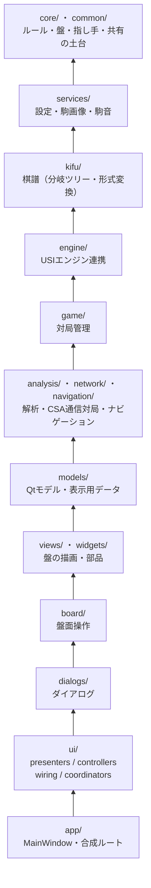

矢印は「上の層が下の層を使ってよい」向きを表す（下の層すべてを使える）。`automation/`（自動化 API と CLI 共有のサービス）と `cli/`（`shogiboardq-cli`）は外側の入口で、`automation/` は `app/`・`dialogs/`・`widgets/` を、`cli/` は GUI の層を参照しない。

#### 各レイヤーの責務

| 層 | ディレクトリ | 責務 |
|---------|------------|------|
| **土台** | `core/`, `common/` | 将棋のルール・盤面・駒・指し手（Qt GUI非依存）と、ログ・エラー通知・共有状態（`AppState`・`AppActivityState`）などの共有部品 |
| **サービス** | `services/` | 設定の宣言・駒画像・駒音・通知など、層を横断して使う機能 |
| **ドメイン** | `kifu/`, `engine/`, `game/`, `analysis/`, `network/`, `navigation/` | 棋譜・エンジン通信・対局進行・解析・通信対局・ナビゲーションのロジック。`engine/` は `game/` を知らない（`Usi` は `ShogiGameController` を持たない） |
| **表示部品** | `models/`, `views/`, `widgets/`, `board/`, `dialogs/` | Qt のモデル・盤の描画・ウィジェット・盤面操作・ダイアログ |
| **UI の組み立て** | `ui/`, `app/` | 表示更新（Presenter）・利用者操作（Controller）・配線（Wiring）・調整（Coordinator）と、MainWindow・合成ルート |

### 3.2 層間の依存ルール

依存は**上の層→下の層**の一方向だけ許す。`tests/tst_layer_dependencies.cpp` が `src/` の `#include "..."` を読み、層ごとに禁止したディレクトリのヘッダー（パスを付けない `#include "foo.h"` も、ファイル名で探す）を含めていないかを確かめる。

| 参照元（依存する側） | 参照してはいけない層 |
|-------------------|------------|
| `core/`・`common/` | `services/` より上の全部 |
| `services/` | `kifu/` より上の全部 |
| `kifu/` | `engine/` より上の全部 |
| `engine/` | `game/` より上の全部 |
| `game/` | `analysis/`・`network/`・`navigation/` より上の全部 |
| `analysis/`・`network/`・`navigation/` | 互いと、`models/` より上の全部 |
| `models/` | `views/`・`widgets/`・`board/` より上の全部 |
| `views/`・`widgets/` | `board/`・`dialogs/`・`ui/`・`app/` |
| `board/` | `dialogs/`・`ui/`・`app/` |
| `dialogs/` | `ui/`・`app/` |
| `ui/` | `app/` |

**同じ向きの依存の例**:

- `analysis/` → `engine/`: 解析機能がUSIエンジンを利用する
- `network/` → `engine/`: CSA通信対局がUSIエンジンを利用する
- `navigation/` → `kifu/`: ナビゲーションが棋譜データにアクセスする

**禁止される依存の例**:

- `core/` → `game/`: 土台の層が対局管理のクラスを参照してはならない
- `engine/` → `game/`: エンジン連携は対局の盤（`ShogiGameController`）を知らない。対局の局面（position の文字列）・時間の条件・時計は呼び出し側が渡す
- `kifu/` → `engine/`: 棋譜はエンジンを知らない
- `game/` → `ui/`: 対局管理がUI部品を直接操作してはならない。司令塔はシグナルで知らせ、棋譜の行は `MatchRecordSink` に書く（[4.3節](#43-シグナルと-stdfunction-コールバック)）

> **合成ルート**: `MainWindowComposer` は最上位の `app/` にあるので、全ての層の部品を作って結べる（3.3節参照）。

### 3.3 MainWindow と合成ルート（MainWindowComposer）

MainWindow（`src/app/mainwindow.h/.cpp`）は約50行で、`.ui` と閉じるときの確認・終了処理だけを持つ。
各レイヤーの部品を作って結ぶのは合成ルートの `MainWindowComposer`（`src/app/mainwindowcomposer*.cpp`）である。
詳しい規則は [composition-root.md](composition-root.md) を参照。

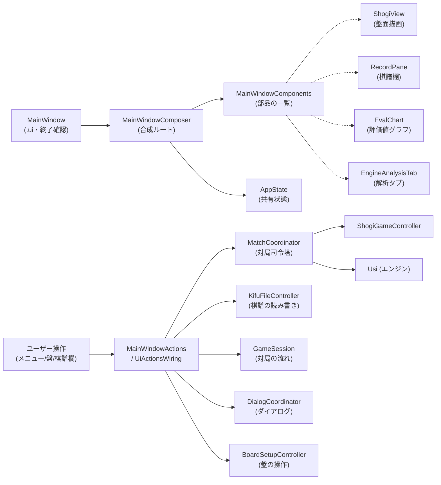

#### 設計原則

1. **MainWindow にロジックを書かない**: MainWindow は `MainWindowComposer` を作って `compose()` を呼ぶだけである
2. **部品は起動時に全部作る**: `MainWindowComposer::compose()` が全部品を依存順に1回だけ作り、それから依存を結ぶ。遅延生成（`ensure*()`）はない
3. **状態は1か所**: 動作状態・局面・対局者・上書き保存先などの共有状態は `AppState`（`src/common/appstate.h`）だけに置く。部品は `AppState*` を受け取る（個々のフィールドへのポインタは渡さない）
4. **操作の受け口**: メニュー・盤・棋譜欄の操作は `UiActionsWiring` と `MainWindowActions` が受け、担当の部品へ振り分ける

#### 合成ルートが作る主要コンポーネント

| カテゴリ | コンポーネント | 役割 |
|---------|-------------|------|
| **対局進行** | `MatchCoordinator` | ローカル対局の司令塔（一手の確定、勝敗判定、待った、中断と再開） |
| **対局の流れ** | `GameSession` | 対局の開始・終局・再開・待ったの UI 側。棋譜の受け手（`MatchRecordSink`） |
| **対局開始** | `GameStartCoordinator` | ダイアログ表示→設定→対局開始の一連のフロー |
| **検討・詰み探索** | `AnalysisSession` | 1つのエンジンで局面を調べるセッション |
| **棋譜読込** | `KifuLoadCoordinator` | 棋譜ファイルの読み込みと盤面反映 |
| **ゲーム制御** | `ShogiGameController` | 指し手の適用、成り判定、合法手チェック |
| **盤面操作** | `BoardInteractionController` | マウスクリック→駒選択→移動の変換 |
| **UI配線** | `*Wiring` 群 | 機能別のシグナル/スロット接続をカプセル化 |
| **プレゼンター** | `*Presenter` 群 | Model→View の表示更新を仲介 |
| **UI調整** | `*Coordinator` 群 | 複数ウィジェットにまたがるUI操作を調整 |

### 3.4 動作状態と対局者（AppActivityState / MatchPlayers）

アプリの振る舞いは、「いま何をしているか」（動作状態）と「対局の先手・後手を誰が指すか」（対局者）の2つで決まる。この2つは別の型に分けて持つ（以前の1つの列挙型 `PlayMode` は削除した）。

| 何を表すか | 型 | 置き場 |
|-----------|-----|-------|
| アプリがいま何をしているか | `AppActivityState::Activity`（`src/common/appactivitystate.h`） | `AppState::activity`（`src/common/appstate.h`） |
| 対局の先手・後手を人間とエンジンのどちらが指すかと、その名前 | `MatchPlayers`（`src/core/matchplayers.h`） | 対局中の正本は `MatchCoordinator::players()`。`AppState::players` は最後に始めた対局の対局者 |

#### 動作状態（Activity）の値

| 値 | 意味 |
|------------|------|
| `Idle` | 待機中。棋譜の閲覧・編集、盤上の着手は変化として記録 |
| `DuringGame` | ローカル対局中（人間対人間・人間対エンジン・エンジン対エンジン） |
| `DuringAnalysis` | 棋譜解析中 |
| `DuringConsideration` | 検討中 |
| `DuringTsumeSearch` | 詰み探索中 |
| `DuringCsaGame` | CSA通信対局中 |
| `DuringPositionEdit` | 局面編集中 |

`AppActivityState` は `QObject` で、`setActivity()` で値が変わると `changed()` を出す。値を変えるのは、対局の司令塔（`MatchCoordinator::start()`・`resumeInterruptedGame()` が `DuringGame`）、検討・詰み探索のセッション（`AnalysisSession`）、通信対局の配線（`CsaGameWiring`）、UI 状態の遷移スロット（`UiStatePolicyManager::transitionTo*()`）などである。終局・中止で `Idle` に戻る。

#### 対局者（MatchPlayers）

`MatchPlayers` は先手・後手それぞれについて、エンジンが指すか（`blackIsEngine`・`whiteIsEngine`）と、人間の名前・エンジンの名前を持つ値型である。駒落ちでは先手が下手、後手が上手になる。

| メソッド | 説明 |
|---------|------|
| `isEngine(side)` / `isHuman(side)` | その手番をエンジン／人間が指すか |
| `hasEngine()` / `hasHuman()` | エンジン／人間が1人でもいるか |
| `engineVsEngine()` / `humanVsHuman()` | エンジン同士／人間同士か |
| `name(side)` | その手番を指す側の名前（エンジンならエンジンの名前） |

対局の条件は `MatchStartOptions::players` で司令塔に渡す。平手か駒落ちかは対局者に持たず、開始局面から判定する（`KifuExportMetadataBuilder::handicapLabel()`）。`AppState::currentMatchPlayers()` は、ローカル対局中（`DuringGame`）だけ対局者を返し、それ以外では `nullptr` を返す（検討・解析・通信対局のエンジンは対局者ではない）。

#### 動作状態と対局者による動作分岐

**1. 盤面操作の制御**（`HumanTurnPolicy::isHumanTurnNow()`、`src/app/humanturnpolicy.h`）

| 状態 | 人間の駒操作 |
|------|------------|
| 対局が進んでいない（`Idle`・終局後など） | 棋譜の変化として受け付けるときだけ可能（`MainWindowActions::canRecordVariationMove()`） |
| `DuringGame` | 手番の側を人間が指すとき（`MatchCoordinator::isHumanSide()`）だけ可能。エンジン同士では不可 |
| `DuringCsaGame` | 自分が人間で、自分の手番（`CsaGameCoordinator::isMyTurn()`）のときだけ可能 |
| 解析・検討・詰み探索・局面編集 | 不可（局面編集は `BoardInteractionController` の編集モードで操作する） |

**2. エンジンの使用**

エンジンは `EngineLifecycleManager` の2つの枠（E1・E2。思考情報と通信ログの表示先）に置き、対局と検討で共有する（同時には動かない）。

| 用途 | E1 | E2 |
|------|----|----|
| 人間対人間 | 不使用 | 不使用 |
| 人間対エンジン | 対局用（エンジンが後手でも E1） | 不使用 |
| エンジン対エンジン | 先手（下手）のエンジン | 後手（上手）のエンジン |
| 検討・詰み探索（`AnalysisSession`） | 解析用 | — |

棋譜解析（`AnalysisJob`）と CSA 通信対局（`CsaEngineController`）は、この枠を使わずに自分で `Usi` を作る（[9.10節](#910-エンジン管理の違いanalysissession-経由-vs-直接-usi)）。

**3. メニュー・ボタンの有効/無効**

`UiStatePolicyManager`（`src/ui/coordinators/uistatepolicymanager.cpp`）が、動作状態ごとにどの UI 要素を有効にするかをコンパイル時の表（`kRules`）で決める。

| 状態 | 棋譜ナビゲーション | 対局開始メニュー | 棋譜読込 |
|----------|-----------------|----------------|---------|
| `Idle` | 有効 | 有効 | 有効 |
| `DuringGame`・`DuringCsaGame` | **無効** | **無効** | **無効** |
| `DuringConsideration`・`DuringTsumeSearch` | 有効（検討は局面移動で再解析） | **無効** | **無効** |
| `DuringAnalysis` | **無効**（自動進行中） | **無効** | **無効** |

待った・投了・入玉宣言は、ローカル対局では人間が参加するときだけ有効にする（`Deps::localGameHasHuman`）。

**4. 動作状態の遷移**

```
Idle ──→ DuringGame / DuringCsaGame ──→ 終局・中断 ──→ Idle
Idle ──→ DuringConsideration / DuringTsumeSearch / DuringAnalysis ──→ 終了 ──→ Idle
Idle ──→ DuringPositionEdit ──→ 編集終了 ──→ Idle
```

自動化 API の `app.state` が返す `play_mode` の文字列は、動作状態と対局者から作る。

### 3.5 データフロー概要

以下は、ユーザーが盤面上で駒を動かしてから表示が更新されるまでの主要なデータフローである。

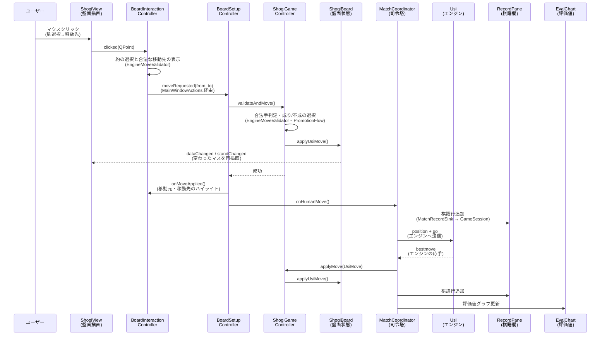

#### フロー解説

1. **ユーザー操作**: `ShogiView` がマウスクリックを受け、`clicked` シグナルで `BoardInteractionController` に盤の座標を通知する。1回目のクリックで駒を選び、設定により `EngineMoveValidator` で合法な移動先を光らせる
2. **着手要求**: 2回目のクリックで `moveRequested` を発行する。`MainWindowActions::handleMoveRequested()` が `BoardSetupController::onMoveRequested()` を呼ぶ
3. **合法手判定と適用**: `ShogiGameController::validateAndMove()` が `EngineMoveValidator` で合法手かを判定し、成り・不成の両方が合法なら `PromotionFlow` のダイアログで選ばせ、`ShogiBoard::applyUsiMove()` で盤を更新する
4. **表示の同期**:
   - `ShogiView`: `ShogiBoard` の `dataChanged`／`standChanged` シグナルで、変わったマスと駒台だけを描き直す。移動元・移動先のハイライトは `BoardInteractionController` が付ける
   - `RecordPane`: 司令塔が一手を確定すると、考慮時間とともに棋譜の行（`RecordEntry`）を `MatchRecordSink` に書く。受け手の `GameSession::appendRecord()` がライブ対局のセッション（分岐ツリー）に追記し、棋譜欄に出る
   - `moveCommitted` シグナルでは、現在の局面・定跡ウィンドウ・駒音を更新する
5. **エンジン応答**: 対エンジンの対局では、`MatchCoordinator` がエンジンに `position` + `go` を送り（`requestEngineMove()`）、`bestmove` を `ShogiGameController::applyMove()` で指して一手を確定する。評価値グラフは `engineMovePlayed` シグナルで `EvaluationGraphController::plotEngineScore()` が更新する

#### 棋譜読み込みのデータフロー


棋譜ファイルは6種類のフォーマット（KIF/KI2/CSA/JKF/USEN/USI）のいずれかを自動判別し、対応する変換器（`*ToSfenConverter`）で内部表現（SFEN + USI指し手列）に統一変換される。

### 3.6 アーキテクチャの設計判断

#### なぜMainWindowを薄くするのか

Qt Widgetsアプリケーションでは、`QMainWindow` がメニューバー、ツールバー、ドックウィジェット、セントラルウィジェットの所有者であるため、UI操作の起点が自然とMainWindowに集中する。ShogiBoardQでは、部品の生成と配線を合成ルート（`MainWindowComposer`）に移し、以下の戦略で複雑さを管理している:

- **Wiring クラス**: 機能別のシグナル/スロット接続をカプセル化（`CsaGameWiring`, `BranchNavigationWiring` 等）
- **Coordinator クラス**: 複数コンポーネントにまたがる操作を調整（`GameStartCoordinator`, `DialogCoordinator` 等）
- **Presenter クラス**: Model→View の表示更新ロジックを分離（`BoardSyncPresenter`, `GameRecordPresenter`, `PlayerInfoPresenter` 等）
- **合成ルート**: `MainWindowComposer` が起動時に部品を全部作ってから結ぶ（[composition-root.md](composition-root.md)）

これらのパターンの詳細は[第4章](#第4章-設計パターンとコーディング規約)で解説する。

#### コア層の独立性

`core/` ディレクトリのコードは Qt GUI（`QWidget`, `QGraphicsView` 等）に依存せず、純粋なC++とQtのユーティリティクラス（`QString`, `QPoint`, `QMap` 等）のみを使用する。これにより:

- ゲームロジックの単体テストが容易になる
- UI変更がルールエンジンに影響しない
- 将来的にCLI版やWebバックエンドへの再利用が可能になる

<!-- chapter-3-end -->

---

<!-- chapter-4-start -->
## 第4章 設計パターンとコーディング規約

本章では、ShogiBoardQ全体で繰り返し使われる設計パターンと、守るべきコーディング規約を解説する。新規コードを書く際はこれらのパターンに従うこと。

### 4.1 Deps構造体パターン

#### 目的

クラスが必要とする外部オブジェクト（依存）を1つの構造体にまとめ、コンストラクタや `updateDeps()` メソッドで一括注入する。これにより以下の利点が得られる:

- **依存の明示化**: クラスが何に依存しているかがヘッダの `Deps` 定義を見るだけで分かる
- **合成ルートでの組み立て**: `MainWindowComposer` が全部品を作ったあとで、各部品の `Deps` を組んで渡す
- **テスト容易性**: テスト時にモックやスタブを `Deps` 経由で注入できる

#### 基本構造

```cpp
class SomeClass : public QObject {
    Q_OBJECT
public:
    struct Deps {
        ObjectA* objA = nullptr;     ///< 説明（非所有）
        ObjectB* objB = nullptr;     ///< 説明（非所有）
        int*     sharedValue = nullptr;  ///< 共有状態（非所有）
    };

    explicit SomeClass(const Deps& deps, QObject* parent = nullptr);

    /// 依存オブジェクトを再設定する
    void updateDeps(const Deps& deps);

private:
    ObjectA* m_objA = nullptr;
    ObjectB* m_objB = nullptr;
    int*     m_sharedValue = nullptr;
};
```

**要点**:
- `Deps` はクラス内の `public` セクションに定義する
- 全フィールドに `nullptr` または適切なデフォルト値を設定する
- ポインタは全て**非所有**（`Deps` を受け取る側は所有権を持たない）
- `///<` でフィールドの説明を付ける

#### 実例: ConsiderationUiController

```cpp
// src/ui/controllers/considerationuicontroller.h

class ConsiderationUiController : public QObject {
    Q_OBJECT
public:
    struct Deps {
        QWidget* parentWidget = nullptr;                             ///< エンジン設定ダイアログの親
        ConsiderationTabManager* considerationTabManager = nullptr;  ///< 検討タブ
        EngineInfoWidget* thinkingInfo1 = nullptr;                   ///< 思考タブの1つ目のエンジン欄
        ShogiView* shogiView = nullptr;                              ///< 候補手の矢印を描く盤
        AnalysisSession* session = nullptr;                          ///< 検討のセッション
        ShogiEngineThinkingModel* considerationModel = nullptr;     ///< 検討タブの思考情報（空なら検討タブから取る）
        UsiCommLogModel* commLogModel = nullptr;                     ///< E1 の通信ログ
    };

    explicit ConsiderationUiController(const Deps& deps, QObject* parent = nullptr);
    /// ダイアログの司令塔を渡す（互いを参照するので、両方を作った後に MainWindowComposer が呼ぶ）
    void setDialogCoordinator(DialogCoordinator* dc) { m_dialogCoordinator = dc; }
    // ...
};
```

> **注目**: `DialogCoordinator` とは互いを参照するので、`Deps` には入れずに両方を作ったあとで `setDialogCoordinator()` で渡す（[4.2節](#42-合成ルートでの組み立て)）。共有状態が要る部品は `AppState*`（動作状態だけなら `AppActivityState*`）を受け取る。`QString*` のような値のフィールドへのポインタは渡さず、状態のコピーも部品に持たない。

#### updateDeps() メソッドの実装

`updateDeps()` は全フィールドを新しい値で上書きする。コンストラクタで `Deps` を受け取れないクラス（作ったあとで依存がそろうもの）は、合成ルートの `wire*()` から1回だけ呼ばれる。たとえば `HumanTurnPolicy` は `createServices()` で作り、`wireGame()` で依存を渡す。

```cpp
// src/app/humanturnpolicy.cpp

void HumanTurnPolicy::updateDeps(const Deps& deps)
{
    m_deps = deps;
}
```

#### 実例: MatchCoordinator::Deps

司令塔の `Deps` は依存する部品のポインタだけを持つ。上の層への知らせはシグナルで出し、棋譜の行は `setRecordSink()` で渡された `MatchRecordSink` に書く（[4.3節](#43-シグナルと-stdfunction-コールバック)）。

```cpp
// src/game/matchcoordinator.h

struct Deps {
    ShogiGameController* gc = nullptr;          ///< 対局の盤（必須、非所有）
    ShogiClock* clock = nullptr;                ///< 対局の時計（必須、非所有）
    AppActivityState* activity = nullptr;       ///< アプリの動作状態（必須、非所有）
    EngineLifecycleManager* engines = nullptr;  ///< エンジンの枠 E1・E2（必須、非所有。検討と共有する）
};
```

### 4.2 合成ルートでの組み立て

#### 目的

アプリの部品は、合成ルートの `MainWindowComposer`（`src/app/mainwindowcomposer*.cpp`）が起動時に全部作る。部品を初めて使うときに作る遅延生成（`ensure*()`）は使わない。これにより:

- **作る順番が1か所で決まる**: `MainWindowComposer::compose()` を読めば、何がどの順で作られるか分かる
- **依存をポインタで渡せる**: 全部品を作ってから結ぶので、生成前の部品を指すための `std::function<X*()>` のゲッターや、後から依存を差し替える `refresh*Deps()` が要らない
- **相互参照も結べる**: 互いを参照する部品も、両方を作ってから渡せばよい

置き換えの経緯と規則の全文は [composition-root.md](composition-root.md) を参照。

#### 起動の3段階

`MainWindowComposer::compose()` は次の順に呼ぶ。

| 段階 | メソッド | ファイル |
|---|---|---|
| 1. 生成 | `createModels()` → `setupUiSkeleton()` → `createBoardAndGameController()` → `createPanelsAndDocks()` → `createBranchNavigation()` → `createRecordAndPlayerInfo()` → `createSecondaryDocks()` → `createServices()` | `mainwindowcomposer_create.cpp` |
| 2. 依存の注入 | `wireFoundation()` → `wireCsaGame()` → `wireKifu()` → `wireUi()` → `wireDialogs()` → `wireGame()`（最後に司令塔と検討のシグナルを `connectMatchSignals()`・`connectAnalysisSignals()` でつなぐ） | `mainwindowcomposer_wire.cpp`・`mainwindowcomposer_game.cpp`（`wireCsaGame`・`wireGame`） |
| 3. 接続と初期表示 | `connectSignals()` → `finalizeUi()` | `mainwindowcomposer_finalize.cpp` |

部品は `MainWindowComponents`（`src/app/mainwindowcomponents.h`）のメンバとして持ち、共有状態は `AppState`（`src/common/appstate.h`）に置く。どちらも `MainWindowComposer` が持つ。

#### 規則

1. 新しい部品は `MainWindowComponents` にメンバを足し、`create*()` のどれか（多くは `createServices()`）で1回だけ作る。QObject は MainWindow を親にした生ポインタ、QObject でないものは `std::unique_ptr` で持つ。
2. 依存は部品のポインタで渡す。`std::function<X*()>` のゲッターや `ensure*` コールバックは使わない。
3. 状態は `AppState` に置き、部品は `&m_state`（`AppState*`。動作状態だけなら `&m_state.activity`）を受け取る。値のフィールドへのポインタは渡さず、部品のメンバに状態のコピーを持たない。
4. `std::function` は、上位へ問い合わせ・操作を委ねるコールバックにだけ使う（[4.3節](#43-シグナルと-stdfunction-コールバック)）。
5. テストは `MainWindow::composer().parts()` と `composer().state()` で部品と状態を読む。

`tests/tst_structural_kpi.cpp` の `appLayerHasNoLazyEnsure` が app 層に `ensure*` がないことを、`testsDoNotRedefinePrivate` がテストで `#define private public` を使っていないことを確かめる。

#### 例: 互いを参照する部品

検討タブの操作（`ConsiderationUiController`）とダイアログの司令塔（`DialogCoordinator`）は互いを参照する。両方を作ってから渡す。

```cpp
// src/app/mainwindowcomposer_wire.cpp（wireDialogs）
m_c.dialogCoordinatorWiring->wire(dc);
m_c.dialogCoordinator = m_c.dialogCoordinatorWiring->coordinator();
// 検討モードの配線とダイアログの司令塔は互いを参照する。両方できたのでここで渡す
m_c.considerationUi->setDialogCoordinator(m_c.dialogCoordinator);
```

#### 例外

- `CsaGameWiring` は最初の CSA 通信対局で司令塔（`CsaGameCoordinator`）を作る。使う側は `CsaGameWiring*` を持ち、`coordinator()` でそのときの司令塔を読む。
- `AutomationServer` は `--automation` 指定時だけ `MainWindowComposer::startAutomationServer()` で作る。

#### 部品の中で持つ下位部品

部品が自分の中に持つ下位の部品は、部品自身が作ってよい。たとえば `PlayerInfoPresenter` は対局情報ドックの `GameInfoPaneController` をコンストラクタで作る。合成ルートは `playerInfo->gameInfoController()` でそれを読み、`MainWindowComponents::gameInfoController` に置いて他の部品へ渡す:

```cpp
// src/ui/presenters/playerinfopresenter.cpp

PlayerInfoPresenter::PlayerInfoPresenter(const Deps& deps, QObject* parent)
    : QObject(parent)
    // ...
    , m_gameInfoController(new GameInfoPaneController(deps.parentWidget))
{
    connect(m_gameInfoController, &GameInfoPaneController::gameInfoUpdated,
            this, &PlayerInfoPresenter::onGameInfoUpdated);
}
```

app 層（`src/app/`）には `ensure*` の形の遅延生成を置かない。

### 4.3 シグナルと std::function コールバック

#### 目的

下の層（`game/`・`analysis/` 等）のクラスが上の層（画面・棋譜欄・ダイアログ）に何かをさせたいとき、UI のクラスを直接参照しない。上の層への知らせ方は次の3つを使い分ける。これにより:

- **層間の依存ルールを維持**: 下の層が上の層のヘッダーを含めない（[3.2節](#32-層間の依存ルール)）
- **柔軟な差し替え**: テストでは受け手を差し替えられる
- **責務の分離**: 「何が起きたか」は下の層が決め、「どう表示するか」は上の層が決める

| 方法 | 使う場面 | 例 |
|------|---------|-----|
| **シグナル** | 起きたことを知らせる（受け手は何人でもよい） | `MatchCoordinator::gameEnded`・`boardChanged`・`engineMovePlayed`、`AnalysisSession::considerationModeEnded` |
| **インターフェイス** | 下の層が上の層へ書き込む・頼む操作の組 | `MatchRecordSink`（司令塔 → 棋譜）、`MatchStrategyHost`（Strategy → 司令塔） |
| **`std::function`** | 上の層の判断を聞く・1つの操作を委ねる | `UiStatePolicyManager::Deps::localGameHasHuman`、`HumanTurnPolicy::Deps::canRecordVariationMove`、`CsaGameWiring::Dependencies::prepareRecord` |

#### 実例: MatchCoordinator のシグナルと MatchRecordSink

司令塔（`MatchCoordinator`）はフックの構造体を持たない。盤・手番・時計・終局はシグナルで知らせ、確定した棋譜の行は `MatchRecordSink`（`src/game/matchrecordsink.h`）へ書く。

```cpp
// src/game/matchrecordsink.h
class MatchRecordSink {
public:
    /// 行を追記できるか（対局中のセッションが終わっていれば false。司令塔はその手を指さない）
    virtual bool canAppendRecord() const = 0;
    virtual void appendRecord(const RecordEntry& entry) = 0;
    /// 末尾の count 行を取り消せるか
    virtual bool canUndoRecords(int count) const = 0;
    virtual void undoRecords(int count) = 0;
protected:
    ~MatchRecordSink() = default;
};
```

受け手は対局の流れの UI 側の `GameSession`（`src/app/gamesession.h`）で、合成ルートが `wireGame()` で `m_c.match->setRecordSink(m_c.gameSession)` と渡す。シグナルの受け手は `connectMatchSignals()`（`src/app/mainwindowcomposer_game.cpp`）がつなぐ。

```cpp
// src/app/mainwindowcomposer_game.cpp（connectMatchSignals、抜粋）
connect(match, &MatchCoordinator::gamePrepared, session, &GameSession::onGamePrepared);
connect(match, &MatchCoordinator::boardChanged, session, &GameSession::renderBoard);
connect(match, &MatchCoordinator::moveHighlightRequested,
        m_c.boardController, &BoardInteractionController::showMoveHighlights);
connect(match, &MatchCoordinator::engineMovePlayed,
        m_c.evalGraphController.get(), &EvaluationGraphController::plotEngineScore);
connect(match, &MatchCoordinator::gameEnded, session, &GameSession::onGameEnded);
connect(match, &MatchCoordinator::autoSaveRequested,
        m_c.kifuFileController, &KifuFileController::autoSaveKifuToFile);
```

#### 実例: std::function で上の層の操作を委ねる

`std::function` は `Deps` のメンバーにして、合成ルートが `std::bind` か、`this` を捕まえるラムダで組む。

```cpp
// src/app/mainwindowcomposer_game.cpp（wireCsaGame、抜粋）
deps.prepareRecord = std::bind(&GameSession::beginCsaGameRecord, m_c.gameSession,
                               std::placeholders::_1, std::placeholders::_2, std::placeholders::_3);
deps.recordGameEnd = std::bind(&GameSession::recordGameEndTime, m_c.gameSession);
deps.saveKifuToPath = std::bind(&KifuFileController::saveKifuToPath, m_c.kifuFileController,
                                std::placeholders::_1, std::placeholders::_2);
```

#### コールバックと Deps の使い分け

| 構造体のメンバー | 格納するもの | 特徴 |
|--------|------------|------|
| **部品のポインタ** | 依存オブジェクト（非所有） | 参照を保持するだけ。`updateDeps()` で差し替え可能 |
| **`std::function`** | 上の層への問い合わせ・操作 | 下の層から上の層のクラスを参照せずに呼べる |

`MatchCoordinator::Deps` は部品のポインタだけを持つ（[4.1節](#41-deps構造体パターン)）。上の層へのコールバックが要るのは、層をまたいで1つの問い合わせ・操作を委ねるときだけである。

### 4.4 Wiringクラスパターン

#### 目的

シグナル/スロット接続のコードはMainWindowに集中しがちである。Wiringクラスは、**機能単位**の接続ロジックをMainWindowから分離してカプセル化する。

#### 全Wiringクラス一覧

| クラス | ファイル | 責務 |
|-------|---------|------|
| `UiActionsWiring` | `app/uiactionswiring.h` | メニュー/ツールバーのQActionを担当クラスのスロットへ接続（ファイル・対局・編集・表示の4つの子 `FileActionsWiring`・`GameActionsWiring`・`EditActionsWiring`・`ViewActionsWiring` に分ける。どれも `app/`） |
| `CsaGameWiring` | `ui/wiring/csagamewiring.h` | CSA通信対局の接続と画面への反映（司令塔は最初の通信対局で作る） |
| `AnalysisTabWiring` | `ui/wiring/analysistabwiring.h` | 解析タブ関連の接続 |
| `RecordPaneWiring` | `ui/wiring/recordpanewiring.h` | 棋譜ペイン関連の接続 |
| `BranchNavigationWiring` | `ui/wiring/branchnavigationwiring.h` | 分岐ナビゲーション（分岐ツリー・棋譜欄・分岐候補）の接続 |
| `DialogCoordinatorWiring` | `ui/wiring/dialogcoordinatorwiring.h` | `DialogCoordinator` の生成と、検討・詰み探索・棋譜解析の接続 |

検討タブ・定跡ウィンドウ・メニューウィンドウは配線だけでなく表示も持つので、Controller（`ConsiderationUiController`・`JosekiWindowController`・`MenuWindowController`、`ui/controllers/`）にしている。メニューから開くダイアログの起動は `DialogLauncher`（`ui/coordinators/dialoglauncher.h`）、対局者名とエンジン名の表示は `PlayerInfoPresenter`（`ui/presenters/`）が受け持つ。

#### Wiringクラスの典型的な構造

```
Wiringクラス
├── Deps 構造体（依存オブジェクト群）
├── コンストラクタ（Deps を受け取って内部に保持）
├── updateDeps()（依存の差し替え）
├── wire() メソッド（一括接続を実行）
│   └── connect() 呼び出し群
└── public slots（接続先のスロットメソッド群）
```

#### 実例: UiActionsWiring

アクションの接続だけを行うWiringクラスの例。`wire()` が、メニューの種類ごとの子（`FileActionsWiring`・`GameActionsWiring`・`EditActionsWiring`・`ViewActionsWiring`）を初回だけ作り、それぞれの `wire()` を呼ぶ:

```cpp
// src/app/uiactionswiring.h

class UiActionsWiring : public QObject {
    Q_OBJECT
public:
    struct Deps {
        Ui::MainWindow* ui = nullptr;       ///< UIオブジェクト
        QWidget*        window = nullptr;    ///< ダイアログの親
        MainWindowActions* actions = nullptr; ///< 利用者操作の振り分け先
        DialogLauncher* dlw = nullptr;   ///< ダイアログ起動配線
        DialogCoordinatorWiring* dcw = nullptr; ///< DialogCoordinator配線（解析中止用）
        KifuFileController* kfc = nullptr;      ///< 棋譜ファイル操作コントローラ
        GameSession* session = nullptr;         ///< 対局のセッション
        AnalysisSession* analysis = nullptr;    ///< 検討・詰み探索のセッション
        // ... 外観コントローラ・盤・評価値グラフ・棋譜エクスポート（すべてポインタ）
    };

    explicit UiActionsWiring(Deps d, QObject* parent = nullptr);

    /// 全アクションのシグナル/スロット接続を実行する（多重接続を避けるため1回だけ呼ぶ）
    void wire();

private:
    Deps m_d;
    FileActionsWiring* m_fileWiring = nullptr;
    GameActionsWiring* m_gameWiring = nullptr;
    EditActionsWiring* m_editWiring = nullptr;
    ViewActionsWiring* m_viewWiring = nullptr;
};
```

```cpp
// src/app/fileactionswiring.cpp（抜粋）

void FileActionsWiring::wire()
{
    // ファイル/アプリ。終了は MainWindowActions、ほかは担当クラスへ直接つなぐ
    QObject::connect(ui->actionQuit,         &QAction::triggered, mw,  &MainWindowActions::requestQuit,            Qt::UniqueConnection);
    QObject::connect(ui->actionSaveAs,       &QAction::triggered, kfc, &KifuFileController::saveKifuToFile,        Qt::UniqueConnection);
    QObject::connect(ui->actionOpenKifuFile, &QAction::triggered, kfc, &KifuFileController::chooseAndLoadKifuFile, Qt::UniqueConnection);
}

// src/app/gameactionswiring.cpp（抜粋）
QObject::connect(ui->actionStartGame,       &QAction::triggered, session,  &GameSession::startGameFromDialog, Qt::UniqueConnection);
QObject::connect(ui->actionResign,          &QAction::triggered, session,  &GameSession::resign,              Qt::UniqueConnection);
QObject::connect(ui->actionStopTsumeSearch, &QAction::triggered, analysis, &AnalysisSession::stop,            Qt::UniqueConnection);
```

#### 実例: DialogCoordinatorWiring（スロットを持つWiring）

棋譜解析のように複数の部品にまたがるフローを扱うWiringクラスは、`wire()` だけでなく独自のスロットメソッドを持つ:

```cpp
// src/ui/wiring/dialogcoordinatorwiring.h（抜粋）

    /// DialogCoordinator を作り、シグナルとコンテキストを設定する（1回だけ呼ぶ）
    void wire(const Deps& deps);
    DialogCoordinator* coordinator() const { return m_coordinator; }

public slots:
    void cancelKifuAnalysis();                                        // 棋譜解析の中止
    void onKifuAnalysisPositionPrepared(int ply);
    void onKifuAnalysisProgress(int ply, int scoreCp, const QString& mate);
    void onKifuAnalysisResultRowSelected(int row);                    // 結果の行から局面へ移る
    void onKifuAnalysisStarted(int lineIndex);
    void onAnalysisPositionSelected(int lineIndex, int ply);
```

このように、Wiringクラスは単なる接続コード置き場ではなく、接続のターゲットとなるスロットメソッド自体も保持できる。検討タブのように表示の状態（経過時間・ボタン・矢印）も持つものは、Controller（`ConsiderationUiController`）にする。

### 4.5 MVPパターン: Presenter/Controller/Coordinator の使い分け

ShogiBoardQの `ui/` ディレクトリには3種類のクラスが存在する。それぞれの責務と命名規則を以下にまとめる。

#### 役割の比較

| 種類 | 命名規則 | 責務 | 例 |
|------|---------|------|-----|
| **Presenter** | `*Presenter` | **Model→View の表示更新**。データを受け取り、ウィジェットの表示を更新する | `BoardSyncPresenter`, `GameRecordPresenter` |
| **Controller** | `*Controller` | **ユーザー操作のハンドリング**。UIイベントを受け取り、適切なアクションを実行する | `EvaluationGraphController`, `LanguageController` |
| **Coordinator** | `*Coordinator` | **複数コンポーネントの調整**。複数のウィジェットやコントローラにまたがる操作を司る | `DialogCoordinator`, `KifuDisplayCoordinator` |

#### データフローの方向

```
  ユーザー操作 ──→ Controller ──→ ドメイン層
                                      │
                                      ↓
              View ←── Presenter ←── Model/データ変更
                                      │
                                      ↓
                   Coordinator ──→ 複数ウィジェット同期
```

#### Presenter の実例

**BoardSyncPresenter** — 盤面の表示同期を担当:

```cpp
// src/ui/presenters/boardsyncpresenter.h

class BoardSyncPresenter : public QObject {
    Q_OBJECT
public:
    struct Deps {
        ShogiGameController* gc = nullptr;
        ShogiView* view = nullptr;
        BoardInteractionController* bic = nullptr;
        const KifuNavigationState* navState = nullptr;   ///< 表示中の手順（分岐ツリー）
    };

    explicit BoardSyncPresenter(const Deps& deps, QObject* parent = nullptr);

    void syncBoardAndHighlightsAtRow(int ply) const;   // 表示中の手順の ply 手目を描いてハイライト
    void loadBoardWithHighlights(const QString& currentSfen,
                                  const QString& prevSfen) const; // 指定の局面を描いてハイライト
};
```

**GameRecordPresenter** — 棋譜表示の更新を担当:

```cpp
// src/ui/presenters/gamerecordpresenter.h

class GameRecordPresenter : public QObject {
    Q_OBJECT
public:
    struct Deps {
        KifuRecordListModel* model {nullptr};
        RecordPane*          recordPane {nullptr};
    };

    explicit GameRecordPresenter(const Deps& d, QObject* parent = nullptr);
    void updateDeps(const Deps& d);

    void clear();
    void presentGameRecord(const QList<KifDisplayItem>& disp);  // 棋譜全体を描画
    void appendMoveLine(const QString& prettyMove,
                        const QString& elapsedTime);             // 1手追記
};
```

**PlayerInfoPresenter** — 対局者名・エンジン名と対局情報を、盤・対局情報ドック・通信ログの見出し・思考タブ・評価値グラフに出す:

```cpp
// src/ui/presenters/playerinfopresenter.h（抜粋）

class PlayerInfoPresenter : public QObject {
    Q_OBJECT
public:
    /// 対局中の対局者（AppState::players）を、盤の名前・通信ログの見出し・思考タブ・評価値グラフに出す
    void showMatchPlayers();

public slots:
    void setOriginalGameInfo(const QList<KifGameInfoItem>& items);    // 読み込んだ棋譜の対局情報
    void onMatchPlayersResolved(const MatchPlayers& players);         // 対局者が決まった（GameStartCoordinator から）
    void onAnalysisEngineNamesChanged(const QString& engine1, const QString& engine2);  // 検討・詰み探索のエンジン名
};
```

#### Controller の実例

**EvaluationGraphController** — エンジンが指した手の評価値を評価値グラフに描く（`plotEngineScore(Turn, int)`・`clear()`・`trimToPly()`）
**LanguageController** — 言語切替操作を処理
**BoardSetupController** — 盤面セットアップ操作を処理

#### Coordinator の実例

**DialogCoordinator** — 各種ダイアログの表示を管理:

```cpp
// src/ui/coordinators/dialogcoordinator.h

class DialogCoordinator : public QObject {
    Q_OBJECT
public:
    explicit DialogCoordinator(QWidget* parentWidget, QObject* parent = nullptr);
    // バージョン情報、エンジン設定、成り選択、検討、詰み探索、
    // 棋譜解析、ゲームオーバー表示などのダイアログを統括
};
```

**KifuDisplayCoordinator** — 棋譜表示・分岐候補の再構築を管理

#### 命名ガイドライン

| やりたいこと | 使うべきクラス種 | 命名例 |
|-------------|---------------|--------|
| データをウィジェットに反映したい | Presenter | `FooPresenter` |
| ユーザー操作に反応したい | Controller | `FooController` |
| 複数コンポーネントを同期したい | Coordinator | `FooCoordinator` |
| シグナル/スロット接続を整理したい | Wiring | `FooWiring` |

### 4.6 ErrorBus: グローバルエラー通知

#### 仕組み

`ErrorBus` はシングルトンパターンのイベントバスで、アプリケーション内のどこからでもエラーを発行し、購読者に一斉配信する。

```cpp
// src/common/errorbus.h

class ErrorBus final : public QObject {
    Q_OBJECT
public:
    static ErrorBus& instance();

    /// 深刻度付きメッセージを発行する（messagePosted を出す。Error/Critical では errorOccurred も出す）
    void postMessage(ErrorBus::ErrorLevel level, const QString& message);

    /// エラーメッセージを発行する（postMessage(ErrorLevel::Error, message) と同じ）
    void postError(const QString& message);

signals:
    /// 深刻度付きメッセージが発行された（→ UiNotificationService::displayMessage）
    void messagePosted(ErrorBus::ErrorLevel level, const QString& message);

    /// エラーが発生した（後方互換。Error/Critical で発火）
    void errorOccurred(const QString& message);

private:
    explicit ErrorBus(QObject* parent = nullptr) : QObject(parent) {}
    Q_DISABLE_COPY_MOVE(ErrorBus)
};
```

```cpp
// src/common/errorbus.cpp

ErrorBus& ErrorBus::instance() {
    static ErrorBus inst;  // Meyers' Singleton
    return inst;
}
```

#### 使い方

**エラーの発行**（どのレイヤーからでも可能）:

```cpp
ErrorBus::instance().postError(tr("エンジンの起動に失敗しました"));
```

**エラーの受信**（`MainWindowComposer::connectSignals()` で接続）:

```cpp
connect(&ErrorBus::instance(), &ErrorBus::messagePosted,
        m_c.notificationService, &UiNotificationService::displayMessage);
```

#### 設計上のポイント

- ドメインサービス層（`engine/`, `kifu/` 等）がUIに依存せずにエラーを通知できる
- `UiNotificationService` が `messagePosted` シグナルを受けて、深刻度に応じた表示を行う
- `Q_DISABLE_COPY_MOVE` でコピー/ムーブを禁止し、シングルトンの一意性を保証する

### 4.7 コーディング規約

#### コンパイラ警告

全てのソースコードは以下の警告オプション付きでコンパイルされる:

```
-Wall -Wextra -Wpedantic -Wshadow -Wconversion -Wsign-conversion
-Wnon-virtual-dtor -Woverloaded-virtual -Wformat=2 -Wimplicit-fallthrough
-Wunused -Wunused-function -Wunused-variable -Wunused-parameter
```

**警告をエラーとして扱わないが、0警告を目標とする。**

#### connect() でのラムダ禁止

本プロジェクトでは `connect()` 文でのラムダ式使用を禁止している。

```cpp
// 正しい: メンバ関数ポインタ構文
connect(sender, &Sender::signal, receiver, &Receiver::slot);

// 禁止: ラムダ式
connect(sender, &Sender::signal, [this]() { /* ... */ });
```

**理由**:
- ラムダ内で `this` をキャプチャした場合、`sender` より先に `receiver` が破棄されるとダングリングポインタになる
- メンバ関数ポインタ構文では、`receiver` が破棄されると Qt が自動的に接続を切断する
- コードの追跡性（どこに接続されているかの `grep` による検索）が向上する
- デバッガでのスタックトレースが読みやすくなる

> **例外**: `Deps` 構造体内の `std::function` コールバック（[4.3節](#43-シグナルと-stdfunction-コールバック)）に渡すラムダはこのルールの対象外である。ラムダ禁止はあくまでも `connect()` に限定される。

#### std::as_const() の使用

Qt コンテナ（`QList`, `QMap` 等）を range-for ループで走査する際、暗黙的なデタッチ（コピー）を防ぐために `std::as_const()` を使用する:

```cpp
// 正しい: デタッチ防止
for (const auto& item : std::as_const(list)) { /* ... */ }

// 警告: clazy-range-loop-detach
for (const auto& item : list) { /* ... */ }
```

**理由**: Qt のコンテナは暗黙共有（implicit sharing）を採用しており、非const参照で走査するとコピーオンライトが発生する場合がある。`std::as_const()` で const 参照を強制することで、不要なコピーを確実に防止する。

#### 静的解析

`.clang-tidy` で以下のチェックが有効化されている:

| チェック | 検出対象 |
|---------|---------|
| `clang-diagnostic-unused-*` | 未使用の警告 |
| `misc-unused-*` | 未使用コードの検出 |
| `clang-analyzer-deadcode.*` | デッドコード解析 |
| `readability-redundant-*` | 冗長なコードの検出 |

cppcheck は `--enable=warning,unusedFunction` で未使用関数を検出する。

### 4.8 コメントスタイル

コメントの記述方針の詳細は [commenting-style-guide.md](commenting-style-guide.md) を参照。以下に要点を要約する。

#### 基本方針

| 項目 | 規約 |
|------|------|
| **言語** | 日本語 |
| **記法** | Doxygen 形式（`/** */`, `///`, `///<`） |
| **記述場所** | ヘッダファイル（`.h`）。`.cpp` には実装上の補足のみ |
| **原則** | **Why（なぜ）を書く。What（何）はコードが語る** |

#### 記法の使い分け

| 記法 | 用途 |
|------|------|
| `/** ... */` | クラス、メソッド、構造体のDoxygen複数行ドキュメント |
| `///` | 1行で収まるDoxygenドキュメント |
| `///<` | enum値・メンバ変数の行末コメント |
| `// ---` | セクション区切り内の小見出し |

#### 書かないコメント

- `// コンストラクタ`、`// デストラクタ` — 見れば分かる
- `// getter` / `// setter` — 命名規約から自明
- 変更履歴・日付コメント — Git で管理する
- コメントアウトしたコード — 削除して Git に任せる

#### 適用タグ

スタイルガイドを適用したファイルには以下のタグを付ける:

```cpp
/// @todo remove コメントスタイルガイド適用済み
```

リリース時に一括検出・除去する:
```bash
grep -rn "@todo remove コメントスタイルガイド適用済み" src/
```

詳細は [commenting-style-guide.md](commenting-style-guide.md) を参照。

<!-- chapter-4-end -->

---

<!-- chapter-5-start -->
## 第5章 core層：純粋なゲームロジック

core層（`src/core/`）は将棋のルールと盤面状態を表現する純粋なゲームロジック層である。Qt の GUI モジュール（`QtWidgets`、`QtCharts` 等）に依存せず、`QObject`・`QString`・`QVector` 等の QtCore モジュールのみを使用する。

### 5.1 core層の設計思想

#### GUI非依存の意義

core層が GUI に依存しないことで、以下のメリットが得られる。

| メリット | 説明 |
|---------|------|
| **テスタビリティ** | ウィンドウ生成なしで盤面操作・合法手判定をテストできる |
| **再利用性** | CLI ツール、別の GUI フレームワーク、エンジン内部などに転用可能 |
| **コンパイル高速化** | GUI ヘッダへの依存がないため、変更時の再コンパイル範囲が限定される |
| **関心の分離** | 「ルール」と「表示」が明確に分かれ、どちらかの変更が他方に波及しない |

#### ファイル構成

```
src/core/
├── shogitypes.h              手番（Turn）と駒（Piece）
├── shogiboard.h / .cpp       盤面データ管理（SFEN の入出力・局面編集を含む）
├── usimove.h                 USI と1対1の指し手の値（UsiMove / BoardSquare）
├── shogimove.h / .cpp        指した手の記録（UsiMove と、動かした駒・取った駒）
├── boardcoordinates.h        盤面表示の座標（駒台は筋10・11）と指し手の対応
├── boardconstants.h          盤の座標・サイズの定数
├── enginemovevalidator.h / .cpp 合法手判定の入口
├── fmv*.h / .cpp             合法手判定の内部（局面・利き・指し手の生成）
├── legalmovestatus.h         合法手存在状態
├── shogiclock.h / .cpp       対局時計
├── timecontrol.h             持ち時間の決まり
├── matchplayers.h            対局者（先手・後手を人間とエンジンのどちらが指すかと名前）
├── sfenreplay.h / .cpp       開始局面から USI の手を順に指して局面列を作る
├── sfendiffutils.h           2つの局面（SFEN）の盤上の差分
├── terminaltype.h / .cpp     終局手の種類と終局語
├── sfenutils.h               SFEN文字列ユーティリティ
├── shoginotation.h           棋譜の表記（筋・段・駒の名前・CSA の駒種）
└── kifmovetext.h             KIF 形式の指し手の文字列
```

### 5.2 ShogiBoard — 盤面データ管理

`ShogiBoard` は将棋盤の現在局面（駒配置・駒台・手番）を保持し、SFEN文字列との相互変換を行う中核クラスである。

**ソース**: `src/core/shogiboard.h`、`src/core/shogiboard.cpp`（盤面アクセス・駒台・SFEN の入出力・局面編集・駒箱）

#### データ構造

```
ShogiBoard
├── m_boardData     : QList<Piece>       81マス。index = (rank - 1) * 9 + (file - 1)
│                                         （file・rank は1〜9。index 0 が1一、80 が9九）
├── m_pieceStand    : QMap<Piece, int>   駒台。玉を含む先後16種の枚数を常に持つ
│                                         （Piece::BlackPawn → 3、Piece::WhitePawn → 0、…）
├── m_currentPlayer : Turn               手番（Turn::Black / Turn::White）
├── m_moveNumber    : int                次に指す手の手数（SFEN の4つ目の欄）
└── m_ranks, m_files : int               段数・筋数（9）
```

**盤面配列 `m_boardData`** は81要素の `QList<Piece>` で、各マスの駒を列挙型 `Piece`（`src/core/shogitypes.h`）で表す。
先手の駒は `Piece::BlackPawn` など、後手の駒は `Piece::WhitePawn` など、成駒は `Piece::BlackPromotedPawn`（と金）や
`Piece::BlackHorse`（馬）などの別の値で、空きマスは `Piece::None` である。`Piece` の値は1文字（先手は大文字、後手は小文字、
成駒は `Q`・`M`・`O`・`T`・`C`・`U` とその小文字、空きマスは空白）で、`pieceToChar()`・`charToPiece()` で文字と変換できる（2.2節）。

**駒台 `m_pieceStand`** は `QMap<Piece, int>` で、駒をキーに枚数を値として持つ。局面編集で玉も駒台に置けるため、
玉を含む先後16種を常に持つ（`addStandPiece()` はこの16種以外の駒を無視する）。16種を0枚で持つ表はすべての盤で共有し
（`initStand()`）、枚数を書き換えたときに初めてその盤の表が作られる（`QMap` の暗黙の共有）。盤を作るたびに16個を挿入しないためで、
`SfenDiffUtils::diffBoards()` のように一時的な盤を作る処理を軽くしている。

**手番 `m_currentPlayer`** は `Turn` である。SFEN の手数は `m_moveNumber` に残し、`applyUsiMove()` が手番を相手に渡すときに1つ進める。

#### 主要メソッド一覧

| カテゴリ | メソッド | 説明 |
|---------|---------|------|
| **SFEN変換** | `setSfen(sfenStr)` | SFEN文字列から盤面全体を復元する（不正なら盤面を変えず、ErrorBus に通知する） |
| | `trySetSfen(sfenStr, error)` | 同上。不正なら盤面を変えずに false を返す（通知しない） |
| | `parseSfen(sfenStr)` | SFEN文字列を4つの欄に分ける（static。盤面は変えない） |
| | `convertBoardToSfen()` | 現在の盤面をSFEN形式の文字列に変換する |
| | `convertStandToSfen()` | 駒台をSFEN形式に変換する |
| | `toSfen()` | 局面全体（盤・手番・持駒・手数）の SFEN を返す |
| | `copyPositionFrom(other)` | 別の盤の局面（盤・駒台・手番）を写す |
| **盤面参照** | `pieceAt(square)` | 盤上のマスの駒を返す（盤外のマスは `Piece::None`） |
| | `pieceCharacter(file, rank)` | 指定マスの駒を返す（筋10・11は先手・後手の駒台の並び） |
| | `boardData()` | 81マスの配列への const 参照を返す |
| | `pieceStand()` / `pieceStandCount(piece)` | 駒台データへの const 参照／指定駒の枚数を返す |
| | `pieceBox()` / `pieceBoxCount(piece)` | 盤上・両駒台にない駒（駒箱）を数える |
| | `currentPlayer()` / `setCurrentPlayer(turn)` | 手番を返す／手番だけを変える（局面編集の手番変更など） |
| | `moveNumber()` / `setMoveNumber(n)` | 次に指す手の手数 |
| **駒操作** | `applyUsiMove(move, mover)` / `applyUsiMove(move)` | USI の指し手を盤と駒台に適用し、手番を相手に渡して手数を1つ進める（合法手かどうかは確かめない。`mover` を省くと手番側の手） |
| | `movePieceToSquare(...)` | 盤上の駒を移動する（盤面配列のみ更新） |
| | `setPieceAt(square, piece)` | マスの駒を置き換える（局面の組み立て用） |
| | `updateBoardAndPieceStand(...)` | 盤面と駒台を同時に更新する（局面編集用） |
| | `addPieceToStand(dest)` | 取った駒を駒台に追加する（成駒→元駒に変換） |
| | `addStandPiece(piece, delta)` / `consumeStandPiece(piece)` | 駒台の枚数を増やす／1枚減らす |
| | `decrementPieceOnStand(piece)` | 駒台から1枚減らす（駒打ち時） |
| **盤面リセット** | `resetGameBoard()` | 盤上・両駒台を空にして、全駒を駒箱に戻す（局面編集用） |
| | `initStand()` | 駒台をすべて0枚にする |
| | `flipSides()` | 先後の配置を反転する |

#### シグナル

| シグナル | 接続先 | 用途 |
|---------|-------|------|
| `boardReset()` | ShogiView・BoardInteractionController | 盤面全体の再描画を要求する（`setSfen`・`copyPositionFrom` など） |
| `dataChanged(c, r)` | ShogiView・BoardInteractionController | 特定マスの再描画を要求する |
| `standChanged(piece)` | ShogiView | 駒台のその駒のセルの再描画を要求する |

#### setSfen() の処理フロー

```
setSfen("lnsgkgsnl/1r5b1/ppppppppp/9/9/9/PPPPPPPPP/1B5R1/LNSGKGSNL b - 1")
  └── trySetSfen()                 … 不正なら盤面を変えずに false（setSfen は ErrorBus に通知する）
        │
        ├── splitSfenFields()      … 空白で盤・手番・持駒・手数の4欄に分け、手番と手数を確かめる
        │                            （欄は元の文字列を指す QStringView で、文字列を作らない）
        ├── readBoardField()       … 盤の欄を1文字ずつ読み、作業用の配列（81マス）に置く
        │                            （成駒の "+"、各段9マス、行き所のない歩・香・桂を確かめる）
        ├── readStandField()       … 持駒の欄を読み、16種の枚数の配列にする
        │
        ├── m_boardData・m_pieceStand・手番を書き換える
        │     （駒台は16種がそろっていれば値だけ書き換え、作り直さない。
        │       枚数が変わらなければ書き込まないので、共有の0枚の表を複製しない）
        └── emit boardReset()      … 盤面描画の全体更新を通知
```

### 5.3 ShogiMove — 指し手データ構造

`ShogiMove` は指した1手の記録である。指し手そのもの（移動元・移動先・成り・打つ駒）は `UsiMove` で持ち、指す前の局面で決まる「動かした駒」「取った駒」を添える。棋譜の1行（`RecordEntry`、`src/kifu/recordentry.h`）や手順（`RecordLine`）がこれを持つ。

**ソース**: `src/core/shogimove.h`, `src/core/shogimove.cpp`（デバッグ出力だけ）、`src/core/usimove.h`

#### フィールド

| フィールド | 型 | 説明 |
|-----------|-----|------|
| `move` | `UsiMove` | 指し手（成り・駒打ちを含む） |
| `movingPiece` | `Piece` | 動かした駒（指す側の色の、成る前の駒） |
| `capturedPiece` | `Piece` | 取った駒（なければ `Piece::None`） |

`UsiMove` のフィールドは次のとおり（[2.1節](#21-盤面座標系)）。

| フィールド | 型 | 説明 |
|-----------|-----|------|
| `from` | `BoardSquare` | 移動元（筋・段とも1〜9。駒打ちでは無効） |
| `to` | `BoardSquare` | 移動先 |
| `drop` | `Piece` | 駒打ちの駒（先手の生駒で表す。盤上の移動では `None`） |
| `promote` | `bool` | 成る |

#### 主なメソッド

| メソッド | 説明 |
|---------|------|
| `ShogiMove::isValid()` | 指し手が正しく、動かした駒があるか |
| `ShogiMove::isDrop()` / `isPromotion()` | 駒打ちか／成るか（`move` に問い合わせる） |
| `ShogiMove::mover()` | 指した側（動かした駒の色） |
| `UsiMove::parse(text)` / `fromString(text)` | USI 文字列を読む（読めなければ `nullopt`／無効な指し手） |
| `UsiMove::toString()` | USI 文字列にする（`"7g7f"`・`"8h2b+"`・`"P*5e"`） |
| `UsiMove::dropPieceFor(mover)` | 駒打ちの駒を指す側の色にする |

#### USI文字列との変換

| 指し手の種類 | USI表記例 | `move.from` | `move.to` | その他 |
|-------------|----------|------------|----------|------|
| 盤上移動（不成） | `7g7f` | (7, 7) | (7, 6) | |
| 盤上移動（成り） | `8h2b+` | (8, 8) | (2, 2) | `promote = true` |
| 駒打ち | `P*3d` | （無効） | (3, 4) | `drop = BlackPawn` |

筋・段は USI と同じ1始まりなので、`UsiMove::toString()` は段を a〜i にするだけである。盤のクリック座標（駒台は筋10・11）との変換は `BoardCoordinates`（`src/core/boardcoordinates.h`）が受け持つ。

### 5.4 EngineMoveValidator — 合法手判定

`EngineMoveValidator` は、盤の配列（`ShogiBoard::boardData()`）と駒台（`pieceStand()`）から局面を作り、指し手が合法かどうかの判定、合法手の一覧、王手の数を求めるクラスである。王手の放置、二歩、打ち歩詰め、行き所のない駒を考慮する。メンバーを持たないので、使う場所でそのつど作る。

**ソース**: `src/core/enginemovevalidator.h`, `src/core/enginemovevalidator.cpp`（入口）、`src/core/fmv*.h/.cpp`（内部。名前空間 `fmv`）

| ファイル | 内容 |
|---------|------|
| `fmvtypes.h` | 先後・駒種・持駒の種類（2.2 節）、指し手 `fmv::Move`、指し手の一覧 `fmv::MoveList`（最大600手） |
| `fmvbitboard81.h/.cpp` | 81マスのビットボード `Bitboard81`（`uint64_t` 2つ） |
| `fmvposition.h/.cpp` | 内部の局面 `EnginePosition`（マスの駒・ビットボード・玉の位置・持駒）と、指す・戻す（`doMove()`／`undoMove()`） |
| `fmvattacks.h/.cpp` | コンパイル時に作る利きの表と、マスに利いている駒の判定 |
| `fmvconverter.h/.cpp` | 盤・駒台・`UsiMove` を内部の型にする変換と、内部の指し手から `UsiMove` への変換 |
| `fmvlegalcore.h/.cpp`, `fmvmovegeneration.cpp` | 合法性の判定（`LegalCore`）と、指し手の生成 |
| `fmvlegalcore_internal.h` | 成れる駒・敵陣・行き所のない駒・二歩の判定 |

#### 主要API

同じ局面で何度も判定するときは、局面を `load()` で `Context` に一度だけ読み込んでから使う。盤の操作で駒の移動先を光らせる `BoardInteractionController::refreshLegalMoveHighlights()` は、1つの `Context` で81マスを判定している。1回だけ判定するときは、`ShogiBoard` を渡す省略形を使う（中で毎回 `Context` を作る）。

| メソッド | 戻り値 | 説明 |
|---------|--------|------|
| `load(board, turn)`<br/>`load(boardData, pieceStand, turn)` | `Context` | 局面と手番を `Context` に読み込む |
| `legalStatus(ctx, move)`<br/>`legalStatus(board, turn, move)` | `LegalMoveStatus` | 指し手（`UsiMove`。成りの指定は見ない）を成る場合と成らない場合のそれぞれで判定する |
| `isLegal(ctx, move)` | `bool` | 指し手（成りの指定を含む）が合法か |
| `legalMoves(ctx)`<br/>`legalMoves(board, turn)` | `QList<UsiMove>` | 合法手の一覧。成り・不成のどちらも指せる手は両方を入れる |
| `pseudoLegalMoves(ctx)`<br/>`pseudoLegalMoves(board, turn)` | `QList<UsiMove>` | 駒の動きだけで決めた指し手の一覧（自玉の安全・二歩・打ち歩詰め・行き所のない駒は見ない）。反則手を書いた棋譜を読み書きするときの候補にする |
| `legalMoveCount(ctx)` | `int` | 合法手の数 |
| `checkCount(ctx)` | `int` | 手番の側の玉にかかっている王手の数（0=王手なし、2=両王手） |
| `isInCheck(board, turn)` | `bool` | 手番の側の玉に王手がかかっているか |

指し手は `UsiMove`（筋・段は1始まり、駒打ちは `drop` に先手の生駒）で渡す。動かす駒・取る駒は `Context` の局面から決まる。

#### LegalMoveStatus

`legalStatus()` の戻り値は `LegalMoveStatus` 構造体で、「成り」と「不成」それぞれの合法性を表す。

```cpp
// src/core/legalmovestatus.h
struct LegalMoveStatus {
    bool nonPromotingMoveExists;  // 不成での合法手が存在するか
    bool promotingMoveExists;     // 成りでの合法手が存在するか
};
```

`ShogiGameController::validateAndMove()` は、両方が `true` なら対局者に成るかどうかを選ばせ（`setPromotionChooser()` で渡された関数）、成りだけが `true` なら成り、どちらも `false` なら着手を受け付けない。エンジンの手（`applyMove()`）は、指し手の成り・不成の側が `true` かを確かめる。

#### 判定の手順

```
legalStatus(ctx, move)
  │
  ├── [1] Converter::toEngineMove()
  │     UsiMove を内部の指し手（fmv::Move）にする。座標が盤外、移動元が手番の駒でない、
  │     持っていない駒を打つ、といった手はここで不合法。
  │     成れる駒で、移動元か移動先が敵陣なら「成る手もある」と記録する
  │
  ├── [2] 局面を写す（ctx.pos は書き換えない）
  │
  └── [3] LegalCore::checkMoveVariants()（成る手もあるとき）／ checkMove()
        手を1つだけ確かめる（checkMoveVariants は、成らないと行き所のない駒になる手なら
        成る手を、それ以外なら成らない手を代表にする）
        ├── isPseudoLegal()   駒の動き・移動先の自駒・二歩・行き所のない駒・成れるか
        ├── doMove()          写した局面で指す
        ├── ownKingInCheck()  自玉に相手の駒が利いていれば不合法（王手の放置・ピン）
        ├── isPawnDropMate()  歩を打って王手し、相手に合法手がなければ打ち歩詰め
        └── undoMove()        局面を戻す
```

成る場合と成らない場合で、駒のあるマスも自玉の位置も変わらないので、自玉の安全の確認は1回で両方に使える。代表の手が合法なら、成れる位置かどうかで `promotingMoveExists` を決める。

合法手の一覧（`legalMoves()`）は、王手されていれば玉の移動・王手した駒を取る手・合駒だけを、されていなければ全ての駒の移動と駒打ちを候補にして、候補ごとに上の [3] と同じく指して戻して確かめる。

#### 利きの計算

利きの表（各マスからの歩・桂・銀・金・玉の利き、馬・龍の1マスの利き、飛・角・香の筋、2マスの間のマス）は `constexpr` 関数でコンパイル時に作る。飛・角・香・馬・龍の利きは、筋の上にある駒と「2マスの間のマス」の表から、間に駒がないかで判定する。と金・成香・成桂・成銀は金と同じ利きを使う。

| 判定 | 関数 | 内容 |
|-----|------|------|
| マスに利いている駒 | `attackersTo()` | 指定の側の駒のうち、そのマスに利いている駒のビットボード（王手の数に使う） |
| マスに利きがあるか | `isSquareAttacked()` | 利いている駒を1枚見つけたところで終える（自玉の安全の確認に使う） |
| 駒が動けるか | `pieceAttacksSquare()` | 駒種・移動元・移動先と、間の駒から、その駒が移動先へ動けるか |

#### 主な合法性チェック

| チェック項目 | 実装箇所 | 説明 |
|-------------|---------|------|
| **王手の放置・ピン** | `LegalCore::ownKingInCheck()` | 指したあとの局面で自玉に相手の駒が利いていれば不合法 |
| **二歩** | `detail::hasPawnOnFile()` | 同じ筋に自分の歩（成っていない歩）があれば歩を打てない |
| **打ち歩詰め** | `LegalCore::isPawnDropMate()` | 歩を打って玉の正面から王手し、相手に合法手がなければ不合法 |
| **行き所のない駒** | `detail::isMandatoryPromotion()`, `detail::isDropDeadSquare()` | 歩・香は1段目、桂は1〜2段目（後手は逆）へ成らずに動けず、打てない |

### 5.5 ShogiClock — 対局時計

`ShogiClock` は対局中の時間管理を行う。持ち時間制・秒読み制・フィッシャー制の3モードに対応し、着手ごとの考慮時間の記録と「待った」による巻き戻しも提供する。時間の決まり（`TimeControl`）と残り時間の両方を時計が持ち、エンジンへの `go` の時間も時計の値から求める（[時間設定の仕様](game-time-control-spec.md) の「時間の決まりの持ち方」）。

**ソース**: `src/core/timecontrol.h`, `src/core/shogiclock.h`, `src/core/shogiclock.cpp`

#### 時間の決まり（TimeControl）

```cpp
struct TimeControlSide {          // 片方の対局者の決まり（ms）
    qint64 mainMs = 0;            // 持ち時間
    qint64 byoyomiMs = 0;         // 秒読み
    qint64 incrementMs = 0;       // 1手ごとの加算
    qint64 delayMs = 0;           // CSA の Delay（通信対局だけ）
};
struct TimeControl {
    TimeControlSide black, white;
    bool isUnlimited() const;     // 双方とも全項目0
    bool usesByoyomi() const;
    TimeControl normalized() const;  // 秒読みと加算の排他（秒読み優先）
};
```

対局ダイアログの値も、CSA の対局条件（`Game_Summary`）も、この値にしてから `ShogiClock::setTimeControl()` に渡す。

#### 3つの時間制モード

| モード | 設定条件 | 動作 |
|--------|---------|------|
| **持ち時間制** | `mainMs > 0`, `byoyomiMs = 0`, `incrementMs = 0` | 持ち時間を消費し、0になった時点で時間切れ負け |
| **秒読み制** | `byoyomiMs > 0` | 持ち時間消費後、毎手 byoyomi 秒の秒読みに移行。秒読み内に着手すればリセット |
| **フィッシャー制** | `incrementMs > 0` | 開始時と着手確定時に加算される。持ち時間が0以下で時間切れ |

秒読みとフィッシャーは排他的であり、`normalized()` が両方の指定を秒読みだけにする。

#### 主なAPI（player は `Turn::Black`／`Turn::White`）

| API | 用途 |
|-----|------|
| `setTimeControl(tc)` | 対局の時間を設定する。初手の加算を与え、持ち時間0の秒読みは秒読みに入った状態で始める。「待った」用の履歴を開始状態から積み直す |
| `setRemainingTimes(blackMs, whiteMs)` | 決まりと履歴を保ったまま、残り時間だけを合わせる（CSA通信対局の着手ごとの同期） |
| `commitMove(player)` | 着手を確定する。消費時間を総消費へ加え、秒読みの再設定または加算を行い、次の手番の開始状態を履歴に積む |
| `remainingMs(player)` / `byoyomiMs(player)` / `incrementMs(player)` | 残り時間と決まりの問い合わせ |
| `timeString(player)` / `considerationAndTotalTime(player)` | 時計と棋譜の消費時間の表記 |
| `pauseAndSnapshot()` / `restoreSnapshot()` | 中断・再開用に状態（決まり・残り時間・履歴）を保存・復元する |

#### 時間管理の仕組み

```
startClock()
  │
  ├── QTimer (50ms間隔) → updateClock() を定期呼び出し
  │
  └── QElapsedTimer でモノトニック時刻を計測
        │
        updateClock()
          ├── delta = 現在時刻 - m_lastTickMs
          ├── 手番側の remainingMs -= delta、considerationMs += delta
          ├── 残り時間 ≤ 0 なら
          │     ├── 秒読みあり → 秒読みへ移行（byoyomiApplied = true）
          │     └── 秒読みなし → emit playerTimeOut(手番の側) → 時間切れ処理
          └── emit timeUpdated()              (表示更新通知)
```

`QTimer`（50ms刻み）と `QElapsedTimer`（モノトニッククロック）を組み合わせることで、システム時刻変更の影響を受けない精密な時間計測を実現している。先後の状態は `SideState`（残り時間・考慮時間・総消費時間・秒読み突入・表示用の秒）の2要素の配列で持ち、先後で同じ処理を書き分けない。

#### 着手確定時の処理

```
commitMove(player)
  │
  ├── 考慮時間を確定: totalConsiderationMs += considerationMs
  │
  ├── 秒読みモード → remainingMs = byoyomiMs   (秒読みリセット)
  ├── フィッシャーモード → remainingMs += incrementMs  (加算。使い切った後は加算しない)
  │
  └── pushHistory()  ← 次の手番の開始状態を「待った」用に積む
```

考慮時間は、次にその対局者の手番が始まるとき（`setCurrentPlayer()`）に0へ戻す。

#### undo（待った）

`ShogiClock` は手番の開始状態を `QList<HistoryEntry>` に積んでおり、`undo()` で末尾の2つ（自分と相手の1手ずつ）を取り除いて、新しい末尾の状態に戻す。各要素は先後の `SideState`（残り時間・直近手の考慮時間・総消費時間・秒読み突入・表示用の秒）を持つ。履歴は中断・再開の保存（`Snapshot`）にも含める。

#### シグナル

| シグナル | 接続先 | 用途 |
|---------|-------|------|
| `timeUpdated()` | TimeDisplayPresenter | 残り時間の表示更新 |
| `playerTimeOut(Turn)` | TimeControlController → `MatchCoordinator::handlePlayerTimeOut()` | 時間切れ通知（引数は時間が切れた側） |

### 5.6 MatchPlayers — 対局者

`MatchPlayers` は、対局の先手・後手を人間とエンジンのどちらが指すかと、その名前を持つ値型である（`Q_DECLARE_METATYPE` 済みで、シグナルの引数にできる）。アプリが「いま何をしているか」は別の `AppActivityState`（`src/common/appactivitystate.h`）が持つ（[3.4節](#34-動作状態と対局者appactivitystate--matchplayers)）。

**ソース**: `src/core/matchplayers.h`（ヘッダオンリー）

```cpp
struct MatchPlayers {
    bool blackIsEngine = false;  ///< 先手（下手）をエンジンが指す
    bool whiteIsEngine = false;  ///< 後手（上手）をエンジンが指す
    QString blackHumanName;      ///< 先手の人間の名前
    QString whiteHumanName;      ///< 後手の人間の名前
    QString blackEngineName;     ///< 先手のエンジンの名前
    QString whiteEngineName;     ///< 後手のエンジンの名前

    bool isEngine(Turn side) const;
    bool isHuman(Turn side) const;
    bool hasEngine() const;        // どちらかがエンジン
    bool hasHuman() const;         // どちらかが人間
    bool engineVsEngine() const;
    bool humanVsHuman() const;
    QString name(Turn side) const; // 指す側の名前（エンジンならエンジンの名前）
};
```

対局開始ダイアログで選んだ人間の名前とエンジンの名前を両方持ち、手番ごとに指す側の名前を `name()` で返す。駒落ちでは先手が下手、後手が上手である。平手か駒落ちかは持たず、開始局面から判定する（`KifuExportMetadataBuilder::handicapLabel()`）。

対局の条件として `MatchStartOptions::players` で司令塔に渡し、司令塔は `MatchCoordinator::players()`・`isHumanSide(Turn)` で返す。手番の側がエンジンかどうかで、エンジンに思考させるか、盤の操作を受け付けるか（`HumanTurnPolicy`）を決める。

### 5.7 SfenUtils / ShogiNotation / KifMoveText — ユーティリティ

#### SfenUtils

**ソース**: `src/core/sfenutils.h`（ヘッダオンリー）

SFEN 文字列の小さな関数群。`normalizeStart()` は文字列 `"startpos"` を標準初期配置のSFEN文字列に展開し、既にSFEN形式であればそのまま返す。ほかに平手のSFEN（`hirateSfen()`）、平手かどうかの判定（`isHirateStart()`）、局面を比べるキー（`normalizeSfenKey()`、持ち駒を並べ直す）などがある。

```cpp
SfenUtils::normalizeStart("startpos")
// → "lnsgkgsnl/1r5b1/ppppppppp/9/9/9/PPPPPPPPP/1B5R1/LNSGKGSNL b - 1"
```

#### ShogiNotation

**ソース**: `src/core/shoginotation.h`（ヘッダオンリー）

棋譜の表記の対応表をまとめた名前空間である。対局の棋譜・読み筋・局面図・棋譜の読み書き・通信対局で同じ表を使う。

| 関数 | 説明 |
|------|------|
| `fileZenkaku(file)` | 筋番号（1〜9）→ 全角数字（"１"〜"９"） |
| `rankKanji(rank)` | 段番号（1〜9）→ 漢数字（"一"〜"九"） |
| `fileFromZenkaku(ch)` | 全角数字 → 1-9（それ以外は0） |
| `rankFromKanji(ch)` | 漢数字 → 1-9（それ以外は0） |
| `movePieceName(piece)` | 指し手の表記に使う駒の名前（成香・成桂・成銀は2文字） |
| `boardPieceName(piece)` | 局面図（BOD）の1文字の駒の名前（杏・圭・全） |
| `pieceFromName(name)` | 駒の名前（別表記も読む）→ 先手の駒 |
| `csaPieceCode(piece)` / `pieceFromCsaCode(code, side)` | CSA の駒種との相互変換 |

#### KifMoveText

**ソース**: `src/core/kifmovetext.h`（ヘッダオンリー）

`KifMoveText::format(mover, moving, move, previousTo)` が「▲７六歩(77)」「△同　銀(31)」「▲５五角打」の形の指し手を作る。`previousTo` が移動先と同じなら「同　」と書く。対局の棋譜・棋譜の読み込み・通信対局・定跡・詰将棋の読み筋で同じ書式を使う。

USI 形式への指し手変換は `UsiMove::toString()`（`src/core/usimove.h`）が行う。`ShogiMove` は `move` メンバーに `UsiMove` を持つ（5.3 を参照）。

### 5.8 core層の他層との関係

core層は他の全層から参照されるが、core層自身は他層を参照しない。

```
             ┌──────────┐
             │  UI 層   │
             │ views/   │
             │ widgets/ │
             └────┬─────┘
                  │ uses
    ┌─────────┐   │   ┌───────────┐
    │ game 層 │───┼───│ engine 層 │
    └────┬────┘   │   └─────┬─────┘
         │        │         │
         ▼        ▼         ▼
    ┌─────────────────────────────┐
    │         core 層             │
    │  ShogiBoard  ShogiMove      │
    │  EngineMoveValidator        │
    │  ShogiClock  MatchPlayers   │
    │  ShogiNotation  SfenReplay  │
    └─────────────────────────────┘
         ↑ 依存なし（QtCore のみ）
```

| 参照元 | 使用するcore部品 | 用途 |
|--------|-----------------|------|
| **game層** | ShogiBoard, ShogiMove, EngineMoveValidator, ShogiClock, MatchPlayers | 対局進行・合法手判定・時間管理・対局者 |
| **engine層** | UsiMove, ShogiClock | USI の指し手・対局時計からの go の時間 |
| **kifu層** | ShogiBoard, ShogiMove, SfenReplay | 棋譜の読み込み・再生時に盤面を更新 |
| **analysis層** | ShogiBoard, UsiMove, EngineMoveValidator | 局面の解析・詰将棋の生成 |
| **UI層** | ShogiBoard, ShogiClock | 盤面描画データの取得・時間表示 |
| **board層** | ShogiBoard, EngineMoveValidator | 盤面編集・インタラクション |

<!-- chapter-5-end -->

---

<!-- chapter-6-start -->
## 第6章 game層：対局管理

game層（`src/game/`）は対局のライフサイクル全体を管理する層である。対局開始の準備から、指し手の実行、手番の切替、終局判定、連続対局まで、対局に関わるフローをこの層のクラス群が担う。棋譜欄・時計表示・メニューの状態などの UI の後始末は、司令塔のシグナルを受けた app 層の `GameSession`（6.9節）が行う。

### 6.1 game層の全体像

```
app 層
  GameSession（利用者の操作の受け口・司令塔の知らせの受け手・棋譜の受け手 MatchRecordSink）
    ├── PreStartCleanupHandler（対局開始前のクリーンアップ）
    ├── TurnStateSyncService（手番同期。TurnManager を持つ）
    └── HumanTurnPolicy（盤を人間が操作できる手番か）
         │ 操作（開始・投了・中断・待った…）        ▲ シグナル・棋譜の行
         ▼                                           │
game 層
  GameStartCoordinator（対局開始フロー）
    └──▶ MatchCoordinator（司令塔。対局の手順 RecordLine・終局・待った・中断と再開）
           ├── GameModeStrategy（HumanVsHuman / HumanVsEngine / EngineVsEngine）
           ├── MatchSessionState（開始の設定・対局者・終局状態・先読みの局面）
           ├── EngineLifecycleManager（エンジンの枠 E1・E2。検討と共有）── Usi × 最大2
           ├── ShogiGameController（盤・合法手・棋譜の表記）── PromotionFlow（成/不成の選択）
           └── ShogiClock（対局時計）
  ConsecutiveGamesController（連続対局）
```

| クラス | ソース | 責務 |
|--------|--------|------|
| **MatchCoordinator** | `matchcoordinator.h/.cpp` | 対局の司令塔。対局の手順（`RecordLine`）を持ち、一手の確定（時計・棋譜・千日手・最大手数）、終局の判定と記録、待った、中断と再開を受け持つ |
| **GameModeStrategy** | `gamemodestrategy.h`、`humanvshumanstrategy`・`humanvsenginestrategy`・`enginevsenginestrategy` の `.h/.cpp` | 対局モード別に、手番ごとに誰が指すかを決める。司令塔への依頼は `MatchStrategyHost` を通す |
| **MatchSessionState** | `matchsessionstate.h` | 開始の設定（`MatchStartOptions`）・対局者（`MatchPlayers`）・終局状態・エンジンの先読みの局面を持つ |
| **EngineLifecycleManager** | `enginelifecyclemanager.h/.cpp` | 対局で指すエンジンの生成・起動・破棄と、手番との対応。エンジンの投了・入玉宣言を手番の知らせにする |
| **ShogiGameController** | `shogigamecontroller.h/.cpp` | 対局の盤を持ち、指し手の合法性の検証と適用、棋譜の表記（「同」を含む）を行う |
| **GameStartCoordinator** | `gamestartcoordinator.h/.cpp` | 対局開始フロー（開始の要求の検証・時計の設定・司令塔の開始） |
| **ConsecutiveGamesController** | `consecutivegamescontroller.h/.cpp` | エンジン同士の連続対局の局数と、次局の設定 |
| **TurnManager** | `turnmanager.h/.cpp` | 手番の表現の変換と、手番変更の通知（`TurnStateSyncService` が持つ） |
| **GameSession** | `app/gamesession.h/.cpp` | 対局の流れの UI 側（操作の受け口、司令塔の知らせを受けた表示の更新、棋譜の受け手）。UI の部品を扱うので `app/` に置く |
| **PreStartCleanupHandler** | `app/prestartcleanuphandler.h/.cpp` | 対局開始前のUI/状態クリーンアップ（UI の部品を扱うので `app/` に置く） |
| **HumanTurnPolicy** | `app/humanturnpolicy.h/.cpp` | 盤を人間が操作できる手番か・対局が進行中かの判定 |
| **PromotionFlow** | `ui/coordinators/promotionflow.h/.cpp` | 成り/不成の選択ダイアログ表示（ダイアログを出すので `ui/coordinators/` に置く） |

ほかに、終局の型（`matchtypes.h`）、開始の設定（`startoptions.h` の `MatchStartOptions`・`GameStartPreparation`）、棋譜の受け手のインターフェース（`matchrecordsink.h`）、中断した対局の状態（`interruptedgamestate.h`）、対局開始ダイアログの値の解釈（`gamestartoptionsbuilder`）、千日手の検出（`sennichitedetector`）、入玉宣言の判定（`nyugyokujudgement`）、局面編集の駒の移動ルール（`piecemoverules`）、持ち時間の時計への適用と検証（`timecontrolutil`・`timecontrolvalidator`）がある。

### 6.2 MatchCoordinator — 司令塔

`MatchCoordinator` はローカル対局（人間・エンジン）の司令塔であり、game層の中核を成す。合成ルートが起動時（`MainWindowComposer::createServices()`）に一度だけ作り、作り直さない（[14.4節](#144-起動の手順)）。通信対局（CSA）はこのクラスを使わない（12.3節の `CsaGameCoordinator`）。

**ソース**: `src/game/matchcoordinator.h`, `src/game/matchcoordinator.cpp`

#### 司令塔の責務

| 責務 | 内容 |
|------|------|
| **対局開始** | `start()` で対局の手順・対局者・Strategy を用意し（時計はまだ動かさない）、`beginPlay()` で時計を動かして初手がエンジンなら思考を始める |
| **手番管理** | 手番は `ShogiGameController` の `currentPlayer()` だけを正とし、司令塔はコピーを持たない。表示は `turnChanged` シグナルで知らせる |
| **指し手進行** | 人間の着手（`onHumanMove()`）は Strategy に渡す。一手の確定（時計・棋譜・千日手・最大手数）は Strategy から `MatchStrategyHost` 経由で呼ばれる `completeHumanMove()`・`applyEngineMove()` が行う |
| **エンジン** | エンジンの枠は `EngineLifecycleManager`（Deps の `engines`）が持つ。思考の依頼は `requestEngineMove(side)` で、手番のエンジンに `Usi::requestMatchMove()` を送る |
| **終局判定** | 投了・時間切れ・中断・入玉宣言・千日手・連続王手の千日手・最大手数・反則の各終局を処理し、終局の行を棋譜に書く |
| **棋譜記録** | 確定した行（指し手・終局）を `MatchRecordSink` に書く。受け手は `GameSession` |
| **待った** | `undoTwoPlies()` で自分と相手の手を1つずつ取り消す（人間の手番のときだけ） |
| **中断と再開** | 中断した対局の手順と時計を `InterruptedGameState` に残し、`resumeInterruptedGame()` で再開する |

検討・詰み探索は司令塔ではなく `AnalysisSession`（`src/analysis/analysissession.h`、第9章）が受け持つ。エンジンの枠（`EngineLifecycleManager`）は検討と共有する。

#### 内部型定義

終局原因・終局情報・終局状態は `src/game/matchtypes.h` にあり、`MatchCoordinator::Cause` などはその別名である。対局者（先手・後手）は、盤や対局の進行と同じ `Turn`（`Turn::Black`／`Turn::White`）で表す。

```cpp
// 終局原因
enum class Cause : int {
    Resignation    = 0,  // 投了
    Timeout        = 1,  // 時間切れ
    BreakOff       = 2,  // 中断
    Jishogi        = 3,  // 持将棋／最大手数到達
    NyugyokuWin    = 4,  // 入玉宣言勝ち
    IllegalMove    = 5,  // 反則負け（入玉宣言失敗など）
    Sennichite     = 6,  // 千日手（引き分け）
    OuteSennichite = 7   // 連続王手の千日手（反則負け）
};
```

エンジンの投了・入玉宣言は `EngineLifecycleManager` の `engineResigned(Turn)`・`engineDeclaredWin(Turn)` で、エンジンの手番として届く。人間対エンジンでは、エンジンが後手でもエンジンは1つ目の枠（E1）に入る。エンジン同士では先手が E1、後手が E2 である。枠は思考情報・通信ログの表示先の区別で、投了などの判定は枠ではなくエンジンの手番で行う。

**StartOptions**（`MatchStartOptions`、`src/game/startoptions.h`）— 対局開始のための設定:

| フィールド | 説明 |
|-----------|------|
| `players` | 対局者（`MatchPlayers`。先手・後手を人間とエンジンのどちらが指すかと、その名前。[5.6節](#56-matchplayers--対局者)） |
| `recordLine` | 開始する手順と手数（現在の局面から始めるとき、その局面までの手順） |
| `sfenStart` | 開始局面のSFEN文字列 |
| `enginePath1`, `enginePath2` | 先手（下手）・後手（上手）のエンジンの実行パス |
| `maxMoves` | 最大手数（0＝無制限） |
| `autoSaveKifu`, `kifuSaveDir` | 棋譜自動保存の設定 |
| `resumeFromBreakOff` | 中断した手の途中から再開する |

対局のモード（人間対人間・人間対エンジン・エンジン同士）は列挙型では持たず、`players` の `blackIsEngine`・`whiteIsEngine` で決まる。

**GameEndInfo** — 終局情報:

```cpp
struct GameEndInfo {
    Cause cause = Cause::Resignation;   // 終局原因
    Turn  loser = Turn::Black;          // 敗者
};
```

**GameOverState** — 直近の終局状態:

```cpp
struct GameOverState {
    bool        isOver       = false;   // 終局済みか
    bool        moveAppended = false;   // 棋譜に終局手を追記済みか
    bool        hasLast      = false;   // 直近の終局情報があるか
    GameEndInfo lastInfo;               // 直近の終局情報（敗者は lastInfo.loser）
    QDateTime   when;                   // 終局日時
};
```

`moveAppended` フラグは棋譜への終局手（「投了」「中断」等）の二重追記を防ぐガードとして機能する。開始の設定・対局者・終局状態は `MatchSessionState`（`src/game/matchsessionstate.h`）が持ち、司令塔は `options()`・`players()`・`gameOverState()` で読ませる。

#### シグナルと MatchRecordSink — 上位層への知らせ

司令塔は UI の部品を知らない。盤・手番・時計・終局の表示はシグナルで知らせ、棋譜の行は `MatchRecordSink`（`src/game/matchrecordsink.h`）に書く。コールバック（`std::function`）の注入は使わない。

```cpp
// src/game/matchrecordsink.h
class MatchRecordSink {
public:
    virtual bool canAppendRecord() const = 0;            // 行を追記できるか（できなければ司令塔はその手を指さない）
    virtual void appendRecord(const RecordEntry& entry) = 0;
    virtual bool canUndoRecords(int count) const = 0;    // 末尾の count 行を取り消せるか
    virtual void undoRecords(int count) = 0;
};
```

受け手は `GameSession` で、`MainWindowComposer::wireGame()` が `setRecordSink()` で渡す。`GameSession` は行をライブ対局のセッション（`LiveGameSession`、分岐ツリー）に追記する。

Strategy から司令塔への依頼は `MatchStrategyHost`（`src/game/gamemodestrategy.h`）を通す。司令塔はこのインターフェースを private に実装し、`strategyHost()` で Strategy に渡す。

| `MatchStrategyHost` のメソッド | 内容 |
|-------------------------------|------|
| `gameController()` / `clock()` / `engines()` | 盤・時計・エンジンの枠 |
| `isGameOver()` / `currentPly()` | 終局したか・対局の手順の手数 |
| `refreshBoardAndTurn()` | `boardChanged`・`turnChanged` を出す |
| `requestEngineMove(side)` | 手番のエンジンに、いまの局面で思考させる |
| `setEnginePonder(side, ponder)` | エンジンが返した先読みの局面を覚える |
| `applyEngineMove(move, mover, elapsedMs)` | エンジンの手を盤に指して一手を確定する（反則手ならそのエンジンの負け） |
| `completeHumanMove(played)` | 盤で指した人間の手で一手を確定する |

#### Deps — 依存オブジェクト

```cpp
struct Deps {
    ShogiGameController* gc = nullptr;          // 対局の盤（必須、非所有）
    ShogiClock* clock = nullptr;                // 対局の時計（必須、非所有）
    AppActivityState* activity = nullptr;       // アプリの動作状態（必須、非所有）
    EngineLifecycleManager* engines = nullptr;  // エンジンの枠 E1・E2（必須、非所有。検討と共有する）
};
```

すべてのポインタは非所有（non-owning）であり、寿命は合成ルート（`MainWindowComposer`）側で管理される。`activity` は `AppState::activity` を指し、`start()` と `resumeInterruptedGame()` が `DuringGame` にする（[3.4節](#34-動作状態と対局者appactivitystate--matchplayers)）。

#### start() / beginPlay() — 対局の準備と開始

`start()` は `StartOptions` を受け取り、対局の手順・対局者・Strategy を用意する。Strategy は `players` から選ぶ。

```
start(opt)
  │
  ├── 1. 中断した対局を捨てる。opt.recordLine を currentPly までにし、その最後の局面を sfenStart にする
  ├── 2. 終局状態をクリアし、MatchSessionState::begin(opt)、対局の手順 m_record を設定
  ├── 3. AppActivityState を DuringGame にし、gc->newGame(sfenStart)
  ├── 4. emit gamePrepared(opt)      → GameSession::onGamePrepared（盤・対局者名・手番の表示）
  │
  └── 5. createStrategy(opt)
        ├── 両方エンジン    → EngineVsEngineStrategy（先手 E1・enginePath1、後手 E2・enginePath2）
        ├── 先手がエンジン  → HumanVsEngineStrategy(エンジンの手番 = Turn::Black, enginePath1)
        ├── 後手がエンジン  → HumanVsEngineStrategy(エンジンの手番 = Turn::White, enginePath2)
        └── 両方人間        → HumanVsHumanStrategy
        → strategy->start()

beginPlay()
  ├── clock->startClock()
  └── strategy->startInitialMoveIfNeeded()   … 初手がエンジンの手番なら思考を始める
```

各 Strategy の `start()` の処理内容:

| Strategy | 処理内容 |
|---------|---------|
| `HumanVsHumanStrategy` | 盤面描画と手番表示を更新するだけ。人間の考慮時間を `QElapsedTimer` で測る |
| `HumanVsEngineStrategy` | 前のエンジンを破棄→E1 の枠にエンジンを作る（`createEngine(1, エンジンの手番, 名前)`）→起動（初期化は非同期）→盤面と手番の表示を更新 |
| `EngineVsEngineStrategy` | E1（先手）・E2（後手）にエンジンを作って起動→時計を開始→手番の側のエンジンに思考を依頼（初期化中なら時計を止めて待つ） |

#### 主要シグナル

接続先は `MainWindowComposer::connectMatchSignals()`（`src/app/mainwindowcomposer_game.cpp`）が直接つなぐ。

| シグナル | 接続先 | 用途 |
|---------|-------|------|
| `gamePrepared(MatchStartOptions)` | GameSession::onGamePrepared | 対局を準備した（盤の描き直し、対局者名・エンジン名の表示） |
| `boardChanged()` | GameSession::renderBoard | 盤を描き直す |
| `turnChanged(Turn)` | TurnStateSyncService::onTurnManagerChanged | 手番・時計の表示 |
| `moveHighlightRequested(from, to)` | BoardInteractionController::showMoveHighlights | 指した手の移動元・移動先のハイライト |
| `timeUpdated(blackMs, whiteMs, sideToMove, urgencyMs)` | TimeDisplayPresenter::onMatchTimeUpdated | 残り時間の表示 |
| `engineMovePlayed(Turn, int)` | EvaluationGraphController::plotEngineScore | エンジンの手の後、その手番のエンジンの評価値をグラフに足す |
| `movesUndone(int)` | GameSession::onMovesUndone | 待ったの後に盤・ハイライト・手番と時計の表示・評価値グラフを合わせる |
| `gameOverStateChanged(GameOverState)` | GameSession::onGameOverStateChanged、CandidateArrowController | 終局状態の変更（終局行を書いた後に閲覧モードへ） |
| `gameEnded(GameEndInfo)` | GameSession::onGameEnded | 終局（終局の行は棋譜に書いた後）。ライブ対局のセッションの確定、時計の停止、アイドルへの遷移 |
| `gameOverMessage(title, message)` | DialogCoordinator::showInformation | 終局の知らせのダイアログ |
| `autoSaveRequested(saveDir)` | KifuFileController::autoSaveKifuToFile | 棋譜の自動保存 |
| `gameEndProcessed(GameEndInfo)` | GameSession::onGameEndProcessed | 終局の後処理（知らせ・自動保存）の完了。エンジン同士の連続対局の次局はここから |
| `gameInterrupted()` | GameSession::onGameInterrupted | 中断した対局を再開できるようにする |

検討・詰み探索の終了（`considerationModeEnded`・`tsumeSearchModeEnded`）は `AnalysisSession` のシグナルで、`connectAnalysisSignals()` が `UiStatePolicyManager::transitionToIdle` へつなぐ。

### 6.3 対局開始シーケンス

対局開始は `GameSession`（ダイアログ）→ `GameStartCoordinator` → `PreStartCleanupHandler` → `MatchCoordinator` の順に進行する。

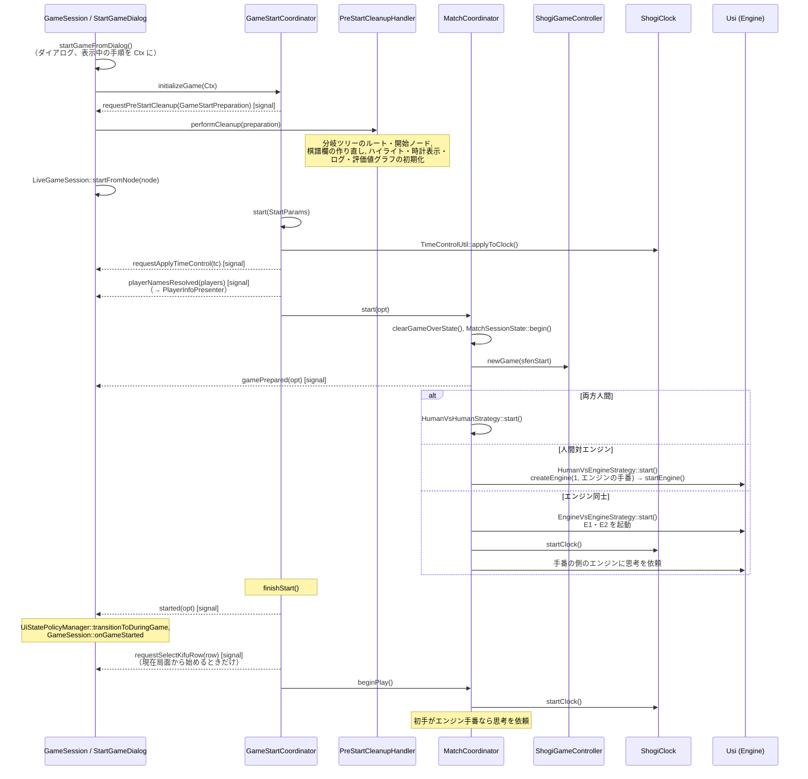

対局の開始は、対局ダイアログからの開始・連続対局の次局（`GameSession::startNextGame()` → `GameStartCoordinator::start()`）・中断した対局の再開（`GameStartCoordinator::resumeInterruptedGame()`）のどれも、最後に `GameStartCoordinator::finishStart()` を通る。`finishStart()` は「`started` の通知 → 棋譜欄の開始行の選択 → `MatchCoordinator::beginPlay()`（時計の開始とエンジンの初手）」の順に行う（`StartParams::autoStartEngineMove` が false なら `beginPlay()` は行わない）。

### 6.4 GameStartCoordinator — 対局開始コーディネータ

`GameStartCoordinator` は対局開始フロー全体を司るコーディネータである。

**ソース**: `src/game/gamestartcoordinator.h`, `src/game/gamestartcoordinator.cpp`

#### 責務

- 対局開始ダイアログの値（`Ctx`）から `StartParams` を作り、開始局面（両方の玉が盤上に1枚ずつあるか）を検証する
- 時計に持ち時間を設定し（`TimeControlUtil::applyToClock()`）、適用した設定をシグナルで UI 層に知らせる
- 対局開始前の UI/内部状態クリアをシグナルで依頼する
- `MatchCoordinator::start()` で対局を準備し、`beginPlay()` で時計と初手を始める

#### 主要な型定義

**StartParams** — 対局開始パラメータ:

```cpp
struct StartParams {
    MatchCoordinator::StartOptions opt;  // 対局設定
    TimeSettings                   tc;   // 時計設定
    bool autoStartEngineMove = true;     // 時計を動かし、先手がエンジンなら初手 go を起動
    int selectKifuRow = -1;              // 開始後に選ぶ棋譜欄の行（-1 なら選ばない）
    bool announcePlayerNames = false;    // 対局者名を通知する（ダイアログからの開始と連続対局の次局）
};
```

**TimeSettings** — 時間設定:

```cpp
struct TimeSettings {
    bool        enabled = false;        // 時間制御が有効か
    TimeControl rules;                  // 先後の決まり（src/core/timecontrol.h、5.5 を参照）
    bool        loseOnTimeout = true;   // 時間切れを負けにするか
};
```

**Ctx** — `initializeGame()` に渡す開始の入力:

| フィールド | 説明 |
|-----------|------|
| `dialogData` | 対局開始ダイアログから取り出した値（`StartGameDialogData`、`src/game/startgamedatabridge.h`） |
| `currentSfen` / `startSfen` | 表示中の局面と、表示中の棋譜の開始局面 |
| `recordLine` | 表示中の手順（`KifuNavigationState::currentRecordLine()`） |
| `startNodeId` | 分岐ツリー上の選択ノード |
| `bottomSide` | 盤の手前に表示している側（「人を手前に表示する」の判定用） |

棋譜読み込み担当（`KifuLoadCoordinator`）や分岐ツリーは持たない。開始前の分岐ツリーと棋譜欄の整理は、`requestPreStartCleanup` で受け手（`GameSession` → `PreStartCleanupHandler`）に任せる。

#### API

| メソッド | 説明 |
|---------|------|
| `initializeGame(Ctx, errorMessage)` | ダイアログの値から開始の手順と `StartParams` を作って検証し、`requestPreStartCleanup`・`boardFlipRequested`・`consecutiveGamesConfigured` を出して `start()` する。不正な開始局面では状態を変えずにエラーを返す |
| `start(StartParams)` | 検証→持ち時間の正規化→時計への適用→`requestApplyTimeControl`→（必要なら `playerNamesResolved`）→`MatchCoordinator::start()`→`finishStart()` |
| `resumeInterruptedGame()` | 時計を設定し直さず、中断した局面・時計から `finishStart()` する |

| シグナル | 接続先 |
|---------|-------|
| `requestPreStartCleanup(GameStartPreparation)` | GameSession::prepareStart |
| `requestApplyTimeControl(TimeSettings)` | GameSession::applyTimeControl |
| `started(StartOptions)` | UiStatePolicyManager::transitionToDuringGame、続いて GameSession::onGameStarted |
| `playerNamesResolved(MatchPlayers)` | PlayerInfoPresenter::onMatchPlayersResolved |
| `consecutiveGamesConfigured(totalGames, switchTurn)` | ConsecutiveGamesController::configure |
| `requestSelectKifuRow(row)` | KifuNavigationCoordinator::selectKifuRow |
| `boardFlipRequested()` | MainWindowAppearanceController::flipBoard |

`GameStartCoordinator` は1つだけ存在する。起動時に `MainWindowComposer::createServices()` が、司令塔を作った直後に `Deps::match` を渡して作る（親は MainWindow）。

`start()` メソッドの時間制御正規化（`TimeControl::normalized()`）では、秒読みとフィッシャーが同時に指定された場合に秒読みを優先してフィッシャー加算を0にクリアする。

### 6.5 PreStartCleanupHandler — 対局開始前クリーンアップ

`PreStartCleanupHandler` は対局開始前に UI とデータモデルを初期状態にリセットする。

**ソース**: `src/app/prestartcleanuphandler.h`, `src/app/prestartcleanuphandler.cpp`

#### 接続方法

```
GameStartCoordinator::requestPreStartCleanup(GameStartPreparation) [signal]
    └──▶ GameSession::prepareStart() [slot]
            ├── PreStartCleanupHandler::performCleanup(preparation)  → 開始ノードを返す
            ├── MainWindowResetService::clearSessionDependentUi()     … 対局ごとに消すログ・思考表示
            └── LiveGameSession::startFromNode(node)                  … ライブ対局のセッションを開始
```

`GameStartPreparation`（`src/game/startoptions.h`）は開始の方法（`NewGame`・`CurrentPosition`・`Reset`）、ルートの局面（`rootSfen`）、現在の局面から始めるときの開始ノード（`startNodeId`）を持つ。表示中の文字列から開始の方法を推測しない。

#### performCleanup() の処理フロー

```
performCleanup(preparation)
  │
  ├── 開始ノードを決める
  │     ├── CurrentPosition → 分岐ツリーの startNodeId のノード（見つからなければ何もせず nullptr）
  │     ├── 終局手（投了など）を選んでいたら直前の局面を開始位置にする（末尾の「中断」は取り除く）
  │     └── NewGame・Reset → 分岐ツリーを rootSfen で作り直し、ルートを開始ノードにする
  │    （始まっていたライブ対局のセッションは破棄し、navState のカーソルを開始ノードに合わせる）
  │
  ├── clearBoardAndHighlights()
  │     盤面のハイライトをすべて消去
  │
  ├── clearClockDisplay()
  │     時計表示を "00:00:00" にリセット
  │
  ├── cleanupKifuModel(node)
  │     ├── 途中局面から開始 → 分岐ツリーのルートから開始ノードまでの行で棋譜欄を作り直す
  │     └── 新規対局          → 棋譜欄を全消去し「=== 開始局面 ===」を追加
  │
  ├── clearBranchModel()
  │     分岐モデルをクリア
  │
  ├── resetUsiLogModels()
  │     エンジン通信ログ・予測手・探索手などをすべて初期化
  │
  ├── resetTimeControl()
  │     時間制御コントローラの開始時刻をクリア
  │
  ├── resetEvaluationGraph(preserve, ply)
  │     ├── 新規対局          → 評価値グラフを全消去
  │     └── 途中局面から開始 → 開始ノードの手数でトリム
  │
  └── selectStartRow(ply)
        棋譜欄の開始行を選択（黄色ハイライト）
```

ライブ対局のセッションの開始（`LiveGameSession::startFromNode()`）は呼び出し側の `GameSession::prepareStart()` が行う（`sessionStarted` を受けた `KifuDisplayCoordinator` がカーソルを開始ノードに合わせる）。対局の手順（`RecordLine`）はここでは作らない。`GameSession::startGameFromDialog()` が表示中の手順（`KifuNavigationState::currentRecordLine()`）を `Ctx::recordLine` に入れ、`GameStartCoordinator::initializeGame()` がその手数までを `StartOptions::recordLine` にする（[対局開始フロー](game-start-flow.md)）。

#### 「現在の局面から開始」の判定

「現在の局面から開始」かどうかは、対局開始ダイアログの開始局面の番号で決まる（`StartGameDialogData::startingPositionNumber` が 0 なら現在の局面、1 以上なら手合割のプリセット）。`GameStartCoordinator::initializeGame()` がこれを見て `GameStartPreparation::Mode::CurrentPosition` か `NewGame` を選び、現在の局面から始めるときだけ表示中の手順と選択ノードを渡す。手順が空なら、表示中の局面（なければ棋譜の開始局面）を開始局面にする。

### 6.6 ShogiGameController — 盤面とルールの橋渡し

`ShogiGameController` は対局で使う盤（`ShogiBoard`）を持ち、`EngineMoveValidator` で指し手を確かめて盤に指すコントローラである。指した手は棋譜の1行（`RecordEntry`）として返し、対局の手順への追加は呼び出し側（司令塔・通信対局）が行う。

**ソース**: `src/game/shogigamecontroller.h`, `src/game/shogigamecontroller.cpp`

#### 指し手実行フロー

人間の着手（盤のクリック。定跡ウィンドウの手もこちら）では `validateAndMove()`、成り・不成まで決まったエンジンの手では `applyMove()`、通信対局でサーバーが知らせた手では `applyRecordedMove()` が呼ばれる。どれも最後に `commitMove()` で指す。

```
validateAndMove(outFrom, outTo)
  ├── prepareMove(from, to)
  │     ├── 1. クリックした2マス（表示の座標。駒台は筋 10・11）を UsiMove にする
  │     │     盤外・相手の駒台・空きマスからの手は受け付けない
  │     ├── 2. legalStatus() — EngineMoveValidator で成り・不成それぞれを判定
  │     └── 3. 成るかどうかを決める
  │           ├── 両方とも合法 → setForcedPromotion() の指定（定跡の手）か、
  │           │                  setPromotionChooser() の関数（成りダイアログ）で決める
  │           ├── 成りだけ合法（行き所のない駒）→ 成る
  │           └── どちらも不合法 → nullopt
  └── applyRecordedMove(move) → commitMove()

applyMove(move)
  ├── legalStatus() で、指し手の成り・不成の側が合法かを確かめる（反則手は盤を変えずに nullopt）
  └── commitMove()

commitMove(move)
  ├── board()->applyUsiMove(move, mover)    盤を更新（手番を渡し、手数を1つ進める）
  ├── RecordEntry::played(ShogiMove(move, 動かした駒, 取った駒),
  │                       convertMoveToKanjiStr(...),   棋譜の文字列（前の手と同じマスなら「同」）
  │                       board()->toSfen())            指した後の局面
  └── setCurrentPlayer(次の手番)             currentPlayerChanged（更新中は保留）
```

着手の確定の知らせ（`moveCommitted`）は `commitMove()` では出さない。呼び出し側が盤・手順・棋譜・時計を更新し終えてから `notifyMoveCommitted(mover, ply)` で出す（ローカル対局は `MatchCoordinator`、通信対局は `CsaGameCoordinator`）。その間の手番と着手の通知は `positionUpdate()`（RAII の `PositionUpdate`）で保留し、更新が終わったときに「手番の通知 → 着手の確定」の順にまとめて出す。

#### 主要なシグナル

| シグナル | 接続先 | 用途 |
|---------|-------|------|
| `currentPlayerChanged(Turn)` | TurnManager（`TurnStateSyncService` が接続）、BoardInteractionController | 手番変更通知。盤の操作は1回目のクリックを取り消す |
| `moveCommitted(Turn, int)` | MainWindowActions::handleMoveCommitted（定跡ウィンドウ）、PieceSoundPlayer::playMoveSound | 着手確定通知。ローカル対局・通信対局のどちらもこの知らせを使う |
| `endDragSignal()` | ShogiView::endDrag | 駒のドラッグ表示を終える |

### 6.7 TurnManager / TurnStateSyncService — 手番管理

#### TurnManager — 手番の表現の変換と通知

手番の正は `ShogiGameController` の `currentPlayer()` である（司令塔は手番のコピーを持たない）。`TurnManager` は手番の表現を変換し、手番が変わったことを時計・盤・手番表示へ知らせる。`TurnStateSyncService`（`src/app/turnstatesyncservice.h`）が自分の子として作って持つ。

**ソース**: `src/game/turnmanager.h`, `src/game/turnmanager.cpp`

```
  set(Turn) / setFromSfenToken("b"/"w") / toggle()
                    │
                    ▼
             ┌──────────────┐     side()          → Turn
             │ TurnManager  │──── toSfenToken()   → "b" / "w"
             │ m_side(Turn) │
             └──────┬───────┘
                    │ changed(Turn) [signal]
                    ▼
       TurnStateSyncService::onTurnManagerChanged()
```

各変換メソッド:

| メソッド | 方向 | 変換内容 |
|---------|------|---------|
| `set(Turn)` | → TM | 手番を設定する（`ShogiGameController::currentPlayerChanged` から） |
| `side()` | TM → | 今の手番（`Turn`）を返す |
| `setFromSfenToken("b"/"w")` | SFEN → TM | SFEN の手番文字から設定 |
| `toSfenToken()` | TM → SFEN | `"b"` または `"w"` を返す |
| `toggle()` | — | 手番を反転（先手 ↔ 後手） |

`set()` は後手以外を先手にそろえ、値が変わったとき（と最初の設定のとき）だけ `changed()` シグナルを発行する。

#### TurnStateSyncService — 手番同期の配線

`TurnStateSyncService`（app 層）は GC・TurnManager・時計・盤の手番表示の同期を一箇所に集約する。コンストラクタで `TurnManager` を作り、`updateDeps()` で GC の手番変更を `TurnManager` へつなぐ。

**ソース**: `src/app/turnstatesyncservice.h`, `src/app/turnstatesyncservice.cpp`

```cpp
// TurnStateSyncService が構築する接続
GC::currentPlayerChanged ──▶ TurnManager::set                         // updateDeps()
TurnManager::changed     ──▶ TurnStateSyncService::onTurnManagerChanged // コンストラクタ
// 司令塔の turnChanged も onTurnManagerChanged へつなぐ（MainWindowComposer::connectMatchSignals）
```

`onTurnManagerChanged()` は時計の手番（`ShogiClock::setCurrentPlayer()`）、GC の手番、盤の手番表示（`ShogiView::updateTurnIndicator()`）を合わせる。`setCurrentTurn()` は、対局が進行中（`HumanTurnPolicy::isGameActivelyInProgress()`）なら GC の手番、それ以外なら盤面 SFEN の手番を正として `TurnManager` と GC をそろえる（起動時の初期表示でも `MainWindowComposer::finalizeUi()` から呼ぶ）。

#### 人間/エンジンの手番切替

人間とエンジンの手番切替は、`MatchCoordinator` が対局者（`MatchPlayers`）から作る Strategy（`HumanVsHumanStrategy`・`HumanVsEngineStrategy`・`EngineVsEngineStrategy`）が制御する。一手の確定は司令塔の `completeMove()` にまとまっている。

```
                         対局中の指し手進行
                              │
                   ┌──────────┴──────────┐
                   │                     │
              人間の着手              エンジンの着手
                   │                     │
  BoardSetupController::onMoveRequested  Usi::matchMoveReady
     → GC::validateAndMove()             → Strategy::onEngineMoveReady()
     → MatchCoordinator::onHumanMove()   → MatchStrategyHost::applyEngineMove()
     → Strategy::onHumanMove()              → GC::applyMove()
     → MatchStrategyHost::completeHumanMove()
                   └──────────┬──────────┘
                              │
              MatchCoordinator::completeMove()
                ├── 時計の確定・棋譜の行（MatchRecordSink::appendRecord）
                ├── boardChanged / moveHighlightRequested / turnChanged / timeUpdated
                ├── engineMovePlayed（エンジンの手のとき）
                ├── GC::notifyMoveCommitted() → moveCommitted
                └── 千日手・最大手数の判定
                              │
             次の手番は誰か？（Strategy が判定）
                              │
                   ┌──────────┴──────────┐
                   │                     │
              人間の手番            エンジンの手番
                   │                     │
          盤面クリック待ち      requestEngineMove(side)
          （HvH は考慮時間を計測） → Usi::requestMatchMove()（position + go）
                                 bestmove（Usi::matchMoveReady）待ち
```

### 6.8 PromotionFlow — 成り/不成の選択

`PromotionFlow` は駒の成り/不成をユーザーに問い合わせるシンプルなユーティリティクラスである。

**ソース**: `src/ui/coordinators/promotionflow.h`, `src/ui/coordinators/promotionflow.cpp`

```cpp
class PromotionFlow final {
public:
    /// @return 成る: true / 不成: false
    static bool askPromote(QWidget* parent);
};
```

実装は `PromoteDialog`（成り/不成選択ダイアログ）を表示し、ユーザーの選択結果を返す。`QDialog::Accepted`（OK/成る）なら `true`、それ以外（Cancel/不成）なら `false` を返す。

このクラスは、`ShogiGameController::validateAndMove()` が成り・不成の両方とも合法な手で、成りの選び方の関数（`setPromotionChooser()` で渡す `DialogLauncher::choosePromotion()`）を呼んだときに、`DialogCoordinator::showPromotionDialog()` から呼ばれる（6.6 節）。以下の場合はダイアログを表示しない:

- **行き所のない駒**: 成りだけが合法な手（歩・香が1段目、桂が1〜2段目へ動く手。後手は逆）は成る
- **成り・不成の指定**: 定跡ウィンドウの手は、`setForcedPromotion()` で事前に成り・不成が決まっている

### 6.9 GameSession — 対局の流れの UI 側

`GameSession` は対局の流れの UI 側を受け持つ app 層のクラスである。利用者の操作（対局開始・投了・中断・再開・すぐ指させる・待った）を受けて司令塔（`MatchCoordinator`）か通信対局（`CsaGameCoordinator`）に頼み、司令塔の知らせを受けて棋譜欄・分岐ツリー・時計・盤の表示・メニューの状態を合わせる。対局の棋譜の受け手（`MatchRecordSink`）でもある。

**ソース**: `src/app/gamesession.h`, `src/app/gamesession.cpp`

#### 責務

| 責務 | 内容 |
|------|------|
| **利用者の操作** | `startGameFromDialog()`・`resign()`・`breakOff()`・`makeEngineMoveNow()`・`undoTwoMoves()`・`resumeInterruptedGame()`。通信対局中は `CsaGameCoordinator` に、それ以外は `MatchCoordinator` に頼む |
| **対局の開始** | `prepareStart()`（開始前のクリーンアップとライブ対局のセッションの開始）、`applyTimeControl()`、`onGamePrepared()`（`AppState` の局面と対局者 `players` の更新、盤と名前の表示）、`onGameStarted()` |
| **棋譜の受け手** | `MatchRecordSink` の `canAppendRecord()`・`appendRecord()`・`canUndoRecords()`・`undoRecords()`。行は `LiveGameSession` に追記する（通信対局の行も `CsaGameWiring` からここへ届く） |
| **終局後処理** | `onGameOverStateChanged()`・`onGameEnded()`・`onGameEndProcessed()`（ライブ対局のセッションの確定、閲覧モードへの遷移、終局時刻、連続対局の次局） |
| **中断と再開** | `onGameInterrupted()`・`discardInterruptedGame()`・`resumeInterruptedGame()` |
| **リセット** | 「新規」の `resetToInitialState()`、棋譜読み込み前の `clearUiBeforeKifuLoad()`、通信対局の棋譜の準備 `beginCsaGameRecord()` |

#### シグナル接続

```
MatchCoordinator::gameOverStateChanged
    └──▶ GameSession::onGameOverStateChanged()
            ├── 終局スタイルロックを有効化（終局行の追記前に検知した時点で）
            ├── 終局行の追記（moveAppended）を待ってから以降を行う
            ├── syncNavStateToPly(棋譜欄の最終行) で表示中の手数（分岐ツリーのカーソル）を終局行へ
            ├── UiStatePolicyManager::transitionToIdle()、リプレイモードへ
            └── ハイライト消去

MatchCoordinator::gameEnded（終局の行は書いた後）
    └──▶ GameSession::onGameEnded()
            ├── 中断以外ならライブ対局のセッションを確定（LiveGameSession::commit）
            ├── 時計停止・盤のクリック無効化・棋譜欄を1行選択に
            ├── 終局時刻を記録して対局情報に反映
            └── UiStatePolicyManager::transitionToIdle()

MatchCoordinator::gameEndProcessed
    └──▶ GameSession::onGameEndProcessed()
            └── エンジン同士で次局があれば ConsecutiveGamesController::startNextGame()
```

終局の行（「投了」など）は司令塔が `MatchRecordSink::appendRecord()` で書くので、受け手で終局の行を組み立て直さない。

#### 依存（Deps）

`GameSession` はコールバックを持たず、`Deps` 構造体で部品のポインタを受け取る（`MainWindowComposer::wireGame()` が `setDeps()` で渡す）。主なもの:

| フィールド | 用途 |
|-----------|------|
| `state` | `AppState`（局面・対局者・動作状態） |
| `match` / `gameStart` / `csa` / `analysis` / `consecutive` / `preStartCleanup` | 対局の司令塔・開始・通信対局・検討（対局の前に止める）・連続対局・開始前のクリーンアップ |
| `liveSession` / `branchTree` / `navState` / `kifuNav` / `gameRecord` / `kifuRecordModel` | 棋譜の正本（分岐ツリー）と表示位置 |
| `shogiView` / `boardController` / `boardSync` / `turnSync` / `timeController` / `uiStatePolicy` / `playerInfo` / `evalGraph` など | 盤・手番・時計・メニュー・対局者名・評価値グラフの表示 |
| `sessionUi` / `models` | 対局ごとに消すログ・思考表示と、「新規」で作り直す棋譜まわり（`MainWindowResetService` に渡す） |

#### 人間/エンジンの判定（HumanTurnPolicy / MatchPlayers）

どちらの手番を人間が指すかは、対局者 `MatchPlayers`（`src/core/matchplayers.h`）の `isHuman(Turn)`・`isEngine(Turn)` で決まる。司令塔の `MatchCoordinator::isHumanSide(Turn)` は、対局を一度でも始めていればその対局の `players().isHuman(side)` を返す。

盤を人間が操作できるかの判定は `HumanTurnPolicy`（`src/app/humanturnpolicy.h`）の1か所にある。動作状態（`AppActivityState`）で、ローカル対局なら司令塔、通信対局なら `CsaGameCoordinator` に聞く。

```cpp
bool HumanTurnPolicy::isHumanTurnNow() const
{
    // 対局していないときは、盤上の着手を棋譜の変化として記録できるか
    if (!isGameActivelyInProgress()) {
        return m_deps.canRecordVariationMove && m_deps.canRecordVariationMove();
    }
    switch (m_deps.activity->activity()) {
    case AppActivityState::Activity::DuringGame:
        return m_deps.gameController && m_deps.match->isHumanSide(m_deps.gameController->currentPlayer());
    case AppActivityState::Activity::DuringCsaGame: {
        const CsaGameCoordinator* csa = m_deps.csaGameWiring ? m_deps.csaGameWiring->coordinator() : nullptr;
        return csa && csa->isHumanPlayer() && csa->isMyTurn();
    }
    default:
        return false;
    }
}
```

`isGameActivelyInProgress()` はローカル対局なら終局前か、通信対局なら `CsaGameCoordinator::GameState::InGame` かを返す。`BoardInteractionController` の盤のクリック、定跡ウィンドウ（`JosekiWindowController`）、手番同期（`TurnStateSyncService`）がこの判定を使う。

### 6.10 ConsecutiveGamesController — 連続対局制御

`ConsecutiveGamesController` はエンジン同士（EvE）の連続対局を管理する。次局を始めるのは受け手の `GameSession` である。

**ソース**: `src/game/consecutivegamescontroller.h`, `src/game/consecutivegamescontroller.cpp`

#### 仕組み

```
GameStartCoordinator::consecutiveGamesConfigured(totalGames, switchTurn)
    └──▶ ConsecutiveGamesController::configure(totalGames, switchTurn)

GameSession::applyTimeControl(tc) → setTimeSettings(tc)      … 次局にも同じ持ち時間を使う
GameSession::onGameStarted(opt)   → onGameStarted(opt)       … 次局はこの設定から作る

MatchCoordinator::gameEndProcessed（終局表示・自動保存のあと）
    └──▶ GameSession::onGameEndProcessed()
            └──▶ エンジン同士で shouldStartNextGame() ? → startNextGame()

startNextGame()
  └── 100ms のタイマー → launchPreparedNextGame()
        ├── m_remainingGames--, m_gameNumber++
        ├── switchTurn → 先後のエンジン名・パス・持ち時間の決まりを std::swap で入れ替え
        ├── 手順（recordLine）を空にする（次局は同じ開始局面からの独立した棋譜）
        └── emit nextGameReady(StartParams)
              └──▶ GameSession::startNextGame(params)
                      ├── 棋譜まわりを開始局面で作り直し、prepareStart(NewGame)
                      └── GameStartCoordinator::start(params)
```

連続対局では直前の開始設定（`m_lastStartOptions`）と時間の決まり（`m_lastTimeControl`）を保存しておき、次局開始時に再利用する。手番入れ替え（`m_switchTurnEachGame`）が有効な場合、エンジンと一緒に持ち時間も入れ替え、エンジンごとに時間差を付けた対局でも各エンジンが同じ持ち時間で指し続けるようにする。

次局開始前に 100ms の遅延を入れるのは、いまの終局処理・エンジン応答の処理を抜けてから次局を初期化するためである。

| メソッド | 説明 |
|---------|------|
| `configure(totalGames, switchTurn)` | 合計対局数と手番入替の設定を受け取る |
| `setTimeSettings(tc)` | 対局の時間の決まりを保存 |
| `onGameStarted(opt)` | 対局開始時のオプションを保存 |
| `shouldStartNextGame()` | 残り対局数 > 0 なら true |
| `startNextGame()` | 次局の準備を予約する（準備ができたら `nextGameReady`） |
| `reset()` | 全状態をリセット（中断・「新規」のとき） |

### 6.11 game層のクラス間関係まとめ

```
┌──────────────────────────────────────────────────────────────────────┐
│                                                                      │
│  合成ルート (MainWindowComposer)                                     │
│    │ 起動時に全部作る（createServices）                               │
│    │                                                                  │
│    ├── GameSession（app 層。操作の受け口・棋譜の受け手）              │
│    │     ├── startGameFromDialog() ──▶ GameStartCoordinator          │
│    │     ├── prepareStart() ──▶ PreStartCleanupHandler               │
│    │     └── 司令塔のシグナル（gamePrepared・gameEnded など）を受ける │
│    │                                                                  │
│    ├── GameStartCoordinator                                          │
│    │     ├── start() ──▶ MatchCoordinator.start() / beginPlay()      │
│    │     └── started ──▶ UiStatePolicyManager, GameSession           │
│    │                                                                  │
│    ├── MatchCoordinator  (司令塔)                                     │
│    │     ├── ShogiGameController (盤面/ルール)                        │
│    │     ├── ShogiClock (時計)                                        │
│    │     ├── EngineLifecycleManager ── Usi × 2 (エンジン)             │
│    │     ├── GameModeStrategy (対局モード別の手番の進め方)             │
│    │     └── MatchRecordSink（= GameSession）へ棋譜の行を書く          │
│    │                                                                  │
│    ├── HumanTurnPolicy (盤を人間が操作できるか)                       │
│    │                                                                  │
│    ├── TurnStateSyncService / TurnManager (手番同期)                  │
│    │     └── GC → TurnManager → 時計・盤の手番表示                    │
│    │                                                                  │
│    └── ConsecutiveGamesController (連続対局)                           │
│          └── nextGameReady ──▶ GameSession::startNextGame             │
│                                                                      │
└──────────────────────────────────────────────────────────────────────┘
```

<!-- chapter-6-end -->

---

<!-- chapter-7-start -->
## 第7章 engine層：USIエンジン連携

engine層は、外部の USI（Universal Shogi Interface）対応エンジンとのプロセス間通信を担当する。エンジンの起動・終了、USIプロトコルのコマンド送受信、思考情報の解析と表示モデルへの反映、およびエンジン設定の管理を包括的に扱う。

### 7.1 3層アーキテクチャ

engine層は **単一責任原則（SRP）** に基づき、以下の3つのクラスに分離されている。プロセスとプロトコル処理は `UsiEngineSession`（GUI と自動化・CLI で共用する接続）が束ね、`Usi` はそれと `ThinkingInfoPresenter`・`UsiMatchHandler` を持つ。engine層は game層を知らない（`Usi` は `ShogiGameController` を持たず、対局の時計は core 層の `ShogiClock` を `setMatchClock()` で受け取るだけ）。

```
┌─────────────────────────────────────────────────────┐
│                   Usi（ファサード）                    │
│  外部公開インターフェース、シグナル中継、モデル更新       │
│                                                     │
│  m_session（UsiEngineSession。QObject の親で所有）   │
│    ├── EngineProcessManager                         │
│    └── UsiProtocolHandler                           │
│  m_presenter・m_matchHandler（std::unique_ptr で所有）│
├─────────────────────────────────────────────────────┤
│         ▲ シグナル/スロット接続 ▼                      │
├──────────┬──────────────────┬────────────────────────┤
│EngineProcess│UsiProtocol    │ThinkingInfo           │
│Manager      │Handler        │Presenter              │
│             │               │                       │
│QProcess管理 │USIコマンド     │info行解析             │
│起動/終了    │送受信・待機    │読み筋漢字変換         │
│標準入出力   │状態管理       │評価値計算             │
│シャットダウン│bestmove解析   │通信ログ整形           │
└──────────┴──────────────────┴────────────────────────┘
```

#### 各クラスの責務

| クラス | ソース | 責務 |
|--------|--------|------|
| `EngineProcessManager` | `src/engine/engineprocessmanager.h/.cpp` | QProcess のライフサイクル管理。コマンド送信、標準出力/エラーの行単位読み取り、シャットダウン状態の管理 |
| `UsiProtocolHandler` | `src/engine/usiprotocolhandler.h/.cpp` | USI コマンドの生成・送信、レスポンス（usiok, readyok, bestmove, info, checkmate）の解析、待機処理 |
| `ThinkingInfoPresenter` | `src/engine/thinkinginfopresenter.h/.cpp` | info 行の解析結果を GUI 向けシグナルに変換。評価値の計算、漢字読み筋の生成、通信ログの整形 |
| `UsiEngineSession` | `src/engine/usienginesession.h/.cpp` | 上の2つを束ね、起動・初期化（usi〜readyok）・終了を行う。GUI の `Usi` と自動化・CLI が共用し、思考タブを使わない詰将棋の局面生成（`TsumeshogiGenerator`）や詰み判定（`TsumeMateEngine`）も直接使う |
| `UsiMatchHandler` | `src/engine/usimatchhandler.h/.cpp` | 対局の position/go/bestmove、先読み（ponder）、bestmove の応答待ち |

#### シグナル伝搬の流れ

```
エンジンプロセス (stdout)
    │
    ▼
EngineProcessManager::onReadyReadStdout()
    │ emit dataReceived(line)
    ├──────────────────────────────────────┐
    ▼                                      ▼
UsiProtocolHandler::onDataReceived()    Usi::onDataReceived()
    │                                      │
    ├─ "usiok"  → emit usiOkReceived()     └─ Presenter::logReceivedData()
    ├─ "readyok"→ emit readyOkReceived()         │ emit commLogAppended()
    ├─ "bestmove"→ emit bestMoveReceived()        ▼
    ├─ "info"   → UsiInfoParser::parse()   UsiCommLogModel
    │              emit infoReceived(UsiInfo)
    │              Presenter::onInfoReceived()
    │                   │ (50msバッファリング後)
    │                   ▼
    │              processInfo(UsiInfo)
    │                   │ emit thinkingInfoUpdated(ThinkingInfoRow)
    │                   ▼
    │              Usi::onThinkingInfoUpdated()
    │                   ├─ ThinkingModel::prependItem()
    │                   ├─ ConsiderationModel::updateByMultipv()
    │                   └─ emit thinkingInfoUpdated() [外部通知]
    │
    └─ "checkmate" → emit checkmateSolved/NoMate/NotImplemented/Unknown()
```

### 7.2 USIプロトコルの状態遷移

USI プロトコルは、エンジンの起動から対局終了までの一連の状態遷移を定義する。以下に主要な状態遷移を示す。

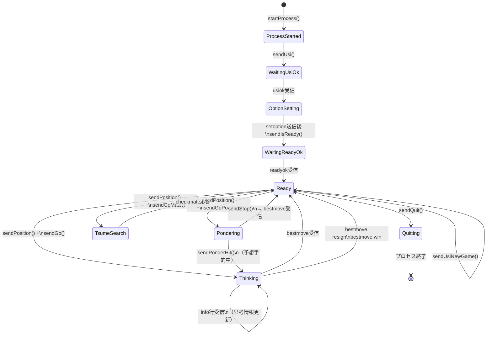

#### 非同期初期化シーケンス

`Usi::startEngine(path, name)` は起動の要求を受け付けたかを返す（パスが空、起動できないときは false と `errorOccurred`）。
中では `UsiEngineSession::startAsync()` が、設定ファイルからそのエンジンのオプションを読み（`UsiProtocolHandler::loadEngineOptions()`）、
`EngineProcessManager::startProcessAsync()` で起動する。`processStarted` の後、`UsiProtocolHandler::initializeEngineAsync()` が
`usi` → `usiok` → `setoption` → `isready` → `readyok` → `usinewgame` の順に進める。
各応答はQtシグナルで受信し、usiok・readyokにはそれぞれ既定5秒のタイマーを設ける。
成功は `UsiEngineSession::ready` → `Usi::engineInitialized`、失敗は `UsiEngineSession::errorOccurred` → `Usi::errorOccurred` で通知する。
初期化中の要求（対局の思考・検討・詰み探索・setoption・USI コンソールの入力）は `deferUntilReady()` で保管し、初期化完了後に順に送る。
キャンセル（`cancelCurrentOperation()`）時は保留要求とタイマーを破棄する。

### 7.3 EngineProcessManager — プロセス管理

**ソース**: `src/engine/engineprocessmanager.h`, `src/engine/engineprocessmanager.cpp`

QProcess を直接管理し、USI プロトコルの詳細を知らない純粋なプロセス管理クラスである。

#### シャットダウン状態

```cpp
enum class ShutdownState {
    Running,                    // 通常動作中
    IgnoreAll,                  // 全ての受信を無視
    IgnoreAllExceptInfoString   // info string以外を無視
};
```

quit コマンド送信後、エンジンが出力する残りの応答を制御するために使用される。`UsiProtocolHandler::sendQuit()` は `IgnoreAllExceptInfoString` にして残行数を1にする。この状態では残行数分の `info string` 応答のみを許可し、残行数が 0 になると `IgnoreAll` に遷移する。`stopProcessAsync()` とプロセスの終了（`onProcessFinished()`）では `IgnoreAll` になる。`Running` のままプロセスが終わったとき（予期しない終了）だけ `processExited` を発行する。

#### 主要メソッド

| メソッド | 説明 |
|---------|------|
| `startProcessAsync(engineFile)` | ファイル検証後に起動要求を出す。完了は `processStarted` で通知 |
| `stopProcessAsync()` | プロセスの所有権を終了処理へ移し、quit → terminate → kill をタイマーで進める。管理元の破棄後も回収する |
| `sendCommand(command)` | コマンド文字列を UTF-8 で書き込み、`commandSent` シグナルを発行 |
| `setLogIdentity(tag, side, name)` | ログ出力用の識別情報を設定（例: `[E1/black] YaneuraOu`。対局のエンジンは手番を `black`／`white` で付ける） |

#### 標準出力の読み取り

`onReadyReadStdout()` はチャンク単位（最大64行）で標準出力を読み取る。1チャンクの処理後、未読データが残っていれば `QTimer::singleShot(0, ...)` でイベントループ経由で再スケジュールし、UI の応答性を維持する。

```
onReadyReadStdout()
  │
  ├── 行ごとに読み取り（最大 kMaxLinesPerChunk = 64。空行は飛ばす）
  │     ├── "id name ..." → ログの識別に使うエンジン名を記録（未設定のときだけ。行は下の判定へ進む）
  │     ├── ShutdownState::IgnoreAll → 破棄
  │     ├── ShutdownState::IgnoreAllExceptInfoString
  │     │     └── "info string" のみ通過、残行数をデクリメント
  │     └── Running → dataReceived シグナルを発行
  │
  └── 未読データあり → scheduleMoreReading()
```

### 7.4 UsiProtocolHandler — プロトコル処理

**ソース**: `src/engine/usiprotocolhandler.h`, `src/engine/usiprotocolhandler.cpp`

USI プロトコルのコマンド生成・レスポンス解析・非同期初期化を担当する。

#### 思考フェーズ

```cpp
enum class SearchPhase {
    Idle,           // 待機中
    Main,           // 本探索中（go送信後）
    Ponder,         // 先読み中（go ponder送信後）
    StoppingPonder  // 先読みのstop送信後、bestmove回収待ち
};
```

`sendGo()`（`go depth`・`go movetime`・`go infinite`・`go searchmoves` の各送信も同じ）で `Main` に、`sendGoPonder()` で `Ponder` に遷移する。`sendPonderHit()` は `Ponder` → `Main` に切り替える（予想手が的中した場合）。先読み中の `sendStop()` は `StoppingPonder` にする。bestmove の受信と `cancelCurrentOperation()` で `Idle` に戻る。

#### 主要コマンド送信メソッド

| メソッド | 生成されるコマンド |
|---------|------------------|
| `sendUsi()` | `usi` |
| `sendIsReady()` | `isready` |
| `sendUsiNewGame()` | `usinewgame` |
| `sendPosition(str)` | `position startpos moves ...` |
| `sendGo(goTime)` | `go btime X wtime Y byoyomi Z` / `go btime X wtime Y binc A winc B`（`UsiGoTime::toCommand()`） |
| `sendGoPonder(goTime)` | `go ponder btime X wtime Y ...` |
| `sendGoMate(timeMs, infinite)` | `go mate X` / `go mate infinite` |
| `sendGoInfinite()` | `go infinite`（検討・棋譜解析） |
| `sendGoDepth(depth)` | `go depth X` |
| `sendGoMovetime(timeMs)` | `go movetime X` |
| `sendGoSearchmoves(moves, infinite)` | `go searchmoves 7g7f 8h2b+ infinite`（`sendGoSearchmovesDepth()`・`sendGoSearchmovesMovetime()` もある） |
| `sendStop()` | `stop` |
| `sendPonderHit()` | `ponderhit` |
| `sendGameOver(result)` | `gameover win` / `gameover lose` / `gameover draw` |
| `sendQuit()` | `quit`（+ シャットダウン状態遷移） |
| `sendSetOption(name, value)` | `setoption name X value Y` |

#### レスポンス処理（onDataReceived）

```
onDataReceived(line)
  │
  ├── タイムアウト宣言済み → 破棄
  │
  ├── "checkmate ..." → handleCheckmateLine()
  │     ├── "nomate"         → emit checkmateNoMate()
  │     ├── "notimplemented" → emit checkmateNotImplemented()
  │     ├── 空/"unknown"/"timeout" → emit checkmateUnknown()
  │     └── 手順あり          → emit checkmateSolved(pvMoves)
  │
  ├── "bestmove ..." → handleBestMoveLine()
  │     ├── stop・キャンセルで世代が進んだ後の bestmove → 破棄
  │     ├── 先読み（Ponder / StoppingPonder）の結果 → 予想手を消す（投了・宣言勝ちのシグナルは出さない）
  │     ├── "resign" → emit bestMoveResignReceived()（重複防止付き）
  │     ├── "win"    → emit bestMoveWinReceived()（重複防止付き）
  │     └── 通常手   → m_bestMove に格納、ponder手も取得
  │     └── emit bestMoveReceived()
  │
  ├── "info ..." → UsiInfoParser::parse()（読めなければ破棄）→ updateCandidate()（候補手）
  │                 → emit infoReceived(UsiInfo)
  │                 ThinkingInfoPresenter::onInfoReceived()、Usi::infoReceived（→ AnalysisJob）
  │
  ├── "option name ..." → UsiInfoParser::parseOptionDeclaration()（報告されたオプションを記録）
  ├── "id name ..."     → UsiInfoParser::parseIdName()
  │
  ├── "readyok" → emit readyOkReceived()
  │
  └── "usiok"   → emit usiOkReceived()
```

#### 応答待ちとキャンセル

同期の `waitFor*` APIは設けず、応答シグナルとタイマーで進行する。
初期化は `initializationFinished(bool)`、対局の着手は `Usi::matchMoveReady` で通知する。
`UsiMatchHandler` は本探索・先読み停止待ちを管理し、先読みが外れた場合は
旧探索の `bestmove` を回収してから次の `go` を送る。
時計と同じ残り時間を期限に使い、無制限対局には30分の安全上限を設ける。
`cancelCurrentOperation()` は探索の世代を更新し、取消済みの結果の採用を防ぐ。

#### 経過時間の計測

`QElapsedTimer m_goTimer` で `go` コマンド送信から `bestmove` 受信までの経過時間を計測し、`m_lastGoToBestmoveMs` に記録する。この値は時間制御で消費時間として使用される。

### 7.5 Usi クラス — ファサード

**ソース**: `src/engine/usi.h`, `src/engine/usi.cpp`

`Usi` クラスは GUI からエンジン1台を使う窓口である。対局（`HumanVsEngineStrategy`・`EngineVsEngineStrategy`。エンジンは `EngineLifecycleManager` が作る）、検討・詰み探索（`AnalysisSession`）、棋譜解析（`AnalysisJob`）、通信対局（`CsaEngineController`）が使う。詰将棋の局面生成（`TsumeshogiGenerator`）は `Usi` を使わず、`UsiEngineSession`（`m_engine`）を持って `UsiProtocolHandler` で position・go mate・stop を送り、詰み探索の結果も `UsiProtocolHandler` のシグナルで受ける。`Usi` は内部のコンポーネント（7.1節の表）を持ち、シグナルの中継とモデル更新を行う。

#### コンストラクタと依存関係

```cpp
Usi(UsiCommLogModel* model,                  // 通信ログモデル（非所有。nullptr 可）
    ShogiEngineThinkingModel* modelThinking, // 思考情報モデル（非所有。nullptr 可）
    QObject* parent = nullptr);
```

コンストラクタで `UsiEngineSession`（`EngineProcessManager`・`UsiProtocolHandler` を持つ）・`ThinkingInfoPresenter`・`UsiMatchHandler` を作り、`setupConnections()` で全シグナル/スロットを接続する。対局の時計は `setMatchClock(ShogiClock*)`、検討タブのモデルは `setConsiderationModel()` で後から渡す。

#### 主なメソッド

| メソッド | 用途 |
|---------|------|
| `startEngine(path, name)` | エンジンを起動して初期化を始める（完了は `engineInitialized`、失敗は `errorOccurred`） |
| `requestMatchMove(position, ponder, timing)` | 対局の思考を依頼する（指し手は `matchMoveReady`） |
| `requestImmediateMove()` | 対局中の「すぐ指させる」（stop を送る） |
| `sendAnalysisCommands(position, byoyomiMs, multiPV)` | 検討の position + go infinite（時間が来たら stop） |
| `sendPositionAndGoInfinite(position)` | 棋譜解析の1局面の探索 |
| `startMateSearch(position, ms)` | 詰み探索を始める（思考タブを消し、読み筋はこの局面から表示する） |
| `sendSetOptionCommand(name, value)` / `sendConsoleCommand(command)` | setoption の送信 / USI コンソールの入力をそのまま送る |
| `cancelCurrentOperation()` | 探索の世代を進め、保留中の要求と取消済みの結果を捨てる |

#### setupConnections() の接続構造

```
UsiEngineSession → Usi（コンストラクタで接続）
  ├── ready             → onEngineInitialized  → 保留した要求を送り、emit engineInitialized
  └── errorOccurred     → onProtocolError      → プロセスを片付け、emit errorOccurred

ProcessManager → Usi
  ├── commandSent       → onCommandSent      → Presenter::logSentCommand
  ├── dataReceived      → onDataReceived      → Presenter::logReceivedData
  └── stderrReceived    → onStderrReceived    → Presenter::logStderrData

ProtocolHandler → Presenter
  ├── positionChanged   → setBaseSfen（読み筋を日本語にする局面）
  ├── searchStarted     → requestClearThinkingInfo
  ├── infoReceived      → onInfoReceived
  └── checkmateSolved   → presentCheckmate

ProtocolHandler → Usi（シグナル再発行）
  ├── searchCandidateChanged → searchCandidateChanged（候補手の矢印）
  ├── usiOkReceived     → usiOkReceived
  ├── readyOkReceived   → readyOkReceived
  ├── bestMoveReceived  → onMatchBestMoveReceived（予想手の表示、UsiMatchHandler へ）、bestMoveReceived
  ├── bestMoveResignReceived → bestMoveResignReceived
  ├── bestMoveWinReceived    → bestMoveWinReceived
  ├── infoReceived      → infoReceived
  └── checkmate*        → checkmate*（4種）

Presenter → Usi（モデル更新の中継）
  ├── thinkingInfoUpdated      → onThinkingInfoUpdated
  ├── searchedMoveUpdated      → onSearchedMoveUpdated  → CommLogModel
  ├── searchDepthUpdated       → onSearchDepthUpdated   → CommLogModel
  ├── nodeCountUpdated         → onNodeCountUpdated     → CommLogModel
  ├── npsUpdated               → onNpsUpdated           → CommLogModel
  ├── hashUsageUpdated         → onHashUsageUpdated     → CommLogModel
  ├── commLogAppended          → onCommLogAppended      → CommLogModel
  └── clearThinkingInfoRequested → onClearThinkingInfoRequested → ThinkingModel
```

#### 主要シグナル一覧

| シグナル | 用途 | 主な接続先 |
|---------|------|----------|
| `engineInitialized()` | 初期化（usi〜readyok）の完了 | 対局の Strategy、AnalysisJob、CsaEngineController |
| `matchMoveReady(UsiMove, position, ponder)` | 対局の思考で指し手が決まった | HumanVsEngineStrategy・EngineVsEngineStrategy、CsaEngineController |
| `bestMoveReceived()` | bestmove 受信 | AnalysisSession（検討・詰み探索）、AnalysisJob（棋譜解析） |
| `bestMoveResignReceived()` | 投了 | EngineLifecycleManager（→ `engineResigned(Turn)` → MatchCoordinator）、CsaEngineController |
| `bestMoveWinReceived()` | 入玉宣言勝ち | EngineLifecycleManager（→ `engineDeclaredWin(Turn)` → MatchCoordinator）、CsaEngineController |
| `errorOccurred(message)` | エンジンエラー | EngineLifecycleManager（対局のエンジン。→ `engineError` → MatchCoordinator）、AnalysisSession、AnalysisJob、CsaEngineController |
| `infoReceived(UsiInfo)` | info 受信（解析済み） | AnalysisJob |
| `thinkingInfoUpdated(ThinkingInfoRow)` | 思考情報更新 | AnalysisJob（→ AnalysisFlowController） |
| `searchCandidateChanged()` | 候補手が変わった | CandidateArrowController |
| `checkmateSolved(pvMoves)` / `checkmateNoMate()` など | 詰み探索の結果 | AnalysisSession |

#### onThinkingInfoUpdated() のモデル更新

```
onThinkingInfoUpdated(row)   // ThinkingInfoRow（時間・深さ・ノード数・評価値・漢字の読み筋・USI の読み筋・エンジンの読み筋・局面・multipv・評価値の整数）
  │
  ├── 思考タブ: m_thinkingModel->prependItem(record)
  │     ├── 漢字の読み筋が空の行は入れない（詰み探索の中間結果など）
  │     ├── 先頭の行と内容が同じなら入れない
  │     └── 新しい思考情報を先頭に追加（時系列の逆順）し、trimToMaxRows(500) で古い行を消す
  │
  ├── 検討タブ: m_considerationModel->updateByMultipv(record, maxMultiPV)
  │     ├── 漢字の読み筋が空の行と、同じ multipv の行と内容が同じものは反映しない
  │     └── MultiPV番号に基づいて行を更新/挿入
  │
  └── emit thinkingInfoUpdated(row)  ← 外部への通知
```

### 7.6 ThinkingInfoPresenter — 思考情報の解析と表示

**ソース**: `src/engine/thinkinginfopresenter.h`, `src/engine/thinkinginfopresenter.cpp`

#### info のバッファリング

高頻度で到着する info（解析済みの `UsiInfo`）を 50ms 間隔でバッチ処理し、GUI の更新頻度を抑える。

```
onInfoReceived(info)                     ← UsiProtocolHandler::infoReceived から呼ばれる
  │
  ├── m_infoBuffer に追加
  │
  └── フラッシュ未予約なら
        QTimer::singleShot(50ms, flushInfoBuffer)

flushInfoBuffer()
  │
  ├── バッファを swap で取り出し
  └── 各 info に対して processInfo() を実行
```

`requestClearThinkingInfo()`（探索の開始時に `searchStarted` から呼ばれる）はバッファに残った info も捨てる。棋譜解析（`AnalysisJob`）は bestmove を受けたとき、評価値グラフ（`EvaluationGraphController`）は評価値を描く前に、`Usi::flushThinkingInfoBuffer()` でバッファを処理して最後の値を確定させる。

#### processInfo() の処理フロー

```
processInfo(info)
  │
  ├── 1. PvNotationFormatter に前回指し手の座標を設定
  │     （思考開始局面は setBaseSfen で設定済み）
  │
  ├── 2. format(info) で読み筋・探索手を漢字表記にする
  │     └── 盤面コピー上で指し手をシミュレートし、漢字読み筋を生成
  │
  ├── 3. GUI項目のシグナルを発行（Usi が UsiCommLogModel に入れる）
  │     ├── searchedMoveUpdated  → 探索手（表記の設定に合わせた表示）
  │     ├── searchDepthUpdated   → 深さ（depth/seldepth）
  │     ├── nodeCountUpdated     → ノード数（カンマ区切り）
  │     ├── npsUpdated           → NPS（カンマ区切り）
  │     └── hashUsageUpdated     → ハッシュ使用率（hashfull の千分率を % で表示。無ければ空）
  │
  ├── 4. 評価値の更新
  │     └── updateEvaluationInfo()
  │           ├── score cp → 値をそのまま使い（手番側から見た値）、lowerbound は "++"、upperbound は "--" を付ける
  │           ├── score mate → 詰み評価値（±31111）と「N手詰」（手数が無ければ「詰み」）
  │           └── multipv=1 のときだけ lastScoreCp() / lastScoreMate() を更新
  │                 （評価値グラフの EvaluationGraphController と CsaEngineController が読む）
  │
  └── 5. thinkingInfoUpdated(ThinkingInfoRow) シグナルを発行
        └── 時間・深さ・ノード数・評価値・読み筋がすべて空なら発行しない
```

`checkmateSolved` は `presentCheckmate(pv)` にもつながっている。バッファを先に処理してから、詰み手順を score mate の info として `processInfo()` に通し、info を出さないエンジンでも詰み手順を思考タブに残す。

#### 通信ログの整形

送信・受信・エラーの各ログを、エンジンタグ付きのフォーマットで整形する。

```
▶ E1: position startpos moves 7g7f     （送信：▶）
◀ E1: info depth 15 score cp 120 ...   （受信：◀）
⚠ E1: warning: ...                     （エラー：⚠）
```

### 7.7 UsiInfoParser と PvNotationFormatter — info の解析と読み筋の表記

**ソース**: `src/engine/usiinfo.h`, `src/engine/usiinfoparser.h/.cpp`, `src/engine/pvnotationformatter.h/.cpp`

info 行の解釈はアプリ全体で `UsiInfoParser::parse()` の1か所にまとめる。`UsiProtocolHandler` が受信時に1回だけ解析し、
`infoReceived(const UsiInfo&)` で配る。思考タブ（`ThinkingInfoPresenter`）、棋譜解析（`AnalysisCoordinator`）、
自動化・CLI（`EngineAnalysisRunner`）、候補手の矢印（`UsiProtocolHandler::updateCandidate`）は、どれもこの値を使う。
`UsiInfo` は盤面や GUI に依存しない値型で、CLI・MCP サーバー向けの JSON（`toJson()`）も持つ。

#### UsiInfo の項目

| サブコマンド | 項目 | 未指定のとき |
|-------------|------|-------------|
| `depth` / `seldepth` | `depth` / `seldepth` | -1 |
| `multipv` | `multipv` | 1 |
| `time` / `nodes` / `nps` | `timeMs` / `nodes` / `nps` | -1 |
| `hashfull` | `hashfull`（千分率） | -1 |
| `score cp` / `score mate` | `score`（`UsiScore`: `kind` = Cp/Mate、`value`、`bound` = None/Lower/Upper、`mateCountKnown`、`mateWin`） | `kind` = None |
| `currmove` | `currmove` | 空 |
| `pv` | `pv`（USI 形式の指し手の `QStringList`。行末まで） | 空 |
| `string` | `string`（行末までの本文。中の `pv` などは読まない） | 空 |

`score mate +` / `score mate -` のように手数を省く場合は `value` = 0、`mateCountKnown` = false、勝ち負けは `mateWin`（`+` が true）で、`mateText()` は `"+"` / `"-"` を返す。
数でない値や知らない語は飛ばす。先頭の語が `info` でない行は `std::nullopt` になる。

同じファイルの `parseOptionDeclaration()`（`option name <name> type <type> ...`）と `parseIdName()`（`id name <name>`）は、
usi〜usiok の間にエンジンが報告したオプションと名前を記録するときに使う。

#### PvNotationFormatter — 読み筋の漢字表記

`UsiInfo` の `pv` と `currmove` を、思考を始めた局面の上で進めて漢字表記にする（盤面に結び付いた表示用の変換だけを持つ）。
結果は `pvKanjiStr()`（漢字表記）、`pvUsiStr()`（局面に合った手までの USI 形式）、`searchedHand()` / `searchedUsi()`（探索手）。
評価値の表示（`"120++"`、`"3手詰"`）と評価値グラフ用の整数は `ThinkingInfoPresenter` が `UsiScore` から作る（lowerbound は "++"、upperbound は "--"）。

#### 読み筋（PV）の漢字変換処理

読み筋は、思考を始めた局面から日本語にする。局面は `setPosition(sfen)` で設定する（`ThinkingInfoPresenter::setBaseSfen` が呼ぶ）。
`PvNotationFormatter` はその局面を `ShogiBoard` に持ち、`format()` の中の `formatPv()` が
info ごとに作業用の盤へ写して（`ShogiBoard::copyPositionFrom`）、指し手を順に進める。

```
入力: "7g7f 3c3d 8h2b+ 3a2b B*4e"（平手）

変換処理:
  各指し手について:
    1. UsiMove::parse() で指し手を読む
    2. 盤の上で動かす駒を決める（駒打ちは指す側の持駒）。
       指す側の駒でない・持っていない・行き先が自分の駒なら、そこで変換をやめる
    3. KifMoveText::append() で文字列に足す（手番の印は局面の手番から。「同」は詰めて書く）
    4. ShogiBoard::applyUsiMove() で盤を進める（取った駒は駒台に載る）

出力: "▲７六歩(77)△３四歩(33)▲２二角成(88)△同銀(31)▲４五角打"
```

- 初手が直前の手（`setPreviousMove`）と同じマスへ行くなら「同」と書く。
- 末尾の `(57.54%)` のような指し手でない語はそのまま付ける。`resign`・`win` は「投了」「入玉勝ち」にする。
- 局面と合わない指し手で変換をやめたときは、そこまでの漢字表記を残し、USI 形式の読み筋は残さない。

### 7.8 ShogiEngineThinkingModel — 思考情報テーブルモデル

**ソース**: `src/engine/shogienginethinkingmodel.h`, `src/engine/shogienginethinkingmodel.cpp`

`AbstractListModel<ShogiInfoRecord>` を継承した Qt モデルクラスで、思考タブ・検討タブの `QTableView` にバインドされる。

#### 列構成（6列）

| 列番号 | ヘッダ | データソース | 備考 |
|--------|--------|-------------|------|
| 0 | 時間(ms) | `ShogiInfoRecord::time()` | info の `time`（ミリ秒） |
| 1 | 深さ | `ShogiInfoRecord::depth()` | info の `depth`（seldepth は付けない） |
| 2 | ノード数 | `ShogiInfoRecord::nodes()` | info の `nodes` |
| 3 | 評価値 | `ShogiInfoRecord::score()` | cp値（"++"/"--" 付きもある）または「N手詰」 |
| 4 | 盤面 | 固定文字列「表示」（中央揃え） | ビューが `PvBoardButtonDelegate` で角丸のボタン風に描く |
| 5 | 読み筋 | `ShogiInfoRecord::displayPv()` | 表記の設定に合わせた読み筋（ツールチップは移動元付きの全文） |

モデルは数を区切りなしの文字列で持つ。列0〜3はビューが `NumericRightAlignCommaDelegate` で3桁区切り・右寄せに描く（思考タブは `EngineAnalysisPresenter`、検討タブは `ConsiderationTabManager` が設定する）。depth/seldepth の形の深さは、表ではなく `UsiCommLogModel` 側の欄（7.6節の手順3）に出る。

列4（盤面）をクリックすると、`PvClickController::onPvRowClicked()` が読み筋の盤面ダイアログ（`PvBoardDialog`）を開く。`baseSfen` と `usiPv`（空ならエンジンが送った `enginePv`）から局面をたどる。

#### 2つの更新モード

| モード | メソッド | 用途 |
|--------|---------|------|
| 通常モード | `prependItem(record)` | 思考タブ：新しい情報を先頭に追加（時系列の逆順表示）。`Usi` が `trimToMaxRows(500)` で古い行を消す |
| MultiPVモード | `updateByMultipv(record, maxMultiPV)` | 検討タブ：multipv 番号に基づいて行を更新/挿入 |

#### updateByMultipv() のロジック

```
updateByMultipv(record, maxMultiPV)
  │
  ├── multipv が範囲外（< 1 or > maxMultiPV）→ 破棄
  │
  ├── 同じ multipv 値の既存行を検索
  │     ├── 見つかった → その行を上書き（dataChanged シグナル）
  │     └── 見つからない → multipv 順にソートした位置に挿入
  │
  └── 行数が maxMultiPV を超えたら末尾から削除
```

#### ShogiInfoRecord — 思考情報レコード

**ソース**: `src/kifu/shogiinforecord.h`, `src/kifu/shogiinforecord.cpp`

1行分の思考情報を保持する QObject 派生クラスである。

| フィールド | 型 | 説明 |
|-----------|-----|------|
| `m_time` | QString | 思考時間 |
| `m_depth` | QString | 探索深さ |
| `m_nodes` | QString | ノード数 |
| `m_score` | QString | 評価値（表示用文字列） |
| `m_pv` | QString | 漢字表記の読み筋 |
| `m_usiPv` | QString | USI 形式の読み筋 |
| `m_enginePv` | QStringList | エンジンが送った読み筋（局面との照合前の USI 形式の指し手） |
| `m_baseSfen` | QString | 読み筋の開始局面 SFEN |
| `m_lastUsiMove` | QString | 開始局面に至った最後の指し手（ハイライト用） |
| `m_multipv` | int | MultiPV 番号（1〜） |
| `m_scoreCp` | int | 評価値（整数、ソート用） |

### 7.9 エンジン登録・設定（EngineRegistrationDialog / EngineRegistrationHandler）

エンジン設定ダイアログは、メニューから `DialogCoordinator::showEngineSettingsDialog()` が `EngineRegistrationDialog` をモーダル表示する。

#### EngineRegistrationDialog — エンジン登録ダイアログ

**ソース**: `src/dialogs/engineregistrationdialog.h/.cpp`（画面）、`src/engine/engineregistrationhandler.h/.cpp`（登録の処理）、`src/engine/engineregistrationworker.h/.cpp`（ワーカースレッドでのエンジンとの通信）

エンジンの追加・削除・設定変更を行うダイアログ。登録の処理は `EngineRegistrationHandler` に任せ、エンジンとの通信はワーカースレッドで行う。以下のフローでエンジンを登録する。

```
エンジン追加フロー:
  │
  ├── 1. EngineRegistrationDialog::addEngineFromFileSelection()
  │     └── ファイル選択ダイアログで実行ファイルを選択（パスの重複は isDuplicatePath() で確かめる）
  │
  ├── 2. EngineRegistrationHandler::startRegistration(filePath)
  │     └── ワーカースレッドの EngineRegistrationWorker::registerEngine() を呼ぶ
  │
  ├── 3. EngineRegistrationWorker::registerEngine()（ワーカースレッド）
  │     ├── QProcess でエンジンを起動し、"usi" を送信
  │     ├── "id name ..." → エンジン名、"id author ..." → 作者名、"option name ..." → オプション行を保存
  │     └── "usiok" → "quit" を送って engineRegistered(name, author, optionLines) を出す
  │
  ├── 4. parseEngineOptionsFromUsiOutput()（メインスレッド）
  │     └── option行を解析し EngineOption リストを構築
  │
  ├── 5. saveEnginesToSettingsFile()
  │     └── QSettings に Engine 情報を保存（同じ id name があれば「名前 (2)」のように番号を付ける）
  │
  └── 6. saveEngineOptionsToSettings()
        └── QSettings にオプション値を保存し、engineRegistered を出す
```

#### EngineOption 構造体

**ソース**: `src/engine/engineoptions.h`

```cpp
struct EngineOption {
    QString name;          // オプション名
    QString type;          // 型: spin, check, combo, button, filename, string
    QString defaultValue;  // デフォルト値
    QString min;           // 最小値（spin型）
    QString max;           // 最大値（spin型）
    QString currentValue;  // 現在の値
    QStringList valueList; // 選択肢（combo型）
};
```

USI プロトコルの `option` コマンドで報告される情報を格納する。型に応じてダイアログ上で適切な入力ウィジェット（スピンボックス、チェックボックス、コンボボックス等）が生成される。

#### 設定の永続化

エンジン情報とオプション値は `QSettings`（INI ファイル）に配列で保存される。配列やグループを開いたまま読み書きするため、ほかの設定のような宣言の表（§12.5）は使わず、各関数で `QSettings settings(SettingsCommon::settingsFilePath(), QSettings::IniFormat)` を開く。登録一覧を読むときは `EngineListSettings::loadEngines()` を使う。

```
[Engines]
1\name=YaneuraOu
1\path=/path/to/yaneuraou
1\author=...

[YaneuraOu]           ← エンジン名がグループ名
1\name=Threads
1\value=4
1\type=spin
2\name=Hash
2\value=256
2\type=spin
3\name=USI_Ponder
3\value=true
3\type=check
```

`UsiProtocolHandler::loadEngineOptions()` が起動時にこの設定を読み込み、`setoption` コマンド群を構築する。`USI_Ponder` だけはここでは送らず、GUI の先読み設定（`EnginePonderSettings`。エンジン名グループの `gui/ponderEnabled` など）から初期化時に一度だけ送る（通知を省略する設定で、エンジンも報告していなければ送らない）。

### 7.10 UsiCommLogModel — 通信ログモデル

**ソース**: `src/engine/usicommlogmodel.h`, `src/engine/usicommlogmodel.cpp`

USI エンジンの思考情報と通信ログを保持し、`Q_PROPERTY` バインディングで GUI ウィジェット（`EngineInfoWidget`, `EngineAnalysisTab`）に自動反映するモデルである。

#### プロパティ一覧

| プロパティ | 変更シグナル | 説明 |
|-----------|------------|------|
| `engineName` | `engineNameChanged` | エンジン名 |
| `predictiveMove` | `predictiveMoveChanged` | 予想手（ponder手） |
| `searchedMove` | `searchedMoveChanged` | 現在探索中の手 |
| `searchDepth` | `searchDepthChanged` | 探索深さ |
| `nodeCount` | `nodeCountChanged` | ノード数 |
| `nodesPerSecond` | `nodesPerSecondChanged` | NPS |
| `hashUsage` | `hashUsageChanged` | ハッシュ使用率 |
| `usiCommLog` | `usiCommLogChanged` | 通信ログ行 |

#### 更新の流れ

```
ThinkingInfoPresenter                  Usi                    UsiCommLogModel
  │                                     │                        │
  │ emit searchedMoveUpdated("▲７六歩") │                        │
  │ ──────────────────────────────────▶ │                        │
  │                                     │ setSearchedMove(...)   │
  │                                     │ ──────────────────────▶│
  │                                     │                        │ emit searchedMoveChanged()
  │                                     │                        │ ──────────▶ GUI更新
```

各 setter は値が実際に変更された場合のみシグナルを発火する（変更検出パターン）。`clear()` メソッドは全プロパティを空にし、対局開始時のリセットに使用される。

`appendUsiCommLog()` は通信ログの1行を設定する。`ThinkingInfoPresenter` が送受信コマンドにエンジンタグ（`▶ E1:`, `◀ E1:`）を付与した文字列を渡す。

### 7.11 クラス関係図

```
                ┌─────────────────────────────────────┐
                │ 対局の Strategy / EngineLifecycle-  │
                │ Manager、AnalysisSession、          │
                │ AnalysisJob、CsaEngineController    │
                └─────────────────┬───────────────────┘
                                  │ シグナル/スロット
                                  ▼
┌───────────────────────────────────────────────────────┐
│                     Usi（ファサード）                    │
│                                                       │
│  ┌──────── UsiEngineSession ────────┐ ┌─────────┐     │
│  │┌───────────────┐ ┌──────────────┐│ │Thinking │     │
│  ││EngineProcess  │ │UsiProtocol   ││ │Info     │     │
│  ││Manager        │ │Handler       ││ │Presenter│     │
│  ││  QProcess     │ │  SearchPhase ││ │         │     │
│  ││  ShutdownState│ │  初期化・    ││ │ 50ms    │     │
│  ││               │ │  UsiInfo解析 ││ │ バッファ│     │
│  │└──────┬────────┘ └──────┬───────┘│ └────┬────┘     │
│  └───────┼─────────────────┼────────┘      │          │
│          │   UsiMatchHandler（対局の position/go/bestmove）│
└──────────┼─────────────────┼───────────────┼──────────┘
           │                 │               │
           ▼                 │               ▼
    エンジンプロセス           │       ┌───────────────┐
   （標準入出力）              │       │PvNotation     │
                             │       │Formatter      │
                             │       │               │
                             │       │ PV漢字変換    │
                             │       │ 盤面シミュレート│
                             │       └───────────────┘
                                │
                    ┌───────────┴───────────┐
                    ▼                       ▼
        ┌──────────────────┐    ┌──────────────────────┐
        │UsiCommLogModel   │    │ShogiEngineThinking   │
        │                  │    │Model                 │
        │ Q_PROPERTY       │    │                      │
        │ バインディング     │    │ 思考タブTableView    │
        │ → EngineInfo     │    │ 検討タブTableView    │
        │   Widget         │    │ (MultiPV対応)        │
        └──────────────────┘    └──────────────────────┘
```

<!-- chapter-7-end -->

---

<!-- chapter-8-start -->
## 第8章 kifu層：棋譜管理

kifu層（`src/kifu/`）は、棋譜の分岐管理・ナビゲーション状態・形式の変換・ファイルの読み書きを担当するレイヤーである。棋譜の「1局の記録全体」を扱い、棋譜の1行（`RecordEntry`：core層の `ShogiMove`・局面SFEN・消費時間・終局・コメント）を組み合わせて分岐ツリーという上位構造を構築する。

棋譜の読み込み・保存・書き出しの画面側の流れ（`KifuFileController`・`KifuLoadCoordinator`・`KifuApplyService`・`KifuSaveCoordinator`・`KifuExportController`・`KifuExportClipboard`・`KifuClipboardService`）は `src/ui/coordinators/` にある。kifu層はダイアログやウィジェットを知らない（層の規則）ため ui 層に置いているが、棋譜の話題なので本章で扱う。

### 8.1 全体構成

```
┌─────────────────────────────────────────────────────────────────┐
│                     kifu 層（src/kifu/）                         │
│                                                                 │
│  ┌─────────────────────┐   ┌─────────────────────────────┐      │
│  │  KifuBranchTree     │   │  GameRecordModel            │      │
│  │  ┌───────────────┐  │   │  コメント・しおりの編集、     │      │
│  │  │KifuBranchNode │  │   │  棋譜出力                    │      │
│  │  │ ply,          │  │   │  （KIF/KI2/CSA/JKF/USEN/USI）│      │
│  │  │ RecordEntry   │  │   └──────────┬──────────────────┘      │
│  │  └───────────────┘  │              │ 参照                    │
│  └──────────┬──────────┘              │                         │
│             │ 構築                     │                         │
│  ┌──────────┴──────────┐   ┌──────────┴──────────────────┐      │
│  │KifuBranchTreeBuilder│   │  KifuNavigationState        │      │
│  │buildFromKifParse... │   │  現在位置追跡、分岐記憶      │      │
│  └─────────────────────┘   └─────────────────────────────┘      │
│                                                                 │
│  ┌─────────────────────┐   ┌─────────────────────────────┐      │
│  │KifuLoadParser       │   │  LiveGameSession            │      │
│  │  形式判定・パース     │   │  ライブ対局の記録            │      │
│  │  （別スレッドで実行） │   │  commit/discard パターン    │      │
│  └─────────────────────┘   └─────────────────────────────┘      │
│                                                                 │
│  ┌─────────────────────┐   ┌─────────────────────────────┐      │
│  │KifuSaveFile         │   │  KifuIoService              │      │
│  │  保存形式の判定・書込 │   │  既定ファイル名・ファイル書込 │      │
│  └─────────────────────┘   └─────────────────────────────┘      │
│                                                                 │
│  ┌─────────────────────────────────────────────────────────┐    │
│  │ formats/  フォーマット変換器                              │    │
│  │  KifToSfenConverter, Ki2ToSfenConverter,                │    │
│  │  CsaToSfenConverter, JkfToSfenConverter,                │    │
│  │  UsenToSfenConverter, UsiToSfenConverter                │    │
│  └─────────────────────────────────────────────────────────┘    │
└─────────────────────────────────────────────────────────────────┘

画面側の流れ（src/ui/coordinators/）:
  KifuFileController ─┬→ KifuLoadCoordinator ─┬→ KifuLoadParser（kifu。パース）
                      │                       └→ KifuApplyService（モデル・棋譜欄・分岐ツリーへ反映）
                      └→ KifuExportController ─┬→ KifuSaveCoordinator（保存ダイアログ）→ KifuSaveFile（kifu）
                                               └→ KifuExportClipboard → KifuClipboardService（クリップボード）
```

### 8.2 KifuBranchTree / KifuBranchNode — 分岐ツリー

**ソース**: `src/kifu/kifubranchtree.h/.cpp`, `src/kifu/kifubranchnode.h/.cpp`

棋譜の分岐構造をツリーで表現するデータモデルである。UIとは独立しており、純粋なデータ層として機能する。

#### ノードが保持する情報

| フィールド | 型 | 説明 |
|-----------|-----|------|
| `m_nodeId` | `int` | ツリー内で一意のID（`QHash` で O(1) 検索可能） |
| `m_ply` | `int` | 手数（0=開始局面、1以降=指し手） |
| `m_record` | `RecordEntry` | この行（指した手か終局）。表示テキスト・この手の後の局面SFEN・`ShogiMove`・消費時間（`RecordTime`）・終局の種類と側・コメント・しおりを持つ |
| `m_parent` | `KifuBranchNode*` | 親ノードへのポインタ（非所有） |
| `m_children` | `QList<KifuBranchNode*>` | 子ノードリスト（非所有、ツリーが所有） |

`displayText()`・`sfen()`・`move()`・`comment()`・`bookmark()`・`timeText()`・`terminalType()`・`terminalSide()` などのアクセサは `m_record` を読み書きする。
`RecordEntry`（`src/kifu/recordentry.h`）は棋譜の1行の値で、対局（`MatchCoordinator`）・通信対局・棋譜の読み込みから分岐ツリーへ渡す共通の形である。
指した手の行は `RecordEntry::played()`、終局の行は `RecordEntry::ending()` で作る。

#### 所有権モデル

`KifuBranchTree` が全ノードを `m_nodeById`（`QHash<int, KifuBranchNode*>`）で所有する。ノード間の `parent` / `children` ポインタは非所有の参照であり、ツリーのデストラクタで全ノードが一括解放される。

#### ツリー構造図

以下は、本譜から2つの分岐が派生した棋譜の例である。

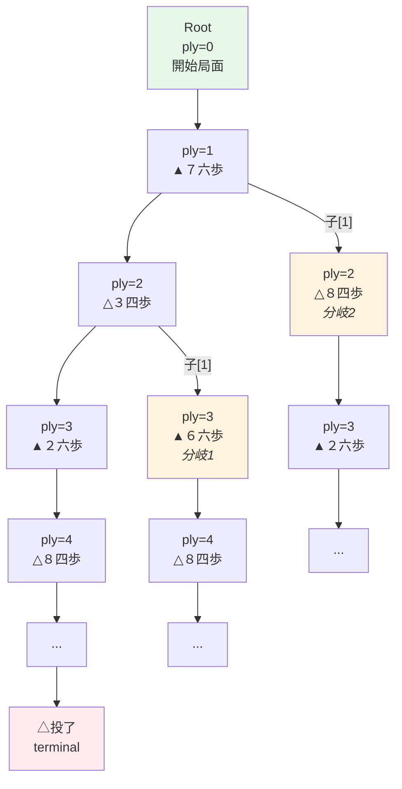

**本譜**はルートから各ノードの `children[0]`（最初の子）を辿った経路である。`children[1]` 以降が分岐を表す。`isMainLine()` は「親の最初の子であるか」で判定する。

#### TerminalType — 終局手の種類

**ソース**: `src/core/terminaltype.h/.cpp`

```cpp
enum class TerminalType {
    None,           // 通常の指し手
    Resign,         // 投了
    Checkmate,      // 詰み
    Repetition,     // 千日手
    PerpetualCheck, // 王手千日手
    Impasse,        // 持将棋
    Timeout,        // 時間切れ
    IllegalWin,     // 反則勝ち
    IllegalLoss,    // 反則負け
    Forfeit,        // 不戦敗
    Interrupt,      // 中断
    NoCheckmate,    // 不詰（詰将棋用）
    DeclarationWin, // 入玉宣言勝ち
    Draw,           // 引き分け
    MaxMoves,       // 最大手数到達
    Error,          // エラー
    ForfeitWin      // 不戦勝
};
```

終局手ノードは `isTerminal() == true` であり、盤面を変えない（局面SFENは直前の局面、`ShogiMove` は無効）。
終局の種類と終局語（「投了」など）の対応は名前空間 `TerminalTypes` の表1つにまとめている。
`label()` が棋譜に書く語、`displayLabel()` が表示言語に訳した語を返し、`fromWord()`・`findWord()` が語（「切れ負け」などの別表記を含む）から種類を判定する。

#### BranchLine — ライン情報

```cpp
struct BranchLine {
    int lineIndex = 0;                      // 0=本譜、1以降=分岐
    QString name;                           // "本譜", "分岐1", ...
    QList<KifuBranchNode*> nodes;           // ルートから終端までのノード列
    int branchPly = 0;                      // 分岐開始手数（本譜は0）
    KifuBranchNode* branchPoint = nullptr;  // 分岐点のノード（本譜は nullptr）
};
```

`allLines()` で全ラインを取得でき、`displayItemsForLine(lineIndex)` / `sfenListForLine(lineIndex)` でライン単位のデータ抽出が可能。

#### RecordLine — 手順の値

**ソース**: `src/kifu/recordline.h`（ヘッダオンリー）

1本の手順（開始局面と、指した手の行の並び）を表す値。終局行（投了など）は含まない。分岐ツリーで表示中の手順のスナップショット（検討・詰み探索・棋譜解析・定跡のマージ・読み筋の表示・書き出しに渡す）と、対局中の手順（司令塔の `MatchCoordinator::record()`、通信対局の `CsaGameProgress::record`）の両方に使う。局面列や指し手列を別々の一覧から探さずに、この値から取る。

```cpp
struct RecordLine {
    QString startSfen;          // 開始局面（完全な SFEN）
    QList<RecordEntry> entries; // entries[i] は i+1 手目（指した手と、その手の後の局面）
    int currentPly = 0;         // 表示中の手数（0 は開始局面）

    int moveCount() const;                        // 手数
    QString sfenAt(int ply) const;                // ply 手目の後の局面（0 は開始局面）
    QStringList sfens() const;                    // 開始局面と各手の後の局面
    QList<ShogiMove> moves() const;               // 各手
    UsiMove usiMove(int ply) const;               // ply 手目の指し手
    QStringList usiMoves(int upToPly = -1) const; // upToPly 手目までの USI の指し手
    BoardSquare destinationOf(int ply) const;     // ply 手目の移動先
    RecordLine upTo(int ply) const;               // ply 手目までの手順
    QString positionCommand(int ply) const;       // ply 手目の後の position コマンド
};
```

| 取り出し方 | 中身 |
|---------|------|
| `KifuNavigationState::currentRecordLine()` | 表示中の手順（選んでいる分岐。対局中はライブの手も含む） |
| `KifuBranchTree::mainRecordLine()` | 本譜の手順 |
| `KifuBranchTree::toRecordLine(nodes, currentPly)` | 任意のノード列（static） |
| `MatchCoordinator::record()` | ローカル対局で指した手順 |

棋譜の正本は分岐ツリーとそのカーソル（8.10）である。対局を始めるときは表示中の手順を `MatchStartOptions::recordLine` で司令塔に渡し、司令塔はその `currentPly` までを対局の手順にする（[指し手データ・棋譜データ構造](move-and-record-data-structures.md) の 4.4）。

#### KifuBranchTree の主要API

| カテゴリ | メソッド | 説明 |
|---------|---------|------|
| 構築 | `setRootSfen(sfen)` | ルートノードを作成 |
| 構築 | `addRecord(parent, entry)` | 棋譜の1行（指した手か終局）のノードを追加（`treeChanged` 発火） |
| 構築 | `addMove(parent, move, text, sfen, time)` | 指し手ノードを追加（`treeChanged` 発火） |
| 構築 | `addMoveQuiet(...)` | 指し手追加（`treeChanged` を発火しない） |
| 構築 | `addTerminalMove(parent, type, side, time)` | 終局手ノードを追加（表記は終局語の表から作る） |
| 構築 | `beginBatchUpdate()` / `endBatchUpdate()` | 一括更新の間は `treeChanged` を最後の1回にまとめる |
| 検索 | `nodeAt(nodeId)` | IDで O(1) 検索 |
| 検索 | `findByPlyOnMainLine(ply)` | 本譜のN手目を取得 |
| 検索 | `findBySfen(sfen, ply)` | SFEN一致検索 |
| 検索 | `findMatchingChild(parent, entry)` | 同じ手の子ノード（指し直しで再利用する） |
| ライン | `mainLine()` | 本譜のノード列を取得 |
| ライン | `pathToNode(node)` | ルートから指定ノードまでの経路 |
| ライン | `allLines()` | 全 `BranchLine` のリスト |
| ライン | `mainRecordLine()` | 本譜の手順（`RecordLine`、終局行を除く） |
| ライン | `toRecordLine(nodes, currentPly)` | ノード列を `RecordLine` にする（static） |
| 分岐 | `hasBranch(node)` | 分岐の有無判定 |
| 分岐の編集 | `moveChild(child, index)` / `promoteToMainLine(node)` / `removeSubtree(node)` | 分岐の並べ替え・本譜にする・削除（利用者の操作） |
| コメント | `setComment(nodeId, comment)` | コメント設定 |

#### シグナル

| シグナル | 発火タイミング |
|---------|--------------|
| `treeChanged()` | ツリー構造が変更された時（`addRecord`・`addMove`・分岐の編集など。一括更新中は最後に1回） |

`*Quiet` の付くメソッド（`addMoveQuiet`・`removeLeafQuiet`・`moveChildQuiet`）は `treeChanged` を出さない。

### 8.3 KifuBranchTreeBuilder — ツリー構築

**ソース**: `src/kifu/kifubranchtreebuilder.h/.cpp`

フォーマット変換器のパース結果（`KifParseResult`）から `KifuBranchTree` を構築する静的ビルダークラスである。コンストラクタは private で、全メソッドが static。

#### 構築フロー

```
buildFromKifParseResult(tree, result, startSfen)
  │
  ├── validateVariations(result)        … 変化の親（parentVariation）と開始手数を検証
  │                                       （不正なら false を返し、既存のツリーを変えない）
  ├── tree->beginBatchUpdate()
  ├── tree->clear()、tree->setRootSfen(startSfen)
  ├── addKifLineToTree(tree, mainline, {root})
  │     └── 本譜の各行を addRecord() で追加（開始局面のコメント・しおりはルートへ）
  ├── for each variation:
  │     ├── 親の手順（本譜か先に追加した変化）の先頭 startPly 個を経路として取る
  │     │     （最後のノードが分岐点）
  │     └── addKifLineToTree(tree, variation.line, 経路)
  └── tree->endBatchUpdate()            … treeChanged を1回だけ発火
```

変化の親子関係はパース時に `KifVariation::parentVariation`（-1 は本譜、それ以外は先に定義された変化の番号）として持つため、ビルダーは手数や局面から分岐点を探し直さない。

### 8.4 KifDisplayItem / KifParseTypes — 基本データ型

#### KifDisplayItem

**ソース**: `src/kifu/kifdisplayitem.h`

棋譜の1手分の表示情報を保持する軽量構造体。UIモデル（`KifuRecordListModel`）やフォーマット変換器で広く使用される。

```cpp
struct KifDisplayItem {
    QString prettyMove;  // "▲７六歩" — 表示用指し手テキスト
    QString timeText;    // "00:05/00:00:15" — 消費時間
    QString comment;     // コメント
    QString bookmark;    // しおり
    int     ply = 0;     // 手数（0始まり）
    // 表示と保存で共有する型付きの局面・終局情報
    QString beforeSfen;  // この手を指す前の局面
    QString usiMove;     // この手の USI 表記（終局行は空）
    bool terminal = false;
    TerminalType terminalType = TerminalType::None;
    Turn terminalSide = Turn::Black;
};
```

`Q_DECLARE_METATYPE` でQt メタタイプに登録されており、シグナル/スロットで直接受け渡し可能。

#### KifParseResult / KifLine / KifVariation

**ソース**: `src/kifu/kifparsetypes.h`

フォーマット変換器が棋譜をパースした結果を格納する構造体群。手順は棋譜の1行 `RecordEntry` の並びで持ち、局面列・指し手列・表示データは必要なときに行から作る。

```cpp
struct KifLine {
    int startPly = 1;                       // 開始手数
    QString baseSfen;                       // 手順の開始局面のSFEN
    std::optional<KifDisplayItem> opening;  // 開始局面のコメント・しおり
    QList<RecordEntry> entries;             // 各行（終局行を含む）

    bool endsWithTerminal() const;          // 終局手で終わるか
    int moveCount() const;                  // 指し手の数（終局行を除く）
    QString sfenAt(int offset) const;       // offset 手目の後の局面（0 は baseSfen）
    QStringList usiMoves() const;           // USI形式の指し手列
    QStringList sfenList() const;           // baseSfen と各手の後の局面
    QList<KifDisplayItem> displayItems() const; // 表示用データ
};

struct KifVariation {
    int startPly = 1;            // 変化開始手数（「変化：65手」なら 65）
    KifLine line;                // 変化の手順
    int parentVariation = -1;    // 分岐元の手順。-1 は本譜、それ以外は variations の先行要素
};

struct KifParseResult {
    KifLine mainline;                // 本譜
    QList<KifVariation> variations;  // 変化リスト
};
```

#### KifGameInfoItem — 対局情報の1項目

**ソース**: `src/kifu/kifparsetypes.h`

棋譜ヘッダーの1項目（`key` 例: `"開始日時"`、`value` 例: `"2025/03/02 09:00"`）。変換器の `extractGameInfo()` が返し、対局情報ドックと棋譜出力（8.5 の `KifuExportMetadata::gameInfoItems`）で使う。

### 8.5 GameRecordModel — 棋譜データの中央管理

**ソース**: `src/kifu/gamerecordmodel.h/.cpp`

`KifuBranchTree` を正本として、コメント・しおりの編集と各種フォーマットへの出力を担当する。ツリー未構築時のみ内部配列へ保存する。

#### 責務

1. **コメント・しおり管理**: 表示中の分岐のノードを更新し、変更シグナルで表示へ通知（棋譜欄の表示用の一覧には書かない）
2. **変更追跡**: `isDirty()` で未保存の変更を検出
3. **棋譜出力**: 6つのフォーマットへの変換メソッドを提供

#### データフロー

```
CommentCoordinator::onCommentUpdated(moveIndex, comment)  ← コメント欄（CommentEditorPanel）の更新
  │   手数は表示中の手（KifuNavigationState::currentPly()）を優先する
  ▼
setComment(ply, comment)
  │
  ├── 表示中の分岐（KifuNavigationState::currentLineIndex()）の ply 番目のノードに保存
  │     （ツリー未構築時のみ内部配列。ツリーがあってその手数のノードが無ければ何もしない）
  └── 内容が変わったときだけ isDirty() を立てて commentChanged(ply, comment)
        └── CommentCoordinator::onGameRecordCommentChanged（合成ルートが接続）
              ├── 棋譜欄: KifuRecordListModel の ply 行のコメントを書き換え、
              │           コメント列（列3）の dataChanged を出す
              └── コメント欄: broadcastComment() で CommentEditorPanel の本文と手数を更新
```

しおり（`setBookmark()` → `bookmarkChanged`）も同じ流れで、`CommentCoordinator::onBookmarkChanged` が棋譜欄のしおり列（列2）を更新する。

#### ExportContext — 出力コンテキスト

`ExportContext` は `KifuExportMetadata`（`src/kifu/kifuexportmetadata.h`）の別名。UIウィジェットへの参照を含まない。
`KifuExportMetadataBuilder` が通常出力と簡易KIF保存で、対局情報の見出し（`collect()`）・対局者名（`resolvePlayerNames()`）・手合割（`handicapLabel()`。開始局面から判定する）を共通に作る。

```cpp
struct KifuExportMetadata {
    bool gameInfoProvided = false;         // 空の編集結果も明示できる
    QList<KifGameInfoItem> gameInfoItems;  // UIから抽出済みの値
    QString startSfen;                     // 開始局面SFEN
    MatchPlayers players;                  // 対局情報が無いときに書く対局者（人間・エンジンと名前）
    TimeControl timeControl;               // 持ち時間（CSA出力用。双方とも時間制限がなければ書かない）
    QDateTime gameStartDateTime, gameEndDateTime;
};
```

#### 出力フォーマット

| メソッド | 形式 | 分岐対応 | 備考 |
|---------|------|---------|------|
| `toKifLines(ctx)` | KIF | あり | 日本将棋連盟標準形式。消費時間・コメント含む |
| `toKi2Lines(ctx)` | KI2 | あり | 移動元座標省略形式。消費時間なし |
| `toCsaLines(ctx, usiMoves)` | CSA | なし | コンピュータ将棋協会形式。本譜のみ |
| `toJkfLines(ctx)` | JKF | あり | JSON棋譜フォーマット |
| `toUsenLines(ctx, usiMoves)` | USEN | あり | URLセーフ短縮形式 |
| `toUsiLines(ctx, usiMoves)` | USI | なし | position コマンド文字列。本譜のみ |

保存・コピーで渡す `usiMoves` は、`collectMainlineUsiForExport()`（分岐ツリーの本譜 `KifuBranchTree::mainRecordLine().usiMoves()`）から取る。

### 8.6 LiveGameSession — ライブ対局セッション

**ソース**: `src/kifu/livegamesession.h/.cpp`

進行中の対局を一時的に記録し、対局終了時に `KifuBranchTree` にコミットするセッション管理クラス。途中局面からの対局開始にも対応する。

#### commit/discard パターン

```
  startFromNode(branchPoint)          startFromRoot()
        │                                   │
        ▼                                   ▼
   ┌────────────────────────────────────────────┐
   │           m_active = true                  │
   │  ┌──────────────────────────────┐          │
   │  │ appendRecord(entry)          │ ← 繰返し │
   │  │ （終局の行も同じ経路）         │          │
   │  │ undoMoves(count)  … 待った    │          │
   │  └──────────────────────────────┘          │
   └────────────┬──────────────────┬────────────┘
                │                  │
         commit()             discard()
                │                  │
                ▼                  ▼
   ┌─────────────────┐  ┌──────────────────┐
   │ツリーに分岐追加   │  │セッション破棄     │
   │sessionCommitted  │  │sessionDiscarded  │
   │シグナル発火       │  │シグナル発火       │
   └─────────────────┘  └──────────────────┘
```

#### 動作の詳細

1. **`startFromNode(branchPoint)`**: 途中局面から対局を開始。`branchPoint` が分岐の起点となる
2. **`startFromRoot()`**: 開始局面から新規対局を開始
3. **`appendRecord(entry)`**: 棋譜の1行（`RecordEntry`）を履歴（`m_entries`）に記録しつつ、`KifuBranchTree::addRecord()` でツリーにも即座にノードを追加する（リアルタイムUI更新のため。ツリーの更新とセッションの更新がそろってから `treeChanged` が出るよう、一括更新で囲む）。同じ手の子が既にあれば `findMatchingChild()` で再利用し、重複した分岐を作らない。対局中は `MatchRecordSink` を実装する `GameSession::appendRecord()` から呼ばれる（ローカル対局・通信対局とも）。`addMove(move, text, sfen, elapsed)` は同じ処理を個別の値で呼ぶ版
4. **終局の行**: 終局の `RecordEntry` を追加すると、以後 `canAddMove()` は `false` を返す
5. **`commit()`**: セッションの内容を確定。`sessionCommitted` シグナルで新しいラインの終端ノードを通知
6. **`discard()`**: セッションを破棄。ツリーには変更を加えない

#### 待った（undoMoves）

`undoMoves(count)` はセッションの履歴と現在位置（`m_liveParent`）を巻き戻すだけで、ツリーのノードは削除しない。取り消した手順は分岐として残る。
このセッションで追加した手順を取り消した場合は、その先頭ノードを `m_undoneNodeIds` に記録する。次に指した手（新規ノード・既存ノードの再利用・終局手のいずれも）が記録済みの兄弟より後ろにあれば、`KifuBranchTree::moveChildQuiet()` で前へ移す。
これにより、実際に指した手順が本譜側、取り消した手順が分岐側に並ぶ。以前の棋譜から再利用した手を取り消した場合は記録せず、以前の本譜の並びを保つ。
`canUndoMoves()` は対局開始位置（分岐起点・ルート）より前へは戻さない。

#### 途中局面からの分岐

`startFromNode(branchPoint)` で始めると、手順は分岐起点の子として追加される。起点の手数・局面は `anchorPly()`・`anchorSfen()` が返す。棋譜の途中から続けた対局の情報は `setFirstMoveNote()` で、新しく作った最初の手のコメントに残す。消費時間の累計は `continuedTime()`・`continuedElapsedText()` で、棋譜上で同じ側が直前に指した手の累計に続ける。

#### 主要シグナル

| シグナル | 発火タイミング |
|---------|--------------|
| `sessionStarted(branchPoint)` | セッション開始時 |
| `moveAdded(ply, displayText)` | 行（指し手・終局）追加時 |
| `movesUndone()` | 待ったで巻き戻した時 |
| `sessionCommitted(newLineEnd)` | 確定時（新ラインの終端ノードを通知） |
| `sessionDiscarded()` | 破棄時 |

### 8.7 KifuLoadCoordinator — 棋譜読み込みフロー

**ソース**: `src/ui/coordinators/kifuloadcoordinator.h/.cpp`, `src/kifu/kifuloadparser.h/.cpp`, `src/ui/coordinators/kifuapplyservice.h/.cpp`

棋譜ファイルの読み込みからUI反映までを統括するコーディネータ。6つのファイル形式と、テキスト貼り付けによる自動判定読み込みに対応する。パース（`KifuLoadParser`）と、結果をモデル・UIに当てはめる処理（`KifuApplyService`）は別のクラスにある。

起動時に `MainWindowComposer::wireKifu()` が `KifuLoadCoordinatorFactory::createAndWire()` で一度だけ作り（親は MainWindow）、以後のすべての読み込みに使う。`KifuFileController` は `Deps::loadCoordinator` でポインタを受け取る。読み込み中に次の読み込みを始めると、前の読み込みは `KifuLoadCoordinator` 自身が打ち切る。

#### 読み込みフロー

```
ユーザーがファイルを開く
  │
  ▼
loadFileAsync(filePath) / loadTextAsync(content)     ← KifuFileController から
  │   （同期版の loadKifuFromFile / loadKi2FromFile / loadCsaFromFile / ... も同じ applyLoadResult() を通る）
  ▼
KifuLoadParser::parseFile() / parseText()             ← 別スレッド（QtConcurrent::run）
  │   形式を判定してフォーマット変換器の parseWithVariations() を呼ぶ
  │   → KifuLoadResult { initialSfen, teaiLabel, gameInfo, record: KifParseResult（本譜 + 変化）, ... }
  ▼
onLoadFinished() → applyLoadResult(result)            ← メインスレッド
  │
  ├── 1. 対局情報
  │     ├── KifuApplyService::populateGameInfo() → 対局情報テーブルに反映
  │     └── KifuApplyService::applyPlayersFromGameInfo() → 対局者名を盤面に反映
  │
  └── 2. KifuApplyService::applyParsedResult(filePath, initialSfen, teaiLabel, record, ...)
        │
        ├── 2a. applyToRecordView()
        │     ├── displayGameRecord(disp) フック → 棋譜欄に反映（GameRecordModel にコメント・しおり）
        │     ├── 棋譜欄の先頭行を選択、navState->goToRoot()
        │     └── enableArrowButtons() フック
        │
        ├── 2b. applyBranchTree()
        │     ├── KifuBranchTreeBuilder::buildFromKifParseResult() でツリー構築（変化の親子を先に検証）
        │     │     （beginBatchUpdate()/endBatchUpdate() で treeChanged を1回にまとめる）
        │     ├── navState->goToRoot()、branchTreeBuilt() フック
        │     ├── applyBranchMarksForCurrentLine() → 棋譜欄の分岐マーク
        │     └── 分岐ツリー欄の開始局面をハイライト
        │
        └── 2c. syncBoardAndHighlightsAtRow(0) フック → 盤面を開始局面に同期
```

棋譜の正本は分岐ツリーで、読み込みは分岐ツリーとそのカーソルだけを作り直す。対局の手順は、対局開始時に表示中の手順（`RecordLine`）から司令塔が作る（[対局開始フロー](game-start-flow.md)）。

#### テキスト貼り付け

`loadTextAsync(content)` / `loadKifuFromString(content)` は `KifuLoadParser::parseText()` で、`KifuFileReader::detectFormat()`（`src/kifu/kifufilereader.h`）により形式を自動判定し、適切なパーサーにディスパッチする。SFEN・BOD は局面だけを読み込む（`KifuApplyService::loadPositionFromSfen()`）。

#### 分岐マーカー表示

`KifuApplyService::applyBranchMarksForCurrentLine()` が分岐のある手数を収集し、`KifuRecordListModel::setBranchPlyMarks()` で棋譜モデルへ反映する。

### 8.8 KifuSaveCoordinator / KifuSaveFile / KifuIoService — 保存

**ソース**: `src/ui/coordinators/kifusavecoordinator.h/.cpp`（ダイアログ）、`src/kifu/kifusavefile.h/.cpp`（保存形式の判定と書き込み）、`src/kifu/kifuioservice.h/.cpp`（ファイル I/O）

保存は、ダイアログを出す部分（ui 層）と、ファイルに書く部分（kifu 層）に分かれている。ファイルに書く部分はダイアログを出さないので、GUI・自動化 API・CLI で共通に使う。

#### KifuSaveCoordinator

棋譜の保存ダイアログと未保存の確認を担当する名前空間。

| 関数 | 説明 |
|------|------|
| `saveViaDialog(parent, generateLines, defaultFileName, hasBranches, hasTimeInfo, outError)` | 保存ダイアログを出し、KIF（UTF-8 `.kifu`・Shift_JIS `.kif`）・KI2（`.ki2u`・`.ki2`）・CSA・JKF・USEN・USI のどれかで保存する。形式は選んだパスの拡張子で決まり、決まってから `generateLines(format)` でその形式の行だけを作る。分岐や消費時間を保存できない形式では、続けるか確認する |
| `overwriteExisting(parent, path, lines, outError)` | 既存ファイルへの上書き保存 |
| `confirmDiscardUnsaved(parent, isDirty, save)` | 未保存の変更があるとき、保存・破棄・キャンセルを確認する |

`saveViaDialog` は保存に成功した場合にファイルパスを返し、キャンセルまたはエラーの場合は空文字を返す。最後に保存したフォルダは `GameSettings::lastKifuSaveDirectory` に記録する。

#### KifuSaveFile

保存形式の判定とファイルへの書き出しを担当する名前空間（ダイアログを出さない）。

- **`saveFormatForPath(path)`**: 拡張子から `SaveFormat`（Kif / Ki2 / Csa / Jkf / Usen / Usi）を決める（未知の拡張子は Kif）
- **`pathForSelectedFilter(path, selectedFilter)`**: 拡張子のないパスに、選んだフィルタの拡張子を付ける
- **`hasKnownSaveExtension(path)`** / **`usesShiftJisForPath(path)`**: 保存形式として認識できる拡張子か、Shift_JIS で書く拡張子（`.kif`・`.ki2`）か
- **`write(path, lines, outError, allowUtf8)`**: 拡張子に応じた文字コードで書く。Shift_JIS で表せない文字があれば `allowUtf8` に聞き、許されれば UTF-8 で書く

#### KifuIoService

低レベルのファイルI/Oを担当する名前空間。

- **`makeDefaultSaveFileName(players, now, extension)`**: 対局者（`MatchPlayers`）と日時から既定のファイル名（`日時_先手_vs_後手.拡張子`。名前が無ければ `日時_Session.拡張子`）を作る。GUI では最後に始めた対局の対局者（`AppState::players`）を渡す
- **`charactersNotInShiftJis(text)`**: Shift_JIS で表せない文字を返す
- **`writeKifuFile(path, lines, errorText, useShiftJis)`**: 行リストをテキストファイルとして書き込む

### 8.9 KifuExportController — エクスポート管理

**ソース**: `src/ui/coordinators/kifuexportcontroller.h/.cpp`

`GameRecordModel` の出力メソッドと `KifuSaveCoordinator` / `KifuSaveFile` / `KifuExportClipboard` を統合し、メニュー項目（`KifuFileController` 経由を含む）からエクスポートを実行するコントローラ。

#### 依存構造（Dependencies）

```cpp
struct Dependencies {
    GameRecordModel* gameRecord;
    KifuRecordListModel* kifuRecordModel;
    GameInfoPaneController* gameInfoController;
    TimeControlController* timeController;
    ShogiGameController* gameController;

    const AppState* state;               // 開始局面・対局者（書き出すたびに読む）
    const KifuNavigationState* navState; // 表示中の手順と手数
};
```

依存は起動時に `MainWindowComposer` が `setDependencies()` で1回だけ渡す。開始局面（`AppState::startSfenStr`）と対局者（最後に始めた対局の `AppState::players`）は値を写さず、書き出すたびに `AppState` から読む。既定の保存ファイル名もこの対局者から作る。表示中の手数は分岐ツリーのカーソル（`KifuNavigationState::currentPly()`）から取る。
CSA・USEN・USI の書き出しに使う USI の指し手は、`GameRecordModel::collectMainlineUsiForExport()`（分岐ツリーの本譜）から取る。クリップボード操作は `KifuExportClipboard` に委ね、依存は `Dependencies` から写した `KifuExportClipboard::Deps` で渡す。

#### 主要メソッド

| カテゴリ | メソッド | 説明 |
|---------|---------|------|
| ファイル保存 | `saveToFile()` | ダイアログ表示 → 全形式で保存 |
| ファイル保存 | `overwriteFile(path)` | 上書き保存 |
| ファイル保存 | `autoSaveToDir(dir)` | 指定ディレクトリへ自動保存 |
| クリップボード | `copyKifToClipboard()` | KIF形式でコピー |
| クリップボード | `copyKi2ToClipboard()` | KI2形式でコピー |
| クリップボード | `copyCsaToClipboard()` | CSA形式でコピー |
| クリップボード | `copyJkfToClipboard()` | JKF形式でコピー |
| クリップボード | `copyUsenToClipboard()` | USEN形式でコピー |
| クリップボード | `copyUsiToClipboard()` | USI形式（全手）でコピー |
| クリップボード | `copyUsiCurrentToClipboard()` | USI形式（現在の手まで）でコピー |
| クリップボード | `copySfenToClipboard()` | SFEN（現在局面）をコピー |
| クリップボード | `copyBodToClipboard()` | BOD形式（現在局面）をコピー |

### 8.10 KifuNavigationState — ナビゲーション状態

**ソース**: `src/kifu/kifunavigationstate.h/.cpp`

`KifuBranchTree` 上の現在位置（棋譜のカーソル）と、分岐点での選択履歴を管理するクラス。表示中の手数は `currentPly()` だけが持ち、MainWindow は手数の変数を持たない。

#### 状態管理

```
KifuNavigationState
  │
  ├── m_currentNodeId        … 現在表示中のノードID（参照時に解決）
  └── m_selectedChildIds     … QHash<parentNodeId, childNodeId>
                               分岐点ごとに最後に選んだ子を記憶
```

#### 優先ライン（Preferred Line）

`setPreferredLineIndex(lineIndex)` は行番号をノードIDの経路へ変換して記憶する。分岐点より前に戻っても維持され、兄弟を並べ替えても選択した手順を辿る。現在の行番号はこの経路から求める。`resetPreferredLineIndex()` で選択記憶を消去する。

#### 分岐選択の記憶

```
手順例:
  1. 3手目で2番目の子（分岐）を選択
     → rememberChildSelection(node2, 1) で記憶（node2 は分岐点）
  2. 1手目に戻る
  3. 「進む」で3手目に到達
     → lastSelectedChildAt(node2) が 1 を返す
     → 自動的に同じ分岐を選択
```

`rememberPathSelections(node)` はルートから `node` までの経路上の全分岐点で、経路が通る子を記憶する。`clearLineSelectionMemory()` ですべての記憶をクリアし、ナビゲーションを本譜に戻す。記憶する添字は `childAt()` の添字で、`allLines()` のラインインデックスとは別物である。

#### 主要メソッド

| カテゴリ | メソッド | 説明 |
|---------|---------|------|
| 位置 | `currentNode()` | 現在のノードを取得 |
| 位置 | `currentPly()` | 現在の手数（表示中の手数）を取得 |
| 位置 | `currentLineIndex()` | 現在のラインインデックスを取得 |
| 位置 | `currentSfen()` | 現在位置のSFENを取得 |
| 位置 | `currentRecordLine()` | 表示中の手順（`RecordLine`。8.2 を参照） |
| 設定 | `setCurrentNode(node)` | 現在位置を設定 |
| 設定 | `goToRoot()` | ルートに移動 |
| クエリ | `isOnMainLine()` | 本譜にいるか |
| クエリ | `canGoForward()` / `canGoBack()` | 進める/戻れるか |
| 分岐 | `branchCandidatesAtCurrent()` | 現在位置の分岐候補 |
| 分岐 | `hasBranchAtCurrent()` | 現在位置に分岐があるか |
| 記憶 | `rememberChildSelection(node, childIndex)` | 分岐点で選んだ子を記憶 |
| 記憶 | `lastSelectedChildAt(node)` | 分岐点で最後に選んだ子を取得 |
| 記憶 | `rememberPathSelections(node)` | 経路上の全分岐点の選択を記憶 |

`KifuNavigationState` はシグナルを持たない。カーソルを動かすのは `KifuNavigationController`（ナビゲーション操作。棋譜欄の行の選択も `KifuDisplayCoordinator` から `goToLine()` でここを通る）、`KifuDisplayCoordinator`（対局の開始・着手・待った。対局中は盤を動かさずカーソルとハイライトだけを最新手に合わせる）、`KifuApplyService`（棋譜の読み込み）、`PreStartCleanupHandler`（新規対局の開始前）、`GameSession`（中断した対局の再開と、`MainWindowResetService::resetModels()` を通した初期状態へのリセット）などで、表示の更新は `KifuNavigationController` のシグナル（13.1）で行う。

### 8.11 フォーマット変換器一覧

`src/kifu/formats/` に配置された変換器群は、各棋譜フォーマットを統一的なインターフェースで読み込む。

| クラス | 入力形式 | 概要 | 分岐対応 |
|--------|---------|------|---------|
| `KifToSfenConverter` | KIF (.kif, .kifu) | 日本将棋連盟標準形式。移動元座標付き指し手、消費時間、コメント、BOD盤面図を解析 | あり |
| `Ki2ToSfenConverter` | KI2 (.ki2) | 移動元座標省略形式。盤面状態を追跡し「右」「左」「直」等の修飾語から移動元を推測 | あり |
| `CsaToSfenConverter` | CSA (.csa) | コンピュータ将棋協会形式。PI/P1..P9による初期局面、`+`/`-` による指し手、`$` による対局情報を解析 | なし |
| `JkfToSfenConverter` | JKF (.jkf) | JSON棋譜フォーマット。`header` / `initial` / `moves` の3セクション構造。分岐は `forks` 配列で表現 | あり |
| `UsenToSfenConverter` | USEN (.usen) | URLセーフ短縮形式。base36エンコードされた指し手列（3文字=1手）。`~(startPly).` で分岐区切り | あり |
| `UsiToSfenConverter` | USI (.usi) | USI position コマンド文字列。`startpos moves ...` または `sfen ... moves ...` 形式 | なし |

#### 共通API

すべての変換器は以下の統一インターフェースを持つ:

```cpp
// 初期局面SFENの検出
static QString detectInitialSfenFromFile(const QString& path, QString* detectedLabel = nullptr);

// USI指し手列の抽出（本譜のみ）
static QStringList convertFile(const QString& path, QString* errorMessage = nullptr);

// 表示用データの抽出（コメント含む）
static QList<KifDisplayItem> extractMovesWithTimes(const QString& path, QString* errorMessage = nullptr);

// 本譜＋全変化の一括抽出（推奨API）
static bool parseWithVariations(const QString& path, KifParseResult& out, QString* errorMessage = nullptr);

// 対局情報の抽出
static QList<KifGameInfoItem> extractGameInfo(const QString& filePath);

// テキスト版（貼り付けた棋譜など。ファイル版はファイルを読んでこれらに渡す）
static QString detectInitialSfenFromText(const QString& text, QString* detectedLabel = nullptr);
static bool parseText(const QString& text, KifParseResult& out, QString* errorMessage = nullptr);
static QList<KifGameInfoItem> extractGameInfoFromText(const QString& text);
```

`parseWithVariations()` / `parseText()` が最も包括的なAPIである。`KifuLoadParser` はファイルを1回だけ読み、テキスト版の `parseText()` などを呼ぶ（貼り付けも同じ経路で、一時ファイルは作らない）。CSA は `parse()` / `parseText()`、USEN は対局情報を持たない。

#### KI2形式の移動元推測

KI2形式は移動元座標がないため、`Ki2ToSfenConverter` は局面を `ShogiBoard` で追い、各指し手で以下の処理を行う:

1. `Ki2Lexer::parseMoveText()` で移動先（「同」）・駒・修飾語（「右」「左」「上」「引」「寄」「直」）・成／不成・打を分ける
2. `Ki2MoveNotation::resolve()` で、局面の合法手（`EngineMoveValidator::legalMoves()`）のうち同じ駒が移動先へ動く手を修飾語で1つに絞る。
   ピンされた駒は合法手に入らないので候補にならない。合法手で決まらない手（二歩・王手放置などの反則手を書いた棋譜）だけは、
   駒の動きだけで決めた手（`EngineMoveValidator::pseudoLegalMoves()`）から選ぶ
3. 決まった `UsiMove` を `ShogiBoard::applyUsiMove()` で盤に適用する

書き出し（`Ki2Exporter`）は、分岐ツリーのノードの手（`ShogiMove::move` の `UsiMove`）と局面から `Ki2MoveNotation::format()` で
KI2 の文字列を作る。修飾語は日本将棋連盟の棋譜の表記方法に合わせる（動作の上・引・寄を優先し、区別できなければ右・左。
金・銀が真っ直ぐ上がるときは直。飛・角・竜・馬は直を使わない。3枚以上は「左上」のように位置・動作の順）。

### 8.12 補助クラス

#### KifuFileReader

**ソース**: `src/kifu/kifufilereader.h/.cpp`

棋譜の形式を判定する名前空間。`detectFormat(content)` がテキストの内容から、`detectFileFormat(filePath)` がファイルから `KifuFormat`（Unknown / KIF / KI2 / CSA / USI / JKF / USEN / SFEN / BOD）を返す。棋譜の読み込み（`KifuLoadParser`・`KifuFileController`）と棋譜の変換（`KifuConversionService`）で使う。

#### KifuClipboardService / KifuExportClipboard

**ソース**: `src/ui/coordinators/kifuclipboardservice.h/.cpp`, `src/ui/coordinators/kifuexportclipboard.h/.cpp`

`KifuClipboardService` は KIF・KI2 形式の棋譜をクリップボードに書き込む名前空間（`copyKif()`・`copyKi2()`）。`KifuExportClipboard` は `KifuExportController` から各形式（KIF・KI2・CSA・JKF・USEN・USI・SFEN・BOD）のコピーを受け持つ。

#### KifReader

**ソース**: `src/kifu/kifreader.h/.cpp`

棋譜ファイルを文字コード（UTF-8・CP932 など）を自動判別して読み込む名前空間（`readAllLinesAuto()`・`readAllTextAuto()`）。

#### ShogiInfoRecord

**ソース**: `src/kifu/shogiinforecord.h/.cpp`

USIエンジンの思考情報（時間・深さ・ノード数・評価値・読み筋）を1レコードとして保持するクラス。engine層の `ThinkingInfoPresenter` と連携して思考タブに表示される。

<!-- chapter-8-end -->

---

<!-- chapter-9-start -->
## 第9章 analysis層：解析機能

analysis層（`src/analysis/`）は、USIエンジンを用いた局面・棋譜の解析機能を提供するレイヤーである。**検討（Consideration）**・**棋譜解析（KifuAnalysis）**・**詰将棋探索（TsumeSearch）** の3つのモードを持ち、それぞれ異なるユースケースに対応する。

analysis層にはダイアログを知らない部分（`AnalysisSession`・`AnalysisJob`・`AnalysisCoordinator`・詰将棋の生成など）を置く。ダイアログを出してモードを始めるフローコントローラ（`ConsiderationFlowController`・`AnalysisFlowController`・`TsumeSearchFlowController`）は `src/ui/coordinators/`、結果の表示（`AnalysisResultsPresenter`・`AnalysisResultHandler`）は `src/ui/presenters/`、検討タブの操作（`ConsiderationUiController`）は `src/ui/controllers/`、結果のモデル（`KifuAnalysisListModel`）は `src/models/` にある。

### 9.1 3モードの比較

| 項目 | 検討（Consideration） | 棋譜解析（KifuAnalysis） | 詰将棋探索（TsumeSearch） |
|------|----------------------|------------------------|--------------------------|
| **目的** | 現在の1局面をリアルタイムで深く分析する | 棋譜の指定範囲を1手ずつ自動解析し、各手の評価値と候補手を算出する | 現在の局面から詰み手順を探索する |
| **動作状態**（`AppActivityState::Activity`） | `DuringConsideration` | `DuringAnalysis` | `DuringTsumeSearch` |
| **USIコマンド** | `go infinite`（時間指定があればタイマーで `stop`） | `go infinite` + タイマーで `stop`（1手あたり固定時間） | `go mate <time>` / `go mate infinite` |
| **エンジン管理** | `AnalysisSession`（エンジンの枠 E1 を対局と共有） | `AnalysisJob` が専用 `Usi` を作成・管理 | `AnalysisSession`（検討と同じ） |
| **結果表示** | 検討タブにリアルタイム表示、盤面に矢印オーバーレイ | 結果一覧テーブル（ドックウィジェット）、評価値グラフ | 思考情報と、詰みの有無のメッセージ |
| **MultiPV** | 対応（複数候補手を同時表示、検討中に変更可） | `AnalysisCoordinator::Options::multiPV` を `setoption name MultiPV` で送る（ダイアログからは1） | 非対応（1手順のみ） |
| **フロー制御** | `ConsiderationFlowController` | `AnalysisFlowController` + `AnalysisCoordinator` | `TsumeSearchFlowController` |
| **UI制御** | `ConsiderationUiController` | `AnalysisResultsPresenter` | なし（結果はメッセージで知らせる） |

### 9.2 全体構成

```
┌─────────────────────────────────────────────────────────────────────────┐
│  ui/coordinators・ui/controllers・ui/presenters                          │
│                                                                         │
│  ┌──────────────────────────────┐  ┌──────────────────────────────┐     │
│  │ ConsiderationFlowController  │  │ ConsiderationUiController    │     │
│  │ 検討の開始                    │  │ 検討タブの操作と表示          │     │
│  │ DirectParams → 即座に開始     │  │ 矢印、経過時間、MultiPV       │     │
│  └───────────┬──────────────────┘  └──────────────────────────────┘     │
│  ┌───────────┼──────────────────┐                                       │
│  │ TsumeSearchFlowController    │                                       │
│  │ 詰み探索の開始（ダイアログ）   │                                       │
│  └───────────┤──────────────────┘                                       │
│              │ AnalysisSession::start(AnalysisOptions)                   │
│  ┌──────────────────────────────┐  ┌──────────────────────────────┐     │
│  │ AnalysisFlowController       │  │ AnalysisResultsPresenter     │     │
│  │ 棋譜解析の全体フロー管理       │  │ 解析結果テーブルのUI構築      │     │
│  │ ダイアログ→ジョブ→結果表示     │  │ AnalysisResultHandler        │     │
│  └───────────┬──────────────────┘  │ 1手ごとの結果の確定           │     │
│              │ 所有                 └──────────────────────────────┘     │
├──────────────┼──────────────────────────────────────────────────────────┤
│  analysis 層（src/analysis/）                                           │
│              ▼                                                          │
│  ┌──────────────────────────────┐  ┌──────────────────────────────┐     │
│  │ AnalysisJob                  │  │ AnalysisSession              │     │
│  │ 1回の棋譜解析（Usi の利用期間）│  │ 検討・詰み探索のセッション    │     │
│  │  └ AnalysisCoordinator        │  │ 開始・停止・やり直しの状態遷移 │     │
│  │    局面の逐次送信と info 受信  │  │ エンジンは E1 の枠に作る      │     │
│  └──────────────────────────────┘  └──────────────┬───────────────┘     │
│                                                   │                     │
│                     game 層の EngineLifecycleManager（枠 E1・E2）◄──┘     │
│                                                                         │
│  models/ の KifuAnalysisListModel … 解析結果の8列テーブルモデル          │
└─────────────────────────────────────────────────────────────────────────┘
```

### 9.3 AnalysisCoordinator — エンジン解析の逐次制御

**ソース**: `src/analysis/analysiscoordinator.h`, `src/analysis/analysiscoordinator.cpp`

AnalysisCoordinator は、USIエンジンへの局面送信・思考開始・停止を逐次的に制御する低レベルコーディネータである。エンジンプロセスそのものは所有せず、`requestSetOption`・`requestSearch`・`requestStop` シグナルで送信を外部に頼む（`AnalysisJob` が `Usi` の型付き送信メソッドにつなぐ）。解析する局面は `Deps::positions`（`[ply]` ごとの SFEN か `position ...` コマンド。`AnalysisJob` が `RecordLine::sfens()` を渡す）で受け取る。

#### 解析モード（Mode）

```cpp
enum Mode {
    Idle,            // 解析停止中
    SinglePosition,  // 単一局面の解析（検討モードから利用）
    RangePositions   // 範囲解析（棋譜解析から利用）
};
```

#### 状態遷移

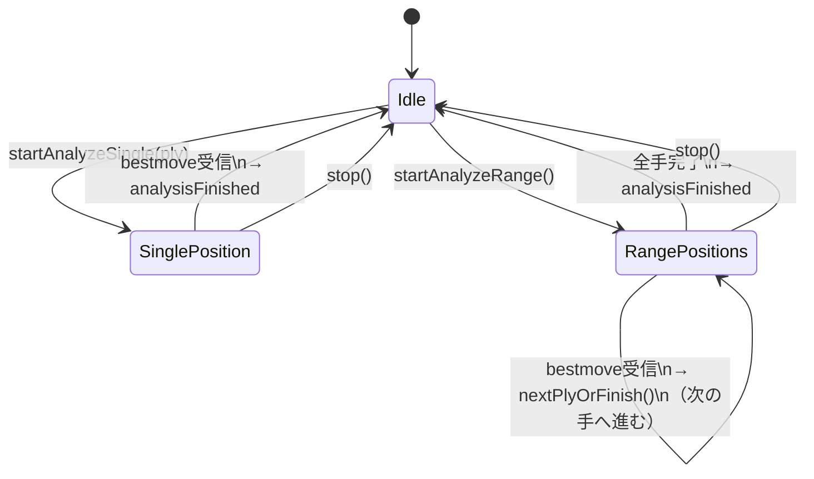

#### Options 構造体

```cpp
struct Options {
    int startPly = 0;       // 解析開始手数
    int endPly = -1;        // 解析終了手数（-1=最終手まで）
    int movetimeMs = 1000;  // 1手あたりの思考時間（ミリ秒）
    int multiPV = 1;        // 候補手の数（setoption で送る）
};
```

#### 1手の解析サイクル

```
sendAnalyzeForPly(ply)
  │
  ├── positions[ply] から position コマンドを構築
  ├── m_pendingPosCmd に保存
  ├── emit positionPrepared(ply, sfen)   … 表示用の通知（受け手がいなくても探索は始める）
  └── sendGoCommand()
        │
        ▼
sendGoCommand()
  │
  ├── emit requestSearch(m_pendingPosCmd)  // "position sfen ..." と go infinite の送信を要求
  └── m_stopTimer.start(movetimeMs)  // タイマー開始
        │
        ▼ movetimeMs 経過
onStopTimerTimeout()
  │
  └── emit requestStop()        // 思考停止を要求
        │
        ▼ エンジンが応答
onEngineBestmoveReceived()
  │
  └── nextPlyOrFinish()
        ├── 次の手あり → sendAnalyzeForPly(ply + 1)
        └── 全手完了   → emit analysisFinished(Idle)
```

#### info の受け取り

`onEngineInfo(const UsiInfo&)` で解析済みの info を受け取り、解析中なら `analysisProgress(ply, info)` で伝える。
info 行の解釈は `UsiInfoParser`（第7章）が行い、このクラスは正規表現などで行を読み直さない。
`AnalysisFlowController::onAnalysisProgress` は `UsiScore` から評価値・詰み手数（`"+"` / `"-"` を含む表記）を取り出す。

#### シグナル一覧

| シグナル | 発火タイミング | 用途 |
|---------|--------------|------|
| `requestSetOption(name, value)` | MultiPV の設定時 | `Usi::sendSetOptionCommand()` に接続 |
| `requestSearch(positionCommand)` | 局面の探索開始時 | `Usi::sendPositionAndGoInfinite()` に接続 |
| `requestStop()` | 思考時間の経過・中止時 | `Usi::sendStopCommand()` に接続 |
| `analysisFinished(mode)` | 解析完了・中止時 | UI のリセット |
| `analysisProgress(ply, UsiInfo)` | info 受信時 | 結果の蓄積 |
| `positionPrepared(ply, positionCmd)` | 局面準備完了時 | 盤面表示の更新（`AnalysisJob` が読み筋表示用の局面と直前の手を `Usi` に設定） |

### 9.4 ConsiderationFlowController — 検討モードのフロー制御

**ソース**: `src/ui/coordinators/considerationflowcontroller.h`, `src/ui/coordinators/considerationflowcontroller.cpp`

検討モード（Consideration）の開始処理を担う薄いフローコントローラである。AnalysisCoordinator は使用せず、検討のセッション `AnalysisSession::start()` に直接委譲する点が棋譜解析との大きな違いである。
検討タブの「検討開始」→ `ConsiderationUiController::startConsideration()` → `DialogCoordinator::startConsiderationFromContext()`（表示中の手順から `ConsiderationPositionResolver::resolve()` で局面と直前の手を決める）→ `DialogCoordinator::startConsiderationDirect()` の順に呼ばれ、最後にここへ来る。

#### 検討モードの開始フロー

```
ConsiderationFlowController::runDirect(deps, params, positionStr)
  │
  ├── 1. バリデーション
  │     ├── session が null → エラー通知して return
  │     └── positionStr が空 → エラー通知して return
  │
  ├── 2. エンジンパス取得
  │     └── EngineListSettings::loadEngines() の登録一覧から
  │         名前（名前が空なら番号）で実行ファイルパスを引く
  │
  ├── 3. 秒読み設定
  │     └── byoyomiSec → byoyomiMs 変換（0 = 無制限）
  │
  ├── 4. コールバック通知
  │     ├── onStarted()
  │     ├── onTimeSettingsReady(unlimited, byoyomiSec)
  │     └── onMultiPVReady(multiPV)
  │
  └── 5. AnalysisSession::start(AnalysisOptions)
              │
              ├── mode = AnalysisOptions::Mode::Consideration
              ├── enginePath, engineName  ← エンジン設定
              ├── positionStr             ← "position sfen ..."
              ├── byoyomiMs              ← 思考時間
              ├── multiPV                ← 候補手数
              ├── considerationModel     ← 思考情報モデル
              ├── previousTo             ← 「同」表記用の前手の移動先（BoardSquare）
              └── lastUsiMove            ← ハイライト用の最終手
```

`DialogCoordinator` はコールバックを `considerationModeStarted`・`considerationTimeSettingsReady`・`considerationMultiPVReady` シグナルにし、`DialogCoordinatorWiring` がそれらを `ConsiderationUiController` の `onModeStarted()`・`onTimeSettingsReady()`・`onDialogMultiPVReady()` へつなぐ。

#### DirectParams 構造体

```cpp
struct DirectParams {
    int engineIndex = 0;      // エンジン番号（登録一覧の位置。engineName が空のときだけ使う）
    QString engineName;        // エンジン名（登録一覧から実行ファイルを引く）
    bool unlimitedTime = true; // 無制限思考
    int byoyomiSec = 20;      // 秒読み時間（秒）
    int multiPV = 1;           // 候補手数
    BoardSquare previousTo;    // 前手の移動先（読み筋の「同」の判定に使う）
    QString lastUsiMove;       // 最終手（USI形式、ハイライト用）
};
```

#### 検討モードと対局エンジンの関係

検討のセッション `AnalysisSession`（`src/analysis/analysissession.h/.cpp`）は、対局の司令塔と同じエンジンの枠（`EngineLifecycleManager` の E1）にエンジンを作る（`createEngine(1, ...)`。対局と検討は同時には動かない）。開始すると動作状態を `DuringConsideration`（詰み探索は `DuringTsumeSearch`）にし、`Usi::startEngine()` でエンジンを起動してから `Usi::sendAnalysisCommands()`（position・MultiPV の setoption・`go infinite`、時間指定があればタイマーで `stop`）を送る。
探索が終わると次の局面を待つ（`considerationWaitingStarted`）。局面や候補手の数が変わると探索をやり直し（`updatePosition()`・`updateMultiPV()`）、`stop()` でエンジンを破棄して `considerationModeEnded` を出す。

### 9.5 ConsiderationUiController — 検討モードのUI制御

**ソース**: `src/ui/controllers/considerationuicontroller.h`, `src/ui/controllers/considerationuicontroller.cpp`

検討タブ（`ConsiderationTabManager`）の操作を検討のセッション（`AnalysisSession`）へ伝え、検討の状態（ボタン表示、経過時間、MultiPV、矢印表示）を検討タブと盤へ出すコントローラである。合成ルートが起動時に1つだけ作り（`MainWindowComponents::considerationUi`）、`DialogCoordinator` とは互いを参照するので、両方を作った後に `setDialogCoordinator()` で渡す。

#### UI状態遷移

```
startConsideration()               … 検討タブの「検討開始」（AnalysisTabWiring がつなぐ）
  │ DialogCoordinator::startConsiderationFromContext()
  ▼
onModeStarted()
  │ 検討タブに思考情報モデルと通信ログをつなぐ
  ▼
onTimeSettingsReady(unlimited, byoyomiSec)
  │ 時間表示設定、経過時間のタイマー開始、ボタンを「検討中止」に切替
  ▼
  ├── （ユーザーが棋譜ナビゲーション）
  │     └── KifuNavigationCoordinator::handleBranchNodeHandled()
  │           AnalysisSession::updatePosition() で検討する局面を切り替え
  │
  ├── （ユーザーがMultiPV変更）
  │     └── onMultiPVChanged() → AnalysisSession::updateMultiPV()
  │
  ├── （ユーザーがエンジンを変更）
  │     └── onEngineChanged() → 中止して新しいエンジンで始め直す
  │
  ├── onWaitingStarted()           … 時間切れで次の局面を待つ（タイマーだけ止める）
  │
  └── onModeEnded()                … AnalysisSession::considerationModeEnded
        タイマー停止、ボタンを「検討開始」に戻す、矢印を更新
```

#### 矢印表示のロジック

`updateArrows()` は、検討中かどうか・矢印表示の設定・検討モデルを `CandidateArrowController::setConsiderationState()` に渡すだけで、矢印は `CandidateArrowController`（`src/ui/controllers/candidatearrowcontroller.h/.cpp`。盤ごとに1つ、`forView(view)` で取る）が描く。

```
CandidateArrowController::refresh()
  │
  ├── 検討中でない → 対局中のエンジンの候補手（設定で表示する場合）を描く
  │
  └── 検討中で矢印表示が有効
        │
        └── 検討モデル（ShogiEngineThinkingModel）の各行をイテレーション
              │
              ├── 行の基準局面が盤の局面と違う行は飛ばす
              ├── 読み筋（USI）の最初の指し手を UsiMove::parse() で読む
              │     └── 駒打ちは基準局面の手番で駒の色を決める
              │
              └── arrowForMove() で Arrow を作る（priority は multipv）
                    ├── multipv 1: QColor(255, 0, 0, 200)   — 最善手（濃い赤）
                    └── multipv 2+: QColor(255, 100, 100, 150) — 次善手以降（薄い赤）
```

#### 棋譜ナビゲーション中の検討位置更新

ユーザーが棋譜欄・ナビゲーションボタン・分岐ツリーで局面を移ると、`KifuNavigationController` は移動経路によらず `branchNodeHandled(ply, sfen, previousTo, usiMove)` を出す。`BranchNavigationWiring` 経由でこれを受けた `KifuNavigationCoordinator::handleBranchNodeHandled()` が、検討中なら `AnalysisSession::updatePosition()` で新しい局面（`position sfen ...`）をエンジンに送り、検討タブの経過時間を数え直す。同じ局面なら何もしない。
検討の開始時は `ConsiderationPositionResolver::resolve(line, row, fallbackSfen)`（`src/kifu/considerationpositionresolver.h/.cpp`）が表示中の手順（`KifuNavigationState::currentRecordLine()`）から position コマンドと直前の手（読み筋の「同」の判定に使う移動先と USI の指し手）を決める。

### 9.6 AnalysisFlowController — 棋譜解析の全体フロー

**ソース**: `src/ui/coordinators/analysisflowcontroller.h/.cpp`、`src/analysis/analysisjob.h/.cpp`（1回の解析）、`src/ui/presenters/analysisresulthandler.h/.cpp`（結果の確定）

棋譜解析モードの全体ワークフローを管理する最上位のフローコントローラである。ダイアログ表示から、解析ジョブ（`AnalysisJob`）の起動、結果のモデルへの蓄積、完了通知までの全工程を統括する。`DialogCoordinator` が初回の棋譜解析で作って持ち、メニュー「棋譜解析」から `runWithDialog()` を呼ぶ。

- **`AnalysisJob`**（analysis 層）: 1回の解析の入力（`AnalysisRequest`：手順 `RecordLine`・`AnalysisCoordinator::Options`・エンジンのパスと名前・分岐ライン）と、エンジンの利用期間を持つ。`Usi` を借りなければ自分で作って所有し、`AnalysisCoordinator` を `Usi` の送信メソッドにつなぐ
- **`AnalysisResultHandler`**（ui/presenters）: info の一時結果を持ち、`bestmove` のたびに1手分の結果を確定してモデルに足す

#### Deps 構造体（主要メンバー）

| メンバー | 型 | 必須 | 説明 |
|---------|-----|------|------|
| `line` | `RecordLine` | 必須 | 解析する手順（値。`DialogCoordinator` が表示中の手順を渡す） |
| `analysisModel` | `KifuAnalysisListModel*` | 必須 | 結果蓄積用モデル |
| `usi` | `Usi*` | 任意 | 外部提供のUSIエンジン（null なら `AnalysisJob` が作成） |
| `logModel` / `thinkingModel` | `UsiCommLogModel*` / `ShogiEngineThinkingModel*` | 任意 | エンジンを作るときに渡す通信ログ・思考情報モデル（GUI では E1 のもの） |
| `presenter` | `AnalysisResultsPresenter*` | 任意 | 結果表示プレゼンター |
| `displayError` | `std::function<void(const QString&)>` | 必須 | エラー表示コールバック |
| `activePly` | `int` | — | 解析開始時の表示手数（`RecordLine::currentPly`。分岐ツリーのカーソル） |
| `lineIndex` | `int` | — | 解析対象の分岐ライン |
| `blackPlayerName` / `whitePlayerName` | `QString` | — | 読み筋盤面ダイアログに出す対局者名 |
| `boardFlipped` | `bool` | — | GUI 本体の盤の反転状態（読み筋盤面ダイアログに合わせる） |

#### 棋譜解析の全体シーケンス

```
runWithDialog(deps, parent)
  │
  ├── 1. KifuAnalysisDialog を表示（モーダル）
  │     ├── エンジン選択
  │     ├── 解析範囲（開始手〜終了手。手数の上限は line.moveCount()）
  │     └── 1手あたりの思考時間
  │
  └── 2. start(deps, dialog) → AnalysisRequest を組み立てて start(deps, request)
        │
        ├── 解析範囲を手順の手数に収める、前回の解析を止めて結果をクリア
        ├── presenter->showWithModel() / beginAnalysis()
        ├── AnalysisJob を作成（deps.usi が null なら Usi を作成・所有）
        │     ├── AC::requestSetOption / requestSearch / requestStop
        │     │     → Usi::sendSetOptionCommand / sendPositionAndGoInfinite / sendStopCommand
        │     ├── Usi::engineInitialized → AC::startAnalyzeRange()
        │     ├── Usi::infoReceived → AC::onEngineInfo
        │     └── Usi::bestMoveReceived → 思考情報を流してから resultReady → AC::onEngineBestmoveReceived
        ├── ジョブのシグナルを接続
        │     ├── progress → onAnalysisProgress（一時結果を更新）
        │     ├── positionPrepared → onPositionPrepared
        │     ├── resultReady → onBestMoveReceived（commitPendingResult）
        │     ├── thinkingInfoUpdated → onThinkingInfoUpdated（漢字の読み筋）
        │     ├── errorOccurred → onEngineError
        │     └── finished → onAnalysisFinished
        ├── emit analysisEngineNameChanged / analysisStarted(lineIndex)
        └── AnalysisJob::start() → Usi::startEngine(path, name)
              │
              ▼ （以下、AnalysisCoordinator の解析サイクル）
              ┌─────────────────────────────────────────┐
              │ positionPrepared(ply, sfen)              │
              │   → AnalysisJob が Usi に基準局面・      │
              │     直前の手を設定                       │
              │   → onPositionPrepared()                 │
              │     前の手の確定結果を評価値グラフへ通知  │
              ├─────────────────────────────────────────┤
              │ info行受信 → onAnalysisProgress()        │
              │   pending結果を更新（最新の評価値を保持）  │
              ├─────────────────────────────────────────┤
              │ bestmove受信 → onBestMoveReceived()      │
              │   AnalysisResultHandler::                │
              │     commitPendingResult()                │
              │     → KifuAnalysisListModel に1行追加    │
              │   nextPlyOrFinish()                      │
              └─────────────────────────────────────────┘
              （startPly〜endPly まで繰り返し）
              │
              ▼
        onAnalysisFinished()
          └── 停止ボタン無効化、正常完了なら完了表示、analysisStopped を1回だけ出す
```

#### commitPendingResult() — 解析結果の確定

`AnalysisResultHandler::commitPendingResult()` は1手分の解析が完了した（`bestmove` 受信）タイミングで呼ばれ、蓄積した思考情報を `KifuAnalysisResultsDisplay` オブジェクトに変換して `KifuAnalysisListModel` に追加する。

| 処理 | 説明 |
|------|------|
| 定跡手判定 | info を1件も受け取らずに `bestmove` が来た（一時結果の手数が -1）なら「（定跡）」として処理 |
| 評価値符号反転 | 局面の手番が後手（SFEN の手番が `w`。局面がなければ奇数手）の場合、エンジン出力の評価値符号を反転して先手基準に統一 |
| 詰み表示 | `mate` 値がある場合、`"mate N"` 形式に変換（後手番なら符号も反転） |
| 読み筋選択 | 漢字PV（`m_pendingPvKanji`）を優先、なければUSI PVを使用 |
| 候補手抽出 | 前行の読み筋の最初の指し手を候補手として設定（前行の局面がこの手の前の局面と同じときだけ） |
| 「同」表記 | 候補手の移動先が直前の手の移動先と同じなら「同　」と書く |
| 評価値差 | 直前の数値の評価値との差分を計算（比較できなければ `-`） |

#### PV盤面ダイアログ

結果テーブルの「盤面」列（列6）をクリックすると `AnalysisResultsPresenter::rowDoubleClicked` から `AnalysisFlowController::onResultRowDoubleClicked()` が呼ばれ、`AnalysisResultHandler::showPvBoardDialog()` が `PvBoardDialog`（`src/dialogs/`）を開く。このダイアログは、その局面のSFENから読み筋の指し手を順に再生できるミニ盤面ビューアである。

### 9.7 TsumeSearchFlowController — 詰将棋探索

**ソース**: `src/ui/coordinators/tsumesearchflowcontroller.h`, `src/ui/coordinators/tsumesearchflowcontroller.cpp`

詰将棋探索モードのフローコントローラである。現在の局面を `go mate` コマンドで解析し、詰み手順を探索する。探索そのものは検討と同じ `AnalysisSession` が行う。

#### 探索開始フロー

```
runWithDialog(deps, parent)
  │
  ├── 1. バリデーション
  │     └── session が null → エラー通知して return
  │
  ├── 2. 局面文字列の構築
  │     └── buildPositionForMate(deps)
  │           ├── 途中局面（line.currentPly > 0）→ deps.line.positionCommand(ply)
  │           │     └── "position startpos moves 7g7f 3c3d ..." 形式
  │           └── 開始局面・手順なし → TsumePositionUtil::buildPositionForMate(sfen)
  │                 └── "position sfen ..." 形式（玉の有無から攻方を決めて手番を合わせる）
  │
  ├── 3. TsumeShogiSearchDialog を表示（モーダル）
  │     ├── エンジン選択
  │     └── 探索時間設定
  │
  └── 4. ダイアログを閉じてから、次のイベントループで AnalysisSession::start(AnalysisOptions)
              ├── mode = AnalysisOptions::Mode::Tsume
              ├── enginePath, engineName
              ├── positionStr  ← 構築した局面文字列
              └── byoyomiMs   ← 探索制限時間（0 = 無制限）
```

`AnalysisSession` はエンジンを起動してから `Usi::startMateSearch(position, ms)` で探索を始め、結果（下表）を受けると `stop()` でエンジンを破棄し、`messageRequested` で結果を知らせる（`MainWindowComposer` が `DialogCoordinator::showInformation` につなぐ）。

#### USIコマンドの違い

通常の解析が `go infinite` + タイマーで `stop` を送信するのに対し、詰将棋探索は `go mate <time>`（時間指定なしは `go mate infinite`）を使用する。`Usi::startMateSearch()` が position と go mate を送る（送信だけの `sendMateSearch()` は private）。エンジンは以下の応答を返す。

| 応答 | 意味 | 対応シグナル |
|------|------|------------|
| `checkmate <moves>` | 詰み発見、手順を返す | `checkmateSolved` |
| `checkmate nomate` | 不詰（詰みなし） | `checkmateNoMate` |
| `checkmate notimplemented` | go mate 未対応 | `checkmateNotImplemented` |
| `checkmate timeout` など | 時間内に判定できない | `checkmateUnknown` |

#### position 文字列の構築戦略

`TsumeSearchFlowController::Deps` は `session`（`AnalysisSession`）・`line`（表示中の手順 `RecordLine`）・`fallbackSfen`（手順が無いときの局面）・`onError` を持つ。`buildPositionForMate()` は2つの方式を持つ。

1. **moves形式（途中局面）**: `line.currentPly > 0` のとき、`RecordLine::positionCommand(ply)` で `"position startpos moves 7g7f 3c3d ..."`（平手以外の開始局面は `"position sfen ... moves ..."`）のように指し手列で局面を表現する。エンジンが局面の履歴情報（千日手判定等）を利用できる。

2. **SFEN形式（開始局面）**: 開始局面（詰将棋の問題など）や手順が無いときは、`TsumePositionUtil::buildPositionForMate(sfenLike)` が1つの局面（`line.startSfen` か `fallbackSfen`）から `"position sfen <sfen>"` を作る。玉の有無から攻方を推定し、手番を合わせる。

### 9.8 AnalysisResultsPresenter — 解析結果の表示

**ソース**: `src/ui/presenters/analysisresultspresenter.h`, `src/ui/presenters/analysisresultspresenter.cpp`

棋譜解析結果を表示するドックウィジェットのMVPプレゼンターである。テーブルビューの構築、列幅管理、自動スクロール、フォントサイズ調整を担当する。

#### UIコンポーネント構成

```
QDockWidget
  └── QWidget (container)
        └── QVBoxLayout
              ├── QHBoxLayout
              │     ├── QPushButton "解析中止"
              │     ├── ElideLabel   (エンジン名)
              │     ├── QPushButton "A-"  (フォント縮小)
              │     └── QPushButton "A+"  (フォント拡大)
              ├── QHBoxLayout
              │     ├── QLabel       (状態の説明)
              │     └── QProgressBar (解析の進捗)
              ├── QTableView
              │     ├── 交互行色、単一選択
              │     ├── 列 3,5: NumericRightAlignCommaDelegate（数値右寄せ）
              │     ├── 列 6: PvBoardButtonDelegate（「表示」ボタン）
              │     └── 列 7: PvTextDelegate（読み筋）
              └── QLabel（評価値の見方などのヒント）
```

#### 解析中の動作制御

| 状態 | テーブル選択 | 自動スクロール | 「表示」ボタン | 停止ボタン |
|------|------------|--------------|--------------|----------|
| 解析中（`m_isAnalyzing = true`） | `NoSelection` | 最新行に自動スクロール＆選択 | クリック無効 | 有効 |
| 解析完了（`m_isAnalyzing = false`） | `SingleSelection` | なし | クリック有効 | 無効 |

解析中は `NoSelection` モードでユーザーの選択操作を抑制しつつ、`onRowsInserted()` で一時的に `SingleSelection` に切り替えて最新行を選択・スクロールし、すぐに `NoSelection` に戻す。`m_autoSelecting` フラグにより、この自動選択が `rowSelected` シグナルを発火しないよう制御する。

#### 列幅の自動調整

`reflowNow()` は間隔0の単発タイマー（`m_reflowTimer`）で遅延実行され、モデル変更のバーストに対して効率的にリフロー処理を行う。各列に最小幅（列0: 140, 列1: 120, 列2: 50, 列3: 85, 列4: 110, 列5: 85, 列6: 60）を設定し、利用者が調整した列幅は保つ。列幅は広がる一方なので、足した・変わった行だけを測る。

#### フォントサイズの永続化

A-/A+ ボタンで8pt〜24ptの範囲でフォントサイズを調整でき、変更のたびに `AnalysisSettings::kifuAnalysisFontSize`（`KifuAnalysis/fontSize`）へ保存される。保存値が範囲外（宣言の既定値 0 を含む）のときは表の現在のフォントサイズ（10pt未満なら10pt）を使う。列幅は `AnalysisSettings::kifuAnalysisColumnWidths()` / `setKifuAnalysisColumnWidths()` で保存・復元する。ドックの位置・大きさ・浮動・表示は、ほかのドックと同じく `DockSettings::kifuAnalysisResultsDockGeometry` などに保存し、起動時に `DockCreationService::restoreDockState()` が戻す。

### 9.9 KifuAnalysisListModel — 解析結果テーブルモデル

**ソース**: `src/models/kifuanalysislistmodel.h`, `src/models/kifuanalysislistmodel.cpp`

`AbstractListModel<KifuAnalysisResultsDisplay>`（`src/common/abstractlistmodel.h`）を継承した8列テーブルモデルである。解析結果の各行を `KifuAnalysisResultsDisplay` オブジェクトとして保持する。

#### 列定義

| 列 | ヘッダー（日本語） | ヘッダー（英語） | データソース | 配置 |
|----|------------------|-----------------|-------------|------|
| 0 | 指し手 | Move | `displayMove()` | 左寄せ |
| 1 | 候補手 | Candidate | `displayCandidate()` | 左寄せ |
| 2 | 一致 | Match | 指し手と候補手の USI と前の局面を比較 | 中央 |
| 3 | 評価値 | Eval | `evaluationValue()` | 右寄せ |
| 4 | 形勢 | Judgment | `getJudgementString()` で計算 | 左寄せ |
| 5 | 評価値差 | Diff | `evaluationDifference()` | 右寄せ |
| 6 | 盤面 | Board | 固定文字列 "表示" | — |
| 7 | 読み筋 | PV | `principalVariation()` | 左寄せ |

#### 一致判定

実際の指し手と候補手が同じかは、表記の文字列ではなく、指し手の USI（`lastUsiMove()`）と候補手の USI（`candidateUsi`）が等しく、かつ指す前の局面（`beforeSfen`）と候補手の局面（`candidateSfen`）が同じかで判定する。一致していれば "◯" が表示される。

#### getJudgementString() — 形勢判断

評価値（centipawn）から日本語の形勢判断文字列を生成する。

```
|score| <= 100  → "互角"             （Even）
|score| <= 300  → "[side]：やや有利"  （Slightly better）
|score| <= 600  → "[side]：有利"     （Better）
|score| <= 1000 → "[side]：優勢"     （Superior）
|score| > 1000  → "[side]：勝勢"     （Winning）
詰み            → "[side]勝ち"       （Checkmate win）
```

`[side]` は "先手" または "後手" であり、評価値の符号で判定する（正=先手有利、負=後手有利）。

#### KifuAnalysisResultsDisplay — 結果データクラス

**ソース**: `src/models/kifuanalysisresultsdisplay.h/.cpp`

1手分の解析結果を保持するデータオブジェクト。`QObject` を継承し、`KifuAnalysisListModel` のアイテムとして使用される。

| フィールド | 型 | 説明 |
|-----------|-----|------|
| `m_currentMove` | `QString` | 実際の指し手（漢字表記） |
| `m_candidateMove` | `QString` | エンジン推奨手（前行の読み筋の先頭手） |
| `m_evaluationValue` | `QString` | 評価値（centipawn、先手基準に統一済み） |
| `m_evaluationDifference` | `QString` | 前手との評価値差 |
| `m_principalVariation` | `QString` | 読み筋（漢字表記優先） |
| `m_usiPv` | `QString` | 読み筋（USI形式、PvBoardDialog用） |
| `m_sfen` | `QString` | この局面のSFEN文字列 |
| `m_lastUsiMove` | `QString` | 盤面ハイライト用の最終手 |
| `beforeSfen` / `candidateUsi` / `candidateSfen` | `QString` | 指す前の局面・候補手の USI・候補手の局面（一致判定に使う） |

### 9.10 エンジン管理の違い：AnalysisSession 経由 vs 直接 Usi

analysis層のフローコントローラは、エンジンとの通信経路が2つに分かれている。

```
検討モード / 詰将棋探索
  │
  └── FlowController → AnalysisSession::start(AnalysisOptions)
                          │
                          └── EngineLifecycleManager の枠 E1 に Usi を作って起動
                              go infinite / go mate を送信

棋譜解析モード
  │
  └── AnalysisFlowController → AnalysisJob
        │
        ├── 専用 Usi インスタンスを作成・所有（または外部提供）
        ├── AnalysisCoordinator の送信要求 → Usi の型付き送信メソッド
        └── 独自の position/go infinite/stop サイクルを実行
```

**検討・詰将棋探索**: `AnalysisSession` が、対局の司令塔（`MatchCoordinator`）と共有するエンジンの枠（`EngineLifecycleManager` の E1）でエンジンを管理する。対局と同じ枠を使うため、エンジンの起動・初期化・シャットダウンが統一されており、思考情報・通信ログも E1 のモデルに出る。対局と検討は同時には動かない（`AnalysisSession` は始めるときに枠のエンジンを破棄する）。

**棋譜解析**: 複数局面を逐次解析する必要があり、`AnalysisCoordinator` が独自の position/go/stop サイクルを制御する。エンジンは `AnalysisJob` が直接 `Usi` クラスを作成・管理するか、外部から注入されたものを使用する。

<!-- chapter-9-end -->

---

<!-- chapter-10-start -->
## 第10章 UI層：プレゼンテーション

`src/ui/` 配下には、MainWindow からビジネスロジックを分離するための4カテゴリのクラス群が配置されている。本章ではそれぞれの役割分担と、各クラスの責務を解説する。メニュー・ツールバーの `QAction` をつなぐ `UiActionsWiring` とその4つの子は、合成ルートと同じ `src/app/` に置いている（10.4 節）。

### 10.1 4カテゴリの役割分担

UI層は **Presenters**（データ→表示変換）、**Controllers**（UIイベント処理）、**Wiring**（シグナル/スロット接続の一括管理）、**Coordinators**（複数オブジェクト間の調整）の4カテゴリで構成される。

```mermaid
graph TB
    subgraph UI層 4カテゴリ
        direction TB

        subgraph Presenters["Presenters（7種）"]
            direction LR
            P1[BoardSyncPresenter]
            P2[GameRecordPresenter]
            P3[PlayerInfoPresenter]
            P4[TimeDisplayPresenter]
            P5["... 他3種"]
        end

        subgraph Controllers["Controllers（16種）"]
            direction LR
            C1[BoardSetupController]
            C2[ConsiderationUiController]
            C3[EvaluationGraphController]
            C4[ReplayController]
            C5[TimeControlController]
            C6["... 他11種"]
        end

        subgraph Wiring["Wiring（5種）"]
            direction LR
            W1[CsaGameWiring]
            W2[AnalysisTabWiring]
            W3[BranchNavigationWiring]
            W4[DialogCoordinatorWiring]
            W5[RecordPaneWiring]
        end

        subgraph Coordinators["Coordinators（23種）"]
            direction LR
            Co1[DialogCoordinator]
            Co2[DialogLauncher]
            Co3[KifuDisplayCoordinator]
            Co4[PositionEditCoordinator]
            Co5["... 他19種"]
        end
    end

    Model["Model層\n(GameController, MatchCoordinator,\nGameRecordModel 等)"]
    View["View層\n(ShogiView, RecordPane,\nEngineAnalysisTab 等)"]
    MW["MainWindowComposer"]

    Model -->|データ変更| Presenters
    Presenters -->|表示更新| View
    View -->|ユーザー操作| Controllers
    Controllers -->|状態変更| Model
    Wiring -.->|connect()| Presenters
    Wiring -.->|connect()| Controllers
    MW -->|起動時に生成| Wiring
    MW -->|起動時に生成| Coordinators
    Coordinators -->|複数オブジェクト調整| Presenters
    Coordinators -->|複数オブジェクト調整| Controllers
```

数は `src/ui/` の各ディレクトリのヘッダーの数である（2026-10-15 時点）。

#### 各カテゴリの責務

| カテゴリ | 責務 | 方向 | 典型的なパターン |
|---------|------|------|----------------|
| **Presenters** | Model のデータを View に反映する | Model → View | `syncBoardAndHighlightsAtRow()`, `appendMoveLine()` |
| **Controllers** | UI イベントを受け取り、Model の状態を変更する | View → Model | `onMoveRequested()`, `onPvRowClicked()` |
| **Wiring** | シグナル/スロット接続を一括で行う | 横断的 | `wire()`, `buildUiAndWire()` |
| **Coordinators** | 複数オブジェクト間の複雑な調整を行う | 横断的 | `startConsiderationFromContext()`, `onNavigationCompleted()` |

### 10.2 Presenters — データの表示変換

Presenters は「Model → View」の単方向データフローを担当する。Model 側のデータ変更を受け取り、対応する View ウィジェットに反映する。

#### 一覧

ソースはすべて `src/ui/presenters/` にある。

| Presenter | ソース | 責務 |
|-----------|--------|------|
| `BoardSyncPresenter` | `boardsyncpresenter.h` | 盤面表示の同期。表示中の手順の局面を描き、直前の手をハイライトする |
| `GameRecordPresenter` | `gamerecordpresenter.h` | 棋譜リスト表示の管理。棋譜全体の描画、ライブ対局中の1手追加、選択行とコメントの通知を行う |
| `KifuDisplayPresenter` | `kifudisplaypresenter.h` | 棋譜欄モデルの構築・分岐マークの計算・表示と分岐ツリーの一致の検証（`KifuDisplayCoordinator` が使う） |
| `PlayerInfoPresenter` | `playerinfopresenter.h` | 対局者名・エンジン名と対局情報を、盤・対局情報ドック・通信ログの見出し・思考タブ・評価値グラフに出す |
| `TimeDisplayPresenter` | `timedisplaypresenter.h` | 対局時計の表示。残り時間の表示、手番に応じたハイライト、秒読み時の緊急表示を行う |
| `AnalysisResultsPresenter` | `analysisresultspresenter.h` | 棋譜解析結果ドックの構築と表示更新（第9章） |
| `AnalysisResultHandler` | `analysisresulthandler.h` | 棋譜解析の結果の蓄積・確定・読み筋表示（第9章） |

評価値グラフに点を足す処理は Presenter ではなく `EvaluationGraphController`（10.3 節）が持つ。思考タブの表示を受け持つ `EngineAnalysisPresenter` は、思考タブの部品として `src/widgets/` にある。

#### BoardSyncPresenter — 盤面同期

**ソース**: `src/ui/presenters/boardsyncpresenter.h`, `src/ui/presenters/boardsyncpresenter.cpp`

棋譜の局面を盤に描き、直前の手をハイライトするプレゼンターである。コンストラクタで `Deps` 構造体（`gc`・`view`・`bic`・`navState`）を受け取る。局面は棋譜の正本（分岐ツリーの表示中の手順。`KifuNavigationState::currentRecordLine()`）から取る。対局中も、対局の手順は `LiveGameSession` が分岐ツリーに積んでいるので同じ経路で描ける。

| メソッド | 説明 |
|---------|------|
| `syncBoardAndHighlightsAtRow(int ply)` | 表示中の手順の `ply` 手目の局面を描き、直前の局面との差分からハイライト（移動元・移動先のマーカー）を表示する。`ply=0`（開始局面）と終局行ではハイライトなし |
| `loadBoardWithHighlights(currentSfen, prevSfen)` | 指定した局面を描き、直前の局面との差分からハイライトする（棋譜欄のクリック・分岐ナビゲーション用）。`prevSfen` が空ならハイライトを消す |

2つのメソッドは同じハイライト処理（`showMoveHighlight()`）を通る。

```
データフロー:

navState->currentRecordLine().sfenAt(ply) → ShogiBoard::setSfen()
                                            → ShogiView::applyBoardAndRender()

sfenAt(ply-1) と sfenAt(ply) の差分（SfenDiffUtils::diffBoards）
    → 移動元/移動先を求める（駒打ちは BoardCoordinates::standSquareOf() で駒台のマスを移動元にする）
    → BoardInteractionController::showMoveHighlights(from, to)
```

#### PlayerInfoPresenter — 対局者名・対局情報

**ソース**: `src/ui/presenters/playerinfopresenter.h`, `src/ui/presenters/playerinfopresenter.cpp`

対局者名・エンジン名と対局情報を表示先へ反映するプレゼンターである。表示先は、盤の対局者名、対局情報ドック（`GameInfoPaneController`。このクラスが作って持つ）、通信ログの見出し（E1・E2）、思考タブの2つ目のエンジン欄、検討タブ、評価値グラフ。対局者は `MatchPlayers`（[5.6節](#56-matchplayers--対局者)）で受け取り、`AppState::players` に記録する。

| メソッド・スロット | 説明 |
|------------------|------|
| `onMatchPlayersResolved(players)` | 対局開始ダイアログで対局者が決まった（`GameStartCoordinator::playerNamesResolved` から）。対局者を `AppState::players` に記録して表示し、対局情報（開始日時・対局者・手合割・持ち時間）を作る。読み込んだ棋譜の途中から続ける対局では、棋譜の対局情報を残す |
| `showMatchPlayers()` | 対局中の対局者（`AppState::currentMatchPlayers()`）を表示する。対局していなければエンジン名を消し、盤には対局情報の名前（初期値は「先手」「後手」）を出す |
| `onAnalysisEngineNamesChanged(engine1, engine2)` | 検討・詰み探索のエンジン名を検討タブ・思考タブ・評価値グラフに出す（`AnalysisSession::engineNamesChanged` から） |
| `setOriginalGameInfo(items)` | 読み込んだ棋譜の元の対局情報を覚える |
| `updateGameInfoWithEndTime(endDateTime)` | 終局時の終了日時を対局情報に書く |

手合割は開始局面から `KifuExportMetadataBuilder::handicapLabel()` で求め、駒落ちなら対局情報の見出しを下手・上手にする。通信ログの見出し（E1・E2）にどのエンジン名を出すかは 12.7 節を参照。

#### GameRecordPresenter — 棋譜リスト表示

**ソース**: `src/ui/presenters/gamerecordpresenter.h`, `src/ui/presenters/gamerecordpresenter.cpp`

棋譜リストの表示と選択状態の管理を一手に担う、Presenters の中で最も多機能なクラスである。

| メソッド群 | 説明 |
|-----------|------|
| **全体描画** | `presentGameRecord(disp)` — `KifDisplayItem` のリストから棋譜全体を描画 |
| **ライブ追加** | `appendMoveLine(prettyMove, elapsedTime, beforeSfen, usiMove)` — 対局中に1手ずつ末尾に追加 |
| **待った** | `syncCurrentMoveIndexToLastRow()` — 棋譜欄の末尾を消した後、現在の手数を最後の行に合わせる |
| **コメント取得** | `commentForRow(row)` — 棋譜欄の行のコメントを読む（コメントの正本は分岐ツリーのノード） |
| **選択通知** | `onKifuCurrentRowChanged()` → `currentRowChanged(row, comment)` シグナル発行 |
| **一括操作** | `displayAndWire()` — 棋譜反映 + コメント設定 + 選択変更配線を一度に実行 |

```
選択変更のデータフロー:

ユーザーが棋譜リストの行をクリック
  → QTableView::selectionModel()::currentChanged
     → GameRecordPresenter::onKifuCurrentRowChanged()
        → currentRowChanged(row, comment) シグナル
           → CommentCoordinator::handleRecordRowChangeRequest()
              → コメント表示

（盤面の更新は RecordPane::mainRowChanged → MainWindowActions::onRecordPaneMainRowChanged()
  → RecordNavigationHandler::onMainRowChanged() が行う）
```

#### TimeDisplayPresenter — 対局時計

**ソース**: `src/ui/presenters/timedisplaypresenter.h`, `src/ui/presenters/timedisplaypresenter.cpp`

対局時計の表示を管理するプレゼンターである。`MatchCoordinator::timeUpdated` シグナルに接続され、残り時間のフォーマットと表示を行う。

| 処理 | 説明 |
|------|------|
| **時間フォーマット** | ミリ秒を `HH:MM:SS` 形式に変換して `ShogiView` に表示 |
| **手番ハイライト** | 現在の手番側のプレイヤー名・時計エリアを強調表示 |
| **秒読み緊急表示** | `ShogiClock` の秒読み状態を検出し、残り時間が少ない場合にスタイルを変更 |

```
MatchCoordinator::timeUpdated(blackMs, whiteMs, sideToMove, urgencyMs)
  → TimeDisplayPresenter::onMatchTimeUpdated()
     → fmt_hhmmss() で時間文字列に変換（最後の値と手番を覚えておく）
     → updateUrgencyStyles() で手番ハイライトと秒読み緊急表示
     → ShogiView に反映

盤を反転したとき（MainWindowAppearanceController::flipBoard）
  → TimeDisplayPresenter::refresh() で、覚えておいた値と手番で描き直す
```

### 10.3 Controllers — UIイベント処理

Controllers は「View → Model」方向のイベント処理を担当する。ユーザー操作やUIイベントを受け取り、対応するModel層の状態を変更する。多くは `QObject` を継承し、setter か `Deps` 構造体で依存を受け取る。

#### 一覧

ソースはすべて `src/ui/controllers/` にある。

| Controller | ソース | 責務 | 主な操作対象 |
|-----------|--------|------|------------|
| `BoardSetupController` | `boardsetupcontroller.h` | 盤面操作の配線と着手要求の振り分け | `BoardInteractionController`, `ShogiView` |
| `ConsiderationUiController` | `considerationuicontroller.h` | 検討タブの操作（開始・中止・エンジン変更・候補手の数）と、検討中の経過時間・矢印の表示 | `ConsiderationTabManager`, `AnalysisSession` |
| `EvaluationGraphController` | `evaluationgraphcontroller.h` | エンジンが指した手の評価値をグラフに描く | `EvaluationChartWidget`, `EngineLifecycleManager` |
| `CandidateArrowController` | `candidatearrowcontroller.h` | 対局と検討の候補手の矢印を盤に描く | `ShogiView`, `EngineLifecycleManager` |
| `ReplayController` | `replaycontroller.h` | リプレイモード・途中局面からの再開フラグの管理 | `ShogiClock`, `ShogiView` |
| `TimeControlController` | `timecontrolcontroller.h` | 対局時計の所有、記録用の持ち時間・開始終了日時、時間切れの通知 | `ShogiClock`, `TimeDisplayPresenter` |
| `LanguageController` | `languagecontroller.h` | 表示言語・棋譜表記の切り替えと再起動の案内 | `QAction`（言語・表記メニュー） |
| `PvClickController` | `pvclickcontroller.h` | 読み筋行クリック時のPV盤面ダイアログ表示 | `ShogiEngineThinkingModel`, `PvBoardDialog` |
| `UsiCommandController` | `usicommandcontroller.h` | 手動USIコマンドの送信 | `EngineLifecycleManager`, `EngineAnalysisTab` |
| `NyugyokuDeclarationHandler` | `nyugyokudeclarationhandler.h` | 入玉宣言の判定と結果表示 | `ShogiBoard`, `MatchCoordinator` |
| `JishogiScoreDialogController` | `jishogiscoredialogcontroller.h` | 持将棋スコアダイアログの表示 | `ShogiBoard` |
| `JosekiWindowController` | `josekiwindowcontroller.h` | 定跡ウィンドウの生成・更新と、定跡手から着手要求への変換 | `JosekiWindow`, `KifuNavigationState` |
| `MenuWindowController` | `menuwindowcontroller.h` | メニューバーの項目を集めてメニューウィンドウを作る | `MenuWindow`, `QMenuBar` |
| `BranchTreeEditController` | `branchtreeeditcontroller.h` | 分岐ツリーの右クリックメニューからの分岐の編集と、対局外の盤上の着手の記録 | `KifuBranchTree`, `BranchTreeManager` |
| `MainWindowAppearanceController` | `mainwindowappearancecontroller.h` | 盤の拡大・縮小・反転、ツールバー、ウィンドウの外観 | `ShogiView`, `TimeDisplayPresenter` |
| `SettingsResetController` | `settingsresetcontroller.h` | 全設定の初期化と終了確認 | `SettingsCommon` |

#### BoardSetupController — 盤面操作

**ソース**: `src/ui/controllers/boardsetupcontroller.h`, `src/ui/controllers/boardsetupcontroller.cpp`

`BoardInteractionController`（`src/board/` 配下の低レベル盤面操作クラス）のライフサイクル管理と、着手要求の振り分けを担当する。

主な処理フロー:

```
setupBoardInteractionController()
  ├── 前の BoardInteractionController を切り離して破棄し、作り直す（ShogiView・ShogiGameController を渡す）
  ├── connectBoardClicks()
  │     ShogiView::clicked      → BoardInteractionController::onLeftClick
  │     ShogiView::rightClicked → BoardInteractionController::onRightClick
  └── Ctrl+ホイールで盤の大きさを変えるフィルタを付ける

onMoveRequested(from, to)    ← MainWindowActions::handleMoveRequested() から
  ├── 局面編集モード → PositionEditController::applyEditMove()
  ├── 棋譜の変化として記録する状態（対局していないとき）→ 記録のコールバック（MainWindowActions::recordVariationMove）
  ├── 通信対局中（AppActivityState::DuringCsaGame）→ csaMoveRequested シグナル（→ CsaGameCoordinator::onHumanMove）
  └── 対局中（DuringGame）で人間の手番（MatchCoordinator::canAcceptMove()・isHumanSide()）
       → ShogiGameController::validateAndMove()
       ├── BoardInteractionController::onMoveApplied() でハイライトを更新
       └── 指せたら MatchCoordinator::onHumanMove(指した手の RecordEntry)
            （考慮時間の確定・棋譜への追記・千日手と最大手数の判定・エンジンへの手番渡しは司令塔が行う）
```

着手要求（`BoardInteractionController::moveRequested`）はこのクラスではつながない。`MainWindowComposer::connectSignals()` が `MainWindowActions::handleMoveRequested` につなぎ、そこから `onMoveRequested()` を呼ぶ（15.2 節）。定跡ウィンドウからの着手（`JosekiWindowController::moveRequested`）も同じ入口を通る。

部品は `MainWindowComposer` が `setShogiView()`・`setGameController()`・`setPositionEditController()`・`setActivityState()`（生成の段階）と `setMatchCoordinator()` でポインタとして渡す。関数で受け取るのは、棋譜の変化として記録するかを決める `setVariationInputCallbacks()`（中身は `MainWindowActions::canRecordVariationMove()`・`recordVariationMove()`）だけである。

#### EvaluationGraphController — 評価値グラフ

**ソース**: `src/ui/controllers/evaluationgraphcontroller.h`, `src/ui/controllers/evaluationgraphcontroller.cpp`

対局中のエンジンの評価値を `EvaluationChartWidget` に描く。評価値はエンジンの枠（`EngineLifecycleManager`）の、指した手番のエンジン（`Usi`）から読む。

| メソッド | 説明 |
|---------|------|
| `plotEngineScore(side, ply)` | エンジンが指した手の評価値を描く（`MatchCoordinator::engineMovePlayed` からつなぐ）。bestmove と同時に届いた info 行を読み終えるまで 50ms 遅らせ、その手番のエンジンの `lastScoreCp()`・`lastScoreMate()` を取る |
| `setCurrentPly(ply)` | 現在の手数の縦線を動かす |
| `trimToPly(maxPly)` | 指定手数より後の点を消す（待った・途中局面からの再開） |
| `clear()` | グラフを空にする |
| `setEngine1Name()` / `setEngine2Name()` | 凡例のエンジン名（`PlayerInfoPresenter` が設定する） |

先手のエンジンは P1、後手のエンジンは P2 として描く。USI エンジンは手番側から見た評価値を出すので、後手の値は符号を反転して先手から見た値にする。

グラフの横軸の長さは、`setNavigation()` で渡した分岐ツリーの表示中の手順の行数（終局行を含む）- 1 から求める。

#### TimeControlController — 対局時計管理

**ソース**: `src/ui/controllers/timecontrolcontroller.h`, `src/ui/controllers/timecontrolcontroller.cpp`

`ShogiClock` の所有、対局情報と棋譜に記録する持ち時間・開始終了日時の保持、タイムアウト処理を担当する。時計に持ち時間の決まりを渡すのは `GameStartCoordinator::start()`（`TimeControlUtil::applyToClock()`、12.8 節）である。

```
ensureClock()
  └── ShogiClock が未作成なら作成
       └── playerTimeOut(Turn) シグナルを onClockPlayerTimeOut に接続
            （→ MatchCoordinator::handlePlayerTimeOut(時間が切れた側)）

presentTimeControl(tc, view)        ← GameSession::applyTimeControl() から
  ├── beginGameWithTimeControl(tc.rules)
  └── TimeDisplayPresenter の表示を時計の今の値で更新

beginGameWithTimeControl(timeControl)
  └── 記録用の持ち時間を置き換え、開始日時を記録し、終了日時を消す
      （CSA通信対局では CsaGameWiring がサーバーの対局条件で呼ぶ）

timeControl() / hasTimeControl()
  └── 記録用の持ち時間（TimeControl）と、時間制限があるか
```

記録用の持ち時間も、時計と同じ `TimeControl`（5.5 を参照）で持つ。

#### PvClickController — 読み筋クリック処理

**ソース**: `src/ui/controllers/pvclickcontroller.h`, `src/ui/controllers/pvclickcontroller.cpp`

`EngineAnalysisTab` 上の読み筋（PV）行をクリックした際の処理を担当する。クリックされた行から読み筋データを取得し、`PvBoardDialog`（ミニ盤面ビューア）を表示する。

```
onPvRowClicked(engineIndex, row)
  ├── クリックした時点の状態を読む（AppState の対局者・表示中の局面・開始局面、
  │     KifuNavigationState::currentRecordLine() の表示中の手順、盤の反転）
  ├── ShogiEngineThinkingModel から読み筋（USI の手順と漢字表記）を取得
  ├── resolveCurrentSfen() で読み筋の起点の局面 SFEN を解決
  ├── resolveHighlightContext() で直前の局面と最終手を決める
  │     読み筋の起点の局面が表示中の手順の何手目かを探し、その直前の局面と、
  │     その局面に至った手（record->lastUsiMove() が空なら RecordLine::usiMove(ply)）を使う
  ├── resolvePlayerNames() で先手/後手名を解決（最後に始めた対局の AppState::players。名前が無ければ「先手」「後手」）
  └── PvBoardDialog を作成・表示
       └── ダイアログ閉じた時 → pvDialogClosed シグナル
```

`StateRefs` は共有状態 `AppState`（対局者・表示中の局面・開始局面）と、表示中の手順を読む `KifuNavigationState` へのポインタを持つ。

#### その他のControllers

| Controller | 説明 |
|-----------|------|
| `ConsiderationUiController` | 検討タブの操作（開始 `startConsideration()`・中止・エンジン変更・エンジン設定・候補手の数）を検討のセッション（`AnalysisSession`）へ伝える。検討中は経過時間を数えてボタンを「検討中止」にし、盤の候補手の矢印を更新する（配線は 10.4 節） |
| `CandidateArrowController` | 対局と検討の候補手の矢印を盤に描く。`forView()` で盤ごとに1つ作り、`setSources()` で司令塔・エンジンの枠・動作状態・検討のセッションを受け取る |
| `ReplayController` | リプレイモードと途中局面からの再開フラグを管理する。リプレイモードに入ると時計を止め、`MatchCoordinator::pokeTimeUpdateNow()` で時計の表示だけを更新する |
| `LanguageController` | 言語メニュー（システム・日本語・英語・簡体字・繁体字）と棋譜表記のメニューを処理し、言語を変えたら再起動を案内する |
| `UsiCommandController` | `EngineAnalysisTab` の手動コマンド入力欄からのUSIコマンドを、エンジンの枠（`EngineLifecycleManager` の E1・E2）のエンジンに送る。エンジン未起動時はステータスログにエラーを表示する |
| `NyugyokuDeclarationHandler` | 入玉宣言を行う（`handleDeclaration()`）。24点法・27点法の2ルールで判定し、結果をダイアログで表示して `MatchCoordinator::handleNyugyokuDeclaration()` で終局させる |
| `JishogiScoreDialogController` | 表示中の局面の点数を `JishogiCalculator::calculate()` で数え、先後の王手を `EngineMoveValidator::isInCheck()` で調べて、`JishogiScoreDialog`（`src/dialogs/`）をモーダルで開く。ダイアログは先手・後手の2列の表で、宣言点数（敵陣の駒＋持ち駒）・総点数（盤上の全駒＋持ち駒）・玉が敵陣にいるか・敵陣に玉以外の駒が10枚以上あるか（枚数つき）・王手がかかっていないか・24点法と27点法の判定（条件未達・点数不足・宣言時の結果と、足りない点数）を出す。点数の数え方と規則の説明、A-/A+（`GameSettings::jishogiScoreFontSize`）と「結果をコピー」もある |
| `JosekiWindowController` | 定跡ウィンドウ（`JosekiWindow`）を作ってドックに載せ、ドックが前面にある間だけ局面に合わせて更新する。定跡手を選ぶと USI 文字列を `UsiMove::parse()` と `BoardCoordinates` で盤座標にし、`moveRequested` シグナルで `MainWindowActions::handleMoveRequested` に渡す。着手できたかは局面（`AppState::currentSfenStr`）が変わったかで判定する。定跡へのマージには、表示中の手順（`RecordLine`）の局面・USI の指し手・表記を渡す。人間の手番かどうかは `HumanTurnPolicy` に聞く |
| `MenuWindowController` | メニューバーの項目をカテゴリごとに集めて `MenuWindow` を作り（初回だけ）、押されたボタンの `QAction` を `actionTriggered` で知らせる |
| `BranchTreeEditController` | 分岐ツリーの右クリックメニューで分岐を編集する（本譜にする・並べ替え・削除）。対局していないときの盤上の着手を、現在の手の次の手（変化）として記録する |
| `MainWindowAppearanceController` | 盤の拡大・縮小・反転（`flipBoard()`）、ツールバーの表示、ウィンドウ幅と評価値グラフの高さの調整 |
| `SettingsResetController` | 確認のうえ全設定を初期化してアプリを終える |

### 10.4 Wiring — シグナル/スロット接続の一括管理

#### なぜ Wiring クラスに分離するのか

ShogiBoardQ では多数のシグナル/スロット接続が必要であり、これを MainWindow の1メソッドに記述すると以下の問題が生じる。

1. **可読性**: 数十〜数百行の `connect()` 文が並ぶと、どの接続がどの機能に関係するのか把握しにくい
2. **ライフサイクル**: 機能ごとに接続の生成・解除タイミングが異なる（例: CSA対局中のみ有効な接続）
3. **テスト性**: 接続ロジックが独立したクラスにあれば、依存オブジェクトのモック差し替えが容易になる
4. **MainWindow の肥大化防止**: CLAUDE.md の設計原則「MainWindow should stay lean」に従う

Wiring クラスは、関連するシグナル/スロット接続を機能単位でグループ化し、`wire()` または `buildUiAndWire()` メソッドで一括実行する。

#### 共通パターン

```cpp
// 典型的な Wiring クラスの構造
class SomeWiring : public QObject {
public:
    struct Deps {
        QWidget* parentWidget;
        SomeController* controller;
        SomeView* view;
        // ...
    };

    explicit SomeWiring(const Deps& d, QObject* parent = nullptr);
    void wire();           // シグナル/スロット接続を実行
    // または
    SomeWidget* buildUiAndWire();  // UI部品を生成して接続
};
```

#### 一覧

| Wiring | ソース | 接続する対象 | 概要 |
|--------|--------|------------|------|
| `UiActionsWiring` | `src/app/uiactionswiring.h` | QAction → 担当クラスのスロット | メニュー/ツールバーの全アクションを、4つの子（ファイル・対局・編集・表示の `*ActionsWiring`。同じく `src/app/`）で接続 |
| `AnalysisTabWiring` | `analysistabwiring.h` | EngineAnalysisTab ↔ ThinkingModel・各受け手 | 解析タブの生成とモデル配線、タブの操作を受け手へつなぐ |
| `BranchNavigationWiring` | `branchnavigationwiring.h` | 分岐ツリー・ナビゲーションボタン ↔ KifuNavigationController ↔ KifuDisplayCoordinator | 分岐ナビゲーションの配線と、盤の描き直しの要求（`boardWithHighlightsRequired`・`boardSfenChanged`） |
| `CsaGameWiring` | `csagamewiring.h` | CsaGameCoordinator ↔ UI各部 | CSA通信対局の司令塔の生成、シグナル接続・解除、画面の切り替え |
| `DialogCoordinatorWiring` | `dialogcoordinatorwiring.h` | DialogCoordinator ↔ 検討・詰み探索・棋譜解析 | `DialogCoordinator` の生成とコンテキスト設定、検討の開始・棋譜解析の進捗と中止の配線 |
| `RecordPaneWiring` | `recordpanewiring.h` | RecordPane ↔ KifuModels | 棋譜ペインの生成とモデル配線 |

`UiActionsWiring` 以外のソースは `src/ui/wiring/` にある。検討タブの操作は `ConsiderationUiController`、対局者情報の表示は `PlayerInfoPresenter`、メニューウィンドウと定跡ウィンドウは `MenuWindowController`・`JosekiWindowController`、メニューから開くダイアログは `DialogLauncher` が受け持ち、これらは Wiring クラスを持たない（10.2・10.3・10.5 節）。

#### UiActionsWiring — メニュー/ツールバー接続

**ソース**: `src/app/uiactionswiring.h`, `src/app/uiactionswiring.cpp`（子は `src/app/` の `fileactionswiring`・`gameactionswiring`・`editactionswiring`・`viewactionswiring`）

`Ui::MainWindow` が持つ全ての `QAction`（ファイル操作、対局、盤操作、解析、表示など）を、担当するクラスのスロットに接続する。`MainWindowComposer::connectSignals()` が起動時に1回だけ作って `wire()` を呼ぶ。

```
wire()
  ├── FileActionsWiring  → KifuFileController（開く・保存・上書き）、DialogLauncher（バージョン情報・Webサイト）、
  │                        MainWindowActions（終了）
  ├── GameActionsWiring  → GameSession（対局開始・投了・中断・再開）、DialogLauncher（CSA通信対局・各種ダイアログ）、
  │                        DialogCoordinatorWiring（棋譜解析の中止）、AnalysisSession（詰み探索の中止）、
  │                        MainWindowActions（新規・局面編集）
  ├── EditActionsWiring  → KifuExportController（棋譜・局面のコピー）、KifuFileController（貼り付け）、
  │                        DialogLauncher（局面集）
  └── ViewActionsWiring  → MainWindowAppearanceController（盤の拡大・縮小・反転）、GameSession（待った・すぐ指させる）、
                           DialogLauncher（メニューウィンドウ）など
```

#### 検討モードの配線（ConsiderationUiController）

**ソース**: `src/ui/controllers/considerationuicontroller.h`, `src/ui/controllers/considerationuicontroller.cpp`

検討モードの UI は Wiring クラスを持たない。検討タブの操作を受けるのは `ConsiderationUiController`（10.3 節）で、検討タブからの接続は `AnalysisTabWiring`、ダイアログの司令塔からの接続は `DialogCoordinatorWiring` が行う。検討そのもの（エンジンの起動・局面の送り直し）は `AnalysisSession`（第9章）が持つ。

```
EngineAnalysisTab::startConsiderationRequested ─(AnalysisTabWiring)→ startConsideration()
  └── DialogCoordinator::startConsiderationFromContext()（起動時に setDialogCoordinator() で受け取ったもの）

DialogCoordinator のシグナル ─(DialogCoordinatorWiring)→
  ├── considerationModeStarted       → onModeStarted()（検討タブに思考情報モデルと通信ログをつなぐ）
  ├── considerationTimeSettingsReady → onTimeSettingsReady()（経過時間を数え、ボタンを「検討中止」にする）
  └── considerationMultiPVReady      → onDialogMultiPVReady()（候補手の数を検討タブに反映）

EngineAnalysisTab::considerationEngineChanged → onEngineChanged()（検討中なら中止して新しいエンジンで始め直す）
AnalysisSession::considerationModeEnded / considerationWaitingStarted → タイマーとボタンを戻し、矢印を更新
```

棋譜ナビゲーションで局面が変わったときは、`KifuNavigationCoordinator` が `AnalysisSession::updatePosition()` で検討中の局面をエンジンに送り直す。

#### CsaGameWiring — CSA通信対局配線

**ソース**: `src/ui/wiring/csagamewiring.h`, `src/ui/wiring/csagamewiring.cpp`

最初の CSA 通信対局で `CsaGameCoordinator` を作り、そのシグナルを実際の受け手へ直接つなぐ（中継シグナルを持たない）。`wire()` は何度呼んでも1本だけつなぎ、`unwire()` で外す。受け手（UI 状態・棋譜の受け手・エラー通知）は、起動時に `MainWindowComposer::wireCsaGame()` が `wireExternalSignals()` で渡す。

```
wire()
  ├── recordEntryReady       → onRecordEntryReady() → MatchRecordSink::appendRecord（GameSession）
  ├── moveHighlightRequested → BoardInteractionController::showMoveHighlights
  ├── errorOccurred          → UiNotificationService::displayErrorMessage
  ├── connectionStateChanged / csaCommLogAppended → EngineAnalysisTab（CSA ログ）
  ├── EngineAnalysisTab::csaRawCommandRequested   → CsaGameCoordinator::sendRawCommand
  ├── BoardSetupController::csaMoveRequested      → CsaGameCoordinator::onHumanMove
  └── gameStarted / gameEnded / turnChanged / logMessage → 自身（画面の切り替え）
```

指し手の進行と棋譜行の組み立て（終局原因の TerminalType への対応を含む）は `CsaGameCoordinator` と値型 `CsaGameProgress` が行う。配線側に残るのは、動作状態（`AppActivityState` の `DuringCsaGame`・`Idle`）・UI 状態・対局者名・盤の反転・ステータスバー・結果の表示・棋譜の自動保存だけ。

**シグナル**: CsaGameWiring はシグナルを持たない。通信対局の指し手も `ShogiGameController` が盤に指すので、駒音（`PieceSoundPlayer`）と定跡ウィンドウの更新はローカル対局と同じ `ShogiGameController::moveCommitted` で受ける。

#### 対局者情報の配線（PlayerInfoPresenter）

**ソース**: `src/ui/presenters/playerinfopresenter.h`, `src/ui/presenters/playerinfopresenter.cpp`

対局者情報には Wiring クラスがない。`PlayerInfoPresenter`（10.2 節）が対局情報ドック（`GameInfoPaneController`）を作って持ち、知らせの受け手として直接つながる。

| 接続 | つなぐ場所 |
|------|-----------|
| `GameStartCoordinator::playerNamesResolved` → `onMatchPlayersResolved()` | `MainWindowComposer::connectMatchSignals()`（`mainwindowcomposer_game.cpp`） |
| `AnalysisSession::engineNamesChanged` → `onAnalysisEngineNamesChanged()` | `MainWindowComposer::connectAnalysisSignals()`（同上） |
| `KifuLoadCoordinator::gameInfoPopulated` → `setOriginalGameInfo()` | `KifuLoadCoordinatorFactory::createAndWire()` |

起動時の対局情報タブの用意と、前回選んだタブの復元は `addGameInfoTabAtStartup()` が行う（`MainWindowComposer` が作った直後に呼ぶ）。

#### その他の Wiring クラス

| Wiring | 説明 |
|--------|------|
| `AnalysisTabWiring` | `EngineAnalysisTab`（思考・検討・USI/CSAログ・コメント・分岐ツリーのタブ）を `buildUiAndWire()` で作り、思考情報モデル（`ShogiEngineThinkingModel` x2）を作って設定する。`wireExternalSignals()` で、分岐ツリーのクリック・読み筋のクリック・コメント・USIコマンド・検討の操作を受け手（`BranchNavigationWiring`・`PvClickController`・`CommentCoordinator`・`UsiCommandController`・`ConsiderationUiController`）へつなぐ |
| `BranchNavigationWiring` | 分岐ツリー・ナビゲーションボタン・分岐候補を `KifuNavigationController`・`KifuDisplayCoordinator` へつなぎ、分岐の編集（`BranchTreeEditController`）を付ける。盤の描き直しは `boardWithHighlightsRequired`・`boardSfenChanged` シグナルで `BoardLoadService` に頼む |
| `DialogCoordinatorWiring` | `DialogCoordinator` を作り、検討・詰み探索・棋譜解析のコンテキスト（`bindContexts()`）とシグナル（`wireSignals()`）を設定する。棋譜解析の中止・進捗・結果行の選択を受けるスロットを持つ |
| `RecordPaneWiring` | `RecordPane`（棋譜表示パネル）の生成と、`KifuRecordListModel`・`KifuBranchListModel` のモデル配線を行う。`buildUiAndWire()` でパネルを作成し、モデルを設定する |

### 10.5 Coordinators — 複数オブジェクト間の調整

Coordinators は、複数のオブジェクトをまたぐ複雑な処理フローを調整する。単一の Controller や Presenter では対処できない、オブジェクト間の協調動作をカプセル化する。

#### 一覧

ソースはすべて `src/ui/coordinators/` にある。

| Coordinator | ソース | 役割 |
|------------|--------|------|
| `DialogCoordinator` | `dialogcoordinator.h` | 検討・詰将棋探索・棋譜解析のダイアログとフローの窓口。知らせのメッセージボックスも出す |
| `DialogLauncher` | `dialoglauncher.h` | メニューから開くダイアログ（エンジン設定・CSA通信対局・詰将棋・局面集・持将棋・入玉宣言・駒音など）を、必要な部品を渡して開く。成り・不成の選択（`choosePromotion()`）も受け持つ |
| `KifuDisplayCoordinator` | `kifudisplaycoordinator.h` | 棋譜表示の統合UI更新。棋譜リスト・分岐ツリー・分岐候補を同期的に更新 |
| `KifuSelectionSync` | `kifuselectionsync.h` | 棋譜の選択状態の同期 |
| `RecordNavigationHandler` | `recordnavigationhandler.h` | 棋譜欄の行変更を受けて盤と表示を合わせる（13.3 節） |
| `CommentCoordinator` | `commentcoordinator.h` | 棋譜コメントとしおりの表示・編集（14.5.3） |
| `PositionEditCoordinator` | `positioneditcoordinator.h` | 局面編集モードの開始/終了フローと関連UIの状態管理 |
| `PromotionFlow` | `promotionflow.h` | 成り・不成の選択ダイアログ（6.8 節） |
| `UiStatePolicyManager` | `uistatepolicymanager.h` | 動作状態（`AppActivityState`）ごとのメニュー・ボタンの有効・無効・非表示 |
| `KifuFileController`・`KifuLoadCoordinator`・`KifuSaveCoordinator`・`KifuExportController` ほか | `kifufilecontroller.h` など | 棋譜の読み込み・保存・書き出し・クリップボードの UI フロー（`KifuApplyService`・`KifuApplyLogger`・`KifuClipboardService`・`kifuexportclipboard` を含む。第8章） |
| `AnalysisFlowController`・`ConsiderationFlowController`・`TsumeSearchFlowController` | `analysisflowcontroller.h` など | 棋譜解析・検討・詰み探索のフロー（第9章） |
| `AboutCoordinator` | `aboutcoordinator.h` | バージョン情報ダイアログとプロジェクトWebサイトの表示 |
| `DockLayoutManager` | `docklayoutmanager.h` | ドックウィジェットのレイアウト管理、保存・復元・ロック（メニューへの接続は `DockUiCoordinator::wireLayoutMenu()`） |

#### DialogCoordinator — ダイアログ統合窓口

**ソース**: `src/ui/coordinators/dialogcoordinator.h`, `src/ui/coordinators/dialogcoordinator.cpp`

解析系のダイアログ（検討・詰将棋探索・棋譜解析）の起動とフローの窓口になる Coordinator である。ダイアログの生成・パラメータ設定・シグナル接続を一元化する。起動時に `DialogCoordinatorWiring` が作り、メニューから開くそのほかのダイアログは `DialogLauncher` が開く。

**管理するダイアログ群:**

| ダイアログ | メソッド | 説明 |
|-----------|---------|------|
| バージョン情報 | `showVersionInformation()` | `AboutCoordinator` に委譲 |
| エンジン設定 | `showEngineSettingsDialog()` | USIエンジンの設定ダイアログ |
| 成り確認 | `showPromotionDialog()` | 駒を成るかどうかの選択 |
| 知らせ | `showInformation(title, msg)` | 終局・検討の終了・詰み探索の結果（`MatchCoordinator::gameOverMessage`・`AnalysisSession::messageRequested` からつなぐ） |
| 検討 | `startConsiderationFromContext()` | Context構造体から検討ダイアログを起動（ダイアログを出さずに始める `startConsiderationDirect()` もある） |
| 詰将棋探索 | `showTsumeSearchDialogFromContext()` | Context構造体から探索ダイアログを起動 |
| 棋譜解析 | `showKifuAnalysisDialogFromContext()` | Context構造体から解析ダイアログを起動 |
| エラー | `showFlowError(msg)` | 解析フローからのエラー表示 |

**Context パターン**: 検討・詰将棋探索・棋譜解析の3つの解析ダイアログは、`set*Context()` で必要な依存オブジェクトを事前に設定し、`show*FromContext()`（検討は `startConsiderationFromContext()`）で起動する2段階パターンを採用している。コンテキストは `DialogCoordinatorWiring::bindContexts()` が起動時に1回だけ設定する。

```
// Context パターンの使用例（DialogCoordinatorWiring::bindContexts）
DialogCoordinator::ConsiderationContext ctx;
ctx.gameController = gameController;
ctx.state = state;                    // 手順が無いときに検討する局面（表示中・開始局面）
ctx.navState = navState;              // 表示中の手順（分岐ツリー）
ctx.considerationModel = considerationModel;
dialogCoordinator->setConsiderationContext(ctx);

// 検討タブの「検討開始」で（ConsiderationUiController::startConsideration）
dialogCoordinator->startConsiderationFromContext();
```

#### KifuDisplayCoordinator — 棋譜表示の統合UI更新

**ソース**: `src/ui/coordinators/kifudisplaycoordinator.h`, `src/ui/coordinators/kifudisplaycoordinator.cpp`

棋譜ナビゲーション時に、棋譜リスト・分岐ツリー・分岐候補リスト・盤面表示の4つのUI要素を同期的に更新する、Coordinators の中核クラスである。棋譜欄モデルの構築と一致の検証は `KifuDisplayPresenter`（10.2 節）に任せる。

```
KifuNavigationController からのシグナル
  │
  ▼
KifuDisplayCoordinator
  ├── onNavigationCompleted(node)
  │     ├── RecordPane: 棋譜リストの選択行を更新
  │     ├── BranchTreeManager: ツリー上の強調表示を更新（ツリーは BranchTreeManager::setBranchTree() で渡し、ツリーから描く）
  │     ├── KifuBranchListModel: 分岐候補を更新
  │     └── boardWithHighlightsRequired シグナル → 盤面更新
  │
  ├── onBranchCandidateActivated(index)
  │     └── 分岐候補リストの選択 → KifuNavigationController で分岐に移動
  │
  └── ライブ対局更新（LiveGameSession のシグナル）
        ├── onLiveGameMoveAdded(ply, displayText) → 棋譜リストに1手追加
        ├── onLiveGameMovesUndone() → 待ったの後、現在の手をライブ対局の末尾に合わせる
        ├── onLiveGameSessionStarted(branchPoint) → ライブモード開始
        ├── onLiveGameCommitted(newLineEnd) → 対局結果を棋譜ツリーに確定
        └── onLiveGameDiscarded() → 対局途中で中止
```

**整合性検証**: `verifyDisplayConsistency()`・`verifyDisplayConsistencyDetailed()`・`consistencyReport()` はデバッグ用メソッドで、棋譜リスト・分岐ツリー・分岐候補の表示状態が内部データと一致しているかを検証する。

#### PositionEditCoordinator — 局面編集フロー

**ソース**: `src/ui/coordinators/positioneditcoordinator.h`, `src/ui/coordinators/positioneditcoordinator.cpp`

局面編集モードの開始・終了フローを管理する。メニューの切り替えと「編集終了」ボタンの表示・片付けは、`BeginEditContext`・`FinishEditContext` に入れた関数（`onEnterEditMenu`・`onShowEditExitButton`・`onLeaveEditMenu`・`onHideEditExitButton`）で `PositionEditController` に渡す。

```
beginPositionEditing()
  ├── 表示中の手順（navState->currentRecordLine()）から BeginEditContext を作る
  │     （displayedSfen = 表示中の局面、recordStartSfen = 表示中の棋譜の開始局面）
  ├── PositionEditController::beginPositionEditing(ctx) で編集モード開始（返った局面を AppState::startSfenStr に）
  │     └── onEnterEditMenu → UiStatePolicyManager::transitionToDuringPositionEdit()（編集メニューを有効にする）
  ├── positionEditingStarted シグナル → 棋譜を編集元の局面から作り直す（MainWindowActions::resetRecordForEditedPosition）、
  │                                     評価値グラフを消す（GameSession::clearEvalState）
  └── 編集用 QAction（EditActions 構造体）を PositionEditController のスロットへつなぐ
        ├── actionReturnAllPiecesToStand（全駒を駒台へ）
        ├── actionSetHiratePosition（平手初期配置）
        ├── actionSetTsumePosition（詰将棋配置）
        └── actionChangeTurn（手番変更）

finishPositionEditing()
  ├── PositionEditController::finishPositionEditing(ctx) で編集モード終了（編集後の SFEN を AppState::startSfenStr に反映）
  │     └── onLeaveEditMenu → UiStatePolicyManager::transitionToIdle()
  └── positionEditingFinished シグナル → 棋譜（分岐ツリー）を編集後の局面から作り直す（resetRecordForEditedPosition）
```

#### DockLayoutManager — ドックレイアウト管理

**ソース**: `src/ui/coordinators/docklayoutmanager.h`, `src/ui/coordinators/docklayoutmanager.cpp`

`QMainWindow` のドックウィジェットレイアウトを管理する。レイアウトの保存・復元・ロック機能を提供し、ユーザーが自由にカスタマイズしたウィンドウ配置を永続化する。

**管理するドック種別** (`DockType` enum):

| ドック | 説明 |
|--------|------|
| `Menu` | メニューウィンドウ |
| `Joseki` | 定跡ウィンドウ |
| `Record` | 棋譜ペイン |
| `GameInfo` | 対局情報 |
| `Thinking` | エンジン思考情報 |
| `Consideration` | 検討モデル |
| `UsiLog` | USI通信ログ |
| `CsaLog` | CSA通信ログ |
| `Comment` | コメント |
| `BranchTree` | 分岐ツリー |
| `EvalChart` | 評価値グラフ |
| `AnalysisResults` | 棋譜解析結果 |

| メソッド群 | 説明 |
|-----------|------|
| `saveLayoutAs()` | 現在のレイアウトに名前をつけて保存 |
| `restoreLayout(name)` | 名前付きレイアウトを復元 |
| `resetToDefault()` | デフォルトレイアウトにリセット |
| `setAsStartupLayout(name)` | 起動時に自動適用するレイアウトを設定 |
| `setDocksLocked(locked)` | ドックの移動・リサイズを禁止/許可 |
| `wireMenuActions(...)` | メニューアクションとの接続（起動時は `DockUiCoordinator::wireLayoutMenu()` から呼ぶ） |

#### AboutCoordinator — バージョン情報

**ソース**: `src/ui/coordinators/aboutcoordinator.h`, `src/ui/coordinators/aboutcoordinator.cpp`

名前空間（namespace）として実装された2つのユーティリティ関数を提供する。

| 関数 | 説明 |
|------|------|
| `showVersionDialog(parent)` | バージョン情報ダイアログを表示 |
| `openProjectWebsite()` | デフォルトブラウザでプロジェクトWebサイトを開く |

### 10.6 UI層全体のデータフロー

以下に、ユーザーが「対局中に指し手を実行する」場面での、UI層各カテゴリの連携を示す。

```
ユーザーが盤面をクリック
  │
  ▼ [View層]
ShogiView::clicked(point) シグナル
  │
  ▼ [BoardSetupController::connectBoardClicks() が接続]
BoardInteractionController::onLeftClick(point)
  │  （1回目で駒を選び、2回目で移動先を決める）
  ▼
BoardInteractionController::moveRequested(from, to) シグナル
  │
  ▼ [MainWindowComposer::connectSignals() が接続]
MainWindowActions::handleMoveRequested(from, to)
  │
  ▼ [Controller]
BoardSetupController::onMoveRequested(from, to)
  │  └── 動作状態（AppActivityState）と MatchCoordinator::isHumanSide() で、人間が指せる手番かを確かめる
  │
  ├── ShogiGameController::validateAndMove()  ← Model層
  │     ├── ShogiBoard::applyUsiMove()
  │     │     └── [View] ShogiView が dataChanged / standChanged で変わったマスを再描画
  │     └── moveCommitted(mover, ply) シグナル
  │           ├── MainWindowActions::handleMoveCommitted() → 定跡ウィンドウの更新
  │           └── PieceSoundPlayer::playMoveSound()（駒音）
  │
  ├── [Controller] BoardInteractionController::onMoveApplied(from, to, ok)
  │     └── 移動元・移動先のハイライト（違法手なら駒の選択を解除）
  │
  └── MatchCoordinator::onHumanMove(played)  ← game層
        └── 一手の確定（時計・千日手・最大手数）→ MatchRecordSink::appendRecord()（GameSession）
              └── LiveGameSession（分岐ツリー）に追記 → KifuDisplayCoordinator が RecordPane（棋譜欄）に棋譜行を追加
```

<!-- chapter-10-end -->

---

<!-- chapter-11-start -->
## 第11章 views/widgets/dialogs層：Qt UI部品

本章では、ユーザーが直接目にする Qt ウィジェット群を解説する。第10章で扱った Presenter / Controller / Wiring 層が「何を表示するか」のロジックを担うのに対し、本章のクラスは「どう描画し、どう入力を受けるか」という **ビュー実体** にあたる。

### 11.1 ShogiView — 将棋盤の描画エンジン

`src/views/shogiview.h` / `shogiview.cpp`（状態・入力・マスの位置）/ `shogiview_draw.cpp`（描画）

盤の大きさと位置の計算は `ShogiViewLayout`（`shogiviewlayout.h/.cpp`）、マウス操作とドラッグは `ShogiViewInteraction`（`shogiviewinteraction.h/.cpp`）、ハイライトと矢印は `ShogiViewHighlighting`（`shogiviewhighlighting.h/.cpp`）に分けている。駒の描画は `PiecePainter`、盤・駒台の木肌と縁は `BoardSurfacePainter` が受け持つ。

#### 11.1.1 概要

ShogiView は QWidget を直接継承した **カスタムペイントウィジェット** であり、盤面・駒・駒台・ハイライト・矢印・段筋ラベルをすべて `paintEvent()` 内の QPainter で描画する。対局者カード（名前・時計・手番の札）と「編集終了」ボタン・駒箱の先後切り替えは描かず、子として重ねた `BoardChromeWidget` が持つ（11.1.6）。QGraphicsView は使用しない（分岐ツリーの `BranchTreeManager` は QGraphicsView に描く）。

主な責務は以下のとおり。

| 責務 | 内容 |
|------|------|
| 盤面描画 | 9×9マス、星印、段筋ラベル、将棋盤の影・余白 |
| 駒描画 | 駒アイコン（QIcon → QMap\<QChar, QIcon\>）、反転表示対応 |
| 駒台描画 | 先手・後手の持ち駒と枚数（疑似座標 file=10/11 を使用。セルの位置は `ShogiViewLayout::standCellRect()`・`standPieceAt()`・`standBaseCell()`） |
| ハイライト | FieldHighlight による移動可能マスの色付け表示 |
| 矢印 | Arrow 構造体によるエンジン最善手の可視化 |
| ドラッグ&ドロップ | 駒のつまみ上げ・移動先判定 |
| 対局者カードの配置 | 盤・駒台の位置を `BoardChromeWidget::setBoardLayout()` に渡す（`relayoutChrome()`） |
| リサイズ | `fitBoardToWidget()` でウィジェットサイズに自動追従（計算は `ShogiViewLayout`） |

#### 11.1.2 レンダリングレイヤー順序

`paintEvent()`（`shogiview_draw.cpp`）は以下の順番で背面から前面へ描画する。

```
レイヤー 0〜3 : drawStaticLayer()         — 変わらない部分を1枚の画像に描いて貼る
               drawBackground() → drawBoardSurface()（盤の木肌と縁）→ drawBoardFields()（マスの罫線）
               → drawNormalModeStand()（駒台）→ drawFourStars()（星）
               （大きさ・配色・端数倍率の位相が同じなら、前に描いた画像を使い回す）
             : drawPieceBoxBackground()   — 局面編集中の駒箱
レイヤー 4   : ShogiViewHighlighting::drawHighlights() — ハイライト（選択/移動可能マス）
レイヤー 5   : drawPieces()              — 盤上の駒
レイヤー 6   : drawPiecesStandFeatures() — 駒台の駒と枚数（局面編集中は駒箱の駒も）
レイヤー 6.5 : ShogiViewHighlighting::drawArrows() — 候補手の矢印（駒台からの始点も駒の上に重ねる）
レイヤー 7   : drawRanks() / drawFiles()  — 段・筋ラベル
レイヤー 8   : ShogiViewInteraction::drawDraggingPiece() — ドラッグ中の駒（最前面）
```

ハイライト（レイヤー 4）が駒（レイヤー 5）より先に描画される点に注意。これにより、ハイライトの上に駒が重なり、移動先マスが半透明の色で示される設計になっている。

#### 11.1.3 座標系とアスペクト比

```
盤座標: (file, rank)  file=1..9（右→左）, rank=1..9（上→下）
駒台座標: file=10（右側=先手）, file=11（左側=後手）
```

1マスのアスペクト比は実物の将棋盤に基づく。

```cpp
// src/views/shogiviewlayout.h
static constexpr double kSquareAspectRatio = 34.8 / 31.7;  // ≈ 1.098（縦/横）
```

`ShogiViewLayout::m_squareSize` が横幅の基準ピクセルで、縦は `m_squareSize * kSquareAspectRatio` で算出される。反転表示（`ShogiViewLayout::m_flipMode`）時は `getClickedSquareInFlippedState()` で座標変換を行う。

#### 11.1.4 主要メソッド

| メソッド | 説明 |
|---------|------|
| `setBoard(ShogiBoard*)` | モデル（局面）を差し替え |
| `applyBoardAndRender(ShogiBoard*)` | ボード適用＋駒画像読込＋再描画 |
| `addHighlight() / removeHighlightAllData()` | ハイライトの追加・全クリア |
| `setArrows() / clearArrows()` | 矢印（最善手表示）の設定・クリア |
| `setFlipMode(bool)` | 反転表示の切り替え |
| `setPositionEditMode(bool)` | 局面編集モードの ON/OFF |
| `chrome()` | 対局者カード・時計・手番の札（`BoardChromeWidget`）。新しいコードはこちらを直接使う |
| `setActiveSide(bool)` | 手番表示（`BoardChromeWidget` へ転送） |
| `applyClockUrgency(qint64)` | 残時間に応じた時計配色変更（10秒/5秒警告。`BoardChromeWidget` へ転送） |
| `enlargeBoard() / reduceBoard()` | 盤の拡大/縮小（±1px） |
| `toImage(qreal)` | 現在の盤面を QImage として出力 |

#### 11.1.5 ハイライトと矢印

**ハイライト** は `Highlight` 基底クラスとその派生クラス `FieldHighlight`（`ShogiView` の中の型）で実装される。`FieldHighlight` は座標 (file, rank) と色を保持し、`ShogiViewHighlighting::drawHighlights()` で半透明の矩形として描画される。

**矢印** は `Arrow` 構造体で表現される。移動元・移動先座標、優先順位（1=最善手）、色を持ち、検討機能で複数の候補手を盤上に視覚化する。駒打ちの場合は `dropPiece` フィールドに駒種を格納する。

#### 11.1.6 対局者カード・時計・手番表示（BoardChromeWidget）

`src/views/boardchromewidget.h`

対局者カード（`blackPlayerCard` / `whitePlayerCard` の QFrame）、名前（`ElideLabel`）、時計（`QLabel`）、手番の札（`turnLabelBlack` / `turnLabelWhite`）、局面編集の「編集終了」ボタン（`editExitButton`）、駒箱の先後切り替え（`pieceBoxBlackButton` / `pieceBoxWhiteButton`）は、`BoardChromeWidget` が持つ。

- ShogiView の子として盤と同じ大きさで重ね、部品のある範囲だけをマスク（`setMask`）で残す。それ以外のクリック・描画は下の ShogiView に届くので、盤の入力はそのまま。
- ShogiView は盤・駒台の位置（`BoardChromeWidget::BoardLayout`：マスの大きさ・駒台・盤の範囲・反転）を `setBoardLayout()` で渡すだけ。カードは駒台の外側に置き、駒箱はカード（`visibleCardRect()`）の下に置く。
- 手番・時計の警告・配色の上書き・終局時の表示維持（`setGameOverStyleLock`）の状態もここにあり、`BoardAppearance::colorsChanged` を自分で受けて配色を合わせる。スタイルシートは色の組ごとに覚えて使い回す。
- ShogiView の `setBlackPlayerName()`・`setBlackClockText()`・`setActiveSide()`・`blackClockLabel()` などは互換のための1行の転送。部品は ShogiView の子孫なので `findChild` と `grab()`（盤面画像の書き出し）にも含まれる。

```
Urgency::Normal → 通常の時計の色
Urgency::Warn10 → 警告色（残10秒）
Urgency::Warn5  → 強い警告色（残5秒・秒読み）
```

---

### 11.2 主要ウィジェット一覧

`src/widgets/` ディレクトリに配置されたウィジェット群の一覧を示す（棋譜1手分などの表示用データクラスは `src/models/`、メニューウィンドウは `src/dialogs/` にある）。

| クラス名 | 基底クラス | 配置場所 | 機能 |
|---------|-----------|---------|------|
| RecordPane | QWidget | 棋譜ドック（既定は右側） | 棋譜一覧（QTableView。指し手・消費時間・しおり・コメントの列と、列の表示の切り替え）＋分岐候補一覧（折りたたみ可）＋ナビゲーションボタン＋文字サイズ・しおり編集のボタン。コメントの編集欄は持たない（棋譜コメントのドック） |
| EngineAnalysisTab | QWidget | 下部のドック群（タブにまとめる） | 思考・検討・USI通信ログ・CSA通信ログ・棋譜コメント・分岐ツリーの各ページを `createThinkingPage()` などで作り、`DockCreationService` がページごとに別のドックに載せる（`buildUi()` の QTabWidget は使わない）。検討タブの操作は中継せず、呼び出し側が `considerationTabManager()` で `ConsiderationTabManager` を取り出して呼ぶ。思考タブの表示は `EngineAnalysisPresenter` に分けている |
| BranchTreeManager | QObject | 分岐ツリーのドック（EngineAnalysisTab のページ） | 分岐ツリーを QGraphicsView に描く（`KifuBranchTree` を読むだけの観察者）。構築・入力は `branchtreemanager.cpp`、描画は `branchtreemanager_draw.cpp`。行（変化）の折りたたみと段の割り当ては値型 `BranchTreeLayout`（`branchtreelayout.h/.cpp`）が計算する |
| EvaluationChartWidget | QWidget | MainWindow 下部（QDockWidget） | Qt Charts による評価値グラフ（2エンジン対応、ゼロライン、カーソル線） |
| EngineInfoWidget | QWidget | 思考・検討のページ内（エンジンごとの情報欄） | `UsiCommLogModel` の値を1行の表に出す（エンジン名・予想手・探索手・深さ・ノード数・探索局面数/秒・ハッシュ使用率。予想手の列は隠せる）。列幅は保存する |
| GameInfoPaneController | QObject | 対局情報ドック（思考などのドックとタブにまとめる） | 対局情報テーブルの管理（QTableWidget）、編集・Undo/Redo・フォント変更。`PlayerInfoPresenter` が作って持つ |
| KifuDisplay | QObject | モデルデータ（`src/models/`） | 棋譜1手分のデータ保持（指し手・消費時間・コメント・しおり） |
| KifuBranchDisplay | QObject | モデルデータ（`src/models/`） | 分岐候補1手分のデータ保持（指し手テキスト） |
| KifuAnalysisResultsDisplay | QObject | モデルデータ（`src/models/`） | 棋譜解析結果の保持（指し手・候補手・評価値・評価値の差・読み筋（漢字・USI）・局面SFEN） |
| MenuWindow | QWidget | メニューのドック（棋譜ドックとタブにまとめる。`src/dialogs/`） | メニュー項目をボタン形式で表示（タブ付き、お気に入り、カスタマイズモード）。作るのは `MenuWindowController` |
| MenuButtonWidget | QWidget | MenuWindow 内 | QAction をアイコン＋テキストで表示するカスタムボタン、D&D対応 |

#### 汎用部品

| クラス名 | 基底クラス | 機能 |
|---------|-----------|------|
| CollapsibleGroupBox | QWidget | クリックで展開/折りたたみ可能なグループボックス |
| ElideLabel | QLabel | テキスト省略表示ラベル（エリプシス＋ホバースクロール＋ドラッグパン） |
| GlobalToolTip | QFrame | 軽量なカスタムツールチップポップアップ（XSS対策済み） |
| AppToolTipFilter | QObject | Qt 標準ツールチップを GlobalToolTip に置き換えるイベントフィルタ |
| FlowLayout | QLayout | 自動折り返しレイアウト（Qt サンプルコード準拠） |
| LongLongSpinBox | QAbstractSpinBox | 64bit 整数対応スピンボックス（Qt 標準 QSpinBox は int 範囲のみ） |
| DialogUtils | （名前空間） | ダイアログの大きさの保存・復元（`restoreDialogSize`・`saveDialogSize`）など |
| FontSizeHelper | （クラス） | A-/A+ のフォントサイズ調整。設定の宣言を渡すと初期値の読み込みと保存も行う |
| DialogFontScale | QWidget | 補助ダイアログ・メッセージボックスに文字サイズの操作と保存を付ける |

#### デリゲート

| クラス名 | 基底クラス | 機能 |
|---------|-----------|------|
| ItemTextDelegate | QStyledItemDelegate | 見た目は QStyledItemDelegate と同じで、項目の文字を `ItemTextPainter` に描かせる（下の各デリゲートの基底） |
| NumericRightAlignCommaDelegate | ItemTextDelegate | テーブル内の数値を3桁カンマ区切り＋右寄せ表示（思考・検討の表の列0〜3、解析結果の表） |
| PvTextDelegate | ItemTextDelegate | 読み筋のように長い文字列の列を軽く描く |
| KifuMoveDelegate | ItemTextDelegate | 指し手の列を、指し手用の字形を選んで描く（エンジン情報欄・定跡ウィンドウなど） |
| RecordHighlightDelegate | ItemTextDelegate | 棋譜欄・分岐候補欄の現在行の目印とセルの大きさのキャッシュ |
| PvBoardButtonDelegate | QStyledItemDelegate | 読み筋の「表示」セルを角丸のボタン風に描く（思考・検討の表、解析結果、詰将棋の局面生成の結果） |

---

### 11.3 ダイアログ一覧

`src/dialogs/` ディレクトリに配置されたダイアログ群の一覧を示す。

| クラス名 | 基底クラス | .ui ファイル | 用途 |
|---------|-----------|------------|------|
| StartGameDialog | QDialog | startgamedialog.ui | 対局開始パラメータ収集（対局者・持ち時間・開始局面・連続対局設定） |
| TsumeShogiSearchDialog | QDialog | tsumeshogisearchdialog.ui | 詰み探索の設定（エンジン選択・探索時間） |
| KifuAnalysisDialog | QDialog | kifuanalysisdialog.ui | 棋譜解析パラメータ収集（解析範囲・エンジン・思考時間） |
| CsaGameDialog | QDialog | csagamedialog.ui | CSA通信対局設定（サーバー接続情報・対局者選択） |
| CsaWaitingDialog | QDialog | なし | CSA通信対局の接続待機表示（状態遷移・ログ表示） |
| EngineRegistrationDialog | QDialog | engineregistrationdialog.ui | USIエンジンの登録・削除・option自動取得 |
| ChangeEngineSettingsDialog | QDialog | changeenginesettingsdialog.ui | USI engine options の編集（テキスト/スピン/チェック/コンボ/ファイル選択） |
| PromoteDialog | QDialog | promotedialog.ui | 成り/不成の選択確認 |
| VersionDialog | QDialog | versiondialog.ui | バージョン情報表示 |
| PvBoardDialog | QDialog | なし | 読み筋（PV）再生ウィンドウ（ShogiView を内蔵、ナビゲーションボタン付き） |
| KifuPasteDialog | QDialog | なし | クリップボードからの棋譜テキスト取り込み（形式自動判定） |
| JosekiWindow | QWidget | なし | 定跡データベースの表示・編集・マージ（独立ウィンドウ） |
| JosekiMoveDialog | QDialog | なし | 定跡手の追加・編集（やねうら王形式、USIプレビュー） |
| JosekiMergeDialog | QDialog | なし | 棋譜データから定跡ファイルへのマージ（個別・一括登録） |
| MenuWindow | QWidget | なし | メニュー項目のボタン一覧表示（お気に入り・カテゴリ別タブ） |

---

### 11.4 .ui ファイルと C++ クラスの統合

#### 11.4.1 AUTOUIC の動作

本プロジェクトでは CMake の `set(CMAKE_AUTOUIC ON)` により、`.ui` ファイルの処理が自動化されている。

```
ビルド時の流れ:
  *.ui  →  uic  →  ui_*.h（ビルドディレクトリに生成）→  #include で取り込み
```

具体的には、`startgamedialog.ui` から `ui_startgamedialog.h` が生成され、`Ui::StartGameDialog` クラスが定義される。AUTOUIC が正しく動作するためには、`.ui` ファイルが対応する `.cpp` ファイルと同じディレクトリに存在する必要がある。

#### 11.4.2 ui->setupUi() の呼び出しパターン

`.ui` ファイルを使用するダイアログは、以下のパターンでUIを初期化する。

```cpp
// ヘッダー（前方宣言）
namespace Ui {
class StartGameDialog;
}

class StartGameDialog : public QDialog {
    Q_OBJECT
public:
    explicit StartGameDialog(QWidget *parent = nullptr);
    ~StartGameDialog() override;
private:
    std::unique_ptr<Ui::StartGameDialog> ui;   // .ui から生成されたクラス
};

// ソース（コンストラクタ）
StartGameDialog::StartGameDialog(QWidget *parent)
    : QDialog(parent), ui(std::make_unique<Ui::StartGameDialog>())
{
    ui->setupUi(this);         // UIウィジェットの生成と配置
    // ここで ui->pushButton, ui->comboBox 等にアクセス可能
    connectSignalsAndSlots();   // シグナル/スロット接続
    loadGameSettings();         // 設定の復元
}

StartGameDialog::~StartGameDialog()
{
    // ui は unique_ptr が解放する（ここでは大きさを保存するだけ）
    DialogUtils::saveDialogSize(this, GameSettings::startGameDialogSize);
}
```

ポイント:
- `Ui::ClassName` はヘッダーで前方宣言し、PIMPL パターン風に `.cpp` でのみ `#include "ui_*.h"` する
- `ui->setupUi(this)` でウィジェットツリー全体が構築される
- `ui` は `std::unique_ptr` で持つ（裸の `new`/`delete` は使わない。デストラクタはヘッダーで宣言し、`ui_*.h` を取り込む `.cpp` で定義する）

#### 11.4.3 .ui なしのプログラマティック構築

`.ui` ファイルを使用しないダイアログ（CsaWaitingDialog、PvBoardDialog、KifuPasteDialog 等）は、コンストラクタ内またはプライベートメソッド（`buildUi()`・`setupUi()` など）で直接ウィジェットを生成する。

```cpp
// 自前で組み立てるパターン（PvBoardDialog・RecordPane・EngineAnalysisTab の buildUi() も同じ形。例は簡略化）
void CsaWaitingDialog::setupUi()
{
    auto* layout = new QVBoxLayout(this);
    m_statusLabel = new QLabel(this);
    m_cancelButton = new QPushButton(tr("キャンセル"), this);
    layout->addWidget(m_statusLabel);
    layout->addWidget(m_cancelButton);
}
```

`.ui` ファイルを使うか `buildUi()` を使うかの判断基準:

| 基準 | .ui ファイル | buildUi() |
|------|------------|-----------|
| レイアウトの複雑さ | 多数のウィジェットを配置する場合 | 動的にウィジェット数が変わる場合 |
| デザイン調整 | Qt Designer で視覚的に調整したい場合 | コードで制御する方が効率的な場合 |
| 既存慣例 | StartGameDialog, CsaGameDialog 等 | RecordPane, EngineAnalysisTab 等 |

---

### 11.5 カスタムウィジェットの設計指針

#### 11.5.1 CollapsibleGroupBox

```
src/widgets/collapsiblegroupbox.h / .cpp
```

折りたたみ可能なグループボックス。見出しのボタンのクリックでコンテンツエリアの展開/折りたたみを切り替える。エンジン設定ダイアログのオプションのカテゴリ（`EngineSettingsOptionHandler`）で使う。

```
┌─ ▼ タイトル ──────────┐     ┌─ ▶ タイトル ───┐
│  コンテンツエリア        │  →  └─────────────────┘
│  (QVBoxLayout)          │       （折りたたみ時）
└─────────────────────────┘
```

- `contentLayout()` でコンテンツエリアの QVBoxLayout を取得し、任意のウィジェットを追加
- `setExpanded(bool)` で状態制御（`maximumHeight` を 200ms のアニメーションで変える）
- `expandedChanged(bool)` シグナルで外部に通知

#### 11.5.2 ElideLabel

```
src/widgets/elidelabel.h / .cpp
```

テキストがラベル幅に収まらない場合にエリプシス（...）を表示し、ホバー時に横スクロールで全文を閲覧可能にするカスタム QLabel。盤の対局者名（`BoardChromeWidget`。`ShogiView::blackNameLabel()` などで取り出せる）、USI通信ログのエンジン名、棋譜解析結果のエンジン名で使用される。

機能:
- `setFullText()` でフルテキストを設定、幅超過時に自動省略
- `setElideMode(Qt::TextElideMode)` で省略位置を変更（デフォルト: 中央。対局者名と USI通信ログのエンジン名は右端にしている）
- `setSlideOnHover(true)` でマウスホバー時の自動横スクロールを有効化
- `setManualPanEnabled(true)` でドラッグによる手動パンを有効化

#### 11.5.3 GlobalToolTip と AppToolTipFilter

```
src/widgets/globaltooltip.h / .cpp
src/widgets/apptooltipfilter.h / .cpp
```

Qt 標準のツールチップは OS やテーマに依存して見た目が不統一になりやすい。本プロジェクトでは以下の構成で統一的なツールチップを実現している。

- **GlobalToolTip**: QFrame ベースの軽量ポップアップ。`showText(QPoint, QString)` でグローバル座標にプレーンテキストを表示。XSS 対策として HTML タグをエスケープする
- **AppToolTipFilter**: QObject のイベントフィルタ。`QEvent::ToolTip` を横取りして GlobalToolTip に差し替える。`installOn(QWidget*)` はルートと、その下のメニューバー・ツールバー・メニュー・ツールボタンに装着する（ほかの子ウィジェットや後から足した子には付かない）。アプリでは `MainWindowAppearanceController::installAppToolTips()` がツールバーのボタンに装着している

#### 11.5.4 LongLongSpinBox

```
src/widgets/longlongspinbox.h / .cpp
```

Qt の QSpinBox は `int` 範囲（約±21億）しか扱えないため、USI エンジンの option で `qlonglong` 範囲が必要な場合のためのカスタムスピンボックス（エンジン設定ダイアログの spin 型のオプションに使う）。QAbstractSpinBox を継承し、`stepBy()` / `validate()` を自前実装している。

#### 11.5.5 FlowLayout

```
src/widgets/flowlayout.h / .cpp
```

Qt の公式サンプルコードを参考にした自動折り返しレイアウト。MenuWindow 内でメニューボタンを水平に並べ、ウィンドウ幅が不足すると自動で次の行に折り返す（対局情報と検討のツールバーにも使う）。`heightForWidth()` をオーバーライドして、QLayout のサイズヒント計算に対応している。

#### 11.5.6 カスタムウィジェット設計の共通パターン

本プロジェクトのカスタムウィジェットには以下の共通パターンが見られる。

**1. buildUi() による初期化**

コンストラクタで `buildUi()` を呼び出し、ウィジェットツリーの構築を分離する。RecordPane、GameInfoPaneController、PvBoardDialog、SfenCollectionDialog、TsumeCollectionDialog、TsumePlayDialog 等が採用している。EngineAnalysisTab は `buildUi()` を呼ばず、ドックごとのページを `createThinkingPage()` などで作る。

**2. フォントサイズの永続化**

ほぼすべてのウィジェットとダイアログにフォントサイズ増減（A+/A-）機能がある。サイズは設定の宣言の表の `Setting<int>`（例: `GameSettings::kifuPaneFontSize`）で保存・復元し、`applyFontSize()` で一括反映する。ダイアログでは `FontSizeHelper` に宣言をそのまま渡すと、初期値の読み込みと変更のたびの保存をまとめて任せられる（§12.5）。

**3. イベントフィルタの活用**

`eventFilter()` をオーバーライドし、子ウィジェットのイベントを横取りするパターンが多い。BranchTreeManager では分岐ツリーのビューのクリック・キー操作・大きさの変化の検出、AppToolTipFilter ではツールチップの差し替えに使用される。ShogiView の Ctrl+ホイールでの拡大縮小は `wheelEvent()` の上書きで行う。

**4. デリゲートによる描画カスタマイズ**

QTableView / QTreeView の表示をカスタマイズする場合は QStyledItemDelegate を継承する。文字を描く列のデリゲートは、文字の配置を覚えて描く `ItemTextDelegate`（QStyledItemDelegate の派生）を継承する。`NumericRightAlignCommaDelegate` は数値の3桁区切り右寄せ、`PvBoardButtonDelegate` は読み筋の「表示」セルを担当する（11.2 のデリゲートの表）。

<!-- chapter-11-end -->

---

<!-- chapter-12-start -->
## 第12章 network層とservices層

network層はCSA（Computer Shogi Association）プロトコルによるネットワーク通信対局を実装し、services層は設定の永続化など、アプリケーション全体で利用される横断的なサービスを提供する。本章では関連する話題として、手番・時計表示の同期（app 層）、対局者名の表示（ui 層）、持ち時間の適用（game 層）もあわせて扱う。

### 12.1 全体構成

```
┌─────────────────────────────────────────────────────────────────┐
│                      network 層                                  │
│                                                                 │
│  ┌─────────────────────┐   ┌─────────────────────────────┐      │
│  │  CsaClient          │   │  CsaGameCoordinator         │      │
│  │  TCP/IP通信           │   │  ゲームシステムとの橋渡し     │      │
│  │  CSAプロトコル解析     │   │  CSA↔USI形式変換（CsaMove-  │      │
│  │  状態管理・手番       │   │  Converter）・時計・エンジン │      │
│  └──────────┬──────────┘   └──────────┬──────────────────┘      │
│             │ signals                  │ signals                │
│             └──────────┬───────────────┘                        │
│                        ↓                                        │
│              CsaGameWiring (ui/wiring層)                        │
│              MainWindow UI要素への配線                           │
└─────────────────────────────────────────────────────────────────┘

┌─────────────────────────────────────────────────────────────────┐
│                      services 層                                 │
│                                                                 │
│  ┌─────────────────────┐                                        │
│  │  Setting<T>         │                                        │
│  │  INI設定の永続化     │                                        │
│  │  (ドメイン別の宣言) │                                        │
│  └─────────────────────┘                                        │
└─────────────────────────────────────────────────────────────────┘
```

手番・時計表示の同期（12.6）は `src/app/turnstatesyncservice`、対局者名の表示（12.7）は `src/ui/presenters/playerinfopresenter`、持ち時間の適用（12.8）は `src/game/timecontrolutil` にある。

### 12.2 CsaClient — CSAプロトコルクライアント

**ソース**: `src/network/csaclient.h/.cpp`

CSAサーバー（[shogi-server](https://github.com/TadaoYamaoka/shogi-server)）との通信を担当するクラス。CSAプロトコル1.2.1を実装し、TCP/IP接続の管理、メッセージの送受信、対局進行の低レベル処理を行う。

#### 責務

- TCP/IPソケット（`QTcpSocket`）による接続の確立・切断
- CSAプロトコルメッセージの解析と状態遷移
- ログイン/ログアウト処理
- Game_Summaryの受信と解析（時間設定・局面情報を含む）
- 指し手の送受信と消費時間の抽出
- 対局結果の判定（結果行は2行連続で受信: 事象行 + 結果行）

#### ConnectionState — 接続状態

CsaClientは8つの接続状態を持ち、CSAプロトコルの各フェーズに対応する。

| 状態 | 説明 |
|------|------|
| `Disconnected` | 未接続。初期状態、または切断後の状態 |
| `Connecting` | `connectToHost()` 呼び出し後、TCP接続の確立を待機中 |
| `Connected` | TCP接続完了。ログインコマンドの送信が可能 |
| `LoggedIn` | ログイン成功。Game_Summaryの受信を待機 |
| `WaitingForGame` | 対局マッチング待ち（LoggedInの後、明示的に遷移） |
| `GameReady` | Game_Summary受信完了。AGREEまたはREJECTの送信が可能 |
| `InGame` | START:受信後の対局中。指し手の送受信が可能 |
| `GameOver` | 対局終了。結果行（#WIN/#LOSE/#DRAW等）の受信完了 |

#### 状態遷移図

```mermaid
stateDiagram-v2
    [*] --> Disconnected
    Disconnected --> Connecting : connectToServer()
    Connecting --> Connected : onSocketConnected()
    Connecting --> Disconnected : timeout / error
    Connected --> LoggedIn : LOGIN: OK
    Connected --> Disconnected : LOGIN: incorrect
    LoggedIn --> WaitingForGame : Game_Summary待ち
    WaitingForGame --> GameReady : END Game_Summary
    GameReady --> InGame : START:受信
    GameReady --> WaitingForGame : REJECT:受信
    InGame --> GameOver : #WIN / #LOSE / #DRAW
    GameOver --> Disconnected : 切断
    LoggedIn --> Disconnected : LOGOUT:
    WaitingForGame --> Disconnected : LOGOUT:
```

#### 受信処理のアーキテクチャ

TCPストリームはパケット境界と行境界が一致しないため、`m_receiveBuffer` にデータを蓄積し、改行文字（`\n`）で分割して1行ずつ `processLine()` に渡す（受信行の解析は `csaclient_parser.cpp`、意思表示・生コマンド・接続の維持は `csaclient_commands.cpp`）。

```
QTcpSocket::readyRead → onReadyRead() → m_receiveBuffer に蓄積
                                        → 改行で分割
                                        → processLine(line)
                                            ├── processGameSummary()      [Game_Summary解析中]
                                            ├── processLoginResponse()    [Connected状態]
                                            ├── processWaitingLine()      [LoggedIn・WaitingForGame・GameOver状態]
                                            ├── START: / REJECT:          [GameReady状態]
                                            └── processGameMessage()      [InGame状態]
                                                ├── processResultLine()   [#で始まる行]
                                                └── processMoveLine()    [+/-で始まる行]
```

#### Game_Summary解析

Game_Summaryはセクション構造を持つ複合メッセージで、いまどの階層を読んでいるかを1つの列挙型で持って解析する。

```
BEGIN Game_Summary
  Protocol_Version:1.2.1
  ...
  BEGIN Time
    Time_Unit:1sec
    Total_Time:600
    Byoyomi:10
    ...
  END Time
  BEGIN Position
    P1-KY-KE-GI-KI-OU-KI-GI-KE-KY
    ...
  END Position
END Game_Summary
```

読み取り位置は `enum class SummarySection`（`Outside`・`TopLevel`・`Time`・`TimeBlack`・`TimeWhite`・`Position`）の `m_summarySection` 1つで持つ。`Outside` 以外の間は、受信した行をすべて `processGameSummary()` に渡す。`BEGIN Time+` / `BEGIN Time-` は先手/後手の個別の持時間で、`TimeBlack` / `TimeWhite` で区別する。

#### GameSummary構造体

サーバーから受信した対局条件を保持する。

| フィールド | 型 | 説明 |
|-----------|-----|------|
| `protocolVersion` | `QString` | プロトコルバージョン（例: "1.2.1"） |
| `protocolMode` | `QString` | "Server" または "Direct" |
| `format` / `declaration` | `QString` | フォーマット（Shogi 1.0）／宣言ルール（Jishogi 1.1） |
| `gameId` | `QString` | 対局ID |
| `blackName` / `whiteName` | `QString` | 先手/後手の対局者名 |
| `myTurn` | `std::optional<Turn>` | こちら側の手番（`Your_Turn`。届かなければ無し） |
| `toMove` | `Turn` | 最初の手番（`To_Move`。通常は `Turn::Black`） |
| `rematchOnDraw` | `bool` | 引き分け時に再対局するか |
| `maxMoves` | `int` | 最大手数（0=無制限） |
| `timeBlack` / `timeWhite` | `CsaClient::TimeControl` | 先手/後手の持時間（`timeUnit`・`totalTime`・`byoyomi`・`increment`・`delay` などを単位時間で持つ）。共通の `Time` は両方に入れ、`Time+` / `Time-` は該当側だけを上書きする |
| `hasIndividualTime` | `bool` | `Time+` / `Time-` の個別設定があるか |
| `positionLines` | `QStringList` | 初期局面（CSA形式） |
| `moves` / `moveConsumedTimes` | `QStringList` / `QList<int>` | 途中局面からの再開用指し手リストと、各手の消費時間 |

主な関数: `isBlackSide()`（こちらが先手（下手）か）、`movesFirst()`（こちらが最初に指すか）、`timeControl()`（持ち時間の決まりを時計と同じ `::TimeControl` のミリ秒で返す。時間無制限なら値はすべて 0）、`isTimeUnlimited()`、`totalTimeMs(black)`・`byoyomiMs(black)`・`incrementMs(black)`（単位時間をミリ秒に換算）。

対局中にいまこちらの手番かどうかは `CsaClient::isMyTurn()` が持つ。`START:` を受けたときに `movesFirst()` から決め、指し手行（自分の手の確認を含む）を受けるたびに切り替える。指し手・意思表示の確認待ちは `awaitingMoveConfirmation()`。

#### シグナル一覧

CsaClientが発行するシグナルはすべて `CsaGameCoordinator` のスロットに接続される（1対1対応）。

| シグナル | 接続先スロット |
|---------|---------------|
| `connectionStateChanged()` | `onConnectionStateChanged()` |
| `errorOccurred()` | `onClientError()` |
| `commandRejected()` | `onCommandRejected()` |
| `loginSucceeded()` | `onLoginSucceeded()` |
| `loginFailed()` | `onLoginFailed()` |
| `logoutCompleted()` | `onLogoutCompleted()` |
| `gameSummaryReceived()` | `onGameSummaryReceived()` |
| `gameStarted()` | `onGameStarted()` |
| `gameRejected()` | `onGameRejected()` |
| `moveReceived()` | `onMoveReceived()` |
| `moveConfirmed()` | `onMoveConfirmed()` |
| `gameEnded()` | `onServerGameEnded()` |
| `gameInterrupted()` | `onGameInterrupted()` |
| `rawMessageReceived()` | `onRawMessageReceived()` |
| `rawMessageSent()` | `onRawMessageSent()` |

#### 対局結果の列挙型

対局結果は2つの列挙型で表現される。

**GameResult** — 自分にとっての結果:

| 値 | 説明 |
|----|------|
| `Win` | 勝利 |
| `Lose` | 敗北 |
| `Draw` | 引き分け |
| `Censored` | 打ち切り |
| `Chudan` | 中断 |
| `Unknown` | 不明 |

**GameEndCause** — 終局の原因:

| 値 | CSAプロトコル | 説明 |
|----|-------------|------|
| `Resign` | `#RESIGN` | 投了 |
| `TimeUp` | `#TIME_UP` | 時間切れ |
| `IllegalMove` | `#ILLEGAL_MOVE` | 反則 |
| `Sennichite` | `#SENNICHITE` | 千日手 |
| `OuteSennichite` | `#OUTE_SENNICHITE` | 連続王手の千日手 |
| `Jishogi` | `#JISHOGI` | 入玉宣言 |
| `MaxMoves` | `#MAX_MOVES` | 手数制限 |
| `Chudan` | `#CHUDAN` | 中断 |
| `IllegalAction` | `#ILLEGAL_ACTION` | 不正行為 |
| `Unknown` | — | 不明 |

### 12.3 CsaGameCoordinator — CSA通信対局コーディネータ

**ソース**: `src/network/csagamecoordinator.h/.cpp`（指し手の進行は `csagamecoordinator_moves.cpp`、初期局面・時計の準備は `csagamecoordinator_setup.cpp`）

CsaClientとゲームシステム（ShogiGameController, ShogiClock等）の橋渡し役。CSA通信対局の全体フローを制御する。

#### 責務

- CsaClient のシグナルを受け取り、ゲームシステムに反映
- CSA形式 ↔ USI形式の指し手変換（`CsaMoveConverter`）
- 盤面への指し手適用（`CsaMoveConverter::applyMoveToBoard()` が `ShogiGameController::applyRecordedMove()` で指す。指すとローカル対局と同じく `ShogiGameController::moveCommitted` が出る）
- 対局の手順を `CsaGameProgress::record`（`RecordLine`）1つに積み、確定した棋譜行を `recordEntryReady` で知らせる
- GUI側の時計制御（サーバーの権威的な消費時間でGUI時計を補正）
- USIエンジンの起動・思考管理（エンジン vs サーバー対局時。`CsaEngineController`）
- 対局結果の日本語変換と表示

自分の手番は持たない。いまの手番は `CsaClient::isMyTurn()` と確認待ち（`awaitingMoveConfirmation()`）から `turnState()`（`MyTurn`・`AwaitingConfirmation`・`OpponentTurn`）として求め、`isMyTurn()` はその `MyTurn` を返す。

#### 対局形態

CsaGameCoordinatorは2種類の対局形態をサポートする。

| PlayerType | 説明 |
|-----------|------|
| `Human` | 人間がGUI経由で指す。`onHumanMove()` スロットで座標→CSA変換→サーバー送信 |
| `Engine` | USIエンジンが自動応答。`startEngineThinking()` でエンジンに思考→結果をCSA変換→送信 |

#### GameState — 対局状態

| 状態 | 説明 |
|------|------|
| `Idle` | 待機中（初期状態） |
| `Connecting` | サーバー接続中 |
| `LoggingIn` | ログイン中 |
| `WaitingForMatch` | マッチング待ち |
| `WaitingForAgree` | 対局条件確認中（自動AGREE） |
| `InGame` | 対局中 |
| `GameOver` | 対局終了 |
| `Error` | エラー状態 |

#### CSA通信対局の全体フロー

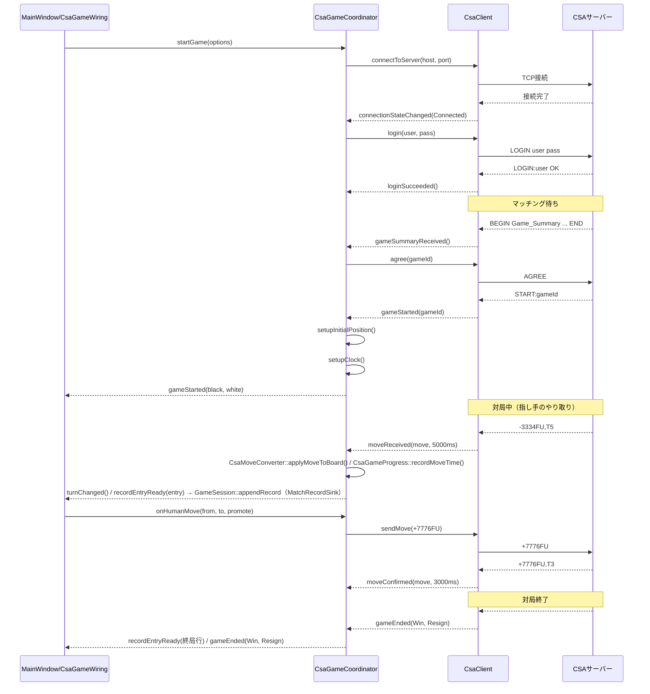

#### 時計管理の仕組み

CSA通信対局では、サーバーが権威的な消費時間（`T` に続く数値）を通知する。CsaGameCoordinatorはこの情報をもとにGUI側の時計を補正する。

1. **残り時間の追跡**: 値型 `CsaGameProgress`（`blackRemainingMs` / `whiteRemainingMs`・累計）でサーバーからの消費時間と加算を追跡（`recordMoveTime()`）
2. **時計の補正**: 対局開始時（`setupClock()`）に対局条件（`GameSummary::timeControl()`）を `ShogiClock::setTimeControl()` で渡し、着手ごとに `syncClockAfterMove()` がサーバーの消費時間を反映した残り時間を `ShogiClock::setRemainingTimes()` で合わせる
3. **手番の切替**: 指し手確認後に `setCurrentPlayer()` で次の手番の時計に切り替え、`startClock()` でGUI上のカウントダウンを開始

終局はサーバーの裁定に従い、表示用の時計の時間切れでは対局を終えない（`setLoseOnTimeout(false)`）。

#### 指し手形式の変換

指し手形式の変換は `CsaMoveConverter`（`src/network/csamoveconverter.h/.cpp`）の static 関数が受け持つ。

| メソッド | 変換元 → 変換先 | 例 |
|---------|----------------|-----|
| `csaToUsi(csaMove)` | CSA → USI | `"+7776FU"` → `"7g7f"` |
| `usiToCsa(usiMove, isBlack, board)` | USI → CSA | `"7g7f"` → `"+7776FU"` |
| `boardToCSA(from, to, promote, isBlackSide, board)` | GUI座標 → CSA | `QPoint(7,7)→QPoint(7,6)` → `"+7776FU"` |
| `csaToPretty(csaMove, isPromotion, previousTo)` | CSA → 表示用 | `"+7776FU"` → `"▲７六歩(77)"`（`previousTo` は直前の手の移動先の `BoardSquare`。同じなら「同」と書く） |
| `applyMoveToBoard(csaMove, gc)` | CSA → 盤に指す | 指せたら棋譜の行（`RecordEntry`）を返す |

駒打ちの場合、CSA形式では移動元が `00`（例: `+0077FU`）となり、GUI座標では `from.x() >= BoardConstants::kBlackStandFile`（10=先手駒台, 11=後手駒台）で表現される。

#### Dependencies構造体

```cpp
struct Dependencies {
    ShogiGameController* gameController = nullptr;    // 対局の盤（非所有）
    ShogiClock* clock = nullptr;                      // 時計（非所有）
    UsiCommLogModel* usiCommLog = nullptr;            // USI通信ログ（エンジンで指すとき）
    ShogiEngineThinkingModel* engineThinking = nullptr; // エンジンの思考情報（エンジンで指すとき）
};
```

盤のビュー・棋譜欄・ハイライトの部品は持たない。盤への着手は `ShogiGameController`、棋譜行は `recordEntryReady`、移動元・移動先のハイライトは `moveHighlightRequested` で知らせる。通信ログと思考情報のモデルは、エンジンで指すときに `CsaEngineController` へ渡す（`CsaGameWiring` は E1 の通信ログ・思考情報を渡す）。

### 12.4 CsaGameWiring — CSA通信対局のUI配線

**ソース**: `src/ui/wiring/csagamewiring.h/.cpp`

CsaGameCoordinatorのシグナルとMainWindowのUI要素を接続する配線クラス。第4章で解説したWiringパターンの典型例であり、MainWindowの肥大化を防ぐ。

#### 役割

- CsaGameCoordinatorの各シグナルを実際の受け手へ直接配線（`wire()` / `unwire()`）。棋譜行（`recordEntryReady`）は棋譜の受け手（`MatchRecordSink`。実体は `GameSession`）へ届く
- 対局開始/終了時の動作状態（`AppActivityState`）・UI状態（`UiStatePolicyManager`）の切り替え、結果の表示、棋譜の自動保存
- CsaGameDialogからの対局開始処理（`startCsaGame()`。司令塔は最初の通信対局で作る）
- 待機ダイアログ（CsaWaitingDialog）の管理

配線の詳細は 10.4 節を参照。

### 12.5 設定の永続化 — 宣言の表（`Setting<T>`）

**ソース**: `src/services/setting.h`, `src/services/settingscommon.h/.cpp`, ドメイン別ヘッダー（`appsettings.h`・`gamesettings.h`・`analysissettings.h`・`networksettings.h`・`josekisettings.h`・`tsumeshogisettings.h`・`enginedialogsettings.h`・`docksettings.h`）

アプリケーション設定をINIファイル（`ShogiBoardQ.ini`）で永続化する。設定項目は `Setting<T>` で**キーと既定値を1行で宣言**し、読み書きはその宣言を通す。getter と setter の組やキー定数は手で書かない。詳しい規約は [settings-service.md](settings-service.md) にまとめている。

`src/services/settingsservice.h` は、ドメイン別ヘッダーをまとめて include するだけのヘッダーとして残っている（関数はなく、`.cpp` もない）。新しいコードはドメイン別ヘッダーを直接 include する。

#### INIファイルの場所と構造

INIファイルの場所は `SettingsCommon::settingsFilePath()` が `AppPaths::configDirectory()`（`src/services/apppaths.h`。既定は `QStandardPaths::AppConfigLocation`）から決める（Linux は `~/.config/ShogiBoardQ/ShogiBoardQ.ini`）。環境変数 `SHOGIBOARDQ_CONFIG_HOME` を指定すると、その下の `ShogiBoardQ` フォルダを使う。読み書きは `SettingsCommon::openSettings()` が返す、アプリ全体で1つの `QSettings` を通る。

```ini
[SizeRelated]
mainWindowSize=@Size(1100 720)
squareSize=55

[General]
lastKifuDirectory=/home/user/kifu
language=system

[FontSize]
usiLog=10
comment=10
gameInfo=10
thinking=10
kifuPane=10
csaLog=10
engineSettings=12

[UI]
lastSelectedTabIndex=0
toolbarVisible=true

[EvalChart]
yLimit=2000
xLimit=500
xInterval=10
labelFontSize=7

[Consideration]
engineName=YaneuraOu
unlimitedTime=true
byoyomiSec=0
multiPV=1

[KifuAnalysis]
fontSize=10
byoyomiSec=3
engineName=YaneuraOu
fullRange=true

[EvalChartDock]
floating=false
visible=true

[RecordPaneDock]
floating=false
visible=true

[CustomDockLayouts]
layout1=@ByteArray(<QMainWindow::saveState() のバイト列>)
```

主要なグループと設定項目:

| INIグループ | 設定カテゴリ | 主な項目 |
|------------|------------|---------|
| `SizeRelated` | ウィンドウサイズ | メインウィンドウ、盤のマスの大きさ、各ダイアログのサイズ |
| `General` | 一般設定 | 最後の棋譜ディレクトリ、言語、指し手の表記、GUI共通フォント |
| `FontSize` | フォントサイズ | 各タブ・ダイアログのフォントサイズ |
| `UI` | UI状態 | 最後に選択したタブ、ツールバー表示 |
| `EvalChart` | 評価値グラフ | Y軸上限、X軸上限、軸ラベルサイズ |
| `Consideration` | 検討設定 | エンジン名、時間無制限フラグ、候補手数 |
| `KifuAnalysis` | 棋譜解析設定 | 思考時間、エンジン名、解析範囲 |
| `GameSettings` | 対局開始ダイアログ | 対局者・持ち時間・開始局面・最大手数など前回の対局条件 |
| `CsaGameSettings` | CSA通信対局ダイアログ | 対局者、接続先、接続の維持・連続対局・自動保存などの詳細設定 |
| `*Dock` | ドック状態 | フローティング、ジオメトリ、表示状態 |
| `CustomDockLayouts` | カスタムレイアウト | 名前付きレイアウトの保存 |
| `MenuWindow` | メニューウィンドウ | お気に入り、サイズ、ボタンサイズ |
| `Engines`・エンジン名 | エンジン登録情報 | 登録一覧とUSIオプション（§7.9。宣言の表を使わない） |

#### 宣言と読み書き

各項目はドメイン別ヘッダーの namespace に `inline const Setting<T>` として宣言する。以下は実際のコードからの抜粋:

```cpp
// src/services/analysissettings.h より
namespace AnalysisSettings {
/// USI通信ログタブのフォントサイズ（デフォルト: 10）
inline const Setting<int> usiLogFontSize{"FontSize/usiLog", 10};
/// 読み筋表示ウィンドウのサイズ（デフォルト: 620x720）
inline const Setting<QSize> pvBoardDialogSize{"SizeRelated/pvBoardDialogSize", QSize(620, 720)};
}
```

```cpp
const int size = AnalysisSettings::usiLogFontSize();     // 読む（未保存なら宣言の既定値）
AnalysisSettings::usiLogFontSize.set(12);                // 書く
AnalysisSettings::usiLogFontSize.defaultValue();         // 宣言の既定値（「既定値に戻す」など）
AnalysisSettings::usiLogFontSize.remove();               // 保存値を消す
```

`Setting<T>` の要点:
1. 読み書きは `SettingsCommon::openSettings()` の共有 `QSettings` を通る。項目ごとの `.cpp` は要らない
2. 未保存のときは宣言の既定値を返す。既定値が翻訳文や実行時の場所で決まる項目は、宣言の既定値を空にして `valueOr()` で読む（例: `GameSettings::StartGame::player1.humanName.valueOr(tr("You"))`）
3. 同じ形の項目は `Setting<T>` をメンバに持つ構造体にまとめられる（対局開始ダイアログの `GameSettings::StartGame::Player` の `player1` / `player2`）

#### 関数として書く項目

値の範囲を絞る（`AppSettings::pieceSoundVolume` など）、複数のキーを構造体にまとめる（`AppSettings::boardColors` など）、古い保存値を引き継ぐ（`AppSettings::appearanceSection`）、リスト・配列で保存する（`AnalysisSettings::engineInfoColumnWidths`・ドックレイアウトなど）、id ごとにキーを作る（`AppSettings::dialogFontSize(id, ...)`）項目だけは、ドメイン別ヘッダーに関数を宣言し、`.cpp` で `SettingsCommon::openSettings()` を使って実装する。キーは `settingskeys.h` に置く（id から組み立てる `DialogAppearance/<id>/...` だけは関数の中に書いている）。

```cpp
// src/services/analysissettings.cpp より
QList<int> engineInfoColumnWidths(int widgetIndex)
{
    QSettings& s = SettingsCommon::openSettings();
    QString key = QString(SettingsKeys::kEngineInfoColumnWidthsFmt).arg(widgetIndex);
    QList<int> widths;

    int size = s.beginReadArray(key);
    for (int i = 0; i < size; ++i) {
        s.setArrayIndex(i);
        widths.append(s.value(SettingsKeys::kArrayWidth, 0).toInt());
    }
    s.endArray();

    return widths;
}
```

設定ファイルを `QSettings settings(SettingsCommon::settingsFilePath(), QSettings::IniFormat)` で直接開くのは、`beginReadArray` / `beginGroup` でグループを開いたまま読み書きを続ける配列データ（エンジン登録一覧、エンジンごとのオプション配列、CSA通信対局の接続履歴）だけ。共有の `QSettings` でグループを開いたままにすると、その間に読み書きするほかの項目のキーがずれるためである。

#### 設定項目の追加方法

新しいダイアログやウィンドウを追加する際は、CLAUDE.md の「Settings Update Guidelines」に従い、以下の手順で設定を追加する。

**1. ドメイン別ヘッダーに宣言を1行ずつ足す:**

```cpp
// gamesettings.h
/// 〇〇ダイアログのウィンドウサイズ（デフォルト: 800x600）
inline const Setting<QSize> myDialogSize{"SizeRelated/myDialogSize", QSize(800, 600)};
/// 〇〇ダイアログのフォントサイズ（デフォルト: 10）
inline const Setting<int> myDialogFontSize{"FontSize/myDialog", 10};
```

**2. ダイアログで読み込み/保存を行う:**

```cpp
// mydialog.cpp
MyDialog::MyDialog(QWidget* parent)
    : QDialog(parent)
    , m_fontHelper(GameSettings::myDialogFontSize, 8, 24, 1)  // 変更のたびに保存する
{
    DialogUtils::restoreDialogSize(this, GameSettings::myDialogSize);
}

MyDialog::~MyDialog()
{
    DialogUtils::saveDialogSize(this, GameSettings::myDialogSize);
}
```

`FontSizeHelper`（`src/widgets/fontsizehelper.h`）は宣言から初期値を読み、A-/A+ で変わるたびに同じ宣言へ保存する。`DialogUtils::restoreDialogSize` / `saveDialogSize`（`src/widgets/dialogutils.h`）も宣言をそのまま受け取る。保存はデストラクタのほか、`done()` や `closeEvent` で行ってもよい。実際のコードでは `KifuPasteDialog` が同じ形になっている。

永続化すべき主な設定項目:
- **ウィンドウサイズ**: ユーザーがリサイズ可能なダイアログ
- **フォントサイズ**: A-/A+ ボタンによる調整機能がある場合
- **列幅**: テーブルやリストビューの列幅
- **最後に選択した項目**: コンボボックスの選択状態、最後に開いたファイルパス

### 12.6 手番・時計表示の同期

**ソース**: `src/app/turnstatesyncservice.h/.cpp`, `src/game/matchcoordinator.h/.cpp`

`TurnStateSyncService::updateTurnAndTimekeepingDisplay()` がゲームコントローラの手番を表示へ反映し、`ShogiClock` の現在値を `TimeDisplayPresenter` へ渡す。司令塔の手番が変わると（`MatchCoordinator::turnChanged`）、`TurnStateSyncService::onTurnManagerChanged()` が時計・`ShogiGameController`・盤の手番表示を合わせる。

対局中の時計の値は `MatchCoordinator` が `ShogiClock::timeUpdated` を受けて、`timeUpdated(blackMs, whiteMs, sideToMove, urgencyMs)` で `TimeDisplayPresenter::onMatchTimeUpdated()` に知らせる。人間同士の対局の考慮時間の計測は、対局モード別の Strategy（`HumanVsHumanStrategy`）が持つ。

### 12.7 対局者名の表示（PlayerInfoPresenter）

**ソース**: `src/ui/presenters/playerinfopresenter.h/.cpp`（クラスの概要は 10.2 節）

対局者名・エンジン名をどこに出すかは、`PlayerInfoPresenter` が対局者（`MatchPlayers`、[5.6節](#56-matchplayers--対局者)）から決める。対局中は最後に始めた対局の対局者（`AppState::players`）を出し、対局していなければ（`AppState::currentMatchPlayers()` が nullptr）エンジン名を消す。

#### 通信ログの見出し（E1・E2）

2つの通信ログ（E1=上段, E2=下段）の見出しにどのエンジン名を出すかは、エンジンの枠（`EngineLifecycleManager` の E1・E2）と同じ規則で決める。

| 対局者 | E1 | E2 |
|-------|----|----|
| 人間 vs 人間 | (空) | (空) |
| 人間（先手・下手） vs エンジン（後手・上手） | 後手のエンジン | (空) |
| エンジン（先手・下手） vs 人間（後手・上手） | 先手のエンジン | (空) |
| エンジン vs エンジン（平手・駒落ちとも） | 先手（下手）のエンジン | 後手（上手）のエンジン |

人間対エンジンでは、エンジンが後手でも E1 に置く。思考タブの2つ目のエンジン欄はエンジン同士の対局だけ表示する。評価値グラフは、どの対局でも先手のエンジンを P1、後手のエンジンを P2 として描く（`EvaluationGraphController::setEngine1Name()`・`setEngine2Name()`）。検討・詰み探索のエンジンは E1 だけを使う（`onAnalysisEngineNamesChanged()`）。

### 12.8 TimeControlUtil — 持ち時間設定のユーティリティ

**ソース**: `src/game/timecontrolutil.h/.cpp`

`GameStartCoordinator::TimeSettings` の設定値を `ShogiClock` に適用するユーティリティ名前空間。対局を始めるときに `GameStartCoordinator::start()` が一度だけ呼ぶ。

#### applyToClock()

```cpp
void applyToClock(ShogiClock* clock,
                  const GameStartCoordinator::TimeSettings& tc,
                  const QString& startSfenStr,
                  const QString& currentSfenStr);
```

処理の流れ:

1. **時計への適用**: `ShogiClock::setTimeControl(tc.rules)` で先後の決まりを渡す。秒読みと加算の排他、初手の加算、持ち時間0の秒読みの扱いは時計と `TimeControl::normalized()` が受け持つ
2. **時間切れ負け**: 時間制限があり、`tc.loseOnTimeout` がオンのときだけ時間切れを負けにする
3. **初期手番の推定**: 開始局面のSFEN文字列から `" b "`（先手）/ `" w "`（後手）を探索して初期手番を決定

```
TimeSettings {enabled, rules: TimeControl {black, white}, loseOnTimeout}
    ↓
ShogiClock::setTimeControl(rules)
ShogiClock::setLoseOnTimeout(limited && loseOnTimeout)
ShogiClock::setCurrentPlayer(Turn::Black / Turn::White)  ← SFENから推定
```

<!-- chapter-12-end -->

---

<!-- chapter-13-start -->
## 第13章 navigation層とboard層

本章では棋譜ナビゲーション（`src/navigation/`）と盤面操作（`src/board/`）の2層を解説する。ナビゲーション層は棋譜の手を辿るUI操作を統一管理し、盤面層はクリックによる駒操作・局面編集・画像エクスポートを担う。棋譜欄の行変更を受ける `RecordNavigationHandler`（`src/ui/coordinators/`）と、開始局面から手を順に指して局面列を作る `SfenReplay`（`src/core/`）もここで扱う。

### 13.1 KifuNavigationController — 棋譜ナビゲーションコントローラ

**ソース**: `src/navigation/kifunavigationcontroller.h/.cpp`

棋譜の閲覧操作（ボタン・クリック・分岐選択）を統一的に処理するコントローラ。ナビゲーション後は `emitUpdateSignals()` で盤面・棋譜欄・分岐ツリーへの更新シグナルを一括発行する。

#### 依存オブジェクト

| オブジェクト | 設定方法 | 役割 |
|-------------|---------|------|
| `KifuBranchTree` | `setTreeAndState()` | 分岐ツリーデータ（非所有） |
| `KifuNavigationState` | `setTreeAndState()` | 現在位置・分岐選択記憶の管理（非所有） |

#### 6つのナビゲーションボタン

`connectButtons()` で6つの `QPushButton` の `clicked` シグナルを対応スロットに接続する。

| ボタン | スロット | 動作 |
|-------|---------|------|
| 先頭（`|◁`） | `onFirstClicked` → `goToFirst()` | ルートノード（0手目）へ移動 |
| 10手戻る（`◁◁`） | `onBack10Clicked` → `goBack(10)` | 親ノードを10回辿る |
| 1手戻る（`◁`） | `onPrevClicked` → `goBack(1)` | 親ノードへ移動 |
| 1手進む（`▷`） | `onNextClicked` → `goForward(1)` | 子ノードへ移動（分岐選択記憶を優先） |
| 10手進む（`▷▷`） | `onFwd10Clicked` → `goForward(10)` | 子ノードを10回辿る |
| 末尾（`▷|`） | `onLastClicked` → `goToLast()` | 現在ラインの終端まで進む |

#### goForward() の分岐選択ロジック

「1手進む」/「10手進む」/「末尾」では、分岐がある場合に `findForwardNode()` で次のノードを決定する。

```
findForwardNode():
  1. currentNode の子ノード数が 0 → null（末尾）
  2. 分岐があれば、優先ライン（なければ現在のライン）の allLines() のパス上の子を返す
  3. lastSelectedChildAt(currentNode) で以前選んだ子を取得
     → 有効なインデックスなら、その子ノードを返す
  4. フォールバック: childAt(0)（本譜）を返す
```

この仕組みにより、一度分岐を選択してから「戻る→進む」した場合、以前選択した分岐パスを辿り直すことができる。

#### goToNode() — 分岐選択記憶の更新

指定ノードへ直接移動する際、`rememberPathSelections(node)` でルートからノードまでの経路上の全分岐点での選択を記憶する。これにより後続の `goForward()` が正しいパスを辿れるようになる。

#### その他のナビゲーション操作

| メソッド | 動作 |
|---------|------|
| `goToPly(int ply)` | 現在ライン上の指定手数へ移動（内部で `goBack`/`goForward` を呼ぶ） |
| `goToLine(int lineIndex, int ply)` | 指定ラインの指定手数のノードへ移動（分岐ラインなら優先ラインに設定し、本譜ならリセット）。棋譜欄の行選択と分岐ツリーのクリックが使う |
| `selectBranchCandidate(int idx)` | 分岐候補欄から選択して移動、優先ラインを設定 |
| `goToMainLineAtCurrentPly()` | 本譜の同手数ノードへ戻る（優先ライン・選択記憶をリセット） |

#### handleBranchNodeActivated() — 分岐ツリークリック処理

分岐ツリーウィジェットのセルがクリックされたときに呼ばれるスロット。

```
handleBranchNodeActivated(row, ply):
  1. 未更新のコメントがあれば確かめる（canLeaveCurrentPosition()）
     → やめたら分岐ツリーの強調を現在の手に戻して終了
  2. ply == 0 → ルートノードへ移動して終了
  3. 分岐前の共有ノードかチェック
     → クリックした行と現在のラインで、その手数のノードが同じなら effectiveRow を現在ラインに維持
  4. goToLine(effectiveRow, ply):
     effectiveRow > 0 なら setPreferredLineIndex() で優先ラインを設定（0 ならリセット）し、
     line.nodes から ply に一致するノードを探して goToNode() で移動
```

#### emitUpdateSignals() — 更新シグナルの一括発行

全ナビゲーション操作の末尾で呼ばれ、5つのシグナルを発行する。接続は `KifuDisplayCoordinator::wireSignals()` と `BranchNavigationWiring`、合成ルートの `connectSignals()`（`mainwindowcomposer_finalize.cpp`）にある。

| シグナル | 接続先 | 内容 |
|---------|-------|------|
| `navigationCompleted(node)` | KifuDisplayCoordinator::onNavigationCompleted | 棋譜欄を表示中のラインに合わせ、`boardWithHighlightsRequired(currentSfen, prevSfen)` で盤とハイライトの更新を頼む（→ `BoardLoadService::loadWithHighlights()`） |
| `recordHighlightRequired(ply)` | KifuDisplayCoordinator、BranchNavigationWiring::currentPlyChanged | 棋譜欄ハイライト、評価値グラフの縦線（`EvaluationGraphController::setCurrentPly()`） |
| `branchTreeHighlightRequired(lineIdx, ply)` | KifuDisplayCoordinator | 分岐ツリーハイライト |
| `branchCandidatesUpdateRequired(candidates)` | KifuDisplayCoordinator | 分岐候補欄更新 |
| `branchNodeHandled(ply, sfen, previousTo, usiMove)` | BranchNavigationWiring → KifuNavigationCoordinator::handleBranchNodeHandled | 表示中の局面（`AppState::currentSfenStr`）・矢印ボタン・定跡ウィンドウの更新と、検討中なら `AnalysisSession::updatePosition()`。`previousTo` は直前の手の移動先（`BoardSquare`、開始局面では無効値） |

### 13.2 KifuNavigationState — ナビゲーション状態管理

**ソース**: `src/kifu/kifunavigationstate.h/.cpp`

ナビゲーションの現在位置と分岐選択履歴を保持する状態オブジェクト。KifuNavigationController の操作対象となる。

#### 主要な状態

| メンバ | 型 | 役割 |
|-------|---|------|
| `m_currentNodeId` | `int` | 現在位置のノードID |
| `m_tree` | `KifuBranchTree*` | 分岐ツリーへの参照 |
| `m_selectedChildIds` | `QHash<int, int>` | 分岐点IDから選んだ子IDへの対応 |

#### 主要メソッド

| メソッド | 説明 |
|---------|------|
| `currentPly()` | 現在の手数（表示中の手数。MainWindow は手数の変数を持たない） |
| `currentLineIndex()` | 現在のラインインデックス（0=本譜、1以上=分岐） |
| `currentRecordLine()` | 表示中の手順（`RecordLine`） |
| `isOnMainLine()` | 本譜上にいるか |
| `canGoForward()` / `canGoBack()` | 前進/後退可能か |
| `branchCandidatesAtCurrent()` | 現在位置の分岐候補ノード一覧 |
| `rememberChildSelection(node, childIndex)` | 分岐点で選んだ子を記憶 |
| `lastSelectedChildAt(node)` | 記憶された子を返す |

### 13.3 RecordNavigationHandler — 棋譜欄行変更ハンドラ

**ソース**: `src/ui/coordinators/recordnavigationhandler.h/.cpp`

棋譜欄（RecordPane）の行選択が変わったときの処理を担当する。`MainWindowActions::onRecordPaneMainRowChanged()` が未更新のコメントを確かめてから `onMainRowChanged()` を呼ぶ。行の選択を、表示中のラインのノードへの移動に変えるだけのクラスである。

#### Deps構造体

```cpp
struct Deps {
    KifuNavigationState* navState = nullptr;               ///< ナビゲーション状態（非所有）
    KifuDisplayCoordinator* displayCoordinator = nullptr;  ///< 棋譜表示コーディネータ（非所有）
    LiveGameSession* liveSession = nullptr;                ///< 対局棋譜の更新状態（非所有）
};
```

#### onMainRowChanged() の処理フロー

```
onMainRowChanged(row):
  1. row が負、または navState・displayCoordinator が無ければ何もしない
  2. ライブ対局のセッションが手を追加できる間（対局中。対局の準備・再開を含む）は何もしない
     （棋譜の更新に伴う行選択を閲覧操作として扱わない）
  3. KifuDisplayCoordinator::onPositionChanged(表示中のライン, row) を呼ぶ
     → そのラインの row 手目のノードが現在のノードでなければ
       KifuNavigationController::goToLine() で移動する
```

盤・棋譜欄・分岐ツリー・評価値グラフの縦線・手番表示・定跡ウィンドウ・検討中の局面は、`goToLine()` の後の `emitUpdateSignals()`（13.1）の経路でまとめて更新する。表示中の手数は手数の変数ではなく、分岐ツリーのカーソル（`KifuNavigationState`）が持つ。対局中のカーソルは `KifuDisplayCoordinator::onLiveGameMoveAdded()` が最新手に合わせる。

#### 発行するシグナル

`RecordNavigationHandler` はシグナルを持たない。盤面同期などの更新は、棋譜ナビゲーションの更新シグナル（13.1）の受け手が行う。

### 13.4 ナビゲーションフロー図

ユーザの操作から盤面更新までの全体的なデータフローを示す。

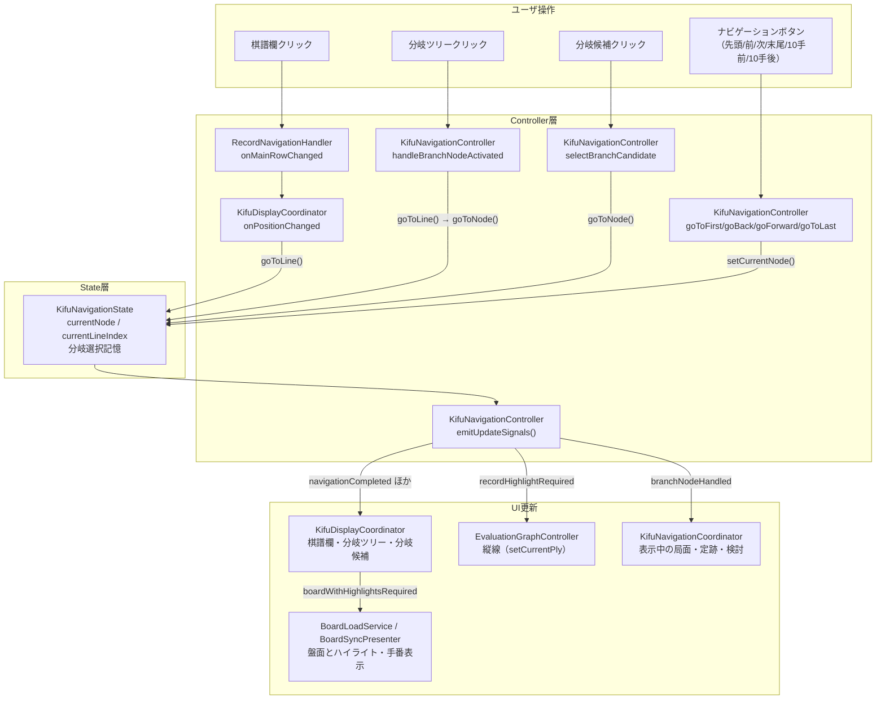

**ポイント**: どの操作も最後は KifuNavigationController の `emitUpdateSignals()` を通り、同じシグナルで表示を更新する。棋譜欄クリックも RecordNavigationHandler → `KifuDisplayCoordinator::onPositionChanged()` → `goToLine()` でこの経路に入る。

### 13.5 BoardInteractionController — 盤面操作コントローラ

**ソース**: `src/board/boardinteractioncontroller.h/.cpp`

盤面上のマウスクリック操作とハイライト描画を制御するコントローラ。

#### 操作モード

```cpp
enum class Mode {
    HumanVsHuman,   // 対人対局
    HumanVsEngine,  // 対エンジン対局
    Edit             // 局面編集
};
```

モードに応じてクリック時の挙動が変わる。`Edit` モード以外では人間の手番判定コールバック（`IsHumanTurnCallback`）でガードされる。合成ルートは `HumanTurnPolicy::isHumanTurnNow()` をこのコールバックとして渡す（`wireGame()`）。

#### 2クリック方式の駒移動

駒の移動は2段階のクリックで実行される。

```
1stクリック（onLeftClick）:
  1. 人間の手番チェック（Editモード以外）
  2. 駒台の枚数0チェック
  3. startDrag() でドラッグ開始
  4. selectPieceAndHighlight() で選択マスをオレンジハイライト
  5. m_waitingSecondClick = true

2ndクリック（onLeftClick）:
  1. m_waitingSecondClick = false
  2. 同一マスクリック → キャンセル（finalizeDrag）
  3. 異なるマス → moveRequested(from, to) シグナルを発火
```

右クリックは2クリック待ち中のキャンセル、または編集モード時の成/不成トグルに使用される。

#### ハイライト管理

3種類のハイライトを独立に管理する。

| ハイライト | 色 | 意味 | メンバ変数 |
|-----------|---|------|-----------|
| 選択中 | オレンジ（`rgba(255,128,0,70)`） | 現在選択中の駒 | `m_selectedField` |
| 移動元 | 薄い赤（`rgba(255,0,0,50)`） | 直前の着手の移動元 | `m_selectedField2` |
| 移動先 | 黄色（`rgb(255,255,0)`） | 直前の着手の移動先 | `m_movedField` |

```
onMoveApplied(from, to, success):
  成功時 → 移動元を赤、移動先を黄色で表示、選択ハイライトをクリア
  失敗時 → 全選択状態をクリア（finalizeDrag）
```

#### ダングリングポインタ防止

ハイライトは本クラスが `std::unique_ptr` で所有し、`ShogiView` は参照だけを持つ。`ShogiView::highlightsCleared` シグナルに `onHighlightsCleared()` を接続し、`ShogiView::removeHighlightAllData()` が呼ばれた際に所有するハイライトを破棄し、2クリックの途中状態も取り消す。これにより、外部からハイライトが一括削除された場合のダングリングポインタを防止する。

#### 駒台の座標規約

| 定数 | 値 | 意味 |
|------|---|------|
| `kBlackStandFile` | 10 | 先手駒台のファイル番号 |
| `kWhiteStandFile` | 11 | 後手駒台のファイル番号 |

盤上は `file: 1-9`、`rank: 1-9` の座標を使用し、駒台は `file: 10-11` で区別する。

### 13.6 PositionEditController — 局面編集コントローラ

**ソース**: `src/board/positioneditcontroller.h/.cpp`

局面編集モードのライフサイクル（開始・終了）と盤面操作APIを提供する。

#### 編集開始 — beginPositionEditing()

`BeginEditContext` 構造体で必要な情報を受け取り、以下の手順で編集モードに入る。

```
beginPositionEditing(context):
  1. 編集開始SFENの決定:
     currentSfen（AppState::currentSfenStr）→ displayedSfen（表示中の局面）→ 盤面状態
     の優先順位で取得
  2. SFEN正規化: toMinimalSfen() で4フィールド形式に統一
  3. 手番/手数の強制上書き: forceTurnAndPly() で表示中の盤面の手番に合わせる
  4. 盤面適用: board->setSfen(adjusted)
  5. 編集モード遷移: setPositionEditMode(true), setMouseClickMode(true)
  6. BIC を Edit モードに設定、ハイライトクリア
  7. GC の手番を盤面の手番に同期
  8. 「編集終了」ボタンを表示（コールバック）
  9. 開始局面を返す（recordStartSfen、空なら編集する局面）
```

`BeginEditContext` の `displayedSfen`・`recordStartSfen` は、`PositionEditCoordinator` が分岐ツリーの表示中の手順（`KifuNavigationState::currentRecordLine()`）から、`currentSfen` は `AppState::currentSfenStr` から入れる。`PositionEditController` は `AppState` を書かず、`PositionEditCoordinator` が戻り値を `AppState::startSfenStr` に書く。

#### 編集終了 — finishPositionEditing()

`FinishEditContext` 構造体で必要な情報を受け取り、編集結果を確定する。

```
finishPositionEditing(context):
  1. 盤面モデルから SFEN を再構成（convertBoardToSfen + GC の手番 + convertStandToSfen）
  2. board->setSfen() で反映
  3. setPositionEditMode(false) で通常モードへ復帰
  4. ハイライトクリア、「編集終了」ボタン非表示
  5. 編集後の局面を返す（PositionEditCoordinator が AppState::startSfenStr に書き、編集した局面が開始局面になる）
```

棋譜（分岐ツリー）は、このあと `PositionEditCoordinator::positionEditingFinished` を受けた `MainWindowActions::resetRecordForEditedPosition()` が編集後の局面から作り直す。

#### 盤面操作API

| メソッド | 対応アクション | 動作 |
|---------|-------------|------|
| `resetPiecesToBox()` | 「全ての駒を駒箱へ」 | `ShogiView::returnAllPiecesToBox()` を呼ぶ |
| `setStandardStartPosition()` | 「平手初期配置」 | `ShogiView::initializeToFlatStartingPosition()` を呼ぶ |
| `setTsumeShogiStartPosition()` | 「詰将棋初期配置」 | `ShogiView::shogiProblemInitialPosition()` を呼ぶ |
| `onToggleSideToMoveTriggered()` | 「手番切替」 | 先手 ⇔ 後手をトグル |

各操作はメニューアクションのスロットとしても提供され、編集セッション中に保持した `m_view`/`m_gc`/`m_bic` を利用する。

#### applyEditMove() — 編集中の着手適用

局面編集モードでの駒移動を処理する。

```cpp
bool applyEditMove(from, to, view, gc, bic):
  1. gc->editPosition(from, to) で駒を移動
  2. view->endDrag() でドラッグ状態を解除
  3. bic->onMoveApplied() でハイライトを更新
  4. 成功時は view->update() で再描画
```

### 13.7 BoardImageExporter — 盤面画像エクスポータ

**ソース**: `src/board/boardimageexporter.h/.cpp`

盤面ウィジェットのキャプチャ画像をクリップボードまたはファイルに保存する静的ユーティリティ。インスタンスを持たず、全メソッドが `static` である。

#### copyToClipboard()

```cpp
static void copyToClipboard(QWidget* boardWidget);
```

`boardWidget->grab()` で `QPixmap` を取得し、`QApplication::clipboard()->setPixmap()` でクリップボードにコピーする。

#### saveImage()

```cpp
static void saveImage(QWidget* parent, QWidget* boardWidget);
```

処理フロー:

1. `QImageWriter::supportedImageFormats()` でサポートフォーマットを収集
2. PNG/TIFF/JPEG/WebP/BMP 等からフィルタリスト作成
3. `QFileDialog::getSaveFileName()` でファイル名を取得（デフォルト名: `ShogiBoard_yyyyMMdd_HHmmss.png`）
4. 拡張子からフォーマットを決定（JPEG/WebP は品質95で書き出し）
5. `QImageWriter` で画像を保存

### 13.8 SfenReplay — 手順の再生（局面列の構築）

**ソース**: `src/core/sfenreplay.h/.cpp`（名前空間 `SfenReplay`）

開始局面から USI の手を順に指して、各手の後の局面を作る関数群。局面は `ShogiBoard` で持ち、合法手かどうかは確かめない。棋譜の読み込みで使うため、持ち駒の数が合わない駒打ちも指す。盤に依存しないので core 層に置いている。

#### 内部データ構造

```
Step   — 1手ぶん
  move       : ShogiMove（USI の指し手と、動かした駒・取った駒）
  beforeSfen : 指す前の局面
  sfen       : 指した後の局面

Result — replay() の結果
  moves       : QList<Step>
  initialSfen : 開始局面（ShogiBoard::toSfen() で整えたもの）
  failedPly   : -1 は成功、0 は開始局面が不正、1以上は指せなかった手数
  error       : 失敗の理由（success() で成否を確かめる）
```

#### applyLenient() — USI手の適用

```
applyLenient(board, usiMove):
  UsiMove::parse() で読めなければ false
  通常手（"7g7f" / "2b3c+"形式）:
    ShogiBoard::applyUsiMove(move, 手番) に任せる
    （移動元が空なら false。取った駒を駒台へ移し、手番を渡して手数を1つ進める）
  駒打ち（"P*5e"形式）:
    1. 持ち駒があれば1枚減らす（無くても打つ）
    2. 打つマスに駒があっても、打った駒で置き換える
    3. 手番を相手に渡し、手数を1つ進める
```

#### 座標変換

座標は `UsiMove`・`BoardSquare`（筋・段とも1始まり）で扱い、盤の配列との変換は `ShogiBoard` が行う。`SfenReplay` 自身は座標変換を持たない。

#### 主な関数

| 関数 | 用途 |
|---------|------|
| `applyLenient(board, usiMove)` | 盤に USI の1手を手番側の手として指す |
| `positionAfter(sfen, usiMove)` | 局面から1手指した後の局面（指せなければ空）。定跡ウィンドウ・候補手の矢印・エンジンの最善手の後の局面に使う |
| `replay(initialSfen, usiMoves)` | 開始局面から手を順に指し、各手と前後の局面を `Result` にまとめる。棋譜の読み込み（`KifuParseCommon::KifLineDraft::resolve()`）が使う |
| `sfenFromPositionCommand(positionCommand)` | USI の `position startpos moves ...`／`position sfen ... moves ...` の局面（読めなければ空）。エンジン連携（`Usi`・`UsiProtocolHandler`・`UsiMatchHandler`）が使う |
テストが手順の局面列や指し手列を作るときは、`tests/test_replay.h` の `TestReplay::buildSfenRecord(initialSfen, usiMoves, hasTerminal)`（開始局面と各手の後の局面の列。`hasTerminal` が `true` のとき終局の行のために最後の局面を複製する）と `TestReplay::buildGameMoves(initialSfen, usiMoves)`（各手の `ShogiMove` の列）を使う。どちらも `replay()` の結果を並べるだけのテスト用の関数で、本体の `SfenReplay` には無い。

#### replay() の処理フロー

```
replay(initialSfen, usiMoves):
  1. ShogiBoard に initialSfen を読む（不正なら failedPly = 0 で終える）
  2. 各手について:
     a. 指す前の局面を beforeSfen に取る
     b. UsiMove::parse() し、動かす駒（駒打ちなら打つ駒）と取る駒から ShogiMove を作る
     c. applyLenient() で指す
        （読めない手・移動元が空の手・指せない手は failedPly にその手数を入れて終える）
     d. 指した後の局面を sfen に取り、moves に足す
  戻り値: Result（moves・initialSfen・failedPly・error）

テストの TestReplay::buildSfenRecord() は replay() の結果から [開始局面, 1手目後, 2手目後, ..., (終局の行の複製)] を作る。
```

### 13.9 navigation層とboard層の協調

ナビゲーションと盤面操作は独立した層だが、以下の箇所で協調する。

| 協調ポイント | 関与クラス | 内容 |
|-------------|-----------|------|
| 盤面とハイライトの同期 | KifuNavigationController → KifuDisplayCoordinator → BoardLoadService → BoardSyncPresenter | ナビゲーション完了の `navigationCompleted` から `boardWithHighlightsRequired(currentSfen, prevSfen)` で盤と直前手のハイライト（`BoardInteractionController::showMoveHighlights()`）を更新する |
| 棋譜欄の行変更 | RecordNavigationHandler → KifuDisplayCoordinator → KifuNavigationController | 行の選択を `goToLine()` に変え、ボタン操作と同じ経路で更新する |
| 局面編集↔通常モード切替 | PositionEditController → BoardInteractionController | 編集開始で `setMode(Edit)`、終了で通常モードに復帰 |
| 局面列の構築 | SfenReplay → 棋譜の読み込み（`KifuParseCommon`） | 棋譜読み込み時に各手の前後の局面を作り、分岐ツリーの構築に使う |
| 対局中の行選択 | RecordNavigationHandler | ライブ対局のセッションが手を追加できる間は行の選択で移動しない（棋譜の追記と閲覧の操作を混ぜない） |

<!-- chapter-13-end -->

---

<!-- chapter-14-start -->
## 第14章 MainWindowの役割と構造

### 14.1 設計思想: "MainWindow should stay lean"

CLAUDE.md に明記されているとおり、ShogiBoardQ の設計原則は **「MainWindow は痩せた状態を保つ」** ことである。2026-10-15 からは、部品の生成・配線・状態を合成ルートの `MainWindowComposer` に移し、MainWindow は `.ui` の保持と、閉じるときの確認・終了処理だけを持つ。合成ルートの規則は [composition-root.md](composition-root.md) にまとめてある。

```
MainWindow（.ui・閉じるときの確認と終了処理）
  └─ MainWindowComposer（合成ルート）
       ├─ MainWindowComponents  部品の一覧（起動時に全部作る）
       ├─ AppState              部品どうしで共有する状態（1か所だけ）
       └─ compose()             生成 → 依存の注入 → シグナル接続と初期表示
```

メニュー・盤・棋譜欄の操作は MainWindow を経由しない。`UiActionsWiring` と `MainWindowActions` が受けて、担当の部品へ振り分ける（[14.6節](#146-操作の受け口mainwindowactions)）。

`mainwindow.cpp` は当初 5,368 行あったが、今は約 45 行である（2026-10-15 時点。詳細は [14.7節](#147-リファクタリング経緯) を参照）。

```cpp
// src/app/mainwindow.cpp
MainWindow::MainWindow(QWidget* parent)
    : QMainWindow(parent)
    , ui(std::make_unique<Ui::MainWindow>())
    , m_composer(std::make_unique<MainWindowComposer>(*this, *ui))
{
    m_composer->compose();
}
```

---

### 14.2 部品と状態の置き場

MainWindow のメンバは `ui`・`m_composer`・`m_skipCloseConfirmation`（自動化 API からの終了で確認を出さない）の3つだけである。部品と状態は `MainWindowComposer` が持ち、`composer().parts()` と `composer().state()` で読める（テストと自動化 API が使う）。

#### AppState — 共有状態

`AppState`（`src/common/appstate.h`）は、部品どうしで共有する状態の唯一の置き場である。部品は組み立て時に `AppState*` を受け取り、使うときに読む（`QString*` のような個々のフィールドへのポインタは渡さない）。部品のメンバに状態のコピーを持たない。

| フィールド | 型 | 役割 |
|------|----|------|
| `activity` | `AppActivityState` | アプリの動作状態（`Idle`・`DuringGame`・`DuringAnalysis`・`DuringCsaGame`・`DuringTsumeSearch`・`DuringConsideration`・`DuringPositionEdit`）。変わると `changed()` を出す |
| `startSfenStr` | `QString` | 開始局面（完全な SFEN） |
| `currentSfenStr` | `QString` | 表示中の局面 |
| `players` | `MatchPlayers` | 最後に始めた対局の対局者（先手・後手のどちらを人間・エンジンが指すかと名前） |
| `saveFileName` | `QString` | 上書き保存先（読み込み成功時に更新、貼り付け時にクリア） |

`currentMatchPlayers()` は、対局中（`activity` が `DuringGame`）なら `players` を、それ以外は `nullptr` を返す（検討・解析・通信対局のエンジンは対局者ではない）。

表示中の手数は `AppState` ではなく、分岐ツリーのカーソル（`KifuNavigationState::currentPly()`）が持つ。棋譜の正本は分岐ツリー（`KifuBranchTree`）で、対局中の手順は司令塔（`MatchCoordinator::record()`、`RecordLine`）が持つ。盤の手前に表示している側は `ShogiView::flipMode()` から求める。

#### MainWindowComponents — 部品の一覧

`MainWindowComponents`（`src/app/mainwindowcomponents.h`）は、起動時に `MainWindowComposer` が作る部品の一覧である。QObject は MainWindow を親にした生ポインタ（親が破棄する）、QObject でないものは `std::unique_ptr` で持つ。どれも起動時に1回だけ作り、作り直さない。

| グループ | 主なメンバ |
|---------|-----------|
| モデル | `kifuRecord`・`kifuBranch`・`thinking1/2`・`consideration`・`analysis`・`commLog1/2`・`gameRecord` |
| 盤・対局の芯 | `gameController`（`ShogiGameController`）・`shogiView`・`boardController`（`BoardSetupController` が作る） |
| 画面部品 | `central`・`tab`・`recordPane`・`analysisTab`・`evalChart`・`docks`（`DockWidgets`、12 個のドック） |
| 分岐ナビゲーション | `branchTree`・`navState`・`kifuNavController`・`displayCoordinator`・`liveGameSession` |
| 対局・検討 | `engines`（`EngineLifecycleManager`。エンジンの枠 E1・E2 を対局と検討で共有）・`match`（`MatchCoordinator`）・`analysisSession`（`AnalysisSession`）・`gameStart`・`gameSession`（`GameSession`。対局の棋譜の受け手）・`timeController`・`timePresenter`・`replayController`・`consecutiveGamesController`・`preStartCleanupHandler`・`humanTurnPolicy`（`HumanTurnPolicy`）・`turnStateSync`・`csaGameWiring` |
| 棋譜 | `branchNavWiring`・`kifuNavCoordinator`・`gameRecordLoadService`・`kifuExportController`・`josekiController`（`JosekiWindowController`）・`kifuFileController`・`kifuLoadCoordinator` |
| UI | `actions`（`MainWindowActions`）・`actionsWiring`（`UiActionsWiring`）・`dialogCoordinatorWiring`・`dialogCoordinator`・`dialogLauncher`（`DialogLauncher`）・`menuWindowController`（`MenuWindowController`）・`considerationUi`（`ConsiderationUiController`）・`playerInfo`（`PlayerInfoPresenter`）・`gameInfoController`（`playerInfo` が作る）・`uiStatePolicy`・`commentCoordinator`・`recordPresenter`・`boardSync`・`boardLoadService`・`posEditCoordinator` など |
| 自動化 | `automationServer`（`--automation` 指定時だけ） |

`match`・`gameStart`・`gameSession`・`analysisSession` も、ほかの QObject と同じく `createServices()` で MainWindow を親にして作る。起動時に作らないのは `AutomationServer`（`--automation` 指定時だけ）と、CSA 通信対局の司令塔（`CsaGameWiring` が最初の通信対局で作る）だけである。

---

### 14.3 依存の渡し方

`MainWindowComposer` は全部品を作ってから依存を結ぶ。そのため次の形になる。共通の規則は [4.2節](#42-合成ルートでの組み立て) を参照。

- **依存はポインタで渡す**: 部品は `Deps` 構造体か `set*()` で、ほかの部品のポインタを受け取る。たとえば `GameSession::Deps` は `match`・`gameStart`・`analysis`・`dialogCoordinator`・`liveSession` などをポインタで持つ。生成前の部品を指すための `std::function<X*()>` のゲッターは使わない。
- **状態は AppState を指す**: 共有状態を使う部品は `AppState*` を受け取り（`GameSession`・`KifuFileController`・`KifuExportController`・`BoardLoadService`・`AutomationContext` など）、使うときに読む。動作状態だけを使う部品は `&m_state.activity`（`AppActivityState*`）を受け取る（`MatchCoordinator`・`AnalysisSession`・`UiStatePolicyManager`・`HumanTurnPolicy`・`DialogLauncher` など）。
- **互いを参照する部品**: 両方を作ってから渡す（例: `ConsiderationUiController::setDialogCoordinator()`）。
- **`std::function` はフックだけ**: 上位へ操作を委ねるフック（`CsaGameWiring::Dependencies` の `prepareRecord`・`saveKifuToPath`、`HumanTurnPolicy::Deps::canRecordVariationMove`、`UiStatePolicyManager::Deps::localGameHasHuman` など）と、層の境界をまたぐ関数（`AutomationContext` のお気に入りの取得・設定）にだけ使う。司令塔（`MatchCoordinator`）はフックを持たず、シグナルと棋譜の受け手（`MatchRecordSink`）で上位に知らせる（[4.3節](#43-シグナルと-stdfunction-コールバック)）。

子ハンドラの Refs では、親が後から差し替えるポインタ（`KifuApplyService` の分岐ツリーや盤）を、その時点の値を返す関数で受けるものが残っている。これは部品の内部の話で、合成ルートの規則とは別である。

二重ポインタ（`T**`）で相手の変数に書き込む形は使わない。起動するクラスだけが使うダイアログ（CSA 通信対局の接続ダイアログ、局面集ビューア）は、その起動役（`DialogLauncher`）が持つ。

**例外**:

- CSA 通信対局の司令塔（`CsaGameCoordinator`）は、最初の CSA 通信対局で `CsaGameWiring` が作る。ほかの部品は `CsaGameWiring*` を持ち、`coordinator()` でそのときの司令塔を読む（`GameSession`・`HumanTurnPolicy`・`DialogLauncher`・`AutomationContext` など）。
- `AutomationServer` は `--automation` 指定時だけ作る（[14.5.1](#1451-automationserver自動化-api)）。

「新規」・対局開始前・棋譜読み込み前の状態とモデルの消去は `MainWindowResetService` が行う。`GameSession::resetToInitialState()`（「新規」）もこのサービスで初期状態に戻す。

`tst_service_initialization` は本体の MainWindow を使い、部品が1回だけ作られてシグナルが重複してつながらないこと、司令塔と棋譜読み込み担当が1つだけであることなどを確かめる。

### 14.4 起動の手順

`MainWindowComposer::compose()` が次の順に呼ぶ。この順序を崩すと null 参照や初期表示の不整合が起きやすい。

```
MainWindow::MainWindow()
 ├─ m_composer = MainWindowComposer(*this, *ui)
 └─ m_composer->compose()
     │  1) 生成（mainwindowcomposer_create.cpp）
     ├─ createModels()                 // 棋譜欄・分岐・検討・棋譜解析・通信ログのモデル、ui->setupUi()
     ├─ setupUiSkeleton()              // 外観コントローラ、セントラルウィジェット、ツールバー
     ├─ createBoardAndGameController() // GC と ShogiView、時計と時間表示、局面編集と盤操作（BoardSetupController）
     ├─ createPanelsAndDocks()         // 棋譜欄・盤のセントラル配置・エンジン解析タブ（思考モデル1・2もここ）
     ├─ createBranchNavigation()       // 分岐ツリー・カーソル・ナビゲーション・ライブ対局セッション
     ├─ createRecordAndPlayerInfo()    // GameRecordModel、対局者情報、解析用ドック、評価値グラフ
     ├─ createSecondaryDocks()         // メニューウィンドウ・定跡ウィンドウ・棋譜解析結果のドック
     ├─ createServices()               // 共通基盤・エンジンの枠・司令塔・検討・対局開始・GameSession・棋譜・UI のサービス
     │
     │  2) 依存の注入（mainwindowcomposer_wire.cpp・mainwindowcomposer_game.cpp）
     ├─ wireFoundation()               // UI 状態ポリシー・通知・評価値グラフ・コメント・言語・駒音
     ├─ wireCsaGame()                  // CSA 通信対局の配線（CsaGameWiring を作る）
     ├─ wireKifu()                     // 棋譜のナビゲーション・分岐・読み込み・保存・書き出し
     ├─ wireUi()                       // 盤の読み込み・局面編集・読み筋クリック・検討（ConsiderationUiController）・棋譜欄の行変更・MainWindowActions
     ├─ wireDialogs()                  // DialogCoordinator と DialogLauncher
     ├─ wireGame()                     // 棋譜の受け手・HumanTurnPolicy・手番同期・GameSession と、司令塔・検討のシグナル
     │
     │  3) 接続と初期表示（mainwindowcomposer_finalize.cpp）
     ├─ connectSignals()               // UiActionsWiring、盤・棋譜欄・局面編集・定跡などのシグナル
     └─ finalizeUi()                   // 初期局面の描画、対局者名、手番、ウィンドウとドックの復元、アイドル状態
```

`wireCsaGame()`・`wireGame()`・`connectMatchSignals()`・`connectAnalysisSignals()` は `mainwindowcomposer_game.cpp`、ほかの `wire*()` は `mainwindowcomposer_wire.cpp` にある。

**司令塔（MatchCoordinator）の生成と接続**: 司令塔は `createServices()` で、エンジンの枠（`EngineLifecycleManager`）を作った後に `MatchCoordinator::Deps`（`gc`・`clock`・`activity`・`engines`）を渡して1回だけ作る。検討・詰み探索の `AnalysisSession` も同じエンジンの枠を受け取る。

- `wireGame()` が `MatchCoordinator::setRecordSink()` で棋譜の受け手（`GameSession`）を渡し、`connectMatchSignals()` で司令塔と `GameStartCoordinator` のシグナルを受け手へ直接つなぐ（盤・手番・時計・評価値・待った・終局・中断・開始・連続対局）。`AnalysisSession` のシグナルは `connectAnalysisSignals()` がつなぐ。
- 終局の知らせは、`gameOverStateChanged`（終局した）→ 終局の行の追記（`MatchRecordSink::appendRecord()`）→ `gameOverStateChanged`（終局の行を書いた。`GameSession` が閲覧モードへ移る）→ `gameEnded`（`GameSession::onGameEnded()`：ライブ対局のセッションの確定・終局時刻の記録・アイドルへの遷移）→ `gameOverMessage`・`autoSaveRequested` → `gameEndProcessed`（連続対局の次局）の順に出る。
- `tests/tst_wiring_contracts.cpp` は本体の部品で、対局の開始と終局が実際の受け手に届くこと（UI 状態・対局者・時計・棋譜の行）と、着手と待ったで司令塔の手順・棋譜・表示中の局面がそろうことを確かめる。

以前は起動の途中で仮の対局開始（`startNewGame()`）を行って司令塔を作り、最後にもう一度依存を結び直していた。今は起動時に対局を始めず、`finalizeUi()` が初期局面・対局者名・手番を表示する。

**終了**: `MainWindow::closeEvent()` が `MainWindowComposer::confirmClose()`（未保存の棋譜・定跡の確認）を呼び、閉じるときに `shutdown()` でウィンドウ・盤・ドックの設定を保存してエンジンを止める。`shutdown()` は2回目以降は何もしない（デストラクタからも呼ばれる）。

---

### 14.5 委譲先クラスの詳細

#### 14.5.1 AutomationServer（自動化 API）

**ファイル**: `src/automation/automationserver.h/.cpp`、`src/app/mainwindowcomposer_automation.cpp`

`ShogiBoardQ --automation` で起動したときだけ、`MainWindowComposer::startAutomationServer()`（`MainWindow::startAutomationServer()` から呼ぶ）が作る（親は MainWindow）。`QLocalServer` で改行区切りの JSON-RPC 2.0 を待ち受け、局面・棋譜・UI の操作を外部から行えるようにする。MCP サーバー（`mcp/`）と GUI のテスト（`tests/gui/`）がこれを使う。

部品は `AutomationContext` に詰めて渡す（部品のポインタと、状態として `AppState`・`KifuNavigationState`）。メソッドの実装（`automationcommands_*.cpp`）は MainWindow を知らない。設計は [MCP サーバーの設計](mcp-server.md) を参照。

> 以前は MainWindow から切り出した `TestAutomationHelper`（`startTestGame()`・`makeTestMove()` など）があったが、2026-02-08 に削除した。外部からアプリを操作するときは、今はこの自動化 API を使う。

#### 14.5.2 DockCreationService

**ファイル**: `src/app/dockcreationservice.h/.cpp`

MainWindow からドックウィジェットの生成ロジックを分離したクラス。12 種類のドック（評価値グラフ、棋譜欄、対局情報、思考、検討、USI ログ、CSA ログ、コメント、分岐ツリー、メニューウィンドウ、定跡ウィンドウ、棋譜解析結果）の作成・設定復元・メニュー登録を担当する。

```
DockCreationService
  ├─ createEvalChartDock()        → 評価値グラフドック
  ├─ createRecordPaneDock()       → 棋譜欄ドック
  ├─ createAnalysisDocks()        → 解析系ドック一括生成
  │     ├─ 対局情報、思考、検討
  │     ├─ USIログ、CSAログ
  │     ├─ コメント、分岐ツリー
  │     └─ ※ 検討タブ用のモデルも設定
  ├─ createMenuWindowDock()       → メニューウィンドウドック
  ├─ createJosekiWindowDock()     → 定跡ウィンドウドック
  └─ createAnalysisResultsDock()  → 棋譜解析結果ドック
```

**依存設定**: setter メソッドで個別に設定する方式。`MainWindowComposer` の生成段階（`mainwindowcomposer_create.cpp`）で渡す。

```cpp
m_c.dockCreationService->setDisplayMenu(m_ui.Display);
m_c.dockCreationService->setRecordPane(m_c.recordPane);
m_c.dockCreationService->setAnalysisTab(m_c.analysisTab);
// ...
```

各 `create*()` メソッドは共通のヘルパー `setupDockFeatures()`, `addToggleActionToMenu()`, `restoreDockState()` を使い、ドック機能設定・メニュー登録・状態復元を統一的に処理する。

#### 14.5.3 CommentCoordinator

**ファイル**: `src/ui/coordinators/commentcoordinator.h/.cpp`

棋譜コメントの表示更新・保存・同期処理を MainWindow から分離したクラス。

**提供機能**:
- `broadcastComment()` — コメントを EngineAnalysisTab と RecordPane に配信
- `onCommentUpdated()` — UI からのコメント更新を処理
- `onGameRecordCommentChanged()` / `onBookmarkChanged()` — GameRecordModel の変更シグナルから表示を更新

編集する手数は、`setNavigationState()` で受け取った分岐ツリーのカーソル（`KifuNavigationState::currentPly()`）から決める。`GameRecordModel` は起動時に作られているので、`setGameRecordModel()` でポインタを受け取るだけである（以前あった、モデルの遅延生成を頼むシグナルは削除した）。

---

### 14.6 操作の受け口（MainWindowActions）

MainWindow はスロットを持たない。メニュー・盤・棋譜欄の操作のうち、複数の部品にまたがるものは `MainWindowActions`（`src/app/mainwindowactions.h`）のスロットが受け、担当の部品へ振り分ける。部品は `MainWindowActions::Deps` でポインタとして受け取る（すべて非所有）。

| カテゴリ | スロット | 接続元 | 振り分け先 |
|----------|---------|--------|-----------|
| メニュー操作 | `resetToInitialState()` | `GameActionsWiring`（新規） | 未保存の確認 → `GameSession::resetToInitialState()` |
| メニュー操作 | `beginPositionEditing()`、`finishPositionEditing()` | `GameActionsWiring`（局面編集） | 開始時は未保存の確認と中断した対局の破棄 → `PositionEditCoordinator` |
| メニュー操作 | `requestQuit()` | `FileActionsWiring`（終了） | ウィンドウを閉じる（確認は `MainWindow::closeEvent()`） |
| 盤の操作 | `handleMoveRequested()` | `BoardInteractionController::moveRequested`、`JosekiWindowController::moveRequested` | `BoardSetupController::onMoveRequested()`（局面編集・変化の入力・通信対局・対局の振り分けは `BoardSetupController` が `AppActivityState` を見て行う） |
| 盤の操作 | `handleMoveCommitted()` | `ShogiGameController::moveCommitted` | 定跡ウィンドウの更新（`JosekiWindowController::updateJosekiWindow()`） |
| 棋譜欄 | `onRecordPaneMainRowChanged()` | `RecordPane::mainRowChanged` | 未更新のコメントの確認 → `RecordNavigationHandler::onMainRowChanged()` |
| 局面編集 | `resetRecordForEditedPosition()` | `PositionEditCoordinator` の開始・終了シグナル | 編集局面を開始局面にして棋譜まわりを作り直す |

盤上の着手を棋譜の変化として記録するかどうかは、`canRecordVariationMove()`・`recordVariationMove()` が決める（`BoardSetupController::setVariationInputCallbacks()` と `HumanTurnPolicy::Deps::canRecordVariationMove` に渡す）。

ファイルの読み書き・対局・ダイアログなど、ほとんどのメニュー操作は `MainWindowActions` も経由しない。`UiActionsWiring` の子（`FileActionsWiring`・`GameActionsWiring`・`EditActionsWiring`・`ViewActionsWiring`。どれも `src/app/`）が、担当するクラス（`KifuFileController`・`GameSession`・`AnalysisSession`・`DialogLauncher` など）のスロットへ直接つなぐ。たとえば待ったは `ViewActionsWiring` が `GameSession::undoTwoMoves()` へつなぐ。矢印ボタンなどの有効・無効は `UiStatePolicyManager` が状態ごとに決める（[UI状態ポリシー](ui-state-policy.md)）。

---

### 14.7 リファクタリング経緯

> 本節は経緯の記録である。今の構成は 14.1〜14.6 を参照。

MainWindow は段階的にリファクタリングされ、ロジックが専用クラスへ移譲されてきた。

#### 行数の推移

| 時期 | mainwindow.cpp 行数 | mainwindow.h 行数 |
|------|---------------------|-------------------|
| リファクタリング前 | 5,368 行 | 765 行 |
| 第1次完了後 | 4,388 行 | 721 行 |
| 第2次完了後 | 約 4,180 行 | 725 行 |
| 委譲の完了後（Task 65） | 379 行 | 545 行 |
| レジストリ構成（2026-10-14） | 171 行 | 238 行 |
| 合成ルート構成（2026-10-15） | 45 行 | 48 行 |

2026-10-14 までは、部品の生成と依存の更新をレジストリ（`MainWindowServiceRegistry`・`MainWindowFoundationRegistry`・`KifuSubRegistry`、約50個の `ensure*()`）が行っていた。部品を初めて使うときに作る構成だったため、生成前の部品を指すゲッター（`std::function<X*()>`）、依存を渡し直す `refresh*Deps()`、MainWindow の非公開メンバを書き換える `friend` が積み重なっていた。2026-10-15 にこれを合成ルート（`MainWindowComposer`）に置き換えた。理由と規則は [composition-root.md](composition-root.md) を参照。

その後、対局の流れを UI 側で分け持っていた複数のクラス（対局操作・終局後の処理・状態・棋譜の追記・待った・検討の局面）を `GameSession` 1つにまとめ、司令塔の子ハンドラ（開始・終局・時計・待った・手番）を `MatchCoordinator` 本体に戻した。司令塔から上位へのコールバックはシグナルと棋譜の受け手（`MatchRecordSink`）に置き換え、対局モードの列挙型は動作状態（`AppActivityState`）と対局者（`MatchPlayers`）に分けた。

#### 主な移譲先と内容

| 移譲先クラス | 移譲された責務 |
|-------------|---------------|
| `MainWindowComposer` | 部品の生成・依存の注入・シグナル接続・初期表示・終了処理 |
| `MainWindowActions` | メニュー・盤・棋譜欄の操作の振り分け |
| `AppState` | 動作状態・局面・対局者・上書き保存先の共有状態 |
| `GameSession` | 対局の開始・投了・中断と再開・待った・終局後の表示、対局の棋譜の追記 |
| `DockCreationService` | ドックウィジェットの生成・設定復元・メニュー登録 |
| `CommentCoordinator` | `broadcastComment()`, コメント更新・同期処理 |
| `ConsiderationUiController` | 検討タブの操作（開始・中止・エンジン変更・候補手の数）と検討中の表示 |
| `PlayerInfoPresenter` | 対局者名・エンジン名と対局情報の表示 |
| `RecordNavigationHandler` | 棋譜欄の行選択変更ハンドラ |
| `BoardSyncPresenter` | 盤面とハイライトの同期（`loadBoardWithHighlights()` 等） |
| `KifuNavigationController` | 分岐ノード活性化ハンドラ |
| `KifuLoadCoordinator` | 棋譜読み込みフローの重複排除 |

#### リファクタリングの方針

1. **ラッパーメソッドの除去**: MainWindow が単にメソッド呼び出しを中継するだけのラッパーは、`connect()` を委譲先クラスへ直接接続することで削除
2. **デッドコードの除去**: どのシグナルにも接続されておらず、直接呼び出しもないスロットを特定して削除
3. **起動時に全部作る**: 遅延生成（`ensure*()`）をやめ、合成ルートが全部品を作ってからポインタで結ぶ。`tst_structural_kpi` の `appLayerHasNoLazyEnsure` が app 層に `ensure*` が戻らないことを確かめる
4. **状態は1か所**: 状態のコピー（司令塔の手番のコピーなど）をやめ、動作状態は `AppState::activity`、対局者は司令塔の `MatchStartOptions::players`（開始時に `AppState::players` へ写す）、手番は `ShogiGameController` だけを正とする
5. **状態表による UI の有効・無効**: 以前は `enableArrowButtons()` などを多数のクラスから MainWindow へつないでいたが、`UiStatePolicyManager` の状態表に置き換えて MainWindow から削除した

<!-- chapter-14-end -->

---

<!-- chapter-15-start -->
## 第15章 機能フロー詳解

本章では、ShogiBoardQの主要な5つのユースケースについて、シーケンス図と解説を通じてデータと制御の流れを追う。各フローは実際のクラス名・メソッド名に対応しており、コードリーディングの導線として活用できる。

---

### 15.1 対局開始フロー

対局開始は、ユーザーがメニューから「対局」を選択し、ダイアログで設定を行ってから、盤面・時計・エンジンが初期化されるまでの一連の処理である。

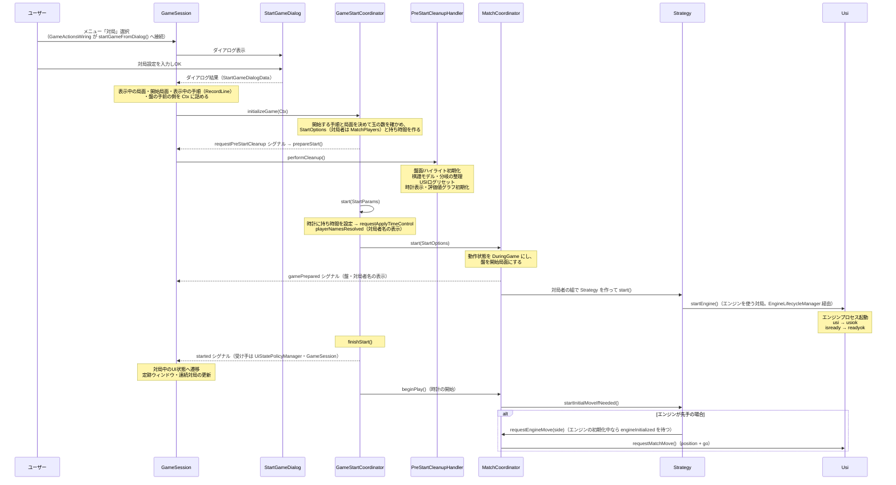

**主要クラスの役割:**

| クラス | 責務 |
|--------|------|
| `GameSession` | メニューの「対局」を受けてダイアログを出し、開始を頼む。開始前の片付け・持ち時間・開始の知らせを受けて表示を合わせる（`src/app/`） |
| `StartGameDialog` | 対局者（人間・エンジン）・時間設定・開始局面のUI入力を収集 |
| `GameStartCoordinator` | 開始する局面と手順を決め、時計の設定・開始の通知・初手の起動までを1か所で行う |
| `PreStartCleanupHandler` | 前回の対局状態をクリーンアップ（盤面・棋譜・時計・評価値等） |
| `MatchCoordinator` | 対局進行の司令塔。対局の手順と対局者を持ち、対局者の組で Strategy を作る。時計を動かして初手の思考を頼む |
| `Usi` | USIプロトコル通信ファサード。エンジンプロセスの起動と初期化を実行 |

**補足:**
- `GameStartCoordinator::initializeGame()` は開始する手順（現在の局面から始めるなら、表示中の手順の表示中の手数まで）を決め、`requestPreStartCleanup` で片付けを頼んでから `start()` を呼ぶ。片付けの実体は `GameSession::prepareStart()` から呼ぶ `PreStartCleanupHandler` にある
- 対局ダイアログからの開始・連続対局の次局（`GameSession::startNextGame()` → `GameStartCoordinator::start()`）・中断した対局の再開（`GameStartCoordinator::resumeInterruptedGame()`）は、どれも最後に `GameStartCoordinator::finishStart()` を通る（`started` の通知 → 棋譜欄の開始行の選択 → `MatchCoordinator::beginPlay()`）
- `MatchCoordinator::start()` は `MatchStartOptions::players`（`MatchPlayers`）から Strategy を選ぶ。エンジン同士なら `EngineVsEngineStrategy`、片方がエンジンなら `HumanVsEngineStrategy`、人間同士なら `HumanVsHumanStrategy`（6.2 節）
- エンジン同士の対局では E1・E2 の枠に2つの `Usi` を作り、交互に go/bestmove を繰り返す

---

### 15.2 指し手実行フロー

人間が盤面をクリックして駒を移動し、合法手判定・盤面更新・棋譜記録・エンジン応答までを含む一連の処理。

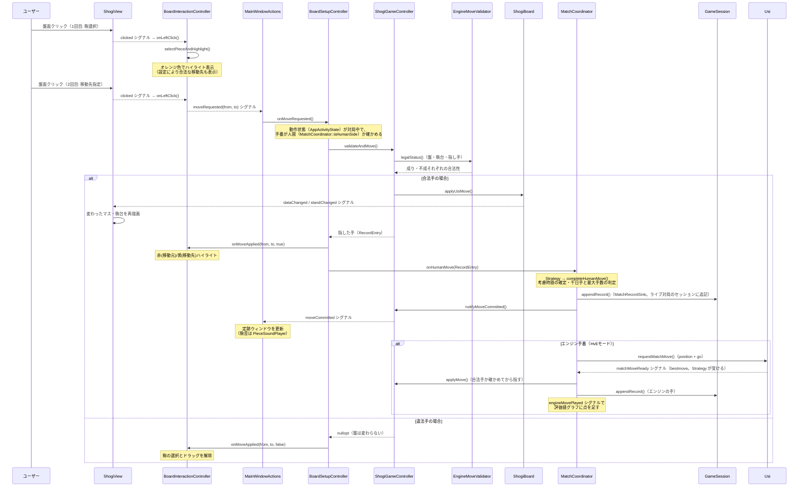

**主要クラスの役割:**

| クラス | 責務 |
|--------|------|
| `ShogiView` | Qt Graphics Viewベースの盤面描画とマウスイベントの発行 |
| `BoardInteractionController` | 2クリック方式の駒選択・移動要求、ハイライト管理 |
| `BoardSetupController` | 着手要求を受け、局面編集・棋譜の変化の入力・通信対局・対局に振り分ける |
| `ShogiGameController` | 指し手の検証と盤面更新の実行。着手確定の知らせ（`moveCommitted`） |
| `EngineMoveValidator` | 合法手判定ロジック（王手放置、二歩、打ち歩詰め、行き所のない駒等を検査） |
| `ShogiBoard` | 9x9盤面 + 駒台のデータモデル |
| `MatchCoordinator` | 一手の確定（時計・棋譜の行・千日手・最大手数）と、エンジンへの手番渡し |
| `GameSession` | 対局の棋譜の受け手（`MatchRecordSink`）。確定した行をライブ対局のセッション（分岐ツリー）に追記する。棋譜欄には `LiveGameSession::moveAdded` を受けた `KifuDisplayCoordinator` が出す |

**補足:**
- `MainWindowActions::handleMoveRequested()` は `BoardSetupController::onMoveRequested()` を呼ぶだけで、判定と後処理は `BoardSetupController` が行う
- 成り・不成は `ShogiGameController::validateAndMove()` が決める。両方とも合法なら成りダイアログ（`setPromotionChooser()` で渡す `DialogLauncher::choosePromotion()`）で選ばせ、成りだけが合法（行き所のない駒）なら成る（6.6 節）
- `MatchCoordinator::onHumanMove()` は対局モードの Strategy（HvE なら `HumanVsEngineStrategy`）に渡す。Strategy は `MatchStrategyHost::completeHumanMove()` で一手を確定させ、エンジンの手番なら `requestEngineMove()` で `Usi::requestMatchMove()`（position と go）を頼み、`matchMoveReady` シグナルで受けた応手を `applyEngineMove()` で指す
- 着手の確定（`MatchCoordinator` の一手の確定）では、盤の描き直し（`boardChanged`）・移動元と移動先の強調（`moveHighlightRequested`）・手番（`turnChanged`）・時計（`timeUpdated`）もシグナルで知らせる
- 人間同士の対局ではエンジンとの通信はなく、司令塔が一手を確定して手番が交互に切り替わる。通信対局では `BoardSetupController` が `csaMoveRequested` シグナルで手を `CsaGameCoordinator::onHumanMove()` へ送る（15.5）
- 対局していないときに盤で指した手は、`BranchTreeEditController::recordBoardMove()` が棋譜の変化として記録する

---

### 15.3 棋譜読み込みフロー

棋譜ファイル（KIF / KI2 / CSA / JKF / USEN / USI形式）を読み込み、内部データモデルを構築してUIに反映するまでのフロー。

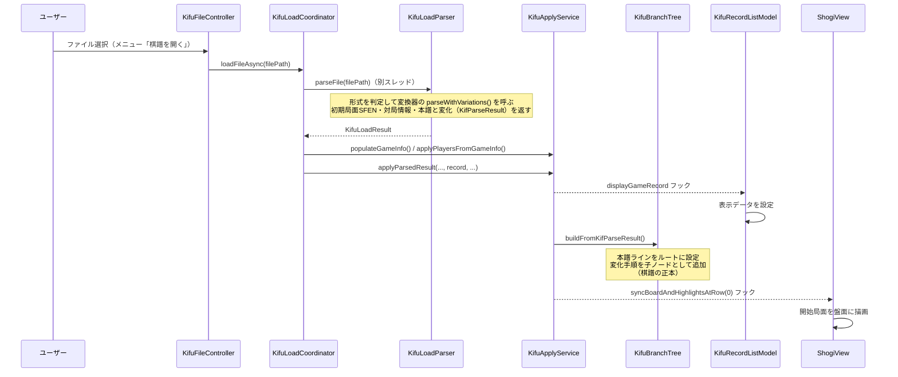

**主要クラスの役割:**

| クラス | 責務 |
|--------|------|
| `KifuFileController` | 「棋譜を開く」などのファイル操作の入口（`src/ui/coordinators/`） |
| `KifuLoadCoordinator` | 棋譜読み込みの統括。パースの起動（別スレッド）と結果の適用（`src/ui/coordinators/`） |
| `KifuLoadParser` | 形式判定とフォーマット変換器の呼び出し。結果を `KifuLoadResult` にまとめる（`src/kifu/`） |
| `KifuApplyService` | 解析結果を棋譜欄・分岐ツリー・盤面に当てはめる（`src/ui/coordinators/`） |
| `KifToSfenConverter` | KIF形式の解析。手合割→SFEN変換、指し手→USI変換、変化抽出 |
| `KifuBranchTree` | 分岐棋譜のツリー構造。本譜と変化を木構造で管理する棋譜の正本 |
| `KifuRecordListModel` | 棋譜欄表示用のQtモデル |

**補足:**
- 同期版の `loadKifuFromFile()` などと、テキストからの読み込み（`loadTextAsync()` / `loadKifuFromString()`、クリップボード貼り付けで使用、形式を自動判定）も同じ `applyLoadResult()` を通る
- KIF以外の形式も同様のパターンで処理される: `Ki2ToSfenConverter`（KI2形式）、`CsaToSfenConverter`（CSA形式）等
- 分岐ツリー構築後、`KifuApplyService` が分岐のある手数を棋譜モデルの `setBranchPlyMarks()` に渡す
- 読み込みが作るのは分岐ツリー（棋譜の正本）だけである。対局を始めるときは、表示中の手順（`KifuNavigationState::currentRecordLine()`）から司令塔の手順（`RecordLine`）を作る（15.1、8.7）
- 各手の後の局面は、変換器の結果から `SfenReplay::replay()` で作る（13.8）

---

### 15.4 検討モードフロー

検討モードは、現在の局面をエンジンに解析させ、候補手と評価値をリアルタイム表示する機能。局面移動に追従して再解析する動作も含む。

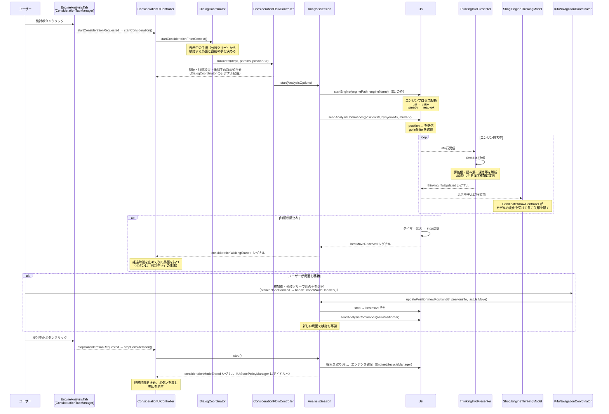

**主要クラスの役割:**

| クラス | 責務 |
|--------|------|
| `EngineAnalysisTab` | 検討タブUI（中身は `ConsiderationTabManager`。`considerationTabManager()` で取り出す）。エンジン選択・時間設定・MultiPV設定・検討開始/中止ボタン |
| `ConsiderationUiController` | 検討タブの開始・中止・エンジン変更・候補手の数を検討のセッションへ伝え、経過時間・ボタン・矢印の表示を合わせる（`src/ui/controllers/`） |
| `DialogCoordinator` | 表示中の手順から検討する局面と直前の手を決め（`ConsiderationPositionResolver`）、検討タブの設定で `ConsiderationFlowController` を呼ぶ |
| `ConsiderationFlowController` | 検討パラメータ（エンジン・時間・候補手の数）から `AnalysisOptions` を作り、`AnalysisSession` を始める（`src/ui/coordinators/`） |
| `AnalysisSession` | 検討・詰み探索のセッション。E1 の枠にエンジンを作り、局面や候補手の数が変わるたびに探索をやり直す（`src/analysis/`） |
| `Usi` | エンジンへのposition/goコマンド送信、info行の受信 |
| `ThinkingInfoPresenter` | info行を解析し、評価値・読み筋（漢字変換含む）をシグナルで通知 |
| `ShogiEngineThinkingModel` | 思考情報の表示モデル（MultiPV対応） |
| `KifuNavigationCoordinator` | 局面移動のあと、検討中なら新しい局面を `AnalysisSession::updatePosition()` で渡す |

**補足:**
- 検討モードのMultiPVは動的に変更可能。`ConsiderationTabManager::considerationMultiPVChanged` → `ConsiderationUiController::onMultiPVChanged()` → `AnalysisSession::updateMultiPV()` の経路で伝わり、探索をやり直す
- 局面変更・MultiPV変更のやり直しは `AnalysisSession` の状態（`State`）で1つにまとめる。探索中なら stop を送って bestmove を待ち（`StoppingSearch`）、それから新しい局面で go を送る（`RestartQueued`）ので、二重に再開しない
- 矢印表示は `ConsiderationUiController::updateArrows()` が `CandidateArrowController::setConsiderationState()` に検討中かどうか・表示の有無・検討タブのモデルを渡し、`CandidateArrowController` がモデルの候補手から `ShogiView` に矢印を描く
- 検討中にエンジンを変えると、`ConsiderationUiController::onEngineChanged()` が検討を止めて新しいエンジンで始め直す

---

### 15.5 CSA通信対局フロー

CSAプロトコルを使用したネットワーク対局の、接続からログイン、対局開始、指し手交換、対局終了までの一連のフロー。

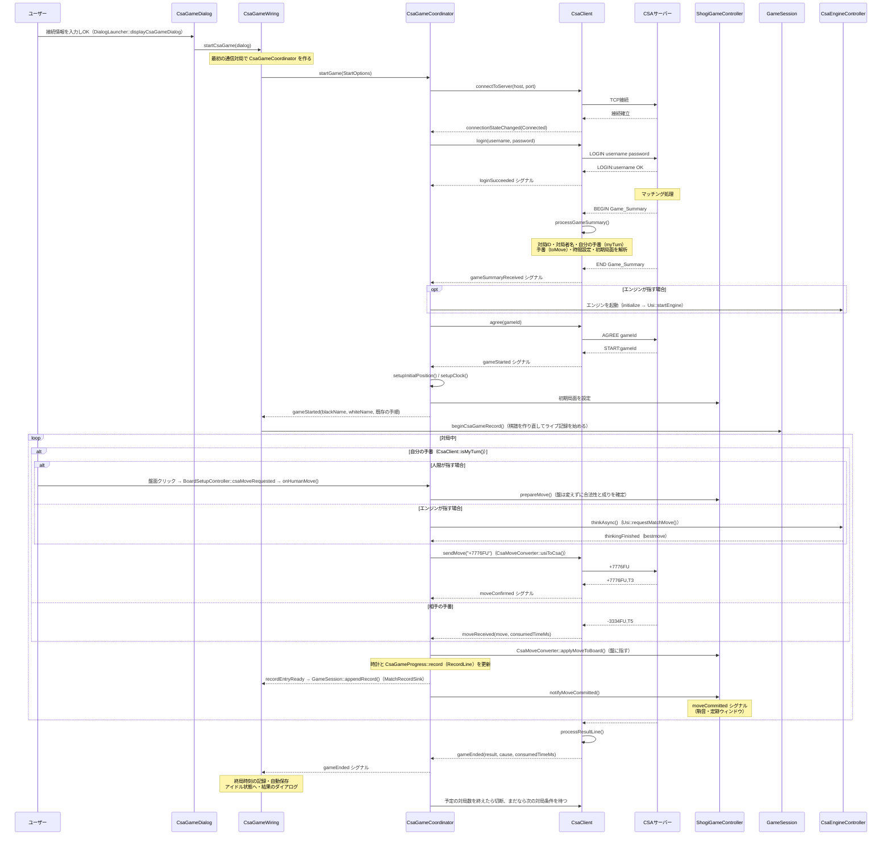

**主要クラスの役割:**

| クラス | 責務 |
|--------|------|
| `CsaGameDialog` | CSA通信対局の接続設定UI（ホスト・ポート・ユーザー名・パスワード・エンジン選択） |
| `CsaGameWiring` | 通信対局の UI 配線。最初の通信対局で `CsaGameCoordinator` を作り、棋譜の行を `GameSession`（`MatchRecordSink`）へ渡す（`src/ui/wiring/`） |
| `CsaGameCoordinator` | CSA通信対局の進行管理。1局の進行（持ち時間・手数・手順）は `CsaGameProgress` に持ち、手順は `record`（`RecordLine`）1つだけ。自分の手番は持たず `CsaClient::isMyTurn()` を見る |
| `CsaClient` | CSAプロトコルのTCP/IP通信実装。メッセージの送受信と状態管理。Game_Summary は `GameSummary`（`myTurn` は `std::optional<Turn>`、`toMove` は `Turn`）にまとめる |
| `CsaEngineController` | エンジンで指すときの `Usi` の起動と思考 |
| `ShogiGameController` | 盤面データの更新と、着手確定の知らせ（`moveCommitted`） |

**補足:**
- `CsaClient`は状態マシンパターンで実装されており、`ConnectionState`が `Disconnected → Connecting → Connected → LoggedIn → WaitingForGame → GameReady → InGame → GameOver` と遷移する
- CSA形式の指し手（例: `+7776FU`）とUSI形式の指し手（例: `7g7f`）の変換は `CsaMoveConverter`（`csaToUsi()`・`usiToCsa()`）が担当する。棋譜の表記は `csaToPretty(csaMove, isPromotion, previousTo)`（`previousTo` は直前の手の移動先の `BoardSquare`）、盤への適用は `applyMoveToBoard()`
- 自分の手も相手の手も、サーバーからの確認（`moveConfirmed`／`moveReceived`）を受けてから盤に指す。盤で入力した手はその時点では盤を変えない
- エンジン対局時は `CsaEngineController` が `Usi` を持ち、`matchMoveReady` で受けた応手を `thinkingFinished` で `CsaGameCoordinator` に返す
- 着手確定の知らせは、ローカル対局と同じ `ShogiGameController::moveCommitted`（`notifyMoveCommitted()` が出す）で、駒音と定跡ウィンドウはこれを受ける
- 終局原因（投了・時間切れ・千日手・入玉宣言等）は `CsaClient::GameEndCause` 列挙型で分類され、対応する結果表示が行われる

<!-- chapter-15-end -->

---

<!-- chapter-16-start -->
## 第16章 国際化（i18n）と翻訳

ShogiBoardQは日本語・英語・簡体字中国語・繁体字中国語の4言語をサポートしている（原文は日本語）。本章ではQtの国際化フレームワークを活用した翻訳の仕組みと、実行時の言語切替メカニズムについて解説する。

### 16.1 翻訳ワークフローの全体像

ソースコード中の `tr()` マクロで囲まれた文字列が翻訳対象となり、以下のパイプラインで処理される。

```
┌─────────────────────────────────────────────────────────────────┐
│                     翻訳ワークフロー                              │
├─────────────────────────────────────────────────────────────────┤
│                                                                 │
│  ① ソースコード (.cpp / .h / .ui)                                │
│      tr("言語設定") / tr("棋譜解析完了")                           │
│            │                                                    │
│            ▼                                                    │
│  ② lupdate（文字列抽出）                                         │
│      cmake --build build --target update_translations          │
│            │                                                    │
│            ▼                                                    │
│  ③ .ts ファイル編集（XML形式）                                    │
│      <source> に対する <translation> を記述                       │
│            │                                                    │
│            ▼                                                    │
│  ④ lrelease / cmake ビルド（バイナリ変換）                        │
│      qt_add_translation() が .ts → .qm を生成                   │
│            │                                                    │
│            ▼                                                    │
│  ⑤ .qm ファイル（コンパクトなバイナリ翻訳）                       │
│      実行時に QTranslator::load() で読み込み                      │
│                                                                 │
└─────────────────────────────────────────────────────────────────┘
```

各ステップの概要を以下にまとめる。

| ステップ | ツール/ファイル | 役割 |
|----------|----------------|------|
| ① `tr()` | ソースコード中のマクロ | 翻訳対象の文字列をマーク |
| ② `lupdate` | `update_translations` ターゲット | ソースから `.ts` ファイルへ文字列を抽出・同期（明示的に実行する） |
| ③ `.ts` 編集 | テキストエディタ or Qt Linguist | 翻訳テキストを入力 |
| ④ `lrelease` | CMakeビルド時に自動実行 | `.ts` → `.qm` バイナリ変換 |
| ⑤ `.qm` ロード | `QTranslator` + `QApplication` | 実行時に翻訳を適用 |

### 16.2 翻訳ファイルの構造

翻訳ファイルは `resources/translations/` に格納されるXML形式の `.ts` ファイルである。

| ファイル | 言語 |
|---------|------|
| `ShogiBoardQ_ja_JP.ts` | 日本語（原文と同じ訳を入れる） |
| `ShogiBoardQ_en.ts` | 英語 |
| `ShogiBoardQ_zh_CN.ts` | 簡体字中国語 |
| `ShogiBoardQ_zh_TW.ts` | 繁体字中国語（台湾の用語） |

4言語とも未翻訳（`type="unfinished"`）を0件に保つ。CI の `translation-check` ジョブは、未翻訳の数が `resources/translations/baseline-unfinished.txt` から増えると失敗する。`tst_translation_files` は、4言語のカタログ（原文の集合）とプレースホルダー（`%1` など）が揃っているかを確かめる。

#### .ts ファイルのXML構造

```xml
<?xml version="1.0" encoding="utf-8"?>
<!DOCTYPE TS>
<TS version="2.1" language="ja_JP">
  <context>
    <name>AnalysisFlowController</name>       <!-- クラス名 -->
    <message>
      <location filename="../../src/ui/coordinators/analysisflowcontroller.cpp" line="50"/>
      <source>内部エラー: 解析モデルが未準備です。</source>  <!-- 原文 -->
      <translation type="unfinished"></translation>           <!-- 翻訳 -->
    </message>
    ...
  </context>
  <context>
    <name>BranchTreeManager</name>
    ...
  </context>
</TS>
```

主要なXML要素を以下に示す。

| 要素 | 説明 |
|------|------|
| `<TS>` | ルート要素。`version` と `language` 属性を持つ |
| `<context>` | クラス単位のグルーピング。`<name>` でクラス名を示す |
| `<message>` | 翻訳単位。1つの `tr()` 呼び出しに対応 |
| `<location>` | ソースファイルのパスと行番号（`lupdate` が自動設定） |
| `<source>` | 翻訳元の文字列（`tr()` に渡された文字列） |
| `<translation>` | 翻訳先の文字列。未翻訳の場合は `type="unfinished"` |

`<translation>` 要素の `type` 属性の意味は以下の通り。

| type属性 | 意味 |
|----------|------|
| `type="unfinished"` | 未翻訳。翻訳テキストを追加する必要がある |
| `type="obsolete"` | ソースコードから該当する `tr()` が削除された |
| （属性なし） | 翻訳済み。正常状態 |

### 16.3 CMakeによるビルド統合

`CMakeLists.txt` で翻訳ファイルのビルドパイプラインが定義されている。

```cmake
# ==== Translations (.ts) ====
set(TS_FILES
    resources/translations/ShogiBoardQ_ja_JP.ts
    resources/translations/ShogiBoardQ_en.ts
    resources/translations/ShogiBoardQ_zh_CN.ts
    resources/translations/ShogiBoardQ_zh_TW.ts
)

# .qm 生成（lrelease のみ。ソースのスキャンはしない）
qt_add_translation(QM_FILES ${TS_FILES})
add_custom_target(translations ALL DEPENDS ${QM_FILES})
add_dependencies(ShogiBoardQ translations)

# lupdate（ソースから .ts を更新）は明示的に実行する
add_custom_target(update_translations
    COMMAND Qt6::lupdate ${CMAKE_SOURCE_DIR}/src -ts ${TS_FILES}
    WORKING_DIRECTORY ${CMAKE_SOURCE_DIR})

# .qm ファイルを実行可能ファイルと同じディレクトリにコピー
foreach(QM_FILE ${QM_FILES})
    add_custom_command(TARGET ShogiBoardQ POST_BUILD
        COMMAND ${CMAKE_COMMAND} -E copy_if_different
            ${QM_FILE}
            $<TARGET_FILE_DIR:ShogiBoardQ>)
endforeach()

# Qt 標準ダイアログの翻訳（qtbase_ja / zh_CN / zh_TW）をリソースに同梱する
qt_add_resources(ShogiBoardQ qt_dialog_translations PREFIX "/translations/qt" ...)
```

ポイント:

- 通常のビルドは `lrelease` だけを行う。ソースの `tr()` を `.ts` に反映するには `update_translations` ターゲットを実行する
- `lupdate` のスキャン対象を `${CMAKE_SOURCE_DIR}/src` に限定することで、`build/` 配下の autogen ファイルを拾わない
- 生成された `.qm` ファイルはビルド後に実行ファイルと同じディレクトリへコピーされる
- Qt 標準ダイアログ（ファイル選択など）の翻訳は、配布スクリプトが落としても使えるよう `:/translations/qt/` に埋め込む

### 16.4 起動時の翻訳ロード

`main.cpp` は `QApplication` を作った直後、ウィジェットを作る前に `ApplicationTranslations`（`src/services/applicationtranslations.h/.cpp`）を作り、終了処理まで持っておく。`ApplicationTranslations` は `AppSettings::language`（`General/language`）を読み、言語を1つに決めて翻訳を読み込む。

```
┌──────────────────────────────────────────────────────────┐
│               翻訳ロードのフロー                            │
├──────────────────────────────────────────────────────────┤
│                                                          │
│  AppSettings::language() で設定値を取得                     │
│         │  "system" ならシステムの UI 言語の先頭を使う         │
│         ▼                                                │
│  KifuPresentation::resolveLanguage()                     │
│         ├── 日本語 → "ja_JP"                               │
│         ├── 中国語 → 繁体字なら "zh_TW"、それ以外は "zh_CN"   │
│         └── それ以外 → "en"                                │
│         │                                                │
│         ├→ Qt 標準ダイアログ: qtbase_<言語>.qm               │
│         │   （:/translations/qt/ → Qt の翻訳ディレクトリ）     │
│         ├→ アプリ: ShogiBoardQ_<言語>.qm                    │
│         │   （実行ファイルと同じディレクトリ）                  │
│         └→ 棋譜表記の設定: KifuPresentation::configure()     │
│                                                          │
└──────────────────────────────────────────────────────────┘
```

`main.cpp` の該当部分（抜粋）:

```cpp
// 終了時の設定初期化メッセージも翻訳できるよう、このスコープで保持する。
const ApplicationTranslations translations;

configureApplicationAppearance(a, translations.language());  // フォントも言語に合わせる
```

`ApplicationTranslations` のコンストラクタ（抜粋）:

```cpp
m_language = KifuPresentation::resolveLanguage(AppSettings::language(), systemLanguage);

// Qt 標準ダイアログの翻訳（日本語は "ja"）
const QString qtLanguage = m_language == QStringLiteral("ja_JP") ? QStringLiteral("ja") : m_language;
if (m_qtTranslator.load(":/translations/qt/qtbase_" + qtLanguage + ".qm")
    || m_qtTranslator.load("qtbase_" + qtLanguage, QLibraryInfo::path(QLibraryInfo::TranslationsPath)))
    QCoreApplication::installTranslator(&m_qtTranslator);

// アプリの翻訳
if (m_appTranslator.load(directory.filePath("ShogiBoardQ_" + m_language + ".qm")))
    QCoreApplication::installTranslator(&m_appTranslator);

// 棋譜の表記（漢数字か英字か、など）は言語と表記の設定から決める
KifuPresentation::configure(m_language, AppSettings::moveNotation(), AppSettings::notationOrigin());
```

言語は日本語・英語・簡体字・繁体字のいずれかに必ず決まる。日本語のときも `ShogiBoardQ_ja_JP.qm` を読み込む（訳は原文と同じ）。`QTranslator` は `ApplicationTranslations` のメンバなので、破棄するとアプリケーションへの登録も外れる。

### 16.5 LanguageController: 実行時言語切替

LanguageControllerは、メニューからの言語と棋譜表記の選択をハンドリングし、設定の保存と再起動の案内を行うコントローラである。

**ファイル**: `src/ui/controllers/languagecontroller.h`, `src/ui/controllers/languagecontroller.cpp`

#### クラス構成

```
LanguageController (QObject)
├── メンバ
│   ├── m_actionGroup: QActionGroup*      言語の排他選択グループ
│   ├── m_systemAction: QAction*          「システム言語」メニュー項目
│   ├── m_japaneseAction: QAction*        「日本語」メニュー項目
│   ├── m_englishAction: QAction*         「英語」メニュー項目
│   ├── m_simplifiedAction: QAction*      「简体中文」メニュー項目
│   ├── m_traditionalAction: QAction*     「繁體中文」メニュー項目
│   ├── m_notationGroup: QActionGroup*    棋譜表記（言語に合わせる・日本語表記・英語表記）の排他選択グループ
│   └── m_parentWidget: QWidget*          ダイアログ表示用の親ウィジェット
├── public メソッド
│   ├── setActions()                      言語のメニューアクションの登録
│   ├── setNotationActions()              棋譜表記のメニューアクションの登録
│   ├── setParentWidget()                 親ウィジェットの設定
│   └── updateMenuState()                 現在の設定でチェック状態を更新
├── public slots
│   ├── onSystemLanguageTriggered()       「システム言語」選択時
│   ├── onJapaneseTriggered()             「日本語」選択時
│   └── onEnglishTriggered()              「英語」選択時
├── private slots
│   ├── onChineseSimplifiedTriggered()    「简体中文」選択時
│   ├── onChineseTraditionalTriggered()   「繁體中文」選択時
│   ├── onNotationTriggered(QAction*)     棋譜表記の選択時
│   ├── onOriginTriggered(bool)           「英語表記で移動元を常に表示」の切り替え時
│   └── showNotationHelp()                棋譜表記の読み方を表示
└── private メソッド
    ├── changeLanguage(const QString&)    設定保存＋再起動の案内
    └── restartNotice()                   再起動の案内ダイアログ
```

#### 言語切替のシーケンス

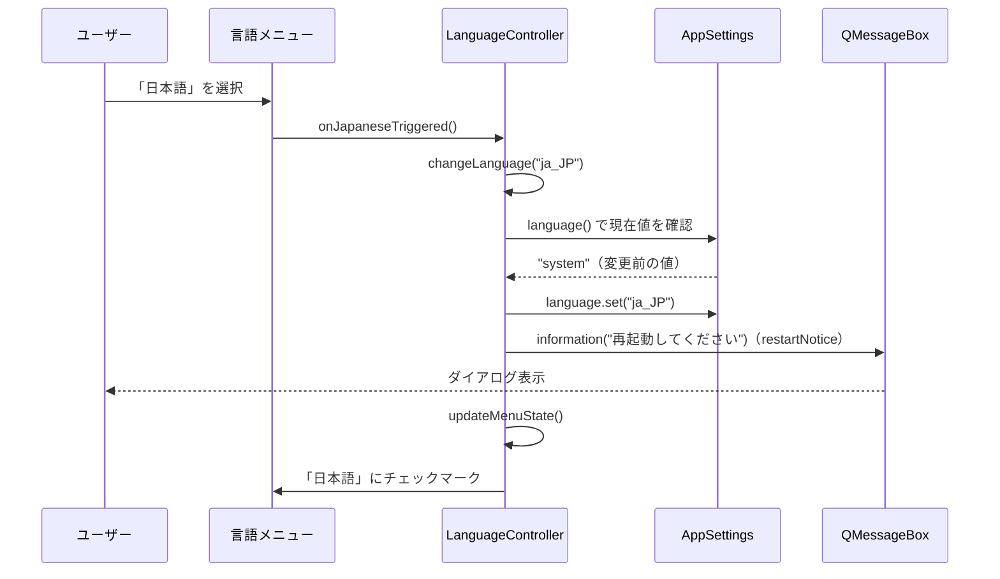

重要な設計上のポイント:

- **再起動が必要**: 言語と棋譜表記の変更は即座には反映されない。翻訳と棋譜表記は起動時に `ApplicationTranslations` が決めるため、変更を反映するにはアプリケーションの再起動が必要
- **排他選択**: `QActionGroup` により、5つの言語オプション（システム/日本語/英語/简体中文/繁體中文）は常に1つだけが選択される
- **同一言語の再選択を無視**: `changeLanguage()` は現在の設定と同じ値が指定された場合、何もしない

#### 合成ルートとの統合

LanguageController は `MainWindowComposer::createServices()` で作り、`wireFoundation()` でメニューのアクションを渡す。

```cpp
// src/app/mainwindowcomposer_wire.cpp（wireFoundation）
// 言語メニュー（相互排他）と表記
m_c.languageController->setParentWidget(&m_window);
m_c.languageController->setActions(
    m_ui.actionLanguageSystem, m_ui.actionLanguageJapanese, m_ui.actionLanguageEnglish,
    m_ui.actionLanguageChineseSimplified, m_ui.actionLanguageChineseTraditional);
m_c.languageController->setNotationActions(
    m_ui.actionNotationAuto, m_ui.actionNotationJapanese,
    m_ui.actionNotationWestern, m_ui.actionNotationOrigin, m_ui.actionNotationHelp);
```

`setActions()`・`setNotationActions()` の内部で各アクションの `triggered` シグナルと対応するスロットが接続されるため、呼び出し側での追加的な `connect()` は不要である。

### 16.6 AppSettingsによる言語設定の永続化

言語設定は `AppSettings::language`（`src/services/appsettings.h`）としてINIファイルに保存される。ほかの設定と同じく、宣言の表に1行で書いた `Setting<QString>` である（§12.5）。

```cpp
// appsettings.h
/// 言語コード（デフォルト: "system"）
inline const Setting<QString> language{"General/language", "system"};

// 読み書き
const QString current = AppSettings::language();  // LanguageController::changeLanguage()
AppSettings::language.set(lang);
```

起動時は `ApplicationTranslations`（`src/services/applicationtranslations.cpp`）がこの値を読み、`"system"` ならシステムのUI言語から解決して翻訳ファイルを選ぶ。

| 設定キー | 取りうる値 | デフォルト | 説明 |
|---------|-----------|-----------|------|
| `General/language` | `"system"`, `"ja_JP"`, `"en"`, `"zh_CN"`, `"zh_TW"` | `"system"` | 表示言語の設定 |

### 16.7 翻訳追加の手順

新しい翻訳可能文字列を追加してから翻訳が反映されるまでの具体的な手順を示す。

#### ステップ1: ソースコードで `tr()` を使用

```cpp
// 新しいダイアログメッセージを追加する例
QMessageBox::information(this,
    tr("エクスポート完了"),
    tr("棋譜のエクスポートが完了しました。"));
```

#### ステップ2: `lupdate` で翻訳ファイルを更新

```bash
cmake --build build --target update_translations
```

このコマンドにより、新しい `tr()` 文字列が4言語の `.ts` ファイルに `type="unfinished"` として追加される。既存の翻訳は保持される。

#### ステップ3: `.ts` ファイルを編集して翻訳を入力

日本語が原文の場合、英語・簡体字・繁体字（`ShogiBoardQ_en.ts`・`ShogiBoardQ_zh_CN.ts`・`ShogiBoardQ_zh_TW.ts`）に翻訳を追加し、`ShogiBoardQ_ja_JP.ts` には原文と同じ文字列を訳として入れる。英語の例:

```xml
<message>
    <source>エクスポート完了</source>
    <translation>Export Complete</translation>   <!-- type="unfinished" を削除 -->
</message>
<message>
    <source>棋譜のエクスポートが完了しました。</source>
    <translation>Kifu export has been completed.</translation>
</message>
```

翻訳を入力したら `type="unfinished"` 属性を削除する（または Qt Linguist で翻訳済みにマークする）。4言語とも未翻訳が0件になったことを確かめる。

```bash
grep -c 'type="unfinished"' resources/translations/*.ts
```

`%n` の複数形（`<numerusform>`）は使わない。`tst_translation_files` が訳を空と判定する。件数は `%2` などの通常の引数で渡す。

#### ステップ4: ビルドして .qm を生成

```bash
cmake --build build
```

CMakeの `qt_add_translation()` が `lrelease` を実行し、`.ts` → `.qm` の変換が行われる。

#### ステップ5: 動作確認

アプリケーションを起動し、言語メニューから対象言語を選択（→再起動）して翻訳が反映されていることを確認する。

### 16.8 `tr()` マクロの使い方

#### 基本的な使い方

```cpp
// QObject を継承するクラス内で使用
setWindowTitle(tr("対局設定"));

// 引数を含む文字列
statusBar()->showMessage(tr("手数: %1").arg(moveCount));
```

#### 注意事項

| 項目 | 説明 |
|------|------|
| QObject派生クラス内で使用 | `tr()` は `QObject::tr()` のマクロであり、QObject派生クラスのメンバ関数内で使用する |
| リテラル文字列のみ | `tr(variable)` はNG。`lupdate` は静的にソースを解析するため、リテラル文字列のみ抽出できる |
| `%1`, `%2` で引数 | `QString::arg()` と組み合わせて動的な値を埋め込む |
| `.ui` ファイル | Qt Designer で設定した文字列は自動的に `tr()` でラップされる |

<!-- chapter-16-end -->

---

<!-- chapter-17-start -->
## 第17章 新機能の追加ガイド

本章では、ShogiBoardQに新機能を追加する際の標準的な手順を、実践チュートリアル形式で解説する。仮の新機能「棋譜にタグを付ける機能」（棋譜ファイルに「急戦」「居飛車」等のタグを付与し、検索・フィルタリングを可能にする）を題材として、ファイル配置からビルド確認までの全工程を一通り示す。

### 17.1 ファイル配置先の選定

新しいクラスをどのディレクトリに配置するかは、そのクラスの責務で決まる。判断基準を以下にまとめる。

#### ディレクトリ選定フローチャート

```
新クラスの主な責務は？
│
├─ 将棋のルール・盤面ロジック ──→ src/core/
│
├─ 対局進行・ゲーム管理 ──→ src/game/
│
├─ 棋譜データ・フォーマット変換 ──→ src/kifu/
│    └─ フォーマット変換器 ──→ src/kifu/formats/
│
├─ エンジン通信・USIプロトコル ──→ src/engine/
│
├─ 解析（検討・棋譜解析・詰将棋） ──→ src/analysis/
│
├─ ネットワーク通信（CSA） ──→ src/network/
│
├─ ナビゲーション（棋譜移動・分岐） ──→ src/navigation/
│
├─ 盤面操作（編集・画像出力） ──→ src/board/
│
├─ UI関連
│    ├─ データ表示の同期 ──→ src/ui/presenters/
│    ├─ ユーザー操作のハンドリング ──→ src/ui/controllers/
│    ├─ シグナル/スロット接続 ──→ src/ui/wiring/
│    └─ 複数コンポーネントの調整・ダイアログの起動 ──→ src/ui/coordinators/
│
├─ 部品の組み立て（合成ルート）・メニューのアクションの接続・
│  利用者操作の振り分け・対局の流れの UI 側 ──→ src/app/
│
├─ ウィジェット（再利用可能なUI部品） ──→ src/widgets/
│
├─ ダイアログ（モーダル/モードレス） ──→ src/dialogs/
│
├─ Qtモデル（QAbstractListModel等） ──→ src/models/
│
├─ 設定・永続化・横断サービス ──→ src/services/
│
├─ 自動化 API、CLI と共有する GUI 非依存のサービス ──→ src/automation/
│
├─ CLI（shogiboardq-cli）のコマンド ──→ src/cli/
│
└─ 共通ユーティリティ ──→ src/common/
```

置き場所は層の規則にも合わせる。下の層は上の層を `#include` しない。下から順に core・common → services → kifu → engine → game → analysis・network・navigation → models → views・widgets → board → dialogs → ui → app で、automation・cli は外側の入口である（analysis・network・navigation は互いを参照しない）。`tests/tst_layer_dependencies.cpp` が `#include` を調べて確かめる（§3.2）。たとえば game のクラスは ui の部品を知らないので、表示や棋譜への反映はシグナルか、上の層が実装するインターフェース（司令塔の棋譜の受け手 `MatchRecordSink` を app の `GameSession` が実装する、など）で知らせる。

#### 今回の例: 棋譜タグ機能

棋譜タグ機能は以下の3つのクラスで構成すると仮定する。

| クラス | 責務 | 配置先 |
|-------|------|--------|
| `KifuTagModel` | タグデータの管理（追加・削除・検索） | `src/models/` |
| `KifuTagWiring` | MainWindowとタグUIの接続 | `src/ui/wiring/` |
| `KifuTagDialog` | タグ編集ダイアログのUI | `src/dialogs/` |

`KifuTagWiring`（ui）は `KifuTagModel`（models）と `KifuTagDialog`（dialogs）を参照できるが、逆向きの参照はできない。

> **ポイント**: ヘッダファイル（`.h`）は対応するソースファイル（`.cpp`）と同じディレクトリに配置する。ソースファイルは `CMakeLists.txt` に列挙しているので、配置先に対応する `SRC_*`（例: `src/models/` なら `SRC_MODELS`）に `.cpp` と `.h` を書き足す（[1.4節](#14-cmakeビルド構成の概要)）。

### 17.2 Deps構造体を持つ新クラスの作成

Wiringクラスは第4章で解説した「Deps構造体パターン」に従う。ここでは `KifuTagWiring` の実装例を示す。

#### ヘッダファイル

```cpp
// src/ui/wiring/kifutagwiring.h

#ifndef KIFUTAGWIRING_H
#define KIFUTAGWIRING_H

/// @file kifutagwiring.h
/// @brief 棋譜タグ機能の配線クラスの定義

#include <QObject>

class QWidget;
class KifuTagModel;
class KifuTagDialog;

/**
 * @brief 棋譜タグ機能のUI配線を担当するクラス
 *
 * 責務:
 * - タグ編集ダイアログの表示制御
 * - タグモデルとUIの接続
 *
 * Deps構造体で必要なオブジェクトを受け取る（合成ルートが起動時に1回渡す）。
 */
class KifuTagWiring : public QObject
{
    Q_OBJECT

public:
    /// 依存オブジェクト
    struct Deps {
        QWidget* parentWidget = nullptr;       ///< 親ウィジェット（非所有）
        KifuTagModel* tagModel = nullptr;      ///< タグモデル（非所有）
    };

    explicit KifuTagWiring(const Deps& deps, QObject* parent = nullptr);
    ~KifuTagWiring() override = default;

    /// 依存オブジェクトを再設定する
    void updateDeps(const Deps& deps);

public slots:
    /// タグ編集ダイアログを表示する（actionEditTags に接続）
    void showTagEditDialog();

    /// タグが変更されたときの処理（KifuTagModel::tagsChanged に接続）
    void onTagsChanged();

signals:
    /// タグ変更の保存を要求する（→ KifuFileController::overwriteKifuFile）
    void saveRequested();

private:
    QWidget* m_parentWidget = nullptr;
    KifuTagModel* m_tagModel = nullptr;
};

#endif // KIFUTAGWIRING_H
```

#### ソースファイル

```cpp
// src/ui/wiring/kifutagwiring.cpp

/// @file kifutagwiring.cpp
/// @brief 棋譜タグ機能の配線クラスの実装

#include "kifutagwiring.h"

#include "kifutagmodel.h"
#include "kifutagdialog.h"

// ============================================================
// 初期化
// ============================================================

KifuTagWiring::KifuTagWiring(const Deps& deps, QObject* parent)
    : QObject(parent)
    , m_parentWidget(deps.parentWidget)
    , m_tagModel(deps.tagModel)
{
}

void KifuTagWiring::updateDeps(const Deps& deps)
{
    m_parentWidget = deps.parentWidget;
    m_tagModel = deps.tagModel;
}

// ============================================================
// スロット
// ============================================================

void KifuTagWiring::showTagEditDialog()
{
    if (!m_tagModel) return;

    KifuTagDialog dialog(m_tagModel, m_parentWidget);
    if (dialog.exec() == QDialog::Accepted) {
        emit saveRequested();
    }
}

void KifuTagWiring::onTagsChanged()
{
    // タグ変更時の処理（例: ステータスバー更新、棋譜モデルへの反映）
}
```

**テンプレートの要点**:

| 要素 | ルール |
|------|--------|
| **Deps のフィールド** | 全て `nullptr` または適切なデフォルト値で初期化 |
| **コンストラクタ** | 初期化リストで `Deps` の値をメンバーにコピー |
| **updateDeps()** | 全フィールドを上書き。作ったあとで依存がそろうクラスだけが持つ |
| **ファイルヘッダー** | `@file` と `@brief` の2行（commenting-style-guide.md §2） |
| **クラスコメント** | `@brief` + 責務の箇条書き（commenting-style-guide.md §3） |

### 17.3 合成ルートに部品を追加

部品の生成と依存の設定は、MainWindow ではなく合成ルート（`MainWindowComposer`）で行う。部品は起動時に1回だけ作り、`ensure*()` は使わない（[4.2節](#42-合成ルートでの組み立て)、[composition-root.md](composition-root.md)）。

#### 1. MainWindowComponents にメンバーを宣言

```cpp
// src/app/mainwindowcomponents.h に追加

class KifuTagModel;
class KifuTagWiring;

struct MainWindowComponents {
    // ...
    // --- 棋譜 ---
    KifuTagModel* kifuTagModel = nullptr;
    KifuTagWiring* kifuTagWiring = nullptr;
};
```

> **ポイント**: 前方宣言をヘッダ冒頭の前方宣言セクションに追加する。`#include` ではなく前方宣言を使うことで、ヘッダの依存関係を最小化する。QObject は MainWindow を親にした生ポインタ、QObject でないものは `std::unique_ptr` で持つ。

#### 2. 生成段階で作る

```cpp
// src/app/mainwindowcomposer_create.cpp（createServices の「棋譜」の段）

// Lifetime: MainWindow の子（親が破棄する）。起動時に1回だけ作る
m_c.kifuTagModel = new KifuTagModel(&m_window);
```

#### 3. 依存の注入段階で依存を渡す

ほかの部品がそろってから `Deps` を組んで渡す。依存が生成段階でそろうなら、作るときにコンストラクタへ渡してもよい。

```cpp
// src/app/mainwindowcomposer_wire.cpp（wireKifu）

KifuTagWiring::Deps td;
td.parentWidget = &m_window;
td.tagModel = m_c.kifuTagModel;
m_c.kifuTagWiring = new KifuTagWiring(td, &m_window);
```

状態が要るときは、値を写さずに `AppState` へのポインタ（`&m_state`）を渡し、部品は `m_state->currentSfenStr` のように読む。個々のフィールドへのポインタ（`QString*` など）は渡さない。アプリが何をしているかだけが要る部品には `&m_state.activity`（`AppActivityState`）を渡す。部品を `std::function<X*()>` のゲッターで渡さない。

#### 4. シグナルをつなぐ

部品どうしのシグナルは `connectSignals()`（`mainwindowcomposer_finalize.cpp`）でつなぐ（§17.4）。

`tst_structural_kpi` の `appLayerHasNoLazyEnsure` が app 層に `ensure*` がないことを確かめる。テストから部品を読むときは `MainWindow::composer().parts().kifuTagWiring` を使う。

### 17.4 Wiringクラスでシグナル/スロット接続

シグナル/スロット接続は **`connect()` のメンバー関数ポインタ構文** を使用する。ラムダ式は禁止である（CLAUDE.md の Code Style 参照）。

#### 接続コードの例

```cpp
// src/app/mainwindowcomposer_finalize.cpp（connectSignals）

// メニューアクション → KifuTagWiring のスロット
connect(m_ui.actionEditTags, &QAction::triggered,
        m_c.kifuTagWiring, &KifuTagWiring::showTagEditDialog);

// KifuTagWiring のシグナル → 棋譜ファイル操作のスロット
connect(m_c.kifuTagWiring, &KifuTagWiring::saveRequested,
        m_c.kifuFileController, &KifuFileController::overwriteKifuFile);
```

メニューのアクションの多くは、`UiActionsWiring` の子（`FileActionsWiring`・`GameActionsWiring`・`EditActionsWiring`・`ViewActionsWiring`、どれも `src/app/`）でつないでいる。既存のメニューに足すなら、そちらに書く。

#### 接続時の注意事項

| ルール | 理由 | 例 |
|--------|------|-----|
| ラムダ禁止 | 接続の追跡を困難にするため | `connect(a, &A::sig, [this](){...})` は使わない |
| `Qt::UniqueConnection` | 重複接続を防ぐ（`wire()` で一括接続する場合） | `connect(..., Qt::UniqueConnection)` |
| 接続先のコメント | コードを追わずに接続関係を把握できるようにする | `/// タグ変更の保存を要求（→ KifuFileController）` |

#### Wiringクラス内の内部接続

Wiringクラスが内部にコントローラを持つ場合、コントローラを作るところ（Wiring クラスの中の `ensure*()` など）でコントローラのシグナルを接続する。app 層の外の部品が自分の中に持つ下位の部品は、この形で作ってよい（実例: `MenuWindowController::ensureMenuWindow()`・`JosekiWindowController::ensureJosekiWindow()` は、ウィンドウを初めて出すときに作ってシグナルをつなぐ）。

```cpp
void KifuTagWiring::ensureTagController()
{
    if (m_tagController) return;

    m_tagController = new KifuTagController(this);

    // コントローラからのシグナルをWiringのシグナルに中継
    connect(m_tagController, &KifuTagController::tagAdded,
            this, &KifuTagWiring::onTagsChanged);
}
```

### 17.5 設定の宣言の表に設定項目を追加

ダイアログの状態（ウィンドウサイズ、フォントサイズ等）を永続化する場合は、ドメイン別ヘッダーの宣言の表に `Setting<T>` を1行ずつ足す（§12.5、[settings-service.md](settings-service.md)）。getter と setter の組やキー定数は書かない。

#### 1. ドメイン別ヘッダーに宣言を追加

棋譜タグは対局・棋譜の設定なので `gamesettings.h` に置く。

```cpp
// src/services/gamesettings.h — namespace GameSettings 内に追加

/// 棋譜タグダイアログのフォントサイズ（デフォルト: 10）
inline const Setting<int> kifuTagDialogFontSize{"FontSize/kifuTag", 10};

/// 棋譜タグダイアログのウィンドウサイズ（デフォルト: 400x300）
inline const Setting<QSize> kifuTagDialogSize{"SizeRelated/kifuTagDialogSize", QSize(400, 300)};
```

宣言は `inline const` なので `.cpp` への実装は要らない。

#### 2. ダイアログ側で読み込み・保存

```cpp
// src/dialogs/kifutagdialog.cpp

KifuTagDialog::KifuTagDialog(KifuTagModel* model, QWidget* parent)
    : QDialog(parent)
    , m_model(model)
    , m_fontHelper(GameSettings::kifuTagDialogFontSize, 8, 24, 1)  // 初期値を読み、変更のたびに保存する
{
    // 設定の読み込み
    DialogUtils::restoreDialogSize(this, GameSettings::kifuTagDialogSize);
    applyFontSize();  // m_fontHelper.fontSize() を画面に反映する
}

void KifuTagDialog::closeEvent(QCloseEvent* event)
{
    // 設定の保存（フォントサイズは FontSizeHelper が保存済み）
    DialogUtils::saveDialogSize(this, GameSettings::kifuTagDialogSize);
    QDialog::closeEvent(event);
}
```

A-/A+ ボタンのスロットでは `m_fontHelper.increase()` / `decrease()` が `true` を返したときだけ `applyFontSize()` を呼ぶ（`KifuPasteDialog` と同じ形）。

`applyFontSize()` の本体は `m_fontHelper.applyTo(this)` の1行を基本にする。`applyTo` は `DialogUtils::applyFontSize` を呼び、余白・ボタンの標準化、全子ウィジェット（コンボボックスの一覧・ダイアログのメニューを含む）へのフォント設定、A-/A+ ボタンの有効状態と寸法の更新をまとめて行い、適用したフォントを返す。盤面など文字の大きさを自分で決めるウィジェットは `applyTo(this, {m_view})` のように除外し、太字の見出しなどダイアログ固有の調整だけを戻り値のフォントから作る。

```cpp
void KifuTagDialog::applyFontSize()
{
    m_fontHelper.applyTo(this);
}
```

#### 設定項目を追加するときの規約

| 項目 | 規約 |
|------|------|
| **置き場所** | 機能に合うドメイン別ヘッダー（`appsettings.h`・`gamesettings.h`・`analysissettings.h`・`networksettings.h`・`josekisettings.h`・`tsumeshogisettings.h`・`enginedialogsettings.h`・`docksettings.h`） |
| **宣言** | `inline const Setting<T> name{"Group/key", 既定値};` を1行。ドキュメントコメントに既定値を書く |
| **INIキー命名** | `グループ名/キー名` 形式（例: `FontSize/kifuTag`）。キーを変えると保存済みの値は読まれなくなる |
| **読み書き** | `NS::name()` / `NS::name.set(v)` / `NS::name.defaultValue()`。既定値が翻訳文や実行時の場所で決まる項目は `NS::name.valueOr(...)` |
| **関数にする項目** | 値の範囲を絞る、複数のキーを構造体にまとめる、配列で保存する、古い保存値を引き継ぐ、といった処理が要るものだけ。`SettingsCommon::openSettings()` を使い、キーは `settingskeys.h` に置く |
| **QSettings の直接構築** | `beginReadArray` / `beginGroup` でグループを開いたまま読み書きする配列データだけ（`QSettings settings(SettingsCommon::settingsFilePath(), QSettings::IniFormat)`） |
| **永続化対象の判断** | ウィンドウサイズ、フォントサイズ、列幅、最後の選択状態など |

### 17.6 tr()による翻訳対応

ユーザーに表示する文字列は全て `tr()` でラップし、翻訳可能にする。

#### tr() の使い方

```cpp
// 基本形: QObject 派生クラス内
setWindowTitle(tr("タグ編集"));

// パラメータ付き
statusBar()->showMessage(tr("%1 件のタグを追加しました").arg(count));

// コンテキスト付き（同じ文字列でも異なるクラスで別の翻訳が必要な場合）
// tr() は自動的にクラス名をコンテキストとして使用する

// QObject 非派生クラスの場合
QCoreApplication::translate("KifuTagDialog", "タグ編集");
```

#### 翻訳で避けるべきパターン

```cpp
// 悪い例: 文字列の連結
label->setText(tr("合計") + ": " + QString::number(count) + tr("件"));

// 良い例: %1 プレースホルダを使う
label->setText(tr("合計: %1 件").arg(count));

// 悪い例: 翻訳不要な文字列を tr() で囲む
qDebug() << tr("Debug message");   // デバッグログは翻訳不要

// 良い例: tr() を付けない
qDebug() << "Debug message";
```

#### lupdate の実行

`tr()` でラップした文字列を追加・変更したら、翻訳ファイルを更新する。

```bash
cmake --build build --target update_translations
```

4言語（`ja_JP`・`en`・`zh_CN`・`zh_TW`）の `.ts` ファイルがまとめて更新される（§16.7）。

#### .ts ファイルの編集

`lupdate` 実行後、`.ts` ファイル内の `type="unfinished"` エントリに翻訳を追加する。

```xml
<!-- resources/translations/ShogiBoardQ_en.ts に追加されるエントリ例 -->
<context>
    <name>KifuTagDialog</name>
    <message>
        <source>タグ編集</source>
        <translation type="unfinished"></translation>  <!-- ← 翻訳を追加 -->
    </message>
</context>
```

翻訳を追加した後:

```xml
<message>
    <source>タグ編集</source>
    <translation>Edit Tags</translation>  <!-- type属性を削除 -->
</message>
```

> **参考**: 翻訳ワークフローの詳細は [第16章](#第16章-国際化i18nと翻訳) を参照。

### 17.7 コメントの記述

[commenting-style-guide.md](commenting-style-guide.md) に従ってコメントを記述する。ここでは新機能追加時に必要なコメントの種類と具体例をまとめる。

#### ファイルヘッダー（§2）

全ての `.h` / `.cpp` ファイルに `@file` と `@brief` を付ける。

```cpp
// .h ファイル
/// @file kifutagwiring.h
/// @brief 棋譜タグ機能の配線クラスの定義

// .cpp ファイル
/// @file kifutagwiring.cpp
/// @brief 棋譜タグ機能の配線クラスの実装
```

#### クラスコメント（§3）

クラス宣言の直前に `@brief` + 責務を記述する。Deps構造体を持つクラスでは、Depsパターンの使用を明記する。

```cpp
/**
 * @brief 棋譜タグ機能のUI配線を担当するクラス
 *
 * 責務:
 * - タグ編集ダイアログの表示制御
 * - タグモデルとUIの接続
 *
 * Deps構造体で必要なオブジェクトを受け取る（合成ルートが起動時に1回渡す）。
 */
class KifuTagWiring : public QObject
```

#### シグナル・スロットコメント（§5）

接続元または接続先を明示する。

```cpp
signals:
    /// タグ変更の保存を要求する（→ KifuFileController::overwriteKifuFile）
    void saveRequested();

public slots:
    /// タグ編集ダイアログを表示する（actionEditTags に接続）
    void showTagEditDialog();
```

#### メンバー変数（§6）

`///<` で行末コメントを付ける。ポインタは所有権を明記する。

```cpp
private:
    QWidget* m_parentWidget = nullptr;     ///< 親ウィジェット（非所有）
    KifuTagModel* m_tagModel = nullptr;    ///< タグモデル（非所有）
```

#### .cpp 内のインラインコメント（§9）

**Why（なぜ）** を書く。コードの繰り返しは書かない。

```cpp
// 良い例: なぜそうするかを説明
// 保存はダイアログで OK を押したときだけ。キャンセルでは棋譜を書き換えない
if (dialog.exec() == QDialog::Accepted) {
    emit saveRequested();
}

// 悪い例: コードの繰り返し
// タグモデルがnullかチェックする  ← 見れば分かる
if (!m_tagModel) return;
```

#### セクション区切り（§8）

```cpp
// .h 内
public:
    // --- 初期化 ---
    void updateDeps(const Deps& deps);

    // --- 操作 ---
    void showTagEditDialog();

// .cpp 内
// ============================================================
// 初期化
// ============================================================

KifuTagWiring::KifuTagWiring(const Deps& deps, QObject* parent)
```

### 17.8 チェックリスト

新機能の追加が完了したら、以下の項目を確認する。

#### コーディング規約チェック

| # | 確認項目 | 参照 |
|---|---------|------|
| 1 | `connect()` でラムダ式を使っていないか | CLAUDE.md Code Style |
| 2 | `std::as_const()` でQt コンテナの detach を防いでいるか | CLAUDE.md Code Style |
| 3 | コンパイラ警告が出ていないか（`-Wall -Wextra -Wpedantic -Wshadow -Wconversion`） | CLAUDE.md Code Style |
| 4 | `tr()` でユーザー向け文字列をラップしているか | 第16章、§17.6 |
| 5 | commenting-style-guide.md に従ったコメントを書いたか | §17.7 |

#### 設計パターンチェック

| # | 確認項目 | 参照 |
|---|---------|------|
| 6 | `Deps` 構造体で依存を注入しているか | 第4章 §4.1 |
| 7 | 部品を `MainWindowComponents` に足し、合成ルートで1回だけ作っているか（app 層に `ensure*()` を置かない） | 第4章 §4.2 |
| 8 | 依存をポインタで渡しているか（`std::function<X*()>` のゲッターを使わず、状態は `AppState` を指す） | 第4章 §4.2 |
| 9 | MainWindowへのロジック追加を最小限にしているか | CLAUDE.md Design Principles |
| 10 | ポインタの所有権をコメントで明記しているか | commenting-style-guide.md §6 |

#### 設定の永続化チェック

| # | 確認項目 | 参照 |
|---|---------|------|
| 11 | ダイアログのウィンドウサイズを保存しているか（`DialogUtils::restoreDialogSize` / `saveDialogSize`） | CLAUDE.md Settings Update Guidelines |
| 12 | フォントサイズ調整機能がある場合、サイズを保存しているか（`FontSizeHelper` に宣言を渡す） | CLAUDE.md Settings Update Guidelines |
| 13 | テーブル/リストの列幅を保存しているか（該当する場合） | CLAUDE.md Settings Update Guidelines |
| 14 | コンボボックス等の選択状態を保存しているか（該当する場合） | CLAUDE.md Settings Update Guidelines |

どの項目も、getter と setter の組ではなく `Setting<T>` の宣言1行で足す。関数にするのは処理が要る項目だけ（§17.5）。

#### 翻訳チェック

| # | 確認項目 | 参照 |
|---|---------|------|
| 15 | `update_translations` ターゲット（`lupdate`）を実行して `.ts` ファイルを更新したか | CLAUDE.md Translation Guidelines |
| 16 | 4言語の `.ts` ファイルの `type="unfinished"` エントリに翻訳を追加し、未翻訳が0件か | 第16章 §16.2、§16.7 |
| 17 | デバッグログやINIキー等の翻訳不要な文字列に `tr()` を付けていないか | §17.6 |

#### ビルド・動作確認チェック

| # | 確認項目 | 手順 |
|---|---------|------|
| 18 | ビルドが通るか | `cmake --build build` |
| 19 | clang-tidy の警告が出ていないか | `cmake -B build -DENABLE_CLANG_TIDY=ON && cmake --build build` |
| 20 | 追加した機能が正常に動作するか | `./build/ShogiBoardQ` で手動確認 |

#### 全手順のまとめ

```
新機能の追加手順

① ファイル配置先を決定（§17.1 のフローチャート参照）
     │
② ヘッダ / ソースファイルを作成（§17.2）
   ├─ Deps 構造体を定義
   ├─ コンストラクタ / updateDeps() を実装
   └─ スロットメソッドを実装
     │
③ 合成ルートに部品を追加（§17.3）
   ├─ mainwindowcomponents.h にメンバーを宣言
   ├─ MainWindowComposer の create*() で作り、wire*() で依存を渡す
   └─ CMakeLists.txt の SRC_* に新しいファイルを列挙（§1.4）
     │
④ シグナル / スロット接続を追加（§17.4）
   └─ connect() はメンバー関数ポインタ構文のみ
     │
⑤ 設定の宣言の表に設定項目を追加（§17.5）
   ├─ ドメイン別ヘッダーに Setting<T> を1行ずつ宣言
   └─ ダイアログで読み込み / 保存（FontSizeHelper・DialogUtils に宣言を渡す）
     │
⑥ tr() で翻訳対応（§17.6）
   ├─ ユーザー向け文字列を tr() でラップ
   ├─ lupdate を実行
   └─ .ts ファイルに翻訳を追加
     │
⑦ コメントを記述（§17.7）
   └─ commenting-style-guide.md に準拠
     │
⑧ チェックリストで最終確認（§17.8）
   └─ ビルド → clang-tidy → 動作確認
```

<!-- chapter-17-end -->

---

<!-- chapter-18-start -->
## 第18章 用語集・索引

本章は、ShogiBoardQの開発において頻出する将棋用語・技術略語を整理し、全クラスとファイルの逆引き索引を提供する。

---

### 18.1 将棋用語 日英対応表

| 日本語 | 英語 | SFEN/USI表記 | 補足 |
|--------|------|-------------|------|
| 先手（せんて） | Black / First player | `b` | SFEN手番表記。先に指す側 |
| 後手（ごて） | White / Second player | `w` | SFEN手番表記 |
| 玉将（ぎょくしょう） | King | `K` / `k` | 先手=`K`、後手=`k` |
| 飛車（ひしゃ） | Rook | `R` / `r` | 成ると竜王（`+R`） |
| 角行（かくぎょう） | Bishop | `B` / `b` | 成ると竜馬（`+B`） |
| 金将（きんしょう） | Gold | `G` / `g` | 成りなし |
| 銀将（ぎんしょう） | Silver | `S` / `s` | 成ると成銀（`+S`） |
| 桂馬（けいま） | Knight | `N` / `n` | 成ると成桂（`+N`） |
| 香車（きょうしゃ） | Lance | `L` / `l` | 成ると成香（`+L`） |
| 歩兵（ふひょう） | Pawn | `P` / `p` | 成ると「と金」（`+P`） |
| 成る（なる） | Promote | `+`（USI末尾） | 例: `7c7b+` |
| 不成（ならず） | Non-promote | （`+`なし） | 例: `7c7b` |
| 持ち駒（もちごま） | Hand pieces / Pieces in hand | SFEN第3フィールド | 例: `S2Pb2p` |
| 王手（おうて） | Check | — | 玉が取られる状態 |
| 詰み（つみ） | Checkmate | `mate` | USIの`score mate N` |
| 千日手（せんにちて） | Repetition | — | 同一局面4回で引き分け |
| 入玉（にゅうぎょく） | Entering King | — | 玉が敵陣に入ること |
| 持将棋（じしょうぎ） | Impasse / Jishogi | — | 両玉入玉で点数判定 |
| 投了（とうりょう） | Resignation | — | 負けを宣言 |
| 中断（ちゅうだん） | Adjournment / Break | — | 対局の一時停止 |
| 筋（すじ） | File | 1〜9（右→左） | 縦の列。9が左端 |
| 段（だん） | Rank | 1〜9 / a〜i | 横の行。1（a）が先手側 |
| 棋譜（きふ） | Kifu / Game record | — | 指し手の記録 |
| 定跡（じょうせき） | Joseki / Opening book | — | 定番の序盤手順 |
| 検討（けんとう） | Consideration / Analysis | — | エンジンによる局面分析 |
| 読み筋（よみすじ） | Principal Variation (PV) | `pv`（USI info） | エンジンの最善手順 |
| 評価値（ひょうかち） | Evaluation score | `score cp N` | センチポーン単位 |
| 秒読み（びょうよみ） | Byoyomi | `byoyomi` | 持ち時間後の秒数制限 |
| 手数（てすう） | Move number / Ply | SFEN第4フィールド | 何手目かの番号 |
| 駒台（こまだい） | Piece stand | — | 持ち駒の置き場 |
| 打つ（うつ） | Drop | `P*3d`（USI） | 持ち駒を盤上に置く |

---

### 18.2 略語一覧

| 略語 | 正式名称 | 意味 | 参照章 |
|------|---------|------|--------|
| **SFEN** | Shogi Forsyth-Edwards Notation | 局面を1行テキストで表現する記法。FEN（チェス）の将棋版 | 第2章 §2.3 |
| **USI** | Universal Shogi Interface | 将棋エンジンとGUI間の通信プロトコル。UCI（チェス）の将棋版 | 第2章 §2.4, 第7章 |
| **CSA** | Computer Shogi Association | コンピュータ将棋協会。ネットワーク対局プロトコルおよび棋譜形式の名称 | 第2章 §2.5, 第12章 |
| **PV** | Principal Variation | エンジンが示す最善手順（読み筋） | 第7章 §7.7, 第9章 |
| **MultiPV** | Multiple Principal Variations | 複数の候補手を同時に表示する機能 | 第9章 §9.1 |
| **KIF** | 棋譜ファイル（Kifu File） | 日本語表記の棋譜形式。柿木将棋が起源 | 第2章 §2.5 |
| **KI2** | 棋譜ファイル2（Kifu File 2） | KIFの改良版。座標を省略し日本語のみで表記 | 第2章 §2.5 |
| **JKF** | JSON Kifu Format | JSON形式の棋譜フォーマット | 第2章 §2.5 |
| **USEN** | URL-Safe Encoded Notation | URL安全な棋譜エンコード形式 | 第2章 §2.5 |
| **MVP** | Model-View-Presenter | UI設計パターン。Model→Viewの同期をPresenterが担当 | 第4章 §4.5 |
| **Deps** | Dependencies（依存構造体） | 依存注入用のPOD構造体パターン | 第4章 §4.1 |
| **MOC** | Meta-Object Compiler | Qtのメタオブジェクトコンパイラ。シグナル/スロットを処理 | 第4章 |
| **INI** | Initialization File | Windows形式の設定ファイル。`Setting<T>` の宣言の表で読み書きする | 第12章 §12.5 |

---

### 18.3 クラス名逆引き一覧

全主要クラス・名前空間をアルファベット順に掲載する。「種別」列の凡例: C=クラス, S=構造体（値型）, NS=名前空間。

| 名前 | 種別 | ディレクトリ | 説明 | 解説章 |
|------|------|-------------|------|--------|
| AboutCoordinator | NS | ui/coordinators | バージョン情報ダイアログの表示 | 第10章 |
| AbstractListModel | C | common | ポインタ所有リストモデルのテンプレート基底 | 第11章 |
| AnalysisCoordinator | C | analysis | 局面解析の低レベル制御（Idle/SinglePosition/RangePositions） | 第9章 |
| AnalysisFlowController | C | ui/coordinators | 棋譜解析フローの制御 | 第9章 |
| AnalysisResultsPresenter | C | ui/presenters | 解析結果の表示プレゼンター | 第9章 |
| AnalysisSession | C | analysis | 検討・詰み探索（1つのエンジンで局面を調べる）のセッション | 第9章 |
| AnalysisTabWiring | C | ui/wiring | 解析タブのシグナル/スロット配線 | 第10章 |
| AppActivityState | C | common | アプリの動作状態（待機・対局・解析・検討・詰み探索・通信対局・局面編集）の正本 | 第3章, 第14章 |
| AppState | S | common | 部品どうしで共有する状態の唯一の置き場（動作状態・開始局面・表示中の局面・最後の対局の対局者・上書き保存先） | 第14章 |
| AppToolTipFilter | C | widgets | アプリ全体のツールチップフィルタ | 第11章 |
| BoardImageExporter | C | board | 盤面画像のクリップボードコピー・ファイル保存 | 第13章 |
| BoardInteractionController | C | board | 盤面クリック・ドラッグ操作とハイライト制御 | 第13章 |
| BoardSetupController | C | ui/controllers | 盤面初期配置のセットアップ | 第10章 |
| BoardSyncPresenter | C | ui/presenters | 盤面状態の同期プレゼンター | 第10章 |
| BranchNavigationWiring | C | ui/wiring | 分岐ナビゲーション関連のUI配線 | 第10章 |
| BranchTreeLayout | S | widgets | 分岐ツリーの行（変化）の折りたたみと段の割り当て（描画に依存しない値型） | 第11章 |
| BranchTreeManager | C | widgets | 分岐ツリーの表示（構築・ハイライト・クリック検出） | 第11章, 第13章 |
| ChangeEngineSettingsDialog | C | dialogs | エンジン設定変更ダイアログ | 第11章 |
| CollapsibleGroupBox | C | widgets | 折りたたみ可能なグループボックス | 第11章 |
| CommentCoordinator | C | ui/coordinators | コメント編集の統合調整 | 第14章 |
| ConsecutiveGamesController | C | game | 連続対局の進行管理 | 第6章 |
| ConsiderationFlowController | C | ui/coordinators | 検討モードのフロー制御 | 第9章 |
| ConsiderationUiController | C | ui/controllers | 検討タブの開始・中止・エンジン変更・候補手の数と、検討中の経過時間・矢印 | 第9章, 第10章 |
| CsaClient | C | network | CSAプロトコル通信クライアント | 第12章 |
| CsaGameCoordinator | C | network | CSAネットワーク対局の統合調整 | 第12章 |
| CsaGameDialog | C | dialogs | CSA対局接続ダイアログ | 第11章 |
| CsaGameProgress | S | network | 通信対局1局ぶんの進行（手順 `RecordLine`・持ち時間・消費時間） | 第12章 |
| CsaGameWiring | C | ui/wiring | CSA対局のシグナル/スロット配線 | 第10章 |
| CsaMoveConverter | C | network | CSA・USI・SFEN の指し手の変換 | 第12章 |
| CsaToSfenConverter | C | kifu/formats | CSA形式→SFEN変換器 | 第8章 |
| CsaWaitingDialog | C | dialogs | CSA接続待機ダイアログ | 第11章 |
| DialogCoordinator | C | ui/coordinators | ダイアログ生成・管理の統合調整 | 第10章 |
| DialogCoordinatorWiring | C | ui/wiring | DialogCoordinator の生成・コンテキスト設定・シグナル配線 | 第4章, 第10章 |
| DialogLauncher | C | ui/coordinators | メニューから開くダイアログの起動 | 第10章 |
| DockCreationService | C | app | ドックウィジェット生成サービス | 第14章 |
| DockLayoutManager | C | ui/coordinators | ドックレイアウト状態の管理 | 第10章 |
| ElideLabel | C | widgets | テキスト省略表示ラベル | 第11章 |
| EngineAnalysisTab | C | widgets | エンジン解析結果タブウィジェット | 第11章 |
| EngineInfoWidget | C | widgets | エンジン情報表示ウィジェット | 第11章 |
| EngineLifecycleManager | C | game | エンジンの枠 E1・E2 の生成・起動・破棄と手番との対応（対局と検討で共有） | 第6章 |
| EngineMoveValidator | C | core | 合法手判定・合法手の一覧 | 第2章, 第5章 |
| EngineOptionDescriptions | C | engine | USIエンジンオプション説明データベース | 第7章 |
| EngineProcessManager | C | engine | エンジンプロセスのライフサイクル管理 | 第7章 |
| EngineRegistrationDialog | C | dialogs | エンジン登録・設定ダイアログ | 第11章 |
| EngineSettingsConstants | NS | services | エンジン設定の定数定義 | 第7章 |
| ErrorBus | C | common | アプリ全体のエラー通知イベントバス（シングルトン） | 第4章, 第12章 |
| EvaluationChartWidget | C | widgets | 評価値グラフチャートウィジェット | 第11章 |
| EvaluationGraphController | C | ui/controllers | 対局中のエンジンの評価値を評価値グラフに描く | 第10章 |
| FlowLayout | C | widgets | フロー（折り返し）レイアウトマネージャ | 第11章 |
| GameInfoPaneController | C | widgets | 対局情報ペインの制御 | 第11章 |
| GameModeStrategy | C | game | 対局モード別の手番の進め方（人間対人間・人間対エンジン・エンジン対エンジン） | 第6章 |
| GameRecordModel | C | kifu | 棋譜データモデル（コメントのSingle Source of Truth） | 第8章 |
| GameRecordPresenter | C | ui/presenters | 棋譜表示プレゼンター | 第10章 |
| GameSession | C | app | 対局の流れの UI 側（開始・終局・待った・中断と再開・連続対局）。`MatchRecordSink` として対局の手順を棋譜に追記する | 第6章, 第15章 |
| GameStartCoordinator | C | game | 対局開始フローの統合調整 | 第6章 |
| GlobalToolTip | C | widgets | グローバルツールチップ表示ウィジェット | 第11章 |
| HumanTurnPolicy | C | app | 盤を人間が操作できる手番か・対局が進行中かの判定 | 第6章 |
| JishogiCalculator | C | common | 持将棋の点数計算・判定 | 第12章 |
| JishogiScoreDialogController | C | ui/controllers | 持将棋点数ダイアログの制御 | 第10章 |
| JkfToSfenConverter | C | kifu/formats | JKF形式→SFEN変換器 | 第8章 |
| JosekiMergeDialog | C | dialogs | 定跡結合ダイアログ | 第11章 |
| JosekiMoveDialog | C | dialogs | 定跡手入力ダイアログ | 第11章 |
| JosekiWindow | C | dialogs | 定跡管理ウィンドウ | 第11章 |
| JosekiWindowController | C | ui/controllers | 定跡ウィンドウの表示・更新と、選んだ定跡手の着手の要求 | 第10章 |
| Ki2ToSfenConverter | C | kifu/formats | KI2形式→SFEN変換器 | 第8章 |
| KifMoveText | NS | core | KIF 形式の指し手の文字列（ヘッダーオンリー） | 第5章 |
| KifReader | NS | kifu | KIF形式ファイルの読み込み | 第8章 |
| KifToSfenConverter | C | kifu/formats | KIF形式→SFEN変換器 | 第8章 |
| KifuAnalysisDialog | C | dialogs | 棋譜解析設定ダイアログ | 第11章 |
| KifuAnalysisListModel | C | models | 棋譜解析結果リストモデル（8列テーブル） | 第9章 |
| KifuAnalysisResultsDisplay | C | models | 棋譜解析結果1行ぶんの表示データ | 第9章, 第11章 |
| KifuBranchDisplay | C | models | 分岐候補1行ぶんの表示データ | 第11章 |
| KifuBranchListModel | C | models | 分岐候補リストモデル | 第11章 |
| KifuBranchNode | C | kifu | 分岐ツリーのノード | 第8章 |
| KifuBranchTree | C | kifu | 分岐ツリーデータモデル | 第8章 |
| KifuBranchTreeBuilder | C | kifu | 分岐ツリー構築ビルダー | 第8章 |
| KifuClipboardService | NS | ui/coordinators | クリップボード棋譜操作（形式自動検出） | 第8章 |
| KifuDisplay | C | models | 棋譜欄1行ぶんの表示データ（指し手・消費時間・コメント・しおり） | 第11章 |
| KifuDisplayCoordinator | C | ui/coordinators | 棋譜表示の統合調整 | 第10章 |
| KifuExportController | C | ui/coordinators | 棋譜エクスポートの制御 | 第8章 |
| KifuFileController | C | ui/coordinators | 棋譜ファイルの操作（開く・保存・上書き・貼り付け・自動保存） | 第3章, 第8章 |
| KifuIoService | NS | kifu | 棋譜ファイルI/Oサービス | 第8章 |
| KifuLoadCoordinator | C | ui/coordinators | 棋譜ファイル読み込みの統合調整（形式自動検出） | 第8章 |
| KifuNavigationController | C | navigation | 棋譜ナビゲーション制御 | 第13章 |
| KifuNavigationCoordinator | C | app | 棋譜ナビゲーション同期 | 第13章 |
| KifuNavigationState | C | kifu | 棋譜ナビゲーション状態の管理 | 第8章, 第13章 |
| KifuPasteDialog | C | dialogs | 棋譜ペーストダイアログ | 第11章 |
| KifuRecordListModel | C | models | 棋譜レコードリストモデル | 第11章 |
| KifuSaveCoordinator | NS | ui/coordinators | 棋譜の保存で利用者に聞くこと（保存先・未保存の確認など） | 第8章 |
| KifuSaveFile | NS | kifu | 棋譜の保存形式（拡張子）とファイルへの書き出し | 第8章 |
| LanguageController | C | ui/controllers | アプリ言語切替の制御 | 第10章, 第16章 |
| LiveGameSession | C | kifu | 対局中の棋譜一時記録セッション | 第8章 |
| LongLongSpinBox | C | widgets | 64ビット整数スピンボックス | 第11章 |
| MainWindow | C | app | メインウィンドウ（.ui と閉じるときの確認・終了処理） | 第3章, 第14章 |
| MainWindowActions | C | app | メニュー・盤・棋譜欄の操作を担当の部品へ振り分けるスロット | 第14章, 第15章 |
| MainWindowComponents | S | app | 合成ルートが起動時に作る部品の一覧 | 第4章, 第14章 |
| MainWindowComposer | C | app | 合成ルート。部品の生成・依存の注入・シグナル接続・初期表示 | 第3章, 第4章, 第14章 |
| MatchCoordinator | C | game | ローカル対局（人間・エンジン）の司令塔。手順・一手の確定・終局・待った・中断と再開 | 第6章 |
| MatchPlayers | S | core | 対局者（先手・後手を人間とエンジンのどちらが指すかと、その名前） | 第3章, 第5章 |
| MatchRecordSink | C | game | 対局の棋譜の受け手のインターフェース（実装は `GameSession`） | 第6章 |
| MatchSessionState | C | game | 対局の設定と終了状態の持ち主 | 第6章 |
| MenuButtonWidget | C | widgets | メニューボタンウィジェット | 第11章 |
| MenuWindow | C | dialogs | メニュー項目をボタンで並べるウィンドウ | 第11章 |
| MenuWindowController | C | ui/controllers | メニューウィンドウの表示と、押されたボタンの項目の通知 | 第10章 |
| NumericRightAlignCommaDelegate | C | widgets | 数値右寄せカンマ区切りデリゲート | 第11章 |
| NyugyokuDeclarationHandler | C | ui/controllers | 入玉宣言の処理ハンドラ | 第10章 |
| PlayerInfoPresenter | C | ui/presenters | 対局者名・エンジン名と対局情報を盤・対局情報ドック・通信ログ見出し・思考タブ・評価値グラフに出す | 第10章, 第12章 |
| PositionEditController | C | board | 局面編集モードの制御 | 第13章 |
| PositionEditCoordinator | C | ui/coordinators | 局面編集の統合調整 | 第10章 |
| PreStartCleanupHandler | C | app | 対局開始前クリーンアップ処理 | 第6章 |
| PromoteDialog | C | dialogs | 成/不成確認ダイアログ | 第11章 |
| PromotionFlow | C | ui/coordinators | 成/不成選択フロー | 第6章 |
| PvBoardDialog | C | dialogs | 読み筋盤面表示ダイアログ | 第11章 |
| PvClickController | C | ui/controllers | 読み筋クリックの制御 | 第10章 |
| PvNotationFormatter | C | engine | UsiInfo の読み筋・探索手を局面の上で漢字表記にする | 第7章 |
| RecordLine | S | kifu | 分岐ツリーの1本の手順の値（局面列・指し手・表記・表示中の手数） | 第8章 |
| RecordNavigationHandler | C | ui/coordinators | 棋譜ペイン行変更ハンドラ | 第13章 |
| RecordPane | C | widgets | 棋譜ペインウィジェット | 第11章 |
| RecordPaneWiring | C | ui/wiring | 棋譜ペインのシグナル/スロット配線 | 第10章 |
| ReplayController | C | ui/controllers | 棋譜再生・自動再生の制御 | 第10章 |
| Setting | C | services | 設定ファイルの1項目（キーと既定値）の宣言。読み書きの入口になるテンプレート（ヘッダーオンリー） | 第12章 |
| SettingsCommon | NS | services | 設定ファイルのパスと、アプリ全体で共有する `QSettings` | 第12章 |
| SfenReplay | NS | core | 開始局面から USI の手を順に指して局面列を作る | 第13章 |
| SfenUtils | NS | core | SFEN文字列のユーティリティ（ヘッダーオンリー） | 第2章, 第5章 |
| ShogiBoard | C | core | 将棋盤・駒台の状態管理 | 第5章 |
| ShogiClock | C | core | 対局時計・時間管理 | 第5章 |
| ShogiEngineThinkingModel | C | engine | エンジン思考結果リストモデル（6列） | 第7章 |
| ShogiGameController | C | game | 対局進行・盤面更新・合法手検証 | 第6章 |
| ShogiInfoRecord | C | kifu | USIエンジン思考情報レコード | 第7章, 第8章 |
| ShogiNotation | NS | core | 棋譜の表記（筋・段・駒の名前・CSA の駒種）の対応表（ヘッダーオンリー） | 第2章, 第5章 |
| ShogiView | C | views | 将棋盤の描画・レンダリングビュー | 第11章 |
| ShogiViewLayout | C | views | 盤面のレイアウト計算（マス・駒台のセルの位置） | 第11章 |
| StartGameDialog | C | dialogs | 対局開始設定ダイアログ | 第11章 |
| ThinkingInfoPresenter | C | engine | 思考情報のGUI表示プレゼンター | 第7章 |
| ThinkingInfoRow | S | engine | 思考タブの1行分の表示データ | 第7章 |
| TimeControlController | C | ui/controllers | 持ち時間・時計表示の制御 | 第10章 |
| TimeControlUtil | NS | game | 持ち時間設定を `ShogiClock` へ適用するユーティリティ | 第12章 |
| TimeDisplayPresenter | C | ui/presenters | 時間表示更新プレゼンター | 第10章 |
| TsumePositionUtil | C | common | 詰将棋局面のユーティリティ | 第9章, 第12章 |
| TsumeSearchFlowController | C | ui/coordinators | 詰将棋探索フローの制御 | 第9章 |
| TsumeShogiSearchDialog | C | dialogs | 詰将棋探索ダイアログ | 第11章 |
| TurnManager | C | game | 手番管理・形式変換 | 第6章 |
| TurnStateSyncService | C | app | TurnManager を持ち、GC・時計・盤の手番表示を同期 | 第6章 |
| UiActionsWiring | C | app | メニュー・ツールバーアクションのシグナル/スロット配線（file・game・edit・view の `*ActionsWiring` に分ける） | 第4章, 第10章 |
| UiStatePolicyManager | C | ui/coordinators | 動作状態ごとのメニュー・ボタンの有効・無効（コンパイル時の表） | 第6章, 第10章, 第14章 |
| UsenToSfenConverter | C | kifu/formats | USEN形式→SFEN変換器 | 第8章 |
| Usi | C | engine | GUI から使う USI エンジン1台の窓口（型付きの送信メソッド） | 第7章 |
| UsiCommLogModel | C | engine | USI通信ログ・エンジン情報モデル | 第7章 |
| UsiCommandController | C | ui/controllers | USIエンジンコマンド送信の制御 | 第10章 |
| UsiInfo | S | engine | info 行を解析した値（UsiScore を含む） | 第7章 |
| UsiInfoParser | NS | engine | info・option・id 行の解析（GUI・盤面に依存しない） | 第7章 |
| UsiProtocolHandler | C | engine | USIプロトコルの送受信管理 | 第7章 |
| UsiToSfenConverter | C | kifu/formats | USI形式→SFEN変換器 | 第8章 |
| VersionDialog | C | dialogs | バージョン情報ダイアログ | 第11章 |

---

### 18.4 ファイル→章 対応表（逆引き）

主要ソースファイルがどの章で解説されているかの逆引き一覧。ヘッダー（`.h`）と実装（`.cpp`）は同一ディレクトリに配置されているため、ファイル名部分のみ記載する。

#### core/（第2章, 第5章）

| ファイル | 解説章 | 内容 |
|---------|--------|------|
| shogiboard | 第2章, 第5章 | 盤面・駒台の状態管理 |
| shogimove | 第2章, 第5章 | 指した手の記録（USI の指し手と、動かした駒・取った駒） |
| usimove | 第2章, 第5章 | USI と1対1に対応する指し手（`UsiMove`・`BoardSquare`） |
| enginemovevalidator | 第2章, 第5章 | 合法手判定 |
| fmv* | 第2章, 第5章 | 合法手判定の内部（局面・利き・指し手の生成） |
| shogiclock | 第5章 | 対局時計 |
| matchplayers | 第3章, 第5章 | 対局者（`MatchPlayers`） |
| sfenreplay | 第13章 | 開始局面から USI の手を順に指して局面列を作る |
| sfenutils | 第2章, 第5章 | SFENユーティリティ |
| sfendiffutils | 第5章 | 2つの局面の盤上の差分 |
| shoginotation | 第2章, 第5章 | 棋譜の表記の対応表 |
| kifmovetext | 第5章 | KIF 形式の指し手の文字列 |
| legalmovestatus | 第5章 | 合法手ステータス |
| terminaltype | 第8章 | 終局手の種類と終局語の対応表 |

#### game/（第6章）

| ファイル | 解説章 | 内容 |
|---------|--------|------|
| matchcoordinator | 第4章, 第6章 | ローカル対局の司令塔 |
| matchsessionstate | 第6章 | 対局の設定と終了状態 |
| matchrecordsink | 第6章 | 対局の棋譜の受け手（インターフェース） |
| gamemodestrategy | 第6章 | 対局モード別の Strategy（実装は humanvs*strategy・enginevsenginestrategy） |
| enginelifecyclemanager | 第6章 | エンジンの枠 E1・E2 の生成・起動・破棄 |
| shogigamecontroller | 第6章 | 対局フロー制御（指し手の検証と盤への適用） |
| gamestartcoordinator | 第6章 | 対局開始フロー |
| turnmanager | 第6章 | 手番管理 |
| consecutivegamescontroller | 第6章 | 連続対局制御 |
| timecontrolutil | 第12章 | 持ち時間ユーティリティ |

#### engine/（第7章）

| ファイル | 解説章 | 内容 |
|---------|--------|------|
| usi | 第7章 | エンジンファサード |
| usiprotocolhandler | 第7章 | USIプロトコル処理 |
| engineprocessmanager | 第7章 | エンジンプロセス管理 |
| usimatchhandler | 第7章 | 対局・解析での USI のやり取り（position/go/bestmove） |
| thinkinginfopresenter | 第7章 | 思考情報表示 |
| usiinfoparser | 第7章 | info 行パーサー |
| pvnotationformatter | 第7章 | 読み筋の漢字表記 |
| shogienginethinkingmodel | 第7章 | 思考結果モデル |
| usicommlogmodel | 第7章 | 通信ログモデル |
| engineoptiondescriptions | 第7章 | オプション説明 |
| engineoptions | 第7章 | オプション定義 |

#### kifu/（第8章）

| ファイル | 解説章 | 内容 |
|---------|--------|------|
| gamerecordmodel | 第8章 | 棋譜データモデル |
| kifubranchtree | 第8章 | 分岐ツリー |
| kifubranchnode | 第8章 | 分岐ノード |
| kifubranchtreebuilder | 第8章 | ツリー構築 |
| kifusavefile | 第8章 | 保存形式（拡張子）とファイルへの書き出し |
| kifuioservice | 第8章 | ファイルI/O |
| kifunavigationstate | 第8章, 第13章 | ナビゲーション状態 |
| recordline | 第8章 | 手順の値（RecordLine） |
| livegamesession | 第8章 | 対局中セッション |
| considerationpositionresolver | 第9章 | 検討する局面と直前の手の決定 |
| shogiinforecord | 第7章, 第8章 | 思考情報レコード |
| kifreader | 第8章 | KIFファイル読み込み |
| kifdisplayitem | 第8章 | 表示アイテム定義 |
| kifparsetypes | 第8章 | パース型定義 |

#### kifu/formats/（第8章）

| ファイル | 解説章 | 内容 |
|---------|--------|------|
| kiftosfenconverter | 第8章 | KIF→SFEN変換 |
| ki2tosfenconverter | 第8章 | KI2→SFEN変換 |
| csatosfenconverter | 第8章 | CSA→SFEN変換 |
| jkftosfenconverter | 第8章 | JKF→SFEN変換 |
| usentosfenconverter | 第8章 | USEN→SFEN変換 |
| usitosfenconverter | 第8章 | USI→SFEN変換 |

#### analysis/（第9章）

| ファイル | 解説章 | 内容 |
|---------|--------|------|
| analysiscoordinator | 第9章 | 解析の低レベル制御 |
| analysissession | 第9章 | 検討・詰み探索のセッション |
| analysisoptions | 第9章 | 解析の設定値 |

棋譜解析・検討・詰み探索のフロー制御は `ui/coordinators/`、解析結果の表示は `ui/presenters/`、解析結果のモデルは `models/` にある。

#### network/（第12章）

| ファイル | 解説章 | 内容 |
|---------|--------|------|
| csaclient | 第12章 | CSAプロトコルクライアント（csaclient_parser・csaclient_commands に分割） |
| csagamecoordinator | 第12章 | CSA対局調整（csagamecoordinator_moves・_setup に分割） |
| csagameprogress | 第12章 | 1局ぶんの進行の値型 |
| csamoveconverter | 第12章 | CSA・USI・SFEN の指し手の変換 |

#### navigation/（第13章）

| ファイル | 解説章 | 内容 |
|---------|--------|------|
| kifunavigationcontroller | 第13章 | ナビゲーション制御 |

#### board/（第13章）

| ファイル | 解説章 | 内容 |
|---------|--------|------|
| boardinteractioncontroller | 第13章 | 盤面操作制御 |
| positioneditcontroller | 第13章 | 局面編集制御 |
| boardimageexporter | 第13章 | 盤面画像出力 |

#### ui/presenters/（第10章）

| ファイル | 解説章 | 内容 |
|---------|--------|------|
| boardsyncpresenter | 第4章, 第10章 | 盤面同期 |
| gamerecordpresenter | 第4章, 第10章 | 棋譜表示 |
| playerinfopresenter | 第10章, 第12章 | 対局者名・エンジン名と対局情報の表示 |
| timedisplaypresenter | 第10章 | 時間表示更新 |
| analysisresultspresenter | 第9章 | 解析結果表示 |
| analysisresulthandler | 第9章 | 解析結果の蓄積・確定・読み筋表示 |

#### ui/controllers/（第10章）

| ファイル | 解説章 | 内容 |
|---------|--------|------|
| boardsetupcontroller | 第10章 | 初期配置セットアップ |
| considerationuicontroller | 第9章, 第10章 | 検討タブの操作と検討中の表示 |
| evaluationgraphcontroller | 第10章 | 評価値グラフ制御 |
| josekiwindowcontroller | 第10章 | 定跡ウィンドウ |
| menuwindowcontroller | 第10章 | メニューウィンドウ |
| jishogiscoredialogcontroller | 第10章 | 持将棋点数ダイアログ |
| languagecontroller | 第10章, 第16章 | 言語切替 |
| nyugyokudeclarationhandler | 第10章 | 入玉宣言 |
| pvclickcontroller | 第10章 | 読み筋クリック |
| replaycontroller | 第10章 | 棋譜再生 |
| timecontrolcontroller | 第10章 | 持ち時間制御 |
| usicommandcontroller | 第10章 | USIコマンド送信 |

#### ui/wiring/（第10章）

| ファイル | 解説章 | 内容 |
|---------|--------|------|
| analysistabwiring | 第10章 | 解析タブ配線 |
| branchnavigationwiring | 第10章 | 分岐ナビゲーション配線 |
| csagamewiring | 第10章 | CSA対局配線 |
| dialogcoordinatorwiring | 第4章, 第10章 | DialogCoordinator の生成と配線 |
| recordpanewiring | 第10章 | 棋譜ペイン配線 |

メニューのアクションの配線（uiactionswiring と file・game・edit・view の *actionswiring）は `app/` にある。

#### ui/coordinators/（第10章）

| ファイル | 解説章 | 内容 |
|---------|--------|------|
| dialogcoordinator | 第4章, 第10章 | ダイアログ管理 |
| dialoglauncher | 第10章 | メニューから開くダイアログの起動 |
| uistatepolicymanager | 第10章, 第14章 | 動作状態ごとの UI の有効・無効 |
| docklayoutmanager | 第10章 | ドックレイアウト |
| kifudisplaycoordinator | 第10章 | 棋譜表示調整 |
| positioneditcoordinator | 第10章 | 局面編集調整 |
| promotionflow | 第6章 | 成/不成フロー |
| aboutcoordinator | 第10章 | バージョン情報 |
| commentcoordinator | 第14章 | コメント調整 |
| recordnavigationhandler | 第13章 | 棋譜ペイン行変更 |
| kifuloadcoordinator | 第8章 | 棋譜読み込み |
| kifufilecontroller | 第8章 | 棋譜ファイルの操作 |
| kifusavecoordinator | 第8章 | 棋譜保存の確認・保存ダイアログ |
| kifuexportcontroller | 第8章 | エクスポート制御 |
| kifuclipboardservice | 第8章 | クリップボード操作 |
| analysisflowcontroller | 第9章 | 棋譜解析フロー |
| considerationflowcontroller | 第9章 | 検討モードフロー |
| tsumesearchflowcontroller | 第9章 | 詰将棋探索フロー |

#### views/（第11章）

| ファイル | 解説章 | 内容 |
|---------|--------|------|
| shogiview | 第11章 | 将棋盤レンダリング（shogiview.cpp と描画の shogiview_draw.cpp） |
| shogiviewlayout | 第11章 | 盤面・駒台のレイアウト計算 |
| boardchromewidget | 第11章 | 対局者カード・時計・手番の札 |

#### widgets/（第11章）

| ファイル | 解説章 | 内容 |
|---------|--------|------|
| recordpane | 第11章 | 棋譜ペイン |
| engineanalysistab | 第11章 | エンジン解析タブ |
| branchtreemanager | 第11章, 第13章 | 分岐ツリーの表示（branchtreemanager.cpp と描画の branchtreemanager_draw.cpp） |
| branchtreelayout | 第11章 | 分岐ツリーの行の折りたたみと段の割り当て |
| evaluationchartwidget | 第11章 | 評価値チャート |
| gameinfopanecontroller | 第11章 | 対局情報ペイン |
| engineinfowidget | 第11章 | エンジン情報 |
| menubuttonwidget | 第11章 | メニューボタン |
| collapsiblegroupbox | 第11章 | 折りたたみボックス |
| elidelabel | 第11章 | テキスト省略ラベル |
| flowlayout | 第11章 | フローレイアウト |
| globaltooltip | 第11章 | ツールチップ |
| apptooltipfilter | 第11章 | ツールチップフィルタ |
| longlongspinbox | 第11章 | 64bit スピンボックス |
| numericrightaligncommadelegate | 第11章 | 数値デリゲート |
| dialogutils | 第12章, 第17章 | ダイアログの大きさの保存・復元など |
| fontsizehelper | 第11章, 第17章 | A-/A+ のフォントサイズ調整 |

#### dialogs/（第11章）

| ファイル | 解説章 | 内容 |
|---------|--------|------|
| startgamedialog | 第11章 | 対局開始 |
| kifuanalysisdialog | 第11章 | 棋譜解析 |
| csagamedialog | 第11章 | CSA対局 |
| engineregistrationdialog | 第11章 | エンジン登録 |
| changeenginesettingsdialog | 第11章 | エンジン設定変更 |
| promotedialog | 第11章 | 成/不成確認 |
| versiondialog | 第11章 | バージョン情報 |
| tsumeshogisearchdialog | 第11章 | 詰将棋探索 |
| pvboarddialog | 第11章 | 読み筋盤面 |
| kifupastedialog | 第11章 | 棋譜ペースト |
| csawaitingdialog | 第11章 | CSA待機 |
| menuwindow | 第11章 | メニューウィンドウ |
| josekiwindow | 第11章 | 定跡ウィンドウ |
| josekimergedialog | 第11章 | 定跡結合 |
| josekimovedialog | 第11章 | 定跡手入力 |

#### models/（第11章）

| ファイル | 解説章 | 内容 |
|---------|--------|------|
| kifurecordlistmodel | 第11章 | 棋譜レコードモデル |
| kifubranchlistmodel | 第11章 | 分岐候補モデル |
| kifuanalysislistmodel | 第9章 | 解析結果リストモデル |
| kifudisplay | 第11章 | 棋譜欄1行ぶんの表示データ |
| kifubranchdisplay | 第11章 | 分岐候補1行ぶんの表示データ |
| kifuanalysisresultsdisplay | 第9章, 第11章 | 解析結果1行ぶんの表示データ |

#### services/（第12章）

| ファイル | 解説章 | 内容 |
|---------|--------|------|
| setting | 第12章 | 設定1項目の宣言（`Setting<T>`） |
| settingscommon | 第12章 | 設定ファイルのパスと共有 `QSettings` |
| appsettings ほか `*settings` | 第12章 | ドメイン別の設定の宣言の表 |
| settingsservice | 第12章 | ドメイン別設定ヘッダーをまとめて取り込むだけのヘッダー |
| enginesettingsconstants | 第1章, 第7章 | エンジン設定の定数 |

#### common/（第4章, 第12章）

| ファイル | 解説章 | 内容 |
|---------|--------|------|
| appstate | 第14章 | 部品どうしで共有する状態（`AppState`） |
| appactivitystate | 第3章, 第14章 | アプリの動作状態（`AppActivityState`） |
| abstractlistmodel | 第11章 | リストモデル基底テンプレート |
| errorbus | 第4章, 第12章 | エラー通知バス |
| jishogicalculator | 第12章 | 持将棋点数計算 |
| tsumepositionutil | 第9章, 第12章 | 詰将棋局面ユーティリティ |

#### app/（第1章, 第3章, 第14章）

| ファイル | 解説章 | 内容 |
|---------|--------|------|
| main | 第1章 | アプリケーションエントリーポイント |
| mainwindow | 第3章, 第14章 | メインウィンドウ（.ui と閉じるときの確認・終了処理） |
| mainwindowcomposer | 第3章, 第4章, 第14章 | 合成ルート（実装は mainwindowcomposer_create / wire / game / finalize / automation に分割） |
| mainwindowcomponents | 第14章 | 部品の一覧 |
| mainwindowactions | 第14章, 第15章 | メニュー・盤・棋譜欄の操作の振り分け |
| uiactionswiring | 第4章, 第10章 | メニュー・ツールバー配線（file・game・edit・view の *actionswiring に分ける） |
| gamesession | 第6章, 第15章 | 対局の流れの UI 側・対局の棋譜の受け手 |
| humanturnpolicy | 第6章 | 人間が盤を操作できる手番か・対局が進行中かの判定 |
| turnstatesyncservice | 第6章 | 手番同期（TurnManager を持つ） |
| prestartcleanuphandler | 第6章 | 対局前クリーンアップ |
| kifunavigationcoordinator | 第13章 | 棋譜ナビゲーション同期 |
| dockcreationservice | 第14章 | ドック生成サービス |

#### resources/（第1章, 第16章）

| ファイル | 解説章 | 内容 |
|---------|--------|------|
| shogiboardq.qrc | 第1章 | Qtリソース定義 |
| translations/ShogiBoardQ_ja_JP.ts | 第1章, 第16章 | 日本語翻訳 |
| translations/ShogiBoardQ_en.ts | 第1章, 第16章 | 英語翻訳 |
| translations/ShogiBoardQ_zh_CN.ts | 第16章 | 簡体字中国語翻訳 |
| translations/ShogiBoardQ_zh_TW.ts | 第16章 | 繁体字中国語翻訳 |

#### その他

| ファイル | 解説章 | 内容 |
|---------|--------|------|
| CMakeLists.txt | 第1章 | CMakeビルド設定 |
| CLAUDE.md | 第1章, 第4章 | 開発ガイドライン |

---

### 18.5 章別 主要トピック索引

各章の主要トピックへのクイックリファレンス。

| トピック | 章 | 節 |
|---------|----|----|
| SFEN記法 | 第2章 | §2.3 |
| USI指し手記法 | 第2章 | §2.4 |
| 棋譜フォーマット比較 | 第2章 | §2.5 |
| レイヤー構造と層間の依存ルール | 第3章 | §3.1–§3.2 |
| 動作状態（AppActivityState）と対局者（MatchPlayers） | 第3章 | §3.4 |
| Deps構造体パターン | 第4章 | §4.1 |
| 合成ルート（MainWindowComposer） | 第4章 | §4.2 |
| シグナルと std::function コールバック | 第4章 | §4.3 |
| Wiringパターン | 第4章 | §4.4 |
| MVP分割（Presenter/Controller/Coordinator） | 第4章 | §4.5 |
| ErrorBusシングルトン | 第4章 | §4.6 |
| connect()でのラムダ禁止 | 第4章 | §4.7 |
| m_boardData（81要素の `QList<Piece>`） | 第5章 | §5.2 |
| 対局者（MatchPlayers） | 第5章 | §5.6 |
| MatchCoordinator（対局司令塔） | 第6章 | §6.2 |
| GameSession（対局の流れの UI 側・棋譜の受け手） | 第6章 | §6.9 |
| エンジン3層構造（Usi/ProtocolHandler/ProcessManager） | 第7章 | §7.1 |
| SearchPhase（思考フェーズ） | 第7章 | §7.4 |
| 分岐ツリー（KifuBranchTree/Node） | 第8章 | §8.2 |
| TerminalType（終局手の種類） | 第8章 | §8.2 |
| 検討・棋譜解析・詰将棋探索の3モード比較 | 第9章 | §9.1 |
| 検討モード（Consideration） | 第9章 | §9.4–§9.5 |
| 棋譜解析（KifuAnalysis） | 第9章 | §9.6 |
| 詰将棋探索（TsumeSearch） | 第9章 | §9.7 |
| ShogiViewの描画パイプライン | 第11章 | §11.1 |
| CSAプロトコル状態遷移 | 第12章 | §12.2 |
| 設定の宣言の表（`Setting<T>`）とINI永続化 | 第12章 | §12.5 |
| MainWindowComponents と AppState | 第14章 | §14.2 |
| 起動の手順 | 第14章 | §14.4 |
| リファクタリング経緯 | 第14章 | §14.7 |
| ユースケースシーケンス図（5パターン） | 第15章 | §15.1–§15.5 |
| Qt Linguistワークフロー | 第16章 | §16.1 |
| 新機能追加チェックリスト | 第17章 | §17.8 |

<!-- chapter-18-end -->
