<!-- chapter-0-start -->
# ShogiBoardQ 開発者向けソースコード解説マニュアル

## 本マニュアルについて

**対象読者**: ShogiBoardQプロジェクトに新規参加する開発者

**前提知識**:
- C++17 の基本的な文法（`std::function`、構造化束縛、`std::optional` 等）
- Qt 6 の基礎（シグナル/スロット、`QWidget`、`QObject` の親子関係）
- CMake によるビルド経験
- 将棋のルールについては第2章で解説するため、事前知識は不要

**関連ドキュメント**:
- [CLAUDE.md](../../CLAUDE.md) — プロジェクトの開発ガイドライン（ビルド手順、アーキテクチャ概要、コーディング規約）
- [commenting-style-guide.md](commenting-style-guide.md) — コメント記述のスタイルガイド

---

## 目次

| 章 | タイトル | 概要 |
|----|---------|------|
| [第0章](#shogiboardq-開発者向けソースコード解説マニュアル) | 表紙・目次 | 本ページ |
| [第1章](#第1章-プロジェクト概要とビルド手順) | プロジェクト概要とビルド手順 | 機能紹介、ビルド方法、ディレクトリ構造 |
| [第2章](#第2章-将棋のドメイン知識) | 将棋のドメイン知識 | SFEN、USI記法、駒表現、座標系 |
| [第3章](#第3章-アーキテクチャ全体図) | アーキテクチャ全体図 | レイヤー構造、データフロー、MainWindowの位置づけ |
| [第4章](#第4章-設計パターンとコーディング規約) | 設計パターンとコーディング規約 | Deps/Hooks/Refs、合成ルート、シグナルと MatchRecordSink、クラス名の役割、コード規約 |
| [第5章](#第5章-core層純粋なゲームロジック) | core層：純粋なゲームロジック | Position・ShogiBoard、UsiMove・ShogiMove・UsiPosition、EngineMoveValidator、ShogiClock、MatchPlayers |
| [第6章](#第6章-game層対局管理) | game層：対局管理 | MatchCoordinator、対局者ごとの Strategy、ShogiGameController、GameSession、ConsecutiveGameSeries |
| [第7章](#第7章-engine層usiエンジン連携) | engine層：USIエンジン連携 | Usi、UsiProtocolHandler、UsiLineParser、EngineLifecycleManager、思考情報の整形 |
| [第8章](#第8章-kifu層棋譜管理) | kifu層：棋譜管理 | 分岐ツリー、棋譜モデル、KifuFormat、フォーマット変換 |
| [第9章](#第9章-analysis層解析機能) | analysis層：解析機能 | 検討・棋譜解析・詰将棋探索の3モード |
| [第10章](#第10章-ui層プレゼンテーション) | UI層：プレゼンテーション | Presenters/Controllers/Coordinators |
| [第11章](#第11章-viewswidgetsdialogs層qt-ui部品) | views/widgets/dialogs層：Qt UI部品 | ShogiView描画、ThinkingPanel などのウィジェット、ダイアログ |
| [第12章](#第12章-network層とservices層) | network層とservices層 | CSA通信、設定の宣言（Setting<T>）、駒音・外観などのサービス |
| [第13章](#第13章-navigation層とboard層) | navigation層とboard層 | 棋譜ナビゲーション、盤面操作 |
| [第14章](#第14章-mainwindowの役割と構造) | MainWindowの役割と構造 | MainWindowComposer・部品の一覧・動作状態、起動手順 |
| [第15章](#第15章-機能フロー詳解) | 機能フロー詳解 | 5大ユースケースのシーケンス図 |
| [第16章](#第16章-国際化i18nと翻訳) | 国際化（i18n）と翻訳 | Qt Linguist、LanguageController |
| [第17章](#第17章-新機能の追加ガイド) | 新機能の追加ガイド | 実践チュートリアル |
| [第18章](#第18章-用語集索引) | 用語集・索引 | 将棋用語日英対応、クラス名逆引き |

---

## 改訂履歴

| 日付 | 内容 |
|------|------|
| 2026-02-08 | 初版作成（第0章・第1章） |
| 2026-02-08 | 第2章「将棋のドメイン知識」作成 |
| 2026-02-08 | 第3章「アーキテクチャ全体図」作成 |
| 2026-02-08 | 第4章「設計パターンとコーディング規約」作成 |
| 2026-02-08 | 第5章「core層：純粋なゲームロジック」作成 |
| 2026-02-08 | 第6章「game層：対局管理」作成 |
| 2026-02-08 | 第7章「engine層：USIエンジン連携」作成 |
| 2026-02-08 | 第8章「kifu層：棋譜管理」作成 |
| 2026-02-08 | 第9章「analysis層：解析機能」作成 |
| 2026-02-08 | 第10章「UI層：プレゼンテーション」作成 |
| 2026-02-08 | 第11章「views/widgets/dialogs層：Qt UI部品」作成 |
| 2026-02-08 | 第12章「network層とservices層」作成 |
| 2026-02-08 | 第13章「navigation層とboard層」作成 |
| 2026-02-08 | 第14章「MainWindowの役割と構造」作成 |
| 2026-02-08 | 第15章「機能フロー詳解」作成 |
| 2026-02-08 | 第16章「国際化（i18n）と翻訳」作成 |
| 2026-02-08 | 第17章「新機能の追加ガイド」作成 |
| 2026-02-08 | 第18章「用語集・索引」作成 |
| 2026-10-13 | 配線層の整理に合わせて第1章・第4章・第6章・第8章・第14章・第18章を更新（司令塔と棋譜読み込み担当は一度だけ作る。`MainWindowCompositionRoot` などの中継層を削除し、生成はレジストリに集約） |
| 2026-10-13 | 設定の保存を宣言の表（`Setting<T>`）に移したのに合わせて第1章・第7章・第9章・第11章・第12章・第16章・第17章・第18章を更新（設定項目はドメイン別ヘッダーに1行で宣言し、getter/setter の組を書かない。§12.5・§16.6・§17.5 を書き直し） |
| 2026-10-13 | 盤（`ShogiBoard`）が駒を `Piece`、駒台を `QMap<Piece, int>` で持つのに合わせて §2.1〜§2.3・§5.2 を更新（`QChar` の盤と、削除した関数・手数のメンバーの記述を除く。駒台の0枚の表を共有することと、SFEN の盤の欄で内部の成駒の文字を読まないことを追記） |
| 2026-10-14 | 合法手判定が `EngineMoveValidator`（内部は `fmv*`）になっているのに合わせて、`FastMoveValidator` の記述を直し、§2.2 の後半・§5.4・§6.6 を書き直し（§6.6 は今の `validateAndMove()`・`applyMove()`・`commitMove()` の流れとシグナル） |
| 2026-10-14 | §15.2 指し手実行フローの図・役割の表・補足を今の流れに書き直し（着手要求は `BoardSetupController` が振り分け、盤の再描画は `ShogiBoard` のシグナル、棋譜の追記は `GameRecordUpdateService`。存在しない `boardChanged` シグナル・違法手の「エラー通知」・`decidePromotion()` などを削除） |
| 2026-10-14 | 盤の着手の流れの記述を今のコードに合わせて更新（§3.5 のデータフロー概要、§6.2 の司令塔の責務の表、§6.7 の `TurnManager` の変換メソッド・`TurnSyncBridge` の接続・手番切替の図、§6.8 の PromotionFlow の呼ばれ方とソースの場所、§10.3 の BoardSetupController の処理フロー、§10.6 の UI層全体のデータフロー。存在しない `engineMoveOnce()`・`onHumanMove_HvE()`・`decidePromotion()`・`setMandatoryPromotionFlag()`・`squareClicked`・`TurnManager::setFromGc()` などを削除） |
| 2026-10-14 | 対局者（先手・後手）を `Turn` にまとめたのに合わせて §4・§5.5・§6.2・§6.7・§6.9・§10 を更新（`MatchPlayer`（P1/P2）を削除。時計の API は `Turn` で受け、時間切れは `playerTimeOut(Turn)` の1つのシグナル。エンジンの投了・勝ち宣言・反則はエンジンの手番で受ける。`TurnManager::toClockPlayer()` を削除） |
| 2026-10-14 | 先後を `bool` で持っていたもの（`engineIsP1`・`loserIsP1`・`lastLoserIsP1`・`bottomIsP1`・`appendEvalP1/P2`・`p1turn`）を `Turn` にしたのに合わせて §4・§6.2・§6.3・§10 を更新（§6.2 の `configureAndStart()` の流れと §6.3 の図を、Strategy を作る今の流れに書き直し。盤の反転で時計の表示を描き直す `TimeDisplayPresenter::refresh()` を追記） |
| 2026-10-14 | 使われていなかった時間切れの投了シグナル（`ShogiClock::resignationTriggered`）と、編集開始の局面の候補の `resumeSfenStr` を削除したのに合わせて §5.5・§13 を更新 |
| 2026-10-14 | 司令塔と `GameStartCoordinator` のシグナルを受け手へ直接つなぐようにしたのに合わせて §6.2（シグナルの接続先の表、UI・Game のフックをシグナルにしない理由）・§6.9・§6.10・§6.11・§14.4 を更新 |
| 2026-10-14 | 古い記述を今のコードに合わせて更新（§1.2・§1.4・§17.1 のソースの列挙、§1.6 の規模の表、§4.1 の ConsiderationWiring の例、§4.4・§10.4 の UiActionsWiring の例、§13.6 の局面編集の API、§14.2 のメンバーの表、§14.5.1 を TestAutomationHelper から自動化 API に、§14.6 のスロット構造、§14.7 の行数、第16章を4言語と `ApplicationTranslations` に、§17.3 をレジストリへの追加手順に） |
| 2026-10-14 | §1.5 のディレクトリの木を今の構成に合わせて更新（プロジェクトルートに `Hayanagi/`・`mcp/`・`data/`・`packaging/` など、`src/` に `automation/`・`cli/` と主要なファイルを追加。存在しない `enginesettingscoordinator`・`navigationpresenter`・`recordpresenter`・`gamelayoutbuilder`・`branchrowdelegate` を削除） |
| 2026-10-14 | `prestartcleanuphandler.h` を `src/app/`、`promotionflow.h` を `src/ui/coordinators/` に移し、ヘッダーとソースを同じディレクトリにしたのに合わせて §1.5・§6.1・§6.5・§6.8 を更新。§1.8 のテスト構成を今の `tests/` に合わせて書き直し（存在しない `fakes/`・`tst_prestartcleanuphandler.cpp` などを削除） |
| 2026-10-15 | レジストリ構成（`MainWindowServiceRegistry`・`MainWindowFoundationRegistry`・`KifuSubRegistry` と `ensure*()`、`MainWindowLifecyclePipeline`、`MainWindowSignalRouter`、`MainWindowMatchAdapter`、`TurnSyncBridge`、`mainwindowstate.h` など）を合成ルート（`MainWindowComposer`・`MainWindowComponents`・`AppState`・`MainWindowActions`）に置き換えたのに合わせて更新。§1.5・§1.6、§3.3、§4.2（合成ルートでの組み立てに書き直し）、§4.3、§6.2〜§6.4（司令塔はコンストラクタで子の部品を全部作る、手番のコピー `m_cur` の削除、開始は `GameStartCoordinator::finishStart()` に集約）、§6.7（`TurnStateSyncService`）、§6.9（判定は `PlayModePolicyService`）、§8.7・§8.9、§10、§13、第14章（MainWindow・部品の一覧・共有状態・起動の手順・`MainWindowActions` に書き直し）、§15.1・§15.2、§16.5、§17.3〜§17.8、第18章 |
| 2026-10-15 | 対局・検討・棋譜の構造の整理に合わせて全章を更新。§3.4・§5.6 を `PlayMode` から動作状態（`AppActivityState`）と対局者（`MatchPlayers`）に、§4.3 を司令塔のシグナルと `MatchRecordSink` に、§6.9 を `GameSession` に、§9.5 を `ConsiderationUiController` に、§12.7 を `PlayerInfoPresenter` に、§13.8 を `SfenReplay` に書き直し。§3.1・§3.2 を `tests/tst_layer_dependencies.cpp` の層の順に、§2.1・§2.4・§5.3・§5.4 を `UsiMove`（1始まりの `BoardSquare`）で持つ `ShogiMove` と今の `EngineMoveValidator` の API に、§1.5・§1.6 と第18章を移動したファイル（棋譜・解析の UI フローは `src/ui/coordinators/` など）に合わせて更新 |
| 2026-10-15 | 今のコードに合わせて更新。§13.8 の `SfenReplay::buildSfenRecord()`・`buildGameMoves()` をテスト用の `TestReplay`（`tests/test_replay.h`）に、詰将棋の局面生成が `Usi` ではなく `UsiEngineSession` と `UsiProtocolHandler` を使うのに合わせて §7.1・§7.5・§9.7 を直し、削除した `MatchCoordinator::hasStarted()`・`KifuNavigationController::boardUpdateRequired` の記述を除く。§1.8 のテストの数、§7.3〜§7.8（シャットダウン状態、`SearchPhase::StoppingPonder`、info のバッファと評価値、思考の表の列）、§8.5 のコメントの流れ、§8.10 のカーソルを動かす部品、§10.3 の持将棋の点数ダイアログ、§11.2・§11.5（ドックへの配置、デリゲート、ElideLabel の既定、AppToolTipFilter の装着先）、§12.5 の INI の例を更新 |
| 2026-10-16 | クラス構成の整理に合わせて全章を更新（手番は `ShogiBoard` だけが持ち、`TurnManager`・`TurnStateSyncService` を削除。対局開始は `GameSession`＋`GameStartOptionsBuilder`、開始前の棋譜の準備は `SessionResetCoordinator`、メニューの接続は `MenuActionsWiring`。棋譜の表示は `KifuDisplayPresenter`・`BoardSyncPresenter`、読み込みは `KifuLoader`＋`KifuLoadParser`（変換器はテキスト版だけ）。思考の表は `ThinkingTableView`、対局情報は `GameInfoPane`＋`GameInfoEditModel`、USI の受信行は `UsiLineParser`、形式は `KifuFormat` に一本化） |
| 2026-10-16 | 局面の値 `Position`（`shogiposition.h`）とエンジンに探索させる局面 `UsiPosition`（`usiposition.h`）を足したのに合わせて §1.5・§2.1〜§2.4・§5.1・§5.2（`Position` と `ShogiBoard` に書き直し）・§5.4・§6.2・§6.6・§7.4〜§7.7・§8・§9.3〜§9.7・§10.6・§12.3・§13.6・§13.8・第15章・第18章を更新（`Piece` は種類＋後手なら16、`piecerules.h`、`RecordLine::usiPosition()`、先読みの局面は `UsiMatchHandler` だけが持つ、「同」の基準は呼び出し側が手順から渡す） |
| 2026-10-16 | 棋譜の読み込みの作り直しに合わせて §1.5・§2.5・§5.1・§5.2・§5.8・§8.1・§8.2・§8.4・§8.5・§8.7・§8.11・§13.8・§13.9・§15.3・§18.3・§18.4 を更新（形式ごとの変換器は `parse()` を1つだけ持ち `KifuParseOutcome` を返す、KIF・KI2 は `KifTextParser`・`KifMoveGrammar` を共有、手順は全形式で `KifLineBuilder` が組み立てる、読めない手の扱いは `ParseOptions`・`ParseReport`、手順の型は `RecordLine` だけ（`KifLine`・`KifDisplayItem` を削除）、`KifuBranchTree::exportLine()`、ノードの setter を削除して `record()` を直接変える、`SfenReplay` は `applyLenient()`・`positionAfter()` だけ） |
| 2026-10-16 | 棋譜の文書 `KifuDocument`（`kifudocument.h`）と形式ごとの書き出しの表 `KifuExport`（`kifuexport.h`）に合わせて §1.5・§3.4・§3.5・§4.4・§4.5・§6.1・§6.3・§6.5・§6.9・§8.1・§8.2・§8.4・§8.5・§8.7〜§8.9・§9.6・§10.2〜§10.5・§12.4・§12.7・§14.2・§14.3・§14.5・§14.7・§15.1・§15.3・§18 を更新（`GameRecordModel`・`KifuExportController` を削除。対局情報・対局者・持ち時間・上書き保存先は文書が持ち、`AppState` は動作状態だけ。未保存は保存した時点との比較で求める。`MatchTimeRecord` を `src/kifu/` に移した） |
| 2026-10-16 | エンジンの表示の持ち主を `EngineDisplayPresenter` に1つにしたのに合わせて §1.5・§3.3・§4.1・§4.2・§4.4・§4.5・§6.5・§6.9・§7.1・§7.6・§7.10・§8.5・§9.1・§9.2・§9.4〜§9.6・§10.2〜§10.4・§11.2・§12.7・§14.4・§14.7・§15.1・§15.4・第18章を更新（探索状況は `EngineSearchStatus` で info 1行ごとに1回送り、書式は `EngineInfoWidget` が決める。`UsiCommLogModel` は状況＋`statusChanged` と `logLineAppended`。評価値グラフの点は `EvaluationSeries` に置き、書き手は `EvaluationGraphPresenter` だけ。検討タブは `ConsiderationSettings` を正本として持ち、実行の状態 `RunState` は `EngineDisplayPresenter` が `AnalysisSession` の知らせから設定する。検討中かどうかの正本は `AnalysisSession::isConsidering()`。`ConsiderationUiController` は操作を伝えるだけ、`PlayerInfoPresenter` は盤の対局者名だけ、`SessionResetCoordinator` は表示の消去を `EngineDisplayPresenter::clearAll()` に任せる） |
| 2026-10-16 | 盤の入力・局面編集・ハイライトの整理（監査 R7）に合わせて §1.5・§3.4・§3.5・§3.6・§4.2・§4.4・§4.5・§5.4・§6.1・§6.6・§6.8・§6.9・§10・§11.1・§12.3・§13.5・§13.6・§13.9・§14.2・§14.3・§14.6・§15.2・§18 を更新（盤で指した手の行き先 `BoardInputRoute`、`BoardInteractionController` の `Mode`・`moveRequested`・手番のコールバックの削除、`PositionEditController`・`PositionEditCoordinator` を `PositionEditSession` に統合、`HumanTurnPolicy` を `src/ui/controllers/` へ移動、ハイライトを層 `BoardHighlightLayer` ごとの値に、`setForcedPromotion()` の削除と定跡の手の `playUsiMove()`） |
| 2026-10-16 | 思考の表と棋譜解析の結果の表の行を値で持つようにしたのに合わせて §1.5・§7.8・§7.10・§9.6・§9.8・§9.9・§10.2・§11.2・§18.3・§18.4 を更新（`AbstractListModel`・`KifuAnalysisResultsDisplay` を削除。行は `ShogiInfoRecord`・`KifuAnalysisRow` の値、表の部品は `PvTableView`、指し手の書体の規則は `MoveFont`） |
| 2026-10-16 | 局面送りと編集のボタンを `QAction` の組で共有したのに合わせて §1.5・§11.2・§13.1・§18.3・§18.4 を更新（`KifuNavigationController` が局面送りの6つの `QAction`（`Step`・`action()`）を持ち、棋譜欄と評価値グラフのボタンを `bindButtons()` で結ぶ。`connectButtons()`・`RecordPane::setArrowButtonsEnabled()`・`setNavigationEnabled()`・`arrowButtonsEnabledChanged`・`EvaluationChartWidget::setNavigationEnabled()` を削除し、`UiStatePolicyManager` は `setStepActionsEnabled()` と `RecordPane::setKifuViewEnabled()` で切り替える。元に戻す〜貼り付けは標準ショートカット付きの `EditActions`（`src/widgets/`）にし、コメント欄と対局情報で使う） |
| 2026-10-16 | 駒のセットの表とドックの表（監査 R10-1・R10-2）に合わせて §1.5・§4.4・§9.8・§10.4・§10.5・§11.2・§12.5・§14.2・§14.5.2・§14.6・§14.7・§17.4・§18.3・§18.4 を更新（駒のセットの表 `PieceStyleCatalog`・外観の値 `AppearanceState` を足し、`AppSettings::availablePieceStyles()`・`BoardColorPresets::pieceStyleName()` を削除。ドックは `DockRegistry`（`ui/coordinators/dockregistry.h`）の表から作り・置き・状態を保存し、`DockCreationService`・`DockUiCoordinator`・`DockWidgets`・`DockLayoutManager::DockType`／`registerDock()` を削除。ドックの状態は全12個を `DockSettings::DockState` で保存。メニューウィンドウ・定跡ウィンドウはコントローラのコンストラクタで作る） |
| 2026-10-16 | CLI・自動化 API・MCP の引数を1つの表から扱うようにしたのに合わせて §1.3・§1.5・§1.8・§14.5.1・第18章を更新（引数の表の部品 `ParamSpec`・`OperationSpec`（`paramspec.h`）、自動化 API の表 `AutomationMethodSpecs`（`AutomationDispatcher` が呼ぶ前に検査し既定値を補う）、CLI の表 `CliCommandSpecs`（オプションの登録・使い方の文・JSON への変換）、表を JSON Schema で出す `shogiboardq-cli describe`） |
| 2026-10-16 | エラーの分類を1つの表にしたのに合わせて §1.3・§1.5・§14.5.1・第18章を更新（分類 `ErrorKind` と語（slug）・JSON-RPC のコードの表 `ErrorKinds`（`errorkinds.h`）を CLI の `CliOutput::fail()`・`failEvent()` と `AutomationError` で共有し、JSON-RPC のエラーに `error.data.slug` を付ける。場所と上限・分類を出す `shogiboardq-cli environment`） |
| 2026-10-16 | 設定の宣言の型（`BoundedSetting`・`StructSetting`・`ListSetting`・`StructListSetting`）と、使われていない API の削除（監査 3章・4章）に合わせて §1.5・§10・§11・§12.5・§17.5・第18章を更新（駒音・詰将棋・列幅・CSA の接続先の履歴の設定を宣言にし、`JishogiScoreDialogController` を `JishogiScoreDialog::showFor()` に、`ElideLabel` を省略表示だけに、`fitBoardToWidget()` の記述を `resizeEvent()` に直す） |
| 2026-10-16 | 局面集ファイルの1行の規則 `PositionCollectionFile`・最近使ったファイルの `RecentFileList`／`RecentFilesMenu`（監査 3章）と、棋譜の書き出しの共有部品 `KifuNodeReplay`・`UsenCodec`・`UsiPosition::commandFor()`・`KifExporter::appendHeaderLines()` に合わせて §1.5・§2.5・§8.9・§8.11・第18章を更新（`UsenToSfenConverter::decodeUsenMoves()`・`decodeUsenMovesStrict()` は `UsenCodec::decodeMoves()` に移した） |
| 2026-10-16 | 読み筋盤の値 `PvLine`、詰将棋を解く画面の状態の表と記録の移動、自動化 API の UI 操作の予約（監査 3章）に合わせて §1.5・§3.5・§6.1・§6.8・§10.5・§11.3・§14.5.1・第18章を更新（`PvBoardController` を削除し、読み筋の値 `PvLine`（`pvline.h`）と表示する手数を持つ `BoardViewerWidget` に。1関数だけの `PromotionFlow` を `PromoteDialog::ask()` にまとめて削除し、§6.8 を書き直し。`TsumePlayDialog` の `Mode` と `controlStates()` の表、挑戦・正答の記録は `TsumeGameSession`。応答の後の UI 操作は `AutomationInteractions::queue()` で予約して `ui.interaction` で結果を引き、マウス入力は `AutomationInput`、部品の読み書きは `AutomationWidgetAdapters` の表） |
| 2026-10-16 | `KifuPresentation` を kifu へ移し、`src/common` の見た目の部品を新しい層 `src/style` に分けたのに合わせて §1.5・§1.6・§3.1・§3.2・§11.2・§16.4・§17.1・第18章を更新（`KifuPresentation` は `src/kifu/kifupresentation.h`。日本語の指し手は `KifMoveText`、段の漢数字は `ShogiNotation`、英語表記で移動元を付けるかは KI2 と同じ判定（`Ki2MoveNotation::annotate()` の `sources`）。表示言語と表記の設定は services の `NotationStyle`（`notationstyle.h`）に置き、`ApplicationTranslations` が設定する。`applicationfonts`・`applicationstyle`・`applicationrendering`・`buttonstyles`・`tablestyles`・`movefont` は `src/style/`（analysis・network・navigation と models の間の層）、`tablemodelutils` は widgets、`jishogicalculator` は core、`tsumepositionutil.h` は analysis へ移動。`TsumePositionUtil::buildPositionWithMoves()` を削除） |
| 2026-10-16 | 定跡のデータを値型 `JosekiBook` にし、定跡手を局面の合法手から選ぶようにしたのに合わせて §1.5・§11.3・第18章を更新（`JosekiRepository`・`josekiioresult.h` を削除。`JosekiBook`（`src/kifu/josekibook.h`）は局面のキー `JosekiBook::positionKey()` から `JosekiPosition`（登録したときの SFEN・定跡手）を引く map 1つで、最後の定跡手を消すと局面も消える。読み書きは `JosekiBookFile::load()`・`save()`、マージで登録した印は `JosekiMoveKey`（`QSet`）。`JosekiMoveInputWidget` は局面の合法手を棋譜の表記で並べた一覧、`JosekiMoveDialog` の受け渡しは `setEntry()`・`entry()`。テストは `tst_joseki_book`） |
| 2026-10-16 | エンジンの起動の失敗を非同期だけで知らせ、枠のエンジンをリースで持つようにしたのに合わせて §3.4・§6.1・§6.2・§6.3・§6.9・§7.2・§7.5・§7.9・§9.3・§9.4・§9.6・§9.10・§12.3・§14.3・§15.4・第18章を更新（`UsiEngineSession::startAsync()`・`probeAsync()`・`Usi::startEngine()`・`MateOracle::start()` などは値を返さず、失敗は戻った後に `errorOccurred` で届く。`EngineLifecycleManager::createEngine()`・`destroyEngine()` を `acquire()` と move-only の `EngineLease` に置き換え、枠を取り上げた前の持ち主には `engineRevoked` で知らせる。`AnalysisSession::stop()` は自分のエンジンだけを手放し、「新規」は `GameSession::Deps::engines` の `destroyEngines(false)` で全部止める） |
| 2026-10-16 | 分岐ツリーの変更の知らせを型付きにし、図を `BranchTreeView`・`BranchNodeItem` に作り直したのに合わせて §1.5・§1.8・§3.5・§4.4・§4.5・§6.9・§8.2・§8.3・§8.6・§8.7・§10.2〜§10.4・§11.1・§11.2・§11.5・§13.1・§13.3・§16.2・第18章を更新（`KifuBranchTree::treeChanged` を `nodeAppended`・`childrenReordered`・`subtreeRemoved`・`reset` に分け、一括更新は知らせを遅らせて順に出す。`*Quiet` の関数・`newestNode()` を削除し、`addMove`・`addTerminalMove`・`findByPlyOnMainLine`・`findBySfen` はテスト用の `TestTree`（`tests/branchtree_test_util.h`）に移した。ノードは子を `std::unique_ptr` で所有する。`BranchTreeManager` を削除し、図はツリーの知らせを自分で受けて、外とはノード ID でやり取りする（`KifuNavigationController::selectBranchTreeNode(nodeId)`・`BranchTreeEditController::onNodeContextMenuAboutToShow(nodeId, menu)`）） |
| 2026-10-16 | 盤の位置を値の型 `BoardGeometry` に、対局者カードを `PlayerCard` にしたのに合わせて §1.5・§11.1・§11.5・§12.6・第18章を更新（`ShogiViewLayout`（`shogiviewlayout.h/.cpp`）を削除し、盤・マス・駒台のセル・座標の文字・カードの位置を `BoardGeometry::Params` から1度だけ計算してウィジェット座標で持つ。ShogiView は `boardGeometry()` で返し、`rebuildGeometry()` で作り直す。`calculateSquareRectangleBasedOnBoardState()`・`cachedFieldRect()`・マスの矩形のキャッシュ・`setFieldSize()`（`fieldSize` は読み出し専用）・`updateBoardSize()`・`setStandGapCols()` を削除。`BoardChromeWidget` は `setBoardLayout()` を `setBoardGeometry()` に置き換え、名前・時計・札の関数（`setBlackPlayerName()`・`setBlackClockText()`・`blackNameLabel()`・`turnBadge()`・`visibleCardRect()` など）を `card(Turn)` が返す `PlayerCard` の `setName()`・`setClockText()`・`nameLabel()`・`clockLabel()`・`turnBadge()` に移した） |
| 2026-10-23 | 動作状態に持ち主を付けた（監査 R1）のに合わせて §1.5・§3.4・§4.2・§6.2・第14章を更新（`AppState` を廃止して合成ルートが `AppActivityState` を持ち、部品は `AppActivityState*` を受け取る。状態を変えるのは `begin()` が返す `ActivityLease` を持つ部品だけで、別の部品が別の動作を始めると前の持ち主に `revoked` が届く。局面編集は待機中だけ始め、取り上げられたら編集した局面で編集を終える） |
| 2026-10-23 | 定跡の状態の持ち主を整理した（監査 R2）のに合わせて §1.5・§10.3・§11.3・第18章を更新（定跡の表示・「盤の手を登録」は `JosekiWindowController` の `QAction`、「盤に定跡手を表示」はメニューの `QAction` を正本にし、定跡ウィンドウ・盤の矢印（`CandidateArrowPresenter`）・盤の手の登録（`JosekiRegistrationController::recordBoardMove`）はそれを読む。前回のファイルと履歴の復元・遅延読込は `JosekiBookSession`（`restore`・`startDeferredLoad`・`lastFilePath`）が持ち、定跡を変える関数は `canEdit()` でなければ何もしない。棋譜からのマージは表示中の手順・棋譜ファイルの本譜（`RecordLine`）を `JosekiMergeDialog` に渡し、`importMoves` で登録して保存しない。「登録済」は定跡に手があるか。`JosekiMergeEntries`・`KifuMergeEntry`・`JosekiMoveKey`・マージの印を削除） |
| 2026-10-23 | 棋譜の表記を値から作るようにした（監査 R3 の段階1）のに合わせて §9.6・第18章を更新（`KifuPresentation::entryLabel(RecordEntry, 指す前の局面)`・`numberedLabel`・`bookLabel` を足し、表示の文字列から手数・分岐の印・終局語を正規表現で読み戻す `label`・`status` を削除。`RecordEntry::displayText` は棋譜の表記だけにし、棋譜解析は表示の文字列を書き戻さない（結果の行は棋譜の表記・分岐の有無・定跡かを値で持ち、表のモデルが表示のたびに作る）。分岐ツリーの図の色は `RecordEntry::mover` で決める） |
| 2026-10-23 | 読み筋を値 `PvText`（`src/core/pvtext.h`）で受け渡すようにした（監査 R3 の段階2）のに合わせて §1.5・§3.1・§7.6〜7.8・§9.6・§9.9・第18章を更新（`PvText::play` が局面の上で1回だけ指し、表記は `KifuPresentation::pv`・`pvMove` が作る。思考の表の行・棋譜解析の結果・読み筋盤・詰将棋の正解手順は同じ値を使い、`PvNotationFormatter`・`TsumeshogiKanjiBuilder` と、文字列の `pv(sfen, usi, 漢字)`・`PvBoardDialog::setKanjiPv` を削除。思考の表と棋譜解析の結果の表の表示の覚え方は `NotationTextCache` 1つにした） |
| 2026-10-23 | 局面の検査を core の `PositionValidator`（`src/core/positionvalidator.h`）に集めた（監査 R4 の段階2）のに合わせて §1.5・§6.4・第18章を更新（駒の数・駒台の玉・玉の重複と有無・手番でない側への王手を1か所で見る。`SfenValidationService` は結果を値と JSON にするだけ、合法手だけを指すのは `EngineMoveValidator::applyIfLegal`、対局の開始は `GameStartOptionsBuilder::validatePosition`（旧 `validateKings`）。詰将棋問題一覧の局面の識別子・読み込みの検査・詰み手順の確認（`TsumeCollection::positionId`・`parse`・`validMateLine`）も core で行い、Hayanagi は詰み探索だけに使う。CLI の `resolvePosition` は手を1回だけ指す。USI の指し手の正規表現2つは `UsiMove::isExact` にした） |
| 2026-10-23 | 入力中の編集の確定と未保存の判定を文書に一本化した（監査 R6）のに合わせて §4・§10・§11・第18章を更新（対局情報欄の「対局情報更新」ボタン・`GameInfoPane::applyChanges`・`gameInfoUpdated`・`GameInfoEditModel` の反映済みの内容（`m_applied`・`markApplied`・`isDirty`）を削除。盤の対局者名は `KifuDocument::headerEdited` で合わせる。`KifuDocument::Hooks` は `commitPendingEdits`・`hasPendingEdits` の2つにし、合成ルートが対局情報欄とコメント欄をまとめて登録する。対局情報を読むだけ（`header()`）では入力中のセルを確定しない） |
| 2026-10-23 | 文書の置き換えを1つの知らせにした（監査 R7）のに合わせて §6・§9・§10・§14・第18章を更新（`KifuDocument::replaced` を受けて評価値グラフ・エンジンの表示が自分で消える。`SessionResetCoordinator::clearBeforeKifuLoad`・`KifuFileController::Deps::clearUiBeforeKifuLoad`・局面編集の開始で評価値グラフを消す配線を削除。連続対局の次局と通信対局の開始も `prepareGameStart()` を通る） |
| 2026-10-23 | 対局で指すエンジン1台を `MatchEngineSeat`（`src/game/matchengineseat.h`）にまとめた（監査 R8 の前半）のに合わせて §1・§6・§7・§12・第18章を更新（人間対エンジン・エンジン同士の Strategy と通信対局が共有し、終局の知らせは `finish()` の1通り。`EngineLifecycleManager` はリース・取り上げの知らせ・表示の消去だけにし、手番・時計・投了などの中継（`engineFor`・`startEngine`・`notifyGameOver`・`disconnectArbiterSignals`・`engineResigned`・`engineDeclaredWin`・`engineError`・`slotFor`）を削除。`CsaEngineController` を削除。対局時計の `ClockTimeSource` は司令塔が持つ。人間が先に指した後もエンジンの初期化を待つ間は時計を止める） |
| 2026-10-23 | 探索の切り替えを `UsiEngineSession::search` にまとめた（監査 R8 の後半・U5）のに合わせて §7・§9 を更新（最後の依頼だけを行い、探索中なら stop で止めて結果と info を捨ててから始める。空の局面は受け付けない。`UsiMatchHandler` の先読み停止待ち（`PonderStop`）と `AnalysisSession` の `StoppingSearch`・`RestartQueued`・再開のタイマーを削除。`stop()` は最後の依頼に効き、`cancelSearch()` を足した。`RecordLine::usiPosition`・`ConsiderationPositionResolver::resolve` は `std::optional` を返す） |
| 2026-10-23 | CLI・自動化 API・MCP が共有する GUI 非依存の部品を `src/headless/` に分けた（監査 R9 の段階1）のに合わせて §1.5・§14・第18章を更新（引数の表・エラーの分類・変換・エンジンの実行器。core〜analysis だけを使う規則を層の検査に足した。JSON-RPC のコードは `errorkinds.h` に移した。書き出し先の検査を `OutputPath::check` 1つにし、出力先がディレクトリのときは CLI も `invalid_argument`。`Failure` に対処 `hint` を足した） |
| 2026-10-23 | CLI の引数名を MCP のツールに揃え、MCP のスキーマを C++ の表から作るようにした（監査 R9 の段階2）のに合わせて §14・第18章を更新（`convert-kifu` の `input_path`・`output_path`、`render-board` の `output_path`、`generate-tsume` の `max_attack_pieces`・`max_defend_pieces`・`add_remaining_to_defender_hand`・`allow_final_move_alternatives`、`verify-tsume` の `timeout_seconds`。旧名は `ParamSpec::alias`・`aliasFlag` で受け付ける。既定値が true の真偽値は `--no-<名前>`。全引数を `--params-json` で渡せる。指し手は `ParamSpec::pattern` で検査。MCP は `specs.json`（`describe` の出力）からスキーマを作り、`--params-json` で渡す） |
| 2026-10-23 | CLI に棋譜全体の解析 `analyze-kifu` を足した（監査 R9 の段階3）のに合わせて §14・第18章を更新（`EngineAnalysisRunner` は局面の列を1つのエンジンで順に解析する。MCP の `analyze_kifu` は1つのジョブ） |
| 2026-10-23 | ダイアログの大きさの保存を `DialogFontScale::Options::size` に揃え、`SettingsFormBinding` に小数・ラジオの組・2択を足した（監査 R10 の1つ目）のに合わせて §11・§13 を更新（15のダイアログのデストラクタ・`done`・`closeEvent` の保存を消した。詰将棋を解く画面・問題一覧の大きさは構造体の設定から `TsumeshogiSettings::playDialogSize`・`collectionDialogSize` に分けた（キーは同じ）。CSA 通信対局・定跡の展開・登録・マージのダイアログの入力欄は表で読み書きする。文字の欄は前後の空白を除いて保存し、コンボは範囲外の位置を端に寄せる） |
| 2026-10-23 | 画面部品の名残を直した（監査 R10 の2〜4つ目）のに合わせて §11・§13・第18章を更新（エンジン登録の画面の一覧はハンドラの一覧（正本）を `enginesChanged` で作り直す。盤の18色の設定のキー・表示名・ボタン名・透明・分類は `BoardColors::fields()` の表1つにし、`settingskeys.h` の色のキー・配色ダイアログの18行・外観の見本の「4番目以降」を消した。棋譜欄は `RecordPaneAppearanceManager` を廃し、見た目の値 `RecordPane::Appearance` と `applyAppearance()` の1か所にした（列は `KifuRecordListModel::Column`。モデルの付け替えの Connection の名残を消した）） |
| 2026-10-23 | 通信ログのパネルと評価値グラフの設定を整理した（監査 R10 の5・6つ目）のに合わせて §11・§13・第18章を更新（USI・CSA の通信ログは共通の基底 `LogPanel`（`src/widgets/logpanel.h`）にし、CSA の通信ログにも折り返し・最新へを足した（`NetworkSettings::csaLogWrapLines`）。`EvaluationChartConfigurator` を廃し、設定の値 `EvaluationChartSettings`（`AnalysisSettings::evalChart`。キーは同じ）・軸の計算 `EvaluationChartRange`・ダイアログ `EvaluationChartSettingsDialog`（dialogs。`DialogLauncher` が開く）に分けた。`EvaluationChartWidget` の使われていない get/set 11本・2つのシグナル・中身のない `setFloating` を消した） |
| 2026-10-23 | 棋譜解析で解析した手順をノード ID で覚えるようにした（監査 U3）のに合わせて §9・§10・§11・§18 を更新（`AnalysisRequest::lineEndNodeId`、`KifuNavigationController::goToPlyOnLine()`（`goToLine()` を置き換え）、`KifuBranchTree::nodeOnLine()`、`EvaluationSeries::analysisLineEnd()`・`analysisLineName()`。解析の後に分岐を足す・本譜にする・並べ替えても、結果の行とグラフの点は解析した手順へ移る）。読み筋盤を開く処理は `PvClickController::showPvBoard()` 1つにし（対局者名は対局情報）、`AnalysisResultHandler` は `KifuAnalysisRowPresenter` に改名して表の行を作るだけにした（候補手の「同　」は `KifMoveText` で作る）） |
| 2026-10-23 | 盤の手の行き先の規則を `HumanTurnPolicy::boardInput()`（`BoardInput{None, Edit, Variation, Game, CsaServer}`）の1か所にした（監査3章・U7）のに合わせて §6・§15 を更新（`BoardMoveController` の2つの switch と `canPlayInGame` をやめ、待機中の手もクリックを `UsiMove` にしてから `BranchTreeEditController::recordMove()` で記録する。`recordBoardMove(QPoint&, QPoint&)`・`canRecordBoardMove()`（`canEdit()` と同じ）を削除。終了処理は `HumanTurnPolicy` を破棄せず `disable()` にする） |
| 2026-10-23 | 対局者ごとの値を手番で引く形にした（監査3章）のに合わせて §3・§5・§6 を更新（`MatchPlayers` の6欄を `std::array<MatchPlayers::Seat, 2>`（`seat(Turn)`）に、`MatchStartOptions` の `enginePath1/2`・`josekiOptions[2]` を `std::array<EngineSeat, 2>`（`engine(Turn)`。パスと定跡の条件）にした。連続対局の手番の入れ替えは `MatchStartOptions::swapSides()`・`TimeControl::swapSides()` の2つ） |
| 2026-10-23 | 入玉宣言の判定を core にまとめた（監査3章）のに合わせて第18章を更新（`JishogiCalculator::judge()` が `Rule{Points24, Points27}` で `Verdict{NotDeclarable, ShortOfPoints, Draw, Win}` を返し、点数の閾値は `winningPoints()`・`requiredPoints()` だけで決める。`result24`・`result27`（core で訳語を返していた）を削除。`NyugyokuJudgement` は文言だけを作り、持将棋ルールは `std::optional<JishogiCalculator::Rule>`（「なし」は nullopt）で受ける） |
| 2026-10-23 | 時間の型の名残を消した（監査3章）のに合わせて §7・§12 を更新（`UsiTimingParams`（`UsiGoTimeInput` の一部の写し）を削除し、`FixedTimeSource` と `CsaGameProgress::engineTiming()` は `UsiGoTimeInput` を直接使う。通信対局の `snapshot()` は `FixedTimeSource` を変換に使わない） |
| 2026-10-23 | 人間の考慮時間は対局時計の値を正本にした（監査3章）のに合わせて §6 を更新（人間対人間だけが `QElapsedTimer` で測って時計を上書きしていたのをやめ、`MatchStrategyHost::recordConsiderationTime`・`GameModeStrategy::armTurnTimerIfNeeded`・`disarmTurnTimer` を削除した。待ったは時計の `undo()` だけで戻す） |
| 2026-10-23 | 局面編集の規則を対局の盤から分けた（監査3章）のに合わせて §6・§13 を更新（`ShogiGameController::editPosition`・`switchPiecePromotionStatusOnRightClick` と game の `PieceMoveRules` を削除し、board の `PositionEditRules`（`apply()`・`canMove()`）にした。必成は `ShogiBoard` が `PieceRules::isDeadSquare` で行うので `shouldAutoPromote` と `updateBoardAndPieceStand` の `promote` 引数を消した。右クリックの成・不成は盤の `promoteOrDemotePiece()` を直接呼ぶ） |
| 2026-10-23 | 対局中に要る値だけを持つようにした（監査3章）のに合わせて §6 を更新（`MatchGameOverState`（テストだけが読む `hasLast`・`moveAppended`・`when`）を廃し、`MatchCoordinator::gameEnd()`（`std::optional<GameEndInfo>`）にした。`clearGameOverState()` は `clearGameEnd()` に改名。`MatchSessionState` は開始の手順を持たず、書くだけだった `MatchStartOptions::resumeFromBreakOff` を削除。再開は中断までの手順の最後の局面から盤を作る） |
| 2026-10-23 | 登録エンジンの扱いを1つにした（監査3章）のに合わせて §7・§11・第18章を更新（`EngineEntry` と一覧の検索を値型 `RegisteredEngines`（`src/services/registeredengines.h`。`load()`・`findByName()`・`findByPath()`・`indexOfName()`・`indexOfPath()`）にし、`EngineListSettings` は機能ごとの選択の保存だけにした（`loadEngines`・`indexOfName`・`indexOfPath`・`pathForName`・`nameForPath` を削除。`EngineListSettings` と `EngineProfileStore` が include し合わない）。エンジンが報告したオプションは `UsiLineParser::parseOption()` が直接 `EngineOption` にし、`UsiOptionDeclaration` を削除した） |
| 2026-10-23 | 「成れた手か」の判定と KI2 の表記を1つにした（監査3章）のに合わせて §5・§8 を更新（`KifMoveText::couldPromote` は `PieceRules::couldPromote` を使い、`Ki2MoveNotation::Annotation::canPromote` を削除した。`Ki2MoveNotation::format` は `KifMoveText::format`（`Notes::withoutSource`・`dropMarkFromModifier`）で文字列を作る） |
| 2026-10-23 | USEN の符号を `UsiMove` で受け渡すようにした（監査3章）のに合わせて §8 を更新（`UsenCodec::encodeMove(UsiMove)`・`decodeMove()` は `std::optional<UsiMove>`、手順は `decodeLines()` が "~" で1回だけ分けて `UsenLine` の列にする。`decodeMoves`・`UsenDecodeResult`・`UsenToSfenConverter::parseUsenString`（"~0." で組み直していた）を削除） |
| 2026-10-23 | `ShogiBoard` の公開を絞った（監査3章）のに合わせて §5 を更新（局面を変えるのは置き換え・指し手・局面編集の3つの操作だけにし、駒台の増減・駒の移動の部品を非公開にした。src から呼ばれず局面を変えても知らせない `flipSides()` を削除） |
| 2026-10-23 | CSA の文字コードの判別をほかの形式と同じにした（監査3章）のに合わせて §8 を更新（宣言の無い CSA は `KifReader::decodeAuto()`（BOM・UTF-8・CP932・EUC-JP）で判別する。旧名の `KifReader::readLinesAuto` を削除） |
| 2026-10-23 | 盤の拡大・縮小を1つの操作と1つの知らせにした（監査3章）のに合わせて §11 を更新（Ctrl+ホイールは `ShogiView::wheelEvent()` だけで扱い、`MainWindowAppearanceController`・`BoardViewerWidget` の横取りの `eventFilter` をやめた。`enlargeBoard`・`reduceBoard` の `emitSignal` 引数と `BoardViewerWidget::boardResized` を削除し、拡大・縮小は常に `fieldSizeChanged`。`boardTransformAboutToChange` は変えた後の `boardTransformed` にした） |
| 2026-10-23 | 駒箱の位置を `BoardGeometry` で求めるようにした（監査3章）のに合わせて §11 を更新（`BoardGeometry::pieceBox(cardHeight, areaHeight)`。`ShogiView::pieceBoxRect()` は対局者カードの位置・表示状態を読まない） |
| 2026-10-23 | 詰将棋問題一覧のプレビュー（`TsumePositionPreview`）を盤と同じ部品で描くようにした（監査3章・U8）。局面は core の `Position`、配置は `BoardGeometry`、木肌は `BoardStaticLayer`（駒台の木目の設定も効く）、持ち駒は `PiecePainter::drawStack` |
| 2026-10-23 | 詰将棋問題一覧のプレビューの持ち駒を読みやすくした。`BoardGeometry::Params` に駒台の大きさ（`standColumns`・`standRows`。盤は2列4段）を足し、プレビューは幅1.8マス・7段の駒台に持っている駒だけを1列に並べて枚数を駒の横に書く（無ければ「なし」）。周りはカードの地のまま、マスは24px |
| 2026-10-23 | 詰みの評価値の表記を1つにした。models の `ScoreText`（`mateIn(手数)` は「3手詰」、`mateUnknown()` は「詰み」）を思考の表・検討の表・棋譜解析の結果の表・評価値グラフが使う（`ShogiEngineThinkingModel::mateScoreText` を削除）。評価値グラフのツールチップは「先手勝ち・3手詰」「先手勝ち・詰み」 |
| 2026-10-23 | 解析結果の表と検討タブの名残を直した（監査3章）のに合わせて §9・§11 を更新（`AnalysisResultsPanel` は解析の進みを `RunState{Idle, Running, Stopped, Completed}` 1つで持ち、`setStopButtonEnabled`・`showAnalysisComplete` を `finishAnalysis(completed)` にした（中止を書いてから完了で上書きしない）。検討タブの中身は QWidget のパネルなので `ConsiderationTabManager` を `ConsiderationPanel`（`considerationpanel.h`）に改名し、呼ばれない `setSettings` を削除。検討時間と候補手の数の範囲と既定値は `AnalysisSettings::considerationByoyomiSec`・`considerationMultiPV`（`BoundedSetting`）の1か所。指し手の書体の判定は `MoveFont::font` に寄せた（分岐ツリー・エンジン情報・盤の段・詰将棋のプレビュー）） |
| 2026-10-23 | 定跡の予想応手の番兵をやめた（監査3章）のに合わせて §8・§11 を更新（`JosekiMove::nextMove` は `std::optional<QString>`（無ければ nullopt。ファイルの "none" は読み書きでだけ扱う）、予想応手を変えない更新は `JosekiBook::updateMove(..., NextMoveUpdate::Keep)`。定跡の表の手は `KifuPresentation::move` で書き、指した後の局面は行を入れ替えたときに1回だけ求める） |
| 2026-10-23 | ダイアログに置いていた規則を移した（監査3章）のに合わせて §9・§11・§12 を更新（CSA のパスワード欄の組み立ては `CsaClient::loginPassword()`、接続履歴は `RecentList<T>`（`RecentFileList` はその文字列版）。詰将棋問題一覧の判定エンジンは名前でなく、登録時に報告したオプションで `TsumeMateEngine::canVerifyShortestMate()` が決める。`KifuAnalysisDialog` は範囲と思考時間を `options()`（`AnalysisRequest::Options`）で返し、`initPosition`・`startPly`・`endPly`・`byoyomiSec` を削除） |
| 2026-10-23 | 棋譜ファイルの選択を形式の表から作るようにした（監査3章）のに合わせて §8・§11 を更新（`KifuFormats::readableSuffixes()`・`isReadableFile()`、開くダイアログの絞り込みは widgets の `KifuFileFilter::forOpening()`。棋譜を開く・定跡に棋譜から登録する・定跡の一括取り込みの3つで同じ絞り込み） |
| 2026-10-23 | 盤の対局者名を1つの経路で決めるようにした（監査3章）のに合わせて §3・§6・§8・§10 を更新（`PlayerInfoPresenter` は文書と動作状態の知らせを自分で受けて `refresh()` で求め直す。`showPlayers`・`showMatchPlayers`・`syncBoardNamesWithGameInfo`、`GameSession::Deps::playerInfo`、合成ルートの2つの接続を削除） |
| 2026-10-23 | 合成ルートから判断を除いた（監査3章）のに合わせて §6・§8・§10・§14 を更新（`MainWindowComposer::isHumanTurnNow`・`showConsiderationArrows`・`commitPendingEdits`・`hasPendingEdits` とラムダ2つを削除。定跡ウィンドウは `HumanTurnPolicy*`、矢印は `const ConsiderationSettings*` を受け、文書は `addPendingEditor()` で画面ごとのフックを、棋譜の移動は `addLeaveGuard()` で部品ごとの確認を受ける。待った・投了を出すかは `MatchCoordinator::hasHumanPlayer()`） |
| 2026-10-23 | CLI・自動化 API の操作の表と実装を1つにした（監査3章・U9）のに合わせて §14 を更新（CLI は (名前, 実装, 出力の種類) を1行で登録し、`CliCommands::run()` が引数を検査してから検査済みの JSON をコマンドに渡す（`CliArgs::parse` を削除）。`AutomationInteractions::queue()` は予約の時点でも `check` を走らせ、メソッドの予約前の同じ検査を消した。`dock.configure` は操作名を `DockOperation` にしてから振り分ける。指し手の JSON は `headless/recordjson` の `RecordJson::entry`・`moves` で CLI の `convert-kifu` と `kifu.get` が共有する。`kifu.get` の `format=moves` の `total_plies` もほかの形式と同じく終局の行を1手に数える） |
| 2026-10-23 | 通信対局の状態を1つの正本にした（監査3章）のに合わせて §12 を更新（`CsaGameCoordinator::GameState` は持たずに、接続の段階を `CsaClient::ConnectionState` から、対局中・終局後・失敗を司令塔の段階 `Phase` から求める（`setGameState` を削除）。接続を始められなかったときは接続中のまま残らず `Error`。`m_playerType`・`m_thinkingMarginMs`（開始の設定の写し）と手番の写し `m_turnSide` を削除し、手番は `CsaGameProgress::sideToMove()` で求める） |
| 2026-10-23 | 設定の名残を片づけた（監査3章）のに合わせて §4・§19 を更新（範囲のある設定は `BoundedSetting` で宣言し、読む側の `qBound` と画面ごとの範囲の定数を消した。`Setting`・`SettingField` はキーの写しを持ち、グループ名だけ違う組は宣言を返す関数から作る。`UiNotificationService` は `ui/presenters/` の `NotificationPresenter`、`ScreenshotService`・`DebugScreenshotShortcut` は `ui/controllers/` へ移し、`AppSettings::loadWindowSize`・`saveWindowAndBoard` を削除） |
| 2026-10-23 | 名前を役割に合わせた（監査3章）のに合わせて §6・§8・§10・§15・§17・§19 を更新（`KifuLoadCoordinator` を kifu の `KifuLoader` に、`KifuSaveCoordinator` を dialogs の `KifuSaveDialogs` にし、`AboutCoordinator` を削除。未保存の確認は棋譜と定跡で `UnsavedChangesPrompt::ask()`。`LanguageController` は言語の `QActionGroup` の data で言語を受ける） |
| 2026-10-23 | 小さな修正と使われていないコードの削除（監査4章）に合わせて §6・§8・§9・§12・§14 を更新（`NotationUtils`・`ConsiderationPositionResolver`（`KifuNavigationState::currentUsiPosition()` に）・`CliPosition`・`ShogiGameController::validateAndMove`・`MatchCoordinator::clock`・`ErrorBus::postError` などを削除。矢印の寸法は `ArrowMetrics`、定跡の取り込みの勝敗は `RecordEntry::winner()`、手番の印は `ShogiNotation::isTurnMark`。詰将棋のワーカーは止めるときに待たない。棋譜解析の表の詰みは「3手詰」） |
| 2026-10-23 | 監査4章で残した名残を片づけたのに合わせて §8・§9・§16・第18章を更新（中身が1行だけの `KifToSfenConverter`・`Ki2ToSfenConverter` を削除し、KIF・KI2 は `KifTextParser::parseKif()`・`parseKi2()`。テストだけが使っていた `ShogiEngineThinkingModel::appendRow`・`MenuButtonWidget::dragStarted` を削除。QObject でないクラス・名前空間の文言は `Q_DECLARE_TR_FUNCTIONS`・`QCoreApplication::translate` で自分の文脈にした（§16.8）。詰将棋の生成は終わるときに件数の内訳をログに出す） |

<!-- chapter-0-end -->

---

<!-- chapter-1-start -->
## 第1章 プロジェクト概要とビルド手順

### 1.1 ShogiBoardQとは

ShogiBoardQは、Qt 6とC++17で構築された将棋盤アプリケーションである。以下の主要機能を持つ。

| 機能カテゴリ | 内容 |
|-------------|------|
| **対局** | 人間 vs エンジン、エンジン vs エンジン、人間同士の対局。連続対局にも対応 |
| **棋譜管理** | KIF/KI2/CSA/JKF/USEN/USI形式の読み込み・保存、分岐棋譜の管理 |
| **エンジン解析** | USI対応エンジンによる局面検討、棋譜解析、詰将棋探索 |
| **CSA通信対局** | CSAプロトコルによるネットワーク対局 |
| **局面編集** | 任意の局面をGUIで作成、SFEN文字列からの読み込み |
| **盤面画像出力** | 現在の局面を画像ファイルとしてエクスポート |
| **定跡管理** | 定跡データの閲覧、結合、移動 |
| **自動化** | 自動化 API（`--automation`）と `shogiboardq-cli`。`mcp/` の MCP サーバーから操作できる |
| **国際化** | 日本語・英語・簡体字中国語・繁体字中国語の4言語対応（メニューで切り替え、再起動で反映） |

### 1.2 技術スタック

| 項目 | バージョン/仕様 |
|------|---------------|
| C++規格 | C++17（必須） |
| GUIフレームワーク | Qt 6（Qt 5 非対応） |
| Qt モジュール | Widgets, Charts, Network, LinguistTools |
| ビルドシステム | CMake 3.16以上 |
| エンジン通信 | USI（Universal Shogi Interface）プロトコル |
| ネットワーク対局 | CSA（Computer Shogi Association）プロトコル |

### 1.3 ビルド手順

#### 前提条件

- CMake 3.16 以上
- Qt 6 の開発パッケージ（Widgets, Charts, Network, LinguistTools）
- C++17 対応コンパイラ（GCC, Clang）

#### 基本ビルド

```bash
# 構成
cmake -B build -S .

# ビルド
cmake --build build

# Ninja使用（高速）
cmake -B build -S . -G Ninja
ninja -C build

# 実行
./build/ShogiBoardQ

# GUI を起動しない JSON 出力のコマンド（mcp/ の MCP サーバーが使う）
./build/shogiboardq-cli version
# CLI の全コマンドと自動化 API の全メソッドの引数（範囲・既定値）を JSON Schema で出す
./build/shogiboardq-cli describe
# 自動化 API の既定のソケット・エンドポイントファイル・設定ファイルの場所、1メッセージの上限、エラーの分類を出す
./build/shogiboardq-cli environment
```

#### 静的解析付きビルド

```bash
# clang-tidy（未使用コード検出）
cmake -B build -S . -DENABLE_CLANG_TIDY=ON
cmake --build build

# cppcheck（未使用関数検出）
cmake -B build -S . -DENABLE_CPPCHECK=ON
cmake --build build
```

clang-tidyは以下のチェックを実行する:
- `clang-diagnostic-unused-*` — 未使用の警告
- `misc-unused-*` — 未使用コードの検出
- `clang-analyzer-deadcode.*` — デッドコード解析
- `readability-redundant-*` — 冗長なコードの検出

cppcheckは `--enable=warning,unusedFunction` で未使用関数を検出する。

#### テストビルド

```bash
cmake -B build -S . -DBUILD_TESTING=ON
cmake --build build
ctest --test-dir build
```

#### 翻訳ファイルの更新

`tr()` でラップされた文字列を追加・変更した後に、`.ts` を更新して `.qm` を作り直す:

```bash
cmake --build build --target update_translations
cmake --build build --target translations
```

新規の `unfinished` の訳を埋めたら、`resources/translations/baseline-unfinished.txt` も更新する（[第16章](#第16章-国際化i18nと翻訳)）。

### 1.4 CMakeビルド構成の概要

`CMakeLists.txt` の主要な設定:

```cmake
# Qt自動処理（.ui, MOC, リソース）
set(CMAKE_AUTOUIC ON)
set(CMAKE_AUTOMOC ON)
set(CMAKE_AUTORCC ON)

# ソースファイルはディレクトリ別に列挙する（一覧の更新: ./scripts/update-sources.sh）
set(SRC_APP
    src/app/applicationlogging.cpp
    src/app/applicationlogging.h
    # ...
)
# ... SRC_CORE から SRC_CLI まで、ディレクトリごとに1つ（全18）

# 本体のオブジェクトライブラリ（SRC_CLI 以外）。CLI とテストは同じオブジェクトの静的ライブラリを使う
qt_add_library(shogiboardq_objects OBJECT ${SRC_APP} ${SRC_CORE} ... ${SRC_AUTOMATION} ${UI_FILES})
add_library(shogiboardq_static STATIC $<TARGET_OBJECTS:shogiboardq_objects>)

qt_add_executable(ShogiBoardQ src/app/main.cpp resources/shogiboardq.qrc ...)
qt_add_executable(shogiboardq-cli ${SRC_CLI} resources/shogiboardq.qrc)
```

ソースファイルは `GLOB` で集めず、`CMakeLists.txt` に列挙している。新しいファイルを追加したら、ディレクトリに対応する `SRC_*` に `.cpp` と `.h` を書き足す（`scripts/update-sources.sh` がディレクトリ別の一覧を出力する）。`.ui` ファイルは `UI_FILES` に足す。テストのソースは `tests/CMakeLists.txt` に別に列挙する。`shogiboardq_static` にリンクするテストは、本体に足したファイルをそのまま使える。

**コンパイラ警告**: 以下の警告オプションが有効化されている:

```
-Wall -Wextra -Wpedantic -Wshadow -Wconversion -Wsign-conversion
-Wnon-virtual-dtor -Woverloaded-virtual -Wformat=2 -Wimplicit-fallthrough
-Wunused -Wunused-function -Wunused-variable -Wunused-parameter
```

### 1.5 ディレクトリ構造

主なファイルとディレクトリだけを載せる。ソースの全体は `CMakeLists.txt` の `SRC_*`（[1.4節](#14-cmakeビルド構成の概要)）、規模は [1.6節](#16-コード規模) を参照。

#### プロジェクトルート

```
ShogiBoardQ/
├── CMakeLists.txt          # トップレベルビルド構成（ソースは SRC_* に列挙）
├── CMakePresets.json       # CMake のプリセット
├── CLAUDE.md               # 開発ガイドライン（AGENTS.md・GEMINI.md は他の AI 向けの同様の文書）
├── README.md               # プロジェクト概要
├── LICENSE                 # ライセンス
├── .clang-tidy             # 静的解析設定
├── .github/                # CI（workflows/）、Issue・PR のテンプレート
├── cmake/                  # CMake の補助ファイル
├── Hayanagi/               # 詰将棋エンジン（git submodule。USI エンジンと、詰将棋対局の相手として組み込む）
├── src/                    # ソースコード（後述）
├── tests/                  # テストコード（tst_*.cpp と、外部エンジンの mock_*.cpp）
│   ├── fixtures/           #   テスト用の棋譜など
│   └── gui/                #   GUI シナリオ・GUI フロー・エンジン終了のハーネス（xvfb-run の上で実行）
├── mcp/                    # MCP サーバー（Python。shogiboardq-cli と自動化 API を使う）
├── resources/              # リソースファイル
│   ├── shogiboardq.qrc     # Qt リソース定義ファイル
│   ├── tsumeshogi.qrc      # 同梱の詰将棋問題集の検査結果のリソース定義
│   ├── icons/              # アプリケーションアイコン
│   ├── images/
│   │   ├── actions/        # メニュー/ツールバーアイコン
│   │   └── pieces/         # 駒画像
│   ├── sounds/             # 駒音
│   ├── licenses/           # 同梱するライセンス文書
│   ├── platform/           # プラットフォーム固有ファイル（app.rc・.desktop）
│   ├── translations/       # 翻訳ファイル（4言語の .ts と、未翻訳数のベースライン）
│   └── include-baseline.txt # include 数の上限（scripts/check-include-counts.sh）
├── data/tsumeshogi/        # 詰将棋問題集（3〜13手詰、各1000題）と検査結果
├── docs/                   # 公開サイト（index.html・guide/・en/・zh-cn/・zh-tw/）と開発文書（dev/）
├── packaging/arch/         # Arch Linux のパッケージ定義
├── scripts/                # ビルド・配布・検査のスクリプト
└── build/                  # ビルド出力（git管理外）
```

#### ソースコード（`src/`）

ヘッダファイル（`.h`）は対応するソースファイル（`.cpp`）と同じディレクトリに配置される。`foo.cpp/.h` は `foo.cpp` と `foo.h`、`foo*.cpp` は `foo.cpp` と `foo_*.cpp` に分割したファイルを表す。
1つのクラスは原則1つの `.cpp` に書く。複数のファイルに分けているのは、段階ごとに分けた合成ルート（`mainwindowcomposer_*.cpp`）、コマンド群ごとに分けた `automationcommands_*.cpp`・`clicommands_*.cpp`、`csaclient_parser.cpp`/`_commands.cpp`、`csagamecoordinator_moves.cpp`/`_setup.cpp` である。
ディレクトリの並びは層の順（[3.1節](#31-レイヤー構造)）で、下の層は上の層をインクルードしない。

```
src/
├── app/                            # アプリケーションエントリーポイントと部品の生成・起動手順
│   ├── main.cpp                    #   エントリーポイント
│   ├── applicationlogging.cpp/.h   #   ログの出力先と書式
│   ├── mainwindow.cpp/.h/.ui       #   メインウィンドウ（.ui と閉じるときの確認・終了処理だけ）
│   ├── mainwindowcomposer*.cpp/.h  #   合成ルート。部品を起動時に全部作って結ぶ（create / wire / automation）
│   ├── mainwindowcomponents.h      #   部品の一覧（MainWindowComposer が持つ）
│   ├── mainwindowactions.cpp/.h    #   1つの部品では済まない操作（新規・局面編集の開始・終了）
│   ├── menuactionswiring.cpp/.h    #   メニュー/ツールバーの QAction を処理する部品へつなぐ
│   ├── gamesession.cpp/.h          #   対局の開始・終局・再開と、対局の手順の棋譜への追記（MatchRecordSink）。ローカル対局と通信対局の棋譜を開始から終局・自動保存まで1本の流れで扱う
│   └── sessionresetcoordinator.cpp/.h # 対局の開始前・新規・局面編集・棋譜の読み込み前に棋譜と表示を作り直す
│
├── core/                           # 純粋なゲームロジック（Qt GUI非依存）
│   ├── shogitypes.h                #   手番（Turn）と駒（Piece。種類＋後手なら16。並びは fmv と同じ）
│   ├── piecerules.h                #   行き所のない駒・成れる段・持ち駒の並びの規則
│   ├── positionvalidator.cpp/.h    #   局面として成り立つかの検査（駒の数・玉・手番でない側への王手）と王手・合法手の数
│   ├── pvtext.cpp/.h               #   局面の上で指した読み筋の値（PvText。表記は KifuPresentation::pv）
│   ├── shogiposition.cpp/.h        #   局面の値（Position）。SFEN の読み書きと指し手の適用はここだけ
│   ├── shogiboard.cpp/.h           #   表示・局面編集に使う盤（Position を1つ持ち、変更をシグナルで知らせる）
│   ├── usiposition.cpp/.h          #   エンジンに探索させる局面（UsiPosition。開始局面・指し手の列・直前の手）
│   ├── usimove.h                   #   USI と1対1に対応する指し手（UsiMove）とマス（BoardSquare）
│   ├── shogimove.cpp/.h            #   指した手の記録（UsiMove と、動かした駒・取った駒）
│   ├── usiscore.h                  #   USI の評価値（score cp / score mate）
│   ├── boardcoordinates.h          #   盤面表示の座標と USI の指し手の対応
│   ├── boardconstants.h            #   盤の座標・サイズの定数（駒台は筋10・11、駒箱は筋12）
│   ├── enginemovevalidator.cpp/.h  #   合法手判定（fmv::Converter を境界に fmv*.cpp/.h のビットボードを使う）
│   ├── fmv*.cpp/.h                 #   合法手生成の内部（局面・ビットボード・利き・手の生成）
│   ├── shogiclock.cpp/.h           #   対局時計
│   ├── timecontrol.h               #   持ち時間の決まり（持ち時間・秒読み・加算・遅延）
│   ├── recordtime.h                #   棋譜の一手の消費時間と累計
│   ├── matchplayers.h              #   対局者（先手・後手を人間とエンジンのどちらが指すかと、その名前）
│   ├── handicaps.h                 #   手合割の表（名前・JKF の preset・開始局面）
│   ├── jishogicalculator.cpp/.h    #   持将棋の点数計算・判定
│   ├── sfenreplay.cpp/.h           #   局面に USI の1手を指す（applyLenient・positionAfter。合法手かは確かめない）
│   ├── sfendiffutils.h             #   2つの局面（SFEN）の盤上の差分
│   ├── terminaltype.cpp/.h         #   終局手の種類と、棋譜に書く終局語の対応
│   ├── shoginotation.h             #   棋譜の表記（筋・段・駒の名前・CSA の駒種）
│   ├── kifmovetext.h               #   KIF 形式の指し手の文字列
│   ├── sfenutils.h                 #   SFEN文字列操作
│   └── legalmovestatus.h           #   合法手判定の状態
│
├── game/                           # 対局管理（GUI に依存しない）
│   ├── matchcoordinator.cpp/.h     #   対局の司令塔（開始・着手・終局・待った・中断と再開）。手順は record()、対局者は players()
│   ├── matchrecordsink.h           #   対局の棋譜の受け手（司令塔が確定した行を書き込む先）
│   ├── gamechannel.cpp/.h          #   対局相手の窓口 GameChannel（投了・中断・即指し・入玉宣言をローカル対局と通信対局で同じ操作に）とローカル対局の実装 LocalGameChannel
│   ├── matchautosave.h             #   終局した棋譜の自動保存の指定 MatchAutoSave（ローカル対局・通信対局で同じ）
│   ├── matchsessionstate.h         #   対局の設定・終局状態
│   ├── matchtypes.h                #   終局の原因・終局情報・終局状態の型
│   ├── matchtimesettings.h         #   対局の時間の決まり（持ち時間・秒読み・加算と、時間切れの扱い）
│   ├── gamemodestrategy.h          #   対局者の組別の Strategy と、Strategy が司令塔に頼む操作（MatchStrategyHost）
│   ├── humanvshumanstrategy.cpp/.h #   人間対人間の進め方
│   ├── humanvsenginestrategy.cpp/.h #  人間対エンジンの進め方
│   ├── enginevsenginestrategy.cpp/.h # エンジン同士の進め方
│   ├── enginelifecyclemanager.cpp/.h # エンジンの枠（E1・E2）のリース・取り上げの知らせ・表示の消去（対局・検討・棋譜解析・CSA 通信対局で共有）
│   ├── matchengineseat.cpp/.h      #   対局で指すエンジン1台（枠のリース・手番・持ち時間の出どころ・知らせ・終局の手順。Strategy と通信対局が持つ）
│   ├── startoptions.h              #   対局開始の設定（MatchStartOptions）
│   ├── startgamedatabridge.h       #   対局開始ダイアログから game 層へ渡す値
│   ├── interruptedgamestate.h      #   中断したローカル対局の状態（棋譜に書いた中断の行 terminalNodeId を含む）
│   ├── sennichitedetector.cpp/.h   #   千日手の検出
│   ├── nyugyokujudgement.cpp/.h    #   入玉宣言の判定（人間の宣言とエンジンの bestmove win で共通）
│   ├── shogigamecontroller.cpp/.h  #   指し手の検証と盤への適用、手番
│   ├── gamestartoptionsbuilder.cpp/.h # 対局開始ダイアログの値の解釈（時間・対局者）
│   ├── timecontrolutil.cpp/.h      #   持ち時間の設定を時計へ適用する
│   ├── timecontrolvalidator.cpp/.h #   対局開始前の時間設定の検証
│   └── consecutivegameseries.cpp/.h # エンジン同士の連続対局（局数・手番の入れ替え・次局の計画）
│
├── kifu/                           # 棋譜管理（GUI に依存しない）
│   ├── kifudocument.cpp/.h         #   開いている棋譜の文書（分岐ツリー・対局情報・対局の記録・上書き保存先）
│   ├── matchtimerecord.cpp/.h      #   対局の持ち時間と開始・終了の日時（棋譜の文書が持ち、対局情報と棋譜に書く）
│   ├── kifubranchnode.cpp/.h       #   分岐ノード
│   ├── kifubranchtree.cpp/.h       #   分岐ツリー（棋譜の正本）
│   ├── kifubranchtreebuilder.cpp/.h #  分岐ツリー構築
│   ├── livegamesession.cpp/.h      #   対局中の記録セッション
│   ├── kifunavigationstate.cpp/.h  #   表示中のノード（changed() を出す）
│   ├── recordentry.h               #   棋譜の1行（指した手か終局）
│   ├── recordline.h                #   1本の手順の値（RecordLine）
│   ├── kifuformat.cpp/.h           #   棋譜の形式（読み込み・保存・変換で共通の KifuFormat）と判定（KifuFormats）
│   ├── kifuloadparser.cpp/.h       #   棋譜の読み込み口（文字コードの判別と形式ごとの変換器への振り分け）
│   ├── kifuloader.cpp/.h           #   棋譜ファイル・貼り付け・局面を読み（KifuLoadParser をワーカーで）、文書を置き換える
│   ├── kifreader.cpp/.h            #   棋譜ファイルの文字コード自動判別読み込み
│   ├── kifusavefile.cpp/.h         #   ファイルへの書き出し
│   ├── kifuioservice.cpp/.h        #   棋譜ファイルI/O
│   ├── shiftjiscodec.cpp/.h        #   Shift_JIS（CP932）の変換
│   ├── kifuexport.cpp/.h           #   形式ごとの書き出しの表（KifuExport::lines。GUI と CLI で共通）
│   ├── kifuexportmetadata.cpp/.h   #   棋譜出力のヘッダー（対局者・手合割など）
│   ├── kifupresentation.cpp/.h     #   画面に出す棋譜の表記（指し手・読み筋・終局語。表示言語と表記の設定 NotationStyle に合わせる）
│   ├── gameinfokeys.h              #   対局情報の項目のキー
│   ├── kifparsetypes.h             #   棋譜の読み込み結果の型（KifParseResult・KifuParseOutcome・ParseOptions）
│   ├── josekibook.cpp/.h           #   定跡のデータの値型 JosekiBook（局面のキー→JosekiPosition の map 1つ）と、定跡ファイル（YANEURAOU-DB2016）の読み書き JosekiBookFile::load/save（ワーカースレッドから呼べる）
│   ├── josekibooksession.cpp/.h    #   開いている定跡ファイル（JosekiBook の値・変更状態・読み書き・履歴と前回のファイルの遅延読込。変えられないとき canEdit() は変更を受け付けない）
│   ├── josekitypes.h               #   定跡手の値型 JosekiMove
│   └── formats/                    #   形式ごとの変換器（テキストを読む。ファイルは KifuLoadParser が読んで渡す）
│       ├── kiftextparser.cpp/.h        #   KIF・KI2 の読み取り（parseKif・parseKi2。行の分類・変化の区切り・開始局面を共有）
│       ├── csatosfenconverter.cpp/.h   #   CSA の parse()（jkf・usen・usi の *tosfenconverter も形式ごとに parse() を1つ持つ）
│       ├── kifmovegrammar.cpp/.h       #   KIF・KI2 の指し手の文法（KIF の手は KI2 の手＋移動元）
│       ├── kiflinebuilder.cpp/.h       #   1本の手順の組み立て（全形式で共通。指しながら RecordEntry を作る）
│       ├── kiflexer.cpp/.h             #   KIF の字句解析（手数・消費時間・BOD。ki2lexer・csalexer も同様）
│       ├── ki2movenotation.cpp/.h      #   KI2 の指し手から移動元を決める
│       ├── jkfmoveparser.cpp/.h        #   JKF の指し手・初期局面・時間
│       ├── kifexporter.cpp/.h          #   KIF の書き出し（ki2・csa・jkf・usen・usi の *exporter も同様。KIF・KI2 の先頭は appendHeaderLines で共有）
│       ├── kifunodereplay.cpp/.h       #   分岐ツリーのノードを指す前の局面と一緒にたどる（KifuNodeReplay。KI2・JKF の書き出しで共有）
│       ├── usencodec.cpp/.h            #   USEN の符号表（指し手の3文字・開始局面・手順の符号化と復号。読み込みと書き出しで共有）
│       ├── csaformatter.cpp/.h, jkfformatter.cpp/.h # CSA・JKF の文字列生成
│       ├── terminalcodes.cpp/.h        #   棋譜形式ごとの終局の符号（読みと書きで同じ表）
│       ├── parsecommon.cpp/.h          # 変換器で共有する補助（行の判定・対局情報・時間の文字列）
│       ├── sfencsapositionconverter.cpp/.h # SFEN と CSA の局面表記の変換
│       ├── kifuexportcommon.cpp/.h     #   エクスポータで共通の文字列処理
│       └── bodtextgenerator.cpp/.h     #   BOD（局面図）の文字列
│
├── engine/                         # USIエンジン連携（対局の仕組みに依存しない）
│   ├── usi.cpp/.h                  #   GUI から使うエンジン1台の窓口（手番 side を持ち、bestMoveReceived を出す）
│   ├── usienginesession.cpp/.h     #   起動と初期化（usi〜readyok）。GUI と CLI の実行器が共有する
│   ├── usiprotocolhandler.cpp/.h   #   USIプロトコル処理
│   ├── usimatchhandler.cpp/.h      #   対局・解析での USI のやり取り（position/go/bestmove）
│   ├── usilineparser.cpp/.h        #   受信行（info・bestmove・checkmate・option・id）を型付きの値にする
│   ├── usiinfo.h, usimessages.h    #   info 行と、option・bestmove・checkmate の値型
│   ├── usigotime.cpp/.h            #   go の時間の計算
│   ├── matchtimesource.cpp/.h      #   エンジンの思考に使う時間の出どころ（MatchTimeSource。対局時計の ClockTimeSource・固定の FixedTimeSource）
│   ├── engineprocessmanager.cpp/.h #   エンジンプロセス管理
│   ├── engineregistrationhandler.cpp/.h # エンジン登録（ワーカースレッドでの起動・USI オプションの解析・設定の保存）
│   ├── thinkinginfoformatter.cpp/.h #  info 行を思考の表・情報欄に出す値に整える
│   ├── thinkinginforow.h           #   思考の表・検討の表の1行分の表示データ
│   ├── enginesearchstatus.h        #   探索状況（探索中の手・深さ・ノード数・NPS・ハッシュ使用率）の値。info 1行ごとに1回送る
│   ├── mateoracle.cpp/.h           #   詰みの問い合わせ（go mate）の部品 MateOracle と答え MateAnswer
│   ├── matequeryloop.cpp/.h        #   引き出し型の問い合わせ元（MateQuerySource）を MateOracle で回す
│   ├── tsumemateengine.cpp/.h      #   詰み判定エンジン（KomoringHeights。MateOracle::askWithin で問い合わせる）
│   └── engineoptiondescriptions.cpp/.h # エンジンオプション説明
│
├── analysis/                       # 解析機能（GUI に依存しない）
│   ├── analysisjob.cpp/.h          #   棋譜解析1回（AnalysisJob）と1局面の結果（PlyAnalysis・PlyAnalysisCollector）
│   ├── analysissession.cpp/.h      #   検討・詰み探索のセッション（1つのエンジンで局面を調べる）
│   ├── analysisoptions.h           #   検討・詰み探索の開始オプション
│   ├── sfenvalidationservice.cpp/.h #  SFEN の妥当性検査の結果を値と JSON にする（検査は core の PositionValidator。自動化・CLI と共有）
│   ├── tsumeshogigenerator.cpp/.h  #   詰将棋局面の自動生成（候補の待ち行列・問い合わせの中継・結果の集計。候補の生成・選別・検証・書き出しは tsumeshogi* に分ける）
│   ├── tsumecandidatejob.cpp/.h    #   詰将棋の候補1つの処理（手数の確認・唯一解の検査・要らない駒の除去）
│   ├── tsumeverificationjob.cpp/.h #   総予算つきの唯一解の検査（生成と CLI の余詰検査で共通）
│   ├── tsumepositionutil.h         #   詰み探索の position の組み立て（buildPositionForMate。文字列は UsiPosition::commandFor）
│   ├── positioncollectionfile.cpp/.h # 局面集ファイル（1行1局面）の規則（局面集ビューアと詰将棋問題一覧で共有）
│   ├── tsumecollection.cpp/.h      #   詰将棋問題集のファイルの読み込みと検証（1行の規則は PositionCollectionFile）
│   ├── tsumecollectionsession.cpp/.h #  開いている詰将棋の局面集（問題・挑戦状況・絞り込み・手数の判定）
│   ├── tsumecollectionwriter.cpp/.h #  詰将棋局面の一覧の書き出し
│   ├── tsumeprogressstore.cpp/.h   #   詰将棋問題集の解答状況の保存
│   └── tsumegamesession.cpp/.h     #   詰将棋対局（応手は Hayanagi。挑戦・正答の記録も付ける）
│
├── network/                        # CSA通信対局
│   ├── csaclient*.cpp/.h           #   CSAプロトコルクライアント（_parser が受信の解析、_commands が送信）
│   ├── csagamecoordinator*.cpp/.h  #   CSA対局調整（_moves が指し手の進行、_setup が対局の準備）。自分のエンジンの時間の出どころ（MatchTimeSource）も兼ねる
│   ├── csagamechannel.cpp/.h       #   通信対局の窓口（GameChannel の実装。操作はサーバーへ送り、入玉宣言の成否はサーバーが判定する）
│   ├── csagameprogress.cpp/.h      #   1局ぶんの進行（持ち時間・手順 RecordLine・終局行）の値型
│   └── csamoveconverter.cpp/.h     #   CSA と USI の指し手の変換（toCsa / toUsi）
│
├── navigation/                     # ナビゲーション
│   └── kifunavigationcontroller.cpp/.h # 棋譜ナビゲーション（局面送りの6つの QAction・分岐）
│
├── style/                          # ウィジェットの書体と見た目（QWidget に依存する。navigation の上、models の下の層）
│   ├── applicationfonts.cpp/.h     #   表示言語に応じた書体
│   ├── applicationstyle.cpp/.h, applicationrendering.cpp/.h # アプリ全体のスタイルと描画の設定
│   ├── movefont.h                  #   指し手・読み筋の書体の規則（表のモデルの FontRole と KifuMoveDelegate で共通）
│   └── buttonstyles.h, tablestyles.h # ボタン・表のスタイルシート
│
├── models/                         # Qtモデルと表示用データ
│   ├── kifurecordlistmodel.cpp/.h  #   棋譜欄のモデル（行は分岐ツリーのノード）
│   ├── kifubranchlistmodel.cpp/.h  #   分岐候補欄のモデル
│   ├── kifuanalysislistmodel.cpp/.h # 棋譜解析の結果の表のモデル（行は KifuAnalysisRow の値）
│   ├── kifuanalysisrow.h           #   棋譜解析の結果の表の1行（作った後は変えない値）
│   ├── shogienginethinkingmodel.cpp/.h # 思考の表のモデル（行は ShogiInfoRecord の値）
│   ├── shogiinforecord.cpp/.h      #   思考の表の1行（エンジンの info 1件）
│   ├── usicommlogmodel.cpp/.h      #   エンジン1台の情報欄（エンジン名・探索状況・予想手）と通信ログの行の知らせ
│   ├── evaluationseries.cpp/.h     #   評価値グラフの点（先手から見た評価値の列が2本・系列名・解析した手順の番号）
│   └── gameinfoeditmodel.cpp/.h    #   対局情報の表の中身と編集の履歴
│
├── views/                          # 盤の描画と入力
│   ├── shogiview.cpp/.h            #   将棋盤描画ビュー（状態・入力・描画・クリック位置からマスへの変換）
│   ├── boardgeometry.cpp/.h        #   盤・マス・駒台のセル・座標の文字・対局者カードの位置（1度だけ計算する変えない値。ウィジェット座標）
│   ├── boardchromewidget.cpp/.h    #   盤に重ねる対局者カード（先手・後手の PlayerCard）・編集終了ボタン・駒箱の先後切り替え
│   ├── playercard.cpp/.h           #   対局者1人のカード（手番の札・名前・時計を子に持ち、place() で並べる）
│   ├── boardstaticlayer.cpp/.h     #   局面によらない部分（背景・盤の木肌と縁・影・罫線・星・駒台の木肌）の画像
│   ├── shogiviewinteraction.cpp/.h #   ドラッグの状態
│   ├── shogiviewhighlighting.cpp/.h #  ハイライト・矢印
│   ├── piecepainter.cpp/.h         #   駒の描画（倍率と影、持駒の重ね描き）
│   └── boardsurfacepainter.cpp/.h  #   盤・駒台の木肌と縁の描画
│
├── widgets/                        # カスタムQtウィジェット
│   ├── recordpane.cpp/.h           #   棋譜表示ペイン（見た目は値 Appearance を applyAppearance() の1か所で反映）
│   ├── thinkingpanel.cpp/.h        #   思考ドックの中身（エンジン2つ分の情報と思考の表）
│   ├── pvtableview.cpp/.h          #   読み筋の表（数値の列・「盤面」ボタン・読み筋の描き方・行の高さ。思考の表と棋譜解析の結果の表で使う）
│   ├── thinkingtableview.cpp/.h    #   思考の表（PvTableView の派生。対局のエンジン2つと検討タブで共用）
│   ├── engineinfowidget.cpp/.h     #   エンジン情報ウィジェット（探索状況の数値の書式はここで決める）
│   ├── considerationpanel.cpp/.h # 検討タブ（設定 ConsiderationSettings を正本として持ち、実行の状態 RunState で開始/中止のボタンを切り替える）
│   ├── considerationsettings.h     #   検討タブの設定の値（エンジン・時間・候補手の数・矢印）
│   ├── analysisresultspanel.cpp/.h #   棋譜解析の結果ドックの中身
│   ├── gameinfopane.cpp/.h         #   対局情報ドックの中身（ツールバー＋表。中身は models/gameinfoeditmodel）
│   ├── branchtreeview.cpp/.h       #   分岐ツリーの図（QGraphicsView の派生でドックの中身。KifuBranchTree の変更の知らせを受けて描き直す。外とはノード ID でやり取りする）
│   ├── branchnodeitem.cpp/.h       #   分岐ツリーの図の1手（開始局面を含む）の図形
│   ├── branchtreelayout.cpp/.h     #   分岐ツリーの行の折りたたみと段の割り当て
│   ├── evaluationchartwidget.cpp/.h #  評価値グラフ（EvaluationSeries を描くだけ。evaluationchartview と組。表示設定のダイアログは dialogs/evaluationchartsettingsdialog）
│   ├── evaluationchartrange.cpp/.h #   評価値グラフの軸の範囲と目盛りの計算（EvaluationChartRange::compute）
│   ├── logpanel.cpp/.h             #   通信ログのパネルの共通部分 LogPanel（ログ・折り返し・最新へ・コピー・消去・コマンドの欄）
│   ├── usilogpanel.cpp/.h          #   USI通信ログドックの中身（LogPanel の派生。CSA は csalogpanel）
│   ├── toolbarwidth.h              #   ドックの操作列がドックの最小幅を広げないようにする（ToolbarWidth::relax）
│   ├── commenteditorpanel.cpp/.h   #   棋譜コメントドックの中身
│   ├── tableheaderview.cpp/.h      #   表の見出し。列幅は利用者がドラッグしたときだけ sectionResizedByUser で保存する
│   ├── incrementaltableview.cpp/.h #   行の追加で表示領域全体を描き直さない表
│   ├── tablebuttondelegate.cpp/.h  #   表のセルを控えめなボタンとして描くデリゲート
│   ├── tablemodelutils.h           #   表へのモデルの付け替え（TableModelUtils::setModel。Qt が置き換えた選択モデルを解放する）
│   ├── itemtext*.cpp/.h, kifumovedelegate, pvtextdelegate, recordhighlightdelegate # 表の文字・現在行の描画
│   ├── dialogutils.cpp/.h          #   ダイアログの大きさの保存・復元など
│   ├── fontsizehelper.cpp/.h       #   A-/A+ の文字の大きさ（範囲・保存・変更の通知）
│   ├── fontsizecontrol.cpp/.h      #   A-/A+ のボタンの組（文字・見た目・説明・範囲の端での無効化）
│   ├── editactions.cpp/.h          #   元に戻す〜貼り付けの QAction の組（標準ショートカット。コメント欄・対局情報で共通）
│   ├── dialogfontscale.cpp/.h      #   ダイアログの A-/A+ と保存（全ダイアログ共通）
│   ├── engineselector.cpp/.h       #   登録エンジンを選ぶ部品（コンボ・「設定」ボタン・未登録の案内・選択の保存）
│   ├── recentfilesmenu.cpp/.h      #   「履歴」ボタンのメニュー（最近使ったファイル・履歴をクリア。定跡ウィンドウ・局面集ビューアで共通）
│   ├── playersetupwidget.cpp/.h    #   対局開始ダイアログの対局者1人の欄（人間かエンジンか・名前・「エンジン設定」）
│   ├── timecontroleditor.cpp/.h    #   片方の対局者の持ち時間・秒読み・加算の欄（TimeControlSide で読み書き）
│   ├── settingsformbinding.cpp/.h  #   入力欄と設定の宣言（Setting<T>）の対応の表（読み込み・保存・既定値に戻す）
│   ├── boardviewerwidget.cpp/.h    #   盤と縮小・拡大・回転・局面送り（読み筋・局面集・詰将棋・外観の見本で共通）
│   ├── menubuttonwidget.cpp/.h     #   メニューボタン
│   ├── collapsiblegroupbox.cpp/.h  #   折りたたみグループボックス
│   ├── elidelabel.cpp/.h           #   省略ラベル
│   ├── flowlayout.cpp/.h           #   フローレイアウト
│   ├── globaltooltip.cpp/.h, apptooltipfilter.cpp/.h # ツールチップ
│   └── longlongspinbox, countspinbox, numericrightaligncommadelegate.h, tsumepositionpreview, opaquebackground, layoutboundarywidget # 入力・表示の小部品
│
├── board/                          # 盤面編集・操作
│   ├── boardinteractioncontroller.cpp/.h # 盤のクリックを移動元・移動先にして行き先へ渡し、ハイライトを出す
│   ├── boardinputroute.h           #   盤で指した手の行き先（BoardInputRoute: つまめるか・局面編集中か・着手）
│   ├── positioneditsession.cpp/.h  #   局面編集（開始・終了・編集メニュー・編集中の着手）
│   ├── positioneditrules.cpp/.h    #   局面編集で駒を盤・駒台・駒箱の間で動かす規則（PositionEditRules::apply）
│   └── boardimageexporter.cpp/.h   #   盤面画像エクスポート
│
├── dialogs/                        # ダイアログ実装（.ui は同じ場所）
│   ├── startgamedialog.cpp/.h/.ui  #   対局開始ダイアログ（先手・後手の欄は widgets/playersetupwidget・timecontroleditor）
│   ├── kifuanalysisdialog.cpp/.h/.ui # 棋譜解析ダイアログ
│   ├── csagamedialog.cpp/.h/.ui    #   CSA対局接続ダイアログ
│   ├── csawaitingdialog.cpp/.h     #   CSA待機ダイアログ（ログ窓は widgets/csalogpanel）
│   ├── engineregistrationdialog.cpp/.h/.ui # エンジン登録ダイアログ
│   ├── evaluationchartsettingsdialog.cpp/.h # 評価値グラフの表示設定（範囲・目盛り・文字の大きさ）
│   ├── changeenginesettingsdialog.cpp/.h/.ui # エンジン設定変更（登録エンジン1つを渡して作る。enginesettingsoptionhandler がオプションの部品を作る）
│   ├── promotedialog.cpp/.h/.ui    #   成/不成選択ダイアログ（PromoteDialog::ask()。主画面の盤と詰将棋を解く画面で共通）
│   ├── versiondialog.cpp/.h/.ui    #   バージョン情報ダイアログ
│   ├── tsumeshogisearchdialog.cpp/.h/.ui # 詰み探索ダイアログ
│   ├── tsumeshogigeneratordialog.cpp/.h # 詰将棋局面生成ダイアログ
│   ├── tsumecollectiondialog.cpp/.h #  詰将棋問題集（一覧から選んで解く）
│   ├── tsumeplaydialog.cpp/.h      #   詰将棋を解く画面（対局と正解手順の再生は Mode、部品の有効・無効は controlStates() の表）
│   ├── boardcolordialog.cpp/.h     #   外観（駒・盤・背景・駒台・対局者情報。boardappearancepreview が見本）
│   ├── fontsettingsdialog.cpp/.h   #   GUI 共通の書体
│   ├── piecesoundsettingsdialog.cpp/.h # 駒音の設定
│   ├── jishogiscoredialog.cpp/.h   #   持将棋の点数
│   ├── sfencollectiondialog.cpp/.h #   SFEN局面集ビューア（1行の規則は analysis の PositionCollectionFile、履歴は RecentFileList・RecentFilesMenu）
│   ├── pvboarddialog.cpp/.h        #   読み筋盤面ダイアログ（表示する手数は BoardViewerWidget だけが持つ）
│   ├── pvline.cpp/.h               #   読み筋の値 PvLine（各手数の局面・手の表記・直前の手のハイライト）
│   ├── kifupastedialog.cpp/.h      #   棋譜貼り付けダイアログ
│   ├── menuwindow.cpp/.h           #   メニューウィンドウ
│   ├── josekiwindow.cpp/.h         #   定跡ウィンドウ（画面のみ）
│   ├── josekitablemodel.cpp/.h     #   定跡ウィンドウの表のモデル（データは kifu/josekibooksession）
│   ├── josekifilecontroller.cpp/.h #   定跡ファイルの操作（開く・新規・保存・最近使ったファイル）
│   ├── josekimergedialog.cpp/.h    #   定跡結合ダイアログ
│   └── josekimovedialog.cpp/.h     #   定跡手の追加・編集ダイアログ（setEntry()/entry()。入力部の josekimoveinputwidget は局面の合法手の一覧から選ぶ）
│
├── ui/                             # UI層
│   ├── presenters/                 #   表示への反映
│   │   ├── boardsyncpresenter.cpp/.h   # 表示中の手の局面に盤を合わせ、指し手のハイライトと手番を示す
│   │   ├── kifudisplaypresenter.cpp/.h # 棋譜欄・分岐候補欄・分岐ツリーに、表示中の手と手順を映す
│   │   ├── playerinfopresenter.cpp/.h  # 盤の対局者名の表示
│   │   ├── timedisplaypresenter.cpp/.h # 時計の表示
│   │   ├── evaluationgraphpresenter.cpp/.h # 評価値グラフの点（EvaluationSeries）の書き手
│   │   ├── candidatearrowpresenter.cpp/.h  # 候補手の矢印
│   │   ├── enginedisplaypresenter.cpp/.h   # エンジンの表示の持ち主（枠 E1・E2 とモデルの結び・検討の表示・2つ目のエンジン欄・系列名・消去）
│   │   ├── usimodelbinding.cpp/.h      # エンジン1台とモデルを結ぶ
│   │   ├── notificationpresenter.cpp/.h # エラー・情報の知らせのダイアログ
│   │   └── kifuanalysisrowpresenter.cpp/.h # 棋譜解析の1局面の結果を結果の表の1行にする
│   ├── controllers/                #   利用者操作の処理
│   │   ├── boardmovecontroller.cpp/.h      # 主画面の BoardInputRoute。盤で指した手を動作状態に応じて処理する
│   │   ├── humanturnpolicy.cpp/.h          # 盤を人間が操作できる手番か・対局が進行中かの判定
│   │   ├── mainwindowappearancecontroller.cpp/.h # 盤の拡大・縮小・反転とウィンドウの外観
│   │   ├── considerationuicontroller.cpp/.h # 検討タブの操作を検討のセッションへ伝える
│   │   ├── kifuanalysiscontroller.cpp/.h   # 棋譜解析の開始・中止と進行の表示
│   │   ├── tsumesearchcontroller.cpp/.h    # 詰み探索の開始・中止
│   │   ├── branchtreeeditcontroller.cpp/.h # 分岐ツリーの編集と盤上の変化の記録
│   │   ├── josekiwindowcontroller.cpp/.h   # 定跡ウィンドウの表示・更新
│   │   ├── menuwindowcontroller.cpp/.h     # メニューウィンドウの表示
│   │   ├── languagecontroller.cpp/.h       # 言語・棋譜表記の切替
│   │   ├── pvclickcontroller.cpp/.h        # 読み筋のクリック
│   │   ├── usicommandcontroller.cpp/.h     # USIコマンドの送信
│   │   ├── imageexportcontroller.cpp/.h    # 盤・評価値グラフの画像のコピー・保存
│   │   ├── settingsresetcontroller.cpp/.h  # 設定の初期化
│   │   ├── screenshotservice.cpp/.h        # スクリーンショットの PNG 保存（自動化 API とデバッグ用のショートカット）
│   │   ├── debugscreenshotshortcut.cpp/.h  # F12 でスクリーンショットを撮る（デバッグビルド専用）
│   │   └── nyugyokudeclarationhandler.cpp/.h # 利用者の入玉宣言（確認・宣言・結果の表示。GameChannel 経由）
│   └── coordinators/               #   複数の部品にまたがる UI の流れ
│       ├── uistatepolicymanager.cpp/.h  # 動作状態ごとのメニュー・ボタンの有効/無効（コンパイル時の表）
│       ├── dialoglauncher.cpp/.h        # メニューから開くダイアログの起動
│       ├── dockregistry.cpp/.h          # ドックの表（DockSpec）から作成・規定の配置・状態の保存と復元
│       ├── docklayoutmanager.cpp/.h     # 名前付きレイアウト・起動時のレイアウト・ドックの固定
│       ├── commentcoordinator.cpp/.h    # コメント機能の調整
│       ├── kifufilecontroller.cpp/.h    # 棋譜の文書とファイル（開く・保存・上書き・自動保存・貼り付け・クリップボードへのコピー）
│       └── csagamesession.cpp/.h        # CSA通信対局の開始と進行の画面への反映（棋譜と自動保存は GameSession）
│
├── services/                       # クロスカッティングサービス
│   ├── setting.h                   #   設定1項目の宣言（Setting<T>: キーと既定値。範囲付き・構造体・配列の BoundedSetting・StructSetting・ListSetting・StructListSetting）
│   ├── settingscommon.cpp/.h       #   設定ファイルのパスと共有QSettings
│   ├── appsettings.cpp/.h, gamesettings.h, analysissettings.cpp/.h, networksettings.h, josekisettings.h, tsumeshogisettings.cpp/.h, enginedialogsettings.h, docksettings.cpp/.h # ドメイン別の設定の宣言の表
│   ├── settingsservice.h           #   ドメイン別ヘッダーをまとめて取り込むだけのヘッダー
│   ├── settingskeys.h              #   処理が要る設定項目のキー文字列
│   ├── enginesettingsconstants.h   #   エンジン設定のキー定数
│   ├── engineprofilestore.cpp/.h   #   登録エンジンの設定（一覧・USIオプション・先読みの設定）の保存形式を知る唯一の場所
│   ├── engineoption.h              #   USIオプション1つの値（EngineOption）
│   ├── registeredengines.cpp/.h    #   登録エンジンの一覧と名前・実行ファイルでの検索（EngineEntry・RegisteredEngines）
│   ├── enginelistsettings.cpp/.h   #   機能ごとに選んだエンジンの保存
│   ├── apppaths.h                  #   設定・データ・キャッシュの置き場所
│   ├── applicationtranslations.cpp/.h # 起動時の言語と翻訳の読み込み
│   ├── notationstyle.cpp/.h        #   表示言語と棋譜の表記の設定（NotationStyle。ApplicationTranslations が決め、KifuPresentation が読む）
│   ├── boardappearance.cpp/.h      #   全盤面に共通する配色（boardappearancecatalog・boardcolorpresets が既定値）
│   ├── boardappearancecatalog.cpp/.h #  盤・駒台・対局者情報・背景の見本と、おすすめの組み合わせ（Combination）
│   ├── appearancestate.cpp/.h      #   外観（駒のセット・配色・見た目）をまとめた値 AppearanceState（current()・apply()）
│   ├── piecestylecatalog.cpp/.h    #   駒のセットの表 PieceStyleCatalog（ID・分類・表示名・画像の場所）
│   ├── pieceimageprovider.cpp/.h   #   全盤面で共有する駒画像
│   └── piecesoundplayer.cpp/.h     #   駒音の再生（piecesoundprocessor・piecesoundtone が音質の加工）
│
├── common/                         # 共有の土台（ログ・エラー通知・共有状態など）
│   ├── appactivitystate.cpp/.h     #   アプリがいま何をしているか（AppActivityState）と持ち主のリース（ActivityLease）
│   ├── boardcolors.h, boardvisuals.h #  盤の配色と質感の値
│   ├── branchtreeitemroles.h       #   分岐ツリーの描画と自動化で共有する項目のキー
│   ├── logcategories.cpp/.h        #   ログカテゴリ
│   ├── errorbus.cpp/.h             #   エラー通知バス
│   ├── recentfilelist.cpp/.h       #   最近使ったファイルの一覧（新しい順・重複なし・上限つき。定跡・局面集で共通）
│   ├── threadtypes.h               #   スレッド間で使う共通型（ジョブの世代番号・キャンセルフラグ）
│   └── tsumeevaluation.h           #   詰みの判定結果（詰み・不詰・不明と手数・読み筋）
│
├── automation/                     # 自動化 API（--automation）
│   ├── automationserver.cpp/.h     #   QLocalServer で改行区切りの JSON-RPC 2.0 を待ち受け
│   ├── automationdispatcher.cpp/.h #   JSON-RPC の解析とメソッド表（GUI 非依存）。呼ぶ前に引数を表で検査し既定値を補う
│   ├── automationcommands_*.cpp    #   app・position・kifu・ui・dock・navigation・widget などのメソッド
│   ├── automationactionpolicy.cpp/.h # 実行してよい QAction の許可リスト
│   ├── automationwidgets.cpp/.h    #   ウィンドウ列挙・部品の検索・操作可否の検査・内容の列挙
│   ├── automationwidgetadapters.cpp/.h # 部品の型ごとの読み（widget.text）と書き（widget.setValue）の表
│   ├── automationinteractions.cpp/.h # 応答の後に行う UI 操作の予約・実行直前の再検査・結果の記録（ui.interaction）
│   ├── automationinput.cpp/.h      #   通常のマウス入力（sendClick・sendDrag）
│   └── boardimagerenderer.cpp/.h   #   SFEN から盤面画像を描画（ShogiView を使う。CLI の render-board も使う）
│
├── headless/                       # CLI・自動化 API・MCP が共有する GUI 非依存の部品（core〜analysis だけを使う）
│   ├── errorkinds.cpp/.h           #   エラーの分類 ErrorKind と語（slug）・JSON-RPC のコードの表、分類つきの失敗 Failure
│   ├── paramspec.cpp/.h            #   引数の表の部品 ParamSpec・OperationSpec（JSON Schema の出力と検査）
│   ├── automationmethodspecs.cpp/.h #  自動化 API の全メソッドの引数の表 AutomationMethodSpecs（CLI の describe も出す）
│   ├── outputpath.cpp/.h           #   書き出し先の事前検査 OutputPath::check（CLI の出力先と kifu.save で共通）
│   ├── enginecatalog.cpp/.h        #   登録エンジンの名前解決
│   ├── kifuconversionservice.cpp/.h #  棋譜の形式変換
│   ├── engineanalysisrunner.cpp/.h #   登録エンジンで局面を順に解析（analyze・analyze-kifu。エンジンは1回だけ起動）
│   ├── matesearchrunner.cpp/.h     #   登録エンジンで詰み探索（MateOracle の1回の問い合わせ）
│   └── tsumeverificationrunner.cpp/.h # 余詰の検査（TsumeVerificationJob を MateQueryLoop で回す）
│
└── cli/                            # shogiboardq-cli（GUI を起動しない JSON 出力コマンド。mcp/ が使う）
    ├── main.cpp                    #   エントリーポイント
    ├── clicommands_*.cpp/.h        #   各コマンド（describe は引数の表を JSON Schema で、environment は場所・上限・エラーの分類を出す）
    ├── clicommandspecs.cpp/.h      #   全コマンドの引数の表 CliCommandSpecs（オプションの登録・使い方の文・JSON への変換と検査）
    ├── cliargs.cpp/.h              #   表で読んだ引数の解釈（parse()・局面 resolvePosition()・エンジン resolveEngine()）
    ├── clioutput.cpp/.h            #   JSON 出力（失敗は fail(Failure)・fail(ErrorKind, ...)・failEvent(ErrorKind, ...)）
    └── clistopwatcher.cpp/.h       #   長時間コマンドの停止要求の監視
```

### 1.6 コード規模

`src/` 配下の `.cpp` と `.h` の数と行数（概数）。

| ディレクトリ | ファイル数 | 行数 | 概要 |
|-------------|-----------|------|------|
| `app/` | 23 | 3,049 | メインウィンドウ、エントリーポイント、合成ルート、対局の流れ（`GameSession`） |
| `core/` | 47 | 5,656 | 純粋ゲームロジック |
| `game/` | 36 | 2,990 | 対局管理 |
| `kifu/` | 46 | 5,423 | 棋譜管理（formatsを除く） |
| `kifu/formats/` | 52 | 7,072 | フォーマット変換器 |
| `engine/` | 30 | 4,104 | USIエンジン連携 |
| `analysis/` | 39 | 4,378 | 解析機能 |
| `network/` | 14 | 3,430 | CSA通信対局 |
| `navigation/` | 2 | 260 | ナビゲーション |
| `style/` | 9 | 872 | ウィジェットの書体と見た目（スタイル・ボタンと表のスタイルシート） |
| `board/` | 6 | 930 | 盤面操作 |
| `ui/presenters/` | 18 | 1,798 | 表示への反映 |
| `ui/controllers/` | 30 | 2,786 | 利用者操作の処理 |
| `ui/coordinators/` | 26 | 3,083 | 複数の部品にまたがる UI の流れ（棋譜の読み書きを含む） |
| `views/` | 16 | 3,471 | 将棋盤描画 |
| `widgets/` | 97 | 12,691 | カスタムウィジェット |
| `dialogs/` | 60 | 13,025 | ダイアログ |
| `models/` | 16 | 1,718 | Qtモデル・表示用データ |
| `services/` | 51 | 3,988 | 横断サービス・設定の宣言 |
| `common/` | 13 | 407 | 共有の土台（ログ・エラー通知・共有状態） |
| `automation/` | 30 | 3,429 | 自動化 API と、CLI と共有するサービス |
| `cli/` | 11 | 1,208 | `shogiboardq-cli` |
| **合計** | **636** | **約85,400** | |

### 1.7 リソース構成

```
resources/
├── shogiboardq.qrc             # Qtリソース定義（画像・翻訳のバンドル）
├── tsumeshogi.qrc              # 同梱の詰将棋問題集の検査結果のリソース定義
├── icons/
│   ├── shogiboardq.icns        # macOS用アイコン
│   ├── shogiboardq.ico         # Windows用アイコン
│   └── shogiboardq.png         # 汎用アイコン（linux/・windows/ にサイズ別）
├── images/
│   ├── actions/                # ツールバー・メニューのアクションアイコン
│   └── pieces/                 # 駒画像（先手/後手、各駒種）
├── sounds/                     # 駒音
├── licenses/                   # 同梱するライセンス文書
├── platform/                   # プラットフォーム固有ファイル（app.rc・.desktop など）
└── translations/
    ├── ShogiBoardQ_ja_JP.ts    # 日本語翻訳ソース
    ├── ShogiBoardQ_en.ts       # 英語翻訳ソース
    ├── ShogiBoardQ_zh_CN.ts    # 簡体字中国語翻訳ソース
    ├── ShogiBoardQ_zh_TW.ts    # 繁体字中国語翻訳ソース
    └── baseline-unfinished.txt # 未翻訳数のベースライン（CI が増加を検査）
```

### 1.8 テスト構成

```
tests/
├── CMakeLists.txt                  # テスト用ビルド構成（add_shogi_test で1本ずつ登録する）
├── tst_*.cpp                       # 単体テスト。多くは shogiboardq_static にリンクする
├── mock_usi_match.cpp              # 本体のUSI通信経路で使うテスト用エンジン
├── tst_layer_dependencies.cpp      # 層の依存規則の検査（3.2節）
├── tst_structural_kpi.cpp          # ファイルの行数の上限などの構造の検査
├── kifu_test_helper.h ほか          # テスト共通の補助（test_replay.h は手順から局面列・指し手列を作る TestReplay、branchtree_test_util.h は分岐ツリーに手を足す・探す TestTree）
├── mock_*.cpp                      # テスト用の偽エンジン（USI・詰み探索）
├── test_*.py                       # scripts/ の Python スクリプトのテスト
├── fixtures/                       # テスト用の棋譜（KIF・KI2・CSA・JKF・USEN・USI）と局面集
├── tsumeshogi_stubs/               # 詰将棋の生成器のテスト用のスタブ（usienginesession.h・usiprotocolhandler.h）
└── gui/                            # GUI シナリオ・GUI フロー・エンジン終了のハーネス
```

`tst_*.cpp` は128本で、`add_shogi_test` で1本ずつ登録する。ほかに、MCP サーバーの Python テスト `tst_mcp_python`、詰将棋の検査の Python テストなども `ctest` に登録する。実行方法は次のとおり。

- 単体テスト: `ctest --test-dir build -j8 -E tst_mcp_python`
- MCP サーバーのテスト: `python3 -m pytest -q mcp/tests`（`mcp/tests/`）
- GUI のテスト: `python3 tests/gui/prepare.py` でビルドしてから、`xvfb-run` の上で `tests/gui/run.py` などを実行する（`tests/gui/README.md`）

### 1.9 開発環境

- **IDE**: Qt Creator を使用
- **ビルドジェネレータ**: Ninja 推奨（Makeより高速）
- **compile_commands.json**: `CMAKE_EXPORT_COMPILE_COMMANDS=ON` で自動生成（clang-tidy、IDE連携に利用）

<!-- chapter-1-end -->

---

<!-- chapter-2-start -->
## 第2章 将棋のドメイン知識

本章では、ShogiBoardQの開発に必要な将棋のデータ表現を解説する。将棋のルール自体の説明は省略し、コード上の座標系・文字列フォーマット・駒表現に焦点を当てる。

### 2.1 盤面座標系

将棋盤は9×9の81マスで構成される。座標は**筋**（file, 縦列）と**段**（rank, 横行）で表現される。

#### 筋と段の番号

```
  9   8   7   6   5   4   3   2   1    ← 筋（file）: 右から左へ 1〜9
┌───┬───┬───┬───┬───┬───┬───┬───┬───┐
│   │   │   │   │   │   │   │   │   │ 一段（rank 1）
├───┼───┼───┼───┼───┼───┼───┼───┼───┤
│   │   │   │   │   │   │   │   │   │ 二段（rank 2）
├───┼───┼───┼───┼───┼───┼───┼───┼───┤
│   │   │   │   │   │   │   │   │   │ 三段（rank 3）
├───┼───┼───┼───┼───┼───┼───┼───┼───┤
│   │   │   │   │   │   │   │   │   │ ...
├───┼───┼───┼───┼───┼───┼───┼───┼───┤
│   │   │   │   │   │   │   │   │   │ 九段（rank 9）
└───┴───┴───┴───┴───┴───┴───┴───┴───┘
```

- **筋（file）**: 1〜9。盤を先手側から見て**右から左**へ番号が増える
- **段（rank）**: 1〜9。盤を先手側から見て**上から下**へ番号が増える
- 先手の陣地は7〜9段目、後手の陣地は1〜3段目

#### 座標表記の変換

日本語の棋譜表記では筋を全角数字、段を漢数字で表す。`src/core/shoginotation.h`（`ShogiNotation` 名前空間、ヘッダーだけ）に変換関数がある。

```cpp
// src/core/shoginotation.h

// 筋番号（1〜9）→ 全角数字（"１"〜"９"。範囲外は空文字列）
inline QString fileZenkaku(int file)
{
    if (file < 1 || file > 9) return {};
    return QString(QChar(u'０' + file));
}

// 段番号（1〜9）→ 漢数字（"一"〜"九"。範囲外は空文字列）
inline QString rankKanji(int rank)
{
    static const char16_t kanji[] = {u'一', u'二', u'三', u'四', u'五', u'六', u'七', u'八', u'九'};
    if (rank < 1 || rank > 9) return {};
    return QString(QChar(kanji[rank - 1]));
}
```

例: 7筋六段 → `"７六"` (7筋=`"７"`, 6段=`"六"`)

#### 内部インデックスとの対応

コード内部の指し手は、USI と1対1に対応する `UsiMove`（`src/core/usimove.h`）で持つ。マスは `BoardSquare` で、筋・段とも **1〜9**（0 は「なし」）である。
指した手の記録 `ShogiMove`（`src/core/shogimove.h`）は、`UsiMove` に動かした駒と取った駒を添えたものである。

```cpp
// src/core/usimove.h
struct BoardSquare { int file = 0; int rank = 0; };   // 1〜9。0 は「なし」

struct UsiMove {
    BoardSquare from;          // 移動元（駒打ちでは無効）
    BoardSquare to;            // 移動先
    Piece drop = Piece::None;  // 駒打ちの駒（先手の生駒で表す。盤上の移動では None）
    bool promote = false;      // 成る
};

// src/core/shogimove.h
struct ShogiMove {
    UsiMove move;                       // 指し手（成り・駒打ちを含む）
    Piece movingPiece = Piece::None;    // 動かした駒（指す側の色の、成る前の駒）
    Piece capturedPiece = Piece::None;  // 取った駒（なければ None）
};
```

| 表記系 | 筋の範囲 | 段の範囲 | 用途 |
|--------|---------|---------|------|
| 外部（SFEN/USI/棋譜） | 1〜9 | 1〜9（USIでは a〜i） | ファイルI/O、エンジン通信 |
| 指し手（`UsiMove`・`BoardSquare`） | 1〜9 | 1〜9 | 対局・棋譜・エンジンの指し手 |
| 盤面表示の座標（`QPoint`） | 1〜9、駒台は10=先手・11=後手、駒箱は12 | 1〜9（駒台・駒箱は駒の並び） | 盤のクリック・ハイライト（`BoardCoordinates`） |

盤面表示の座標と指し手の対応は `BoardCoordinates`（`src/core/boardcoordinates.h`）にまとめてある。
`usiMoveFromSquares(from, to, promote)` がクリックした2つのマスを `UsiMove` にし、`fromSquare(move, mover)`・`toSquare(move)` が逆向きに表示座標を返す（駒打ちの移動元は指す側の駒台）。
合法手判定の内部（`fmv`）だけは0始まりのマス番号を使い、`UsiMove` との変換は `fmvconverter.cpp` で行う。

局面の値 `Position` の盤面データは1次元配列 `std::array<Piece, 81> m_squares` で保持される（`squares()` で読める。合法手生成の `fmv::EnginePosition::board` も同じ並び）。

```cpp
// src/core/shogiposition.h — インデックス計算
static constexpr int indexOf(BoardSquare square)
{
    return square.isValid() ? (square.rank - 1) * kFiles + (square.file - 1) : -1;
}
```

| マス | file（筋） | rank（段） | 配列インデックス |
|------|-----------|-----------|---------------|
| 9一 | 9 | 1 | (1-1)*9 + (9-1) = 8 |
| 1一 | 1 | 1 | (1-1)*9 + (1-1) = 0 |
| 5五 | 5 | 5 | (5-1)*9 + (5-1) = 40 |
| 1九 | 1 | 9 | (9-1)*9 + (1-1) = 72 |

> **注意**: SFEN文字列の盤面パートは9一（左上）から1一（右上）へ左から右に読む。つまり筋が**9→1**の降順で並ぶ。`Position::fromSfen()` が盤の欄を読むときも、各段を9筋から1筋へ読む。

### 2.2 駒の表現方法

#### SFEN駒文字

駒は1文字のアルファベットで表現される。**大文字=先手（Black）**、**小文字=後手（White）**。

| 駒名 | 日本語 | 先手 | 後手 | 最大枚数 |
|------|--------|------|------|---------|
| 歩兵 | Pawn | `P` | `p` | 各9枚 |
| 香車 | Lance | `L` | `l` | 各2枚 |
| 桂馬 | Knight | `N` | `n` | 各2枚 |
| 銀将 | Silver | `S` | `s` | 各2枚 |
| 金将 | Gold | `G` | `g` | 各2枚 |
| 角行 | Bishop | `B` | `b` | 各1枚 |
| 飛車 | Rook | `R` | `r` | 各1枚 |
| 玉将 | King | `K` | `k` | 各1枚 |

#### 成駒の表現

SFEN標準では成駒を `+` 接頭辞で表す。コード内部では、駒を列挙型 `Piece`（`src/core/shogitypes.h`）で持ち、成駒もそれぞれ1つの値にする。
`Piece` の値は「駒の種類 `PieceKind` の値 ＋ 後手なら 16」で、空きマスは `Piece::None`（`0xFF`）である。
`PieceKind` の並び（歩・香・桂・銀・金・角・飛・玉、続いてと・成香・成桂・成銀・馬・龍）は合法手生成の `fmv::PieceType` と同じ。

| 成駒名 | 日本語 | SFEN標準 | `Piece`（先手） | `Piece`（後手） | `PieceKind` |
|--------|--------|---------|----------------|----------------|---------|
| と金 | Promoted Pawn | `+P` / `+p` | `BlackPromotedPawn` | `WhitePromotedPawn` | `ProPawn` |
| 成香 | Promoted Lance | `+L` / `+l` | `BlackPromotedLance` | `WhitePromotedLance` | `ProLance` |
| 成桂 | Promoted Knight | `+N` / `+n` | `BlackPromotedKnight` | `WhitePromotedKnight` | `ProKnight` |
| 成銀 | Promoted Silver | `+S` / `+s` | `BlackPromotedSilver` | `WhitePromotedSilver` | `ProSilver` |
| 馬 | Horse (Promoted Bishop) | `+B` / `+b` | `BlackHorse` | `WhiteHorse` | `Horse` |
| 龍 | Dragon (Promoted Rook) | `+R` / `+r` | `BlackDragon` | `WhiteDragon` | `Dragon` |

> **金将と玉将には成駒がない。**

`promote()`・`demote()`（成駒と元の駒）、`toBlack()`・`toWhite()`・`flipSide()`（先後）、`pieceKind()`・`pieceSide()`・`makePiece()` は値の計算だけの `constexpr` 関数である。
取った駒を持ち駒にした駒は `capturedToHand()`（相手の色の生駒）で求める。

SFEN の文字との変換は次の3つで行う。

| 関数 | 変換 |
|------|------|
| `charToPiece(ch)` | SFEN の駒の文字（`PLNSGBRK`。大文字は先手、小文字は後手）を生駒にする。それ以外は `None` |
| `pieceLetter(p)` | 駒の SFEN の文字（成駒は元の駒の文字。`None` は空白） |
| `pieceSfen(p)` | 駒の SFEN の表記（成駒は `+P` の形。`None` は空） |

SFEN の盤の欄は `Position::fromSfen()`（`src/core/shogiposition.cpp`）が読む。`+` の次の駒を `promote()` で成駒にし、
成れない駒（金・玉）や駒でない文字に `+` が付いているとき、行き所のない段に駒があるとき（`PieceRules::isDeadSquare()`）は、不正な SFEN として読まない。
書き出しは `Position::boardSfen()` が `pieceSfen()` で行う。

行き所のない段・成れる段（`PieceRules::inPromotionZone()`）・成ることもできた手（`couldPromote()`。KIF・KI2 の「不成」、JKF の `promote: false`、英語表記の「=」。`KifMoveText::couldPromote` も KI2 の注記もこれを使う）・持ち駒を書き出す順（`kHandOrder`）は `src/core/piecerules.h` に1か所でまとめる。

#### 駒台（持ち駒）

持ち駒は `Position` が先後それぞれ生駒8種（玉を含む。局面編集で玉も駒台に置ける）の枚数の配列で持つ。
`handCount()`・`setHandCount()`・`addToHand()`・`takeFromHand()` は駒の色を持ち主とし、成駒は元の駒として数える。
盤上・両者の持ち駒にない駒（駒箱）は `pieceBox()` が標準の40枚との差で求める。

駒を取ったとき、成駒は元の駒に変換して相手の持ち駒に加える（`Position::apply()` の中で `capturedToHand()` を使う）。

#### 合法手判定の中の駒種

合法手判定（`EngineMoveValidator`、5.4 節）は、局面（`Position`）を受け取り、内部の局面（`fmv::EnginePosition`）に変換して判定する（`fmv::Converter::toEnginePosition()`）。内部では先後を `fmv::Color`、駒種を先後の区別のない `fmv::PieceType`、持駒の種類を `fmv::HandType` で表す。

```cpp
// src/core/fmvtypes.h
enum class Color : std::uint8_t { Black = 0, White = 1, ColorNb = 2 };

enum class PieceType : std::uint8_t {
    Pawn = 0, Lance, Knight, Silver, Gold, Bishop, Rook, King,
    ProPawn, ProLance, ProKnight, ProSilver, Horse, Dragon,
    PieceTypeNb    // 駒種の数 = 14
};

enum class HandType : std::uint8_t {
    Pawn = 0, Lance, Knight, Silver, Gold, Bishop, Rook, HandTypeNb
};
```

- **盤**: `Position::squares()` の `Piece` の値をそのまま `EnginePosition::board` に写し（符号は同じ。`fmv::typeOf()`・`colorOf()` で種類と色を取り出す）、先後と駒種ごとのビットボード（`pieceOcc[2][14]`）と玉の位置を作り直す。マスの並びは `Position` と同じ（添字 = (段-1)×9 + (筋-1)）。
- **持駒**: 先後と `HandType` ごとの枚数（`hand[2][7]`）にする。駒台の玉は数えない。

### 2.3 SFEN文字列フォーマット

SFEN（Shogi Forsyth-Edwards Notation）は局面を1行の文字列で表現するフォーマットである。チェスのFEN記法を将棋向けに拡張したもの。

#### 構造

SFEN文字列は**スペース区切り**の4つのフィールドからなる。

```
<盤面> <手番> <持ち駒> <手数>
```

**例**: 初期配置

```
lnsgkgsnl/1r5b1/ppppppppp/9/9/9/PPPPPPPPP/1B5R1/LNSGKGSNL b - 1
```

| フィールド | 値 | 説明 |
|-----------|-----|------|
| 盤面 | `lnsgkgsnl/1r5b1/...` | 駒配置（後述） |
| 手番 | `b` | `b`=先手（Black）、`w`=後手（White） |
| 持ち駒 | `-` | `-`=なし、それ以外は駒文字＋枚数 |
| 手数 | `1` | 次の手の番号（1以上の正整数） |

```cpp
// src/core/sfenutils.h — "startpos" を初期配置SFENに展開
inline QString normalizeStart(const QString& startPositionStr)
{
    if (startPositionStr == QStringLiteral("startpos")) {
        return QStringLiteral("lnsgkgsnl/1r5b1/ppppppppp/9/9/9/PPPPPPPPP/1B5R1/LNSGKGSNL b - 1");
    }
    return startPositionStr;
}
```

#### 盤面フィールド

盤面は `/` で9段に区切られ、各段は9一（左上、筋9）から1一（右上、筋1）へ**左から右**に読む（筋は9→1の順）。

- アルファベット文字: 駒（大文字=先手、小文字=後手）
- 数字（1〜9）: 連続する空マスの数
- `+`: 直後の駒文字が成駒であることを示す（`+P` = と金）。成れる駒（歩・香・桂・銀・角・飛）にだけ付けられる

```
lnsgkgsnl    ← 1段目: 後手の 香桂銀金玉金銀桂香
/1r5b1/      ← 2段目: 空1 飛 空5 角 空1
ppppppppp    ← 3段目: 後手の歩×9
/9/9/9/      ← 4〜6段目: 全て空
PPPPPPPPP    ← 7段目: 先手の歩×9
/1B5R1/      ← 8段目: 空1 角 空5 飛 空1
LNSGKGSNL    ← 9段目: 先手の 香桂銀金玉金銀桂香
```

SFEN の読み書きは局面の値 `Position`（`src/core/shogiposition.h`）だけが行う。
`Position::fromSfen()` は欄が4つでない、手番が `b`・`w` でない、手数が1以上の整数でない SFEN を読まない（読めなければ `nullopt` を返し、`error` に理由を入れる）。
`assignSfen()` は読めたときだけ局面を置き換える。`fromSfenLike()` は `startpos`・`sfen ...`・`position ...` の形と手数を省いた3つの欄も受け付ける（`moves` 以降は指して進める）。
手数は `Position::moveNumber()` に残り、`Position::apply()` で1つ進む。

| メソッド | 返す値 |
|----------|--------|
| `toSfen()` | 4つの欄をそろえた SFEN |
| `toSfen(side, moveNumber)` | 手番と手数だけを替えた SFEN |
| `boardSfen()` / `handsSfen()` | 盤の欄 / 持ち駒の欄 |
| `positionKey()` | 局面を比べるキー（`盤 手番 持ち駒`。手数を含めない。`SfenUtils::normalizeSfenKey()` もこれを使う） |

#### 持ち駒フィールド

持ち駒がない場合は `-`。ある場合は枚数＋駒文字を連結する（1枚の場合は数字を省略）。

| 持ち駒文字列 | 意味 |
|-------------|------|
| `-` | 持ち駒なし |
| `P` | 先手の歩1枚 |
| `2P` | 先手の歩2枚 |
| `RB2S3P2p` | 先手: 飛1 角1 銀2 歩3、後手: 歩2 |
| `10P` | 先手の歩10枚（2桁にも対応） |

出力は先手の駒をすべて書いてから後手の駒を書く。どちらも `R B G S N L P`（飛・角・金・銀・桂・香・歩）の順。

```cpp
// src/core/shogiposition.cpp — Position::handsSfen()
QString text;
for (const Turn side : {Turn::Black, Turn::White}) {
    for (const PieceKind kind : PieceRules::kHandOrder) {
        const Piece piece = makePiece(side, kind);
        const int count = handCount(piece);
        if (count <= 0) continue;
        if (count > 1) text += QString::number(count);
        text += pieceLetter(piece);
    }
}
return text.isEmpty() ? QStringLiteral("-") : text;
```

### 2.4 USI指し手表記

USI（Universal Shogi Interface）プロトコルで使用される指し手表記。座標は **筋=1〜9**（数字）、**段=a〜i**（アルファベット）で表す。

#### 座標系

| 段（rank） | 1段 | 2段 | 3段 | 4段 | 5段 | 6段 | 7段 | 8段 | 9段 |
|-----------|-----|-----|-----|-----|-----|-----|-----|-----|-----|
| USI表記 | a | b | c | d | e | f | g | h | i |

#### 指し手の3パターン

| 種類 | 書式 | 例 | 意味 |
|------|------|-----|------|
| 通常移動 | `<from_file><from_rank><to_file><to_rank>` | `7g7f` | 7七(7g)の駒を7六(7f)へ |
| 成り | `<from><to>+` | `8h2b+` | 8八(8h)から2二(2b)へ移動し成る |
| 駒打ち | `<PIECE>*<to_file><to_rank>` | `P*5e` | 歩を5五(5e)に打つ |

- 駒打ちの駒文字は常に**大文字**（先手・後手問わず）
- 駒打ちでは `UsiMove::drop` に打つ駒（先手の生駒）が入り、`from` は使わない

指し手は `UsiMove`（USI と1対1の値）で持つので、USI 文字列との変換は `UsiMove::parse()`（`fromString()` は読めなければ無効な指し手を返す）と `UsiMove::toString()` だけで行う。`ShogiMove` は `move` メンバーに `UsiMove` を持つ（`shogiMove.move.toString()`）。

```cpp
// src/core/usimove.h — UsiMove::toString()
QString UsiMove::toString() const
{
    if (!isValid()) return {};
    if (isDrop()) return pieceLetter(drop) + QStringLiteral("*") + UsiNotation::squareText(to);
    QString text = UsiNotation::squareText(from) + UsiNotation::squareText(to);
    if (promote) text += QLatin1Char('+');
    return text;
}
```

#### 変換の具体例

| 指し手 | 日本語表記 | USI表記 | ShogiMove の値 |
|--------|-----------|---------|---------------|
| ７六歩 | ▲７六歩 | `7g7f` | move.from=(7,7) move.to=(7,6) movingPiece=`BlackPawn` |
| ８八角成 | △８八角成 | `2b8h+` | move.from=(2,2) move.to=(8,8) move.promote=true movingPiece=`WhiteBishop` |
| 歩打ち５五 | ▲５五歩打 | `P*5e` | move.drop=`BlackPawn` move.to=(5,5) movingPiece=`BlackPawn` |

> **注意**: `BoardSquare` の筋・段は USI と同じ1始まりなので、変換で ±1 しない。段の 'a'〜'i' への変換は `UsiNotation::squareText()` が行う。

### 2.5 棋譜フォーマットの比較

ShogiBoardQは6種類の棋譜フォーマットを読み込める（局面だけのSFEN・BODテキストも貼り付けで読める）。いずれも内部的にSFEN＋USI指し手列に変換される。変換器は `src/kifu/formats/` に配置されている。

#### 各フォーマットの概要

| フォーマット | 正式名称 | 種別 | 主な用途 |
|-------------|---------|------|---------|
| **KIF** | KIF（棋譜ファイル） | テキスト（日本語） | プロ棋譜、一般的な棋譜保存 |
| **KI2** | KI2（棋譜ファイル簡略版） | テキスト（日本語） | 書籍・雑誌向け簡略表記 |
| **CSA** | CSA（コンピュータ将棋協会） | テキスト（機械向け） | コンピュータ将棋大会 |
| **JKF** | JSON Kifu Format | JSON | Webアプリ、現代的なツール |
| **USEN** | URL Safe sfen-Extended Notation | Base36エンコード | Shogi Playground等のURL共有 |
| **USI** | Universal Shogi Interface | テキスト（プロトコル） | エンジン通信、解析記録 |

#### 指し手表記の比較

同じ指し手「先手が7七の歩を7六に進める」を各フォーマットで表すと:

| フォーマット | 表記例 | 特徴 |
|-------------|--------|------|
| KIF | `▲７六歩(77)` | 移動元を括弧内に記載 |
| KI2 | `▲７六歩` | 移動元なし（盤面から推定が必要） |
| CSA | `+7776FU` | `+`=先手、座標4桁、駒種2文字 |
| JKF | `{"to":{"x":7,"y":6},"piece":"FU"}` | JSON形式 |
| USEN | 3文字のBase36コード | `code = (from*81+to)*2 + promo` |
| USI | `7g7f` | 座標4文字（筋=数字、段=a-i） |

#### 詳細比較表

| 特性 | KIF | KI2 | CSA | JKF | USEN | USI |
|------|-----|-----|-----|-----|------|-----|
| **可読性** | 高（日本語） | 高（日本語） | 中 | 中（JSON） | 低 | 中 |
| **移動元情報** | あり | **なし** | あり | あり | あり | あり |
| **対局情報** | あり | あり | あり | あり | **なし** | **なし** |
| **時間情報** | あり | あり | あり | あり | **なし** | **なし** |
| **コメント** | あり | あり | あり | あり | **なし** | **なし** |
| **分岐** | あり | あり | なし | あり | あり | あり |
| **文字エンコーディング** | Shift-JIS/UTF-8 | Shift-JIS/UTF-8 | Shift-JIS/UTF-8 | UTF-8 | ASCII | ASCII |
| **パース難易度** | 中 | **高** | 中 | 中 | **高** | 低 |
| **拡張子** | `.kif` | `.ki2` | `.csa` | `.jkf` | (URL) | (なし) |
| **変換器** | `kiftextparser`（`parseKif`） | `kiftextparser`（`parseKi2`） | `csatosfenconverter` | `jkftosfenconverter` | `usentosfenconverter` | `usitosfenconverter` |

#### 各フォーマットの特記事項

**KIF**: 最も広く使われる棋譜フォーマット。移動先は全角数字＋漢数字（`７六`）、移動元は括弧内に半角数字（`(77)`）で記す。同じマスへの移動は「同」と表記する。コメントは `*` で始まる行。ヘッダにはKIFフォーマット固有の情報（対局日、棋戦名、対局者名等）を含む。

**KI2**: KIFの簡略版。移動元座標が省略されるため、パーサは現在の盤面を追跡し合法手から移動元を決める（`KifMoveGrammar::resolve()` → `Ki2MoveNotation::resolve()`）。KIF と KI2 は同じ読み取り（`KifTextParser`）で読み、KIF の手は「KI2 の手＋移動元 `(xy)`」として同じ文法で読む。複数の駒が同じマスに移動できる場合は「右」「左」「上」「引」「寄」「直」等の修飾語で区別する。

**CSA**: コンピュータ将棋大会の標準フォーマット。駒は2文字コード（`FU`=歩, `KY`=香, `KE`=桂, `GI`=銀, `KI`=金, `KA`=角, `HI`=飛, `OU`=玉, `TO`=と, `NY`=成香, `NK`=成桂, `NG`=成銀, `UM`=馬, `RY`=龍）。初期配置は `PI` 行または `P1`〜`P9` 行で記述。終了コードは `%TORYO`（投了）、`%SENNICHITE`（千日手）等。ネットワーク対局（CSAプロトコル）でも使用される。

**JKF**: JSON形式の現代的フォーマット。駒台（handicap）プリセット名 `HIRATE`（平手）、`KY`（香落ち）等をサポート。分岐もJSON配列で自然に表現できる。仕様は [json-kifu-format](https://github.com/na2hiro/json-kifu-format) を参照。

**USEN**: URLに埋め込み可能な超コンパクトフォーマット。指し手をBase36で3文字にエンコードする。計算式: `code = (from_sq * 81 + to_sq) * 2 + (promotion ? 1 : 0)`。マス番号は `(rank-1)*9 + (file-1)` で0〜80。駒打ちは `from_sq = 81 + 駒種番号`。バージョンプレフィックス `~0.` または `~.` で始まる。

**USI**: エンジン通信プロトコルの指し手部分をそのまま棋譜として保存する形式。`position startpos moves 2g2f 3c3d 7g7f` または `position sfen <SFEN> moves ...` の形式。終了コードは `resign`、`win`、`draw` 等。

#### 変換器の共通API

形式ごとの変換器（KIF・KI2 は `KifTextParser`、ほかは `*ToSfenConverter`）はテキストを読むだけで、ファイルは読まない。ファイルは `KifuLoadParser`（`src/kifu/kifuloadparser.h`）が文字コードを判別して読み、形式を `KifuFormats::detectFile()`・`detect()`（`src/kifu/kifuformat.h`）で判定して、形式ごとの変換器に渡す。形式を表す列挙型は `KifuFormat` の1つで、読み込み・保存・変換で共通に使う。

変換器は形式ごとに1つの関数 `parse(text, options)`（`static`）だけを持つ。1回の解析で、棋譜（本譜 `mainline` と変化 `variations` の `KifParseResult`）・開始局面・手合割の名前・対局情報・警告をまとめて `KifuParseOutcome`（`src/kifu/kifparsetypes.h`）に入れて返す。

| 形式 | 関数 |
|------|------|
| KIF・KI2 | `KifTextParser::parseKif()`・`parseKi2()`（どちらも `KifTextParser::parse(text, Dialect::Kif / Dialect::Ki2, options)` を呼ぶ） |
| CSA | `CsaToSfenConverter::parse()`（CSA の文字コード宣言を見てファイルを読む `readFileText()` も持つ。宣言が無ければほかの形式と同じ `KifReader::decodeAuto()` で判別する。手合割の名前も CSA の変換器が決める） |
| JKF | `JkfToSfenConverter::parse()`（JSON は1回だけ解析する） |
| USEN | `UsenToSfenConverter::parse()`（指し手の3文字・開始局面・手順の復号は `UsenCodec`（`usencodec.h`）。書き出しの `UsenExporter` と同じ符号表） |
| USI・SFEN | `UsiToSfenConverter::parse()`（指し手のない局面だけのテキストは `positionOnly` に入れる） |
| BOD | `KifTextParser::parseBod()`（局面図だけのテキスト。局面を `positionOnly` に入れる） |

どの形式も、手順は `KifLineBuilder`（`src/kifu/formats/kiflinebuilder.h`）で組み立てる（8.11）。読めない手・指せない手・パスの扱いは `ParseOptions` の1か所で決める（既定は `UnreadableMove::TruncateLine`）。

呼び出し側は変換器を直接呼ばず、`KifuLoadParser` の次の関数を使う。

| 関数 | 説明 |
|------|------|
| `parseFile(path, format, cancel)` | ファイルを1回読み、`parseContent()` に渡す。形式を省くとファイルから判定する |
| `parseText(content, cancel)` | 貼り付けたテキストの形式を判定して読む |
| `parseContent(content, format, cancel, sourceName)` | 形式が決まっているテキストを読み、`KifuLoadResult`（形式・初期局面・対局情報・`KifParseResult`）を返す。形式ごとの `parse()` は `KifuFormat` から関数を引く表（`parserFor()`）で選び、結果の `KifuParseOutcome` を `KifuLoadResult` に写す |
| `readFileText(path, format, outText, warn)` | 棋譜ファイルをテキストとして読む |

### 2.6 座標変換の早見表

開発中に頻出する座標変換をまとめる。

| 変換 | 方法 | コード例 |
|------|------|---------|
| `BoardSquare` → USIのマス | `UsiNotation::squareText(square)` | (7,6) → `"7f"` |
| USIのマス → `BoardSquare` | `UsiNotation::parseSquare(text)` | `"7f"` → (7,6) |
| 筋(1-9) → 日本語筋 | `ShogiNotation::fileZenkaku(file)` | → `"１"`〜`"９"` |
| 段(1-9) → 日本語段 | `ShogiNotation::rankKanji(rank)` | → `"一"`〜`"九"` |
| 全角数字 → 数値 | `ShogiNotation::fileFromZenkaku(ch)` | `"１"` → `1` |
| 漢数字 → 数値 | `ShogiNotation::rankFromKanji(ch)` | `"一"` → `1` |
| USI文字列 ⇔ `UsiMove` | `UsiMove::parse(text)` / `move.toString()` | `"7g7f"` |
| `ShogiMove` → USI | `shogiMove.move.toString()` | → `"7g7f"` |
| 表示座標 → `UsiMove` | `BoardCoordinates::usiMoveFromSquares(from, to, promote)` | 駒台は筋10・11 |
| file,rank → 配列index | `(rank-1)*9 + (file-1)` | 1-indexed入力 |

<!-- chapter-2-end -->

---

<!-- chapter-3-start -->
## 第3章 アーキテクチャ全体図

本章では、ShogiBoardQのレイヤー構造、各層の責務、MainWindowの位置づけ、動作状態と対局者による動作分岐、およびデータフローの全体像を解説する。

### 3.1 レイヤー構造

ShogiBoardQ はディレクトリごとに層を作る。下の層は上の層をインクルードしない。下から順に次のとおりで、同じ段に並ぶディレクトリどうしもインクルードしない（`views/`・`widgets/` は `board/` を、`analysis/`・`network/`・`navigation/` は互いを参照しない）。

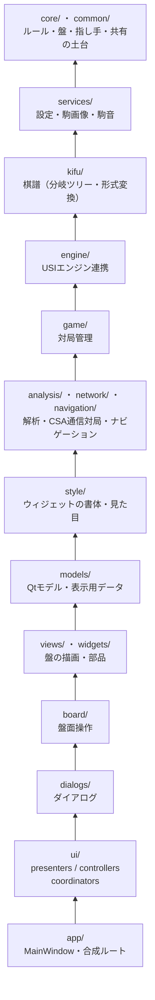

矢印は「上の層が下の層を使ってよい」向きを表す（下の層すべてを使える。ただし `style/` が使えるのは `core/`・`common/`・`services/`・`kifu/` だけで、`engine/`〜`navigation/` は参照しない）。`automation/`（自動化 API と CLI 共有のサービス）と `cli/`（`shogiboardq-cli`）は外側の入口で、`automation/` は `app/`・`dialogs/`・`widgets/` を、`cli/` は GUI の層を参照しない。

#### 各レイヤーの責務

| 層 | ディレクトリ | 責務 |
|---------|------------|------|
| **土台** | `core/`, `common/` | 将棋のルール・盤面・駒・指し手（Qt GUI非依存）と、ログ・エラー通知・動作状態（`AppActivityState`・`ActivityLease`）などの共有部品 |
| **サービス** | `services/` | 設定の宣言・駒画像・駒音・通知など、層を横断して使う機能 |
| **ドメイン** | `kifu/`, `engine/`, `game/`, `analysis/`, `network/`, `navigation/` | 棋譜・エンジン通信・対局進行・解析・通信対局・ナビゲーションのロジック。`engine/` は `game/` を知らない（`Usi` は `ShogiGameController` を持たない） |
| **見た目** | `style/` | QWidget に依存する書体・アプリ全体のスタイル・ボタンと表のスタイルシート（`ApplicationFonts`・`ApplicationStyle`・`ButtonStyles`・`TableStyles`・`MoveFont`） |
| **表示部品** | `models/`, `views/`, `widgets/`, `board/`, `dialogs/` | Qt のモデル・盤の描画・ウィジェット・盤面操作・ダイアログ |
| **UI の組み立て** | `ui/`, `app/` | 表示への反映（Presenter）・利用者操作の処理（Controller）・複数の部品にまたがる流れ（Coordinator）と、MainWindow・合成ルート・メニューの接続（`MenuActionsWiring`） |

### 3.2 層間の依存ルール

依存は**上の層→下の層**の一方向だけ許す。`tests/tst_layer_dependencies.cpp` が `src/` の `#include "..."` を読み、層ごとに禁止したディレクトリのヘッダー（パスを付けない `#include "foo.h"` も、ファイル名で探す）を含めていないかを確かめる。

| 参照元（依存する側） | 参照してはいけない層 |
|-------------------|------------|
| `core/`・`common/` | `services/` より上の全部 |
| `services/` | `kifu/` より上の全部 |
| `kifu/` | `engine/` より上の全部 |
| `engine/` | `game/` より上の全部 |
| `game/` | `analysis/`・`network/`・`navigation/` より上の全部 |
| `analysis/`・`network/`・`navigation/` | 互いと、`style/` より上の全部 |
| `style/` | `engine/`・`game/`・`analysis/`・`network/`・`navigation/` と、`models/` より上の全部 |
| `models/` | `views/`・`widgets/`・`board/` より上の全部 |
| `views/`・`widgets/` | `board/`・`dialogs/`・`ui/`・`app/` |
| `board/` | `dialogs/`・`ui/`・`app/` |
| `dialogs/` | `ui/`・`app/` |
| `ui/` | `app/` |

**同じ向きの依存の例**:

- `analysis/` → `engine/`: 解析機能がUSIエンジンを利用する
- `network/` → `engine/`: CSA通信対局がUSIエンジンを利用する
- `navigation/` → `kifu/`: ナビゲーションが棋譜データにアクセスする

**禁止される依存の例**:

- `core/` → `game/`: 土台の層が対局管理のクラスを参照してはならない
- `engine/` → `game/`: エンジン連携は対局の盤（`ShogiGameController`）を知らない。対局の局面（position の文字列）・時間の条件・時計は呼び出し側が渡す
- `kifu/` → `engine/`: 棋譜はエンジンを知らない
- `game/` → `ui/`: 対局管理がUI部品を直接操作してはならない。司令塔はシグナルで知らせ、棋譜の行は `MatchRecordSink` に書く（[4.3節](#43-シグナルと-stdfunction-コールバック)）

> **合成ルート**: `MainWindowComposer` は最上位の `app/` にあるので、全ての層の部品を作って結べる（3.3節参照）。

### 3.3 MainWindow と合成ルート（MainWindowComposer）

MainWindow（`src/app/mainwindow.h/.cpp`）は約50行で、`.ui` と閉じるときの確認・終了処理だけを持つ。
各レイヤーの部品を作って結ぶのは合成ルートの `MainWindowComposer`（`src/app/mainwindowcomposer*.cpp`）である。
詳しい規則は [composition-root.md](composition-root.md) を参照。

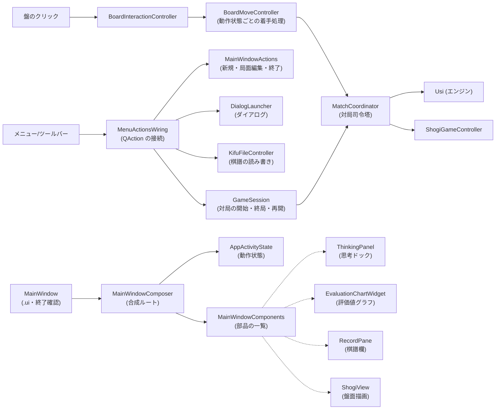

#### 設計原則

1. **MainWindow にロジックを書かない**: MainWindow は `MainWindowComposer` を作って `compose()` を呼ぶだけである
2. **部品は起動時に全部作る**: `MainWindowComposer::compose()` が全部品を依存順に1回だけ作り、それから依存を結ぶ。遅延生成（`ensure*()`）はない
3. **状態は1か所**: 動作状態は `AppActivityState`（`src/common/appactivitystate.h`）だけに置き、部品は `AppActivityState*` を受け取る。変えるのは `begin()` が返す `ActivityLease` を持つ部品だけ。棋譜に付く状態（対局者・上書き保存先など）は棋譜の文書 `KifuDocument` が持つ
4. **操作の受け口**: メニュー・ツールバーの項目は `MenuActionsWiring`（`src/app/menuactionswiring.cpp`）が処理する部品のスロットへつなぐ。1つの部品では済まない操作（新規・局面編集の開始・終了）は `MainWindowActions` が受ける。盤で指した手は `BoardMoveController`、棋譜欄・分岐の操作は `KifuNavigationController` が受ける

#### 合成ルートが作る主要コンポーネント

| カテゴリ | コンポーネント | 役割 |
|---------|-------------|------|
| **対局進行** | `MatchCoordinator` | ローカル対局の司令塔（一手の確定、勝敗判定、待った、中断と再開）。手順は `record()`、対局者は `players()` |
| **対局の流れ** | `GameSession` | 対局の開始・終局・再開と、対局の手順の棋譜への追記（`MatchRecordSink`） |
| **対局開始** | `GameStartOptionsBuilder`（game/） | 対局開始ダイアログの値の解釈。ダイアログは `DialogLauncher` が開く |
| **棋譜と表示のリセット** | `SessionResetCoordinator` | 対局の開始前・新規・局面編集・棋譜の読み込み前に、棋譜と表示を作り直す |
| **検討・詰み探索** | `AnalysisSession` | 1つのエンジンで局面を調べるセッション |
| **エンジンの表示** | `EngineDisplayPresenter` | 枠 E1・E2 のエンジンとモデルの結び、検討の表示、2つ目のエンジン欄と評価値グラフの系列名、表示の消去を1か所で受け持つ |
| **棋譜読込** | `KifuLoader` | 棋譜ファイル・貼り付け・局面を読み、分岐ツリーを作り直す（読み込みの実体は `KifuLoadParser`） |
| **棋譜の表示** | `KifuNavigationState`・`KifuDisplayPresenter`・`BoardSyncPresenter` | 表示中の手を1か所で持ち、変わるたびに棋譜欄・分岐・盤が自分で合わせる |
| **ゲーム制御** | `ShogiGameController` | 指し手の適用、成り判定、合法手チェック、手番 |
| **盤面操作** | `BoardInteractionController`・`BoardMoveController` | マウスクリック→駒選択→移動の変換と、動作状態に応じた着手の処理 |
| **メニューの接続** | `MenuActionsWiring` | メニュー・ツールバーの項目と処理する部品の接続 |
| **プレゼンター** | `*Presenter` 群 | モデル・状態から表示への反映 |
| **コントローラ** | `*Controller` 群 | 利用者操作の処理 |
| **UI調整** | `*Coordinator` 群 | 複数のウィジェットにまたがる UI の流れ |

### 3.4 動作状態と対局者（AppActivityState / MatchPlayers）

アプリの振る舞いは、「いま何をしているか」（動作状態）と「対局の先手・後手を誰が指すか」（対局者）の2つで決まる。この2つは別の型に分けて持つ。

| 何を表すか | 型 | 置き場 |
|-----------|-----|-------|
| アプリがいま何をしているか | `AppActivityState::Activity`（`src/common/appactivitystate.h`） | 合成ルートが持つ `AppActivityState`（変えるのはリース `ActivityLease` の持ち主だけ） |
| 対局の先手・後手を人間とエンジンのどちらが指すかと、その名前 | `MatchPlayers`（`src/core/matchplayers.h`） | 対局中の正本は `MatchCoordinator::players()`。棋譜の文書の `KifuDocument::players()` は最後に始めた対局の対局者（棋譜を置き換えると空になる） |

#### 動作状態（Activity）の値

| 値 | 意味 |
|------------|------|
| `Idle` | 待機中。棋譜の閲覧・編集、盤上の着手は変化として記録 |
| `DuringGame` | ローカル対局中（人間対人間・人間対エンジン・エンジン対エンジン） |
| `DuringAnalysis` | 棋譜解析中 |
| `DuringConsideration` | 検討中 |
| `DuringTsumeSearch` | 詰み探索中 |
| `DuringCsaGame` | CSA通信対局中 |
| `DuringPositionEdit` | 局面編集中 |

`AppActivityState` は `QObject` で、値が変わると `changed()` を出す。値を変えられるのは `begin(動作, 持ち主)` が返す move-only の `ActivityLease` を持つ部品だけで、対局の司令塔（`MatchCoordinator` が `DuringGame`）、検討・詰み探索のセッション（`AnalysisSession`）、棋譜解析（`KifuAnalysisController` が `DuringAnalysis`）、通信対局（`CsaGameSession` が `DuringCsaGame`）、局面編集（`PositionEditSession` が `DuringPositionEdit`）である。終局・中止でリースを手放すと `Idle` に戻る。別の部品が別の動作を始めた後は、前の持ち主がリースを手放しても状態は変わらず、前の持ち主には `revoked(owner)` が次のイベントループで届く（検討・詰み探索・棋譜解析は止め、局面編集は編集した局面で編集を終える）。`UiStatePolicyManager` は `changed()` を受けて、メニュー・ボタンの有効/無効を更新する。

#### 対局者（MatchPlayers）

`MatchPlayers` は先手・後手それぞれについて（`seat(Turn)` が返す `MatchPlayers::Seat`）、エンジンが指すか（`engine`）と、人間の名前・エンジンの名前を持つ値型である。駒落ちでは先手が下手、後手が上手になる。

| メソッド | 説明 |
|---------|------|
| `isEngine(side)` / `isHuman(side)` | その手番をエンジン／人間が指すか |
| `hasEngine()` / `hasHuman()` | エンジン／人間が1人でもいるか |
| `engineVsEngine()` / `humanVsHuman()` | エンジン同士／人間同士か |
| `name(side)` | その手番を指す側の名前（エンジンならエンジンの名前） |

対局の条件は `MatchStartOptions::players` で司令塔に渡す。平手か駒落ちかは対局者に持たず、開始局面から判定する（`KifuExportMetadataBuilder::handicapLabel()`）。対局者として表示するのはローカル対局中（`DuringGame`）だけで、`PlayerInfoPresenter` が動作状態を見て `KifuDocument::players()` を出すか決める（検討・解析・通信対局のエンジンは対局者ではない）。

#### 動作状態と対局者による動作分岐

**1. 盤面操作の制御**（`HumanTurnPolicy::boardInput()`、`src/ui/controllers/humanturnpolicy.h`）

| 状態 | 盤の手の行き先（`HumanTurnPolicy::BoardInput`） |
|------|------------|
| `DuringPositionEdit` | `Edit`（駒の配置を変える） |
| `Idle`（終局後を含む） | 対局の棋譜を書いていなければ `Variation`（棋譜の変化として記録。`BranchTreeEditController::canEdit()`） |
| `DuringGame` | 手を受け付け（`MatchCoordinator::canAcceptMove()`）、手番の側を人間が指すとき（`isHumanSide()`）だけ `Game`。エンジン同士では不可 |
| `DuringCsaGame` | 対局中（`GameState::InGame`）で自分が人間、自分の手番（`isHumanPlayer()` と `isMyTurn()`）のときだけ `CsaServer` |
| 解析・検討・詰み探索・終了処理の後（`disable()`） | `None`（指せない） |

**2. エンジンの使用**

エンジンは `EngineLifecycleManager` の2つの枠（E1・E2。思考情報と通信ログの表示先）に置き、対局・検討・棋譜解析・CSA 通信対局で共有する（同時には動かない）。

| 用途 | E1 | E2 |
|------|----|----|
| 人間対人間 | 不使用 | 不使用 |
| 人間対エンジン | 対局用（エンジンが後手でも E1） | 不使用 |
| エンジン対エンジン | 先手（下手）のエンジン | 後手（上手）のエンジン |
| 検討・詰み探索（`AnalysisSession`） | 解析用 | — |
| 棋譜解析（`KifuAnalysisController`） | 解析用 | — |
| CSA 通信対局（`CsaGameCoordinator` の `MatchEngineSeat`） | 対局用 | — |

どの用途も、エンジンは `EngineLifecycleManager::acquire(owner, slot, name)` で枠に作り、使う側は返された move-only の `EngineLease` を持っている間だけエンジンを使う（`engine()`。手放す `reset()`・破棄で枠を空け、持ち主には知らせない）。ほかの持ち主が同じ枠を取った・`destroyEngines()` で全部の枠を破棄したときは、前の持ち主に `engineRevoked(owner)` で知らせ、そのリースは空になる（枠に入っているかは `holds(engine)`）。リースを持つのは `AnalysisSession`・`KifuAnalysisController`・`MatchEngineSeat`（対局で指すエンジン。`HumanVsEngineStrategy`・`EngineVsEngineStrategy`・`CsaGameCoordinator` が持つ）。枠の部品は手番や時計を知らず、エンジンの知らせも中継しない。思考情報と通信ログの表示は `EngineDisplayPresenter` が枠のエンジンに結ぶ。

**3. メニュー・ボタンの有効/無効**

`UiStatePolicyManager`（`src/ui/coordinators/uistatepolicymanager.cpp`）が、動作状態ごとにどの UI 要素を有効にするかをコンパイル時の表（`kRules`）で決める。動作状態が変わる（`AppActivityState::changed()`）たびに、表に従ってメニュー・ボタンを更新する。

| 状態 | 棋譜ナビゲーション | 対局開始メニュー | 棋譜読込 |
|----------|-----------------|----------------|---------|
| `Idle` | 有効 | 有効 | 有効 |
| `DuringGame`・`DuringCsaGame` | **無効** | **無効** | **無効** |
| `DuringConsideration`・`DuringTsumeSearch` | 有効（検討は局面移動で再解析） | **無効** | **無効** |
| `DuringAnalysis` | **無効**（自動進行中） | **無効** | **無効** |

待った・投了・入玉宣言は、ローカル対局では人間が参加するときだけ有効にする（`Deps::localGameHasHuman`）。

**4. 動作状態の遷移**

```
Idle ──→ DuringGame / DuringCsaGame ──→ 終局・中断 ──→ Idle
Idle ──→ DuringConsideration / DuringTsumeSearch / DuringAnalysis ──→ 終了 ──→ Idle
Idle ──→ DuringPositionEdit ──→ 編集終了 ──→ Idle
```

自動化 API の `app.state` が返す `play_mode` の文字列は、動作状態と対局者から作る（`playModeName()`、`src/automation/automationcommands_app.cpp`）。

### 3.5 データフロー概要

以下は、ユーザーが盤面上で駒を動かしてから表示が更新されるまでの主要なデータフローである。

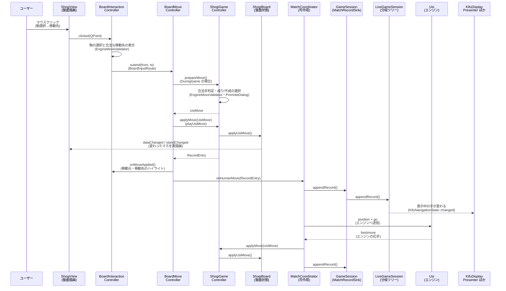

#### フロー解説

1. **ユーザー操作**: `ShogiView` がマウスクリックを受け、`clicked` シグナルで `BoardInteractionController` に盤の座標を通知する。駒をつまめるかは行き先（`BoardInputRoute::acceptsInput()`）に聞く。1回目のクリックで駒を選び、設定により `EngineMoveValidator` で合法な移動先を光らせる
2. **着手要求**: 2回目のクリックで、移動元・移動先を行き先の `BoardInputRoute::submit()` に渡す。主画面の行き先 `BoardMoveController` が、動作状態（`AppActivityState`）に応じて処理を分ける。行き先は `HumanTurnPolicy::boardInput()` の1か所で決まる。局面編集中は `PositionEditSession::applyEditMove()`、それ以外はクリックを `ShogiGameController::prepareMove()` で `UsiMove` にしてから、待機中は棋譜の変化として `BranchTreeEditController::recordMove()`、通信対局は `csaMoveRequested(UsiMove)`、ローカル対局は次のとおり
3. **合法手判定と適用**: ローカル対局では、`MatchCoordinator::isHumanSide()` が真の手番のときだけ `ShogiGameController::prepareMove()` が `EngineMoveValidator` で合法手かを判定し、クリックを `UsiMove` にする。成り・不成の両方が合法なら成りの選び方（`DialogLauncher::choosePromotion()` が `PromoteDialog::ask()` で選ばせる）に従う。`BoardMoveController::playUsiMove()` が `ShogiGameController::applyMove()` で盤を更新し（`ShogiBoard::applyUsiMove()`）、結果は棋譜の1行（`RecordEntry`）で返る
4. **一手の確定**: `BoardMoveController` が `MatchCoordinator::onHumanMove()` を呼ぶと、対局者の組ごとの Strategy を通して `completeMove()` が時計・考慮時間を確定し、行を `MatchRecordSink`（`GameSession::appendRecord()`）に書く。`GameSession` はライブ対局のセッション（`LiveGameSession`）経由で分岐ツリー（`KifuBranchTree`）に追記する
5. **表示の同期**:
   - `ShogiView`: `ShogiBoard` の `dataChanged`／`standChanged`／`turnChanged` シグナルで、変わったマスと駒台、手番の表示を更新する。移動元・移動先のハイライトは `BoardInteractionController` が付ける
   - 棋譜欄・分岐・盤・コメント・評価値グラフなど: 分岐ツリーが変わると `KifuNavigationState` が表示中の手を最新の手に進めて `changed()` を出し、`KifuDisplayPresenter`（棋譜欄・分岐候補欄・分岐ツリー）、`BoardSyncPresenter`（盤・ハイライト）などが各自で合わせる
   - `moveCommitted` シグナルでは、駒音を鳴らす（`PieceSoundPlayer`）
6. **エンジン応答**: 対エンジンの対局では、`MatchCoordinator` がエンジンに `position` + `go` を送り（`requestEngineMove()`）、`bestmove` を `ShogiGameController::applyMove()` で指して一手を確定する。評価値グラフは `engineMovePlayed` シグナルで `EvaluationGraphPresenter::plotEngineScore()` が更新する

#### 棋譜読み込みのデータフロー

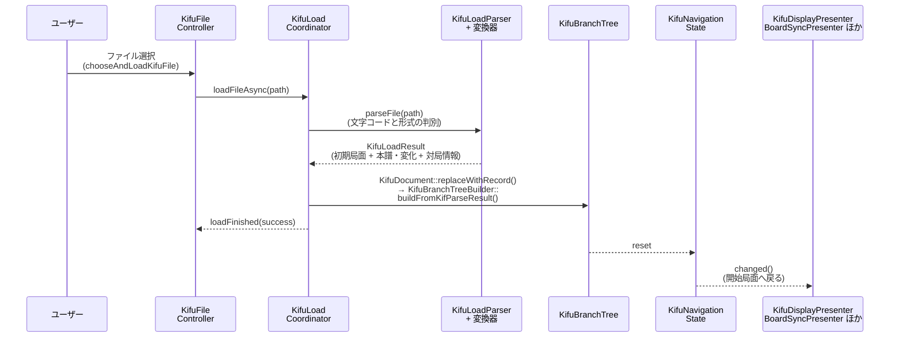

棋譜ファイルは6種類のフォーマット（KIF/KI2/CSA/JKF/USEN/USI）のいずれかを `KifuFormats::detectFile()` が自動判別し、`KifuLoadParser` が文字コードを判別して読んで、対応する変換器（`*ToSfenConverter`）で内部表現（SFEN + 指し手列、本譜と変化）に統一変換する。ファイルの読み込みと変換はワーカースレッドで行い、結果の値（`KifuLoadResult`）だけをメインスレッドに渡す。`KifuLoader` が受け取った結果で棋譜の文書（`KifuDocument`。分岐ツリーと対局情報）を置き換えると、表示中の手は開始局面へ戻り、棋譜欄・盤・コメントは `KifuNavigationState::changed()` を受けて各自で合わせる。対局情報は文書の `headerReset` で対局情報ドックへ届く。

### 3.6 アーキテクチャの設計判断

#### なぜMainWindowを薄くするのか

Qt Widgetsアプリケーションでは、`QMainWindow` がメニューバー、ツールバー、ドックウィジェット、セントラルウィジェットの所有者であるため、UI操作の起点が自然とMainWindowに集中する。ShogiBoardQでは、部品の生成と配線を合成ルート（`MainWindowComposer`）に移し、以下の戦略で複雑さを管理している:

- **Presenter クラス**: 状態から表示への反映を分離（`BoardSyncPresenter`, `KifuDisplayPresenter`, `PlayerInfoPresenter` 等）
- **Controller クラス**: 利用者操作の処理を分離（`BoardMoveController`, `KifuAnalysisController`, `ConsiderationUiController` 等）
- **Coordinator クラス**: 複数コンポーネントにまたがる流れを調整（`SessionResetCoordinator`, `CsaGameSession` 等）
- **Wiring**: メニュー・ツールバーの項目と処理する部品の接続だけを行う（`MenuActionsWiring`）
- **合成ルート**: `MainWindowComposer` が起動時に部品を全部作ってから結ぶ（[composition-root.md](composition-root.md)）

これらのパターンの詳細は[第4章](#第4章-設計パターンとコーディング規約)で解説する。

#### コア層の独立性

`core/` ディレクトリのコードは Qt GUI（`QWidget`, `QGraphicsView` 等）に依存せず、純粋なC++とQtのユーティリティクラス（`QString`, `QPoint`, `QMap` 等）のみを使用する。これにより:

- ゲームロジックの単体テストが容易になる
- UI変更がルールエンジンに影響しない
- 将来的にCLI版やWebバックエンドへの再利用が可能になる

<!-- chapter-3-end -->

---

<!-- chapter-4-start -->
## 第4章 設計パターンとコーディング規約

本章では、ShogiBoardQ全体で繰り返し使われる設計パターンと、守るべきコーディング規約を解説する。新規コードを書く際はこれらのパターンに従うこと。

### 4.1 Deps構造体パターン

#### 目的

クラスが必要とする外部オブジェクト（依存）を1つの構造体にまとめ、コンストラクタで一括注入する。これにより以下の利点が得られる:

- **依存の明示化**: クラスが何に依存しているかがヘッダの `Deps` 定義を見るだけで分かる
- **合成ルートでの組み立て**: `MainWindowComposer` が、依存する部品を先に作ってから、各部品の `Deps` を組んで渡す
- **テスト容易性**: テスト時にモックやスタブを `Deps` 経由で注入できる

#### 基本構造

```cpp
class SomeClass : public QObject {
    Q_OBJECT
public:
    struct Deps {
        ObjectA* objA = nullptr;     ///< 説明（非所有）
        ObjectB* objB = nullptr;     ///< 説明（非所有）
        AppActivityState* activity = nullptr;   ///< 動作状態（非所有）
    };

    explicit SomeClass(const Deps& deps, QObject* parent = nullptr);

private:
    Deps m_deps;
};
```

**要点**:
- `Deps` はクラス内の `public` セクションに定義する
- 全フィールドに `nullptr` または適切なデフォルト値を設定する
- ポインタは全て**非所有**（`Deps` を受け取る側は所有権を持たない）
- `///<` でフィールドの説明を付ける
- 依存は作るときに全部渡す。作ったあとで依存を差し替える `updateDeps()` のような関数は置かない

#### 実例: ConsiderationUiController

```cpp
// src/ui/controllers/considerationuicontroller.h

class ConsiderationUiController : public QObject {
    Q_OBJECT
public:
    struct Deps {
        QWidget* parentWidget = nullptr;                             ///< エンジン設定ダイアログの親
        ConsiderationPanel* considerationPanel = nullptr;  ///< 検討タブ（必須、非所有）
        AnalysisSession* session = nullptr;                          ///< 検討のセッション（必須、非所有）
        const KifuNavigationState* navState = nullptr;               ///< 検討する局面（表示中の手）
    };

    explicit ConsiderationUiController(const Deps& deps, QObject* parent = nullptr);
    // ...
};
```

> **注目**: 動作状態が要る部品は `AppActivityState*` を受け取る。`QString*` のような値のフィールドへのポインタは渡さず、状態のコピーも部品に持たない。読むだけの依存は `const KifuNavigationState*` のように `const` で受け取る。

#### QObject でない部品の Deps

`HumanTurnPolicy` のように QObject でない部品も `Deps` を `const` で保持する。依存が無いものは「操作できない」「対局していない」と答える。

```cpp
// src/ui/controllers/humanturnpolicy.h

class HumanTurnPolicy
{
public:
    struct Deps {
        const AppActivityState* activity = nullptr;
        const ShogiGameController* gameController = nullptr;
        const MatchCoordinator* match = nullptr;
        const CsaGameCoordinator* csaGame = nullptr;     ///< 通信対局の司令塔
        /// 対局していないとき、盤上の着手を棋譜の変化として記録できるか
        const BranchTreeEditController* branchEdit = nullptr;
    };

    explicit HumanTurnPolicy(const Deps& deps) : m_deps(deps) {}
    // ...
private:
    const Deps m_deps;
};
```

#### 実例: MatchCoordinator::Deps

司令塔の `Deps` は依存する部品のポインタだけを持つ。上の層への知らせはシグナルで出し、棋譜の行は `setRecordSink()` で渡された `MatchRecordSink` に書く（[4.3節](#43-シグナルと-stdfunction-コールバック)）。

```cpp
// src/game/matchcoordinator.h

struct Deps {
    ShogiGameController* gc = nullptr;          ///< 対局の盤（必須、非所有）
    ShogiClock* clock = nullptr;                ///< 対局の時計（必須、非所有）
    AppActivityState* activity = nullptr;       ///< アプリの動作状態（必須、非所有）
    EngineLifecycleManager* engines = nullptr;  ///< エンジンの枠 E1・E2（必須、非所有。検討と共有する）
};
```

### 4.2 合成ルートでの組み立て

#### 目的

アプリの部品は、合成ルートの `MainWindowComposer`（`src/app/mainwindowcomposer*.cpp`）が起動時に全部作る。部品を初めて使うときに作る遅延生成（`ensure*()`）は使わない。これにより:

- **作る順番が1か所で決まる**: `MainWindowComposer::compose()` を読めば、何がどの順で作られるか分かる
- **依存をポインタで渡せる**: 依存する部品を先に作り、そのポインタを `Deps` に入れて渡す。生成前の部品を指すための `std::function<X*()>` のゲッターや、後から依存を差し替える関数が要らない
- **シグナルは全部作ってからつなぐ**: シグナルでつながるだけの部品どうしは、作る順を気にしなくてよい

置き換えの経緯と規則の全文は [composition-root.md](composition-root.md) を参照。

#### 起動の3段階

`MainWindowComposer::compose()` は次の順に呼ぶ。

| 段階 | メソッド | ファイル |
|---|---|---|
| 1. 生成 | `createRecordAndModels()`（棋譜の正本・モデル・画面の骨格）→ `createBoard()`（盤・時計）→ `createPanels()`（棋譜欄・ドックの中身・棋譜の表示と編集）→ `createMatchAndAnalysis()`（対局・検討・通信対局の司令塔）→ `createPresentersAndDocks()`（表示とドック）→ `createSessions()`（UI 状態・棋譜のファイル・対局のセッション）→ `createControllers()`（利用者の操作） | `mainwindowcomposer_create.cpp` |
| 2. シグナル接続 | `connectRecord()` → `connectBoard()` → `connectGame()` → `connectAnalysisAndUi()`（メニュー・ツールバーは `MenuActionsWiring::wire()` でつなぐ） | `mainwindowcomposer_wire.cpp` |
| 3. 初期表示 | `finalizeUi()` | `mainwindowcomposer.cpp` |

`--automation` 指定時だけ、`startAutomationServer()`（`mainwindowcomposer_automation.cpp`）が自動化 API のサーバーを作る。

部品は `MainWindowComponents`（`src/app/mainwindowcomponents.h`）のメンバとして持ち、動作状態は `AppActivityState`（`src/common/appactivitystate.h`）に置く。どちらも `MainWindowComposer` が持つ。

#### 規則

1. 新しい部品は `MainWindowComponents` にメンバを足し、`create*()` の該当する段階（多くは `createSessions()` か `createControllers()`）で1回だけ作る。QObject は MainWindow を親にした生ポインタ、QObject でないものは `std::unique_ptr` で持つ。
2. 依存は部品のポインタで渡す。`std::function<X*()>` のゲッターや `ensure*` コールバックは使わない。
3. 動作状態は `AppActivityState` に置き、部品は `&m_activity`（`AppActivityState*`）を受け取る。値のフィールドへのポインタは渡さず、部品のメンバに状態のコピーを持たない。状態を変える部品は `begin()` で `ActivityLease` を受け取る。
4. `std::function` は、上位へ問い合わせ・操作を委ねるコールバックにだけ使う（[4.3節](#43-シグナルと-stdfunction-コールバック)）。
5. テストは `MainWindow::composer().parts()` と `composer().activity()` で部品と動作状態を読む。

`tests/tst_structural_kpi.cpp` の `appLayerHasNoLazyEnsure` が app 層に `ensure*` がないことを、`testsDoNotRedefinePrivate` がテストで `#define private public` を使っていないことを確かめる。

#### 例: 依存する部品を先に作って渡す

`createMatchAndAnalysis()` は、エンジンの枠を作り、それを `Deps` に入れて司令塔と検討のセッションを作る。

```cpp
// src/app/mainwindowcomposer_create.cpp（createMatchAndAnalysis、抜粋）
m_c.engines = new EngineLifecycleManager(&m_window);

MatchCoordinator::Deps md;
md.gc = m_c.gameController;
md.clock = m_c.clock;
md.activity = &m_state.activity;
md.engines = m_c.engines;
m_c.match = new MatchCoordinator(md, &m_window);

AnalysisSession::Deps sd;
sd.engines = m_c.engines;
sd.activity = &m_state.activity;
sd.navState = m_c.navState;
m_c.analysisSession = new AnalysisSession(sd, &m_window);
```

#### 例外

- `MatchCoordinator` は手順の受け手の `GameSession` より先に作るので、受け手だけは `createSessions()` で `setRecordSink()` によって渡す。
- `AutomationServer` は `--automation` 指定時だけ `MainWindowComposer::startAutomationServer()` で作る。

#### 部品の中で持つ下位部品

部品が自分の中に持つ下位の部品は、部品自身が作ってよい。たとえば `ThinkingPanel`（思考ドックの中身）は2つのエンジン欄 `EngineInfoWidget` と思考の表 `ThinkingTableView` をコンストラクタで作る。合成ルートは `ThinkingPanel` を `EngineDisplayPresenter` の `Deps` に渡し、エンジン欄は `EngineDisplayPresenter` が `info1()`・`info2()` で読む:

```cpp
// src/widgets/thinkingpanel.cpp

m_info1 = new EngineInfoWidget(AnalysisSettings::ThinkingTable::Engine1, this);
m_view1 = new ThinkingTableView(AnalysisSettings::ThinkingTable::Engine1, this);
```

```cpp
// src/app/mainwindowcomposer_create.cpp（createPresentersAndDocks）
ed.thinkingPanel = m_c.thinkingPanel;
```

app 層（`src/app/`）には `ensure*` の形の遅延生成を置かない。

### 4.3 シグナルと std::function コールバック

#### 目的

下の層（`game/`・`analysis/` 等）のクラスが上の層（画面・棋譜欄・ダイアログ）に何かをさせたいとき、UI のクラスを直接参照しない。上の層への知らせ方は次の3つを使い分ける。これにより:

- **層間の依存ルールを維持**: 下の層が上の層のヘッダーを含めない（[3.2節](#32-層間の依存ルール)）
- **柔軟な差し替え**: テストでは受け手を差し替えられる
- **責務の分離**: 「何が起きたか」は下の層が決め、「どう表示するか」は上の層が決める

| 方法 | 使う場面 | 例 |
|------|---------|-----|
| **シグナル** | 起きたことを知らせる（受け手は何人でもよい） | `MatchCoordinator::gameEnded`・`engineMovePlayed`・`resumeAvailabilityChanged`、`ShogiClock::timeUpdated`、`AnalysisSession::considerationModeEnded` |
| **インターフェイス** | 下の層が上の層へ書き込む・頼む操作の組 | `MatchRecordSink`（司令塔 → 棋譜）、`MatchStrategyHost`（Strategy → 司令塔）、`GameChannel`（利用者の操作 → ローカル対局・通信対局）、`MatchTimeSource`（エンジン → 持ち時間の出どころ） |
| **`std::function`** | 上の層の判断を聞く・1つの操作を委ねる | `UiStatePolicyManager::Deps::localGameHasHuman`・`canResumeGame`、`KifuDocument::Hooks::commitPendingEdits` |

#### 実例: MatchCoordinator のシグナルと MatchRecordSink

司令塔（`MatchCoordinator`）はフックの構造体を持たない。評価値・終局・再開できるかの変化はシグナルで知らせ、確定した棋譜の行は `MatchRecordSink`（`src/game/matchrecordsink.h`）へ書く。時計の表示は司令塔を通さず、`TimeDisplayPresenter` が `ShogiClock::timeUpdated` を直接受ける。

```cpp
// src/game/matchrecordsink.h
class MatchRecordSink {
public:
    /// 行を追記できるか（対局中のセッションが終わっていれば false。司令塔はその手を指さない）
    virtual bool canAppendRecord() const = 0;
    virtual void appendRecord(const RecordEntry& entry) = 0;
    /// 末尾の count 行を取り消せるか
    virtual bool canUndoRecords(int count) const = 0;
    virtual void undoRecords(int count) = 0;
protected:
    ~MatchRecordSink() = default;
};
```

受け手は対局の流れの UI 側の `GameSession`（`src/app/gamesession.h`）で、合成ルートが `createSessions()` で `m_c.match->setRecordSink(m_c.gameSession)` と渡す。シグナルの受け手は `connectGame()`（`src/app/mainwindowcomposer_wire.cpp`）がつなぐ。

```cpp
// src/app/mainwindowcomposer_wire.cpp（connectGame、抜粋）
connect(match, &MatchCoordinator::engineMovePlayed, m_c.evalGraph, &EvaluationGraphPresenter::plotEngineScore);
connect(match, &MatchCoordinator::movesUndone, m_c.evalGraph, &EvaluationGraphPresenter::trimToPly);
connect(match, &MatchCoordinator::resumeAvailabilityChanged,
        m_c.uiStatePolicy, &UiStatePolicyManager::refreshResumeAvailability);

connect(match, &MatchCoordinator::gameEnded, session, &GameSession::onGameEnded);
connect(match, &MatchCoordinator::gameOverMessage, m_c.notifications, &NotificationPresenter::showInformation);
```

#### 実例: std::function で上の層の操作を委ねる

`std::function` は `Deps` のメンバーにして、合成ルートが `std::bind` か、`this` を捕まえるラムダで組む。

```cpp
// src/app/mainwindowcomposer_create.cpp（createSessions、抜粋）
ud.localGameHasHuman = [this]() {
    return m_c.match->isHumanSide(Turn::Black) || m_c.match->isHumanSide(Turn::White);
};
ud.canResumeGame = std::bind(&MatchCoordinator::canResumeInterruptedGame, m_c.match);
```

#### コールバックと Deps の使い分け

| 構造体のメンバー | 格納するもの | 特徴 |
|--------|------------|------|
| **部品のポインタ** | 依存オブジェクト（非所有） | 参照を保持するだけ。作るときに渡す |
| **`std::function`** | 上の層への問い合わせ・操作 | 下の層から上の層のクラスを参照せずに呼べる |

`MatchCoordinator::Deps` は部品のポインタだけを持つ（[4.1節](#41-deps構造体パターン)）。上の層へのコールバックが要るのは、層をまたいで1つの問い合わせ・操作を委ねるときだけである。

### 4.4 Wiringクラスパターン

#### 目的

シグナル/スロット接続のコードはMainWindowに集中しがちである。接続の記述は、合成ルートの `connect*()`（`mainwindowcomposer_wire.cpp`）と、機能単位の Wiring に分けて MainWindow から外す。Wiring は接続だけを行い、表示や処理は持たない（命名の使い分けは [4.5節](#45-mvpパターン-presentercontrollercoordinator-の使い分け)）。

#### Wiringの一覧

| 名前 | ファイル | 責務 |
|-------|---------|------|
| `MenuActionsWiring` | `app/menuactionswiring.h` | メニュー/ツールバーの QAction を処理する部品のスロットへ接続する（ファイル・編集・対局などのメニューごとに関数を分ける） |

言語・表記のメニューは `LanguageController`、局面編集中の盤のメニューは `PositionEditSession`、ドックの配置のメニューは `DockLayoutManager`（`wireMenuActions()`）が、それぞれ自分でつなぐ。CSA通信対局の開始と画面への反映は `CsaGameSession`（`ui/coordinators/`）、メニューから開くダイアログの起動は `DialogLauncher`（`ui/coordinators/dialoglauncher.h`）、盤の対局者名の表示は `PlayerInfoPresenter`、エンジンの表示（思考・検討・通信ログ・2つ目のエンジン欄・評価値グラフの系列名）は `EngineDisplayPresenter`（どちらも `ui/presenters/`）が自分でつなぐ。検討タブの操作は `ConsiderationUiController` が検討のセッションへ伝え、定跡ウィンドウ・メニューウィンドウは配線だけでなく表示も持つので、Controller（`JosekiWindowController`・`MenuWindowController`、`ui/controllers/`）にしている。

#### 典型的な構造

```
Wiring
├── Deps 構造体（つなぎ先の部品。すべて必須・非所有）
└── wire(Deps)（起動時に1回だけ呼び、connect() をまとめて実行する）
```

状態もスロットも持たない。接続先のスロットは、つなぎ先の部品が自分で持つ。

#### 実例: MenuActionsWiring

`MenuActionsWiring` はクラスではなく名前空間で、`wire()` がメニューごとの関数（`wireFileMenu()`・`wireEditMenu()`・`wireGameMenu()` など）を呼ぶ:

```cpp
// src/app/menuactionswiring.h

namespace MenuActionsWiring {

/// つなぐ先（すべて必須、非所有）
struct Deps {
    Ui::MainWindow* ui = nullptr;
    MainWindowActions* actions = nullptr;               ///< 新規・終了・局面編集の開始
    DialogLauncher* dialogs = nullptr;
    KifuFileController* kifuFiles = nullptr;           ///< 開く・保存・貼り付け・棋譜と局面のコピー
    GameSession* session = nullptr;                    ///< 対局の開始・投了・中断・待った・即指し
    AnalysisSession* analysis = nullptr;               ///< 詰み探索の中止
    // ... 局面編集・棋譜解析・詰み探索・外観・画像・盤・駒音・設定の初期化（すべてポインタ）
};

/// 起動時に1回だけ呼ぶ
void wire(const Deps& deps);

} // namespace MenuActionsWiring
```

```cpp
// src/app/menuactionswiring.cpp（抜粋）

void wireFileMenu(const Deps& d)
{
    QObject::connect(ui->actionNewGame, &QAction::triggered, d.actions, &MainWindowActions::resetToInitialState);
    QObject::connect(ui->actionOpenKifuFile, &QAction::triggered, d.kifuFiles, &KifuFileController::chooseAndLoadKifuFile);
    QObject::connect(ui->actionSaveAs, &QAction::triggered, d.kifuFiles, &KifuFileController::saveKifuToFile);
    QObject::connect(ui->actionQuit, &QAction::triggered, d.actions, &MainWindowActions::requestQuit);
}

void wireGameMenu(const Deps& d)
{
    QObject::connect(ui->actionStartGame, &QAction::triggered, session, &GameSession::startGameFromDialog);
    QObject::connect(ui->actionResign, &QAction::triggered, session, &GameSession::resign);
}
```

合成ルートからは `connectAnalysisAndUi()` が `Deps` を組んで `MenuActionsWiring::wire(md)` を1回呼ぶ。

#### 実例: 合成ルートの connect*()

棋譜の移動・盤・対局・検討のように、複数の部品にまたがる接続は、合成ルートの `connectRecord()`・`connectBoard()`・`connectGame()`・`connectAnalysisAndUi()` に段階ごとに書く。たとえば `connectRecord()` は棋譜欄のボタンや行の選択を `KifuNavigationController` へつなぐ:

```cpp
// src/app/mainwindowcomposer_wire.cpp（connectRecord、抜粋）
connect(pane, &RecordPane::mainRowChanged, nav, &KifuNavigationController::selectRecordRow);
connect(pane, &RecordPane::branchRowActivated, nav, &KifuNavigationController::selectBranchCandidateRow);
connect(tree, &BranchTreeView::nodeActivated, nav, &KifuNavigationController::selectBranchTreeNode);
connect(chart, &EvaluationChartWidget::plyClicked, nav, &KifuNavigationController::selectPly);
```

### 4.5 MVPパターン: Presenter/Controller/Coordinator の使い分け

ShogiBoardQの `ui/` ディレクトリには3種類のクラスが存在する。それぞれの責務と命名規則を以下にまとめる。

#### 役割の比較

| 種類 | 命名規則 | 責務 | 例 |
|------|---------|------|-----|
| **Presenter** | `*Presenter` | **Model→View の表示更新**。データを受け取り、ウィジェットの表示を更新する | `BoardSyncPresenter`, `KifuDisplayPresenter` |
| **Controller** | `*Controller` | **ユーザー操作のハンドリング**。UIイベントを受け取り、適切なアクションを実行する | `ConsiderationUiController`, `LanguageController` |
| **Coordinator** | `*Coordinator` | **複数コンポーネントの調整**。複数のウィジェットやコントローラにまたがる操作を司る | `SessionResetCoordinator`, `CommentCoordinator` |

#### データフローの方向

```
  ユーザー操作 ──→ Controller ──→ ドメイン層
                                      │
                                      ↓
              View ←── Presenter ←── Model/データ変更
                                      │
                                      ↓
                   Coordinator ──→ 複数ウィジェット同期
```

#### Presenter の実例

**BoardSyncPresenter** — 表示中の手（`KifuNavigationState`）が変わるたびに、盤をその局面に合わせ、指し手のハイライトを示す:

```cpp
// src/ui/presenters/boardsyncpresenter.h

class BoardSyncPresenter : public QObject {
    Q_OBJECT
public:
    struct Deps {
        ShogiGameController* gc = nullptr;             ///< 盤（必須）
        BoardInteractionController* bic = nullptr;     ///< ハイライトとクリック待ち（必須）

        const KifuNavigationState* navState = nullptr; ///< 表示中の手（必須）
    };

    explicit BoardSyncPresenter(const Deps& deps, QObject* parent = nullptr);

public slots:
    /// 盤・手のハイライト・手番の表示を表示中の手に合わせる
    void syncToCurrentNode();
};
```

**KifuDisplayPresenter** — 表示中の手と手順を、棋譜欄・分岐候補欄・分岐ツリーに映す。状態の写しは持たず、毎回 `KifuNavigationState` から作る:

```cpp
// src/ui/presenters/kifudisplaypresenter.h

class KifuDisplayPresenter : public QObject {
    Q_OBJECT
public:
    struct Deps {
        KifuNavigationState* navState = nullptr;      ///< 表示中の手（必須）
        LiveGameSession* liveSession = nullptr;       ///< 対局中の手順（必須）
        KifuRecordListModel* recordModel = nullptr;   ///< 棋譜欄（必須）
        KifuBranchListModel* branchModel = nullptr;   ///< 分岐候補欄（必須）
        QTableView* recordView = nullptr;             ///< 棋譜欄の表（選択と表示位置を合わせる）
        BranchTreeView* treeView = nullptr;           ///< 分岐ツリーの図
    };

    explicit KifuDisplayPresenter(const Deps& deps, QObject* parent = nullptr);

public slots:
    /// 表示中の手・手順・ツリーに合わせて描き直す
    void refresh();
    /// 表示（表記・言語）だけを描き直す
    void refreshLabels();
};
```

**PlayerInfoPresenter** — 盤の対局者名を出す（対局者と対局情報は棋譜の文書 `KifuDocument` が持ち、このクラスは読むだけ。エンジンの表示は `EngineDisplayPresenter`）:

```cpp
// src/ui/presenters/playerinfopresenter.h（抜粋）

class PlayerInfoPresenter : public QObject {
    Q_OBJECT
public:
    struct Deps {
        const KifuDocument* document = nullptr;      ///< 対局者と対局情報（必須、非所有）
        const AppActivityState* activity = nullptr;  ///< 対局中か（必須、非所有）
        ShogiView* shogiView = nullptr;
    };

private slots:
    /// 対局中なら対局者（KifuDocument::players()）の名前を、対局していなければ対局情報の名前を盤に出す。
    /// 文書の playersChanged・headerReset・headerEdited・headerValueSet と動作状態の changed を自分で受ける
    void refresh();
};
```

**EngineDisplayPresenter** — エンジンの表示の持ち主。枠 E1・E2 のエンジンを思考の表・情報欄・通信ログのモデルと結び（`UsiModelBinding`）、検討タブの実行の状態（`ConsiderationPanel::setRunState()`）・情報欄・検討の表への読み筋を検討のセッション（`AnalysisSession`）の知らせだけから決める。2つ目のエンジン欄と評価値グラフの系列名は文書の対局者（`KifuDocument::playersChanged`）から、検討・詰み探索ではそのエンジン（`AnalysisSession::engineNamesChanged`）から決める。棋譜を作り直すときの表示の消去は `clearAll()`（`SessionResetCoordinator` が呼ぶ）:

```cpp
// src/ui/presenters/enginedisplaypresenter.h（抜粋）

class EngineDisplayPresenter : public QObject {
    Q_OBJECT
public:
    struct Deps {
        EngineLifecycleManager* engines = nullptr;        ///< エンジンの枠（必須）
        AnalysisSession* analysis = nullptr;              ///< 検討・詰み探索のセッション
        const KifuDocument* document = nullptr;           ///< 対局者（2つ目のエンジン欄・系列名）
        // ... 通信ログ・思考の表（E1/E2）・検討の表・棋譜解析の結果・思考ドック・検討ドック・評価値グラフ・ログ窓
    };

    /// 前の対局・検討・解析のエンジンの表示を消す（通信ログ・思考情報・検討・解析結果・エンジン名）
    void clearAll();
};
```

#### Controller の実例

**ConsiderationUiController** — 検討タブの開始・中止・エンジン変更の操作を検討のセッションへ伝える
**LanguageController** — 言語切替操作を処理
**BoardMoveController** — 主画面の盤で指した手の行き先（`BoardInputRoute`）。動作状態に応じて受け付けるかと処理を決める

#### Coordinator の実例

**KifuLoader** — 棋譜ファイル・貼り付け・局面を読み、棋譜の文書（`KifuDocument`）を置き換える
**CommentCoordinator** — 表示中の手のコメントをコメント欄に出し、編集をその手のノードに書く

#### 命名ガイドライン

| やりたいこと | 使うべきクラス種 | 命名例 |
|-------------|---------------|--------|
| データをウィジェットに反映したい | Presenter | `FooPresenter` |
| ユーザー操作に反応したい | Controller | `FooController` |
| 複数コンポーネントを同期したい | Coordinator | `FooCoordinator` |
| シグナル/スロット接続を整理したい | Wiring | `FooWiring` |

### 4.6 ErrorBus: グローバルエラー通知

#### 仕組み

`ErrorBus` はシングルトンパターンのイベントバスで、アプリケーション内のどこからでもエラーを発行し、購読者に一斉配信する。

```cpp
// src/common/errorbus.h

class ErrorBus final : public QObject {
    Q_OBJECT
public:
    static ErrorBus& instance();

    /// 深刻度付きメッセージを発行する（messagePosted を出す）
    void postMessage(ErrorBus::ErrorLevel level, const QString& message);

signals:
    /// 深刻度付きメッセージが発行された（→ NotificationPresenter::displayMessage）
    void messagePosted(ErrorBus::ErrorLevel level, const QString& message);

private:
    explicit ErrorBus(QObject* parent = nullptr) : QObject(parent) {}
    Q_DISABLE_COPY_MOVE(ErrorBus)
};
```

```cpp
// src/common/errorbus.cpp

ErrorBus& ErrorBus::instance() {
    static ErrorBus inst;
    return inst;
}
```

#### 使い方

**エラーの発行**（どのレイヤーからでも可能）:

```cpp
ErrorBus::instance().postMessage(ErrorBus::ErrorLevel::Error, tr("エンジンの起動に失敗しました"));
```

**エラーの受信**（`MainWindowComposer::connectAnalysisAndUi()` で接続）:

```cpp
connect(&ErrorBus::instance(), &ErrorBus::messagePosted,
        m_c.notifications, &NotificationPresenter::displayMessage);
```

#### 設計上のポイント

- ドメインサービス層（`engine/`, `kifu/` 等）がUIに依存せずにエラーを通知できる
- `NotificationPresenter` が `messagePosted` シグナルを受けて、深刻度に応じた表示を行う
- `Q_DISABLE_COPY_MOVE` でコピー/ムーブを禁止し、シングルトンの一意性を保証する

### 4.7 コーディング規約

#### コンパイラ警告

全てのソースコードは以下の警告オプション付きでコンパイルされる:

```
-Wall -Wextra -Wpedantic -Wshadow -Wconversion -Wsign-conversion
-Wnon-virtual-dtor -Woverloaded-virtual -Wformat=2 -Wimplicit-fallthrough
-Wunused -Wunused-function -Wunused-variable -Wunused-parameter
```

**警告をエラーとして扱わないが、0警告を目標とする。**

#### connect() でのラムダ禁止

本プロジェクトでは `connect()` 文でのラムダ式使用を禁止している。

```cpp
// 正しい: メンバ関数ポインタ構文
connect(sender, &Sender::signal, receiver, &Receiver::slot);

// 禁止: ラムダ式
connect(sender, &Sender::signal, [this]() { /* ... */ });
```

**理由**:
- ラムダ内で `this` をキャプチャした場合、`sender` より先に `receiver` が破棄されるとダングリングポインタになる
- メンバ関数ポインタ構文では、`receiver` が破棄されると Qt が自動的に接続を切断する
- コードの追跡性（どこに接続されているかの `grep` による検索）が向上する
- デバッガでのスタックトレースが読みやすくなる

> **例外**: `Deps` 構造体内の `std::function` コールバック（[4.3節](#43-シグナルと-stdfunction-コールバック)）に渡すラムダはこのルールの対象外である。ラムダ禁止はあくまでも `connect()` に限定される。

#### std::as_const() の使用

Qt コンテナ（`QList`, `QMap` 等）を range-for ループで走査する際、暗黙的なデタッチ（コピー）を防ぐために `std::as_const()` を使用する:

```cpp
// 正しい: デタッチ防止
for (const auto& item : std::as_const(list)) { /* ... */ }

// 警告: clazy-range-loop-detach
for (const auto& item : list) { /* ... */ }
```

**理由**: Qt のコンテナは暗黙共有（implicit sharing）を採用しており、非const参照で走査するとコピーオンライトが発生する場合がある。`std::as_const()` で const 参照を強制することで、不要なコピーを確実に防止する。

#### シグナル・スロットの宣言（clazy）

clazy の level0・level1 の警告を出さないように書く。

- `signals:` / `public slots:` の引数型は、MOC が正規化できるよう完全修飾する。ネスト型は `ClassName::NestedType` と書く（例: `void gameEnded(const MatchCoordinator::GameEndInfo& info);`）。Qt6 では `QVector` は `QList` に正規化されるので `QList` を使う
- `const` メソッドや、引数なしで値を返す getter を `signals:` / `public slots:` に置かない。`connect()` で使わないメソッドは `public:` に置く

#### 静的解析

`.clang-tidy` で以下のチェックが有効化されている:

| チェック | 検出対象 |
|---------|---------|
| `clang-diagnostic-unused-*` | 未使用の警告 |
| `misc-unused-*` | 未使用コードの検出 |
| `clang-analyzer-deadcode.*` | デッドコード解析 |
| `readability-redundant-*` | 冗長なコードの検出 |
| `modernize-*` | C++ の新しい書き方への置き換え（一部を除く） |

cppcheck は `-DENABLE_CPPCHECK=ON` で有効になり、`warning,style,performance,portability` を検査する。未使用関数の検査（`unusedFunction`）は誤検出が多いので、`-DENABLE_CPPCHECK_UNUSED_FUNCTION=ON` を足したときだけ行う。

### 4.8 コメントスタイル

コメントの記述方針の詳細は [commenting-style-guide.md](commenting-style-guide.md) を参照。以下に要点を要約する。

#### 基本方針

| 項目 | 規約 |
|------|------|
| **言語** | 日本語 |
| **記法** | Doxygen 形式（`/** */`, `///`, `///<`） |
| **記述場所** | ヘッダファイル（`.h`）。`.cpp` には実装上の補足のみ |
| **原則** | **Why（なぜ）を書く。What（何）はコードが語る** |

#### 記法の使い分け

| 記法 | 用途 |
|------|------|
| `/** ... */` | クラス、メソッド、構造体のDoxygen複数行ドキュメント |
| `///` | 1行で収まるDoxygenドキュメント |
| `///<` | enum値・メンバ変数の行末コメント |
| `// ---` | セクション区切り内の小見出し |

#### 書かないコメント

- `// コンストラクタ`、`// デストラクタ` — 見れば分かる
- `// getter` / `// setter` — 命名規約から自明
- 変更履歴・日付コメント — Git で管理する
- コメントアウトしたコード — 削除して Git に任せる

#### 適用タグ

スタイルガイドを適用したファイルには以下のタグを付ける:

```cpp
/// @todo remove コメントスタイルガイド適用済み
```

リリース時に一括検出・除去する:
```bash
grep -rn "@todo remove コメントスタイルガイド適用済み" src/
```

詳細は [commenting-style-guide.md](commenting-style-guide.md) を参照。

<!-- chapter-4-end -->

---

<!-- chapter-5-start -->
## 第5章 core層：純粋なゲームロジック

core層（`src/core/`）は将棋のルールと盤面状態を表現する純粋なゲームロジック層である。Qt の GUI モジュール（`QtWidgets`、`QtCharts` 等）に依存せず、`QObject`・`QString`・`QVector` 等の QtCore モジュールのみを使用する。

### 5.1 core層の設計思想

#### GUI非依存の意義

core層が GUI に依存しないことで、以下のメリットが得られる。

| メリット | 説明 |
|---------|------|
| **テスタビリティ** | ウィンドウ生成なしで盤面操作・合法手判定をテストできる |
| **再利用性** | CLI ツール、別の GUI フレームワーク、エンジン内部などに転用可能 |
| **コンパイル高速化** | GUI ヘッダへの依存がないため、変更時の再コンパイル範囲が限定される |
| **関心の分離** | 「ルール」と「表示」が明確に分かれ、どちらかの変更が他方に波及しない |

#### ファイル構成

```
src/core/
├── shogitypes.h              手番（Turn）と駒（Piece）
├── piecerules.h              駒の規則（行き所のない駒・成れる段・持ち駒の並び）
├── shogiposition.h / .cpp    局面の値（Position。SFEN の読み書きと指し手の適用）
├── shogiboard.h / .cpp       表示・局面編集に使う盤（Position を1つ持ち、変更を知らせる）
├── usiposition.h / .cpp      エンジンに探索させる局面（UsiPosition）
├── usimove.h                 USI と1対1の指し手の値（UsiMove / BoardSquare）
├── shogimove.h / .cpp        指した手の記録（UsiMove と、動かした駒・取った駒）
├── boardcoordinates.h        盤面表示の座標（駒台は筋10・11）と指し手の対応
├── boardconstants.h          盤の座標・サイズの定数
├── enginemovevalidator.h / .cpp 合法手判定の入口
├── fmv*.h / .cpp             合法手判定の内部（局面・利き・指し手の生成）
├── legalmovestatus.h         合法手存在状態
├── shogiclock.h / .cpp       対局時計
├── timecontrol.h             持ち時間の決まり
├── matchplayers.h            対局者（先手・後手を人間とエンジンのどちらが指すかと名前）
├── handicaps.h               手合割の表（名前・JKF の preset・開始局面）
├── recordtime.h              棋譜の一手の消費時間と累計
├── usiscore.h / .cpp         USI の評価値（score cp / score mate）
├── sfenreplay.h / .cpp       局面に USI の1手を指す（合法手かは確かめない）
├── sfendiffutils.h           2つの局面（SFEN）の盤上の差分
├── terminaltype.h / .cpp     終局手の種類と終局語
├── sfenutils.h               SFEN文字列ユーティリティ
├── shoginotation.h           棋譜の表記（筋・段・駒の名前・CSA の駒種）
└── kifmovetext.h             KIF 形式の指し手の文字列
```

### 5.2 Position と ShogiBoard — 局面の値と表示の盤

局面そのもの（盤・持ち駒・手番・手数）は QObject ではない値の型 `Position` が持つ。SFEN の読み書きと指し手の適用はここだけで行う。
`ShogiBoard` は画面に出す盤で、`Position` を1つ持ち（`position()`）、変更をシグナルで知らせる包みである。
1手の再生（`SfenReplay`）・棋譜の変換器（`KifLineBuilder`）と書き出し・読み筋（`PvText::play`）・合法手判定（`EngineMoveValidator::load()`）など、
計算のための一時的な局面は `Position` で持ち、`ShogiBoard` は作らない。

**ソース**: `src/core/shogiposition.h`、`src/core/shogiposition.cpp`（SFEN の読み書き・持ち駒・指し手の適用）、
`src/core/shogiboard.h`、`src/core/shogiboard.cpp`（表示の座標での読み出し・局面編集・変更の通知）

#### データ構造

```
Position
├── m_squares    : std::array<Piece, 81>  81マス。index = (rank - 1) * 9 + (file - 1)
│                                         （file・rank は1〜9。index 0 が1一、80 が9九）
├── m_hands      : std::array<int, 16>    持ち駒。[先手8種, 後手8種]（PieceKind の歩〜玉の順）
├── m_sideToMove : Turn                   手番（Turn::Black / Turn::White）
└── m_moveNumber : int                    次に指す手の手数（SFEN の4つ目の欄）

ShogiBoard（QObject）
└── m_position   : Position               表示している局面
```

**盤 `m_squares`** の各マスの駒は列挙型 `Piece`（`src/core/shogitypes.h`）で表す。
先手の駒は `Piece::BlackPawn` など、後手の駒は `Piece::WhitePawn` など、成駒は `Piece::BlackPromotedPawn`（と金）や
`Piece::BlackHorse`（馬）などの別の値で、空きマスは `Piece::None` である。値は「種類＋後手なら 16」で、合法手生成の盤も同じ値を使う（2.2節）。

**持ち駒 `m_hands`** は、局面編集で玉も駒台に置けるため、玉を含む先後16種の枚数を持つ。

**手番 `m_sideToMove`** は `Turn` である。`Position::apply()` が手番を相手に渡し、手数を1つ進める。

#### Position の主要メソッド

| カテゴリ | メソッド | 説明 |
|---------|---------|------|
| **SFEN** | `fromSfen(sfen, error)` | SFEN を読む（static。読めなければ `nullopt`） |
| | `assignSfen(sfen, error)` | 読めたらこの局面を置き換えて true |
| | `fromSfenLike(text, error)` | `startpos`・`sfen ...`・`position ...`・手数を省いた3つの欄も読む（static） |
| | `toSfen()` / `toSfen(side, moveNumber)` | SFEN を返す（後者は手番と手数だけを替える） |
| | `boardSfen()` / `handsSfen()` | 盤の欄 / 持ち駒の欄 |
| | `positionKey()` | 局面を比べるキー（手数を含めない） |
| | `hirate()` | 平手の開始局面（static） |
| **盤** | `pieceAt(square)` / `setPieceAt(square, piece)` | マスの駒（盤外は `None`）／置き換え（持ち駒は増減しない） |
| | `squares()` | 81マスの配列への const 参照 |
| | `countOnBoard(piece)` / `kingSquare(side)` | 盤上の駒の数／玉のマス |
| **持ち駒** | `handCount(piece)` / `setHandCount(piece, n)` | 枚数（駒の色が持ち主。成駒は元の駒として数える） |
| | `addToHand(piece, n)` / `takeFromHand(piece)` | 増やす／1枚減らす（なければ false） |
| | `handsEmpty()` / `pieceBox()` | 持ち駒がないか／盤上・持ち駒にない駒（駒箱） |
| **手番・手数** | `sideToMove()` / `setSideToMove(side)` | 手番 |
| | `moveNumber()` / `setMoveNumber(n)` | 次に指す手の手数 |
| **指し手** | `describe(move)` | 手番側の手として、動かす駒・取る駒を添えた `ShogiMove` |
| | `apply(move, rule)` | 手番側の手を指す（合法手かは確かめない）。取った駒は持ち駒に加え、行き所のない段へ動いた歩・香・桂は成る |
| | `applyAs(move, mover, rule)` | 手番を `mover` にしてから指す |
| | `after(move, rule)` | 指した後の局面（指せなければ `nullopt`） |

`DropRule` は駒打ちの扱いで、`RequireHand`（持ち駒にあり、空いたマスへだけ打てる）と `Lenient`（棋譜の読み込み用。持ち駒が合わなくても、駒のあるマスでも打つ）がある。

#### ShogiBoard の主要メソッド

| カテゴリ | メソッド | 説明 |
|---------|---------|------|
| **局面** | `position()` / `setPosition(position)` | 今の局面／丸ごと置き換える（`boardReset` で知らせる） |
| | `setSfen(sfenStr)` | SFEN文字列から盤面全体を復元する（不正なら盤面を変えず、ErrorBus に通知する） |
| | `trySetSfen(sfenStr, error)` | 同上。不正なら盤面を変えずに false を返す（通知しない） |
| | `toSfen()` | 局面全体（盤・手番・持駒・手数）の SFEN を返す |
| **盤面参照** | `pieceAt(square)` | 盤上のマスの駒を返す（盤外のマスは `Piece::None`） |
| | `pieceCharacter(file, rank)` | 指定マスの駒を返す（筋10・11は先手・後手の駒台の並び） |
| | `pieceStandCount(piece)` | 指定駒の駒台の枚数 |
| | `pieceBox()` / `pieceBoxCount(piece)` | 盤上・両駒台にない駒（駒箱）を数える |
| | `currentPlayer()` / `setCurrentPlayer(turn)` | 手番を返す／手番だけを変える（局面編集の手番変更など） |
| | `moveNumber()` / `setMoveNumber(n)` | 次に指す手の手数 |
| **駒操作** | `applyUsiMove(move, mover)` / `applyUsiMove(move)` | USI の指し手を `Position::apply()` で指し、変わったマス・駒台・手番を知らせる（合法手かどうかは確かめない。`mover` を省くと手番側の手。対局の着手の確定 `ShogiGameController::commitMove()` が使う） |
| | `setPieceAt(square, piece)` | マスの駒を置き換える（局面の組み立て用） |
| **局面編集** | `updateBoardAndPieceStand(...)` | 盤・駒台・駒箱の間で駒を動かす（`PositionEditRules::apply()` が規則を確かめてから呼ぶ。行き所のない段の歩・香・桂は成駒にする） |
| | `promoteOrDemotePiece(file, rank)` | 指定マスの駒の成・不成・先後を巡回して替える（右クリック） |
| | `resetGameBoard()` | 盤上・両駒台を空にして、全駒を駒箱に戻す |

駒台の増減・盤の駒の移動の部品（`addPieceToStand`・`incrementPieceOnStand` など）は、局面編集の操作の内部だけで使う（非公開。単体テストは friend で触る）。

#### シグナル

| シグナル | 接続先 | 用途 |
|---------|-------|------|
| `boardReset()` | ShogiView・BoardInteractionController | 盤面全体の再描画を要求する（`setPosition`・`setSfen` など） |
| `dataChanged(c, r)` | ShogiView・BoardInteractionController | 特定マスの再描画を要求する |
| `standChanged(piece)` | ShogiView | 駒台のその駒のセルの再描画を要求する |
| `turnChanged(turn)` | BoardChromeWidget（`setActiveSide`）・BoardInteractionController | 手番が変わった（指した・手番だけを変えた）。盤の手番表示と、操作中の選択の取り消しに使う。手番は盤だけが持つ |

#### setSfen() の処理フロー

```
setSfen("lnsgkgsnl/1r5b1/ppppppppp/9/9/9/PPPPPPPPP/1B5R1/LNSGKGSNL b - 1")
  └── trySetSfen()                 … 不正なら盤面を変えずに false（setSfen は ErrorBus に通知する）
        │
        ├── Position::fromSfen()   … 盤・手番・持駒・手数の4欄を読む
        │                            （成駒の "+"、各段9マス、行き所のない歩・香・桂を確かめる）
        └── setPosition()          … 局面を置き換え、emit boardReset()（盤面描画の全体更新）
```

### 5.3 ShogiMove — 指し手データ構造

`ShogiMove` は指した1手の記録である。指し手そのもの（移動元・移動先・成り・打つ駒）は `UsiMove` で持ち、指す前の局面で決まる「動かした駒」「取った駒」を添える。棋譜の1行（`RecordEntry`、`src/kifu/recordentry.h`）や手順（`RecordLine`）がこれを持つ。

**ソース**: `src/core/shogimove.h`, `src/core/shogimove.cpp`（デバッグ出力だけ）、`src/core/usimove.h`

#### フィールド

| フィールド | 型 | 説明 |
|-----------|-----|------|
| `move` | `UsiMove` | 指し手（成り・駒打ちを含む） |
| `movingPiece` | `Piece` | 動かした駒（指す側の色の、成る前の駒） |
| `capturedPiece` | `Piece` | 取った駒（なければ `Piece::None`） |

`UsiMove` のフィールドは次のとおり（[2.1節](#21-盤面座標系)）。

| フィールド | 型 | 説明 |
|-----------|-----|------|
| `from` | `BoardSquare` | 移動元（筋・段とも1〜9。駒打ちでは無効） |
| `to` | `BoardSquare` | 移動先 |
| `drop` | `Piece` | 駒打ちの駒（先手の生駒で表す。盤上の移動では `None`） |
| `promote` | `bool` | 成る |

#### 主なメソッド

| メソッド | 説明 |
|---------|------|
| `ShogiMove::isValid()` | 指し手が正しく、動かした駒があるか |
| `ShogiMove::isDrop()` / `isPromotion()` | 駒打ちか／成るか（`move` に問い合わせる） |
| `ShogiMove::mover()` | 指した側（動かした駒の色） |
| `UsiMove::parse(text)` / `fromString(text)` | USI 文字列を読む（読めなければ `nullopt`／無効な指し手） |
| `UsiMove::toString()` | USI 文字列にする（`"7g7f"`・`"8h2b+"`・`"P*5e"`） |
| `UsiMove::dropPieceFor(mover)` | 駒打ちの駒を指す側の色にする |

#### USI文字列との変換

| 指し手の種類 | USI表記例 | `move.from` | `move.to` | その他 |
|-------------|----------|------------|----------|------|
| 盤上移動（不成） | `7g7f` | (7, 7) | (7, 6) | |
| 盤上移動（成り） | `8h2b+` | (8, 8) | (2, 2) | `promote = true` |
| 駒打ち | `P*3d` | （無効） | (3, 4) | `drop = BlackPawn` |

筋・段は USI と同じ1始まりなので、`UsiMove::toString()` は段を a〜i にするだけである。盤のクリック座標（駒台は筋10・11）との変換は `BoardCoordinates`（`src/core/boardcoordinates.h`）が受け持つ。

### 5.4 EngineMoveValidator — 合法手判定

`EngineMoveValidator` は、局面の値（`Position`）から内部の局面を作り、指し手が合法かどうかの判定、合法手の一覧、王手の数を求めるクラスである。王手の放置、二歩、打ち歩詰め、行き所のない駒を考慮する。メンバーを持たないので、使う場所でそのつど作る。

**ソース**: `src/core/enginemovevalidator.h`, `src/core/enginemovevalidator.cpp`（入口）、`src/core/fmv*.h/.cpp`（内部。名前空間 `fmv`）

| ファイル | 内容 |
|---------|------|
| `fmvtypes.h` | 先後・駒種・持駒の種類（2.2 節）、指し手 `fmv::Move`、指し手の一覧 `fmv::MoveList`（最大600手） |
| `fmvbitboard81.h/.cpp` | 81マスのビットボード `Bitboard81`（`uint64_t` 2つ） |
| `fmvposition.h/.cpp` | 内部の局面 `EnginePosition`（マスの駒・ビットボード・玉の位置・持駒）と、指す・戻す（`doMove()`／`undoMove()`） |
| `fmvattacks.h/.cpp` | コンパイル時に作る利きの表と、マスに利いている駒の判定 |
| `fmvconverter.h/.cpp` | `Position`・`UsiMove` を内部の型にする変換と、内部の指し手から `UsiMove` への変換 |
| `fmvlegalcore.h/.cpp`, `fmvmovegeneration.cpp` | 合法性の判定（`LegalCore`）と、指し手の生成 |
| `fmvlegalcore_internal.h` | 成れる駒・敵陣・行き所のない駒・二歩の判定（敵陣・行き所のない段は `piecerules.h` の規則を使う） |

#### 主要API

同じ局面で何度も判定するときは、局面を `load()` で `Context` に一度だけ読み込んでから使う。盤の操作で駒の移動先を光らせる `BoardInteractionController::refreshLegalMoveHighlights()` は、1つの `Context` で81マスを判定している。1回だけ判定するときは、局面（`Position`。表示の盤なら `board->position()`）を渡す省略形を使う（中で毎回 `Context` を作る）。

| メソッド | 戻り値 | 説明 |
|---------|--------|------|
| `load(position, turn)`<br/>`load(position)` | `Context` | 局面と手番（省くと局面の手番）を `Context` に読み込む |
| `legalStatus(ctx, move)`<br/>`legalStatus(position, turn, move)` | `LegalMoveStatus` | 指し手（`UsiMove`。成りの指定は見ない）を成る場合と成らない場合のそれぞれで判定する |
| `isLegal(ctx, move)` | `bool` | 指し手（成りの指定を含む）が合法か |
| `legalMoves(ctx)`<br/>`legalMoves(position, turn)` | `QList<UsiMove>` | 合法手の一覧。成り・不成のどちらも指せる手は両方を入れる |
| `pseudoLegalMoves(ctx)`<br/>`pseudoLegalMoves(position, turn)` | `QList<UsiMove>` | 駒の動きだけで決めた指し手の一覧（自玉の安全・二歩・打ち歩詰め・行き所のない駒は見ない）。反則手を書いた棋譜を読み書きするときの候補にする |
| `legalMoveCount(ctx)` | `int` | 合法手の数 |
| `checkCount(ctx)` | `int` | 手番の側の玉にかかっている王手の数（0=王手なし、2=両王手） |
| `isInCheck(position, turn)` | `bool` | 手番の側の玉に王手がかかっているか |

指し手は `UsiMove`（筋・段は1始まり、駒打ちは `drop` に先手の生駒）で渡す。動かす駒・取る駒は `Context` の局面から決まる。

#### LegalMoveStatus

`legalStatus()` の戻り値は `LegalMoveStatus` 構造体で、「成り」と「不成」それぞれの合法性を表す。

```cpp
// src/core/legalmovestatus.h
struct LegalMoveStatus {
    bool nonPromotingMoveExists;  // 不成での合法手が存在するか
    bool promotingMoveExists;     // 成りでの合法手が存在するか
};
```

盤のクリックを手にする `ShogiGameController::prepareMove()` は、両方が `true` なら対局者に成るかどうかを選ばせ（`setPromotionChooser()` で渡された関数）、成りだけが `true` なら成り、どちらも `false` なら着手を受け付けない。成り・不成まで決まった手（エンジン・定跡の手。`applyMove()`・`isLegal()`）は、指し手の成り・不成の側が `true` かを確かめる。

#### 判定の手順

```
legalStatus(ctx, move)
  │
  ├── [1] Converter::toEngineMove()
  │     UsiMove を内部の指し手（fmv::Move）にする。座標が盤外、移動元が手番の駒でない、
  │     持っていない駒を打つ、といった手はここで不合法。
  │     成れる駒で、移動元か移動先が敵陣なら「成る手もある」と記録する
  │
  ├── [2] 局面を写す（ctx.pos は書き換えない）
  │
  └── [3] LegalCore::checkMoveVariants()（成る手もあるとき）／ checkMove()
        手を1つだけ確かめる（checkMoveVariants は、成らないと行き所のない駒になる手なら
        成る手を、それ以外なら成らない手を代表にする）
        ├── isPseudoLegal()   駒の動き・移動先の自駒・二歩・行き所のない駒・成れるか
        ├── doMove()          写した局面で指す
        ├── ownKingInCheck()  自玉に相手の駒が利いていれば不合法（王手の放置・ピン）
        ├── isPawnDropMate()  歩を打って王手し、相手に合法手がなければ打ち歩詰め
        └── undoMove()        局面を戻す
```

成る場合と成らない場合で、駒のあるマスも自玉の位置も変わらないので、自玉の安全の確認は1回で両方に使える。代表の手が合法なら、成れる位置かどうかで `promotingMoveExists` を決める。

合法手の一覧（`legalMoves()`）は、王手されていれば玉の移動・王手した駒を取る手・合駒だけを、されていなければ全ての駒の移動と駒打ちを候補にして、候補ごとに上の [3] と同じく指して戻して確かめる。

#### 利きの計算

利きの表（各マスからの歩・桂・銀・金・玉の利き、馬・龍の1マスの利き、飛・角・香の筋、2マスの間のマス）は `constexpr` 関数でコンパイル時に作る。飛・角・香・馬・龍の利きは、筋の上にある駒と「2マスの間のマス」の表から、間に駒がないかで判定する。と金・成香・成桂・成銀は金と同じ利きを使う。

| 判定 | 関数 | 内容 |
|-----|------|------|
| マスに利いている駒 | `attackersTo()` | 指定の側の駒のうち、そのマスに利いている駒のビットボード（王手の数に使う） |
| マスに利きがあるか | `isSquareAttacked()` | 利いている駒を1枚見つけたところで終える（自玉の安全の確認に使う） |
| 駒が動けるか | `pieceAttacksSquare()` | 駒種・移動元・移動先と、間の駒から、その駒が移動先へ動けるか |

#### 主な合法性チェック

| チェック項目 | 実装箇所 | 説明 |
|-------------|---------|------|
| **王手の放置・ピン** | `LegalCore::ownKingInCheck()` | 指したあとの局面で自玉に相手の駒が利いていれば不合法 |
| **二歩** | `detail::hasPawnOnFile()` | 同じ筋に自分の歩（成っていない歩）があれば歩を打てない |
| **打ち歩詰め** | `LegalCore::isPawnDropMate()` | 歩を打って玉の正面から王手し、相手に合法手がなければ不合法 |
| **行き所のない駒** | `detail::isDeadSquare()`（中は `PieceRules::isDeadSquare()`） | 歩・香は1段目、桂は1〜2段目（後手は逆）へ成らずに動けず、打てない |

### 5.5 ShogiClock — 対局時計

`ShogiClock` は対局中の時間管理を行う。持ち時間制・秒読み制・フィッシャー制の3モードに対応し、着手ごとの考慮時間の記録と「待った」による巻き戻しも提供する。時間の決まり（`TimeControl`）と残り時間の両方を時計が持ち、エンジンへの `go` の時間も時計の値から求める（[時間設定の仕様](game-time-control-spec.md) の「時間の決まりの持ち方」）。

**ソース**: `src/core/timecontrol.h`, `src/core/shogiclock.h`, `src/core/shogiclock.cpp`

#### 時間の決まり（TimeControl）

```cpp
struct TimeControlSide {          // 片方の対局者の決まり（ms）
    qint64 mainMs = 0;            // 持ち時間
    qint64 byoyomiMs = 0;         // 秒読み
    qint64 incrementMs = 0;       // 1手ごとの加算
    qint64 delayMs = 0;           // CSA の Delay（通信対局だけ）
};
struct TimeControl {
    TimeControlSide black, white;
    bool isUnlimited() const;     // 双方とも全項目0
    bool usesByoyomi() const;
    TimeControl normalized() const;  // 秒読みと加算の排他（秒読み優先）
};
```

対局ダイアログの値も、CSA の対局条件（`Game_Summary`）も、この値にしてから `ShogiClock::setTimeControl()` に渡す。

#### 3つの時間制モード

| モード | 設定条件 | 動作 |
|--------|---------|------|
| **持ち時間制** | `mainMs > 0`, `byoyomiMs = 0`, `incrementMs = 0` | 持ち時間を消費し、0になった時点で時間切れ負け |
| **秒読み制** | `byoyomiMs > 0` | 持ち時間消費後、毎手 byoyomi 秒の秒読みに移行。秒読み内に着手すればリセット |
| **フィッシャー制** | `incrementMs > 0` | 開始時と着手確定時に加算される。持ち時間が0以下で時間切れ |

秒読みとフィッシャーは排他的であり、`normalized()` が両方の指定を秒読みだけにする。

#### 主なAPI（player は `Turn::Black`／`Turn::White`）

| API | 用途 |
|-----|------|
| `setTimeControl(tc)` | 対局の時間を設定する。初手の加算を与え、持ち時間0の秒読みは秒読みに入った状態で始める。「待った」用の履歴を開始状態から積み直す |
| `setRemainingTimes(blackMs, whiteMs)` | 決まりと履歴を保ったまま、残り時間だけを合わせる（CSA通信対局の着手ごとの同期） |
| `commitMove(player)` | 着手を確定する。消費時間を総消費へ加え、秒読みの再設定または加算を行い、次の手番の開始状態を履歴に積む |
| `remainingMs(player)` / `byoyomiMs(player)` / `incrementMs(player)` | 残り時間と決まりの問い合わせ |
| `timeString(player)` / `considerationAndTotalTime(player)` | 時計と棋譜の消費時間の表記 |
| `pauseAndSnapshot()` / `restoreSnapshot()` | 中断・再開用に状態（決まり・残り時間・履歴）を保存・復元する |
| `notifyTimeUpdated()` | 今の値で `timeUpdated` を出す（司令塔が着手の確定で通知を止めてまとめて値を変えた後に、表示を合わせる） |

#### 時間管理の仕組み

```
startClock()
  │
  ├── QTimer (50ms間隔) → updateClock() を定期呼び出し
  │
  └── QElapsedTimer でモノトニック時刻を計測
        │
        updateClock()
          ├── delta = 現在時刻 - m_lastTickMs
          ├── 手番側の remainingMs -= delta、considerationMs += delta
          ├── 残り時間 ≤ 0 なら
          │     ├── 秒読みあり → 秒読みへ移行（byoyomiApplied = true）
          │     └── 秒読みなし → emit playerTimeOut(手番の側) → 時間切れ処理
          └── emit timeUpdated()              (表示更新通知)
```

`QTimer`（50ms刻み）と `QElapsedTimer`（モノトニッククロック）を組み合わせることで、システム時刻変更の影響を受けない精密な時間計測を実現している。先後の状態は `SideState`（残り時間・考慮時間・総消費時間・秒読み突入・表示用の秒）の2要素の配列で持ち、先後で同じ処理を書き分けない。

#### 着手確定時の処理

```
commitMove(player)
  │
  ├── 考慮時間を確定: totalConsiderationMs += considerationMs
  │
  ├── 秒読みモード → remainingMs = byoyomiMs   (秒読みリセット)
  ├── フィッシャーモード → remainingMs += incrementMs  (加算。使い切った後は加算しない)
  │
  └── pushHistory()  ← 次の手番の開始状態を「待った」用に積む
```

考慮時間は、次にその対局者の手番が始まるとき（`setCurrentPlayer()`）に0へ戻す。

#### undo（待った）

`ShogiClock` は手番の開始状態を `QList<HistoryEntry>` に積んでおり、`undo()` で末尾の2つ（自分と相手の1手ずつ）を取り除いて、新しい末尾の状態に戻す。各要素は先後の `SideState`（残り時間・直近手の考慮時間・総消費時間・秒読み突入・表示用の秒）を持つ。履歴は中断・再開の保存（`Snapshot`）にも含める。

#### シグナル

| シグナル | 接続先 | 用途 |
|---------|-------|------|
| `timeUpdated()` | `TimeDisplayPresenter::showClock()`（司令塔は中継しない。通信対局の表示用の時計も同じ） | 残り時間の表示更新 |
| `playerTimeOut(Turn)` | `MatchCoordinator::handlePlayerTimeOut()` | 時間切れ通知（引数は時間が切れた側） |

### 5.6 MatchPlayers — 対局者

`MatchPlayers` は、対局の先手・後手を人間とエンジンのどちらが指すかと、その名前を持つ値型である（`Q_DECLARE_METATYPE` 済みで、シグナルの引数にできる）。アプリが「いま何をしているか」は別の `AppActivityState`（`src/common/appactivitystate.h`）が持つ（[3.4節](#34-動作状態と対局者appactivitystate--matchplayers)）。

**ソース**: `src/core/matchplayers.h`（ヘッダオンリー）

```cpp
struct MatchPlayers {
    struct Seat {
        bool engine = false;   ///< エンジンが指す
        QString humanName;     ///< 人間の名前
        QString engineName;    ///< エンジンの名前
        QString name() const;  ///< 指す側の名前（エンジンならエンジンの名前）
    };
    std::array<Seat, 2> seats;   ///< [0] が先手（下手）、[1] が後手（上手）

    Seat& seat(Turn side);       // 1人分の値は手番で引く
    bool isEngine(Turn side) const;
    bool isHuman(Turn side) const;
    bool hasEngine() const;        // どちらかがエンジン
    bool hasHuman() const;         // どちらかが人間
    bool engineVsEngine() const;
    bool humanVsHuman() const;
    QString name(Turn side) const; // 指す側の名前（エンジンならエンジンの名前）
    void swapSides();              // 先手と後手を入れ替える（連続対局）
};
```

対局開始ダイアログで選んだ人間の名前とエンジンの名前を両方持ち、手番ごとに指す側の名前を `name()` で返す。駒落ちでは先手が下手、後手が上手である。平手か駒落ちかは持たず、開始局面から判定する（`KifuExportMetadataBuilder::handicapLabel()`）。

対局の条件として `MatchStartOptions::players` で司令塔に渡し、司令塔は `MatchCoordinator::players()`・`isHumanSide(Turn)` で返す。手番の側がエンジンかどうかで、エンジンに思考させるか、盤の操作を受け付けるか（`HumanTurnPolicy`）を決める。

### 5.7 SfenUtils / ShogiNotation / KifMoveText — ユーティリティ

#### SfenUtils

**ソース**: `src/core/sfenutils.h`（ヘッダオンリー）

SFEN 文字列の小さな関数群。`normalizeStart()` は文字列 `"startpos"` を標準初期配置のSFEN文字列に展開し、既にSFEN形式であればそのまま返す。ほかに平手のSFEN（`hirateSfen()`）、平手かどうかの判定（`isHirateStart()`）、局面を比べるキー（`normalizeSfenKey()`。読めれば `Position::positionKey()` で、持ち駒は標準の並びになる）などがある。

```cpp
SfenUtils::normalizeStart("startpos")
// → "lnsgkgsnl/1r5b1/ppppppppp/9/9/9/PPPPPPPPP/1B5R1/LNSGKGSNL b - 1"
```

#### ShogiNotation

**ソース**: `src/core/shoginotation.h`（ヘッダオンリー）

棋譜の表記の対応表をまとめた名前空間である。対局の棋譜・読み筋・局面図・棋譜の読み書き・通信対局で同じ表を使う。

| 関数 | 説明 |
|------|------|
| `fileZenkaku(file)` | 筋番号（1〜9）→ 全角数字（"１"〜"９"） |
| `rankKanji(rank)` | 段番号（1〜9）→ 漢数字（"一"〜"九"） |
| `fileFromZenkaku(ch)` | 全角数字 → 1-9（それ以外は0） |
| `rankFromKanji(ch)` | 漢数字 → 1-9（それ以外は0） |
| `movePieceName(piece)` | 指し手の表記に使う駒の名前（成香・成桂・成銀は2文字） |
| `boardPieceName(piece)` | 局面図（BOD）の1文字の駒の名前（杏・圭・全） |
| `pieceFromName(name)` | 駒の名前（別表記も読む）→ 先手の駒 |
| `csaPieceCode(piece)` / `pieceFromCsaCode(code, side)` | CSA の駒種との相互変換 |

#### KifMoveText

**ソース**: `src/core/kifmovetext.h`（ヘッダオンリー）

`KifMoveText::format(mover, moving, move, previousTo)` が「▲７六歩(77)」「△同　銀(31)」「▲５五角打」の形の指し手を作る。`previousTo` が移動先と同じなら「同　」と書く。対局の棋譜・棋譜の読み込み・通信対局・定跡・詰将棋の読み筋で同じ書式を使う。

USI 形式への指し手変換は `UsiMove::toString()`（`src/core/usimove.h`）が行う。`ShogiMove` は `move` メンバーに `UsiMove` を持つ（5.3 を参照）。

### 5.8 core層の他層との関係

core層は他の全層から参照されるが、core層自身は他層を参照しない。

```
             ┌──────────┐
             │  UI 層   │
             │ views/   │
             │ widgets/ │
             └────┬─────┘
                  │ uses
    ┌─────────┐   │   ┌───────────┐
    │ game 層 │───┼───│ engine 層 │
    └────┬────┘   │   └─────┬─────┘
         │        │         │
         ▼        ▼         ▼
    ┌─────────────────────────────┐
    │         core 層             │
    │  Position  ShogiBoard       │
    │  UsiPosition  ShogiMove     │
    │  EngineMoveValidator        │
    │  ShogiClock  MatchPlayers   │
    │  ShogiNotation  SfenReplay  │
    └─────────────────────────────┘
         ↑ 依存なし（QtCore のみ）
```

| 参照元 | 使用するcore部品 | 用途 |
|--------|-----------------|------|
| **game層** | ShogiBoard, Position, ShogiMove, EngineMoveValidator, ShogiClock, MatchPlayers | 対局進行・合法手判定・時間管理・対局者 |
| **engine層** | UsiMove, UsiPosition, Position, ShogiClock | USI の指し手・探索させる局面・読み筋の漢字化・対局時計からの go の時間 |
| **kifu層** | Position, UsiPosition, ShogiMove, KifMoveText | 棋譜の読み込み（`KifLineBuilder`）・書き出しで局面を進める（`RecordLine::usiPosition()` がエンジンに送る局面を作る） |
| **analysis層** | Position, UsiPosition, UsiMove, EngineMoveValidator | 局面の解析・詰将棋の生成 |
| **UI層** | ShogiBoard, ShogiClock | 盤面描画データの取得・時間表示 |
| **board層** | ShogiBoard, EngineMoveValidator | 盤面編集・インタラクション |

<!-- chapter-5-end -->

---

<!-- chapter-6-start -->
## 第6章 game層：対局管理

game層（`src/game/`）は対局のライフサイクル全体を管理する層である。開始の計画の組み立てから、指し手の実行、手番ごとの進め方、終局判定、連続対局まで、対局に関わるフローをこの層のクラス群が担う。棋譜と表示の作り直し・時計表示・メニューの状態などの UI の後始末は、app 層の `GameSession`（6.9節）が対局の開始・終局の手順の中で行う。

### 6.1 game層の全体像

```
app 層・ui 層
  GameSession（利用者の操作の受け口・対局開始の手順・棋譜の受け手 MatchRecordSink）
    ├── SessionResetCoordinator（対局の開始前に棋譜と表示を整える）
    └── 司令塔の知らせの受け手（終局・中断・連続対局の次局）
  BoardMoveController（盤で指した手の行き先）── HumanTurnPolicy（盤を人間が操作できる手番か）
         │ 操作（開始・投了・中断・待った…）        ▲ シグナル・棋譜の行
         ▼                                           │
game 層
  GameStartOptionsBuilder（ダイアログの値 → 開始の計画 GameStartPlan）
  MatchCoordinator（司令塔。対局の手順 RecordLine・終局・待った・中断と再開）
    ├── GameModeStrategy（HumanVsHuman / HumanVsEngine / EngineVsEngine）
    ├── MatchSessionState（開始の設定・対局者・終局状態）
    ├── EngineLifecycleManager（エンジンの枠 E1・E2。検討と共有）── Usi × 最大2
    ├── ShogiGameController（盤・合法手・棋譜の表記）── 成/不成の選択（DialogLauncher::choosePromotion() → PromoteDialog::ask()）
    └── ShogiClock（対局時計）
  ConsecutiveGameSeries（連続対局）
```

| クラス | ソース | 責務 |
|--------|--------|------|
| **MatchCoordinator** | `matchcoordinator.h/.cpp` | 対局の司令塔。対局の手順（`RecordLine`）を持ち、一手の確定（時計・棋譜・千日手・最大手数）、終局の判定と記録、待った、中断と再開を受け持つ |
| **GameModeStrategy** | `gamemodestrategy.h`、`humanvshumanstrategy`・`humanvsenginestrategy`・`enginevsenginestrategy` の `.h/.cpp` | 対局モード別に、手番ごとに誰が指すかを決める。司令塔への依頼は `MatchStrategyHost` を通す |
| **MatchSessionState** | `matchsessionstate.h` | 開始の設定（`MatchStartOptions`）・対局者（`MatchPlayers`）・終局状態を持つ（エンジンの先読みの局面は `UsiMatchHandler` だけが持つ） |
| **EngineLifecycleManager** | `enginelifecyclemanager.h/.cpp` | エンジンの枠 E1・E2 の生成・破棄（対局・検討・棋譜解析・CSA 通信対局で共有）。使う側には `acquire()` で move-only の `EngineLease` を渡し、枠をほかの持ち主に取られた前の持ち主には `engineRevoked` で知らせる |
| **MatchEngineSeat** | `matchengineseat.h/.cpp` | 対局で指すエンジン1台。枠からエンジンを借り、手番と持ち時間の出どころを渡して起動し、初期化・指し手・投了・入玉宣言勝ち・エラーを自分のシグナルで知らせる。終局は `finish(GameOverResult)` で、ローカル対局・通信対局で同じ手順 |
| **ShogiGameController** | `shogigamecontroller.h/.cpp` | 対局の盤を持ち、指し手の合法性の検証と適用、棋譜の表記を行う（「同」の基準は呼び出し側が手順から渡す） |
| **GameStartOptionsBuilder** | `gamestartoptionsbuilder.h/.cpp` | 対局開始ダイアログの値と表示中の手順から、開始の計画（`GameStartPlan`）を作る。状態を持たない |
| **ConsecutiveGameSeries** | `consecutivegameseries.h/.cpp` | エンジン同士の連続対局の局数と、次局の計画 |
| **GameSession** | `app/gamesession.h/.cpp` | 対局の開始・終局・再開の手順と利用者の操作の受け口、棋譜の受け手。UI の部品を扱うので `app/` に置く |
| **SessionResetCoordinator** | `app/sessionresetcoordinator.h/.cpp` | 対局の開始前・新規・局面編集・棋譜の読み込み前に、棋譜と表示を作り直す（UI の部品を扱うので `app/` に置く） |
| **HumanTurnPolicy** | `ui/controllers/humanturnpolicy.h/.cpp` | 盤を人間が操作できる手番か・対局が進行中かの判定（`BoardMoveController` と定跡ウィンドウが使う。ui は app を include できないので `ui/controllers/` に置く） |
| **PromoteDialog::ask()** | `dialogs/promotedialog.h/.cpp` | 成り/不成の選択ダイアログを出して答えを返す（主画面の盤は `DialogLauncher::choosePromotion()` から、詰将棋を解く画面は `TsumePlayDialog` から呼ぶ。ダイアログなので `dialogs/` に置く） |

手番は独立したクラスでは持たず、盤（`ShogiBoard`）だけが持つ（6.7節）。

ほかに、終局の型（`matchtypes.h`）、開始の設定（`startoptions.h` の `MatchStartOptions`・`GameStartPreparation`）、時間の決まり（`matchtimesettings.h` の `MatchTimeSettings`）、棋譜の受け手のインターフェース（`matchrecordsink.h`）、中断した対局の状態（`interruptedgamestate.h`）、対局開始ダイアログの値の入れ物（`startgamedatabridge.h`）、千日手の検出（`sennichitedetector`）、入玉宣言の判定（`nyugyokujudgement`）、持ち時間の時計への適用と検証（`timecontrolutil`・`timecontrolvalidator`）がある。

### 6.2 MatchCoordinator — 司令塔

`MatchCoordinator` はローカル対局（人間・エンジン）の司令塔であり、game層の中核を成す。合成ルートが起動時（`MainWindowComposer::createMatchAndAnalysis()`）に一度だけ作り、作り直さない（[14.4節](#144-起動の手順)）。通信対局（CSA）はこのクラスを使わない（12.3節の `CsaGameCoordinator`）。

**ソース**: `src/game/matchcoordinator.h`, `src/game/matchcoordinator.cpp`

#### 司令塔の責務

| 責務 | 内容 |
|------|------|
| **対局開始** | `start()` で対局の手順・対局者・Strategy を用意し（時計はまだ動かさない）、`beginPlay()` で時計を動かして初手がエンジンなら思考を始める |
| **手番管理** | 手番は盤（`ShogiGameController::currentPlayer()` が返す `ShogiBoard` の手番）だけを正とし、司令塔はコピーを持たない |
| **指し手進行** | 人間の着手（`onHumanMove()`）は Strategy に渡す。一手の確定（時計・棋譜・千日手・最大手数）は Strategy から `MatchStrategyHost` 経由で呼ばれる `completeHumanMove()`・`applyEngineMove()` が行う |
| **エンジン** | エンジンの枠は `EngineLifecycleManager`（Deps の `engines`）が持つ。思考の依頼は `requestEngineMove(side)` で、手番のエンジンに `Usi::requestMatchMove()` を送る |
| **終局判定** | 投了・時間切れ・中断・入玉宣言・千日手・連続王手の千日手・最大手数・反則の各終局を処理し、終局の行を棋譜に書く |
| **棋譜記録** | 確定した行（指し手・終局）を `MatchRecordSink` に書く。受け手は `GameSession` |
| **待った** | `undoTwoPlies()` で自分と相手の手を1つずつ取り消す（人間の手番のときだけ） |
| **中断と再開** | 中断した対局の手順と時計を `InterruptedGameState` に残し、棋譜に書いた中断の行を `attachInterruptedRecord(nodeId)` で結びつける（`canResumeInterruptedGame()`、変われば `resumeAvailabilityChanged`）。`resumeInterruptedGame()` で再開する |

検討・詰み探索は司令塔ではなく `AnalysisSession`（`src/analysis/analysissession.h`、第9章）が受け持つ。エンジンの枠（`EngineLifecycleManager`）は検討と共有する。

#### 内部型定義

終局原因・終局情報・終局状態は `src/game/matchtypes.h` にあり、`MatchCoordinator::Cause` などはその別名である。対局者（先手・後手）は、盤や対局の進行と同じ `Turn`（`Turn::Black`／`Turn::White`）で表す。

```cpp
// 終局原因
enum class Cause : int {
    Resignation    = 0,  // 投了
    Timeout        = 1,  // 時間切れ
    BreakOff       = 2,  // 中断
    Jishogi        = 3,  // 持将棋／最大手数到達
    NyugyokuWin    = 4,  // 入玉宣言勝ち
    IllegalMove    = 5,  // 反則負け（入玉宣言失敗など）
    Sennichite     = 6,  // 千日手（引き分け）
    OuteSennichite = 7   // 連続王手の千日手（反則負け）
};
```

エンジンの投了・入玉宣言は `MatchEngineSeat` の `resigned(Turn)`・`declaredWin(Turn)` で、エンジンの手番として届く（司令塔が Strategy の `engineSeat(side)` ごとにつなぐ）。人間対エンジンでは、エンジンが後手でもエンジンは1つ目の枠（E1）に入る。エンジン同士では先手が E1、後手が E2 である。枠は思考情報・通信ログの表示先の区別で、投了などの判定は枠ではなくエンジンの手番で行う。

**StartOptions**（`MatchStartOptions`、`src/game/startoptions.h`）— 対局開始のための設定:

| フィールド | 説明 |
|-----------|------|
| `players` | 対局者（`MatchPlayers`。先手・後手を人間とエンジンのどちらが指すかと、その名前。[5.6節](#56-matchplayers--対局者)） |
| `recordLine` | 開始する手順と手数（現在の局面から始めるとき、その局面までの手順） |
| `sfenStart` | 開始局面のSFEN文字列 |
| `engines` | 先手（下手）・後手（上手）のエンジンの設定 `EngineSeat{path, joseki}`（実行パスと定跡を使う条件。`engine(Turn)` で引く。人間の側は使わない） |
| `josekiBook` | 対局で使う定跡（対局を始めたときに開いていた定跡の写し。`usesJoseki()` のときだけ写す） |
| `maxMoves` | 最大手数（0＝無制限） |
| `autoSave` | 終局した棋譜の自動保存（`MatchAutoSave`: `enabled`・`dir`・`extension`。ローカル対局は `kifu`。保存は `GameSession` が行う） |

対局のモード（人間対人間・人間対エンジン・エンジン同士）は列挙型では持たず、`players` の `isEngine(Turn)` で決まる。連続対局で手番を入れ替えるときは `swapSides()` が対局者とエンジンの設定を、`TimeControl::swapSides()` が持ち時間の決まりを入れ替える。

**GameEndInfo** — 終局情報:

```cpp
struct GameEndInfo {
    Cause cause = Cause::Resignation;   // 終局原因
    Turn  loser = Turn::Black;          // 敗者
};
```

**終局の情報** — `MatchCoordinator::gameEnd()` が `std::optional<GameEndInfo>` を返す（終局していなければ nullopt。`isGameOver()` はその有無）。

対局の条件（対局者・エンジン・開始局面・最大手数・自動保存・定跡）と終局の情報は `MatchSessionState`（`src/game/matchsessionstate.h`）が持ち、司令塔は `options()`・`players()`・`gameEnd()` で読ませる。開始の手順（`MatchStartOptions::recordLine`）は対局の手順 `record()` になるので、`MatchSessionState::begin()` は持たない（再開した後に古い手順が残らない）。終局は `finish()`（終局済みなら何もしない。終局の行の二重追記もこれで防ぐ）、次の対局の前は `clearEnd()`（司令塔の `clearGameEnd()`）を通す。

#### シグナルと MatchRecordSink — 上位層への知らせ

司令塔は UI の部品を知らない。評価値・終局の知らせはシグナルで出し（時計の表示は `TimeDisplayPresenter` が `ShogiClock::timeUpdated` を直接受ける）、棋譜の行は `MatchRecordSink`（`src/game/matchrecordsink.h`）に書く。盤・棋譜欄・手番の表示は、棋譜の行が書かれて表示中の手が変わると各部品が自分で合わせるので、司令塔は盤を描き直す知らせを出さない。コールバック（`std::function`）の注入は使わない。

```cpp
// src/game/matchrecordsink.h
class MatchRecordSink {
public:
    virtual bool canAppendRecord() const = 0;            // 行を追記できるか（できなければ司令塔はその手を指さない）
    virtual void appendRecord(const RecordEntry& entry) = 0;
    virtual bool canUndoRecords(int count) const = 0;    // 末尾の count 行を取り消せるか
    virtual void undoRecords(int count) = 0;
};
```

受け手は `GameSession` で、`MainWindowComposer::createSessions()`（`src/app/mainwindowcomposer_create.cpp`）が `GameSession` を作った直後に `setRecordSink()` で渡す。`GameSession` は行をライブ対局のセッション（`LiveGameSession`、分岐ツリー）に追記する。

Strategy から司令塔への依頼は `MatchStrategyHost`（`src/game/gamemodestrategy.h`）を通す。司令塔はこのインターフェースを private に実装し、`strategyHost()` で Strategy に渡す。

| `MatchStrategyHost` のメソッド | 内容 |
|-------------------------------|------|
| `engines()` | エンジンの枠（`EngineLifecycleManager`） |
| `isGameOver()` / `sideToMove()` / `currentPly()` | 終局したか・盤の手番・対局の手順の手数 |
| `requestEngineMove(side)` | 手番のエンジンに、いまの局面で思考させる |
| `setWaitingForEngines(waiting)` | エンジンの初期化を待つ間は時計を止める（待ち終えたら、対局中なら動かす） |
| `applyEngineMove(move)` | エンジンの手を盤に指して一手を確定する（反則手ならそのエンジンの負け。指せない手もここで反則手として扱う） |
| `completeHumanMove(played)` | 盤で指した人間の手で一手を確定する |

#### Deps — 依存オブジェクト

```cpp
struct Deps {
    ShogiGameController* gc = nullptr;          // 対局の盤（必須、非所有）
    ShogiClock* clock = nullptr;                // 対局の時計（必須、非所有）
    AppActivityState* activity = nullptr;       // アプリの動作状態（必須、非所有）
    EngineLifecycleManager* engines = nullptr;  // エンジンの枠 E1・E2（必須、非所有。検討と共有する）
};
```

すべてのポインタは非所有（non-owning）であり、寿命は合成ルート（`MainWindowComposer`）側で管理される。`activity` は合成ルートの `AppActivityState` を指し、`start()` と `resumeInterruptedGame()` が `begin(DuringGame)` でリースを受け取り、終局（`endGame()`）で手放して `Idle` に戻す（[3.4節](#34-動作状態と対局者appactivitystate--matchplayers)）。

#### start() / beginPlay() — 対局の準備と開始

`start()` は `StartOptions` を受け取り、対局の手順・対局者・Strategy を用意する。Strategy は `players` から選ぶ。

```
start(opt)
  │
  ├── 1. 中断した対局を捨てる。opt.recordLine を currentPly までにし、その最後の局面を sfenStart にする
  ├── 2. 終局状態をクリアし、MatchSessionState::begin(opt)、対局の手順 m_record を設定
  ├── 3. AppActivityState を DuringGame にし、gc->newGame(sfenStart)   … 盤が開始局面になり、盤の手番が変わる
  │
  └── 4. createStrategy(opt)
        ├── 両方エンジン    → EngineVsEngineStrategy（先手 E1・engine(Black).path、後手 E2・engine(White).path）
        ├── 片方がエンジン  → HumanVsEngineStrategy(エンジンの手番 side, engine(side).path)
        └── 両方人間        → HumanVsHumanStrategy
        → strategy->start()

beginPlay()
  ├── エンジンの初期化待ちでなければ clock->startClock()
  └── strategy->startInitialMoveIfNeeded()   … 初手がエンジンの手番なら思考を始める
```

各 Strategy の `start()` の処理内容:

| Strategy | 処理内容 |
|---------|---------|
| `HumanVsHumanStrategy` | 何も準備しない。人間の手を `completeHumanMove()` で確定するだけ（人間の考慮時間は人間対エンジンと同じく対局時計が測る） |
| `HumanVsEngineStrategy` | 前のエンジンを破棄→E1 の枠にエンジンを作ってリースを持つ（`acquire(this, 1, エンジンの手番, 名前)`）→起動（初期化は非同期。起動の失敗は戻った後に `engineError` で届く）。初手がエンジンで初期化中なら、`setWaitingForEngines(true)` で時計を止めて待つ |
| `EngineVsEngineStrategy` | E1（先手）・E2（後手）にエンジンを作って（`acquire()`。リースは `m_black`・`m_white`）起動→両方の初期化が済んでいれば、手番の側のエンジンに思考を依頼（初期化中なら時計を止めて待つ） |

#### 主要シグナル

接続先は `MainWindowComposer::connectGame()`（`src/app/mainwindowcomposer_wire.cpp`）が直接つなぐ。

| シグナル | 接続先 | 用途 |
|---------|-------|------|
| `engineMovePlayed(Turn, int, UsiScore)` | EvaluationGraphPresenter::plotEngineScore | エンジンの手の後、その手番のエンジンの評価値をグラフに足す |
| `movesUndone(int)` | EvaluationGraphPresenter::trimToPly | 待ったの後に評価値グラフを戻した手数までにする |
| `gameEnded(GameEndInfo)` | GameSession::onGameEnded | 終局（終局の行は棋譜に書き、動作状態を待機にした後）。`finishMatchRecord()` でライブ対局のセッションの確定・終局時刻の記録・棋譜の自動保存（中断も確定するが保存はしない） |
| `gameOverMessage(title, message)` | NotificationPresenter::showInformation | 終局の知らせのダイアログ |
| `gameEndProcessed(GameEndInfo)` | GameSession::onGameEndProcessed | 終局の後処理（知らせ）の完了。エンジン同士の連続対局の次局はここから |
| `gameInterrupted()` | GameSession::onGameInterrupted | 中断の行のノードを `attachInterruptedRecord()` で中断した対局に結びつける |
| `resumeAvailabilityChanged()` | UiStatePolicyManager::refreshResumeAvailability | 「対局再開」の有効・無効を問い合わせ直す（`canResumeInterruptedGame()`） |

盤・手番・指した手のハイライト・棋譜欄は、司令塔のシグナルではなく、盤の手番変化（`ShogiBoard::turnChanged`）と表示中の手の変化（`KifuNavigationState`）を受けた各部品が合わせる（6.7節）。検討・詰み探索の終了（`considerationModeEnded`・`tsumeSearchModeEnded`）は司令塔ではなく `AnalysisSession` のシグナルである。

### 6.3 対局開始シーケンス

対局開始は `GameSession::startGameFromDialog()`（ダイアログ）→ `GameStartOptionsBuilder::plan()`（計画）→ `GameSession::startGame()`（適用）の順に進行する。計画を作る間は棋譜も対局の状態も書き換えない。詳しい手順は [対局開始フロー](game-start-flow.md) を参照。

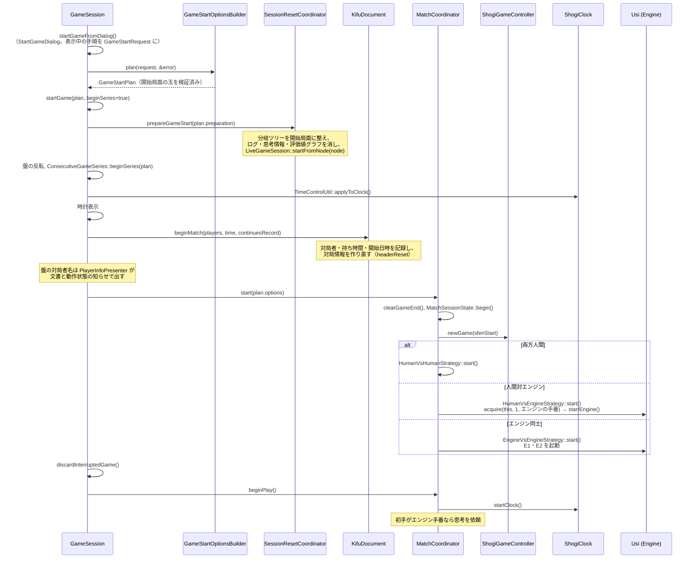

対局の開始は、対局ダイアログからの開始（`startGameFromDialog()` → `startGame(plan, true)`）・連続対局の次局（`startNextGame(plan)` → `startGame(plan, false)`）のどちらも `GameSession::startGame()` を通る。中断した対局の再開だけは `GameSession::resumeInterruptedGame()` から `MatchCoordinator::resumeInterruptedGame()` → `beginPlay()` へ進む（6.9節）。`startGame()` は「棋譜を整える → 時計 → 対局者の表示 → `MatchCoordinator::start()` → `beginPlay()`」の順に1つの関数で行い、開始前の整備を別の部品に依頼するシグナルは使わない。

### 6.4 GameStartOptionsBuilder — 対局開始の計画

`GameStartOptionsBuilder` は対局開始ダイアログの値と表示中の手順から、対局の開始の計画を作る。状態を持たず、棋譜・時計・エンジンには触れない。

**ソース**: `src/game/gamestartoptionsbuilder.h`, `src/game/gamestartoptionsbuilder.cpp`

#### 責務

- ダイアログの値（`StartGameDialogData`）と表示中の手順から開始の手順を決める（現在の局面からならその手数までの手順、手合割ならそのプリセットの局面だけの手順）
- 開始局面（両方の玉が盤上に1枚ずつあり、`PositionValidator` の検査を通るか）を検証する（`validatePosition()`）
- 対局者・時間の決まり・開始前の棋譜の整え方・盤の反転・連続対局の設定を、値としてまとめる

#### 主要な型定義

**GameStartRequest** — 対局を始める操作の入力:

| フィールド | 説明 |
|-----------|------|
| `dialogData` | 対局開始ダイアログから取り出した値（`StartGameDialogData`、`src/game/startgamedatabridge.h`） |
| `recordLine` | 表示中の手順（`KifuNavigationState::currentRecordLine()`）。現在の局面から始めるときは `currentPly` までを使う |
| `startNodeId` | 分岐ツリー上の表示中のノード |
| `bottomSide` | 盤の手前に表示している側（「人を手前に表示する」の判定用） |

**StartGameDialogData** — 対局開始ダイアログで選んだ対局の条件（`src/game/startgamedatabridge.h`）:

| フィールド | 説明 |
|-----------|------|
| `players` | 対局者2人（`std::array<PlayerChoice, 2>`。[0] が先手／下手、[1] が後手／上手） |
| `isLoseOnTimeout` | 時間切れを負けにするか |
| `startingHandicap` | 開始局面の手合割（`Handicaps::kAll` の1つ）。`nullptr` なら表示中の局面から始める（`startsFromCurrentPosition()`） |
| `maxMoves`・`autoSaveKifu`・`kifuSaveDir`・`isShowHumanInFront`・`consecutiveGames`・`isSwitchTurnEachGame` | 最大手数・自動保存・人を手前に表示・連続対局 |

`PlayerChoice` は対局者1人の選択で、`kind`（`Human`・`Engine`）、人間の名前 `humanName`、エンジン `engine`（`EngineEntry`）、時間 `time`（`TimeControlSide`）を持つ。人間とエンジンの印を別々に持たないので、両方に印がある組み合わせは表せない。どちらかがエンジンかは `hasEngine()` で見る。

**GameStartPlan** — 対局の開始の計画:

```cpp
struct GameStartPlan {
    MatchStartOptions options;          // 対局者・開始局面・手順
    MatchTimeSettings time;             // 時間の決まり
    GameStartPreparation preparation;   // 開始前に棋譜をどう整えるか
    bool flipBoard = false;             // 「人を手前に表示する」で盤を反転する
    int consecutiveGames = 1;           // 連続対局の局数
    bool switchTurnEachGame = false;    // 1局ごとに手番を入れ替える
};
```

**MatchTimeSettings** — 時間の決まり（`src/game/matchtimesettings.h`）:

```cpp
struct MatchTimeSettings {
    TimeControl rules;          // 先後の決まり（src/core/timecontrol.h、5.5 を参照）
    bool loseOnTimeout = true;  // 時間切れを負けにするか
};
```

**GameStartPreparation**（`src/game/startoptions.h`）は開始前の棋譜の整え方で、`mode`（`NewGame`・`CurrentPosition`）、ルートの局面（`rootSfen`）、現在の局面から始めるときの開始ノード（`startNodeId`）を持つ。表示中の文字列から開始の方法を推測しない。

#### API

| メソッド | 説明 |
|---------|------|
| `plan(request, &error)` | 開始の計画を作る。不正な開始局面や開始できない条件では `std::nullopt` を返し、`error` に利用者に見せる理由を入れる |
| `validatePosition(sfen, &whyNot)` | 通常の対局に使える局面か（先手・後手の玉が盤上に1枚ずつで、駒の数・駒台の玉・手番でない側への王手の検査（`PositionValidator`）を通る） |
| `buildStartOptions(startSfen, dlg)` | ダイアログの設定から `MatchStartOptions` を作る（対局者は `playersFromDialog()`） |
| `buildTimeSettings(data)` | ダイアログの設定から `MatchTimeSettings` を作る。秒読みとフィッシャー加算が両方あれば秒読みを使う |
| `needsHumanAtBottomFlip(dlg, bottomSide)` | 「人を手前に表示する」で盤を反転するか（人間対エンジンで、人間の側が手前でないとき） |

「現在の局面から開始」かどうかは、`StartGameDialogData::startsFromCurrentPosition()`（`startingHandicap` が `nullptr`）で決まる。手合割なら、その局面は `startingHandicap->sfen`（`Handicaps::kAll` の1つ）である。現在の局面なら `preparation.mode` は `CurrentPosition` で、表示中の手順と選択ノードを渡す。手順が空なら、表示中の局面（なければ棋譜の開始局面）を開始局面にする。プリセットなら `NewGame` で、`startNodeId` は -1 になる。

計画を適用する `GameSession::startGame()` は6.3節の順に動く。時間の決まりは `TimeControlUtil::applyToClock()` が時計に適用する。このとき `TimeControl::normalized()` が、秒読みとフィッシャー加算が同時に指定されていたら秒読みを優先して加算を0にする。

### 6.5 SessionResetCoordinator — 棋譜と表示の作り直し

`SessionResetCoordinator`（app 層）は、対局の開始前・新規・局面編集・棋譜の読み込み前に、棋譜（棋譜の文書 `KifuDocument`）とエンジン・解析の表示を作り直す処理を1か所にまとめる。棋譜の作り直しは文書の置き換え（`KifuDocument::startNew()`）で、対局情報・対局の記録・上書き保存先も一緒に消える。棋譜欄・分岐・盤・コメントは、ツリーと表示中の手が変わると各部品が自分で合わせるので、ここでは触らない。ここで消すのは、ツリーから作られない表示（評価値グラフと、通信ログ・思考情報・検討・解析結果などのエンジンの表示）だけである。エンジンの表示の消去は持ち主の `EngineDisplayPresenter::clearAll()` に任せる。`Deps` は `document`・`liveSession`・`kifuLoader`・`evalGraph`・`engineDisplay` の5つ。

**ソース**: `src/app/sessionresetcoordinator.h`, `src/app/sessionresetcoordinator.cpp`

#### 呼び出し方

| メソッド | 呼び出し元 | 内容 |
|---------|-----------|------|
| `prepareGameStart(preparation)` | `GameSession::startGame()` | 対局を始める局面に棋譜を整え、ライブ対局を始める。始めたノードを返す |
| `resetToNewRecord(sfen)` | 「新規」（`GameSession::resetToInitialState()`）、局面編集 | 読み込み途中の棋譜を捨て、ライブ対局を破棄して、局面 `sfen` だけの新しい棋譜にする（`KifuDocument::startNew()`） |

評価値グラフとエンジンの表示（通信ログ・思考情報・検討・解析結果。`EngineDisplayPresenter::clearAll()`）は、文書の置き換え（`KifuDocument::replaced`。新規・読み込み・局面の反映・新しい棋譜での対局の開始）を受けて自分で消える。`SessionResetCoordinator` が表示に触るのは、文書を置き換えずに現在局面から対局を続けるとき（評価値グラフを開始の手数で切り詰める）だけ。連続対局の次局（`GameSession::startNextGame()`）と通信対局の開始（`GameSession::onCsaGameStarted()`）も `prepareGameStart()` を通る。

#### prepareGameStart() の処理フロー

```
prepareGameStart(preparation)
  │
  ├── 開始ノードを決める
  │     ├── CurrentPosition → 分岐ツリーの startNodeId のノード
  │     │                     （startNodeId があるのにノードが無ければ、別の分岐や同じSFENを探し直さず nullptr を返して何もしない）
  │     ├── 終局の行（投了など）を選んでいたら直前の手を開始ノードにする。
  │     │   末尾の「中断」の行は、子が無ければ取り除く
  │     └── NewGame → KifuDocument::startNew(rootSfen) で新しい棋譜にし、ルートを開始ノードにする
  │                   （前の棋譜の対局情報・対局の記録・上書き保存先は残さない）
  │    （始まっていたライブ対局のセッションは先に破棄する）
  │
  ├── EngineDisplayPresenter::clearAll()
  │     通信ログ・情報欄・思考の表・検討・棋譜解析の表の初期化、思考ドック・検討タブのエンジン名のクリア、
  │     検討タブの実行の状態を Idle に
  │
  ├── 評価値グラフ
  │     ├── 現在の局面から → 開始ノードの手数までにする（trimToPly）
  │     └── 新規対局      → 全消去
  │
  └── LiveGameSession::startFromNode(node)
        ライブ対局のセッションを開始する。表示中の手が開始ノードになる
```

対局の手順（`RecordLine`）はここでは作らない。`GameSession::startGameFromDialog()` が表示中の手順（`KifuNavigationState::currentRecordLine()`）を `GameStartRequest::recordLine` に入れ、`GameStartOptionsBuilder::plan()` がその手数までを `MatchStartOptions::recordLine` にする（[対局開始フロー](game-start-flow.md)）。

### 6.6 ShogiGameController — 盤面とルールの橋渡し

`ShogiGameController` は対局で使う盤（`ShogiBoard`）を持ち、`EngineMoveValidator` で指し手を確かめて盤に指すコントローラである。指した手は棋譜の1行（`RecordEntry`）として返し、対局の手順への追加は呼び出し側（司令塔・通信対局）が行う。

**ソース**: `src/game/shogigamecontroller.h`, `src/game/shogigamecontroller.cpp`

#### 指し手実行フロー

人間の着手（盤のクリック）は `prepareMove()` で `UsiMove` にしてから `applyMove()`、成り・不成まで決まった手（エンジンの手・定跡ウィンドウの手）は `applyMove()`、通信対局でサーバーが知らせた手では `applyRecordedMove()` が呼ばれる。どれも最後に `commitMove()` で指す。

「同」表記の基準（局面に至った手の移動先。開始局面は無効なマス）は、このクラスでは持たず、手順を持つ呼び出し側が指すたびに `previousTo` で渡す。
対局は `MatchCoordinator::lastMoveDestination()`（`m_record.destinationOf(currentPly())`。`BoardMoveController` と `applyEngineMove()` が渡す）、
通信対局は `CsaGameProgress::previousTo()`、分岐の編集（`BranchTreeEditController`）は親ノードの手の移動先を渡す。

```
prepareMove(from, to)（盤を変えない）
  ├── 1. クリックした2マス（表示の座標。駒台は筋 10・11）を UsiMove にする
  │     盤外・相手の駒台・空きマスからの手は受け付けない
  ├── 2. legalStatus() — EngineMoveValidator で成り・不成それぞれを判定
  └── 3. 成るかどうかを決める
        ├── 両方とも合法 → setPromotionChooser() の関数（成りダイアログ）で決める
        ├── 成りだけ合法（行き所のない駒）→ 成る
        └── どちらも不合法 → nullopt

applyMove(move, previousTo)
  ├── isLegal() で、指し手の成り・不成の側が合法かを確かめる（反則手は盤を変えずに nullopt）
  └── commitMove()

commitMove(move, previousTo)
  ├── board()->applyUsiMove(move, mover)    盤を更新（手番を相手に渡し、手数を1つ進める。turnChanged が出る）
  └── RecordEntry::played(ShogiMove(move, 動かした駒, 取った駒),
                          KifMoveText::format(mover, 動かした駒, move, previousTo),   棋譜の文字列（previousTo と同じマスなら「同」）
                          board()->toSfen())            指した後の局面
```

着手の確定の知らせ（`moveCommitted`）は `commitMove()` では出さない。呼び出し側が盤・手順・棋譜・時計を更新し終えてから `notifyMoveCommitted(mover, ply)` で出す（ローカル対局は `MatchCoordinator::completeMove()`、通信対局は `CsaGameCoordinator`）。

#### 主要なシグナル

| シグナル | 接続先 | 用途 |
|---------|-------|------|
| `moveCommitted(Turn, int)` | PieceSoundPlayer::playMoveSound | 着手確定通知。ローカル対局・通信対局のどちらもこの知らせを使う |
| `endDragSignal()` | ShogiView::endDrag | 駒のドラッグ表示を終える |

手番の変更の知らせは `ShogiGameController` ではなく、盤の `ShogiBoard::turnChanged` が出す（6.7節）。

### 6.7 手番管理 — 手番は ShogiBoard だけが持つ

手番は `ShogiBoard`（`src/core/shogiboard.h`）だけが持つ。`ShogiGameController::currentPlayer()` は盤の手番を返すだけで、`ShogiGameController`・`MatchCoordinator`・`AppActivityState` は手番のコピーを持たない。手番の表現を変換したり、手番を各部品へ配ったりする専用のクラスは無い。

| 操作 | 内容 |
|------|------|
| 局面を入れ替える | `ShogiGameController::newGame(sfen)`・`ShogiBoard::setSfen()` で、SFEN の手番が盤の手番になる |
| 一手を指す | `ShogiBoard::applyUsiMove(move, mover)` が `Position::apply()` で相手の手番にし、手数を1つ進める |
| 手番を直接変える | `ShogiGameController::setCurrentPlayer()` → `ShogiBoard::setCurrentPlayer()`（局面編集の手番変更・検討する局面の手番） |

手番が変わると盤が `ShogiBoard::turnChanged(Turn)` を出し、これを受けた部品がそれぞれ自分の表示や状態を合わせる。

```
ShogiBoard::turnChanged(Turn)
  ├──▶ BoardChromeWidget::setActiveSide(Turn)             … 盤の手番表示（ShogiView が接続）
  └──▶ BoardInteractionController::cancelPendingClick()   … 1回目のクリックを取り消す
```

時計の手番は、司令塔の `completeMove()` が一手を確定するたびに `ShogiClock::setCurrentPlayer(gc->currentPlayer())` で盤に合わせる。対局の開始時は `TimeControlUtil::applyToClock()` が開始局面の手番を時計に設定する。

#### 人間/エンジンの手番切替

人間とエンジンの手番切替は、`MatchCoordinator` が対局者（`MatchPlayers`）から作る Strategy（`HumanVsHumanStrategy`・`HumanVsEngineStrategy`・`EngineVsEngineStrategy`）が制御する。一手の確定は司令塔の `completeMove()` にまとまっている。

```
                         対局中の指し手進行
                              │
                   ┌──────────┴──────────┐
                   │                     │
              人間の着手              エンジンの着手
                   │                     │
  BoardMoveController::playMove         Usi::matchMoveReady
     → GC::prepareMove()                 → Strategy::onEngineMoveReady()
     → playUsiMove() → GC::applyMove()   → MatchStrategyHost::applyEngineMove()
     → MatchCoordinator::onHumanMove()      → GC::applyMove()
     → Strategy::onHumanMove()
     → MatchStrategyHost::completeHumanMove()
                   └──────────┬──────────┘
                              │
              MatchCoordinator::completeMove()
                ├── 時計の確定（commitMove・考慮時間のクリア・手番を盤に合わせる）
                ├── 棋譜の行（MatchRecordSink::appendRecord）→ 表示中の手が最新の手になり、
                │     盤・ハイライト・棋譜欄を各部品が合わせる
                ├── ShogiClock::notifyTimeUpdated()（時計の表示）/ engineMovePlayed（エンジンの手のとき）
                ├── GC::notifyMoveCommitted() → moveCommitted
                └── 千日手・最大手数の判定
                              │
             次の手番は誰か？（Strategy が判定）
                              │
                   ┌──────────┴──────────┐
                   │                     │
              人間の手番            エンジンの手番
                   │                     │
          盤面クリック待ち      requestEngineMove(side)
          （HvH は考慮時間を計測） → Usi::requestMatchMove()（position + go）
                                 bestmove（Usi::matchMoveReady）待ち
```

EvE ではエンジンの手を確定した後、`QTimer::singleShot(0, ...)` で次の手番の思考を依頼する。

### 6.8 PromoteDialog::ask() — 成り/不成の選択

成り/不成の問い合わせは `PromoteDialog::ask(parent)` 1つで行う。主画面の盤と詰将棋を解く画面（`TsumePlayDialog`）で共通である（関数1つだけだった `PromotionFlow` はこれにまとめて削除した）。

**ソース**: `src/dialogs/promotedialog.h`, `src/dialogs/promotedialog.cpp`

```cpp
class PromoteDialog : public QDialog {
public:
    /// 成るかを尋ねる（成る: true、成らない・閉じた: false）。主画面の盤と詰将棋を解く画面で共通
    static bool ask(QWidget* parent);
};
```

`PromoteDialog`（「成る」「成らない」のボタン）を出し、`QDialog::Accepted`（成る）なら `true`、それ以外（成らない・閉じた）なら `false` を返す。

主画面では、`ShogiGameController::prepareMove()` が成り・不成の両方とも合法な手で成りの選び方の関数（`setPromotionChooser()` で渡す `DialogLauncher::choosePromotion()`。合成ルートが設定する）を呼び、`DialogLauncher::choosePromotion()` が `PromoteDialog::ask()` を呼ぶ（6.6 節）。詰将棋を解く画面は、成る手と成らない手の両方が合法なときに `PromoteDialog::ask()` を直接呼ぶ。以下の場合はダイアログを表示しない:

- **行き所のない駒**: 成りだけが合法な手（歩・香が1段目、桂が1〜2段目へ動く手。後手は逆）は成る
- **成り・不成の決まった手**: 定跡ウィンドウの手は成り・不成まで決まった `UsiMove` なので、`BoardMoveController::playUsiMove()` が `prepareMove()` を通さずに指す

### 6.9 GameSession — 対局の流れの UI 側

`GameSession` は対局の開始・終局・再開の手順と利用者の操作の受け口を受け持つ app 層のクラスである。利用者の操作（対局開始・投了・中断・再開・すぐ指させる・入玉宣言・待った・新規）を受け、投了・中断・すぐ指させる・入玉宣言は対局相手の窓口（`GameChannel`）に頼む。司令塔の終局・中断の知らせを受けて後処理をする。対局の棋譜の受け手（`MatchRecordSink`）でもあり、ローカル対局と通信対局の棋譜を開始から終局・自動保存まで同じ1本の流れ（`beginMatchRecord()`・`finishMatchRecord()`）で扱う。盤・棋譜欄・分岐ツリー・手番の表示は、棋譜（分岐ツリー）と表示中の手が変わると各部品が自分で合わせるので、`GameSession` は表示を直接更新しない。

**ソース**: `src/app/gamesession.h`, `src/app/gamesession.cpp`

#### 責務

| 責務 | 内容 |
|------|------|
| **利用者の操作** | `startGameFromDialog()`・`resign()`・`breakOff()`・`makeEngineMoveNow()`・`declareNyugyoku()`・`undoTwoMoves()`・`resumeInterruptedGame()`。投了・中断・すぐ指させるは `activeChannel()` の `GameChannel`（動作状態が `DuringCsaGame` なら `CsaGameChannel`、`DuringGame` なら `LocalGameChannel`、それ以外は nullptr）に頼み、対局の種類で分岐しない。入玉宣言は `NyugyokuDeclarationHandler::handleDeclaration(activeChannel())` に任せる |
| **対局の開始** | `startGameFromDialog()`（ダイアログ → `GameStartOptionsBuilder::plan()`）と `startGame(plan, beginSeries)`（棋譜を整える → 時計 → `beginMatchRecord(players, timeControl, continuesRecord)`（棋譜の文書に対局者・持ち時間・開始日時を記録して対局情報を作る `KifuDocument::beginMatch()`、続ける対局なら分岐の最初の手のメモ、対局者の表示）→ 自動保存の指定（`MatchStartOptions::autoSave`）を覚える → `MatchCoordinator::start()` → `beginPlay()`）。連続対局の次局は `startNextGame(plan)` |
| **棋譜の受け手** | `MatchRecordSink` の `canAppendRecord()`・`appendRecord()`・`canUndoRecords()`・`undoRecords()`。行は `LiveGameSession` に追記する（通信対局の行は `CsaGameCoordinator::recordEntryReady` を自分で受けて `appendRecord()` する） |
| **終局後処理** | `onGameEnded()`・`onCsaGameEnded()` から `finishMatchRecord(autoSave)`（ライブ対局のセッションの確定（中断も。再開は中断の行を除いて記録し直す）、終局時刻の記録 `KifuDocument::recordMatchEnd()`、`m_autoSave.isActive()` なら `KifuFileController::autoSaveKifu(dir, extension)`）・`onGameEndProcessed()`（連続対局の次局の予約） |
| **中断と再開** | `onGameInterrupted()`・`discardInterruptedGame()`・`resumeInterruptedGame()` |
| **通信対局の棋譜** | コンストラクタで `CsaGameCoordinator` の `gameStarted`・`recordEntryReady`・`gameEnded` を自分でつなぐ（`CsaGameSession` より先に作るので、画面の反映より先に棋譜ができる）。開始 `onCsaGameStarted()` はローカル対局の新しい棋譜と同じく `SessionResetCoordinator::prepareGameStart()` で棋譜を作り直して（対局情報に書きかけた内容は残し、前の表示は文書の置き換えで消える）ライブ対局を始め、`CsaGameChannel` の対局者・持ち時間で `beginMatchRecord()`、`CsaGameCoordinator::options().autoSave` を覚えて、再開局面の既存手順を追記する。終局 `onCsaGameEnded()` は `finishMatchRecord(true)` |
| **リセット** | 「新規」の `resetToInitialState()` |

#### シグナル接続

`MainWindowComposer::connectGame()` が司令塔のシグナルを `GameSession` へつなぐ。

```
MatchCoordinator::gameEnded（終局の行は書いた後）
    └──▶ GameSession::onGameEnded()
            ├── 中断なら連続対局を打ち切る（ConsecutiveGameSeries::reset）
            └── finishMatchRecord(autoSave = 中断でない)
                  ├── ライブ対局のセッションを確定（LiveGameSession::commit。中断は確定しない）
                  ├── 終局時刻を記録して対局情報に反映（KifuDocument::recordMatchEnd）
                  └── 自動保存（MatchAutoSave::isActive() なら KifuFileController::autoSaveKifu。中断は保存しない）

MatchCoordinator::gameEndProcessed（終局の知らせのあと）
    └──▶ GameSession::onGameEndProcessed()
            └── 中断以外で、エンジン同士の対局に次局があれば ConsecutiveGameSeries::startNextGame()

MatchCoordinator::gameInterrupted
    └──▶ GameSession::onGameInterrupted()
            └── 中断の行のノードを MatchCoordinator::attachInterruptedRecord() で中断した対局に結びつける
                  （resumeAvailabilityChanged → UiStatePolicyManager::refreshResumeAvailability で「対局再開」が有効になる）
```

終局の行（「投了」など）は司令塔が `MatchRecordSink::appendRecord()` で書くので、受け手で終局の行を組み立て直さない。動作状態を待機に戻すのは司令塔の `endGame()` で、メニュー・ボタンの切替は `UiStatePolicyManager` が動作状態の変化を受けて行う。

#### 依存（Deps）

`GameSession` はコールバックを持たず、`Deps` 構造体で部品のポインタを受け取る（`MainWindowComposer::createSessions()` が作るときに渡す）。主なもの:

| フィールド | 用途 |
|-----------|------|
| `activity` | `AppActivityState`（動作状態。対局中の窓口を決める） |
| `match` / `analysis` / `consecutive` / `csaGame` / `reset` | 対局の司令塔（必須）・検討（「新規」で止める）・連続対局・通信対局の司令塔（必須）・棋譜と表示の作り直し |
| `engines` | エンジンの枠（`EngineLifecycleManager`。省略可）。「新規」で対局・棋譜解析のエンジンも `destroyEngines(false)` で止める（`AnalysisSession::stop()` は自分のエンジンしか手放さないため） |
| `navState` / `liveSession` / `document` | 表示中の手（現在局面からの開始・再開）・対局の手順の書き先（分岐ツリー）・棋譜の文書（対局者・持ち時間・開始と終了の日時・対局情報） |
| `clock` / `timePresenter` / `playerInfo` | 時計（必須）・時計の表示・盤の対局者名の表示 |
| `kifuFileController` / `shogiView` / `appearance` | 未保存の棋譜の確認と棋譜の自動保存・手前に表示している側・「人を手前に表示する」の盤の反転 |
| `nyugyoku` | 利用者の入玉宣言（`NyugyokuDeclarationHandler`） |

`GameSession` はコンストラクタで2つの窓口（`LocalGameChannel`（司令塔と時計）・`CsaGameChannel`（通信対局の司令塔））を作って持つ。

#### 中断と再開

中断は司令塔の `handleBreakOff()` が `captureInterruptedGame()` で手順・時計を `InterruptedGameState` に保存してから終局として記録し、`gameInterrupted` を出す。`GameSession::onGameInterrupted()` は中断の行のノードを `MatchCoordinator::attachInterruptedRecord(nodeId)` で `InterruptedGameState::terminalNodeId` に覚えさせる。中断した対局の状態はこの1か所にあり、「対局再開」の有効・無効は `UiStatePolicyManager` が `Deps::canResumeGame`（`MatchCoordinator::canResumeInterruptedGame()`）で問い合わせる（`resumeAvailabilityChanged` → `refreshResumeAvailability()`）。棋譜を変えたとき（`KifuBranchTree` の `nodeAppended`・`childrenReordered`・`subtreeRemoved`・`reset`）、別の対局を始めたとき（`startGame()`）、「新規」にしたときは `discardInterruptedGame()` で捨てる。

`GameSession::resumeInterruptedGame()` は、中断の行の親ノードへ表示中の手を戻し（`KifuNavigationState::resetToNode()`）、ライブ対局のセッションを破棄して中断の行を除いてから、そのノードでセッションを開始し直す。終局時刻を消したあと（`KifuDocument::clearMatchEnd()`）、`MatchCoordinator::resumeInterruptedGame()` が手順・盤・時計を復元して（「同」表記の基準は手順の最後の手から導く） Strategy を作り直し、続く `MatchCoordinator::beginPlay()` が時計の始動と初手の要求を行う。

#### 人間/エンジンの判定（HumanTurnPolicy / MatchPlayers）

どちらの手番を人間が指すかは、対局者 `MatchPlayers`（`src/core/matchplayers.h`）の `isHuman(Turn)`・`isEngine(Turn)` で決まる。司令塔の `MatchCoordinator::isHumanSide(Turn)` は、対局を一度でも始めていればその対局の `players().isHuman(side)` を返す。

盤で指した手の行き先の規則は `HumanTurnPolicy`（`src/ui/controllers/humanturnpolicy.h`）の `boardInput()` 1か所にある。動作状態（`AppActivityState`）で、ローカル対局なら司令塔、通信対局なら `CsaGameCoordinator` に聞く。

```cpp
HumanTurnPolicy::BoardInput HumanTurnPolicy::boardInput() const
{
    if (m_disabled || !m_deps.activity) return BoardInput::None;
    switch (m_deps.activity->activity()) {
    case AppActivityState::Activity::DuringPositionEdit:
        return BoardInput::Edit;
    case AppActivityState::Activity::Idle:
        return m_deps.branchEdit && m_deps.branchEdit->canEdit() ? BoardInput::Variation : BoardInput::None;
    case AppActivityState::Activity::DuringGame: {
        const MatchCoordinator* match = m_deps.match;
        const bool humanTurn = match && m_deps.gameController && match->canAcceptMove()
            && match->isHumanSide(m_deps.gameController->currentPlayer());
        return humanTurn ? BoardInput::Game : BoardInput::None;
    }
    case AppActivityState::Activity::DuringCsaGame: ...（対局中・人間・自分の手番なら CsaServer）
    default:
        return BoardInput::None;
    }
}
```

`isHumanTurnNow()` は行き先が `Variation`・`Game`・`CsaServer` のどれかか、`isGameActivelyInProgress()` はローカル対局なら終局前か、通信対局なら `CsaGameCoordinator::GameState::InGame` かを返す。盤のクリックでは、盤で指した手の行き先 `BoardMoveController` が `acceptsInput()`（行き先が `None` でないか）・`isEditing()`（`Edit` か）で使う（`BoardInteractionController` はつまむたびに行き先に聞く）。定跡ウィンドウ（`JosekiWindowController::Deps::humanTurn`）と矢印（`CandidateArrowPresenter::Deps::humanTurn`）はこの `HumanTurnPolicy` を型付きで受ける。終了処理では `disable()` で何も受け付けなくする（盤の操作が参照し続けるので破棄はしない）。

### 6.10 ConsecutiveGameSeries — 連続対局制御

`ConsecutiveGameSeries` はエンジン同士（EvE）の連続対局の局数と、次局の開始の計画を管理する。次局を始めるのは受け手の `GameSession` である。

**ソース**: `src/game/consecutivegameseries.h`, `src/game/consecutivegameseries.cpp`

#### 仕組み

```
GameSession::startGame(plan, beginSeries=true)           … ダイアログからの開始のとき
    └──▶ ConsecutiveGameSeries::beginSeries(plan)
            ・合計局数 plan.consecutiveGames、残り局数 = 合計 − 1、局目 = 1
            ・次局の元の計画を覚える（手順を空にして開始局面から、NewGame、盤の反転なし）

MatchCoordinator::gameEndProcessed（終局表示・自動保存のあと）
    └──▶ GameSession::onGameEndProcessed()
            └──▶ エンジン同士で shouldStartNextGame() ? → startNextGame()

startNextGame()
  └── 100ms のタイマー → launchPreparedNextGame()
        ├── 残り局数を減らし、局目を増やす
        ├── switchTurnEachGame → MatchStartOptions::swapSides()（対局者・エンジンのパスと定跡の条件）と
        │                        TimeControl::swapSides()（持ち時間の決まり）で先後を入れ替え
        └── emit nextGameReady(GameStartPlan)
              └──▶ GameSession::startNextGame(plan)
                      ├── 独立した棋譜として、開始局面で作り直す（SessionResetCoordinator::resetToNewRecord）
                      └── startGame(plan, beginSeries=false)   … 局数は数え直さない
```

次局の計画は、1局目の計画（`GameStartPlan`）を `beginSeries()` で控えておいて再利用する。時間の決まりも計画に含まれるので、通常の開始と同じく時計へ一度だけ適用する。手番入れ替え（`switchTurnEachGame`）が有効な場合、エンジンと一緒に持ち時間も入れ替え、エンジンごとに時間差を付けた対局でも各エンジンが同じ持ち時間で指し続けるようにする。

次局開始前に 100ms の遅延を入れるのは、いまの終局処理・エンジン応答の処理を抜けてから次局を初期化するためである。

| メソッド | 説明 |
|---------|------|
| `beginSeries(firstGame)` | 連続対局の1局目を始めた（局数・手番の入れ替えと、次局の元にする計画を覚える） |
| `shouldStartNextGame()` | 残り対局数 > 0 なら true |
| `startNextGame()` | 次局の準備を予約する（準備ができたら `nextGameReady`） |
| `currentGameNumber()` / `totalGames()` | 現在の対局番号（1始まり）・合計対局数 |
| `reset()` | 全状態をリセット（中断・「新規」のとき） |

### 6.11 game層のクラス間関係まとめ

```
┌──────────────────────────────────────────────────────────────────────┐
│                                                                      │
│  合成ルート (MainWindowComposer)                                     │
│    │ 起動時に全部作り、依存を渡し、シグナルをつなぐ                    │
│    │                                                                  │
│    ├── GameSession（app 層。操作の受け口・棋譜の受け手）              │
│    │     ├── startGameFromDialog() ──▶ GameStartOptionsBuilder::plan() │
│    │     ├── startGame(plan) ──▶ SessionResetCoordinator::prepareGameStart │
│    │     │                  ──▶ MatchCoordinator.start() / beginPlay() │
│    │     └── 司令塔のシグナル（gameEnded など）を受ける               │
│    │                                                                  │
│    ├── MatchCoordinator  (司令塔)                                     │
│    │     ├── ShogiGameController (盤面/ルール。手番は盤が持つ)         │
│    │     ├── ShogiClock (時計)                                        │
│    │     ├── EngineLifecycleManager ── Usi × 2 (エンジン)             │
│    │     ├── GameModeStrategy (対局モード別の手番の進め方)             │
│    │     └── MatchRecordSink（= GameSession）へ棋譜の行を書く          │
│    │                                                                  │
│    ├── HumanTurnPolicy (盤を人間が操作できるか)                       │
│    │                                                                  │
│    └── ConsecutiveGameSeries (連続対局)                               │
│          └── nextGameReady ──▶ GameSession::startNextGame             │
│                                                                      │
│  棋譜の行が書かれる → 表示中の手が変わる → 盤・棋譜欄・分岐を各部品が合わせる │
│  盤の手番が変わる（ShogiBoard::turnChanged）→ 手番表示を合わせる       │
│                                                                      │
└──────────────────────────────────────────────────────────────────────┘
```

<!-- chapter-6-end -->

---

<!-- chapter-7-start -->
## 第7章 engine層：USIエンジン連携

engine層は、外部の USI（Universal Shogi Interface）対応エンジンとのプロセス間通信を担当する。エンジンの起動・終了、USIプロトコルのコマンド送受信、受信行の型付けと思考情報の整形、およびエンジン設定の管理を包括的に扱う。

### 7.1 3層アーキテクチャ

engine層は **単一責任原則（SRP）** に基づき、以下の3つのクラスに分離されている。プロセスとプロトコル処理は `UsiEngineSession`（GUI と自動化・CLI で共用する接続）が束ね、`Usi` はそれと `ThinkingInfoFormatter`・`UsiMatchHandler` を持つ。engine層は game層を知らない（`Usi` は `ShogiGameController` を持たず、対局の持ち時間は engine 層の `MatchTimeSource`（`src/engine/matchtimesource.h`）を `setMatchTimeSource()` で受け取って読むだけ。ローカル対局は対局時計の `ClockTimeSource`、通信対局はサーバーの残り時間を返す `CsaGameCoordinator`）。また表示のモデルにも触れない。思考の表・情報欄・通信ログのモデルへの反映は、ui層の `UsiModelBinding` が `Usi` のシグナルを受けて行う（7.10節）。

```
┌─────────────────────────────────────────────────────┐
│                   Usi（窓口）                         │
│  対局・検討・棋譜解析・詰み探索の要求、シグナル中継     │
│                                                     │
│  m_session（UsiEngineSession。QObject の親で所有）   │
│    ├── EngineProcessManager                         │
│    └── UsiProtocolHandler                           │
│  m_matchHandler（UsiMatchHandler）                  │
│  m_formatter（ThinkingInfoFormatter）               │
│  いずれも QObject の親で所有                         │
├─────────────────────────────────────────────────────┤
│         ▲ シグナル/スロット接続 ▼                      │
├──────────┬──────────────────┬────────────────────────┤
│EngineProcess│UsiProtocol    │ThinkingInfo           │
│Manager      │Handler        │Formatter              │
│             │               │                       │
│QProcess管理 │USIコマンド     │info の表示用の整形     │
│起動/終了    │送受信         │読み筋漢字変換         │
│1行ずつ送受信│状態機械       │探索状況の値           │
│             │受信行の型付け │                       │
└──────────┴──────────────────┴────────────────────────┘
```

#### 各クラスの責務

| クラス | ソース | 責務 |
|--------|--------|------|
| `EngineProcessManager` | `src/engine/engineprocessmanager.h/.cpp` | QProcess の起動・終了と、標準出力/エラーの1行ずつの受信、コマンドの送信 |
| `UsiProtocolHandler` | `src/engine/usiprotocolhandler.h/.cpp` | エンジン1台の状態機械（`State`）。状態に合う USI コマンドだけを送り、受信行を `UsiLineParser` で型付きの値にしてシグナルで知らせる |
| `UsiLineParser` | `src/engine/usilineparser.h/.cpp` | 受信行（info・bestmove・checkmate・option・id）を型付きの値にする関数群。アプリの中でエンジンの受信行を読む場所はここだけ |
| `ThinkingInfoFormatter` | `src/engine/thinkinginfoformatter.h/.cpp` | 解析済みの info（`UsiInfo`）を思考の表の行（`ThinkingInfoRow`）と情報欄の探索状況（`EngineSearchStatus`）にする。漢字読み筋の生成を含む。表示する側には触れない |
| `UsiEngineSession` | `src/engine/usienginesession.h/.cpp` | プロセスと状態機械を束ね、起動・初期化（usi〜readyok）・探索1回の依頼・終了を行う。GUI の `Usi` と自動化・CLI が共用し、思考タブを使わない詰みの問い合わせ（`MateOracle`）もこれを1つ持って使う |
| `MateOracle` | `src/engine/mateoracle.h/.cpp` | 詰みの問い合わせ（go mate）の部品。`UsiEngineSession` を持ち、`ask(position, limitMs)`（打ち切りは `UsiSearchRequest::mate`）・`askWithin(position, deadlineMs)`（`go mate infinite` を期限まで待ち、stop は送らない）に `answered(MateAnswer)`・`timedOut` で答える。詰将棋の局面生成・詰み判定（`TsumeMateEngine`）・CLI の詰み探索と余詰検査が使う |
| `MateQueryLoop` | `src/engine/matequeryloop.h/.cpp` | 引き出し型の問い合わせ元（`MateQuerySource`：`nextQuery()`・`submit(answer, elapsedMs)`・`isDone()`）を `MateOracle` で最後まで回す。エンジンが go mate に対応していなければ `unsupported` で止まる |
| `UsiMatchHandler` | `src/engine/usimatchhandler.h/.cpp` | 対局の position/go/bestmove、先読み（ponder）、持ち時間の間に bestmove が届かないときの通知 |

#### シグナル伝搬の流れ

```
エンジンプロセス (stdout)
    │
    ▼
EngineProcessManager::onReadyReadStdout()
    │ emit dataReceived(line)
    ├──────────────────────────────────────┐
    ▼                                      ▼
UsiProtocolHandler::onDataReceived()    UsiModelBinding::onLineReceived()
    │                                      │ （通信ログの行「◀ E1: ...」を知らせる）
    │                                      ▼
    │                                   UsiCommLogModel::appendLogLine() → logLineAppended
    │
    ├─ "bestmove" → UsiLineParser::parseBestMove()
    │              emit bestMoveReceived(UsiBestMove)
    ├─ "checkmate"→ UsiLineParser::parseCheckmate()
    │              emit checkmateReceived(UsiCheckmate)
    ├─ "info"   → UsiLineParser::parseInfo()
    │              emit infoReceived(UsiInfo)
    │                   ▼
    │              ThinkingInfoFormatter::onInfoReceived()
    │                   │ (50msバッファリング後)
    │                   ▼
    │              processInfo(UsiInfo)
    │                   │ emit thinkingInfoUpdated(ThinkingInfoRow)
    │                   │ emit searchStatusUpdated(EngineSearchStatus)（情報欄の値。info 1行に1回）
    │                   ▼
    │              UsiModelBinding
    │                   ├─ ShogiEngineThinkingModel::prependRow()
    │                   ├─ ShogiEngineThinkingModel::updateByMultipv()
    │                   └─ UsiCommLogModel::updateStatus()
    │
    ├─ "readyok" → handleReadyOk()  → initializationFinished(true)
    └─ "usiok"   → handleUsiOk()
```

### 7.2 USIプロトコルの状態遷移

USI プロトコルは、エンジンの起動から対局終了までの一連の状態遷移を定義する。以下に主要な状態遷移を示す。

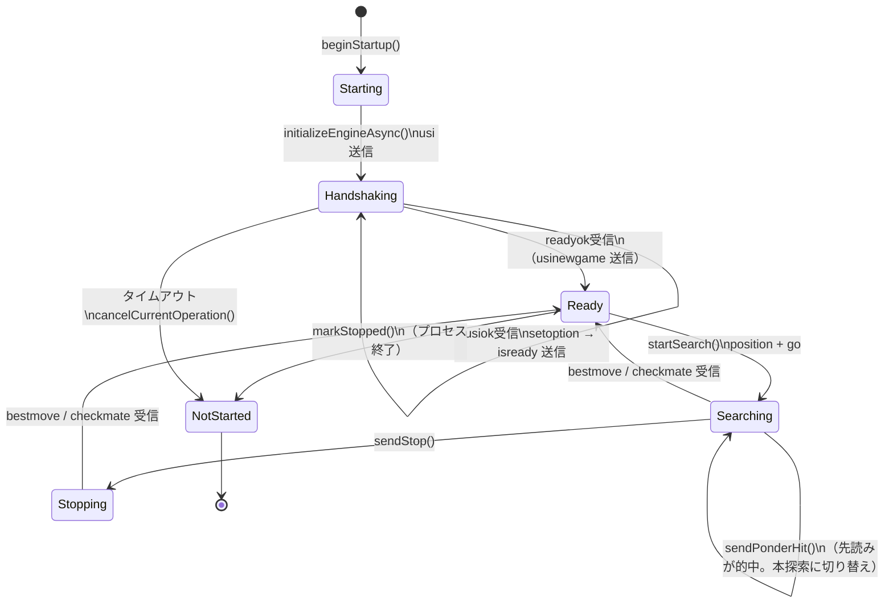

探索の種類は `SearchKind`（`Main`・`Ponder`・`Mate`）で区別する。先読み（`go ponder`）は `Searching` の中の `SearchKind::Ponder` で、`sendPonderHit()` が `Main` に切り替える。詰み探索（`go mate`）は `SearchKind::Mate` で、結果は bestmove ではなく checkmate で届く。

#### 非同期初期化シーケンス

`Usi::startEngine(path, name)` は値を返さない。起動の失敗（パスが空・実行できない・起動できない）は、必ずこの呼び出しから戻った後のイベントループで `errorOccurred` として届く（`UsiEngineSession::startAsync()` が同期では決して知らせない。知らせる前に `quit()`・次の起動をしたら、その失敗は知らせない）。このため使う側は起動の途中の再入（`startEngine()` の中でエラーの処理が走ること）に備えなくてよい。`MateOracle::start()`・`EngineAnalysisRunner::start()`・`MateSearchRunner::start()` も同じく値を返さない（`TsumeVerificationRunner::start()` は SFEN が詰将棋の局面でないときだけ false を返す）。
中では `UsiEngineSession::startAsync()` が、そのエンジンの保存した設定を `UsiProtocolHandler::setLaunchOptions(EngineProfileStore::launchOptions(name))` で渡し、
`EngineProcessManager::startProcessAsync()` で起動する。`processStarted` の後、`UsiProtocolHandler::initializeEngineAsync()` が
`usi` → `usiok` → `setoption` → `isready` → `readyok` → `usinewgame` の順に進める。
各応答はQtシグナルで受信し、usiok・readyokにはそれぞれ既定5秒のタイマーを設ける（`UsiEngineSession::setInitializationTimeoutMs()` で延ばせる）。
成功は `UsiProtocolHandler::initializationFinished(true)` → `UsiEngineSession::ready` → `Usi::engineInitialized`、失敗は `UsiEngineSession::errorOccurred` → `Usi::errorOccurred` で通知する。
初期化中の要求（setoption・USI コンソールの入力・対局の思考の依頼）は `UsiEngineSession::whenReady()` が保管して初期化完了後に順に行い、探索の依頼（`search()`）は最後の1つだけを覚えて、その後で始める。
キャンセル（`cancelCurrentOperation()`）時は保留要求とタイマーを破棄し、遅れて届いた結果も知らせない。

#### 探索の切り替え（UsiEngineSession::search）

探索は最後に頼まれたものだけを行う。エンジンに探索を重ねて頼まない（position・go を探索中に送らない）。

- 局面が空の依頼は受け付けない（`search()` が false を返し、何も送らない。局面を送らない go は前の局面を探索してしまうため）。局面を作れない呼び出し元（`RecordLine::usiPosition()`・`KifuNavigationState::currentUsiPosition()` は `std::optional` を返す）がそれぞれ失敗として扱う。
- 探索中に次を頼まれたら、`UsiProtocolHandler::abandonSearch()` で stop を送り（停止待ちなら送らない）、その結果と info は知らせずに捨てる。結果が届いて待機に戻ったこと（`searchEnded`）を受けて、覚えている最後の依頼を始める。stop に `UsiSearchRequest::kStopReplyMs` 答えなければ `errorOccurred`。
- 依頼のオプション（`UsiSearchRequest::options`。検討の候補手の数など）は、前の探索を止めた後、position の前に送る。go の時間を送るときに決める依頼（`goAtStart`。対局では停止を待つ間も時計が進む）もある。
- `stop()` は最後に頼んだ探索をできるだけ早く終わらせ、結果は届く（まだ始めていなければ、始めてすぐ stop を送る）。`cancelSearch()` は取りやめ、結果は知らせない。

検討のやり直し（`AnalysisSession`）・先読みの外れ（`UsiMatchHandler`）・詰みの問い合わせ（`MateOracle`）は、どれもこの入口に頼み直すだけで、止めて待つ状態を自分では持たない。
エンジンの登録には、起動して usi〜usiok だけ行う `probeAsync()` を使う（7.9節。失敗の知らせ方は `startAsync()` と同じ）。

### 7.3 EngineProcessManager — プロセス管理

**ソース**: `src/engine/engineprocessmanager.h`, `src/engine/engineprocessmanager.cpp`

QProcess を直接管理し、USI プロトコルの詳細を知らない純粋なプロセス管理クラスである。

#### プロセスの終了

`stopProcessAsync()` は、プロセスの所有権を内部クラス `RetiringEngineProcess` に引き渡し、`quit` を書く。以後このプロセスの出力は受け取らない（シグナルを切り離す）。応答がなければ3秒後に `terminate`、さらに1秒後に `kill` を、イベント駆動で進める。`EngineProcessManager` が先に破棄されても、プロセスは回収される。手放す前にプロセスが終わったとき（予期しない終了）だけ、残りの出力を流して `processExited` を発行する。

#### 主要メソッド

| メソッド | 説明 |
|---------|------|
| `startProcessAsync(engineFile)` | ファイル検証後に起動要求を出す。完了は `processStarted` で通知 |
| `stopProcessAsync()` | プロセスを手放して quit を書き、応答がなければ terminate・kill まで進める |
| `sendCommand(command)` | コマンド文字列を UTF-8 で書き込み、`commandSent` シグナルを発行 |
| `setLogIdentity(engineTag, sideTag, engineName)` | ログ出力用の識別情報を設定（例: `[E1/black] YaneuraOu`。対局のエンジンは手番を `black`／`white` で付ける） |

#### 標準出力の読み取り

`onReadyReadStdout()` はチャンク単位（最大64行）で標準出力を読み取る。1チャンクの処理後、未読データが残っていれば `QTimer::singleShot(0, ...)` でイベントループ経由で再スケジュールし、UI の応答性を維持する。

```
onReadyReadStdout()
  │
  ├── 行ごとに読み取り（最大 kMaxLinesPerChunk = 64。空行は飛ばす）
  │     └── 1行ごとに dataReceived シグナルを発行
  │           （受信側が破棄されたら、そこで読み取りをやめる）
  │
  └── 未読データあり → scheduleMoreReading()
```

標準エラーは `onReadyReadStderr()` が1行ずつ `stderrReceived` で知らせる。

### 7.4 UsiProtocolHandler — プロトコル処理

**ソース**: `src/engine/usiprotocolhandler.h`, `src/engine/usiprotocolhandler.cpp`

エンジン1台の状態機械である。USI コマンドの生成・送信、受信行の型付け、非同期初期化を担当する。

#### 状態と探索の種類

```cpp
enum class State {
    NotStarted,   // プロセスがない（終了した・終了させた・初期化に失敗した）
    Starting,     // プロセスの起動を待っている
    Handshaking,  // usi〜usiok〜setoption〜isready〜readyok
    Ready,        // 探索していない
    Searching,    // go を送り、結果（bestmove・checkmate）を待っている
    Stopping,     // stop を送り、結果を待っている
};

enum class SearchKind { Main, Ponder, Mate };
```

`startSearch(position, go)` で `Searching` に入り、`go` の種類（`UsiGo::Kind`）から `SearchKind` が決まる（局面が空なら何も送らず false）。`sendPonderHit()` は `Ponder` → `Main` に切り替える（予想手が的中した場合）。`sendStop()` は `Searching` から `Stopping` にする。bestmove・checkmate の受信（`finishSearch()`）で `Ready` に戻り、結果の知らせの後に `searchEnded` を出す。`cancelCurrentOperation()`・`abandonSearch()`（探索中なら stop も送る）は探索の世代（`m_seq`）を進めて、遅れて届く結果と info を捨てる。

#### 主要コマンド送信メソッド

go に載せる内容は `UsiGo`（`src/engine/usigotime.h`）で表す。時計から `UsiGoTime`（btime・wtime・byoyomi・binc・winc）を求める計算は `UsiGoTimeCalculator::compute()` にある。

| メソッド | 生成されるコマンド |
|---------|------------------|
| `sendUsi()` | `usi` |
| `sendIsReady()` | `isready` |
| `sendUsiNewGame()` | `usinewgame` |
| `startSearch(position, go)` | `position.command()` に続けて `go.command()`（局面が空なら送らない） |
| └ `UsiGo::clock(time)` | `go btime X wtime Y byoyomi Z` / `go btime X wtime Y binc A winc B` |
| └ `UsiGo::ponder(time)` | `go ponder btime X wtime Y ...` |
| └ `UsiGo::infinite()` | `go infinite`（検討・棋譜解析） |
| └ `UsiGo::mate(timeMs)` | `go mate X` / `go mate infinite`（0 以下） |
| `sendStop()` | `stop`（`Searching` のときだけ。停止待ちの間はもう一度は送らない） |
| `sendPonderHit()` | `ponderhit`（先読み中のときだけ） |
| `sendGameOver(result)` | `gameover win` / `gameover lose` / `gameover draw` |
| `sendSetOption(name, value)` | `setoption name X value Y` |
| `sendConsoleCommand(command)` | 利用者が USI コンソールに入力した文字列をそのまま送る |

終了の `quit` は `UsiProtocolHandler` ではなく、`UsiEngineSession::quit()` → `EngineProcessManager::stopProcessAsync()` が書く（7.3節）。

#### レスポンス処理（onDataReceived）

```
onDataReceived(line)
  │
  ├── bestmove 行 → handleBestMove()
  │     ├── 取り消した探索の結果（世代が違う）→ 破棄（searchEnded だけ出す）
  │     ├── UsiLineParser::parseBestMove() が失敗 → errorOccurred
  │     └── 探索の文脈を添えて emit bestMoveReceived(UsiBestMove)
  │           （elapsedMs・最後の評価値 score・baseSfen・pondering・stopped。
  │            resign / win / draw は special に入る）
  │
  ├── checkmate 行 → handleCheckmate()
  │     └── 取り消した探索でなければ emit checkmateReceived(UsiCheckmate)
  │           （Result は Mate / NoMate / NotImplemented / Unknown、手順は pv）
  │
  ├── info 行 → UsiLineParser::parseInfo()
  │     ├── 取り消した探索の info → 破棄
  │     └── updateSearch(info)（最後の評価値・候補手を更新）→ emit infoReceived(UsiInfo)
  │
  ├── "readyok" → handleReadyOk()
  ├── "usiok"   → handleUsiOk()
  │
  ├── "option name ..." → UsiLineParser::parseOption()（報告されたオプションを記録）
  ├── "id name ..."     → UsiLineParser::parseIdName()
  └── "id author ..."   → UsiLineParser::parseIdAuthor()
```

#### 応答待ちとキャンセル

同期の `waitFor*` APIは設けず、応答シグナルとタイマーで進行する。
初期化は `initializationFinished(bool)`、対局の着手は `Usi::matchMoveReady` で通知する。
`UsiMatchHandler` は本探索・定跡手の待ちを管理し、先読みの局面（`m_ponder`。`ponderPosition()` で読める）はこの部品だけが持つ。探索は `UsiEngineSession::search()` に頼む。
手番の探索を頼まれたとき、頼まれた局面と先読みの局面が値として等しければ（`UsiPosition` の比較）`ponderhit` で続け、外れた場合は
次の探索を頼むだけで、`UsiEngineSession` が先読みを stop で回収し、その結果を捨ててから `go` を送る（go の時間は送るときの残り時間で決める）。定跡手を指すときは `cancelSearch()` で先読みを止める。待ったで局面が戻ったときは `forgetPonder()` で先読みの局面を捨てる（`MatchCoordinator::undoTwoPlies()` が両方のエンジンに呼ぶ）。
bestmove の手が局面に指せないときも `moveReady` は出し（先読みはしない）、対局の側が反則手として扱う。
持ち時間は時間の出どころ（`setTimeSource(MatchTimeSource*)`。無ければ時間の決まりのない対局として扱う）だけから読む。思考を始めるときに `MatchTimeSource::snapshot(side, pondering)` が返す `MatchSearchTiming`（`input`（`UsiGoTimeInput`）・`timeoutMs`・`expired`。`UsiMatchHandler::SearchTiming` はその別名）で `go` を送り、その手に使える残り時間を期限に使う。無制限対局には30分の安全上限を設ける（`timeoutMs`）。bestmove を受けたら `MatchTimeSource::finishTurn()` で手番の時間を精算する（時間切れなら false）。
`cancelCurrentOperation()` は探索の世代を更新し、取消済みの結果の採用を防ぐ。

#### 経過時間の計測

`QElapsedTimer m_goTimer` で `go` コマンド送信（先読みが当たったときは `ponderhit` 送信）から `bestmove` 受信までの経過時間を計測し、`UsiBestMove::elapsedMs` に入れる。この値は時間制御で消費時間として使用される。

### 7.5 Usi クラス — 窓口

**ソース**: `src/engine/usi.h`, `src/engine/usi.cpp`

`Usi` クラスは GUI からエンジン1台を使う窓口である。対局（`HumanVsEngineStrategy`・`EngineVsEngineStrategy`）と通信対局（`CsaGameCoordinator`）は `MatchEngineSeat` 経由で（エンジンは `EngineLifecycleManager` が作る）、検討・詰み探索（`AnalysisSession`）、棋譜解析（`AnalysisJob`）は直接使う。思考タブを使わない詰みの問い合わせ（詰将棋の局面生成 `TsumeshogiGenerator`・詰み判定 `TsumeMateEngine`・CLI の `MateSearchRunner`・`TsumeVerificationRunner`）は `Usi` を使わず、`MateOracle`（`UsiEngineSession` を持つ）で頼む。`Usi` は内部のコンポーネント（7.1節の表）を持ち、要求の受け付けとシグナルの中継を行う。思考の表・通信ログのモデルには触れない。

#### コンストラクタと依存関係

```cpp
explicit Usi(QObject* parent = nullptr);
```

コンストラクタで `UsiEngineSession`（`EngineProcessManager`・`UsiProtocolHandler` を持つ）・`ThinkingInfoFormatter`・`UsiMatchHandler` を作り、`connect()` でシグナルを接続する。対局の持ち時間の出どころは `setMatchTimeSource(MatchTimeSource*)` で後から渡す（非所有。`MatchEngineSeat::start()` が、ローカル対局では司令塔の対局時計の `ClockTimeSource` を、通信対局では `CsaGameCoordinator` を渡す）。ログの識別（`E1`・`E2` と手番）は `setLogIdentity()` で設定する。

表示する側は、次の3つの読み取り専用の窓口からシグナルを受ける。

| メソッド | 返す部品 | 知らせる内容 |
|---------|---------|-------------|
| `thinking()` | `ThinkingInfoFormatter` | 整えた思考の行・情報欄の値 |
| `process()` | `EngineProcessManager` | 送受信した行（通信ログ） |
| `protocol()` | `UsiProtocolHandler` | bestmove・checkmate・info |

#### 主なメソッド

| メソッド | 用途 |
|---------|------|
| `startEngine(path, name)` | エンジンを起動して初期化を始める（値は返さない。完了は `engineInitialized`、失敗は戻った後に `errorOccurred`） |
| `requestMatchMove(position)` | 対局の思考を依頼する（`position` は `UsiPosition`。時間は `setMatchTimeSource()` で渡した出どころから読む。先読みの当たり・外れは `UsiMatchHandler` が判断する。指し手は `matchMoveReady`） |
| `forgetPonder()` | 先読みの局面を捨てる（待ったなどで局面が戻ったとき） |
| `requestImmediateMove()` | 対局中の「すぐ指させる」（準備中に頼まれた探索は始めてすぐ stop を送る） |
| `sendGameOverCommand(result)` | `gameover` を送る |
| `startConsideration(position, byoyomiMs, multiPV)` | 検討。MultiPV を送って position + go infinite、時間が来たら stop |
| `search(request)` | 探索1回を頼む（棋譜解析の1局面など。`UsiSearchRequest`。局面は `UsiSearchRequest::position`（`UsiPosition`）） |
| `startMateSearch(position, ms)` | 詰み探索（`go mate`） |
| `stop()` | 最後に頼んだ探索をできるだけ早く終わらせる（結果は届く。まだ始めていなければ始めてすぐ止める） |

探索を頼む3つ（`startConsideration`・`search`・`startMateSearch`）は、局面が空なら何もせず false を返す。探索中に頼むと、前の探索を止めて結果を捨ててから始める（7.2節「探索の切り替え」）。
| `sendSetOptionCommand(name, value)` / `sendConsoleCommand(command)` | setoption の送信 / USI コンソールの入力をそのまま送る。任意の文字列を送れるのは後者だけ |
| `quit(clearThinking)` | プロセスを止める |
| `cancelCurrentOperation()` | 探索の世代を進め、保留中の要求と取消済みの結果を捨てる |

#### コンストラクタの接続構造

```
UsiEngineSession → Usi
  ├── ready             → engineInitialized
  └── errorOccurred     → onSessionError  → プロセスを片付け、emit errorOccurred

UsiProtocolHandler → Usi
  └── searchCandidateChanged → searchCandidateChanged（候補手の矢印）

UsiProtocolHandler → ThinkingInfoFormatter
  ├── positionChanged   → setSearchPosition（読み筋を日本語にする局面と、そこに至った直前の手）
  ├── searchStarted     → requestClearThinkingInfo
  ├── infoReceived      → onInfoReceived
  ├── checkmateReceived → presentCheckmate
  └── bestMoveReceived  → flushInfoBuffer（bestmove の直前の info を先に行にする）

UsiMatchHandler → Usi
  ├── moveReady         → matchMoveReady
  ├── resigned          → resigned(Turn)
  ├── declaredWin       → declaredWin(Turn)
  ├── timedOut          → onMatchTimeout  → emit errorOccurred
  └── errorOccurred     → onSessionError
```

通信ログのための `commandSent`・`dataReceived`・`stderrReceived` は、`Usi` を経由せず `process()` から直接 `UsiModelBinding` に届く。bestmove・info・checkmate も `protocol()` のシグナルを直接受ける（`Usi` が再発行しない）。

#### 主要シグナル一覧

| シグナル | 用途 | 主な接続先 |
|---------|------|----------|
| `engineInitialized()` | 初期化（usi〜readyok）の完了 | MatchEngineSeat（→ 対局の Strategy・CsaGameCoordinator）、AnalysisJob |
| `matchMoveReady(UsiMatchMove)` | 対局の思考で指し手が決まった（指した側・指し手・考えた時間・評価値） | MatchEngineSeat（→ HumanVsEngineStrategy・EngineVsEngineStrategy・CsaGameCoordinator） |
| `resigned(Turn)` | 対局の探索に投了で答えた | MatchEngineSeat（→ MatchCoordinator・CsaGameCoordinator） |
| `declaredWin(Turn)` | 対局の探索に入玉宣言勝ちで答えた | MatchEngineSeat（→ MatchCoordinator・CsaGameCoordinator） |
| `errorOccurred(message)` | エンジンエラー | MatchEngineSeat（対局のエンジン。→ MatchCoordinator・CsaGameCoordinator）、AnalysisSession、AnalysisJob |
| `searchCandidateChanged()` | 候補手が変わった | CandidateArrowPresenter |

検討・棋譜解析・詰み探索の結果は、`protocol()` の `bestMoveReceived(UsiBestMove)`・`checkmateReceived(UsiCheckmate)`・`infoReceived(UsiInfo)` で受ける（`AnalysisSession`・`AnalysisJob`）。`thinking()` の `thinkingInfoUpdated(ThinkingInfoRow)` は思考の表への表示に使い、棋譜解析の結果（読み筋の漢字表記を含む）はこれに頼らない。

### 7.6 ThinkingInfoFormatter — 思考情報の整形

**ソース**: `src/engine/thinkinginfoformatter.h`, `src/engine/thinkinginfoformatter.cpp`

解析済みの info（`UsiInfo`）を、思考の表の1行（`ThinkingInfoRow`）と情報欄の探索状況（`EngineSearchStatus`。探索中の手・深さ・ノード数・NPS・ハッシュ使用率）にしてシグナルで知らせる。探索状況は数値のまま info 1行ごとに1回 `searchStatusUpdated` で送り、書式（3桁区切り・百分率）は表示する側（`EngineInfoWidget`）が決める。表示する側のモデルやウィジェットには触れず、翻訳する文字列も作らない（評価値の「3手詰」などの文字列は表のモデルが作る）。

#### info のバッファリング

高頻度で到着する info を 50ms 間隔でバッチ処理し、GUI の更新頻度を抑える。

```
onInfoReceived(info)                     ← UsiProtocolHandler::infoReceived から呼ばれる
  │
  ├── m_infoBuffer に追加
  │
  └── フラッシュ未予約なら
        QTimer::singleShot(50ms, flushInfoBuffer)

flushInfoBuffer()
  │
  ├── バッファを swap で取り出し
  └── 各 info に対して processInfo() を実行
```

`requestClearThinkingInfo()`（探索の開始時に `searchStarted` から呼ばれる）はバッファに残った info も捨てる。bestmove の直前に届いた info は、`bestMoveReceived` に接続した `flushInfoBuffer()` が bestmove を受け取る側より先に行にする。

#### processInfo() の処理フロー

```
processInfo(info)
  │
  ├── 1. PvText::play(探索の局面, info.pv, 直前の手の移動先) で読み筋を局面の上で指す
  │     （探索の局面と直前の手は setSearchPosition で設定済み。表記は表示する側が作る）
  │
  ├── 2. 探索手（currmove、無ければ読み筋の最初の手）の表示を作る
  │
  ├── 3. EngineSearchStatus を作って searchStatusUpdated を発行
  │     （UsiModelBinding が UsiCommLogModel::updateStatus() で前の値に重ねる）
  │     ├── searchedMove → 探索手（表記の設定に合わせた表示。手ごとに作った表示を覚えておく）
  │     ├── depth・seldepth → 深さ
  │     ├── nodes・nps   → ノード数・NPS
  │     └── hashfull     → ハッシュ使用率（パーミル。無ければ -1）
  │     info に含まれなかった項目は -1・空で、受け手は前の値を残す（EngineSearchStatus::merge）
  │
  └── 4. ThinkingInfoRow を作って thinkingInfoUpdated を発行
        ├── 時間・深さ・ノード数・評価値が無く、表に出す読み筋（PvText::isDisplayable）も無ければ発行しない
        └── 評価値は UsiScore のまま渡す（手番側から見た値。文字列にはしない）
```

`checkmateReceived` は `presentCheckmate(result)` にもつながっている。詰みの結果なら、バッファを先に処理してから、詰み手順を score mate の info として `processInfo()` に通し、info を出さないエンジンでも詰み手順を思考タブに残す。

評価値の最後の値は `UsiProtocolHandler` が探索ごとに覚え（multipv 1 の値）、`UsiBestMove::score` に入れて知らせる。評価値グラフの `EvaluationGraphPresenter` や通信対局の `CsaGameCoordinator`（`UsiMatchMove::score`）は、これを使う。

#### 通信ログの整形

送信・受信・エラーの各ログは、`UsiModelBinding` がエンジンタグ付きのフォーマットで整形して `UsiCommLogModel::appendLogLine()` に渡す。モデルは行を溜めず、`logLineAppended` で `UsiLogPanel` に知らせる。

```
▶ E1: position startpos moves 7g7f     （送信：▶）
◀ E1: info depth 15 score cp 120 ...   （受信：◀）
⚠ E1: warning: ...                     （エラー：⚠）
```

### 7.7 UsiLineParser と PvText — 受信行の解析と読み筋の値

**ソース**: `src/engine/usiinfo.h`, `src/engine/usimessages.h`, `src/core/usiscore.h`, `src/engine/usilineparser.h/.cpp`, `src/core/pvtext.h/.cpp`

エンジンの受信行の解釈はアプリ全体で `UsiLineParser`（名前空間の関数群）の1か所にまとめる。`UsiProtocolHandler` が受信時に1回だけ解析し、型付きの値でシグナルを出す。思考タブ（`ThinkingInfoFormatter`）、棋譜解析（`PlyAnalysisCollector`）、
自動化・CLI（`EngineAnalysisRunner`）、候補手の矢印（`UsiProtocolHandler::updateSearch`）は、どれもこの値を使う。
値型は盤面や GUI に依存しない。

| 関数 | 行 | 値 |
|------|-----|-----|
| `parseInfo()` | `info ...` | `UsiInfo` |
| `parseOption()` | `option name <name> type <type> ...` | `EngineOption`（`services/engineoption.h`。値は既定値。登録・保存・設定ダイアログと同じ型） |
| `parseIdName()` / `parseIdAuthor()` | `id name ...` / `id author ...` | `QString` |
| `isBestMoveLine()` / `parseBestMove()` | `bestmove <move> [ponder <move>]` | `UsiBestMove` |
| `parseCheckmate()` | `checkmate <pv...>` / `nomate` / `notimplemented` / `timeout` / `unknown` | `UsiCheckmate` |

別の種類の行には `std::nullopt` を返す。

#### UsiInfo の項目

`UsiInfo` は CLI・MCP サーバー向けの JSON（`toJson()`）も持つ。

| サブコマンド | 項目 | 未指定のとき |
|-------------|------|-------------|
| `depth` / `seldepth` | `depth` / `seldepth` | -1 |
| `multipv` | `multipv` | 1 |
| `time` / `nodes` / `nps` | `timeMs` / `nodes` / `nps` | -1 |
| `hashfull` | `hashfull`（千分率） | -1 |
| `score cp` / `score mate` | `score`（`UsiScore`: `kind` = Cp/Mate、`value`、`bound` = None/Lower/Upper、`mateCountKnown`、`mateWin`） | `kind` = None |
| `currmove` | `currmove` | 空 |
| `pv` | `pv`（USI 形式の指し手の `QStringList`。行末まで） | 空 |
| `string` | `string`（行末までの本文。中の `pv` などは読まない） | 空 |

`score mate +` / `score mate -` のように手数を省く場合は `value` = 0、`mateCountKnown` = false、勝ち負けは `mateWin`（`+` が true）で、`mateText()` は `"+"` / `"-"` を返す。
数でない値や知らない語は飛ばす。先頭の語が `info` でない行は `std::nullopt` になる。

`UsiScore` は評価値の値型で、表示用の文字列は作らない。先手から見た値にするときは `negated()`、グラフや並べ替えに使う数は `chartValue()`（詰みは ±`kMateValue` = 31111）で得る。

#### UsiBestMove と UsiCheckmate

`UsiBestMove`（`move`・`ponder`・`special`）は解析器が入れる。`baseSfen`・`elapsedMs`・`score`・`pondering`・`stopped` という探索の文脈は `UsiProtocolHandler` が入れる。`resign`・`win`・`draw` は `move` に入り、`special`（`SpecialMove`）でも判別できる（`isMove()` は通常の指し手のとき true）。`UsiCheckmate` は `result`（`Mate`・`NoMate`・`NotImplemented`・`Unknown`）・`pv`・`stopped` を持つ。詰みの答えとしての解釈は `MateAnswer::fromCheckmate()`（`src/engine/mateoracle.h`）の1か所で行い、`stopped` の付いた応答（打ち切った探索の途中の結果かもしれない）は `Unknown` にする。

#### PvText — 読み筋の値

読み筋は、局面の上で指した値 `PvText`（`src/core/pvtext.h`）で受け渡す。思考の表の行（`ThinkingInfoRow::pv`）・棋譜解析の結果（`PlyAnalysis::pv`・`KifuAnalysisRow::pv`）・読み筋盤（`PvLine`・`PvBoardDialog`）・詰将棋の正解手順の表示が同じ値を使う。
`PvText::play(開始局面, USI の語, 開始局面に至った手の移動先)` が1回だけ作り、表記は表示するときに `KifuPresentation::pv(pv, fullOrigin)`（1手は `pvMove(pv, ply)`）がその時の表記の設定で作る。
評価値は文字列にせず、`UsiScore` のまま `ThinkingInfoRow` に載せる。表示の文字列（`"120++"`、`"3手詰"`）は表のモデル（`ShogiEngineThinkingModel::scoreDisplay()`）が作る（lowerbound は "++"、upperbound は "--"）。

```
入力: "7g7f 3c3d 8h2b+ 3a2b B*4e"（平手）

PvText::play:
  各語について:
    1. UsiMove::parse() で指し手を読む
    2. 盤の上で動かす駒を決める（駒打ちは指す側の持駒）。
       指す側の駒でない・持っていない・行き先が自分の駒なら、そこで止め、そこから後の語は rest() に残す
    3. 指した手を Step{move, mover, moving} として足し、局面を進める（取った駒は持ち駒に加わる）

KifuPresentation::pv（日本語表記）:
  KifMoveText::append() で続けて書く（手番の印は指した側から。「同」は詰めて書く）
  出力: "▲７六歩(77)△３四歩(33)▲２二角成(88)△同銀(31)▲４五角打"
```

- 初手が開始局面に至った手（探索の局面の `UsiPosition::lastMove()`。先読み中は予想した相手の手）と同じマスへ行くなら「同」と書く。
- 末尾の `(57.54%)` のような指し手でない語（`annotation()`）はそのまま付ける。`resign`・`win`（`declaration()`）は手番の印と終局語（表示言語に合わせる）にする。
- 局面と合わない手の手前までが指せた手（`steps()`・`usiMoves()`・`firstMove()`）で、候補手の矢印・定跡への登録・読み筋盤はこれを使う。1手も指せず終局の宣言も無い読み筋は表に出さない（`isDisplayable()`）。そのときの表記はエンジンが送った語のまま。

### 7.8 ShogiEngineThinkingModel — 思考情報テーブルモデル

**ソース**: `src/models/shogienginethinkingmodel.h`, `src/models/shogienginethinkingmodel.cpp`

`QAbstractTableModel` の派生で、行は `ShogiInfoRecord` の値（`QList<ShogiInfoRecord>`）で持つ。思考タブ・検討タブの `ThinkingTableView`（`src/widgets/thinkingtableview.h`）にバインドされる。指定行は `recordAt(row)` で読む（返すポインタは行を足す・消すまで有効）。

#### 列構成（6列）

列は `ShogiEngineThinkingModel::Column`（`TimeColumn`・`DepthColumn`・`NodesColumn`・`ScoreColumn`・`BoardColumn`・`PvColumn`）で表す。

| 列番号 | ヘッダ | データソース | 備考 |
|--------|--------|-------------|------|
| 0 | 時間(ms) | `ShogiInfoRecord::timeMs()` | info の `time`（ミリ秒。数で返す） |
| 1 | 深さ | `ShogiInfoRecord::depth()` | info の `depth`（seldepth は付けない） |
| 2 | ノード数 | `ShogiInfoRecord::nodes()` | info の `nodes` |
| 3 | 評価値 | `ShogiInfoRecord::score()` | `scoreDisplay()`。cp値（"++"/"--" 付きもある）または「N手詰」 |
| 4 | 盤面 | 固定文字列「表示」（中央揃え） | ビューが `TableButtonDelegate` で角丸のボタン風に描く |
| 5 | 読み筋 | `ShogiInfoRecord::displayPv()` | 表記の設定に合わせた読み筋（ツールチップは移動元付きの全文） |

モデルは列0〜3を数で返し、ビューが `NumericRightAlignCommaDelegate` で3桁区切り・右寄せに描く（`ThinkingTableView` の基底の読み筋の表 `PvTableView` が設定する）。列幅は利用者がドラッグしたときだけ保存する（`TableHeaderView::sectionResizedByUser`）。depth/seldepth の形の深さは、表ではなく `UsiCommLogModel` 側の欄（7.6節の手順3）に出る。

列4（盤面）をクリックする（選んで Enter でもよい）と、`PvClickController::onPvRowClicked(model, row)` が読み筋の盤面ダイアログ（`PvBoardDialog`）を開く。行の読み筋（`PvText`）の指せた手で局面をたどる（開始局面が無ければ、表示中の局面の上でエンジンが送った語を指し直す）。

#### 2つの更新モード

| モード | メソッド | 用途 |
|--------|---------|------|
| 通常モード | `prependRow(row, maxRows)` | 思考タブ：新しい情報を先頭に追加（時系列の逆順表示）。先頭と同じ内容なら足さず、`maxRows`（`UsiModelBinding` は 500）を超えた古い行は消す |
| MultiPVモード | `updateByMultipv(row, maxMultiPV)` | 検討タブ：multipv 番号に基づいて行を更新/挿入 |

どちらも、表に出す読み筋の無い行（`PvText::isDisplayable()` が偽）は `UsiModelBinding::onThinkingRow()` が表に出さない（詰み探索の中間結果など）。ほかに `trimToMaxRows()`・`clear()` を持つ。

#### updateByMultipv() のロジック

```
updateByMultipv(row, maxMultiPV)
  │
  ├── multipv が範囲外（< 1 or > maxMultiPV）→ 破棄
  │
  ├── 同じ multipv 値の既存行を検索（findRowByMultipv）
  │     ├── 見つかった → 同じ内容なら何もしない。違えば行を上書き（dataChanged シグナル）
  │     └── 見つからない → multipv 順にソートした位置に挿入
  │
  └── 行数が maxMultiPV を超えたら末尾から削除
```

#### ShogiInfoRecord — 思考情報レコード

**ソース**: `src/models/shogiinforecord.h`, `src/models/shogiinforecord.cpp`

1行分の思考情報を保持する値クラスである（QObject ではない）。値は `ThinkingInfoRow`（`src/engine/thinkinginforow.h`）のまま持ち、表示する文字列は表のモデルが作る。読み筋の表示だけは、表記の設定ごとに作った文字列を覚えておく（英語表記では局面をたどって作るので重い）。覚えるのは `NotationTextCache`（`src/models/notationtextcache.h`。棋譜解析の結果の表と共通）で、`KifuPresentation::revision()`（表記の設定を変えるたびに増える番号）が変わったら作り直す。

`ThinkingInfoRow` の項目:

| フィールド | 型 | 説明 |
|-----------|-----|------|
| `timeMs` | qint64 | 経過時間（ms）。無ければ -1 |
| `depth` | int | 探索深さ。無ければ -1 |
| `nodes` | qint64 | ノード数。無ければ -1 |
| `score` | UsiScore | 評価値（手番側から見た値） |
| `pv` | PvText | 読み筋（開始局面 `baseSfen()`・指せた手・指せなかった語） |
| `lastUsiMove` | QString | 開始局面に至った最後の指し手（ハイライト用） |
| `multipv` | int | MultiPV 番号（1〜。1 が最善） |

`ShogiInfoRecord` はこれに `row()`・`displayPv(fullOrigin)`・`hasSameContent(row)` などの取り出し口を付けたものである。

### 7.9 エンジン登録・設定（EngineRegistrationDialog / EngineRegistrationHandler）

エンジン設定ダイアログは、メニューから `DialogLauncher::displayEngineSettingsDialog()` が `EngineRegistrationDialog` をモーダル表示する。

#### EngineRegistrationDialog — エンジン登録ダイアログ

**ソース**: `src/dialogs/engineregistrationdialog.h/.cpp`（画面）、`src/engine/engineregistrationhandler.h/.cpp`（登録の処理）

エンジンの追加・削除・設定変更を行うダイアログ。登録の処理は `EngineRegistrationHandler` に任せ、エンジンとの通信は `UsiEngineSession::probeAsync()`（起動して usi〜usiok だけ行う）で非同期に行う。以下のフローでエンジンを登録する。

```
エンジン追加フロー:
  │
  ├── 1. EngineRegistrationDialog::addEngineFromFileSelection()
  │     └── ファイル選択ダイアログで実行ファイルを選択（パスの重複は isDuplicatePath() で確かめる）
  │
  ├── 2. EngineRegistrationHandler::startRegistration(filePath)
  │     └── m_probe（UsiEngineSession）の probeAsync() でエンジンを起動する
  │           （起動できなければ、戻った後に errorOccurred → onProbeError で失敗を出す）
  │
  ├── 3. 起動して usi を送る（UsiProtocolHandler が usiok まで進める）
  │     ├── processStarted → onProbeStarted()（進捗「USI通信中...」）
  │     └── ready → onProbeReady()
  │           └── 報告された id name・id author・option 行を UsiProtocolHandler から取り出し、
  │               プロセスを止めて registerEngine() へ（id name が無ければ失敗）
  │
  ├── 4. parseEngineOptionsFromUsiOutput()
  │     └── option行を解析し EngineOption リストを構築
  │
  ├── 5. EngineProfileStore::saveEngines()
  │     └── 登録一覧を保存（同じ id name があれば「名前 (2)」のように番号を付ける）
  │
  └── 6. EngineProfileStore::saveOptions()
        └── オプション値を保存し、engineRegistered を出す
```

起動できない・応答がないときは `errorOccurred` を出す（`onProbeError()`）。

#### EngineOption 構造体

**ソース**: `src/services/engineoption.h`

```cpp
struct EngineOption {
    QString name;          // オプション名
    QString type;          // 型: spin, check, combo, button, filename, string
    QString defaultValue;  // デフォルト値
    QString min;           // 最小値（spin型）
    QString max;           // 最大値（spin型）
    QString currentValue;  // 現在の値
    QStringList valueList; // 選択肢（combo型）
};
```

USI プロトコルの `option` コマンドで報告される情報を格納する。型に応じてダイアログ上で適切な入力ウィジェット（スピンボックス、チェックボックス、コンボボックス等）が生成される。

#### 設定の永続化

エンジン情報とオプション値は `QSettings`（INI ファイル）に配列で保存される。配列やグループを開いたまま読み書きするため、ほかの設定のような宣言の表（§12.5）は使わない。この保存形式を知るのは `EngineProfileStore`（`src/services/engineprofilestore.h`）だけで、登録ダイアログ（`EngineRegistrationHandler`）・設定ダイアログ（`EngineSettingsOptionHandler`）・エンジンの起動（`UsiEngineSession`）はその関数（`saveEngines()`・`loadOptions()`・`saveOptions()`・`removeEngine()`・`launchOptions()` など）を使い、設定ファイルを開かない。登録一覧を読むときは `EngineListSettings::loadEngines()` を使う。

```
[Engines]
1\name=YaneuraOu
1\path=/path/to/yaneuraou
1\author=...

[EngineOptions]       ← エンジンごとの設定（EngineOptions/<エスケープした名前>）
YaneuraOu\1\name=Threads
YaneuraOu\1\value=4
YaneuraOu\1\type=spin
YaneuraOu\2\name=Hash
YaneuraOu\2\value=256
YaneuraOu\2\type=spin
YaneuraOu\3\name=USI_Ponder
YaneuraOu\3\value=true
YaneuraOu\3\type=check
```

グループ名は `EngineSettingsConstants::engineOptionsGroup()` で作る（`%`・`/`・`\` をエスケープする）。combo の選択肢（`valueList`）は JSON の配列で保存する（以前の版の空白区切りも読める）。以前の版のエンジン名の最上位グループは、起動時に `EngineProfileStore::migrateLegacyOptionGroups()` が移す。

起動時は `EngineProfileStore::launchOptions()` がこの設定から送るオプション（`LaunchOptions`。button 型は値が `on` のものだけ）を作り、`UsiProtocolHandler::setLaunchOptions()` に渡す。`UsiProtocolHandler` は設定ファイルを開かず、渡された値から `setoption` コマンド群を構築する。エンジンが報告していないオプションは送らない。`USI_Ponder` だけはここでは送らず、GUI の先読み設定（`EngineProfileStore::loadPonder()`。エンジンごとのグループの `gui/ponderEnabled` など）から初期化時に一度だけ送る（通知を省略する設定で、エンジンも報告していなければ送らない）。

### 7.10 UsiCommLogModel と UsiModelBinding — 情報欄・通信ログ

**ソース**: `src/models/usicommlogmodel.h/.cpp`, `src/ui/presenters/usimodelbinding.h/.cpp`

`UsiCommLogModel` はエンジン1台の情報欄の値（エンジン名・探索状況・予想手）を持ち、通信ログの行を知らせるモデルである。探索状況は `EngineSearchStatus`（`src/engine/enginesearchstatus.h`）の数値のまま持ち、書式（3桁区切り・百分率）は表示する側の `EngineInfoWidget` が決める。通信ログの行は溜めず、届くたびに `logLineAppended` で `UsiLogPanel` に知らせる。

#### 値とシグナル

| 値・操作 | シグナル | 説明 |
|-----------|------------|------|
| `engineName()` / `setEngineName()` | `engineNameChanged` | エンジン名 |
| `status()` / `updateStatus()`・`setStatus()` | `statusChanged` | 探索状況（探索中の手・深さ・ノード数・NPS・ハッシュ使用率）。`updateStatus()` は info に含まれた項目だけを前の値に重ねる（`EngineSearchStatus::merge`） |
| `predictedMove()` / `setPredictedMove()` | `statusChanged` | 予想手（相手の手の予想。表記済み） |
| `appendLogLine(line)` | `logLineAppended(line)` | 通信ログの1行 |

#### UsiModelBinding — エンジンとモデルを結ぶ

`UsiModelBinding`（`ui/presenters`）はエンジン1台（`Usi`）を親にして作り、エンジンのシグナルを受けて表示のモデルを更新する。`Models` 構造体で `UsiCommLogModel`（情報欄と通信ログ）と思考の表の `ShogiEngineThinkingModel` を渡し、検討の表は `setConsideration(model, maxMultiPV)` で後から足す。

| 受けるシグナル | 反映先 |
|----------------|--------|
| `ThinkingInfoFormatter::thinkingInfoUpdated` | 思考の表 `prependRow()`、検討の表 `updateByMultipv()` |
| `ThinkingInfoFormatter::clearThinkingInfoRequested` | 思考の表 `clear()` |
| `ThinkingInfoFormatter::searchStatusUpdated` | `UsiCommLogModel::updateStatus()` |
| `EngineProcessManager::commandSent`・`dataReceived`・`stderrReceived` | `appendLogLine()`（`▶`・`◀`・`⚠` とエンジンタグを付ける） |
| `UsiProtocolHandler::bestMoveReceived` | 予想手の表示（指した後の局面の表記で `setPredictedMove()`） |

#### 更新の流れ

```
ThinkingInfoFormatter           UsiModelBinding              UsiCommLogModel
  │                                │                            │
  │ emit searchStatusUpdated(...)  │                            │
  │ ─────────────────────────────▶ │                            │
  │                                │ updateStatus(status)       │
  │                                │ ──────────────────────────▶│
  │                                │                            │ emit statusChanged()
  │                                │                            │ ──────────▶ EngineInfoWidget が書式を付けて表示
```

各 setter は値が実際に変わった場合だけシグナルを出す（変更検出パターン）。`clear()` はエンジン名・探索状況・予想手を消し、表示の消去（`EngineDisplayPresenter`）で使う。

`appendLogLine()` は通信ログの1行を知らせる。`UsiModelBinding` が送受信コマンドにエンジンタグ（`▶ E1:`, `◀ E1:`）を付与した文字列を渡す。

### 7.11 クラス関係図

```
                ┌─────────────────────────────────────┐
                │ MatchEngineSeat（対局の Strategy・  │
                │ CsaGameCoordinator）、              │
                │ AnalysisSession、AnalysisJob        │
                └─────────────────┬───────────────────┘
                                  │ シグナル/スロット
                                  ▼
┌───────────────────────────────────────────────────────┐
│                     Usi（窓口）                         │
│                                                       │
│  ┌──────── UsiEngineSession ────────┐ ┌─────────┐     │
│  │┌───────────────┐ ┌──────────────┐│ │Thinking │     │
│  ││EngineProcess  │ │UsiProtocol   ││ │Info     │     │
│  ││Manager        │ │Handler       ││ │Formatter│     │
│  ││  QProcess     │ │  State       ││ │         │     │
│  ││  1行送受信    │ │  UsiLine-    ││ │ 50ms    │     │
│  ││               │ │  Parser      ││ │ バッファ│     │
│  │└──────┬────────┘ └──────┬───────┘│ └────┬────┘     │
│  └───────┼─────────────────┼────────┘      │          │
│          │   UsiMatchHandler（対局の position/go/bestmove）│
└──────────┼─────────────────┼───────────────┼──────────┘
           │                 │               │
           ▼                 │               ▼
    エンジンプロセス           │       ┌───────────────┐
   （標準入出力）              │       │PvNotation     │
                             │       │Formatter      │
                             │       │               │
                             │       │ PV漢字変換    │
                             │       │ 盤面シミュレート│
                             │       └───────────────┘
                             │
             process()/thinking()/protocol() のシグナル
                             ▼
                  ┌─────────────────────┐
                  │ UsiModelBinding     │（ui/presenters）
                  └──────────┬──────────┘
                    ┌────────┴──────────┐
                    ▼                   ▼
        ┌──────────────────┐    ┌──────────────────────┐
        │UsiCommLogModel   │    │ShogiEngineThinking   │
        │                  │    │Model                 │
        │ Q_PROPERTY       │    │                      │
        │ バインディング     │    │ 思考タブTableView    │
        │ → EngineInfo     │    │ 検討タブTableView    │
        │   Widget         │    │ (MultiPV対応)        │
        └──────────────────┘    └──────────────────────┘
```

<!-- chapter-7-end -->

---

<!-- chapter-8-start -->
## 第8章 kifu層：棋譜管理

kifu層（`src/kifu/`）は、棋譜の分岐管理・ナビゲーション状態・形式の変換・ファイルの読み書きを担当するレイヤーである。棋譜の「1局の記録全体」を扱い、棋譜の1行（`RecordEntry`：core層の `ShogiMove`・局面SFEN・消費時間・終局・コメント）を組み合わせて分岐ツリーという上位構造を構築する。

棋譜の読み込み（`KifuLoader`）は kifu 層にある。読み込み・保存・書き出しの画面側の流れ（`KifuFileController`）は `src/ui/coordinators/`、保存で利用者に聞くダイアログ（`KifuSaveDialogs`）は `src/dialogs/` にある。kifu層はダイアログやウィジェットを知らない（層の規則）ため上の層に置いているが、棋譜の話題なので本章で扱う。

### 8.1 全体構成

```
┌─────────────────────────────────────────────────────────────────┐
│                     kifu 層（src/kifu/）                         │
│                                                                 │
│  ┌─────────────────────┐   ┌─────────────────────────────┐      │
│  │  KifuBranchTree     │   │  KifuDocument               │      │
│  │  ┌───────────────┐  │   │  開いている棋譜の文書：       │      │
│  │  │KifuBranchNode │  │   │  対局情報・対局の記録・       │      │
│  │  │ ply,          │  │   │  上書き保存先・未保存の判定   │      │
│  │  │ RecordEntry   │  │   └──────────┬──────────────────┘      │
│  │  └───────────────┘  │              │ 参照                    │
│  └──────────┬──────────┘              │                         │
│             │ 構築                     │                         │
│  ┌──────────┴──────────┐   ┌──────────┴──────────────────┐      │
│  │KifuBranchTreeBuilder│   │  KifuNavigationState        │      │
│  │buildFromKifParse... │   │  現在位置追跡、分岐記憶      │      │
│  └─────────────────────┘   └─────────────────────────────┘      │
│                                                                 │
│  ┌─────────────────────┐   ┌─────────────────────────────┐      │
│  │KifuLoadParser       │   │  LiveGameSession            │      │
│  │  形式判定・文字コード │   │  対局中の手の分岐ツリーへの記録│      │
│  │  判別・変換器へ振分け │   │  commit/discard パターン    │      │
│  └─────────────────────┘   └─────────────────────────────┘      │
│                                                                 │
│  ┌─────────────────────┐   ┌─────────────────────────────┐      │
│  │KifuSaveFile         │   │  KifuIoService              │      │
│  │  保存形式の判定・書込 │   │  既定ファイル名・ファイル書込 │      │
│  └─────────────────────┘   └─────────────────────────────┘      │
│                                                                 │
│  ┌─────────────────────┐   ┌─────────────────────────────┐      │
│  │KifuFormat           │   │  KifuExport                 │      │
│  │  棋譜の形式（enum）と │   │  形式ごとの書き出しの表       │      │
│  │  判定（KifuFormats） │   │  （KIF/KI2/CSA/JKF/USEN/USI）│      │
│  └─────────────────────┘   └─────────────────────────────┘      │
│                                                                 │
│  ┌─────────────────────────────────────────────────────────┐    │
│  │ formats/  フォーマット変換器（テキストを読む）             │    │
│  │  KifTextParser::parseKif, parseKi2,                     │    │
│  │  CsaToSfenConverter, JkfToSfenConverter,                │    │
│  │  UsenToSfenConverter, UsiToSfenConverter                │    │
│  │  共通: KifTextParser（KIF・KI2）, KifLineBuilder        │    │
│  │  書き出し: KifExporter, Ki2Exporter, CsaExporter ほか    │    │
│  └─────────────────────────────────────────────────────────┘    │
└─────────────────────────────────────────────────────────────────┘

画面側の流れ（KifuFileController は src/ui/coordinators/）:
  KifuFileController ─┬→ KifuLoader（kifu）─→ KifuLoadParser（kifu。パース）
                      │                         → KifuDocument を置き換える（分岐ツリーの作り直し。表示は
                      │                           KifuNavigationState::changed を受けた部品が合わせる）
                      ├→ KifuExport（kifu。形式ごとの行）
                      ├→ KifuSaveDialogs（dialogs。保存ダイアログ）→ KifuSaveFile（kifu）
                      ├→ KifuDocument::markSaved（保存した時点・上書き保存先）
                      └→ クリップボードへのコピー
```

### 8.2 KifuBranchTree / KifuBranchNode — 分岐ツリー

**ソース**: `src/kifu/kifubranchtree.h/.cpp`, `src/kifu/kifubranchnode.h/.cpp`

棋譜の分岐構造をツリーで表現するデータモデルである。UIとは独立しており、純粋なデータ層として機能する。

#### ノードが保持する情報

| フィールド | 型 | 説明 |
|-----------|-----|------|
| `m_nodeId` | `int` | ツリー内で一意のID（`QHash` で O(1) 検索可能） |
| `m_ply` | `int` | 手数（0=開始局面、1以降=指し手） |
| `m_record` | `RecordEntry` | この行（指した手か終局）。表示テキスト・この手の後の局面SFEN・`ShogiMove`・消費時間（`RecordTime`）・終局の種類と側・コメント・しおりを持つ |
| `m_parent` | `KifuBranchNode*` | 親ノードへのポインタ（非所有） |
| `m_children` | `std::vector<std::unique_ptr<KifuBranchNode>>` | 子ノード（所有。先頭ほど本譜側）。外からは `children()`（`QList` の写し）・`childCount()`・`childAt(index)`・`indexOfChild(child)` で読む |

`displayText()`・`sfen()`・`move()`・`comment()`・`bookmark()`・`timeText()`・`terminalType()`・`terminalSide()` などのアクセサは `m_record` を読む。項目ごとの setter は持たず、変えるときは `record()`（const でない版）の値を直接変える（例: `node->record().comment = text`）。
`RecordEntry`（`src/kifu/recordentry.h`）は棋譜の1行の値で、対局（`MatchCoordinator`）・通信対局・棋譜の読み込みから分岐ツリーへ渡す共通の形である。
指した手の行は `RecordEntry::played()`、終局の行は `RecordEntry::ending()` で作る。

#### 所有権モデル

`KifuBranchTree` がルートを `std::unique_ptr<KifuBranchNode>` で所有し、各ノードが子を `std::unique_ptr` で所有する。`parent` は非所有の参照、`m_nodeById`（`QHash<int, KifuBranchNode*>`）は ID から引くための非所有の索引である。ノードのデストラクタは子孫を再帰せずに順に解放するので、長い手順でもスタックを使い切らない。

木の形（親子・兄弟の並び・手数・ID）を変えられるのは `KifuBranchTree`（`KifuBranchNode` の friend。`appendChild`・`takeChild`・`moveChild`）だけで、ノードは形を変える公開の関数を持たない。行の中身（コメントなど）は `record()` を直接変える。

#### ツリー構造図

以下は、本譜から2つの分岐が派生した棋譜の例である。

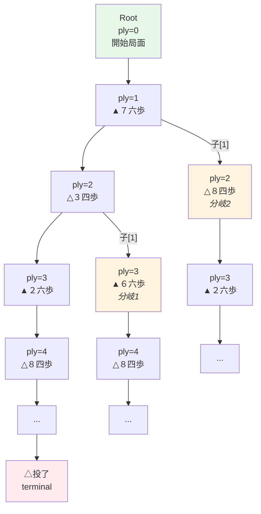

**本譜**はルートから各ノードの `children[0]`（最初の子）を辿った経路である。`children[1]` 以降が分岐を表す。`isMainLine()` は「親の最初の子であるか」で判定する。

#### TerminalType — 終局手の種類

**ソース**: `src/core/terminaltype.h/.cpp`

```cpp
enum class TerminalType {
    None,           // 通常の指し手
    Resign,         // 投了
    Checkmate,      // 詰み
    Repetition,     // 千日手
    PerpetualCheck, // 王手千日手
    Impasse,        // 持将棋
    Timeout,        // 時間切れ
    IllegalWin,     // 反則勝ち
    IllegalLoss,    // 反則負け
    Forfeit,        // 不戦敗
    Interrupt,      // 中断
    NoCheckmate,    // 不詰（詰将棋用）
    DeclarationWin, // 入玉宣言勝ち
    Draw,           // 引き分け
    MaxMoves,       // 最大手数到達
    Error,          // エラー
    ForfeitWin      // 不戦勝
};
```

終局手ノードは `isTerminal() == true` であり、盤面を変えない（局面SFENは直前の局面、`ShogiMove` は無効）。
終局の種類と終局語（「投了」など）の対応は名前空間 `TerminalTypes` の表1つにまとめている。
`label()` が棋譜に書く語、`displayLabel()` が表示言語に訳した語を返し、`fromWord()`・`findWord()` が語（「切れ負け」などの別表記を含む）から種類を判定する。

#### BranchLine — ライン情報

```cpp
struct BranchLine {
    int lineIndex = 0;                      // 0=本譜、1以降=分岐
    KifuBranchNode* leaf = nullptr;         // 終端のノード（手がなければルート）
    int branchPly = 0;                      // 分岐開始手数（本譜は0）
    KifuBranchNode* branchPoint = nullptr;  // 分岐点のノード（本譜は nullptr）

    QList<KifuBranchNode*> nodes() const;            // ルートから終端まで（呼ぶたびに作る）
    QList<KifuBranchNode*> nodesFrom(int fromPly) const;  // fromPly 手目から終端まで
    int length() const;                               // ルートから終端までのノードの数
};
```

ラインはノードの列を持たず、終端から親をたどって作る（手順ごとに列を持つと手数×変化の数のメモリになる）。変化の手だけが要るときは `nodesFrom(branchPly)` を使う。

`allLines()` で全ラインを取得でき、`exportLine(lineIndex)`（末尾の終局の行と開始局面のコメント・しおりを含む `RecordLine`。書き出し・CLI 用）/ `sfenListForLine(lineIndex)` でライン単位のデータ抽出が可能。

#### RecordLine — 手順の値

**ソース**: `src/kifu/recordline.h`（ヘッダオンリー）

1本の手順（開始局面と、指した手の行の並び）を表す値。末尾に終局行（投了など）を1つ持てる（`moveCount()` は終局行を数えない）。棋譜の読み込みで作る本譜・変化（8.4 の `KifParseResult`）、分岐ツリーで表示中の手順のスナップショット（検討・詰み探索・棋譜解析・定跡のマージ・読み筋の表示・書き出しに渡す）、対局中の手順（司令塔の `MatchCoordinator::record()`、通信対局の `CsaGameProgress::record`）のすべてに使う。局面列や指し手列を別々の一覧から探さずに、この値から取る。手順の型はこれ1つで、読み込み用の別の型は無い。

```cpp
struct RecordLine {
    QString startSfen;          // 開始局面（完全な SFEN）
    int startPly = 1;           // 最初の手の手数（変化は分岐した手の手数）
    QString openingComment;     // 開始局面のコメント（本譜だけ）
    QString openingBookmark;    // 開始局面のしおり（本譜だけ）
    QList<RecordEntry> entries; // entries[i] は i+1 手目（指した手と、その手の後の局面）。末尾は終局行のことがある
    int currentPly = 0;         // 表示中の手数（0 は開始局面）

    static RecordLine fromPositions(const QStringList& sfens, const QList<ShogiMove>& moves); // 局面列と指し手列から作る
    bool isEmpty() const;                         // 開始局面が無いか
    bool endsWithTerminal() const;                // 終局行で終わるか
    const RecordEntry* terminal() const;          // 終局行（なければ nullptr）
    int moveCount() const;                        // 指した手の数（終局行は数えない）
    QString sfenAt(int ply) const;                // ply 手目の後の局面（0 は開始局面）
    QString lastSfen() const;                     // 最後の局面
    QStringList sfens() const;                    // 開始局面と各手の後の局面
    QList<ShogiMove> moves() const;               // 各手
    QStringList displayTexts() const;             // 各手の棋譜欄の表記
    UsiMove usiMove(int ply) const;               // ply 手目の指し手
    QStringList usiMoves(int upToPly = -1) const; // upToPly 手目までの USI の指し手
    BoardSquare destinationOf(int ply) const;     // ply 手目の移動先
    RecordLine upTo(int ply) const;               // ply 手目までの手順（終局行は含めない）
    UsiPosition usiPosition(int ply) const;       // ply 手目の後の局面を、開始局面からの手順としてエンジンに送る値
};
```

`usiPosition(ply)` は開始局面と ply 手目までの手を `UsiPosition::fromMoves()` で `UsiPosition`（`src/core/usiposition.h`）にする（手順が無い・指せない手があれば空）。
`UsiPosition` は開始局面・指し手の列（position コマンドの moves）・指した後の局面（`position()`）・局面に至った直前の手（`lastMove()`）を持つ値で、
`command()` が平手なら `position startpos moves ...`、それ以外は `position sfen ... moves ...` を返す。kifu 層の `RecordLine` が作るので、engine 層ではなく core 層に置く。

| 取り出し方 | 中身 |
|---------|------|
| `KifuNavigationState::currentRecordLine()` | 表示中の手順（選んでいる分岐。対局中はライブの手も含む） |
| `KifuBranchTree::mainRecordLine()` | 本譜の手順 |
| `KifuBranchTree::toRecordLine(nodes, currentPly)` | 任意のノード列（static） |
| `KifuBranchTree::exportLine(lineIndex)` | ライン（終局行と開始局面のコメント・しおりを含む。書き出し・CLI 用。CLI の棋譜変換の本譜は `exportLine(0)`） |
| `MatchCoordinator::record()` | ローカル対局で指した手順 |
| `CsaGameProgress::record` | 通信対局で指した手順 |

棋譜の正本は分岐ツリーとそのカーソル（8.10）である。対局を始めるときは表示中の手順を `MatchStartOptions::recordLine` で司令塔に渡し、司令塔はその `currentPly` までを対局の手順にする（[指し手データ・棋譜データ構造](move-and-record-data-structures.md) の 4.4）。

#### KifuBranchTree の主要API

| カテゴリ | メソッド | 説明 |
|---------|---------|------|
| 構築 | `clear()` / `setRootSfen(sfen)` | ツリーを空にする／開始局面だけのツリーに作り直す（`reset`） |
| 構築 | `addRecord(parent, entry)` | 棋譜の1行（指した手か終局）のノードを parent の子の末尾に追加（`nodeAppended`）。本体のコードが手を足す唯一の入口（取り込み・対局・盤上の変化） |
| 構築 | `removeLeaf(node)` | 葉ノードの削除（葉に限った `removeSubtree()`。`subtreeRemoved`） |
| 構築 | `beginBatchUpdate()` / `endBatchUpdate()` | 一括更新の間は変更の知らせを遅らせ、最も外側の `endBatchUpdate()` で順に出す（作り直しを含めば `reset` 1回） |
| 検索 | `nodeAt(nodeId)` | IDで O(1) 検索 |
| 検索 | `findMatchingChild(parent, entry)` | 同じ手の子ノード（指し直しで再利用する） |
| ライン | `mainLine()` | 本譜のノード列を取得 |
| ライン | `pathToNode(node)` | ルートから指定ノードまでの経路 |
| ライン | `allLines()` | 全 `BranchLine` のリスト |
| ライン | `mainRecordLine()` | 本譜の手順（`RecordLine`、終局行を除く） |
| ライン | `toRecordLine(nodes, currentPly)` | ノード列を `RecordLine` にする（static） |
| ライン | `exportLine(lineIndex)` | ラインを `RecordLine` にする（終局行と開始局面のコメント・しおりを含む） |
| 分岐 | `hasBranch(node)` | 分岐の有無判定 |
| 分岐の編集 | `moveChild(child, index)` / `promoteToMainLine(node)` / `removeSubtree(node)` | 分岐の並べ替え・本譜にする・削除（`childrenReordered`・`subtreeRemoved`。利用者の操作と、待ったの後の並べ替え（`LiveGameSession`）） |
| コメント | `setComment(nodeId, comment)` | コメント設定 |
| 変更の版 | `revision()` | 構造変更のたびに増える値。棋譜の文書（`KifuDocument`）が保存した時点と比べて未保存かを決め、表示中の手（`KifuNavigationState`）が同じ構造をもう知らせたかを見るのに使う |

#### シグナル

| シグナル | 発火タイミング |
|---------|--------------|
| `nodeAppended(int parentId, int nodeId)` | 手 nodeId を parentId の子の末尾に足した（`addRecord`） |
| `childrenReordered(int parentId)` | parentId の子の並びを変えた（`moveChild`。`promoteToMainLine` では並びを変えた親のうち最もルートに近いもの。ライン番号が変わる） |
| `subtreeRemoved(int parentId, int nodeId)` | parentId の子 nodeId とその子孫を消した（`removeSubtree`・`removeLeaf`） |
| `reset()` | ツリーを作り直した（`clear`・`setRootSfen`、作り直しを含む一括更新） |

構造の変更はどれも、変わった所をノード ID で知らせる（ノード ID は同じツリーの寿命中は使い回さない）。知らせを出さない変更の関数は無い。一括更新の中の変更は `endBatchUpdate()` まで遅らせて起きた順に出し、作り直しを含むときは `reset()` を1回だけ出す。手の表記・コメント・しおりの変更は構造の変更ではなく、棋譜の文書（`KifuDocument::commentChanged` など）が知らせる。

受け手は必要なシグナルだけをつなぐ。表示中の手（`KifuNavigationState`）は4つすべてを受けて、手が消えていれば開始局面へ戻り、`changed()` を出す。分岐ツリーの図（`BranchTreeView`）は、`nodeAppended` で手順の末尾に1手足しただけならその手だけを描き足し、ほか（新しい変化・並べ替え・削除・作り直し）は作り直す。棋譜欄の分岐の印は `KifuDisplayPresenter` が4つを受けて描き直す。`LiveGameSession` は `subtreeRemoved`・`reset` だけを受けて、対局を始めた手が消えたら記録をやめる。`GameSession` は4つを受けて、中断した対局を再開できなくする。

テストで指し手を直接足す・本譜の N 手目や局面で手を探すときは、`tests/branchtree_test_util.h` の `TestTree::addMove()`・`addTerminalMove()`・`findByPlyOnMainLine()`・`findBySfen()` を使う（本体の `KifuBranchTree` には無い）。

### 8.3 KifuBranchTreeBuilder — ツリー構築

**ソース**: `src/kifu/kifubranchtreebuilder.h/.cpp`

フォーマット変換器のパース結果（`KifParseResult`）から `KifuBranchTree` を構築する静的ビルダークラスである。コンストラクタは private で、全メソッドが static。

#### 構築フロー

```
buildFromKifParseResult(tree, result, startSfen)
  │
  ├── 各変化の分岐元を検証                … variation.parentVariation が先に書かれた手順で、
  │                                       result.branchPoint(...) がその手順の分岐の手の前まで届くこと
  │                                       （不正なら false を返し、既存のツリーを変えない）
  ├── tree->beginBatchUpdate()
  ├── tree->clear()、tree->setRootSfen(startSfen)
  ├── addKifLineToTree(tree, mainline, {root})
  │     └── 本譜の各行を addRecord() で追加（開始局面のコメント・しおりはルートへ）
  ├── for each variation:
  │     ├── 分岐元の手順（本譜か先に追加した変化）の経路の先頭 startPly 個を取る
  │     │     （最後のノードが分岐点）
  │     └── addKifLineToTree(tree, variation.line, 経路)
  └── tree->endBatchUpdate()            … 作り直しを含むので reset を1回だけ発火
```

変化の親子関係はパース時に `KifVariation::parentVariation`（-1 は本譜、それ以外は先に定義された変化の番号）として持つため、ビルダーは手数や局面から分岐点を探し直さない。

### 8.4 KifParseTypes — 読み込み結果の型

**ソース**: `src/kifu/kifparsetypes.h`

フォーマット変換器が棋譜をパースした結果を格納する構造体群。手順は `RecordLine`（8.2。棋譜の1行 `RecordEntry` の並び）で持ち、局面列・指し手列・表示の表記は必要なときに行から作る。変化は分岐元（`KifBranchPoint`）と一緒に `addVariation()` で足す。棋譜の1行を文字列で持つ別の型は無い（棋譜欄の行そのものは、分岐ツリーのノードを行とする `KifuRecordListModel` が持つ）。

#### KifParseResult / KifVariation / KifBranchPoint

```cpp
struct KifVariation {
    int startPly = 1;            // 変化開始手数（「変化：65手」なら 65）
    RecordLine line;             // 変化の手順（line.startPly == startPly）
    int parentVariation = -1;    // 分岐元の手順。-1 は本譜、それ以外は variations の先行要素
};

struct KifBranchPoint {
    int parentVariation = -1;              // 分岐元の手順。-1 は本譜
    int startPly = 1;                      // 変化の最初の手の手数
    QString sfen;                          // 変化の最初の手を指す前の局面
    std::optional<UsiMove> previousMove;   // その局面に至った手（「同」の解決用。開始局面なら nullopt）
};

struct KifParseResult {
    RecordLine mainline;             // 本譜
    QList<KifVariation> variations;  // 変化リスト（書かれた順）

    const RecordLine& lineAt(int variation) const;                            // 手順（-1 は本譜）
    std::optional<KifBranchPoint> branchPoint(int parent, int startPly) const; // 手順 parent の startPly 手目の前の分岐元
    std::optional<KifBranchPoint> latestBranchPoint(int startPly) const;      // 「変化：N手」の分岐元（KIF・KI2・USEN）
    int firstPlyOf(int variation) const;                                      // 手順の最初の手の手数
    void addVariation(const KifBranchPoint& from, RecordLine line);           // 変化を足す
};
```

本譜の開始局面のコメント・しおりは `RecordLine::openingComment`・`openingBookmark` に入る。

#### KifuParseOutcome — 1回の解析の結果

形式ごとの `parse()` が返す値。棋譜・開始局面・手合割の名前・対局情報・警告を同じ解析で作る。`KifuLoadParser::parseContent()` がこれを `KifuLoadResult` に写す。

```cpp
struct KifuParseOutcome {
    bool success = false;
    KifParseResult record;
    QString initialSfen;               // 開始局面（record.mainline.startSfen と同じ）
    QString teaiLabel;                 // 手合割の名前（局面図なら "BOD"、USI・CSA は「平手」「局面指定」）
    QList<KifGameInfoItem> gameInfo;   // 対局情報（書かれた順）
    QString warning;                   // 警告（失敗したときは理由）
    QString positionOnly;              // 指し手のない局面だけの棋譜（USI・SFEN・BOD）の局面
};
```

#### ParseOptions / ParseReport — 読めない手の扱い

読めない手（表記が解釈できない・局面に合わない）・指せない手・パスをどう扱うかは、全形式で `ParseOptions` の1か所で決める。

| `ParseOptions::UnreadableMove` | 動き |
|------|------|
| `TruncateLine`（既定） | その手の手前で手順を打ち切り、警告に「何手目まで読んだか」を書いて読み込みを続ける |
| `FailRecord` | 棋譜全体を読めなかったことにする |

変換器は読み込み中に `ParseReport` を持ち、警告は `warn()`、読めない手は `rejectMove(ply, reason)`、パスは `rejectPass(format, ply)`、棋譜全体の失敗は `fail()` で記録する。`rejectMove()` は方針に従って、打ち切るなら警告に `truncationNotice(ply)`（`The record was read up to move N.`）を足して `true`、棋譜全体を失敗にしたなら `false` を返す。

#### KifGameInfoItem — 対局情報の1項目

**ソース**: `src/kifu/kifparsetypes.h`

棋譜ヘッダーの1項目（`key` 例: `"開始日時"`、`value` 例: `"2025/03/02 09:00"`）。形式ごとの `parse()` が `KifuParseOutcome::gameInfo` に入れ、棋譜の文書の対局情報（8.5）と棋譜出力（8.9 の `KifuExportMetadata::gameInfoItems`）で使う。

### 8.5 KifuDocument — 開いている棋譜の文書

**ソース**: `src/kifu/kifudocument.h/.cpp`、`src/kifu/matchtimerecord.h/.cpp`

開いている棋譜の文書（`QObject`）。書き出しと保存に使う情報をまとめて持つ。

| 持つもの | 内容 |
|---------|------|
| 分岐ツリー | 棋譜の正本（`tree()`）。オブジェクトは合成ルートが作って持ち、文書は非所有のポインタで受け取って中身を置き換える |
| 対局情報 | ヘッダー（`header()`。`QList<KifGameInfoItem>`）。対局情報欄（`GameInfoPane`）はこれを編集する画面 |
| 対局の記録 | 最後に始めた対局の対局者（`players()`。`MatchPlayers`）と、持ち時間・開始と終了の日時（`timeRecord()`。`MatchTimeRecord`） |
| ファイルの紐づけ | 上書き保存先（`filePath()`）と、保存した時点の状態 |

合成ルートは `createRecordAndModels()` で分岐ツリーの直後に文書を作る（`MainWindowComponents::document`）。

#### 置き換えの操作

新規・読み込み・局面の反映は、文書の中身を丸ごと置き換える。置き換えると前の棋譜の対局者・持ち時間・上書き保存先は消え、置き換えた内容を変更なしとする。前の対局の情報が読み込んだ棋譜に混ざることはない。

| メソッド | 使う場面 | 対局情報 |
|---------|---------|---------|
| `startNew(sfen, keepHeader = false)` | 新規・局面編集・連続対局の次局・通信対局の開始（`SessionResetCoordinator::resetToNewRecord()`） | 既定の項目（`defaultHeader()`。対局者は「先手」「後手」）。`keepHeader` なら今の対局情報を残す（通信対局の開始） |
| `replaceWithRecord(record, startSfen, header)` | 棋譜の読み込み（`KifuLoader`）。分岐元が不正ならツリーを変えずに false | 読んだ対局情報 |
| `replaceWithPosition(sfen)` | SFEN・BOD・指し手のない USI の読み込み、局面集から反映した局面 | 空 |

置き換えるたびに `headerReset(items, beforeMatchStart)` と `playersChanged()` を出す。

#### 対局の記録

| メソッド | 呼ぶ側 | 内容 |
|---------|-------|------|
| `beginMatch(players, timeControl, continuesRecord)` | `GameSession::beginMatchRecord()`（ローカル対局の `startGame()`・通信対局の `onCsaGameStarted()`） | 対局者と持ち時間を記録し、開始日時を今にする。対局情報を対局日・開始日時・対局者・手合割・持ち時間で作り直す（棋戦・場所・備考など利用者が入力した項目は残す）。読み込んだ棋譜の途中から続ける対局（`continuesRecord`）では、棋譜の対局情報を残して対局者名だけを書き換える |
| `recordMatchEnd()` | `GameSession::finishMatchRecord()`（ローカル対局・通信対局の終局） | 終了日時を記録して対局情報に書く |
| `clearMatchEnd()` | `GameSession::resumeInterruptedGame()` | 終了日時を消す（中断した対局を再開した） |

対局が書く値（終了日時・続けた対局の対局者名）は `headerValueSet(key, value)` で知らせ、保存した時点の内容にも書くので未保存に数えない。利用者が対局情報を編集していなければ、`beginMatch()` で作り直した対局情報も変更に数えない。

#### 対局情報

- 画面で入力中の編集（対局情報欄のセル・コメント欄の未更新の本文）は、上位層へのフック（Hooks パターン）`addPendingEditor(Hooks{commitPendingEdits, hasPendingEdits})` で編集する画面ごとに受け取る。合成ルートが `GameInfoPane`（`commitPendingEditor`・`hasPendingEditor`）と `CommentCoordinator`（`commitPendingComment`・`hasPendingComment`）を1つずつ足す。保存・書き出し・対局の開始の前に確定し、`isModified()` は未確定の編集も未保存に数える。`header()` は読むだけで確定しない
- `editHeader(items)` は利用者が対局情報欄で編集した内容を受け取る（`GameInfoPane::gameInfoEdited` から）
- `headerPlayerName(side)` は対局情報の対局者名（先手・後手。駒落ちは下手・上手。なければ省略名）。対局していないときの盤の対局者名（`PlayerInfoPresenter`）と棋譜解析の対局者名（`KifuAnalysisController`）に使う
- `usesHandicapNames()` は対局者を下手・上手と呼ぶか（駒落ちで、対局情報の見出しが下手・上手のとき）。司令塔の終局の知らせと入玉宣言の判定（`MatchCoordinator::usesHandicapNames()`）・利用者の入玉宣言の確認（`NyugyokuDeclarationHandler`。ローカル対局・通信対局で共通）・BOD のコピーが使う

#### 未保存の判定

`isModified()` は変更のたびに印を付けず、次のどれかで未保存とする。

1. ツリーの `revision()` が、保存（読み込み）した時点と違う（対局の手・待機中に盤で指した変化・分岐の編集はツリーを変える）
2. コメント・しおりの変更の回数が、保存した時点と違う
3. 対局情報が、保存した時点と違う
4. ファイルにない内容を読み込んだ（`markUnsavedContent()`。貼り付けた棋譜・自動化 API で反映した局面）

`markSaved(path)` は保存したとき・ファイルから読み込んだときに呼び、今の内容を保存した時点にして `saved()` を出す。保存形式を拡張子で決められるファイル（`KifuSaveFile::hasKnownSaveExtension()`）だけを上書き保存先にする（それ以外は「上書き保存」で名前を付けて保存へ誘導する）。

#### コメント・しおり

```
CommentCoordinator::onCommentUpdated(moveIndex, comment)  ← コメント欄（CommentEditorPanel）の更新
  │   コメント欄が編集しているのは表示中の手（KifuNavigationState::currentNode()）
  ▼
KifuDocument::setComment(node, comment)
  │
  ├── 内容が変わらなければ何もしない
  ├── node->record().comment = comment（分岐ツリーのノードに保存）
  └── コメントの変更の回数を増やして（未保存になる）commentChanged(nodeId, comment)
        ├── KifuRecordListModel::refreshNode（合成ルートが接続）… 棋譜欄の該当行を更新
        └── CommentCoordinator::showCurrentComment … コメント欄の本文と手数を更新
```

しおり（`setBookmark()` → `bookmarkChanged`）も同じ流れで、棋譜欄の該当行を更新する。

#### シグナルと画面とのつなぎ

`MainWindowComposer::connectRecord()`（`src/app/mainwindowcomposer_wire.cpp`）がつなぐ。対局情報欄（`GameInfoPane`）は文書の対局情報を編集する画面で、対局情報を自分では作らない。

| シグナル | つなぎ先 | 内容 |
|---------|---------|------|
| `headerReset(items, beforeMatchStart)` | `GameInfoPane::setGameInfo`・`PlayerInfoPresenter`（盤の対局者名） | 対局情報を置き換えた（`beforeMatchStart` なら対局を始める前の案内を出す） |
| `headerValueSet(key, value)` | `GameInfoPane::updateGameInfoValue` | 対局情報に自動で値を書いた（終了日時など） |
| `headerEdited()` | `PlayerInfoPresenter`（盤の対局者名） | 対局情報欄で対局情報を書き換えた（対局していなければ盤の対局者名を合わせる） |
| `playersChanged()` | `EngineDisplayPresenter`（自分でつなぐ。2つ目のエンジン欄・評価値グラフの系列名） | 対局者が変わった（対局の開始・棋譜の置き換え） |
| `commentChanged(nodeId, comment)` / `bookmarkChanged(nodeId, bookmark)` | `KifuRecordListModel::refreshNode`（コメントは `CommentCoordinator::showCurrentComment` も） | ノードのコメント・しおりが変わった |

逆向きに、`GameInfoPane::gameInfoEdited(items)` → `KifuDocument::editHeader` をつなぐ（表が変わるたびに文書へ入るので、未保存かは文書だけで決まる）。入力中の編集は `KifuDocument::Hooks`（`commitPendingEdits`・`hasPendingEdits`）に合成ルートが登録し、対局情報欄の入力中のセルとコメント欄の未更新の本文を、保存・書き出し・対局の開始の前に確定し、未保存に数える。

### 8.6 LiveGameSession — ライブ対局セッション

**ソース**: `src/kifu/livegamesession.h/.cpp`

進行中の対局（ローカル・通信）の手順を、分岐ツリーへ即時に書き、表示中の手（`KifuNavigationState`）を最新の手へ動かすセッション管理クラス。途中局面からの対局開始にも対応する。表示（棋譜欄・分岐・盤）は `KifuNavigationState::changed()` を受けた部品が合わせる。

#### commit/discard パターン

```
  startFromNode(branchPoint)          startFromRoot()
        │                                   │
        ▼                                   ▼
   ┌────────────────────────────────────────────┐
   │           m_active = true                  │
   │  ┌──────────────────────────────┐          │
   │  │ appendRecord(entry)          │ ← 繰返し │
   │  │ （終局の行も同じ経路）         │          │
   │  │ undoMoves(count)  … 待った    │          │
   │  └──────────────────────────────┘          │
   └────────────┬──────────────────┬────────────┘
                │                  │
         commit()             discard()
                │                  │
                ▼                  ▼
   ┌─────────────────┐  ┌──────────────────┐
   │対局を終える       │  │対局をやめる       │
   │足した手はツリーに │  │足した手はツリーに │
   │残る              │  │残る              │
   └─────────────────┘  └──────────────────┘
```

どちらもセッションの状態を戻して `activeChanged()` を出す。手は `appendRecord()` の時点でツリーに入っているので、`commit()` と `discard()` の違いは、`commit()` が最後の手のノードを返すことだけである。

#### 動作の詳細

1. **`startFromNode(branchPoint)`**: 途中局面から対局を開始。`branchPoint` が分岐の起点となる（`nullptr` なら開始局面。終局の行からは始められない。`canStartFrom()` で確かめる）
2. **`startFromRoot()`**: 開始局面から新規対局を開始
3. **`appendRecord(entry)`**: 棋譜の1行（`RecordEntry`）を履歴（`m_entries`）に記録しつつ、`KifuBranchTree::addRecord()` でツリーにも即座にノードを追加し、表示中の手をその行へ動かす（ツリーの更新とセッションの更新がそろってから通知が出るよう、一括更新で囲む）。同じ手の子が既にあれば `findMatchingChild()` で再利用し、重複した分岐を作らない。対局中は `MatchRecordSink` を実装する `GameSession::appendRecord()` から呼ばれる（ローカル対局・通信対局とも）
4. **終局の行**: 終局の `RecordEntry` を追加すると、以後 `canAddMove()` は `false` を返す
5. **`commit()`**: 対局を終える。最後の手のノードを返す（手が無ければ `nullptr`）
6. **`discard()`**: 対局をやめる。足した手はツリーに残る

#### 待った（undoMoves）

`undoMoves(count)` はセッションの履歴と現在位置（`m_liveParent`）を巻き戻すだけで、ツリーのノードは削除しない。取り消した手順は分岐として残る。
このセッションで追加した手順を取り消した場合は、その先頭ノードを `m_undoneNodeIds` に記録する。次に指した手（新規ノード・既存ノードの再利用・終局手のいずれも）が記録済みの兄弟より後ろにあれば、`appendRecord()` の一括更新の中で `KifuBranchTree::moveChild()` で前へ移す（`childrenReordered` は一括更新の終わりに届く）。
これにより、実際に指した手順が本譜側、取り消した手順が分岐側に並ぶ。以前の棋譜から再利用した手を取り消した場合は記録せず、以前の本譜の並びを保つ。
`canUndoMoves()` は対局開始位置（分岐起点・ルート）より前へは戻さない。

#### 途中局面からの分岐

`startFromNode(branchPoint)` で始めると、手順は分岐起点の子として追加される。起点の手数は `anchorPly()` が返す。棋譜の途中から続けた対局の情報は `setFirstMoveNote()` で、新しく作った最初の手のコメントに残す。消費時間の累計は `continuedTime()` で、棋譜上で同じ側が直前に指した手の累計に続ける。

#### 主要シグナル

| シグナル | 発火タイミング |
|---------|--------------|
| `activeChanged()` | 対局を始めた・終えた時 |

手の追加は、ツリーの `nodeAppended`（待ったの後の並べ替えでは `childrenReordered` も）と、表示中の手の `KifuNavigationState::changed()` で表示に伝わる。セッション自身は `subtreeRemoved`・`reset` だけを受け、対局を始めた手（`m_anchorNodeId`）がツリーから消えたら `discard()` する。

### 8.7 KifuLoader — 棋譜読み込みフロー

**ソース**: `src/kifu/kifuloader.h/.cpp`, `src/kifu/kifuloadparser.h/.cpp`, `src/kifu/kifuformat.h/.cpp`

棋譜ファイル・貼り付けたテキスト・SFEN の局面を読み、棋譜の文書（`KifuDocument`）を置き換える読み込み器（kifu 層。GUI に依存しない）。6つのファイル形式（KIF・KI2・CSA・JKF・USI・USEN）と、テキスト貼り付けによる自動判定読み込みに対応する。読む処理（`KifuLoadParser`）はワーカースレッドで行い、結果をメインスレッドで文書に載せる。コンストラクタで文書を受け取る（`KifuLoader(KifuDocument*)`）。

起動時に合成ルート（`MainWindowComposer`）が一度だけ作り（親は MainWindow）、以後のすべての読み込みに使う。`KifuFileController` は `Deps::loader` でポインタを受け取る。読み込み中に次の読み込みを始めると、前の読み込みは `KifuLoader` 自身が打ち切る（`CancelFlag`）。

#### 読み込みフロー

```
ユーザーがファイルを開く
  │
  ▼
loadFileAsync(filePath) / loadTextAsync(content)     ← KifuFileController から
  │   （同期版の loadFile / loadText / loadPositionFromSfen は自動化 API・テスト用。同じ applyLoadResult() を通る）
  ▼
KifuLoadParser::parseFile() / parseText()             ← 別スレッド（QtConcurrent::run）
  │   parseFile: ファイルを1回だけ読み（readFileText。文字コードは形式ごとに判別）、形式を KifuFormats::detectFile() で決める
  │   parseText: 形式を KifuFormats::detect() で判定
  │   → どちらも parseContent(content, format) が形式ごとの parse() を表（parserFor()）から選んで呼ぶ
  │     （KIF・KI2 は KifTextParser、BOD は KifTextParser::parseBod()。結果の KifuParseOutcome を写す）
  │   → KifuLoadResult { format, initialSfen, teaiLabel, gameInfo, record: KifParseResult（本譜 + 変化）, positionOnly, ... }
  ▼
onLoadFinished() → applyLoadResult(result)            ← メインスレッド
  │
  ├── 失敗 → errorOccurred(result.error)
  ├── positionOnly あり（SFEN・BOD・指し手のない USI）→ loadPositionFromSfen()
  │     └── KifuDocument::replaceWithPosition(sfen)（対局情報は空）
  └── applyRecord(result)
        ├── 指し手も局面図も無ければ errorOccurred
        └── KifuDocument::replaceWithRecord(record, initialSfen, gameInfo)
              ├── KifuBranchTreeBuilder::buildFromKifParseResult() でツリーを作り直す（変化の親子を先に検証）
              │     （beginBatchUpdate()/endBatchUpdate() で囲み、作り直しを含むので reset を1回だけ出す）
              └── 対局情報を読んだものにし、前の対局者・持ち時間・上書き保存先を消す（headerReset）
```

読み込みの結果は `loadFinished(bool)` で知らせる。上書き保存先と未保存の状態は `KifuFileController::finishLoad()` が決める（8.9）。

棋譜の正本は分岐ツリーで、読み込みは文書（分岐ツリーと対局情報）を作り直す。ツリーが変わると、表示中の手（`KifuNavigationState`）が開始局面へ戻って `changed()` を出し、棋譜欄・分岐候補・分岐ツリー・盤・コメント欄などは、それを受けて表示を作り直す（8.10）。対局情報は文書の `headerReset` で対局情報欄（`GameInfoPane::setGameInfo`）と盤の対局者名（`PlayerInfoPresenter`）に届く。対局の手順は、対局開始時に表示中の手順（`RecordLine`）から司令塔が作る（[対局開始フロー](game-start-flow.md)）。

#### テキスト貼り付け

`loadTextAsync(content)` / `loadText(content)` は `KifuLoadParser::parseText()` で、`KifuFormats::detect()`（`src/kifu/kifuformat.h`）により形式を自動判定し、適切な変換器にディスパッチする。SFEN・BOD は局面だけを読み込む（`positionOnly`）。

#### 分岐マーカー表示

棋譜欄の `KifuRecordListModel`（分岐ツリーのノードを行とするモデル。行は `setPath()` で表示中の手順のノード列に合わせる）が、行のノードに兄弟があるかで分岐の印を出す（`isBranchRow()`）。手順の行は `KifuDisplayPresenter` が `KifuNavigationState::changed()` を受けて合わせ、分岐の印はツリーの構造の変更（`nodeAppended`・`childrenReordered`・`subtreeRemoved`・`reset`）を受けて描き直す（`refreshBranchMarks()`）。

### 8.8 KifuSaveDialogs / KifuSaveFile / KifuIoService — 保存

**ソース**: `src/dialogs/kifusavedialogs.h/.cpp`（ダイアログ）、`src/kifu/kifusavefile.h/.cpp`（保存形式の判定と書き込み）、`src/kifu/kifuioservice.h/.cpp`（ファイル I/O）

保存は、ダイアログを出す部分（dialogs 層）と、ファイルに書く部分（kifu 層）に分かれている。ファイルに書く部分はダイアログを出さないので、GUI・自動化 API・CLI で共通に使う。

#### KifuSaveDialogs

棋譜の保存ダイアログと未保存の確認を担当する、静的な関数だけのクラス（翻訳の文脈は `KifuSaveDialogs`）。未保存の確認の見た目（「保存」「破棄」「キャンセル」）は定跡の未保存の確認と同じ `UnsavedChangesPrompt::ask()`（widgets）で出す。

| 関数 | 説明 |
|------|------|
| `saveViaDialog(parent, generateLines, defaultFileName, hasBranches, hasTimeInfo, outError)` | 保存ダイアログを出し、KIF（UTF-8 `.kifu`・Shift_JIS `.kif`）・KI2（`.ki2u`・`.ki2`）・CSA・JKF・USEN・USI のどれかで保存する。形式は選んだパスの拡張子で決まり、決まってから `generateLines(format)` でその形式の行だけを作る。分岐や消費時間を保存できない形式では、続けるか確認する |
| `overwriteExisting(parent, path, lines, outError)` | 既存ファイルへの上書き保存 |
| `confirmDiscardUnsaved(parent, isDirty, save)` | 未保存の変更があるとき、保存・破棄・キャンセルを確認する（`isDirty` には `KifuDocument::isModified()` を渡す） |

`saveViaDialog` は保存に成功した場合にファイルパスを返し、キャンセルまたはエラーの場合は空文字を返す。最後に保存したフォルダは `GameSettings::lastKifuSaveDirectory` に記録する。

#### KifuSaveFile

保存形式の判定とファイルへの書き出しを担当する名前空間（ダイアログを出さない）。

- **`saveFormatForPath(path)`**: 拡張子から `KifuFormat`（Kif / Ki2 / Csa / Jkf / Usen / Usi。保存できる形式かは `KifuFormats::isSavable()`）を決める（未知の拡張子は Kif）。`LineGenerator` は形式が決まってからその形式の行だけを作る関数
- **`pathForSelectedFilter(path, selectedFilter)`**: 拡張子のないパスに、選んだフィルタの拡張子を付ける
- **`hasKnownSaveExtension(path)`** / **`usesShiftJisForPath(path)`**: 保存形式として認識できる拡張子か、Shift_JIS で書く拡張子（`.kif`・`.ki2`）か
- **`write(path, lines, outError, allowUtf8)`**: 拡張子に応じた文字コードで書く。Shift_JIS で表せない文字があれば `allowUtf8` に聞き、許されれば UTF-8 で書く

#### KifuIoService

低レベルのファイルI/Oを担当する名前空間。

- **`makeDefaultSaveFileName(blackName, whiteName, now, extension)`**: 対局者名と日時から既定のファイル名（`日時_先手_vs_後手.拡張子`。名前が無ければ `日時_Session.拡張子`）を作る。GUI では対局情報の対局者名（`KifuDocument::headerPlayerName()`。駒落ちは下手・上手）を渡すので、読み込んだ・貼り付けた棋譜も対局者名の付いた名前になる。対局した棋譜は対局情報に対局者が入る
- **`charactersNotInShiftJis(text)`**: Shift_JIS で表せない文字を返す
- **`writeKifuFile(path, lines, errorText, useShiftJis)`**: 行リストをテキストファイルとして書き込む

### 8.9 KifuExport / KifuFileController — 書き出しとファイルの操作

**ソース**: `src/kifu/kifuexport.h/.cpp`、`src/kifu/kifuexportmetadata.h/.cpp`、`src/ui/coordinators/kifufilecontroller.h/.cpp`

#### KifuExport — 形式ごとの書き出しの表

棋譜を形式ごとの行にする名前空間（kifu 層）。書き出しは「分岐ツリーと書き出しの文脈から行を返す関数」を形式ごとに並べた表で選ぶ。GUI の保存・コピー（`KifuFileController`）、自動化 API の `kifu.get`、CLI の変換（`KifuConversionService`）が同じ表を使う。

| 関数 | 説明 |
|------|------|
| `metadataOf(document)` | 文書の書き出しの文脈（`KifuExportMetadata`：対局情報・開始局面・対局者・持ち時間・開始と終了の日時） |
| `lines(tree, metadata, format)` | `format` の行。表の関数を呼ぶ |
| `lines(document, format)` | `lines(*document.tree(), metadataOf(document), format)` |

表の関数は各 Exporter（`src/kifu/formats/`）の `static QStringList exportLines(const KifuBranchTree&, const KifuExportMetadata&)`。

| Exporter | 形式 | 分岐対応 | 備考 |
|---------|------|---------|------|
| `KifExporter` | KIF | あり | 日本将棋連盟標準形式。消費時間・コメント含む。SFEN・BOD を指定したときもこれ（棋譜を書けないため） |
| `Ki2Exporter` | KI2 | あり | 移動元座標省略形式。消費時間なし |
| `CsaExporter` | CSA | なし | コンピュータ将棋協会形式。本譜のみ |
| `JkfExporter` | JKF | あり | JSON棋譜フォーマット |
| `UsenExporter` | USEN | あり | URLセーフ短縮形式 |
| `UsiExporter` | USI | なし | position コマンド文字列。本譜のみ（`KifuBranchTree::mainRecordLine().usiMoves()`）。文字列は `UsiPosition::commandFor(startSfen, moves)`（`UsiPosition::command()` と共有） |

形式をまたいで共有する部品:

| 部品 | 使う側 | 内容 |
|------|--------|------|
| `KifExporter::appendHeaderLines(ctx, out, HeaderOptions)` | KIF・KI2 | 先頭（文字コード宣言・対局情報・平手でない開始局面の盤面図）。KI2 は `HeaderOptions::consumedTime = false` で消費時間を書かない。戻り値は駒落ちの呼び方（下手・上手）で書くか |
| `KifuNodeReplay`（`kifunodereplay.h`） | KI2・JKF | 手順のノードを指す前の局面と一緒にたどる。`board()`・`mover()`・`previousTo()`（「同」の判定）を読んで書き、`advance(node)` で進める。指せない手はノードの SFEN から局面を取り直す。変化は `branchFrom(parent)` の写しでたどる |
| `UsenCodec`（`usencodec.h`） | USEN の読み込み・書き出し | 指し手の3文字と `UsiMove`（`encodeMove`・`decodeMove`）・開始局面（`encodePosition`・`decodePosition`）・手順（`decodeLine`・`decodeLines`。"~" で1回だけ分けて、本譜と変化を `UsenLine{offset, moves, terminal}` にする） |
| `UsiPosition::commandFor(startSfen, moves)` | USI | 開始局面が空か平手なら `position startpos`、それ以外は `position sfen ...` |

#### KifuExportMetadata — 書き出しの文脈

UIウィジェットへの参照を含まない値。対局情報は書かれたとおりに書き、日時・持ち時間・対局者を作り出さない（CSA の `$START_TIME`・`$TIME` も対局情報の開始日時・持ち時間から書く）。`KifuExportMetadataBuilder` は手合割（`handicapLabel()`。開始局面から判定する）と対局者の見出し（`blackPlayerKey()`・`playerName()`）を共通に作る。

```cpp
struct KifuExportMetadata {
    QList<KifGameInfoItem> gameInfoItems;  // 対局情報
    QString startSfen;                     // 開始局面SFEN
    MatchPlayers players;                  // CSA の N+・N- の補い（対局情報に対局者が無いとき。名前が無ければ書かない）
};
```

GUI では `KifuExport::metadataOf()` が書き出すたびに文書（対局情報・分岐ツリーの開始局面・対局者）から組み立てる。CLI の変換は読み込んだ棋譜の対局情報と開始局面から作る。

#### KifuFileController — 開く・保存・貼り付け・コピー

開いている棋譜の文書（`KifuDocument`）とファイルをつなぐ ui 層のクラス。読み込み（ファイル・貼り付け・局面）と保存（名前を付けて・上書き・自動）と、棋譜・局面のクリップボードへのコピーを受け持つ。メニュー項目は `MenuActionsWiring`（`wireFileMenu`・`wireEditMenu`）がつなぐ。

```cpp
struct Deps {
    QWidget* parentWidget;                          // ダイアログの親（必須）
    KifuDocument* document;                         // 開いている棋譜（必須）
    KifuLoader* loader;           // 読み込み（全部の読み込みで1つを使い回す。必須）
    ShogiGameController* gameController;            // 盤（局面のコピー。必須）
    const KifuNavigationState* navState;            // 表示中の手（局面のコピー・現在の手までのコピー。必須）
    const AppActivityState* activity;               // 動作状態（棋譜を置き換えてよいかの判定。必須）
};
```

対局者・上書き保存先・開始局面は値を写さず、そのつど文書から読む。既定の保存ファイル名は文書の対局者（`KifuDocument::players()`）と日時から作る。

| カテゴリ | メソッド | 説明 |
|---------|---------|------|
| 読み込み | `chooseAndLoadKifuFile()` | ファイルを選び、未保存の確認をしてから非同期に読む（進捗ダイアログ） |
| 読み込み | `pasteKifuFromClipboard()` / `onKifuPasteImportRequested(content)` | 貼り付けダイアログを開く／取り込む |
| 読み込み | `onSfenCollectionPositionSelected(sfen)` | SFEN局面集で選んだ局面を反映する |
| 読み込み | `loadKifuFile(path)` / `loadKifuText(content)` / `applySfenPosition(sfen)` | 自動化 API 用（ダイアログなし・同期） |
| 保存 | `saveKifuToFile()` | 名前を付けて保存（`KifuSaveDialogs::saveViaDialog()`） |
| 保存 | `overwriteKifuFile()` | 上書き保存（上書き保存先が無ければ名前を付けて保存） |
| 保存 | `autoSaveKifu(dir, extension)` | 対局の終局時の自動保存（ローカル対局・通信対局とも `GameSession::finishMatchRecord()` から。同じ名前があれば連番を付ける） |
| 保存 | `saveKifuToPath(path, errorText)` | ダイアログを出さずに保存（自動化 API 用） |
| 確認 | `confirmDiscardUnsaved()` / `hasUnsavedChanges()` | 未保存の確認（`KifuDocument::isModified()`） |
| 出力 | `exportLines(format)` | `KifuExport::lines(*document, format)`（ファイルに書かない） |
| クリップボード | `copyKifToClipboard()` / `copyKi2ToClipboard()` / `copyCsaToClipboard()` / `copyJkfToClipboard()` / `copyUsenToClipboard()` / `copyUsiToClipboard()` | 棋譜全体を各形式でコピー（CSA・USI は本譜のみ） |
| クリップボード | `copyUsiCurrentToClipboard()` | USI形式（表示中の手順の現在の手まで）でコピー |
| クリップボード | `copySfenToClipboard()` / `copyBodToClipboard()` | 盤の局面を SFEN・BOD でコピー（BOD の下手・上手は `KifuDocument::usesHandicapNames()`） |

保存の形式はどれも拡張子で決める（`KifuSaveFile::saveFormatForPath()`）。保存に成功すると `KifuDocument::markSaved(path)` で今の内容を保存した時点にする。

読み込みの後始末（上書き保存先と未保存の状態）は、ダイアログからの非同期の読み込み（`KifuLoader::loadFinished` → `onAsyncLoadFinished()`）も自動化 API の同期の読み込みも、1つの関数 `finishLoad(success, source, path)` で行う。読み込んだものの出どころ（`Source`）で後始末が決まる。

| `Source` | 読み込んだもの | 後始末 |
|---------|-------------|-------|
| `File` | 棋譜ファイル | `markSaved(path)`（上書き保存先にし、変更なしとする） |
| `Text` | 貼り付けた棋譜 | `markUnsavedContent()`（未保存。上書き保存先なし） |
| `Position` | 自動化 API で反映した局面 | `markUnsavedContent()` |
| `Collection` | 局面集から反映した局面 | 何もしない（局面集に残っているので変更なし。上書き保存先なし） |

自動化 API のテキストの読み込み（`loadKifuText()`）は `finishLoad()` を通らず、`markUnsavedContent()` だけを直接呼ぶ（貼り付けダイアログとステータスバーの知らせは出さない）。

ステータスバーに出す知らせは `statusMessage(message, timeout)` で通知し、合成ルートが `QStatusBar::showMessage` につなぐ。

### 8.10 KifuNavigationState — ナビゲーション状態

**ソース**: `src/kifu/kifunavigationstate.h/.cpp`

`KifuBranchTree` 上の現在位置（棋譜のカーソル）と、分岐点での選択履歴を管理するクラス。表示中の手数は `currentPly()` だけが持ち、MainWindow は手数の変数を持たない。現在の手・手数・手順（ライン）・分岐候補は、すべてノード ID から導き、写しを持たない。変わるたびに `changed()` を1回出す。

#### 状態管理

```
KifuNavigationState
  │
  ├── m_currentNodeId        … 現在表示中のノードID（参照時に解決）
  └── m_selectedChildIds     … QHash<parentNodeId, childNodeId>
                               分岐点ごとに最後に選んだ子を記憶
```

#### 表示中の手順

選んだ子を記憶した経路（`selectedPath()`）が表示中の手順になる。記憶はノード ID で持つので、兄弟を並べ替えても選択した手順を辿り、分岐点より前に戻っても維持される。現在の行番号（`currentLineIndex()`）はこの経路から表示のたびに求める。`resetToNode(node)` / `goToRoot()` で選択記憶を消去して移る。

#### 分岐選択の記憶

```
手順例:
  1. 3手目で2番目の子（分岐）を選択
     → setCurrentNode(node) が開始局面から node までの経路を記憶する
  2. 1手目に戻る（setCurrentNode）
     → 戻った先より先の選択は残る
  3. 「進む」で3手目に到達
     → nextNode(node) が、選んだ子（なければ最初の子）を返す
     → 自動的に同じ分岐を選択
```

`setCurrentNode(node, lineEnd)` は `lineEnd`（`node` の子孫）までの経路を記憶し、分岐の手順を指定して移るときに使う。

#### 主要メソッド

| カテゴリ | メソッド | 説明 |
|---------|---------|------|
| 位置 | `currentNode()` | 現在のノードを取得 |
| 位置 | `currentPly()` | 現在の手数（表示中の手数）を取得 |
| 位置 | `currentSfen()` | 現在位置のSFENを取得（終局の行は直前の局面） |
| 手順 | `selectedPath()` | 開始局面から、選んだ子をたどった手順の終わりまで |
| 手順 | `currentLineIndex()` | 表示中の手順の番号（`allLines()` の添字） |
| 手順 | `isOnMainLine()` | 表示中の手順が本譜か |
| 手順 | `currentRecordLine()` | 表示中の手順（`RecordLine`。8.2 を参照） |
| 手順 | `nextNode(node)` | `node` の次に進む手（選んだ子。なければ最初の子） |
| 分岐 | `branchCandidatesAtCurrent()` | 表示中の手と同じ親を持つ手（分岐候補） |
| 分岐 | `offersBackToMainLine()` | 分岐候補欄に「本譜へ戻る」を出すか |
| 変更 | `setCurrentNode(node)` / `setCurrentNode(node, lineEnd)` | 移って経路を記憶する |
| 変更 | `resetToNode(node)` / `goToRoot()` | 選択を忘れて移る |

`KifuNavigationState` は変わったときだけ `changed()` を1回出す（ツリーを作り直して表示中の手が無くなったときは開始局面へ戻る）。カーソルを動かすのは `KifuNavigationController`（`navigation/`。ボタン・棋譜欄・分岐候補欄・分岐ツリー・評価値グラフからの移動。`goToPly()`・`goToNode()`・`goToPlyOnLine()` など）、`LiveGameSession`（対局中の最新手への追従）、`GameSession`（中断した対局の再開）、`BranchTreeEditController`（分岐の編集）などである。表示の更新は `changed()` を受けた部品が自分で行う。`KifuDisplayPresenter`（棋譜欄・分岐候補欄・分岐ツリー）、`BoardSyncPresenter`（盤と手番）、`CommentCoordinator`（コメント欄）、`EvaluationGraphPresenter`（評価値グラフ）、`AnalysisSession`（検討の追従）、`JosekiWindowController`（定跡ウィンドウ）が接続している。

### 8.11 フォーマット変換器一覧

`src/kifu/formats/` に配置された変換器群は、各棋譜フォーマットのテキストを統一的なインターフェースで読み込む。変換器は**テキストを読むだけ**で、ファイルは `KifuLoadParser` が文字コードを判別して読んで渡す。

| クラス | 入力形式 | 概要 | 分岐対応 |
|--------|---------|------|---------|
| `KifTextParser::parseKif` | KIF (.kif, .kifu) | 日本将棋連盟標準形式。移動元座標付き指し手、消費時間、コメント、BOD盤面図を解析（`KifTextParser` で読む） | あり |
| `KifTextParser::parseKi2` | KI2 (.ki2) | 移動元座標省略形式。盤面状態を追跡し「右」「左」「直」等の修飾語から移動元を推測（`KifTextParser` で読む） | あり |
| `CsaToSfenConverter` | CSA (.csa) | コンピュータ将棋協会形式。PI/P1..P9による初期局面、`+`/`-` による指し手、`$` による対局情報を解析 | なし |
| `JkfToSfenConverter` | JKF (.jkf) | JSON棋譜フォーマット。`header` / `initial` / `moves` の3セクション構造。分岐は `forks` 配列で表現 | あり |
| `UsenToSfenConverter` | USEN (.usen) | URLセーフ短縮形式。base36エンコードされた指し手列（3文字=1手。符号表は `UsenCodec`）。`~(startPly).` で分岐区切り | あり |
| `UsiToSfenConverter` | USI (.usi) | USI position コマンド文字列。`startpos moves ...` または `sfen ... moves ...` 形式 | なし |

終局語は `TerminalCodes`（`formats/terminalcodes.h`）、手合割の名前と開始局面は `Handicaps`（`core/handicaps.h`）の表を共有する。

#### 共通API

変換器は形式ごとに1つの関数だけを持つ（いずれも `static`）:

```cpp
// 本譜＋全変化・開始局面・手合割の名前・対局情報・警告を1回の解析で作る
static KifuParseOutcome parse(QStringView text, const ParseOptions& options = {});
```

`KifuLoadParser::parseContent()` は `KifuFormat` から関数を引く表（`parserFor()`）でこの `parse()` を選び、結果（8.4 の `KifuParseOutcome`）を `KifuLoadResult` に写す（貼り付けも同じ経路で、一時ファイルは作らない）。BOD（局面図だけのテキスト）は `KifTextParser::parseBod()` が読む。そのほかに公開している関数は、CSA の文字コード宣言を見てファイルを読む `CsaToSfenConverter::readFileText()` と、USEN の開始局面を読む `UsenToSfenConverter::initialSfenOf()` だけである（USEN の符号の復号は `UsenCodec::decodeMoves()`・`decodePosition()` が受け持つ）。USEN は対局情報を持たない。指し手のない USI・SFEN は `UsiToSfenConverter::parse()` が局面を `positionOnly` に入れる。CSA の手合割の名前（「平手」「局面指定」）も CSA の変換器が決める。

形式ごとの部品:

| 形式 | 読む部品 |
|------|---------|
| KIF・KI2 | `KifTextParser`（行の分類・変化の区切り・コメント・しおり・開始局面）、`KifMoveGrammar`（指し手の文法）、`KifLexer`（手数と消費時間の字句・BOD の局面図）、`Ki2Lexer`（KI2 の指し手の行・「まで…」の結果の行） |
| CSA | `CsaLexer`（`parseStartPos(lines, idx, Position&)` で開始局面、`parseMoveLine(line, mover, position, detail)` で指し手を `std::optional<UsiMove>` にする。盤は変えない） |
| JKF | `JkfMoveParser`（`toUsiMove()`・`notesOf()`・`timeOf()`） |

#### KifLineBuilder — 1本の手順の組み立て（全形式で共通）

**ソース**: `src/kifu/formats/kiflinebuilder.h/.cpp`

各形式のパーサは、読んだ順に次の関数を呼ぶだけにする。手を指したその場で局面（`Position`）を進めて `RecordEntry` を作るので、表示の指し手と USI の指し手を別々に積んで突き合わせることはない。手番・「同」の基準（直前の手）・両者の累計の消費時間はこの部品が持つ。

| 関数 | 内容 |
|------|------|
| `addMove(move, time, notes, rule)` | 手番側の手を指して1行足す。指せなければ（移動元が空・打つ駒がない）何も変えずに `false`。打つ駒が持ち駒にない手は既定で許す（`Position::DropRule::Lenient`。CSA は `RequireHand`） |
| `addTerminal(type, side, time)` | 終局の行を足す（表記は終局語の表から作る） |
| `appendComment(text)` / `appendBookmark(text)` | 最後の行にコメント・しおりを足す。手がまだなければ本譜は開始局面（`RecordLine::openingComment`・`openingBookmark`）、変化は最初の手のもの |
| `timeFor(side, elapsedMs, totalMs)` | 1手の消費時間から累計を足した `RecordTime` を作る（CSA の T 行・JKF の time） |
| `setLastTime(time)` | 最後の行の消費時間を置き換える（指し手の後に消費時間を書く形式） |
| `stop()` | 手順を打ち切る（読めない手の後。以降の手は足さない） |
| `lastError()` / `cannotRestore(format, ply)` | 指せなかった理由と、全形式で同じ文面の警告（`"KIF: Cannot restore move 3: Source square is empty: 7g7e"`） |
| `take()` | 組み立てた `RecordLine` |

棋譜欄の表記は、取り込んだ原文を写さず、いつも指し手と直前の手から `KifMoveText::format()` で作る。棋譜に書かれていた相対位置の修飾語・「不成」は `KifMoveText::Notes` で渡して残す。CSA・JKF の消費時間は `RecordTime::fromMilliseconds()` で作り、文字列を経由しない。

#### KIF・KI2 の共通の読み取り（KifTextParser）

**ソース**: `src/kifu/formats/kiftextparser.h/.cpp`、`src/kifu/formats/kifmovegrammar.h/.cpp`

`KifTextParser::parse(text, Dialect::Kif / Dialect::Ki2, options)` が両形式を読む。行の分類（ヘッダ・局面図・コメント `*`・しおり `&`）、「変化：N手」での区切り（分岐元は `KifParseResult::latestBranchPoint()`）、開始局面（BOD の局面図、なければ手合割と手番の行）、指し手の文法は共通である。行の形も、手数で始まる KIF の行と、手番の印で始まる KI2 の行をどちらの形式でも読む。形式（`Dialect`）で違うのは、KI2 の「まで77手で先手の勝ち」の結果の行を読むか、対局情報の終わり（最初の指し手の行）の見分け方、警告の見出し（`KIF:`・`KI2:`）だけである。

指し手の文字列は `KifMoveGrammar::parseMoveText()` で `MoveText`（移動先・「同」・駒・修飾語・成／不成・打・移動元 `from`）に分ける。KIF の手は「KI2 の手＋移動元の `(xy)`」なので同じ文法で読む。`KifMoveGrammar::resolve()` は、移動元か「打」が書いてあればそのとおりの手にし（反則手を書いた棋譜も読めるよう、局面とは照らさない）、どちらもなければ次の「KI2形式の移動元推測」で決める。

#### KI2形式の移動元推測

移動元の書かれていない手（KI2形式）は、局面を値（`Position`）で追い、各指し手で以下の処理を行う:

1. `KifMoveGrammar::parseMoveText()` で移動先（「同」）・駒・修飾語（「右」「左」「上」「引」「寄」「直」）・成／不成・打を分ける
2. `Ki2MoveNotation::resolve()` で、局面の合法手（`EngineMoveValidator::legalMoves()`）のうち同じ駒が移動先へ動く手を修飾語で1つに絞る。
   ピンされた駒は合法手に入らないので候補にならない。合法手で決まらない手（二歩・王手放置などの反則手を書いた棋譜）だけは、
   駒の動きだけで決めた手（`EngineMoveValidator::pseudoLegalMoves()`）から選ぶ
3. 決まった `UsiMove` を `KifLineBuilder::addMove()` で局面に適用し、棋譜の1行を作る

書き出し（`Ki2Exporter`）は、分岐ツリーのノードの手（`ShogiMove::move` の `UsiMove`）と局面（`KifuNodeReplay` でたどる指す前の局面）から `Ki2MoveNotation::format()` で
KI2 の文字列を作る。本譜と変化の指し手の行は同じループ（`appendKi2Moves`）で書く。修飾語は日本将棋連盟の棋譜の表記方法に合わせる（動作の上・引・寄を優先し、区別できなければ右・左。
金・銀が真っ直ぐ上がるときは直。飛・角・竜・馬は直を使わない。3枚以上は「左上」のように位置・動作の順）。

### 8.12 補助クラス

#### KifuFormat

**ソース**: `src/kifu/kifuformat.h/.cpp`

棋譜の形式を表す enum `KifuFormat`（Kif / Ki2 / Csa / Jkf / Usi / Usen / Sfen / Bod）。読み込み・保存・変換で共通の1つの enum を使う。名前空間 `KifuFormats` が判定を受け持つ。

| 関数 | 説明 |
|------|------|
| `detect(content)` | テキストの内容から形式を判定する（分からなければ Kif） |
| `detectFile(filePath)` | ファイルの形式。拡張子で決まらないときは内容から判定する |
| `fromPath(path)` | 拡張子から形式を求める |
| `fromName(name)` / `name(format)` | 形式の名前（`"kif"` など。CLI・自動化 API の引数）との変換 |
| `isSavable(format)` | 棋譜ファイルとして保存できる形式か |

棋譜の読み込み（`KifuLoadParser`・`KifuFileController`）と棋譜の変換（`KifuConversionService`）で使う。

#### KifReader

**ソース**: `src/kifu/kifreader.h/.cpp`

棋譜ファイルを文字コード（BOM・UTF-8・CP932・EUC-JP の順）を自動判別して読み込む名前空間（判別の `decodeAuto()`、`readAllLinesAuto()`・`readAllTextAuto()`・`splitLines()`）。`KifuLoadParser::readFileText()` が CSA 以外の形式で使い、CSA も文字コードの宣言が無ければ `decodeAuto()` を使う。Shift_JIS の変換は `ShiftJisCodec`（`src/kifu/shiftjiscodec.h`）が受け持つ。

#### ShogiInfoRecord

**ソース**: `src/models/shogiinforecord.h/.cpp`

USIエンジンの思考情報（時間・深さ・ノード数・評価値・読み筋）を1レコードとして保持する値クラス。kifu層ではなく models 層にあり、7.8節で説明している。

<!-- chapter-8-end -->

---

<!-- chapter-9-start -->
## 第9章 analysis層：解析機能

analysis層（`src/analysis/`）は、USIエンジンを用いた局面・棋譜の解析機能を提供するレイヤーである。**検討（Consideration）**・**棋譜解析（KifuAnalysis）**・**詰将棋探索（TsumeSearch）** の3つのモードを持ち、それぞれ異なるユースケースに対応する。

analysis層にはダイアログを知らない部分（`AnalysisSession`・`AnalysisJob`・詰将棋の生成など）を置く。ダイアログを出してモードを始める部分は `src/ui/controllers/` の `ConsiderationUiController`（検討タブの操作）・`KifuAnalysisController`（棋譜解析）・`TsumeSearchController`（詰み探索）、1局面の結果を表の1行にする部分（`AnalysisResultHandler`）は `src/ui/presenters/`、結果のドックの中身（`AnalysisResultsPanel`）は `src/widgets/`、結果のモデル（`KifuAnalysisListModel`）は `src/models/` にある。

### 9.1 3モードの比較

| 項目 | 検討（Consideration） | 棋譜解析（KifuAnalysis） | 詰将棋探索（TsumeSearch） |
|------|----------------------|------------------------|--------------------------|
| **目的** | 現在の1局面をリアルタイムで深く分析する | 棋譜の指定範囲を1手ずつ自動解析し、各手の評価値と候補手を算出する | 現在の局面から詰み手順を探索する |
| **動作状態**（`AppActivityState::Activity`） | `DuringConsideration` | `DuringAnalysis` | `DuringTsumeSearch` |
| **USIコマンド** | `go infinite`（時間指定があればタイマーで `stop`） | `go infinite` + タイマーで `stop`（1手あたり固定時間） | `go mate <time>` / `go mate infinite` |
| **エンジン管理** | `AnalysisSession`（エンジンの枠 E1 を対局と共有） | `AnalysisJob` が、`KifuAnalysisController` の渡した枠 E1 の `Usi` を使う | `AnalysisSession`（検討と同じ） |
| **結果表示** | 検討タブにリアルタイム表示、盤面に矢印オーバーレイ | 結果一覧テーブル（ドックウィジェット）、評価値グラフ | 詰みの有無のメッセージ（思考情報は E1 の表示にも出る） |
| **MultiPV** | 対応（複数候補手を同時表示、検討中に変更可） | 送らない（エンジン設定で MultiPV を2以上にしていても、結果は最善の読み筋（multipv 1）で決める） | 非対応（1手順のみ） |
| **開始・操作** | `ConsiderationUiController` | `KifuAnalysisController` + `AnalysisJob` | `TsumeSearchController` |
| **結果の表示部品** | `ConsiderationPanel`（`EngineDisplayPresenter` が状態を設定）・`CandidateArrowPresenter` | `AnalysisResultsPanel` | なし（結果はメッセージで知らせる） |

### 9.2 全体構成

```
┌─────────────────────────────────────────────────────────────────────────┐
│  ui/controllers・ui/presenters・widgets                                  │
│                                                                         │
│  ConsiderationUiController   検討タブの操作（開始・中止・条件の変更）    │
│  EngineDisplayPresenter      検討タブの実行の状態・情報欄・検討の表      │
│  TsumeSearchController       詰み探索の条件ダイアログと開始              │
│        │                                                                │
│        └── AnalysisSession::start(AnalysisOptions)                       │
│                                                                         │
│  KifuAnalysisController      棋譜解析の条件ダイアログ・進み具合の表示    │
│        ├── KifuAnalysisRowPresenter 1局面の結果を表の1行に（ui/presenters）│
│        └── AnalysisResultsPanel   結果ドックの中身（widgets/）           │
│        │ 所有                                                           │
├────────┼────────────────────────────────────────────────────────────────┤
│  analysis 層（src/analysis/）                                           │
│        ▼                                                                │
│  AnalysisJob                      AnalysisSession                       │
│   1回の棋譜解析                    検討・詰み探索のセッション            │
│   └ PlyAnalysisCollector           開始・停止・やり直しの状態遷移        │
│     info から1局面の結果を作る      エンジンは E1 の枠に作る             │
│        │                               │                                │
│        └────────── 使うエンジン（Usi） ┘                                │
│                                                                         │
│  game 層の EngineLifecycleManager（枠 E1・E2）がエンジンを持つ           │
│  models/ の KifuAnalysisListModel … 解析結果の8列テーブルモデル          │
└─────────────────────────────────────────────────────────────────────────┘
```

### 9.3 AnalysisJob — 棋譜解析1回の進行

**ソース**: `src/analysis/analysisjob.h`, `src/analysis/analysisjob.cpp`

`AnalysisJob` は、1回の棋譜解析の入力（`AnalysisRequest`）・進行・エンジンの利用期間を受け持つ。エンジンは所有せず、`Deps::engine` で渡された `Usi` を借りて使う。解析する局面は、手順 `RecordLine` の各局面から作る `QList<UsiPosition>`（`[ply]` ごとに、その局面の SFEN とそこに至った手）である。局面だけを送り（`position sfen ...`）、そこに至った手は読み筋の「同」の判定と盤の強調に使う。画面の応答を待たずに進む。

#### AnalysisRequest 構造体

```cpp
struct AnalysisRequest {
    struct Options {
        int startPly = 0;       ///< 解析を始める手数（0以上）
        int endPly = -1;        ///< 解析を終える手数（-1 は末尾まで）
        int movetimeMs = 1000;  ///< 1局面の思考時間（ms）
    };
    RecordLine line;
    Options options;
    QString enginePath;
    QString engineName;
    int lineEndNodeId = -1;   // 解析する手順の末尾の手（ノード ID）。-1 は棋譜を移さない
    QSet<int> branchPlies;
};
```

解析した手順は末尾の手のノード ID で覚える（`allLines()` の番号は分岐を足す・本譜にする・並べ替えると変わる）。結果の行・グラフの点から棋譜を移すときは `KifuNavigationController::goToPlyOnLine(lineEndNodeId, ply)`（`KifuBranchTree::nodeOnLine()` で末尾から ply 手目までさかのぼる）を使い、手順が消えていれば移らない。

解析はいつも範囲の局面を順に調べる。`start()` が範囲を手順の手数に収める（終わりの -1 は末尾まで）。

#### 1手の解析サイクル

```
start() → Usi::startEngine(path, name)（起動できなければ、戻った後に Usi::errorOccurred → onError）
  ▼ Usi::engineInitialized
analyzePly(startPly)
  │
  ├── PlyAnalysisCollector::begin(ply, positions[ply])
  ├── emit plyStarted(ply)
  └── Usi::search(UsiSearchRequest)
        position + go infinite を送り、movetimeMs 経過後に stop を送る
  ▼ UsiProtocolHandler::infoReceived
onInfo() → PlyAnalysisCollector::addInfo(info)
  ▼ UsiProtocolHandler::bestMoveReceived
onBestMove()
  ├── emit plyAnalyzed(PlyAnalysisCollector::finish(bestMove))
  ├── 次の手あり → analyzePly(ply + 1)
  └── endPly まで終えた → Usi::quit()、emit finished(true)
```

`stop()` とエンジンのエラー（`onError()` → `stop()` → `errorOccurred`）は `finished(false)` を出す。

#### PlyAnalysis と PlyAnalysisCollector

1局面の結果 `PlyAnalysis` は bestmove の時点で1回だけ作る。

| フィールド | 内容 |
|---|---|
| `ply` | 手数 |
| `score` | 評価値（`UsiBestMove::score`。その局面の手番側から見た値。定跡は None） |
| `pv` | 最善の読み筋（`PvText`。解析した局面の上で指した手と、指せなかった語） |
| `book` | info が1つも届かずに bestmove が届いた（定跡） |

`PlyAnalysisCollector`（Qt のイベントループを知らない）は、1局面の info のうち最善の読み筋（multipv 1）の最後の行を覚え、`finish(bestMove)` で `PlyAnalysis` にする。エンジン設定で MultiPV を2以上にしていても、結果は最善の読み筋で決める。読み筋は探索した局面の上でここで指す（`PvText::play`）ので、思考情報の表示（`ThinkingInfoFormatter`）の接続の順序に頼らない。info 行の解釈は `UsiLineParser`（第7章）が行い、このクラスは行を読み直さない。

#### シグナル一覧

| シグナル | 発火タイミング | 受け手 |
|---------|--------------|------|
| `plyStarted(ply)` | 局面の解析を始めた | `KifuAnalysisController::onPlyStarted`（前の局面の評価値をグラフに足し、解析中の手へ棋譜欄を移す） |
| `plyAnalyzed(PlyAnalysis)` | bestmove を受けた | `KifuAnalysisController::onPlyAnalyzed`（`KifuAnalysisRowPresenter::append()` で表に1行足す） |
| `finished(completed)` | 解析を終えた（`completed`: 範囲の全局面を解析した） | `KifuAnalysisController::onFinished` |
| `errorOccurred(message)` | エンジンのエラー | `KifuAnalysisController::onEngineError` |

### 9.4 検討モードの開始と AnalysisSession

**ソース**: `src/ui/controllers/considerationuicontroller.h/.cpp`（開始）、`src/analysis/analysissession.h/.cpp`（セッション）、`src/analysis/analysisoptions.h`

検討モード（Consideration）は `AnalysisJob` を使わず、検討のセッション `AnalysisSession` が1つのエンジンで局面を調べる。棋譜解析との大きな違いである。
検討タブの開始/中止のボタン（検討していないとき）→ `ConsiderationPanel::startConsiderationRequested` → `ConsiderationUiController::startConsideration()` の順に呼ばれ、ここで検討タブの設定（`ConsiderationPanel::settings()`。`ConsiderationSettings`）から `AnalysisOptions` を作って `AnalysisSession::start()` に渡す（タブのシグナルは `ConsiderationUiController` が自分でつなぐ）。

#### 検討モードの開始フロー

```
ConsiderationUiController::startConsideration()
  │
  ├── 1. バリデーション
  │     ├── session / navState / 検討タブが無い → return
  │     ├── エンジンの破棄中（AnalysisSession::isShutdownInProgress） → 無視
  │     └── 検討タブの設定（settings().engineName）でエンジンが選ばれていない → ErrorBus でエラー通知して return
  │
  ├── 2. エンジンパス取得
  │     └── RegisteredEngines::load() の登録一覧から
  │         検討タブで選んだ名前でエントリを引く（見つからない・パスが空ならエラー）
  │
  ├── 3. 検討する局面の決定
  │     └── KifuNavigationState::currentUsiPosition()
  │           表示中の手順（currentRecordLine()）から
  │           検討する局面（UsiPosition。直前の手を含む）を決める
  │
  ├── 4. 秒読み設定
  │     └── ConsiderationSettings::byoyomiMs()（無制限なら 0、そうでなければ秒 × 1000）
  │
  └── 5. AnalysisSession::start(AnalysisOptions)
        検討タブ・思考タブの表示は、探索が始まったとき（considerationSearchStarted）に
        EngineDisplayPresenter が切り替える
```

#### AnalysisOptions 構造体

```cpp
struct AnalysisOptions {
    enum class Mode { Consideration, Tsume };

    Mode     mode = Mode::Consideration;
    QString  enginePath;                ///< エンジン実行ファイル
    QString  engineName;                ///< 表示用エンジン名
    UsiPosition position;               ///< 探索する局面（そこに至った直前の手は読み筋の「同」の判定に使う）
    int      byoyomiMs = 0;             ///< 0=無制限、>0=ms
    int      multiPV   = 1;             ///< MultiPV（候補手の数）
};
```

#### 検討モードと対局エンジンの関係

検討のセッション `AnalysisSession` は、対局の司令塔と同じエンジンの枠（`EngineLifecycleManager` の E1）にエンジンを作り、そのリース（`EngineLease`）を持つ（`acquire(this, 1, std::nullopt, name)`。対局と検討は同時には動かない）。開始すると動作状態を `DuringConsideration`（詰み探索は `DuringTsumeSearch`）にし、`Usi::startEngine()` でエンジンを起動してから（起動の失敗は戻った後に `onEngineError` で届くので、開始中の状態や失敗の覚え書きは持たない）、検討なら `Usi::startConsideration()`（position・MultiPV の setoption・`go infinite`、時間指定があればタイマーで `stop`）、詰み探索なら `Usi::startMateSearch()` で探索を始める。
探索が終わると次の局面を待つ（`considerationWaitingStarted`）。局面や候補手の数が変わると探索をやり直し（`updatePosition()`・`updateMultiPV()`。やり直しの前に `considerationResultsCleared` で検討の表を消す）、`stop()` で自分のリースだけを手放して `considerationModeEnded` を出す（検討・詰み探索をしていなければ何もしない。ほかの処理のエンジンには触れない）。ほかの処理（棋譜解析・対局など）が枠を取ったときは `EngineLifecycleManager::engineRevoked` を受けて（`onEngineRevoked()`）同じく `stop()` で終える。検討中に表示中の手が変わったときは、`AnalysisSession` 自身が `KifuNavigationState::changed` を受けて `followDisplayedPosition()` で検討をやり直す（9.5 参照）。

### 9.5 ConsiderationUiController — 検討モードのUI制御

**ソース**: `src/ui/controllers/considerationuicontroller.h`, `src/ui/controllers/considerationuicontroller.cpp`, `src/widgets/considerationpanel.h`, `src/widgets/considerationsettings.h`, `src/ui/presenters/enginedisplaypresenter.h`

検討タブ（`ConsiderationPanel`）の操作を検討のセッション（`AnalysisSession`）へ伝えるだけのコントローラである。検討の表示（ボタン・経過時間・情報欄・検討の表）と矢印には触れない。合成ルートが起動時に1つだけ作る（`MainWindowComponents::considerationUi`）。

検討の状態は次の3か所に分けて持つ。

| 何を | 正本 | 説明 |
|------|------|------|
| 検討の条件（エンジン・時間・候補手の数・矢印） | `ConsiderationPanel::settings()`（`ConsiderationSettings`） | 利用者が変えると保存して `settingsChanged` を出す。ウィジェットはこの値を出すだけ |
| 検討中かどうか | `AnalysisSession::isConsidering()` | 表示・矢印・コントローラはここだけを見る |
| 検討タブの実行の状態 | `ConsiderationPanel::RunState`（`Idle`・`Running`・`Waiting`） | `EngineDisplayPresenter` がセッションの知らせから `setRunState()` で設定する |

#### UI状態遷移

```
（開始/中止のボタン。RunState が Idle なら startConsiderationRequested、それ以外は stopConsiderationRequested）

startConsiderationRequested → ConsiderationUiController::startConsideration()
  │ settings() から AnalysisOptions を作り AnalysisSession::start(AnalysisOptions)
  ▼
AnalysisSession::considerationSearchStarted → EngineDisplayPresenter
  │ E1 の読み筋を検討の表へ（UsiModelBinding::setConsideration）、検討タブと思考タブの情報欄に E1 のモデル、
  │ setRunState(Running)（ボタンは「検討中止」、経過時間を数え直す）
  │
  ├── （ユーザーが棋譜ナビゲーション）
  │     └── KifuNavigationState::changed → AnalysisSession::followDisplayedPosition()
  │           updatePosition() で検討する局面を切り替え
  │
  ├── （ユーザーが検討の条件を変更） settingsChanged → ConsiderationUiController::onSettingsChanged()
  │     ├── エンジンが変わった → 中止して新しいエンジンで始め直す
  │     └── 候補手の数が変わった → AnalysisSession::updateMultiPV()
  │
  ├── considerationWaitingStarted → setRunState(Waiting)   … 時間切れで次の局面を待つ（経過時間を止める）
  │
  └── stopConsiderationRequested → AnalysisSession::stop()
        considerationModeEnded → EngineDisplayPresenter が setRunState(Idle)（ボタンを「検討開始」に戻す）
```

#### 矢印表示のロジック

検討の矢印は `CandidateArrowPresenter`（`src/ui/presenters/candidatearrowpresenter.h/.cpp`。合成ルートが盤に対して1つ作る）が描く。検討中かどうかは `AnalysisSession::isConsidering()` から、読み筋は `Deps::consideration`（検討の表のモデル）から、表示するかは `Deps::considerationSettings`（検討タブの設定の正本 `ConsiderationPanel::settings()` を指す。`showArrows`）から読む。検討の開始・終了、モデルの変化、検討タブの `settingsChanged` で描き直す。

```
CandidateArrowPresenter::refresh()
  │
  ├── 検討中でない → 対局中のエンジンの候補手（設定で表示する場合）を描く
  │
  └── 検討中で矢印表示が有効
        │
        └── 検討モデル（ShogiEngineThinkingModel）の各行をイテレーション
              │
              ├── 行の基準局面が盤の局面と違う行は飛ばす
              ├── 読み筋（USI）の最初の指し手を読む
              │
              └── arrowForMove(move, baseSfen, priority) で Arrow を作る（priority は multipv）
                    ├── multipv 1: QColor(255, 0, 0, 200)   — 最善手（濃い赤）
                    └── multipv 2+: QColor(255, 100, 100, 150) — 次善手以降（薄い赤）
```

#### 棋譜ナビゲーション中の検討位置更新

ユーザーが棋譜欄・ナビゲーションボタン・分岐ツリーで局面を移ると、表示中のノードを持つ `KifuNavigationState` が `changed()` を出す。`AnalysisSession` はこれを `followDisplayedPosition()` で受け、検討中なら表示中のノードの SFEN と、局面に至った手（実際の指し手のとき）から `UsiPosition::fromSfen(node->sfen(), lastMove)` を作って `updatePosition()` を呼ぶ。同じ局面（`UsiPosition` の値の比較）なら何もせず、違えば検討の表を消して探索をやり直す。やり直しのたびに `considerationSearchStarted` が出て、`EngineDisplayPresenter` が検討タブを `Running` にし直すので経過時間が数え直される。
検討の開始時は `KifuNavigationState::currentUsiPosition()` が表示中の手順（`currentRecordLine()`）から検討する局面（`UsiPosition`。読み筋の「同」の判定に使う直前の手を含む。ツリーが空なら平手）を決める。

### 9.6 KifuAnalysisController — 棋譜解析の全体フロー

**ソース**: `src/ui/controllers/kifuanalysiscontroller.h/.cpp`、`src/analysis/analysisjob.h/.cpp`（1回の解析）、`src/ui/presenters/kifuanalysisrowpresenter.h/.cpp`（結果の表の1行）

棋譜解析モードの全体ワークフローを管理するコントローラである。ダイアログ表示から、解析ジョブ（`AnalysisJob`）の起動、結果のモデルへの蓄積、評価値グラフ・棋譜欄への反映、完了通知までの全工程を統括する。評価値グラフの点は、局面の結果を受けたときではなく次の局面の解析を始めたとき（`plyStarted`）か解析を終えたときに足す（`m_pendingPlot`）。合成ルートが起動時に1つ作り（`MainWindowComponents::kifuAnalysis`）、メニュー「棋譜解析」は `MenuActionsWiring` が `showDialogAndStart()` へ、「解析中止」は `stop()` へつなぐ。

- **`AnalysisJob`**（analysis 層）: 1回の解析の入力（`AnalysisRequest`：手順 `RecordLine`・範囲と思考時間 `AnalysisRequest::Options`・エンジンのパスと名前・解析する手順の末尾の手 `lineEndNodeId`）・進行・エンジンの利用期間を持つ。`AnalysisJob::Deps::engine` で渡された `Usi` を借りて使う（9.3）
- **`KifuAnalysisRowPresenter`**（ui/presenters）: 1局面の結果（`PlyAnalysis`）を `append()` で結果の表の1行にし、先手から見た評価値を返す（評価値グラフの点に使う）。候補手は前の行の読み筋の最初の手で、前の行の局面に至った手と同じマスへの手は `KifMoveText::format` が「同　」と書く

#### Deps 構造体（主要メンバー）

| メンバー | 型 | 必須 | 説明 |
|---------|-----|------|------|
| `parentWidget` | `QWidget*` | — | 条件ダイアログの親 |
| `activity` | `AppActivityState*` | 必須 | 解析中は `DuringAnalysis` にする |
| `analysisModel` | `KifuAnalysisListModel*` | 必須 | 結果蓄積用モデル |
| `resultsPanel` | `AnalysisResultsPanel*` | 任意 | 結果の表（無ければ自分で作る）。初めて解析するときに `setModel(analysisModel)` で1度だけモデルを結ぶ |
| `resultsDock` | `QDockWidget*` | 任意 | 結果の表のドック。解析を始めたときに表示して前に出す |
| `engines` | `EngineLifecycleManager*` | — | 解析のエンジンを置く枠 E1 |
| `navState` | `const KifuNavigationState*` | — | 解析する手順（表示中の手順）とその末尾の手（`AnalysisRequest::lineEndNodeId`）、分岐がある手（`AnalysisRequest::branchPlies`。結果の表で棋譜欄と同じ印を付ける） |
| `pvBoards` | `PvClickController*` | — | 結果の行のダブルクリックで読み筋盤を開く（`showPvBoard()`。対局者名・盤の向きは思考の表と同じ規則） |
| `navController` | `KifuNavigationController*` | — | 解析中・結果の行を選んだ手へ棋譜を移す（`goToPlyOnLine`） |
| `evalChart` | `EvaluationChartWidget*` | — | 評価値グラフ（点のクリックで解析結果の行へ移る） |
| `evalGraph` | `EvaluationGraphPresenter*` | — | 評価値グラフの点（解析した局面の評価値を足す） |
| `engine` | `Usi*` | 任意 | 使うエンジン（テスト用。無ければ解析ごとに枠 E1 に作る） |

エラーは `ErrorBus` で知らせる（コールバックは持たない）。

#### 棋譜解析の全体シーケンス

```
showDialogAndStart()
  │
  ├── 1. KifuAnalysisDialog を表示（モーダル）
  │     ├── エンジン選択（EngineSelector。選んだエンジンは dialog.engine()）
  │     ├── 解析範囲（開始手〜終了手。手数の上限は line.moveCount()）
  │     └── 1手あたりの思考時間
  │
  └── 2. requestFromDialog(dialog) → AnalysisRequest を組み立てて start(request)
        │
        ├── 解析範囲を手順の手数に収める、前回の解析を止めて結果・評価値グラフをクリア
        ├── resultsDock を表示して前に出す、resultsPanel->beginAnalysis()
        ├── 枠 E1 に Usi を作ってリースを持ち（acquire(this, 1, ...) → m_lease）、AnalysisJob を作成
        ├── ジョブのシグナルを接続
        │     ├── plyStarted → onPlyStarted
        │     ├── plyAnalyzed → onPlyAnalyzed
        │     ├── errorOccurred → onEngineError
        │     └── finished → onFinished
        ├── KifuAnalysisRowPresenter を作る（参照: モデル・手順・分岐がある手）
        ├── 動作状態を DuringAnalysis にする
        └── AnalysisJob::start() → Usi::startEngine(path, name)
              │   （起動の失敗は戻った後に errorOccurred → onEngineError で届く。同期の失敗の分岐はない）
              ▼ （以下、AnalysisJob の解析サイクル。9.3 参照）
              ┌─────────────────────────────────────────┐
              │ plyStarted(ply) → onPlyStarted()         │
              │   前の局面の評価値（m_pendingPlot）を    │
              │   評価値グラフへ足し、                   │
              │   解析中の手へ棋譜欄・盤を移す           │
              ├─────────────────────────────────────────┤
              │ plyAnalyzed(PlyAnalysis)                 │
              │   → onPlyAnalyzed()                      │
              │   KifuAnalysisRowPresenter::append()     │
              │   → KifuAnalysisListModel に1行追加      │
              │   先手から見た評価値を m_pendingPlot へ  │
              └─────────────────────────────────────────┘
              （startPly〜endPly まで繰り返し）
              │
              ▼
        onFinished(completed)
          └── 最後の評価値をグラフへ足し、停止ボタン無効化、
              正常完了なら完了表示、動作状態を Idle に戻す
```

#### append() — 1局面の結果を表に足す

`KifuAnalysisRowPresenter::append(const PlyAnalysis&)` は `plyAnalyzed` のたびに呼ばれ、1局面の結果を `KifuAnalysisRow`（`src/models/kifuanalysisrow.h`）の値にして `KifuAnalysisListModel::appendRow()` で足し、先手から見た評価値を返す（定跡・評価値なしは None）。返した評価値は `KifuAnalysisController` が覚えておき、次の局面の解析を始めたときに評価値グラフへ足す。

| 処理 | 説明 |
|------|------|
| 定跡手判定 | `PlyAnalysis::book`（info を1件も受け取らずに `bestmove` が来た）なら評価値なし・読み筋なしにし、行の `book` を立てる（表は読み筋の欄に表示言語の「（定跡）」を出す） |
| 評価値符号反転 | 局面の手番が後手（SFEN の手番が `w`。局面がなければ奇数手）の場合、エンジンの評価値（`PlyAnalysis::score`。手番側から見た値）の符号を反転して先手基準に統一 |
| 詰み表示 | 評価値が詰みなら `UsiScore` が持つ。表示の `"mate N"` 形式への変換は `KifuAnalysisListModel::evaluationText` |
| 読み筋 | `PlyAnalysis::pv`（`PvText`）をそのまま行に入れる。表記は表のモデルが表示のたびに作り、読み筋盤面ダイアログにも同じ値を渡す |
| 候補手抽出 | 前行の読み筋の最初の指し手を候補手として設定（前行の局面がこの手の前の局面と同じときだけ） |
| 「同」表記 | 候補手の移動先が直前の手の移動先と同じなら「同　」と書く |
| 評価値差 | 直前の数値の評価値との差分を計算（比較できなければ `-`） |

#### PV盤面ダイアログ

結果テーブルの「盤面」列（列6）をクリックすると `AnalysisResultsPanel::rowDoubleClicked` から `KifuAnalysisController::onResultRowDoubleClicked()` が呼ばれ、行の読み筋と、その局面に至った手で `PvClickController::showPvBoard()` が `PvBoardDialog`（`src/dialogs/`）を開く（思考・検討の表と同じ開き方。定跡の行は開かない）。このダイアログは、その局面のSFENから読み筋の指し手を順に再生できるミニ盤面ビューアである。

### 9.7 TsumeSearchController — 詰将棋探索

**ソース**: `src/ui/controllers/tsumesearchcontroller.h`, `src/ui/controllers/tsumesearchcontroller.cpp`

詰将棋探索モードのコントローラである。現在の局面を `go mate` コマンドで解析し、詰み手順を探索する。探索そのものは検討と同じ `AnalysisSession` が行う。メニュー「詰み探索」は `MenuActionsWiring` が `showDialogAndStart()` へつなぐ。

#### 探索開始フロー

```
showDialogAndStart()
  │
  ├── 1. 探索する局面（UsiPosition）の構築
  │     └── positionForMate()
  │           ├── 途中局面（line.currentPly > 0）→ line.usiPosition(ply)
  │           │     └── 送るのは "position startpos moves 7g7f 3c3d ..." 形式
  │           └── 開始局面・手順なし → TsumePositionUtil::buildPositionForMate(sfen) を UsiPosition::parse()
  │                 └── 送るのは "position sfen ..." 形式（玉の有無から攻方を決めて手番を合わせる）
  │           空なら ErrorBus で警告して return
  │
  ├── 2. TsumeShogiSearchDialog を表示（モーダル）
  │     ├── エンジン選択（EngineSelector。選んだエンジンは dialog.engine()）
  │     └── 探索時間設定
  │
  └── 3. ダイアログを閉じてから、次のイベントループで AnalysisSession::start(AnalysisOptions)
              ├── mode = AnalysisOptions::Mode::Tsume
              ├── enginePath, engineName
              ├── position    ← 構築した局面
              └── byoyomiMs   ← 探索制限時間（0 = 無制限）
```

`AnalysisSession` はエンジンを起動してから `Usi::startMateSearch(position, ms)` で探索を始め、結果（下表）を受けると `stop()` でエンジンを破棄し、`messageRequested` で結果を知らせる（`MainWindowComposer` が `NotificationPresenter::showInformation` につなぐ）。

#### USIコマンドの違い

通常の解析が `go infinite` + タイマーで `stop` を送信するのに対し、詰将棋探索は `go mate <time>`（時間指定なしは `go mate infinite`）を使用する。エンジンは以下の応答を返し、`UsiProtocolHandler::checkmateReceived` が `UsiCheckmate` として `AnalysisSession::onCheckmate` に渡す。`AnalysisSession` は思考情報を E1 の表示に出すため `MateOracle`（9.11）ではなく `Usi` を使うが、答えの解釈は同じ `MateAnswer::fromCheckmate()` で行う（stop の後の応答は `Unknown`）。

| 応答 | 意味 | `UsiCheckmate::Result` | `MateAnswer::Kind` |
|------|------|------------------------|--------------------|
| `checkmate <moves>` | 詰み発見、手順を返す | `Mate` | `Mate` |
| `checkmate nomate` | 不詰（詰みなし） | `NoMate` | `NoMate` |
| `checkmate notimplemented` | go mate 未対応 | `NotImplemented` | `Unsupported` |
| `checkmate timeout` など | 時間内に判定できない | `Unknown` | `Unknown` |

#### 探索する局面の構築戦略

`TsumeSearchController::Deps` は `parentWidget`・`navState`（`KifuNavigationState`。表示中の手順と局面）・`session`（`AnalysisSession`）を持つ。`positionForMate()` は2つの方式を持つ。

1. **moves形式（途中局面）**: `line.currentPly > 0` のとき、`RecordLine::usiPosition(ply)` で開始局面からの指し手列の局面にする（送るのは `"position startpos moves 7g7f 3c3d ..."`、平手以外の開始局面は `"position sfen ... moves ..."`）。エンジンが局面の履歴情報（千日手判定等）を利用できる。

2. **SFEN形式（開始局面）**: 開始局面（詰将棋の問題など）や手順が無いときは、`TsumePositionUtil::buildPositionForMate(sfenLike)` が1つの局面（`line.startSfen`、手順が無ければ `navState->currentSfen()`）から `"position sfen <sfen>"` を作り、`UsiPosition::parse()` で読む。玉の有無から攻方を推定し、手番を合わせる。

### 9.8 AnalysisResultsPanel — 解析結果の表示

**ソース**: `src/widgets/analysisresultspanel.h`, `src/widgets/analysisresultspanel.cpp`

棋譜解析結果を表示するドックの中身である。`QWidget` の派生で、部品はコンストラクタで作る。列幅管理、自動スクロール、フォントサイズ調整を担当する。合成ルートが作った `AnalysisResultsPanel` を、`DockRegistry`（`ui/coordinators/dockregistry.h`）がそのままドックに入れる。結果のモデルは `setModel(KifuAnalysisListModel*)` で1度だけ結ぶ（同じモデルなら何もしない）。自分の入ったドックは知らず、表示もしない。解析を始めたときにドックを出して前に出すのは `KifuAnalysisController`（`Deps::resultsDock`）である。

#### UIコンポーネント構成

```
QDockWidget
  └── AnalysisResultsPanel（QWidget）
        └── QVBoxLayout
              ├── QHBoxLayout
              │     ├── QPushButton "解析中止"
              │     ├── ElideLabel   (エンジン名)
              │     ├── QPushButton "A-"  (フォント縮小)
              │     └── QPushButton "A+"  (フォント拡大)
              ├── QHBoxLayout
              │     ├── QLabel       (状態の説明)
              │     └── QProgressBar (解析の進捗)
              ├── PvTableView（読み筋の表。TableHeaderView を見出しに使う）
              │     ├── 交互行色、単一選択
              │     ├── EvaluationColumn・DifferenceColumn: NumericRightAlignCommaDelegate（数値右寄せ）
              │     ├── BoardColumn: TableButtonDelegate（「表示」ボタン。思考タブと共通）
              │     └── PvColumn: PvTextDelegate（読み筋）
              └── QLabel（評価値の見方などのヒント）
```

#### 解析中の動作制御

| 状態 | 行の選択 | 自動スクロール | 「表示」ボタン | 停止ボタン |
|------|------------|--------------|--------------|----------|
| 解析中（`RunState::Running`） | 知らせない | 最後に確定した行を選んで見せる | クリック無効 | 有効 |
| 解析を終えた（`Stopped`・`Completed`）・解析前（`Idle`） | `rowSelected` で知らせる | なし | クリック有効 | 無効 |

表の選択モードは常に `SingleSelection` である。解析中は、行が足されるたびに `onRowsInserted()` が最後に確定した行を選んでスクロールする。解析中は選択の変更（`onTableSelectionChanged()`）も盤面列のクリック・Enter（`PvTableView::boardRequested` を受ける `onBoardRequested()`）も無視し、`rowSelected`・`rowDoubleClicked` を出さない。棋譜は解析の進み具合に合わせて `KifuAnalysisController` が移す。解析の進みは `RunState{Idle, Running, Stopped, Completed}` 1つで持ち、`beginAnalysis()` で解析中、`finishAnalysis(completed)` で中止か完了にする（進み具合の文・中止ボタンもこの値で決まる）。

#### 列幅の自動調整

`reflowNow()` は間隔0の単発タイマー（`m_reflowTimer`）で遅延実行され、モデル変更のバーストに対して効率的にリフロー処理を行う。各列に最小幅（列0: 140, 列1: 120, 列2: 50, 列3: 85, 列4: 110, 列5: 85, 列6: 60）を設定し、利用者が調整した列幅は保つ。列幅は広がる一方なので、足した・変わった行だけを測る。

#### フォントサイズの永続化

A-/A+ ボタンで8pt〜24ptの範囲でフォントサイズを調整でき、変更のたびに `AnalysisSettings::kifuAnalysisFontSize`（`KifuAnalysis/fontSize`）へ保存される。大きさは `FontSizeHelper` が持ち、ボタンは `FontSizeControl` で結ぶ。未保存のときは 10pt から始め、範囲外の保存値は 8〜24 に収める。列幅は、見出しの `TableHeaderView::sectionResizedByUser`（利用者がドラッグしたときだけ）を受けて `AnalysisSettings::kifuAnalysisColumnWidths()` / `setKifuAnalysisColumnWidths()` で保存・復元する。ドックの位置・大きさ・浮動・表示は、ほかのドックと同じく `DockRegistry::saveStates()` が `DockSettings::setDockState()` で保存し（グループは `KifuAnalysisResultsDock`）、起動時に `DockRegistry::createAll()` が `DockSettings::dockState()` から戻す。

### 9.9 KifuAnalysisListModel — 解析結果テーブルモデル

**ソース**: `src/models/kifuanalysislistmodel.h`, `src/models/kifuanalysislistmodel.cpp`

`QAbstractTableModel` の派生の8列テーブルモデルである。解析結果の各行を `KifuAnalysisRow` の値で持ち、`appendRow()` で末尾に足し、`clear()` で消す。`row(int)` は指定行を返す（範囲外は nullptr。行を足す・消すまで有効）。手・候補手・読み筋の表示は表記の設定に合わせてモデルが作り、`KifuPresentation::revision()` が変わるまで覚えておく。

#### 列定義

列は `KifuAnalysisListModel::Column` で表す（パネルも列番号を直接書かずにこの enum を使う）。

| 列（`Column`） | ヘッダー（日本語） | ヘッダー（英語） | データソース | 配置 |
|----|------------------|-----------------|-------------|------|
| 0 `MoveColumn` | 指し手 | Move | `move`（表記の設定に合わせる） | 左寄せ |
| 1 `CandidateColumn` | 候補手 | Candidate | `candidateMove`（表記の設定に合わせる） | 左寄せ |
| 2 `MatchColumn` | 一致 | Match | `matchesCandidate()` | 中央 |
| 3 `EvaluationColumn` | 評価値 | Eval | `evaluationText()`（`evaluation` の `UsiScore`） | 右寄せ |
| 4 `JudgementColumn` | 形勢 | Judgment | `judgementText()` で計算 | 左寄せ |
| 5 `DifferenceColumn` | 評価値差 | Diff | `evaluationDifference`（比べられなければ `-`） | 右寄せ |
| 6 `BoardColumn` | 盤面 | Board | 固定文字列 "表示" | — |
| 7 `PvColumn` | 読み筋 | PV | `pv`（表記の設定に合わせる） | 左寄せ |

#### 一致判定

実際の指し手と候補手が同じかは、表記の文字列ではなく、指し手の USI（`lastUsiMove`）と候補手の USI（`candidateUsi`）が等しく、かつ指す前の局面（`beforeSfen`）と候補手の局面（`candidateSfen`）が同じかで判定する（`KifuAnalysisRow::matchesCandidate()`）。一致していれば "◯" が表示される。

#### judgementText() — 形勢判断

先手から見た評価値（`UsiScore`）から形勢判断の文字列を生成する静的メソッド。

```
|score| <= 100  → "互角"             （Even）
|score| <= 300  → "[side]：やや有利"  （Slightly better）
|score| <= 600  → "[side]：有利"     （Better）
|score| <= 1000 → "[side]：優勢"     （Superior）
|score| > 1000  → "[side]：勝勢"     （Winning）
詰み            → "先手勝ち" / "後手勝ち"（Checkmate win）
```

`[side]` は "先手" または "後手" であり、評価値の符号で判定する（正=先手有利、負=後手有利）。評価値がない（定跡・未取得）ときは空文字列を返す。表示用の評価値は `evaluationText()` が作り、centipawn はそのまま、詰みは `"mate N"`、ないときは `-` とする。

#### KifuAnalysisRow — 結果の1行

**ソース**: `src/models/kifuanalysisrow.h`

1局面の解析結果を持つ構造体（QObject ではない）。`KifuAnalysisRowPresenter` が作り、作った後は変えない。表示する文字列（表記の設定に合わせた手・読み筋、`"mate 3"`・形勢）は表のモデルが作る。

| フィールド | 型 | 説明 |
|-----------|-----|------|
| `move` | `QString` | 指した手（棋譜の表記 `RecordEntry::displayText`。手数・分岐の印は表が付ける） |
| `branch` | `bool` | 指した手に分岐がある（棋譜欄と同じ印を付ける） |
| `book` | `bool` | 定跡（読み筋の代わりに「（定跡）」を出す） |
| `lastUsiMove` | `QString` | 指した手（USI。読み筋の盤で強調する） |
| `beforeSfen` / `sfen` | `QString` | 指す前の局面・指した後の局面（読み筋の始まり） |
| `evaluation` | `UsiScore` | 先手から見た評価値（定跡・未取得は None） |
| `evaluationDifference` | `std::optional<int>` | 直前の解析局面からの評価値の増減（比べられなければ nullopt） |
| `pv` | `PvText` | 読み筋（表記は表のモデルが作る。PvBoardDialog にもこの値を渡す） |
| `candidateMove` / `candidateUsi` / `candidateSfen` | `QString` | 候補手（直前の行の読み筋の最初の手）の漢字表記・USI・指す局面 |

### 9.10 エンジン管理の違い：AnalysisSession 経由 vs 直接 Usi

analysis層の機能は、エンジンの使い方が2つに分かれている。

```
検討モード / 詰将棋探索
  │
  └── ConsiderationUiController / TsumeSearchController
        → AnalysisSession::start(AnalysisOptions)
                          │
                          └── EngineLifecycleManager の枠 E1 に Usi を作って起動
                              go infinite / go mate を送信

棋譜解析モード
  │
  └── KifuAnalysisController → AnalysisJob
        │
        ├── 枠 E1 に作った Usi を AnalysisJob::Deps で渡す（借用。リースは KifuAnalysisController が持つ）
        ├── 局面ごとに Usi::search（position + go infinite、思考時間で stop）を頼む
        └── 独自の position/go infinite/stop サイクルを実行
```

**検討・詰将棋探索**: `AnalysisSession` が、対局の司令塔（`MatchCoordinator`）と共有するエンジンの枠（`EngineLifecycleManager` の E1）でエンジンを管理する。対局と同じ枠を使うため、エンジンの起動・初期化・シャットダウンが統一されており、思考情報・通信ログも E1 のモデルに出る。対局と検討は同時には動かない（`AnalysisSession` は始めるときに枠のエンジンを破棄し、ほかの持ち主には `engineRevoked` で知らせる。自分の枠をほかの処理に取られたら `engineRevoked` を受けてセッションを終える）。

**棋譜解析**: 複数局面を逐次解析する必要があり、`AnalysisJob` が独自の position/go/stop サイクルを制御する。エンジンは `KifuAnalysisController` が枠 E1 に作ってリースを持ち（`acquire(this, 1, ...)`）、`AnalysisJob` に渡す（テストでは `Deps::engine` で注入できる）。検討・対局などに枠を取られたら `engineRevoked` を受けて（`onEngineRevoked()`）解析を止める。`AnalysisJob` は解析が終わると `Usi::quit()` でエンジンを終わらせ、思考情報・通信ログの表示は枠 E1 の持ち主が結ぶ。

### 9.11 詰みの問い合わせ（MateOracle）と詰将棋の生成

**ソース**: `src/engine/mateoracle.h/.cpp`、`src/engine/matequeryloop.h/.cpp`、`src/analysis/tsumecandidatejob.h/.cpp`、`src/analysis/tsumeverificationjob.h/.cpp`、`src/analysis/tsumeshogigenerator.h/.cpp`

思考の表に出さない詰みの問い合わせは `MateOracle`（エンジン1台。`UsiEngineSession` を持つ）に頼み、答えを `MateAnswer`（`Mate`・`NoMate`・`Unknown`・`Unsupported` と手順）で受ける。打ち切りの方針（制限時間＋5秒で stop を送り、その後3秒答えなければ `timedOut`）は `UsiSearchRequest::mate()` の1か所で決める。

| 使う部品 | 問い合わせ方 |
|---|---|
| `MateSearchRunner`（CLI の詰み探索） | `ask()` を1回。答えの種類は `kindName()` で `mate`・`nomate`・`unknown`・`notimplemented` にする |
| `TsumeVerificationRunner`（CLI の余詰検査） | `TsumeVerificationJob` を `MateQueryLoop` で回す |
| `TsumeshogiGenerator`（詰将棋の生成） | 候補ごとに `TsumeCandidateJob` を `MateQueryLoop` で回す。生成器は候補の待ち行列・問い合わせの中継・結果の集計（重複の除外・上限・進捗）だけを行う |
| `TsumeMateEngine`（詰将棋の判定） | `askWithin()`（`go mate infinite` を期限まで待ち、stop は送らない） |

`TsumeCandidateJob`（手数の確認 → 唯一解の検査 → 駒の除去 → 除いた局面の検査 → 採択／棄却）と `TsumeVerificationJob`（総予算と1回1秒の上限つきの唯一解の検査）は引き出し型の問い合わせ元 `MateQuerySource`（`nextQuery()`・`submit(answer, elapsedMs)`・`isDone()`）で、Qt のイベントループもエンジンも知らない。テスト（`tests/tst_tsumeshogi_verification.cpp`）は代用エンジンの答えで直接進める。手順と採択条件は [詰将棋局面自動生成機能](tsumeshogi-generator.md) を参照。

<!-- chapter-9-end -->

---

<!-- chapter-10-start -->
## 第10章 UI層：プレゼンテーション

`src/ui/` 配下には、MainWindow からビジネスロジックを分離するための3カテゴリのクラス群（Presenters・Controllers・Coordinators）が配置されている。本章ではそれぞれの役割分担と、各クラスの責務を解説する。シグナルの接続は、メニュー・ツールバーの `QAction` をつなぐ `MenuActionsWiring`（`src/app/`）と、合成ルート `MainWindowComposer` の `connect*()` が受け持つ（10.4 節）。

### 10.1 3カテゴリと接続の役割分担

UI層は **Presenters**（データ→表示変換）、**Controllers**（UIイベント処理）、**Coordinators**（複数オブジェクト間の調整）の3カテゴリと、**Wiring**（シグナル/スロット接続の一括管理。`src/app/` と合成ルート）で構成される。

```mermaid
graph TB
    subgraph UI層
        direction TB

        subgraph Presenters["Presenters（9種）"]
            direction LR
            P1[BoardSyncPresenter]
            P2[KifuDisplayPresenter]
            P3[PlayerInfoPresenter]
            P4[TimeDisplayPresenter]
            P5["... 他5種"]
        end

        subgraph Controllers["Controllers（16種）"]
            direction LR
            C1[BoardMoveController]
            C2[ConsiderationUiController]
            C3[KifuAnalysisController]
            C4[PvClickController]
            C5["... 他12種"]
        end

        subgraph Wiring["Wiring"]
            direction LR
            W1[MenuActionsWiring]
            W2["MainWindowComposer::connect*()"]
        end

        subgraph Coordinators["Coordinators（11種）"]
            direction LR
            Co1[DialogLauncher]
            Co2[KifuLoader]
            Co3[CsaGameSession]
            Co4[UiStatePolicyManager]
            Co5["... 他7種"]
        end
    end

    Model["Model層\n(GameController, MatchCoordinator,\nKifuDocument 等)"]
    View["View層\n(ShogiView, RecordPane,\nThinkingPanel 等)"]
    MW["MainWindowComposer"]

    Model -->|データ変更| Presenters
    Presenters -->|表示更新| View
    View -->|ユーザー操作| Controllers
    Controllers -->|状態変更| Model
    Wiring -.->|connect()| Presenters
    Wiring -.->|connect()| Controllers
    MW -->|起動時に生成| Wiring
    MW -->|起動時に生成| Coordinators
    Coordinators -->|複数オブジェクト調整| Presenters
    Coordinators -->|複数オブジェクト調整| Controllers
```

数は `src/ui/` の各ディレクトリのヘッダーの数である。

#### 各カテゴリの責務

| カテゴリ | 責務 | 方向 | 典型的なパターン |
|---------|------|------|----------------|
| **Presenters** | Model のデータを View に反映する | Model → View | `syncToCurrentNode()`, `refresh()` |
| **Controllers** | UI イベントを受け取り、Model の状態を変更する | View → Model | `playMove()`, `onPvRowClicked()` |
| **Wiring** | シグナル/スロット接続を一括で行う | 横断的 | `MenuActionsWiring::wire()`, `connectRecord()` |
| **Coordinators** | 複数オブジェクト間の複雑な調整を行う | 横断的 | `startGame()`, `loadFileAsync()` |

### 10.2 Presenters — データの表示変換

Presenters は「Model → View」の単方向データフローを担当する。Model 側のデータ変更を受け取り、対応する View ウィジェットに反映する。

#### 一覧

ソースはすべて `src/ui/presenters/` にある。

| Presenter | ソース | 責務 |
|-----------|--------|------|
| `BoardSyncPresenter` | `boardsyncpresenter.h` | 盤面表示の同期。表示中の手の局面を盤に合わせ、その手をハイライトする |
| `KifuDisplayPresenter` | `kifudisplaypresenter.h` | 棋譜欄・分岐候補欄・分岐ツリーに、表示中の手と手順を映す |
| `PlayerInfoPresenter` | `playerinfopresenter.h` | 盤の対局者名を出す（対局中は対局者、対局していなければ対局情報の名前） |
| `TimeDisplayPresenter` | `timedisplaypresenter.h` | 対局時計の表示。残り時間の表示と、秒読み時の緊急表示を行う |
| `EvaluationGraphPresenter` | `evaluationgraphpresenter.h` | 評価値グラフの点（`EvaluationSeries`）を持つ唯一の書き手。対局・通信対局・棋譜解析の評価値と、表示中の手数を評価値グラフに出す |
| `CandidateArrowPresenter` | `candidatearrowpresenter.h` | 対局と検討の候補手の矢印を盤に描く（第9章） |
| `EngineDisplayPresenter` | `enginedisplaypresenter.h` | エンジンの表示の持ち主。枠 E1・E2 のエンジンとモデルの結び、検討の表示（実行の状態・情報欄・検討の表）、2つ目のエンジン欄と評価値グラフの系列名、表示の消去（`clearAll()`） |
| `UsiModelBinding` | `usimodelbinding.h` | エンジン1台（`Usi`）の思考情報・情報欄の値・通信ログを、表示のモデルへ反映する。エンジンを親にして作り、エンジンと一緒に破棄される |
| `KifuAnalysisRowPresenter` | `kifuanalysisrowpresenter.h` | 棋譜解析の1局面の結果を結果の表の1行にする（第9章） |

棋譜解析結果のドックの中身（`AnalysisResultsPanel`）、思考タブの表（`ThinkingTableView`）とその基底の読み筋の表（`PvTableView`）・`ThinkingPanel` は、部品として `src/widgets/` にある。

#### BoardSyncPresenter — 盤面同期

**ソース**: `src/ui/presenters/boardsyncpresenter.h`, `src/ui/presenters/boardsyncpresenter.cpp`

表示中の手が変わるたびに、盤をその局面に合わせ、直前の手をハイライトするプレゼンターである。コンストラクタで `Deps` 構造体（`gc`・`bic`・`navState`）を受け取り、`KifuNavigationState::changed` を `syncToCurrentNode()` につなぐ。局面は棋譜の正本（分岐ツリー）の表示中のノードが持つ。対局中も、対局の手順は `LiveGameSession` が分岐ツリーに積んでいくので同じ経路で描ける。

| メソッド | 説明 |
|---------|------|
| `syncToCurrentNode()` | 表示中のノードの局面が盤の局面と違うときだけ `ShogiBoard::setSfen()` で入れ替える（対局中は対局の盤が先に最新の手を指しているので入れ替えない）。選びかけた駒の選択を取り消し、ノードが実際の指し手ならその移動元・移動先をハイライトし、そうでなければ（開始局面・終局行）ハイライトを消す |

手番の表示は盤のビューが盤の手番（`ShogiBoard::turnChanged`）から作るので、このクラスは手番を扱わない。

```
データフロー:

KifuNavigationState::changed
  → BoardSyncPresenter::syncToCurrentNode()
       ├── node->sfen() → ShogiBoard::setSfen()   （違うときだけ）
       ├── BoardInteractionController::cancelPendingClick()
       └── ノードの指し手（ShogiMove）から移動元/移動先を求める
             （BoardCoordinates::fromSquare()・toSquare()。駒打ちは駒台のマスが移動元）
             → BoardInteractionController::showMoveHighlights(from, to)
```

#### KifuDisplayPresenter — 棋譜リスト表示

**ソース**: `src/ui/presenters/kifudisplaypresenter.h`, `src/ui/presenters/kifudisplaypresenter.cpp`

棋譜欄（`KifuRecordListModel`）・分岐候補欄（`KifuBranchListModel`）・分岐ツリーの図（`BranchTreeView`）を、表示中の手（`KifuNavigationState`）に合わせるプレゼンターである。状態の写しは持たず、毎回 `KifuNavigationState` から作る。`KifuNavigationState::changed` と `LiveGameSession::activeChanged` を `refresh()` につなぐ。分岐ツリーの図にはコンストラクタで1度だけ `setTree(tree)` でツリーを渡し、図はツリーの変更を自分で受けて描き直す（このクラスは表示中の手を伝えるだけ）。ツリーの構造の変更は棋譜欄の分岐の印（`refreshBranchMarks()`）にもつなぐ。

| メソッド | 説明 |
|---------|------|
| `refresh()` | 棋譜欄の手順（対局中は対局の最新の手まで、それ以外は選んでいる手順の終わりまで）、分岐候補欄の候補と選択を合わせ、分岐ツリーの図に表示中の手を `setCurrentNode(nodeId)` で伝える |
| `refreshLabels()` | 表記や言語が変わったときに、モデルの文字列と分岐ツリーの図の手の表記（`BranchTreeView::refreshLabels()`）を描き直す |

```
選択変更のデータフロー:

ユーザーが棋譜リストの行をクリック
  → RecordPane::mainRowChanged
     → KifuNavigationController::selectRecordRow(row)
        → 移る前の確認を通し、KifuNavigationState の表示中の手を動かす
           → KifuNavigationState::changed
              ├── KifuDisplayPresenter::refresh()  … 棋譜欄・分岐候補欄・分岐ツリー
              ├── BoardSyncPresenter::syncToCurrentNode()  … 盤とハイライト
              ├── CommentCoordinator::showCurrentComment()  … コメント表示
              └── EvaluationGraphPresenter::showCurrentPly()  … 評価値グラフの縦線
```

ナビゲーションの操作（ボタン・分岐候補・分岐ツリー・評価値グラフ）は `KifuNavigationController` が受け、表示の更新は行わない。確認でやめたときは `navigationRejected()` を出し、`KifuDisplayPresenter::refresh()` がクリックした行の強調を表示中の手に戻す。

#### PlayerInfoPresenter — 対局者名

**ソース**: `src/ui/presenters/playerinfopresenter.h`, `src/ui/presenters/playerinfopresenter.cpp`

盤の対局者名を出すプレゼンターである（表示だけ）。対局者（`MatchPlayers`、[5.6節](#56-matchplayers--対局者)）と対局情報は棋譜の文書（`KifuDocument`、8.5節）が持ち、このクラスは読むだけで書き換えない。盤の対局者名は、対局中は対局者、対局していなければ対局情報の名前（初期値は「先手」「後手」）にする。エンジンの表示（通信ログの見出し・2つ目のエンジン欄・検討タブ・評価値グラフの系列名）は `EngineDisplayPresenter` が受け持つ。

`Deps` は `document`（`const KifuDocument*`）・`activity`（`const AppActivityState*`。対局中か）・`shogiView` の3つ。

公開の関数は持たない。文書の知らせ（`playersChanged`・`headerReset`・`headerEdited`・`headerValueSet`）と動作状態の `changed` を自分でつなぎ、そのたびに `refresh()` で求め直す（対局中なら文書の対局者 `KifuDocument::players()`、対局していなければ対局情報の名前 `KifuDocument::headerPlayerName()`）。ほかの部品は盤の名前を書き込まない。

対局情報（開始日時・対局者・手合割・持ち時間・終了日時）を作るのは文書（`KifuDocument::beginMatch()`・`recordMatchEnd()`）で、手合割は開始局面から `KifuExportMetadataBuilder::handicapLabel()` で求め、駒落ちなら対局情報の見出しを下手・上手にする。対局情報欄（`GameInfoPane`）は合成ルートが作り、文書の対局情報を編集する画面としてつなぐ（8.5節）。エンジン名をどこに出すかは 12.7 節を参照。

#### TimeDisplayPresenter — 対局時計

**ソース**: `src/ui/presenters/timedisplaypresenter.h`, `src/ui/presenters/timedisplaypresenter.cpp`

対局時計の表示を管理するプレゼンターである。コンストラクタで時計の `ShogiClock::timeUpdated` を自分の `showClock()` に直接つなぎ、残り時間のフォーマットと表示を行う（司令塔は中継しない）。ローカル対局は対局の時計、通信対局はサーバーの残り時間を写した表示用の同じ時計で、どちらも同じ時計を見る。時計そのもの（`ShogiClock`）は合成ルートが作り、持ち時間の決まりは `GameSession`（`TimeControlUtil::applyToClock()`、12.8 節）が渡す。対局情報と棋譜に書く持ち時間・開始終了日時は棋譜の文書の `MatchTimeRecord`（`src/kifu/`。`KifuDocument::timeRecord()`）が持つ。

| 処理 | 説明 |
|------|------|
| **時間フォーマット** | ミリ秒を `HH:MM:SS` 形式に変換して `ShogiView` の時計欄（`chrome()`）に表示。無制限対局では「消費 …」と累積消費時間を表示 |
| **秒読み緊急表示** | 手番側の残り時間から緊急度を求め（`urgencyFor()`）、`chrome()->setUrgency()` で表示を変える |

手番の強調は盤のビューが盤の手番から決めるので、このクラスは扱わない。

```
ShogiClock::timeUpdated()（tick・状態の変化・ShogiClock::notifyTimeUpdated()）
  → TimeDisplayPresenter::showClock()（時計の今の残り時間と手番を読む）
  → showTimes(blackMs, whiteMs, sideToMove)
     → fmt_hhmmss() で時間文字列に変換（最後の値と手番を覚えておく）
     → updateUrgencyStyles() で秒読み緊急表示
     → ShogiView に反映

盤を反転したとき（MainWindowAppearanceController::flipBoard）
  → TimeDisplayPresenter::refresh() で、覚えておいた値と手番で描き直す
```

#### EvaluationGraphPresenter — 評価値グラフ

**ソース**: `src/ui/presenters/evaluationgraphpresenter.h`, `src/ui/presenters/evaluationgraphpresenter.cpp`

評価値グラフの点（`EvaluationSeries`、`src/models/evaluationseries.h`）を持ち、点を足す・消す・系列の名前を付けるのはこのクラスだけである。グラフ（`EvaluationChartWidget`）は `setSeries()` で渡された点を描くだけで、点の追加・削除・名前の変化はモデルのシグナル（`scoreAdded`・`scoresTrimmed`・`labelsChanged`）で受ける。棋譜をたどるときは縦線を表示中の手数に合わせる。

`EvaluationSeries` は評価値を先手から見た値で持つ（系列は2本）。エンジンの評価値はそれを出した側から見た値なので、先手から見た値への直しは `EvaluationSeries::blackView()` の1か所だけで行う。棋譜解析の点なら、解析した手順の末尾の手のノード ID（`analysisLineEnd()`）と見出しに出す手順の名前（`analysisLineName()`。「本譜」「分岐 N」）も持つ。

| メソッド | 説明 |
|---------|------|
| `plotEngineScore(side, ply, score)` | エンジンが指した手の評価値を足す（`MatchCoordinator::engineMovePlayed` からつなぐ。通信対局の自分のエンジンの評価値も `CsaGameSession` が自分の側で呼ぶ）。先手の手は1つ目の系列、後手の手は2つ目の系列に置く。`score` は指した側から見た値で、先手から見た値への直しは `EvaluationSeries` が行う |
| `beginAnalysis(engineName, lineEndNodeId)` | 棋譜解析を始める（点を消し、1つ目の系列名を解析のエンジン名にし、解析する手順（末尾の手）とその名前を付ける。`KifuAnalysisController` から）。分岐ツリーの形が変わるたび（`nodeAppended`・`childrenReordered`・`subtreeRemoved`・`reset`）に手順の名前を付け直す |
| `plotAnalysisScore(ply, blackScore)` | 棋譜解析の ply 手目の評価値（先手から見た値）を1つ目の系列に足す |
| `showCurrentPly()` | 縦線を表示中の手の手数に合わせる（`KifuNavigationState::changed` から）。対局中の手は評価値の点を足すときに描くので動かさない |
| `trimToPly(maxPly)` | 指定手数より後の点を消す（待った・途中局面からの再開。`MatchCoordinator::movesUndone` から） |
| `clear()` | グラフを空にする（局面編集の開始時など） |
| `setEngine1Name()` / `setEngine2Name()` | 系列名（凡例のエンジン名。`EngineDisplayPresenter` が設定する） |
| `series()` | グラフの点（グラフ・テストが読む） |

グラフの横軸の長さは、表示中の手順の行数（終局行を含む）- 1 と現在の手数の大きいほうから求める。

#### EngineDisplayPresenter と UsiModelBinding — エンジンの表示

エンジンは表示のモデルに触れない。`EngineDisplayPresenter`（`enginedisplaypresenter.h`）が、エンジンの枠（`EngineLifecycleManager`）にエンジンが入るたびに `UsiModelBinding` を作り、エンジンのシグナルを思考の表（先頭に足す）・検討の表（multipv の行を更新する）・情報欄と通信ログ（`UsiCommLogModel`）へ反映する。検討の間は E1 のエンジンの読み筋を検討の表にも出す（候補手の数は `AnalysisSession` に合わせる）。

`EngineDisplayPresenter` はエンジンの表示の持ち主で、ほかの部品はエンジンの表示を直接変えない。

| 表示 | 決め方 |
|------|--------|
| 思考の表・情報欄・通信ログ（E1・E2） | 枠にエンジンが入るたびに `UsiModelBinding` で結ぶ（`EngineLifecycleManager::enginesChanged`）。枠の表示の消去の要求（`displayClearRequested`）で通信ログ・情報欄・思考の表を消す |
| 検討タブ（実行の状態・情報欄・検討の表） | `AnalysisSession` の知らせだけから決める。`considerationSearchStarted` で E1 の読み筋を検討の表へ出し、検討タブと思考タブの情報欄を E1 のモデルにして `setRunState(Running)`、`considerationWaitingStarted` で `Waiting`、`considerationModeEnded` で `Idle`、`considerationResultsCleared` で検討の表を消す。検討中かどうかの正本は `AnalysisSession::isConsidering()` |
| 2つ目のエンジン欄・評価値グラフの系列名 | 対局では文書の対局者（`KifuDocument::playersChanged`）から決める（2つ目のエンジン欄はエンジン同士の対局だけ、系列名は先手・後手のエンジン名）。検討・詰み探索では `AnalysisSession::engineNamesChanged` から（2つ目のエンジン欄を隠し、1つ目の系列名・検討タブ・思考タブのエンジン名をそのエンジンにする） |
| 表示の消去 | `clearAll()` が通信ログ・情報欄・思考の表・検討の表・棋譜解析の結果・USI/CSA の通信ログ窓・エンジン名を消し、検討タブを `Idle` に戻す（`SessionResetCoordinator` が棋譜を作り直すときに呼ぶ） |

### 10.3 Controllers — UIイベント処理

Controllers は「View → Model」方向のイベント処理を担当する。ユーザー操作やUIイベントを受け取り、対応するModel層の状態を変更する。多くは `QObject` を継承し、`Deps` 構造体で依存を受け取る。

#### 一覧

ソースはすべて `src/ui/controllers/` にある。

| Controller | ソース | 責務 | 主な操作対象 |
|-----------|--------|------|------------|
| `BoardMoveController` | `boardmovecontroller.h` | 盤上で指した手を、動作状態に合わせて処理する（局面編集・棋譜の変化の記録・通信対局・対局） | `BoardInteractionController`, `ShogiGameController`, `MatchCoordinator` |
| `ConsiderationUiController` | `considerationuicontroller.h` | 検討タブの操作（開始・中止・エンジン設定・条件の変更）を検討のセッションへ伝える。表示には触れない | `ConsiderationPanel`, `AnalysisSession` |
| `KifuAnalysisController` | `kifuanalysiscontroller.h` | 棋譜解析の条件ダイアログ、解析の進み具合の表示、結果の行の選択（第9章） | `AnalysisJob`, `AnalysisResultsPanel`, `EvaluationChartWidget` |
| `TsumeSearchController` | `tsumesearchcontroller.h` | 詰み探索の条件ダイアログと探索の開始（第9章） | `AnalysisSession` |
| `LanguageController` | `languagecontroller.h` | 表示言語・棋譜表記の切り替えと再起動の案内 | `QAction`（言語・表記メニュー） |
| `PvClickController` | `pvclickcontroller.h` | 読み筋行クリック時のPV盤面ダイアログ表示（棋譜解析の結果の行も `showPvBoard()` で開く） | `ShogiEngineThinkingModel`, `PvBoardDialog` |
| `UsiCommandController` | `usicommandcontroller.h` | 手動USIコマンドの送信 | `EngineLifecycleManager`, `UsiLogPanel` |
| `NyugyokuDeclarationHandler` | `nyugyokudeclarationhandler.h` | 利用者の入玉宣言（確認・宣言・結果の表示）をローカル対局・通信対局で同じ手順で行う | `GameChannel`, `KifuDocument` |
| `JosekiWindowController` | `josekiwindowcontroller.h` | 定跡ウィンドウの生成・更新と、定跡手から着手への変換 | `JosekiWindow`, `KifuNavigationState`, `BoardMoveController` |
| `MenuWindowController` | `menuwindowcontroller.h` | メニューバーの項目を集めてメニューウィンドウを作る | `MenuWindow`, `QMenuBar` |
| `BranchTreeEditController` | `branchtreeeditcontroller.h` | 分岐ツリーの右クリックメニューからの分岐の編集と、対局外の盤上の着手の記録 | `KifuBranchTree`, `BranchTreeView` |
| `ImageExportController` | `imageexportcontroller.h` | 盤と評価値グラフの画像のコピー・保存 | `ShogiView`, `EvaluationChartWidget` |
| `MainWindowAppearanceController` | `mainwindowappearancecontroller.h` | 盤の拡大・縮小・反転、ツールバー、ウィンドウの外観 | `ShogiView`, `TimeDisplayPresenter` |
| `SettingsResetController` | `settingsresetcontroller.h` | 全設定の初期化と終了確認 | `SettingsCommon` |

#### BoardMoveController — 盤面操作

**ソース**: `src/ui/controllers/boardmovecontroller.h`, `src/ui/controllers/boardmovecontroller.cpp`

主画面の盤で指した手の行き先（`BoardInputRoute`、`src/board/boardinputroute.h`）。`BoardInteractionController`（`src/board/` 配下の低レベル盤面操作クラス）が決めた移動元・移動先を、今の動作状態（`AppActivityState`）に合わせて処理する。コンストラクタで `BoardInteractionController::setInputRoute(this)` により行き先になり、`AppActivityState::changed` を `BoardInteractionController::cancelPendingClick()` につなぐ（動作状態が変わったら、つまんでいた駒を戻す）。盤のクリック（`ShogiView::clicked`・`rightClicked`）を `BoardInteractionController` につなぐのは `MainWindowComposer::connectBoard()` である。

| `BoardInputRoute` の関数 | `BoardMoveController` での中身 |
|---|---|
| `acceptsInput()` | `HumanTurnPolicy::boardInput()` が `None` でないか |
| `isEditing()` | `HumanTurnPolicy::boardInput()` が `Edit` か（動作状態が `DuringPositionEdit` か） |
| `submit(from, to)` | `playMove(from, to)` |

主な処理フロー:

```
playMove(from, to)                  ← submit()（盤の操作）から
  ├── Edit → PositionEditSession::applyEditMove()
  ├── None → 受け付けない
  └── Variation・Game・CsaServer
       → ShogiGameController::prepareMove() で UsiMove にする（成り・不成の選択もここ）
       → playUsiMove(move)

playUsiMove(move)                   ← playMove()、JosekiWindowController（定跡手）から
  ├── Variation → BranchTreeEditController::recordMove()
  │     （指した手を表示中の手の次の手＝変化として棋譜に記録する）
  ├── CsaServer → ShogiGameController::isLegal() なら csaMoveRequested(move) シグナル
  │     （→ CsaGameCoordinator::onHumanMove(const UsiMove&)。通信対局は確認を受けてから確定するので、盤は動かさない）
  └── Game（ローカル対局で人間の手番）
       → ShogiGameController::applyMove(move, MatchCoordinator::lastMoveDestination())
       ├── BoardInteractionController::onMoveApplied() でハイライトを更新
       └── 指せたら MatchCoordinator::onHumanMove(指した手の RecordEntry)
            （考慮時間の確定・棋譜への追記・千日手と最大手数の判定・エンジンへの手番渡しは司令塔が行う）
```

どの場合も、手を受け付けたかを戻り値で返し、`onMoveApplied()` で盤の操作（つまんだ駒の表示）を戻す。クリックは1回だけ `UsiMove` にし、その後の処理は `playUsiMove()` にまとまっている。定跡ウィンドウの手（`JosekiWindowController`）は成り・不成まで決まっているので `playUsiMove()` を直接呼び（盤の座標を経由しない。局面編集中は指さない）、盤で指した手と同じに扱われる。

#### PvClickController — 読み筋クリック処理

**ソース**: `src/ui/controllers/pvclickcontroller.h`, `src/ui/controllers/pvclickcontroller.cpp`

`ThinkingPanel`（思考タブ）や検討タブの読み筋（PV）行の「盤面」ボタンを押した際の処理を担当する。読み筋盤を開く処理 `showPvBoard(pv, lastUsiMove, prevSfen)` は棋譜解析の結果の行（`KifuAnalysisController`）も使い、対局者名と盤の向きの規則をここ1か所で決める。クリックされた行から読み筋データを取得し、`PvBoardDialog`（ミニ盤面ビューア）を表示する。`ThinkingPanel::pvRowClicked`・`ConsiderationPanel::pvRowClicked` を `onPvRowClicked()` につなぐのは `MainWindowComposer::connectAnalysisAndUi()` である。

```
onPvRowClicked(ShogiEngineThinkingModel* model, row)
  ├── model->recordAt(row) の ShogiInfoRecord から読み筋（USI の手順と漢字表記）を取得
  ├── 読み筋の起点の局面 SFEN を決める
  │     record->baseSfen()、無ければ KifuNavigationState の表示中の局面、それも無ければ平手
  ├── 起点の局面が表示中の手順（RecordLine）の何手目かを探し、その直前の局面と、
  │     その局面に至った手（record->lastUsiMove() が空なら RecordLine::usiMove(ply)）を
  │     ハイライトに使う
  └── showPvBoard(pv, lastUsiMove, prevSfen)
       ├── 先手/後手名を決める（対局情報の名前 KifuDocument::headerPlayerName()。対局を始めると対局者の名前が入る。
       │     名前が無ければ「先手」「後手」）、盤の向きを本体の盤に合わせる
       └── PvBoardDialog を作成・表示
       └── ダイアログ閉じた時 → pvDialogClosed(model) シグナル（表の選択を外す）
```

`Deps` は表示中の手順を読む `KifuNavigationState`、対局者名を読む棋譜の文書 `KifuDocument`（`const`）、盤の反転状態を読む `ShogiView` へのポインタを持つ。

#### その他のControllers

| Controller | 説明 |
|-----------|------|
| `ConsiderationUiController` | 検討タブの操作（開始 `startConsideration()`・中止・エンジン変更・エンジン設定・候補手の数）を検討のセッション（`AnalysisSession`）へ伝える。検討タブの表示（ボタン・経過時間）は `EngineDisplayPresenter`、盤の候補手の矢印は `CandidateArrowPresenter` が受け持つ（第9章） |
| `KifuAnalysisController`・`TsumeSearchController` | 棋譜解析と詰み探索の条件ダイアログを出して始める（第9章）。メニューの項目は `MenuActionsWiring` がつなぐ |
| `LanguageController` | 言語メニュー（システム・日本語・英語・簡体字・繁体字）と棋譜表記のメニューを処理し、言語を変えたら再起動を案内する |
| `UsiCommandController` | `UsiLogPanel` の手動コマンド入力欄からのUSIコマンドを、エンジンの枠（`EngineLifecycleManager` の E1・E2）のエンジンに送る。エンジン未起動時は通信ログにエラーを表示する |
| `NyugyokuDeclarationHandler` | 利用者の入玉宣言を行う（`handleDeclaration(GameChannel*)`。`GameSession::declareNyugyoku()` が `activeChannel()` を渡す。コンストラクタは親ウィジェットと `const KifuDocument*`）。対局中でなければ警告、人間の手番でなければ案内を出す。窓口がこちらで判定する対局（`judgesDeclaration()`。ローカル対局）なら持将棋ルール（24点法・27点法）が選ばれているかを確かめる。確認（宣言する側は `KifuDocument::usesHandicapNames()` で下手・上手とも呼ぶ）の後で `GameChannel::declareNyugyoku()` で宣言し、判定結果が返れば（ローカル対局は `MatchCoordinator::declareNyugyoku(declarer, rule)` が盤面から判定して終局する）ダイアログで知らせる。通信対局はサーバーが判定して終局を知らせる |
| `JosekiWindowController` | 定跡ウィンドウ（`JosekiWindow`）を作ってドックに載せ、ドックが前面にある間だけ局面に合わせて更新する。定跡手を選ぶと USI 文字列を `UsiMove::parse()` で `UsiMove` にし、成りの選択を出さずに `BoardMoveController::playUsiMove()` で指す。指せたかは `playUsiMove()` の戻り値で判定し、指せなければ定跡ウィンドウに失敗を知らせる。人間の手番かどうかは `HumanTurnPolicy`（合成ルートが `isHumanTurnNow` として渡す）に聞く。定跡へのマージには、表示中の手順（`RecordLine`）をそのまま渡す。定跡の表示（「■ 停止」）と「盤の手を登録」の checkable な `QAction` を持ち（表示は設定に保存する）、メニューの「盤に定跡手を表示」と合わせて定跡ウィンドウ・盤の矢印・盤の手の登録に渡す |
| `MenuWindowController` | メニューバーの項目をカテゴリごとに集めて `MenuWindow` を作り（初回だけ）、押されたボタンの `QAction` を `actionTriggered` で知らせる |
| `BranchTreeEditController` | 分岐ツリーの右クリックメニューで分岐を編集する（本譜にする・並べ替え・削除）。対局していないときの盤上の着手を、現在の手の次の手（変化）として記録する |
| `ImageExportController` | メニューの「盤面の画像」「評価値グラフの画像」のコピー・保存（`copyBoardToClipboard()`・`saveBoardImage()` など） |
| `MainWindowAppearanceController` | 盤の拡大・縮小・反転（`flipBoard()`）、ツールバーの表示、ウィンドウ幅と評価値グラフの高さの調整 |
| `SettingsResetController` | 確認のうえ全設定を初期化してアプリを終える |

### 10.4 Wiring — シグナル/スロット接続の一括管理

#### なぜ接続を専用の場所にまとめるのか

ShogiBoardQ では多数のシグナル/スロット接続が必要であり、これを MainWindow の1メソッドに記述すると以下の問題が生じる。

1. **可読性**: 数十〜数百行の `connect()` 文が並ぶと、どの接続がどの機能に関係するのか把握しにくい
2. **ライフサイクル**: 機能ごとに接続の生成・解除タイミングが異なる（例: CSA対局中のみ有効な接続）
3. **テスト性**: 接続ロジックが独立したクラスにあれば、依存オブジェクトのモック差し替えが容易になる
4. **MainWindow の肥大化防止**: CLAUDE.md の設計原則「MainWindow should stay lean」に従う

そのため接続は、部品を作った後に合成ルートが機能単位でまとめて行う。

#### 接続の置き場所

| 場所 | ソース | 接続する対象 |
|------|--------|------------|
| `MenuActionsWiring` | `src/app/menuactionswiring.h/.cpp` | メニュー/ツールバーの `QAction` → 担当クラスのスロット |
| `MainWindowComposer::connectRecord()` | `src/app/mainwindowcomposer_wire.cpp` | 棋譜欄・分岐ツリー・評価値グラフのボタン → `KifuNavigationController`、コメント・読み込みの通知 |
| `MainWindowComposer::connectBoard()` | 同上 | 盤のクリック → `BoardInteractionController`、局面編集の開始・終了 → 棋譜の作り直し、駒音 |
| `MainWindowComposer::connectGame()` | 同上 | `MatchCoordinator` → 時計の表示・評価値グラフ・終局の処理・連続対局 |
| `MainWindowComposer::connectAnalysisAndUi()` | 同上 | 検討タブ・思考タブ・読み筋のクリック・USIコマンド・メニュー・通知 |

コンストラクタで済む接続は、各部品が自分でつなぐ（例: `BoardSyncPresenter` は `KifuNavigationState::changed` を、`BoardMoveController` は `BoardInteractionController` の行き先になって `AppActivityState::changed` を、`CsaGameSession` は `CsaGameCoordinator` のシグナルを自分のコンストラクタでつなぐ）。部品の生成と接続の順序は `docs/dev/composition-root.md` を参照。

#### 共通パターン

`MenuActionsWiring` は、メニューごとの関数（`wireFileMenu()` など）に分けた名前空間で、`Deps` に渡された部品のスロットへ `QAction` をつなぐだけを行う。

```cpp
namespace MenuActionsWiring {

/// つなぐ先（すべて必須、非所有）
struct Deps {
    Ui::MainWindow* ui = nullptr;
    MainWindowActions* actions = nullptr;               ///< 新規・終了・局面編集の開始
    DialogLauncher* dialogs = nullptr;
    KifuFileController* kifuFiles = nullptr;           ///< 開く・保存・貼り付け
    // ...
};

/// 起動時に1回だけ呼ぶ
void wire(const Deps& deps);

} // namespace MenuActionsWiring
```

#### MenuActionsWiring — メニュー/ツールバー接続

**ソース**: `src/app/menuactionswiring.h`, `src/app/menuactionswiring.cpp`

`Ui::MainWindow` が持つ全ての `QAction`（ファイル操作、対局、盤操作、解析、表示など）を、担当するクラスのスロットに接続する。`MainWindowComposer::connectAnalysisAndUi()` が起動時に1回だけ `wire()` を呼ぶ。言語・表記のメニューは `LanguageController`、局面編集中の盤のメニューは `PositionEditSession`、ドックの配置のメニューは、同じ `connectAnalysisAndUi()` が `DockLayoutManager::wireMenuActions()` を呼んでつなぐ。

```
wire()
  ├── wireFileMenu     → MainWindowActions（新規・終了）、KifuFileController（開く・保存・上書き）、
  │                      ImageExportController（盤・評価値グラフの画像）
  ├── wireEditMenu     → KifuFileController（棋譜・局面のコピー、貼り付け）、
  │                      DialogLauncher（局面集）、ImageExportController（画像のコピー）、
  │                      MainWindowActions（局面編集の開始）、PositionEditSession（局面編集の終了）
  ├── wireDisplayMenu  → MainWindowAppearanceController（盤の拡大・縮小・反転、ツールバー）、
  │                      DialogLauncher（盤の外観・文字の大きさ・メニューウィンドウ）、
  │                      BoardInteractionController（合法手の表示）
  ├── wireGameMenu     → GameSession（対局開始・投了・待った・即指し・中断・再開・入玉宣言）、
  │                      DialogLauncher（CSA通信対局・詰将棋の対局と生成・持将棋）、
  │                      KifuAnalysisController（棋譜解析と中止）、
  │                      TsumeSearchController（詰み探索）、AnalysisSession（詰み探索の中止）
  ├── wireSettingsMenu → DialogLauncher（エンジン設定・駒音の設定）、PieceSoundPlayer、
  │                      SettingsResetController
  └── wireHelpMenu     → DialogLauncher（バージョン情報・Webサイト）、QApplication::aboutQt
```

#### 検討モードの配線（ConsiderationUiController）

**ソース**: `src/ui/controllers/considerationuicontroller.h`, `src/ui/controllers/considerationuicontroller.cpp`

検討モードの UI は Wiring クラスを持たない。検討タブの操作を受けるのは `ConsiderationUiController`（10.3 節）で、検討タブからの接続は自分のコンストラクタで行う。検討の表示は `EngineDisplayPresenter`（10.2 節）が `AnalysisSession` のシグナルを自分でつなぐ。検討そのもの（エンジンの起動・局面の送り直し）は `AnalysisSession`（第9章）が持つ。`MainWindowComposer::connectAnalysisAndUi()` がつなぐのは知らせの表示と矢印の描き直しだけである。

```
ConsiderationUiController のコンストラクタ
  ├── ConsiderationPanel::startConsiderationRequested → startConsideration()
  │     └── 検討タブの設定（settings()）から AnalysisOptions を作り、AnalysisSession::start()
  ├── ConsiderationPanel::stopConsiderationRequested → AnalysisSession::stop()
  ├── ConsiderationPanel::engineSettingsRequested(engine) → onEngineSettingsRequested()
  │     └── ChangeEngineSettingsDialog(engine, 親) を開く（検討タブは widgets にあり、dialogs を include できない）
  └── ConsiderationPanel::settingsChanged → onSettingsChanged()
        （検討中なら、エンジンが変われば中止して始め直し、候補手の数が変われば updateMultiPV()）

EngineDisplayPresenter のコンストラクタ
  ├── AnalysisSession::considerationSearchStarted   → 検討の表と情報欄をつなぎ、setRunState(Running)（経過時間を数え直す）
  ├── AnalysisSession::considerationWaitingStarted  → setRunState(Waiting)
  ├── AnalysisSession::considerationModeEnded       → setRunState(Idle)
  ├── AnalysisSession::considerationResultsCleared  → 検討の表を消す
  └── AnalysisSession::engineNamesChanged           → 検討タブ・思考タブのエンジン名、評価値グラフの系列名

MainWindowComposer::connectAnalysisAndUi()
  ├── AnalysisSession::messageRequested → NotificationPresenter::showInformation（結果やエラーの知らせ）
  └── ConsiderationPanel::settingsChanged → CandidateArrowPresenter::scheduleRefresh（矢印の表示の設定）
```

棋譜ナビゲーションで局面が変わったときは、`AnalysisSession` が `KifuNavigationState::changed` を受けて検討中の局面をエンジンに送り直す。

#### CSA通信対局の配線（CsaGameSession）

**ソース**: `src/ui/coordinators/csagamesession.h`, `src/ui/coordinators/csagamesession.cpp`

CSA 通信対局の接続は Wiring クラスを持たず、`CsaGameSession`（10.5 節）が自分のコンストラクタで `CsaGameCoordinator` のシグナルを実際の受け手へ直接つなぐ（中継シグナルを持たない）。

棋譜の行（`gameStarted`・`recordEntryReady`・`gameEnded`）は、先に作られた `GameSession` が受けて棋譜に足す。着手のハイライトはローカル対局と同じく、棋譜の表示中の手が変わったのを受けて `BoardSyncPresenter` が出す。

```
CsaGameSession のコンストラクタ
  ├── gameStarted / gameEnded / turnChanged / logMessage / engineScoreUpdated → 自身のスロット（画面の切り替え）
  ├── errorOccurred          → NotificationPresenter::displayErrorMessage
  ├── connectionStateChanged / csaCommLogAppended → CsaLogPanel（CSA ログ）
  ├── CsaLogPanel::csaRawCommandRequested   → CsaGameCoordinator::sendRawCommand
  └── BoardMoveController::csaMoveRequested → CsaGameCoordinator::onHumanMove
```

通信対局の指し手も `ShogiGameController` が盤に指すので、駒音（`PieceSoundPlayer`）はローカル対局と同じ `ShogiGameController::moveCommitted` で受ける（`connectBoard()`）。

#### 対局者情報の配線（PlayerInfoPresenter）

**ソース**: `src/ui/presenters/playerinfopresenter.h`, `src/ui/presenters/playerinfopresenter.cpp`

対局者情報には Wiring クラスがない。`PlayerInfoPresenter`（10.2 節）は棋譜の文書（`KifuDocument`）の対局者と対局情報を読み、知らせの受け手として直接つながる。エンジン名の表示（2つ目のエンジン欄・評価値グラフの系列名）は `EngineDisplayPresenter` が `KifuDocument::playersChanged`・`AnalysisSession::engineNamesChanged` を自分でつなぐ。対局情報ドック（`GameInfoPane`）は合成ルートが作り、文書の対局情報を編集する画面としてつなぐ（8.5 節）。

| 接続 | つなぐ場所 |
|------|-----------|
| `KifuDocument::playersChanged`・`headerReset`・`headerEdited`・`headerValueSet`、`AppActivityState::changed` → `refresh()` | `PlayerInfoPresenter` のコンストラクタ（自分でつなぐ） |

#### その他の接続

| 接続 | 説明 |
|------|------|
| 棋譜をたどる操作 | `connectRecord()` が、棋譜欄・評価値グラフのナビゲーションボタン、`RecordPane::mainRowChanged`・`branchRowActivated`、`BranchTreeView::nodeActivated`、`EvaluationChartWidget::plyClicked` を `KifuNavigationController` の `select*()` へつなぐ。表示の更新は `KifuNavigationState::changed` を受けた `KifuDisplayPresenter`・`BoardSyncPresenter`・`CommentCoordinator` などが各自で行う |
| 分岐の編集 | 分岐ツリー（`BranchTreeView::nodeContextMenuAboutToShow(nodeId, menu)`）と分岐候補欄の右クリックを `BranchTreeEditController` へつなぐ。棋譜の文書の `commentChanged` を `BranchTreeView::refreshNode` へつなぎ、図のコメントの印と説明を合わせる |
| 読み筋のクリック | `ThinkingPanel`・`ConsiderationPanel` の `pvRowClicked` を `PvClickController::onPvRowClicked` へ、`pvDialogClosed` を各表の選択解除へつなぐ |
| 時計・評価値 | 時計は `TimeDisplayPresenter` がコンストラクタで `ShogiClock::timeUpdated` を自分でつなぐ。`connectGame()` が `MatchCoordinator::engineMovePlayed`・`movesUndone` を `EvaluationGraphPresenter` へつなぐ |

### 10.5 Coordinators — 複数オブジェクト間の調整

Coordinators は、複数のオブジェクトをまたぐ複雑な処理フローを調整する。単一の Controller や Presenter では対処できない、オブジェクト間の協調動作をカプセル化する。

#### 一覧

ソースはすべて `src/ui/coordinators/` にある。棋譜の読み込み器 `KifuLoader` は kifu 層（第8章）、保存で利用者に聞くダイアログ `KifuSaveDialogs` は dialogs 層（第8章）にある。

| Coordinator | ソース | 役割 |
|------------|--------|------|
| `DialogLauncher` | `dialoglauncher.h` | メニューから開くダイアログ（エンジン設定・CSA通信対局・詰将棋・局面集・持将棋・駒音・盤の外観・文字の大きさなど）を、必要な部品を渡して開く。成り・不成の選択（`choosePromotion()`。`PromoteDialog::ask()` を呼ぶ）も受け持つ |
| `KifuFileController` | `kifufilecontroller.h` | 棋譜の開く・保存・上書き・自動保存・貼り付けと、棋譜・局面のクリップボードへのコピー（第8章） |
| `CsaGameSession` | `csagamesession.h` | CSA 通信対局の開始（待機ダイアログ）と、進行の画面への反映（棋譜・自動保存は `GameSession`） |
| `CommentCoordinator` | `commentcoordinator.h` | 棋譜コメントとしおりの表示・編集（14.5.3） |
| `UiStatePolicyManager` | `uistatepolicymanager.h` | 動作状態（`AppActivityState`）ごとのメニュー・ボタンの有効・無効・非表示 |
| `DockRegistry` | `dockregistry.h` | ドックの表（`DockSpec`）から12個のドックを作り、規定の場所に置き、浮動・表示・位置を保存・復元する |
| `DockLayoutManager` | `docklayoutmanager.h` | 名前付きレイアウトの保存・復元・削除、起動時のレイアウト、ドックの固定（メニューへの接続は `wireMenuActions()`） |

#### DialogLauncher — ダイアログ統合窓口

**ソース**: `src/ui/coordinators/dialoglauncher.h`, `src/ui/coordinators/dialoglauncher.cpp`

メニューから開くダイアログの起動窓口になる Coordinator である。ダイアログの生成・パラメータ設定・シグナル接続を一元化する。依存（`Deps`）は `MainWindowComposer` が起動時に作って渡す。検討・詰み探索・棋譜解析の条件ダイアログは、それぞれ `ConsiderationUiController`・`TsumeSearchController`・`KifuAnalysisController` が出す。

**管理するダイアログ群:**

| ダイアログ | メソッド | 説明 |
|-----------|---------|------|
| バージョン情報 | `displayVersionInformation()` | `VersionDialog` をモーダルで開く |
| Webサイト | `openProjectWebsite()` | プロジェクトのWebサイトを開く |
| エンジン設定 | `displayEngineSettingsDialog()` | USIエンジンの設定ダイアログ |
| 成り確認 | `choosePromotion()` | 駒を成るかどうかの選択（`PromoteDialog::ask()`。6.8 節） |
| 持将棋スコア | `displayJishogiScoreDialog()` | `JishogiScoreDialog::showFor(position, parent)`（`src/dialogs/jishogiscoredialog.h`）で、表示中の局面の点数を `JishogiCalculator::calculate()` で数え、先後の王手を `EngineMoveValidator::isInCheck()` で調べて、ダイアログをモーダルで開く。ダイアログは先手・後手の2列の表で、宣言点数（敵陣の駒＋持ち駒）・総点数（盤上の全駒＋持ち駒）・玉が敵陣にいるか・敵陣に玉以外の駒が10枚以上あるか（枚数つき）・王手がかかっていないか・24点法と27点法の判定を出す。A-/A+（`GameSettings::jishogiScoreFontSize`）と「結果をコピー」もある |
| 詰将棋の生成・対局 | `displayTsumeshogiGeneratorDialog()`・`displayTsumePlayDialog()` | 詰将棋の生成と対局のダイアログ |
| メニューウィンドウ | `displayMenuWindow()` | メニューウィンドウのドックを出す |
| CSA通信対局 | `displayCsaGameDialog()` | 接続ダイアログを出し、`CsaGameSession::startGame()` で始める |
| 局面集 | `displaySfenCollectionViewer()` | 局面集ビューア。選んだ局面は `sfenCollectionPositionSelected` で知らせる |
| 駒音・盤の外観・文字の大きさ | `displayPieceSoundSettingsDialog()`・`displayBoardAppearanceDialog()`・`displayFontSettingsDialog()` | 各設定ダイアログ（盤の外観は開いたまま盤を見比べられるモードレス） |

終局・検討の終了・詰み探索の結果の知らせ（メッセージボックス）は `NotificationPresenter::showInformation`（`MatchCoordinator::gameOverMessage`・`AnalysisSession::messageRequested` からつなぐ）が出す。

#### KifuLoader — 棋譜の読み込み

**ソース**: `src/kifu/kifuloader.h`, `src/kifu/kifuloader.cpp`

棋譜を読み、棋譜の文書（`KifuDocument`。棋譜の正本 `KifuBranchTree` と対局情報）を置き換える Coordinator である。読む処理（`KifuLoadParser`）はワーカースレッドで行い、結果をメインスレッドで文書に載せる。表示（棋譜欄・分岐・盤）は、ツリーが変わると表示中の手（`KifuNavigationState`）が開始局面へ戻り、それを受けた `KifuDisplayPresenter`・`BoardSyncPresenter` が各自で合わせる。

```
KifuFileController::chooseAndLoadKifuFile() など（画面からの読み込み）
  → KifuLoader::loadFileAsync(path) / loadTextAsync(text)
       └── QtConcurrent::run で KifuLoadParser::parseFile / parseText
            ▼ 終わったらメインスレッドで onLoadFinished()
       applyLoadResult(result)
         ├── 局面だけ（SFEN・BOD）→ loadPositionFromSfen() → KifuDocument::replaceWithPosition(sfen)
         └── applyRecord() → KifuDocument::replaceWithRecord(record, initialSfen, gameInfo)
              （KifuBranchTreeBuilder::buildFromKifParseResult() でツリーを作り直し、対局情報を置き換える）
              → headerReset(items) → GameInfoPane::setGameInfo()・PlayerInfoPresenter（盤の対局者名）
       → loadFinished(success) → KifuFileController::onAsyncLoadFinished() → finishLoad()（上書き保存先・未保存の状態）
                               → UiStatePolicyManager::enableNavigationIfAllowed()
```

同期版（`loadFile()`・`loadText()`・`loadPositionFromSfen()`）は自動化 API とテストが使い、失敗時は `errorOccurred` を出してから `false` を返す。読み込み中に別の読み込みを始めると、前の処理は取り消す（`cancelLoad()`）。

#### CsaGameSession — CSA通信対局の進行

**ソース**: `src/ui/coordinators/csagamesession.h`, `src/ui/coordinators/csagamesession.cpp`

通信対局の1回の接続（1局または連続した対局）を進める。通信の手順は `CsaGameCoordinator` が行い、このクラスは接続ダイアログの値で対局を始め、対局の開始・手番・終局を盤の向き・評価値グラフ・ステータスバー・結果のダイアログへ反映する（表示だけを受け持つ）。通信対局の間は動作状態を `DuringCsaGame` にする。棋譜（対局者・開始と終了の日時・着手の行・自動保存）はローカル対局と同じく `GameSession` が受け持ち、`GameSession` は `CsaGameSession` より先に作られて `CsaGameCoordinator` のシグナルを先に受けるので、画面に反映するときには棋譜ができている。

| 処理 | 説明 |
|------|------|
| `startGame(selection)` | 待機ダイアログ（`CsaWaitingDialog`）を出して `CsaGameCoordinator::startGame()` を呼び、対局が始まるかエラー・キャンセルまで待つ |
| `onGameStarted` | 後手なら盤を反転し（`MainWindowAppearanceController::flipBoard()`）、動作状態を `DuringCsaGame` にしてステータスバーに知らせる（棋譜・対局者の表示は `GameSession::onCsaGameStarted()` が済ませている） |
| `onEngineScoreUpdated` | 自分のエンジンの評価値を `EvaluationGraphPresenter::plotEngineScore(自分の側, ply, score)` で描く（ローカル対局のエンジンの手と同じ符号の扱い） |
| `onGameEnded` | 動作状態を `Idle` に戻して結果のダイアログとステータスバーで知らせる（棋譜の確定・終了日時・自動保存は `GameSession::onCsaGameEnded()` が済ませている） |

#### DockRegistry — ドックの表

**ソース**: `src/ui/coordinators/dockregistry.h`, `src/ui/coordinators/dockregistry.cpp`

メインウィンドウのドックを1つの表（`DockRegistry::specs()`）から作り、置き、状態を保存する。ドックを足すときは `DockId` と表に1行足し、中身の部品を `createAll()` に渡す。

**ドック** (`DockRegistry::DockId`。並びは表の並びと同じ):

| `DockId` | objectName | 規定の場所 | 規定で表示 | 保存のグループ |
|----------|-----------|-----------|-----------|---------------|
| `Record` | `RecordPaneDock` | 右 | する（前面） | `RecordPaneDock` |
| `GameInfo` | `GameInfoDock` | 下 | する | `GameInfoDock` |
| `Thinking` | `ThinkingDock` | 下 | する（前面） | `ThinkingDock` |
| `Consideration` | `ConsiderationDock` | 下 | する | `ConsiderationDock` |
| `UsiLog` | `UsiLogDock` | 下 | する | `UsiLogDock` |
| `CsaLog` | `CsaLogDock` | 下 | する | `CsaLogDock` |
| `Comment` | `CommentDock` | 下 | する | `CommentDock` |
| `BranchTree` | `BranchTreeDock` | 下 | する | `BranchTreeDock` |
| `EvalChart` | `EvalChartDock` | 下 | する | `EvalChartDock` |
| `Menu` | `MenuWindowDock` | 右 | しない | `MenuWindowDock` |
| `Joseki` | `JosekiWindowDock` | 下 | しない | `JosekiWindowDock` |
| `AnalysisResults` | `AnalysisResultsDock` | 下 | しない | `KifuAnalysisResultsDock` |

表の1行（`DockSpec`）は、objectName・題名（「表示」メニューの項目も同じ）・規定の場所（`area`）・規定で表示するか（`defaultVisible`）・規定の配置で前面に出すか（`raised`）・中身を `LayoutBoundaryWidget` で包むか（`layoutBoundary`）・中身の描き直しをドックとウィンドウまで広げないか（`opaqueContent`）・最小の高さ（`minimumHeight`）・規定の幅（`defaultWidth`）・状態を保存する設定のグループ（`settingsGroup`）を持つ。

| メソッド | 説明 |
|---------|------|
| `createAll(contents)` | 表の順にドックを作って「表示」メニューに表示の切り替えを足し、規定の場所に置き、保存した状態（浮動・表示・位置）を戻す。`Contents` は `DockId` の順の中身の部品（`nullptr` のドックは作らない） |
| `dock(id)`・`docks()` | 作ったドック（作っていなければ `nullptr`）・作ったドックすべて（表の順） |
| `resetToDefault()` | 起動時と同じ規定の配置に戻す（浮動を解いて置き直し、表示・前面・幅を表の値にする） |
| `saveStates()` | すべてのドックの浮動・表示・位置を `DockSettings::setDockState()` で保存する |

規定の配置は表の並びで決まる。同じ場所のドックは、その場所で表の前にあるドックのタブに後ろから重ねる（右は棋譜にメニュー、下は対局情報から棋譜解析までを1つのタブにまとめる）。起動時の配置と「ドックレイアウトをリセット」は同じ関数（`placeAll()`）で作る。状態はすべてのドックで同じ方式で、`<グループ>/floating`・`<グループ>/visible`・`<グループ>/geometry` に保存する（12.5 節の `DockSettings::DockState`）。

#### DockLayoutManager — ドックレイアウト管理

**ソース**: `src/ui/coordinators/docklayoutmanager.h`, `src/ui/coordinators/docklayoutmanager.cpp`

`QMainWindow` のドックの配置のうち、名前付きレイアウトの保存・復元・削除、起動時のレイアウト、ドックの固定を受け持つ。コンストラクタは `DockLayoutManager(QMainWindow*, DockRegistry*, QObject*)` で、扱うドックは `DockRegistry::docks()` から取る。規定の配置へのリセットと状態の保存は `DockRegistry` に任せる。

| メソッド群 | 説明 |
|-----------|------|
| `saveLayoutAs()` | 現在のレイアウトに名前をつけて保存 |
| `restoreLayout(name)` | 名前付きレイアウトを復元 |
| `resetToDefault()` | デフォルトレイアウトにリセット（`DockRegistry::resetToDefault()`） |
| `setAsStartupLayout(name)` | 起動時に自動適用するレイアウトを設定 |
| `setDocksLocked(locked)` | ドックの移動・リサイズを禁止/許可 |
| `saveDockStates()` | すべてのドックの状態を保存（`DockRegistry::saveStates()`） |
| `wireMenuActions(...)` | メニューアクションとの接続（起動時に `MainWindowComposer::connectAnalysisAndUi()` から呼ぶ） |

### 10.6 UI層全体のデータフロー

以下に、ユーザーが「対局中に指し手を実行する」場面での、UI層各カテゴリの連携を示す。

```
ユーザーが盤面をクリック
  │
  ▼ [View層]
ShogiView::clicked(point) シグナル
  │
  ▼ [MainWindowComposer::connectBoard() が接続]
BoardInteractionController::onLeftClick(point)
  │  （つまめるかは BoardInputRoute::acceptsInput() に聞く。1回目で駒を選び、2回目で移動先を決める）
  ▼
BoardInputRoute::submit(from, to)
  │
  ▼ [BoardMoveController が行き先（setInputRoute）]
[Controller] BoardMoveController::playMove(from, to)
  │  └── 動作状態（AppActivityState）と MatchCoordinator::isHumanSide() で、人間が指せる手番かを確かめる
  │      ShogiGameController::prepareMove() でクリックを UsiMove にして playUsiMove(move)
  │
  ├── ShogiGameController::applyMove(move, MatchCoordinator::lastMoveDestination())  ← Model層
  │     ├── ShogiBoard::applyUsiMove()
  │     │     └── [View] ShogiView が dataChanged / standChanged で変わったマスを再描画
  │     └── moveCommitted(mover, ply) シグナル
  │           └── PieceSoundPlayer::playMoveSound()（駒音）
  │
  ├── [Controller] BoardInteractionController::onMoveApplied(from, to, ok)
  │     └── 移動元・移動先のハイライト（違法手なら駒の選択を解除）
  │
  └── MatchCoordinator::onHumanMove(played)  ← game層
        └── 一手の確定（時計・千日手・最大手数）→ MatchRecordSink::appendRecord()（GameSession）
              └── LiveGameSession::appendRecord() が分岐ツリーに追記し、表示中の手を足した手へ移す
                    └── KifuNavigationState::changed
                          ├── KifuDisplayPresenter::refresh() が RecordPane（棋譜欄）などに棋譜行を追加
                          ├── BoardSyncPresenter::syncToCurrentNode() が移動元・移動先をハイライト
                          └── CommentCoordinator / EvaluationGraphPresenter などが各自で表示を合わせる
```

<!-- chapter-10-end -->

---

<!-- chapter-11-start -->
## 第11章 views/widgets/dialogs層：Qt UI部品

本章では、ユーザーが直接目にする Qt ウィジェット群を解説する。第10章で扱った Presenter / Controller / Wiring 層が「何を表示するか」のロジックを担うのに対し、本章のクラスは「どう描画し、どう入力を受けるか」という **ビュー実体** にあたる。

### 11.1 ShogiView — 将棋盤の描画エンジン

`src/views/shogiview.h` / `shogiview.cpp`（状態・入力・マスの位置・描画）

盤・マス・駒台のセル・座標の文字・対局者カードの位置は値の型 `BoardGeometry`（`boardgeometry.h/.cpp`）、マウス操作とドラッグは `ShogiViewInteraction`（`shogiviewinteraction.h/.cpp`）、ハイライトと矢印は `ShogiViewHighlighting`（`shogiviewhighlighting.h/.cpp`）に分けている。駒の描画は `PiecePainter`、盤・駒台の木肌と縁は `BoardSurfacePainter`、局面によらない部分（背景・木肌・罫線・星・駒台）の画像は `BoardStaticLayer`（`boardstaticlayer.h/.cpp`）が受け持つ。

#### 11.1.1 概要

ShogiView は QWidget を直接継承した **カスタムペイントウィジェット** であり、盤面・駒・駒台・ハイライト・矢印・段筋ラベルをすべて `paintEvent()` 内の QPainter で描画する。対局者カード（名前・時計・手番の札）と「編集終了」ボタン・駒箱の先後切り替えは描かず、子として重ねた `BoardChromeWidget` が持つ（11.1.6）。QGraphicsView は使用しない（分岐ツリーの図 `BranchTreeView` は QGraphicsView の派生）。

主な責務は以下のとおり。

| 責務 | 内容 |
|------|------|
| 盤面描画 | 9×9マス、星印、段筋ラベル、将棋盤の影・余白 |
| 駒描画 | 駒アイコン（`Piece` 型 → QIcon。`piece(Piece)`）、反転表示対応 |
| 駒台描画 | 先手・後手の持ち駒と枚数（疑似座標 file=10/11 を使用。セルの位置は `BoardGeometry::standCell(Piece)`（成駒は生駒のセル）、並ぶ駒は `BoardGeometry::standPieces(Turn)`） |
| ハイライト | 層（`BoardHighlightLayer`）ごとのマスの色付け表示（直前の手・選択・合法な移動先） |
| 矢印 | Arrow 構造体によるエンジン最善手の可視化 |
| ドラッグ&ドロップ | 駒のつまみ上げ・移動先判定 |
| 対局者カードの配置 | 盤の位置（`BoardGeometry`）を `BoardChromeWidget::setBoardGeometry()` に渡す（`relayoutChrome()`） |
| リサイズ | `resizeEvent()` で対局者カードの層を置き直す（`relayoutChrome()`）。マスの大きさは拡大・縮小（`enlargeBoard()`・Ctrl+ホイールなど）で変え、そのたびに `rebuildGeometry()` で `BoardGeometry` を作り直す |

#### 11.1.2 レンダリングレイヤー順序

`paintEvent()`（`shogiview.cpp`）は以下の順番で背面から前面へ描画する。

```
レイヤー 0〜3 : BoardStaticLayer::draw() — 背景・盤の木肌と縁・影・罫線・星・駒台の木肌を
               1枚の画像に描いて貼る（大きさ・配色・端数倍率の位相が同じなら、前に描いた画像を使い回す）
             : drawPieceBoxBackground()   — 局面編集中の駒箱
レイヤー 4   : ShogiViewHighlighting::drawHighlights() — ハイライト（選択/移動可能マス）
レイヤー 5   : drawPieces()              — 盤上の駒
レイヤー 6   : drawStandPieces() / drawPieceBoxPieces() — 駒台の駒と枚数（局面編集中は駒箱の駒も）
レイヤー 6.5 : ShogiViewHighlighting::drawArrows() — 候補手の矢印（駒台からの始点も駒の上に重ねる）
レイヤー 7   : drawRanksAndFiles()       — 段・筋ラベル
レイヤー 8   : ShogiViewInteraction::drawDraggingPiece() — ドラッグ中の駒（最前面）
```

ハイライト（レイヤー 4）が駒（レイヤー 5）より先に描画される点に注意。これにより、ハイライトの上に駒が重なり、移動先マスが半透明の色で示される設計になっている。

#### 11.1.3 座標系とアスペクト比

```
盤座標: (file, rank)  file=1..9（右→左）, rank=1..9（上→下）
駒台座標: file=10（右側=先手）, file=11（左側=後手）
```

1マスのアスペクト比は実物の将棋盤に基づく。

```cpp
// src/views/boardgeometry.h
static constexpr double kSquareAspectRatio = 34.8 / 31.7;  // ≈ 1.098（縦/横）
static constexpr int kMinSquareSize = 20;
static constexpr int kMaxSquareSize = 150;
```

盤の位置は、変えない値の型 `BoardGeometry` に1度だけ計算して持つ。条件は `BoardGeometry::Params`（マスの幅 `squareSize`・盤と駒台の間 `standGapCols`・反転 `flipped`・筋と段の数・段の文字の幅を測る書体）で、マスの幅が横の基準ピクセル、縦は `squareSize * kSquareAspectRatio`（`fieldSize()`）。ShogiView は `m_geometry` を1つ持ち（`boardGeometry()`）、マスの大きさ・反転・盤が変わったときに `rebuildGeometry(squareSize, flipped)` で作り直す。描画・入力・ハイライト・対局者カードの配置はこの値を読むだけで、補いの計算やオフセットの足し上げはしない。

| 関数 | 内容（すべてウィジェット座標） |
|------|------|
| `fieldSize()`・`viewSize()` | 1マスの大きさ（縦長）、ウィジェット全体の大きさ（盤・駒台・座標の帯・影・外側の余白） |
| `board()`・`surface()` | 盤のマス目の範囲、盤の木肌（四辺の座標の帯を含む。反転しても位置は変わらない） |
| `square(file, rank)`・`squareAt(pos)` | 盤のマス（反転を含む）、点がある盤のマス（盤の外なら `QPoint()`） |
| `fileLabel(file)`・`rankLabel(rank)`・`coordinateBand()`・`labelPixelSize()` | 筋・段の文字の帯（反転すると上下・左右が替わる）、帯の幅、筋・段の文字の大きさ（1つだけ） |
| `stand(Turn)`・`standCell(Piece)`・`standPieces(Turn)` | 駒台、駒（成駒は生駒）を置くセル、駒台に並ぶ8つの生駒 |
| `standSurface(area)`・`standPieceArea(cell)` | 駒台・駒箱の木肌、セルの中で駒を描く範囲 |
| `playerCard(Turn, cardHeight, areaHeight)`・`standGap()` | 対局者カード（駒台の外側）、駒台とカード・駒箱の間 |
| `pieceBoxLabel(box)`・`pieceBoxSideSelector(box)`・`pieceBoxCell(box, rank)` | 駒箱の見出し・先後の切り替え・セル（static） |

駒台は2列4段で、先手の駒台（反転していないとき）は左の列が上から飛・金・桂・歩、右の列が王・角・銀・香。後手の駒台と反転したときの駒台は、その並びを180度回したもの。クリック位置から盤・駒台（筋10・11）・駒箱（筋12）のマスを求めるのは `ShogiView::clickedSquare()`（盤は `BoardGeometry::squareAt()`、駒台は `standCell()` のセルで判定する）。

#### 11.1.4 主要メソッド

| メソッド | 説明 |
|---------|------|
| `setBoard(ShogiBoard*)` | モデル（局面）を差し替え |
| `applyBoardAndRender(ShogiBoard*)` | ボード適用＋駒画像読込＋再描画 |
| `highlighting()->setHighlights(layer, squares) / clearHighlights()` | 層のマスの置き換え・全層の消去（`ShogiViewHighlighting`。変わったマスだけ描き直す） |
| `setArrows() / clearArrows()` | 矢印（最善手表示）の設定・クリア |
| `setFlipMode(bool)` | 反転表示の切り替え |
| `setPositionEditMode(bool)` | 局面編集モードの ON/OFF |
| `chrome()` | 対局者カード・時計・手番の札（`BoardChromeWidget`）。名前・時計は `view->chrome()->card(Turn::Black)->setName()`・`setClockText()`、手番・時計の警告は `view->chrome()->setActiveSide(Turn)`・`setUrgency()` を直接呼ぶ |
| `clickedSquare(QPoint)` | ウィジェット座標からマス（盤・駒台・駒箱）を求める |
| `boardGeometry()` | 盤・駒台・座標の文字の位置（`BoardGeometry`。11.1.3） |
| `enlargeBoard() / reduceBoard()` | 盤の拡大/縮小（±1px。メニュー・ボタン・Ctrl+ホイール（`wheelEvent()`）の操作はすべてここを通る。つまんでいる駒を放してから変え、変わると `fieldSizeChanged` で知らせる。主画面は `MainWindowAppearanceController`、読み筋盤などは `BoardViewerWidget` がこの知らせでウィンドウを合わせる） |
| `toImage(qreal)` | 現在の盤面を QImage として出力 |

#### 11.1.5 ハイライトと矢印

**ハイライト** は層（`BoardHighlightLayer`：`LastMoveFrom`・`LastMoveTo`・`Selection`・`LegalDestinations`）ごとのマスの一覧（`QList<QPoint>`）を値で持つ。呼び出し側は `setHighlights(layer, squares)` で層のマスを置き換え、`highlights(layer)` で読む。色と描く順は層で決まり（移動元は黄緑系、移動先・選択は橙系、合法な移動先は青の縁取り）、呼び出し側は色を渡さない。`ShogiViewHighlighting::drawHighlights()` がマスの内側を半透明に塗る。

**矢印** は `Arrow` 構造体で表現される。移動元・移動先座標、優先順位（1=最善手）、色、線種を持ち、検討機能で複数の候補手を盤上に視覚化する。駒打ちの場合は `dropPiece` フィールドに駒（`Piece`）を格納する。

#### 11.1.6 対局者カード・時計・手番表示（BoardChromeWidget）

`src/views/boardchromewidget.h`

対局者カード（先手・後手の `PlayerCard`。`card(Turn)`）、局面編集の「編集終了」ボタン（`setEditExitButtonVisible(bool)`。押すと `editExitRequested`。`ShogiView::setEditExitButtonVisible()` が中継し、`PositionEditSession` が出し入れする）、駒箱の先後切り替え（`placePieceBoxSelector()`・`setPieceBoxSide()`・`pieceBoxSideClicked`）は、`BoardChromeWidget` が持つ。

- ShogiView の子として盤と同じ大きさで重ね、部品のある範囲だけをマスク（`setMask`）で残す。それ以外のクリック・描画は下の ShogiView に届くので、盤の入力はそのまま。
- ShogiView は盤の位置（`BoardGeometry`）を `setBoardGeometry(std::optional<BoardGeometry>)` で渡すだけ（盤が無ければ `std::nullopt` で、カードを隠す）。カードの位置は `BoardGeometry::playerCard()`（駒台の外側）で決まり、ShogiView は駒箱をカードの下に置く。対局者名の大きさ（マスの高さに対する比）は `setNameFontScale()`。
- `PlayerCard`（`src/views/playercard.h`。QFrame）は1側1枚で、上から手番の札（`turnBadge()`）・名前（`ElideLabel`、2行分。`nameLabel()`）・時計（`QLabel`。`clockLabel()`。太さ DemiBold は作るときに付け、大きさは配置のたびに枠に合わせる）を子に持つ。QLayout は使わず `place(rect, Metrics)` で並べるので、隠れている間も位置は同じ。手番でない側にも札の場所を取っておき、手番が替わっても名前と時計は動かない。名前は `setName()`（▲▼△▽ の印は外し、盤の向き `setFlipped()` に合わせて付け直す）、時計は `setClockText()`、配色は `applyColors(colors, active, clockColor, showBadge)`。スタイルシートは色の組ごとに覚えて使い回す。オブジェクト名（`blackPlayerCard`・`blackNameLabel`・`blackClockLabel`・`turnLabelBlack` など）は変えていない。
- 手番（`setActiveSide(Turn)`。ShogiView は `ShogiBoard::turnChanged` を `BoardChromeWidget::setActiveSide` に直接つなぐ）・時計の警告（`setUrgency()`）の状態は `BoardChromeWidget` にあり、`BoardAppearance::colorsChanged` を自分で受けて両方のカードの `applyColors()` を呼ぶ。手番の札は盤が置かれているときだけ出す。
- ShogiView には名前・時計・手番を転送する関数を持たせない。呼び出し側は `view->chrome()->card(Turn)->…`・`view->chrome()->…` を直接呼ぶ。部品は ShogiView の子孫なので `findChild` と `grab()`（盤面画像の書き出し）にも含まれる。

```
Urgency::Normal → 通常の時計の色
Urgency::Warn10 → 警告色（残10秒）
Urgency::Warn5  → 強い警告色（残5秒・秒読み）
```

---

### 11.2 主要ウィジェット一覧

`src/widgets/` ディレクトリに配置されたウィジェット群の一覧を示す（棋譜1手分などの表示用データクラスは `src/models/`、メニューウィンドウは `src/dialogs/` にある）。

| クラス名 | 基底クラス | 配置場所 | 機能 |
|---------|-----------|---------|------|
| RecordPane | QWidget | 棋譜ドック（既定は右側） | 棋譜一覧（QTableView。指し手・消費時間・しおり・コメントの列と、列の表示の切り替え）＋分岐候補一覧（折りたたみ可）＋ナビゲーションボタン＋文字サイズ・しおり編集のボタン。コメントの編集欄は持たない（棋譜コメントのドック） |
| ThinkingPanel | QWidget | 思考ドック | 対局・棋譜解析のエンジン2つ分の情報欄（`EngineInfoWidget`）と思考の表（`ThinkingTableView`）、文字の大きさのボタン、対局中の候補手の矢印の表示設定。2つ目のエンジンは `setSecondEngineVisible()` で出す。読み筋の「盤面」ボタンは `pvRowClicked(ShogiEngineThinkingModel*, int)` で通知する |
| PvTableView | IncrementalTableView | 思考の表・棋譜解析の結果の表 | 読み筋の表。数値の列の右寄せ3桁区切り、「盤面」ボタン（クリックか Enter で `boardRequested(int)`）、読み筋の描き方、行の高さと文字の大きさ（`setFontPointSize()`）を受け持つ。列の役割は `Columns`（`numeric`・`board`・`pv`）で渡し、列幅は使う側が決める |
| ThinkingTableView | PvTableView | 思考ドック・検討ドック | 思考の表。対局のエンジン2つと検討タブで共用し、列幅（保存と復元）を受け持つ。「盤面」ボタンは `pvRowClicked(ShogiEngineThinkingModel*, int)` で知らせる |
| ConsiderationPanel | QWidget | 検討ドック | 検討タブの操作（エンジン選択・時間・MultiPV・矢印の表示・開始/中止）と表を作る。設定は `ConsiderationSettings` を正本として持ち（`settings()`・`setSettings()`・`settingsChanged`）、開始/中止のボタンと経過時間は実行の状態 `RunState`（`Idle`・`Running`・`Waiting`。`EngineDisplayPresenter` が `setRunState()` で設定する）で決まる |
| UsiLogPanel / CsaLogPanel / CommentEditorPanel | LogPanel / LogPanel / QWidget | USI通信ログ・CSA通信ログ・棋譜コメントの各ドック | 各ドックの中身。通信ログの2つは共通の基底 `LogPanel`（ログ・文字の大きさ・折り返し・最新へ・全てコピー・消去・コマンドの欄）の派生で、操作列に足す部品（エンジン名・接続状態）とコマンドの送り先だけを決める。`CsaLogPanel` は CSA通信対局の待機ダイアログ（`CsaWaitingDialog`）のログ窓にもそのまま入れる |
| BranchTreeView | QGraphicsView | 分岐ツリーのドック（ドックの中身そのもの。objectName は `branchTreeView`） | 分岐ツリーの図（`KifuBranchTree` を読むだけの観察者）。`setTree(tree)` でツリーの型付きの知らせを自分で受け、`nodeAppended` で手順の末尾に1手足しただけならその手だけを描き足し、それ以外（新しい変化・並べ替え・削除・作り直し）は作り直す。外とは `KifuBranchNode` の ID だけでやり取りする（`setCurrentNode(nodeId, center)`・`currentNodeId()`、シグナル `nodeActivated(nodeId)`・`nodeContextMenuAboutToShow(nodeId, menu)`、スロット `refreshNode(nodeId)`）。描く前に届いた表示中の手は、描いた時点で目立たせる。キー・マウス・ホイール・右クリックは `QGraphicsView` のイベント関数の上書きで受ける（イベントフィルタは使わない）。折りたたみもノード ID で指定する（`setCollapsed`・`isCollapsed`・`isCollapsible`・`expandAll`）。選べるかは `setClickEnabled()`（`UiStatePolicyManager` が決める）。テスト・自動化用に `isDrawn(nodeId)`・`laneOf(nodeId)`・`rebuildCount()` を持つ。行（変化）の折りたたみと段の割り当ては値型 `BranchTreeLayout`（`branchtreelayout.h/.cpp`）が計算する |
| BranchNodeItem | QGraphicsPathItem | BranchTreeView の中 | 図の1手（開始局面も同じクラスで、少し大きく太い枠で描く）。ノード ID・行・手数を型付きのメンバで持ち、`setCurrent()`・`setComment()`・`setCollapsedBadge()` で見た目を変える。`BranchTreeItemRoles`（`src/common/branchtreeitemroles.h`）の項目は自動化 API が読むためだけに付ける |
| EvaluationChartWidget | QWidget | MainWindow 下部（QDockWidget） | Qt Charts による評価値グラフ（2エンジン対応、ゼロライン、カーソル線）。点は `setSeries()` で渡された `EvaluationSeries`（書き手は `EvaluationGraphPresenter`）を描くだけ。表示の設定は値 `EvaluationChartSettings`（`chartSettings()`・`setChartSettings()`。変えると `AnalysisSettings::evalChart` に保存）、軸は `EvaluationChartRange::compute()` が設定・点の範囲・描く場所の大きさから決める（`axes()`）。「表示設定…」は `settingsRequested` を出すだけで、ダイアログは `DialogLauncher` が開く |
| EngineInfoWidget | QWidget | 思考・検討のページ内（エンジンごとの情報欄） | `UsiCommLogModel` の値を1行の表に出す（エンジン名・予想手・探索手・深さ・ノード数・探索局面数/秒・ハッシュ使用率。予想手の列は隠せる）。探索状況（`EngineSearchStatus`）の数値の書式（3桁区切り・百分率）はここで決める。列幅は保存する |
| GameInfoPane | QWidget | 対局情報ドック（思考などのドックとタブにまとめる） | 対局情報のツールバー（元に戻す・切り取り・行の追加など）＋ QTableView。中身・編集の履歴は `GameInfoEditModel`（`src/models/`）。編集は表に入れた時点で文書に入る（「対局情報更新」のボタンは無い）。合成ルートが作り、棋譜の文書（`KifuDocument`）の対局情報を編集する画面としてつなぐ（文書の `headerReset` で中身を入れ、表が変わると `gameInfoEdited` で文書に返す） |
| AnalysisResultsPanel | QWidget | 棋譜解析の結果ドック | 結果の表（`PvTableView`）・停止ボタン・文字の大きさ。モデルは `setModel()` で1度だけ結ぶ。列幅は自分で保存する。ドックの表示は `KifuAnalysisController` が行う（9.8節） |
| MenuWindow | QWidget | メニューのドック（棋譜ドックとタブにまとめる。`src/dialogs/`） | メニュー項目をボタン形式で表示（タブ付き、お気に入り、カスタマイズモード）。作るのは `MenuWindowController` |
| MenuButtonWidget | QWidget | MenuWindow 内 | QAction をアイコン＋テキストで表示するカスタムボタン、D&D対応 |

ドックのパネル（RecordPane・ThinkingPanel・GameInfoPane・ConsiderationPanel・UsiLogPanel・CsaLogPanel・CommentEditorPanel・AnalysisResultsPanel・BranchTreeView）は、どれも `QWidget` の派生で、部品をコンストラクタで作りきる。外から後で中身を作らせる公開の関数（以前の `buildUi()` など）や、中身を返す関数（以前の `containerWidget()` など）は持たない。`DockRegistry::createAll()` はパネルそのものをドックに入れる。

#### 汎用部品

| クラス名 | 基底クラス | 機能 |
|---------|-----------|------|
| CollapsibleGroupBox | QWidget | クリックで展開/折りたたみ可能なグループボックス |
| ElideLabel | QLabel | テキスト省略表示ラベル（幅に収まらない文字をエリプシスで省略） |
| GlobalToolTip | QFrame | 軽量なカスタムツールチップポップアップ（XSS対策済み） |
| AppToolTipFilter | QObject | Qt 標準ツールチップを GlobalToolTip に置き換えるイベントフィルタ |
| FlowLayout | QLayout | 自動折り返しレイアウト（Qt サンプルコード準拠） |
| LongLongSpinBox | QAbstractSpinBox | 64bit 整数対応スピンボックス（Qt 標準 QSpinBox は int 範囲のみ） |
| DialogUtils | （名前空間） | ダイアログの大きさの保存・復元（`restoreDialogSize`・`saveDialogSize`）など |
| FontSizeHelper | QObject | A-/A+ のフォントサイズ調整（範囲・保存・変更の通知）。設定の宣言を渡すと初期値の読み込みと保存も行う |
| FontSizeControl | QObject | A-/A+ のボタン2つを `FontSizeHelper` に結ぶ。ボタンの文字・見た目（`ButtonStyles::fontButton()`）・ツールチップと読み上げ名（「文字を小さくする」「文字を大きくする」）と、範囲の端で押せなくする処理はここだけで決める。ボタンは呼び出し側が置き、objectName も呼び出し側が決める。ボタンには役割のプロパティ `FontSizeControl::kRoleProperty`（`"fontSizeControl"`。値は `"decrease"`・`"increase"`）を付け、テストは表示の文字ではなくこれで探す |
| DialogFontScale | QWidget | 全ダイアログ・メッセージボックスに A-/A+ と保存を付ける（`install(dialog, 宣言, options)`）。各部品を元の大きさからの差で拡大・縮小する |
| EditActions | QObject | 元に戻す・やり直す・切り取り・コピー・貼り付けの5つの `QAction`（`enum Kind`、`action(kind)`・`setEnabled(kind, on)`）。標準ショートカット（`QKeySequence::Undo` など。`Qt::WidgetWithChildrenShortcut` で host に追加）・アイコン・実際のショートカットを添えたツールチップはここだけで決める。ボタンは `createButton(kind, parent)`（`setDefaultAction` した `QToolButton`。フォーカスを取らない）。何をするか・有効にするかは呼び出し側が決める（`CommentEditorPanel` は `QTextEdit` の `undo()` などと `undoAvailable` などに、`GameInfoPane` は自分の編集の履歴とクリップボード操作に結ぶ） |
| EngineSelector | QObject | 登録エンジンを選ぶ部品（下記） |
| PlayerSetupWidget | QWidget | 対局開始ダイアログの対局者1人の欄（下記） |
| TimeControlEditor | QWidget | 片方の対局者の持ち時間（時間・分）・秒読み・加算の欄（下記） |
| SettingsFormBinding | （値の型） | 入力欄と設定の宣言（`Setting<T>`）の対応の表（下記） |

#### EngineSelector — 登録エンジンを選ぶ部品

**ソース**: `src/widgets/engineselector.h/.cpp`

エンジンを選ぶ画面に共通の処理を1か所にまとめた部品である。
部品は呼び出し側が置き（.ui の部品でもよい。objectName は変わらない）、`Widgets{combo, settingsButton, hint}` で結ぶ。コンボは必須で、ほかは無ければ `nullptr`。
`Options` には選択の保存先 `keys`（`EngineListSettings::SelectionKeys`。設定の詳細は `settings-service.md` の7章）、内蔵エンジンの項目の表示名 `builtinLabel`（空なら置かない）、一覧に出す登録エンジンの絞り込み `filter` を渡す。

| 操作 | 内容 |
|---|---|
| コンストラクタ | 登録エンジンの一覧を読み、保存した選択を名前で戻す（以前の版の番号・パスのキーも読む）。保存が無ければ先頭の登録エンジン |
| `selected()` | 選んだ登録エンジン（`std::optional<EngineEntry>`。作者名も持つ）。内蔵の項目・未選択なら `std::nullopt` |
| `isBuiltinSelected()` | 内蔵エンジンの項目を選んでいるか |
| `saveSelection()` | 選んだエンジンの名前を保存する（内蔵の項目なら空の名前） |
| `reload()` | 一覧を読み直す（選んでいたエンジンは保つ） |
| `select(name)`・`setEnabled(bool)` | 名前で選ぶ。対局の実行中などにコンボと「設定」ボタンを止める |
| `selectionChanged()` | 選んだエンジンが変わった |
| `settingsRequested(engine)` | 「設定」が押された。設定ダイアログ（`ChangeEngineSettingsDialog`）は dialogs にあり widgets から include できないので、受け手が開く |

「設定」ボタンは登録エンジンを選んでいるときだけ押せる。コンボは項目が1つも無いときに無効にする。案内（`hint`）は登録エンジンが無いときだけ出す（棋譜解析のダイアログが使う）。
「設定」を押したときに登録エンジンを選んでいなければ、「将棋エンジンが選択されていません。」のエラーを出す。

使う画面は次のとおり。

| 画面 | 保存先（`EngineListSettings`） | 「設定」の受け手 |
|---|---|---|
| `KifuAnalysisDialog` | `kifuAnalysisSelection()` | ダイアログ自身 |
| `TsumeShogiSearchDialog` | `tsumeSearchSelection()` | ダイアログ自身 |
| `TsumeshogiGeneratorDialog` | `tsumeshogiGeneratorSelection()` | ダイアログ自身 |
| `TsumeCollectionDialog` | `tsumeCollectionSelection()`（内蔵の項目「Hayanagi（内蔵・31手まで）」と、名前に KomoringHeights を含む登録エンジンだけ） | 「設定」ボタンなし |
| `CsaGameDialog` | `csaGameSelection()` | ダイアログ自身 |
| `StartGameDialog`（`PlayerSetupWidget` が使う。内蔵の項目を「人間」にする） | `GameSettings::StartGame::player1`・`player2` の `engineName`（以前の版の `engineNumber`・`enginePath` も読む） | `PlayerSetupWidget::engineSettingsRequested(engine)` を出し、ダイアログが開く |
| `ConsiderationPanel`（検討タブ） | `considerationSelection()` | `engineSettingsRequested(engine)` を出し、`ConsiderationUiController::onEngineSettingsRequested()` が開く |

`KifuAnalysisDialog`・`TsumeShogiSearchDialog` は選んだエンジンを `engine()`（`std::optional<EngineEntry>`）で返す。`KifuAnalysisController`・`TsumeSearchController` はそこからパスと名前を取る。
テストは `tests/tst_engineselector.cpp`（名前での保存と復元、以前の版の番号、未登録、内蔵の項目と絞り込み、詰将棋問題一覧の以前の版の保存値、「設定」と読み直し）。

#### PlayerSetupWidget・TimeControlEditor — 対局開始ダイアログの先手・後手の欄

**ソース**: `src/widgets/playersetupwidget.h/.cpp`, `src/widgets/timecontroleditor.h/.cpp`

対局開始ダイアログ（`StartGameDialog`）は、先手／下手と後手／上手に同じ部品を1つずつ作る。`.ui` には入れ物のグループ（`groupBox`・`groupBox_2`・`groupBox_7`・`groupBoxSecondPlayerTimeSettings`）だけを置き、中身はダイアログがコードで入れる。部品の objectName は以前の `.ui` と同じで、末尾に番号（1=先手／下手、2=後手／上手）が付く（`comboBoxPlayer1`・`lineEditHumanName1`・`pushButtonEngineSettings1`・`stackedWidgetPlayer1`・`basicTimeHour1`・`basicTimeMinutes1`・`byoyomiSec1`・`addEachMoveSec1` など）。

`PlayerSetupWidget(side, saved, parent)` は対局者1人の欄である。`saved` はその対局者の保存先（`GameSettings::StartGame::Player`）。

| 操作 | 内容 |
|---|---|
| コンボ | 先頭が「人間」、その後に登録エンジンが並ぶ（`EngineSelector` の内蔵の項目を「人間」に使う） |
| 下の欄 | 人間なら名前の入力欄、エンジンなら「エンジン設定」ボタン |
| `choice()`・`setChoice()` | 選んだ対局者（`PlayerChoice`。時間は含まない） |
| `load()` | 保存した選択を読む。保存したエンジンが一覧に無ければ（削除されていれば）人間にする。別のエンジンには替えない |
| `save()` | 選択を保存する。人間を選んでいるときは、前に選んだエンジンを残す |
| `reset(engine)` | 既定値に戻す（`engine` なら先頭の登録エンジン。無ければ人間） |
| `kindChanged()` | 人間かエンジンかが変わった |
| `engineSettingsRequested(engine)` | 「エンジン設定」が押された。設定ダイアログは受け手（ダイアログ）が開く |

`TimeControlEditor(side, parent)` は片方の対局者の時間の欄である。`value()`・`setValue()` で `TimeControlSide` を読み書きする（秒より細かい値は持たない）。秒読みと加算は排他で、一方に値を入れるともう一方を0にする。相手側の欄にも同じことをするよう、値を入れたことを `byoyomiEntered`・`incrementEntered` で知らせる。相手側の欄は `clearIncrement`・`clearByoyomi` で受ける。

開始局面の一覧は `Handicaps::kAll` から作る（「現在の局面」の次に手合割の表の順。左七枚落ち・右七枚落ちも選べる）。選んだ手合割は `StartGameDialogData::startingHandicap` に入る。時間設定の検証は `TimeControlValidator::validate(p1, p2, hasEngine)`（`TimeControlSide` を2つ受け取る）。

#### SettingsFormBinding — 入力欄と設定の対応の表

**ソース**: `src/widgets/settingsformbinding.h/.cpp`

入力欄ごとに `add(欄, Setting<T>)` で保存先を1度だけ書けば、`load()`・`save()`・`reset()` がすべての欄を同じ表で扱う。読み込み・保存・既定値に戻すで同じ項目を3回並べなくてよい。`reset()` は宣言の既定値（`defaultValue()`）を入れ、保存はしない。

| 欄 | 設定の型 | 結ぶ値 |
|---|---|---|
| `QSpinBox` | `Setting<int>` | 値 |
| `QAbstractButton`（チェックボックス・ラジオボタン） | `Setting<bool>` | checked |
| `QGroupBox`（チェックできるグループ） | `Setting<bool>` | checked |
| `QComboBox` | `Setting<int>` | 選んだ位置 |
| `QLineEdit` | `Setting<QString>` | 文字。`defaultText` を渡すと、未保存のときと既定値に戻すときにその値を使う |

`StartGameDialog`（対局者・時間・開始局面以外の欄）と `TsumeshogiGeneratorDialog`（生成の条件の欄と表示の欄）が使う。詰将棋生成ダイアログの「既定値に戻す」は、生成の条件の表の `reset()` で宣言の既定値に戻す。

#### デリゲート

| クラス名 | 基底クラス | 機能 |
|---------|-----------|------|
| ItemTextDelegate | QStyledItemDelegate | 見た目は QStyledItemDelegate と同じで、項目の文字を `ItemTextPainter` に描かせる（下の各デリゲートの基底） |
| NumericRightAlignCommaDelegate | ItemTextDelegate | テーブル内の数値を3桁カンマ区切り＋右寄せ表示（思考・検討の表の列0〜3、解析結果の表） |
| PvTextDelegate | ItemTextDelegate | 読み筋のように長い文字列の列を軽く描く |
| KifuMoveDelegate | ItemTextDelegate | 指し手の列を、指し手用の字形を選んで描く（エンジン情報欄・定跡ウィンドウなど）。書体の規則は表のモデルの FontRole と同じ `MoveFont`（`src/style/movefont.h`） |
| RecordHighlightDelegate | ItemTextDelegate | 棋譜欄・分岐候補欄の現在行の目印とセルの大きさのキャッシュ |
| TableButtonDelegate | QStyledItemDelegate | 読み筋の「表示」セルを角丸のボタン風に描く（思考・検討の表、解析結果、詰将棋の局面生成の結果） |

---

### 11.3 ダイアログ一覧

`src/dialogs/` ディレクトリに配置されたダイアログ群の一覧を示す。

| クラス名 | 基底クラス | .ui ファイル | 用途 |
|---------|-----------|------------|------|
| StartGameDialog | QDialog | startgamedialog.ui | 対局開始パラメータ収集（対局者・持ち時間・開始局面・連続対局設定）。先手・後手の対局者と時間の欄は `.ui` に置かず、`PlayerSetupWidget`・`TimeControlEditor` を2つずつコードで作ってグループに入れる。対局者・時間・開始局面以外の欄は `SettingsFormBinding` で設定と結ぶ |
| TsumeShogiSearchDialog | QDialog | tsumeshogisearchdialog.ui | 詰み探索の設定（エンジン選択・探索時間）。選んだエンジンは `engine()`（`std::optional<EngineEntry>`） |
| KifuAnalysisDialog | QDialog | kifuanalysisdialog.ui | 棋譜解析パラメータ収集（解析範囲・エンジン・思考時間）。選んだエンジンは `engine()`（`std::optional<EngineEntry>`） |
| CsaGameDialog | QDialog | csagamedialog.ui | CSA通信対局設定（サーバー接続情報・対局者選択。エンジンは `EngineSelector` で選ぶ） |
| CsaWaitingDialog | QDialog | なし | CSA通信対局の接続待機表示（状態遷移・ログ表示） |
| EngineRegistrationDialog | QDialog | engineregistrationdialog.ui | USIエンジンの登録・削除・option自動取得 |
| EvaluationChartSettingsDialog | QDialog | なし | 評価値グラフの表示設定。今の設定と軸を受け取り、選んだ値を `settings()`（`EvaluationChartSettings`）で返す。評価値グラフの「表示設定…」（`settingsRequested`）を受けて `DialogLauncher::displayEvaluationChartSettings()` が開き、`setChartSettings()` でグラフに渡す |
| ChangeEngineSettingsDialog | QDialog | changeenginesettingsdialog.ui | USI engine options の編集（テキスト/スピン/チェック/コンボ/ファイル選択）。`ChangeEngineSettingsDialog(engine, parent)` で登録エンジン1つ（`EngineEntry`）を渡して作り、見出しにエンジン名と作者名を出す |
| PromoteDialog | QDialog | promotedialog.ui | 成り/不成の選択確認（`ask(parent)` で出して答えを返す。主画面の盤と詰将棋を解く画面で共通） |
| VersionDialog | QDialog | versiondialog.ui | バージョン情報表示 |
| PvBoardDialog | QDialog | なし | 読み筋（PV）再生ウィンドウ（ShogiView を内蔵、ナビゲーションボタン付き）。読み筋の値は `PvLine`（`pvline.h`。各手数の局面 `positions()`・手の表記 `moveText(ply)`・読み筋全体の表記 `displayPv()`・直前の手のハイライト `highlight(ply)`）で、表示する手数は `BoardViewerWidget` だけが持つ |
| KifuPasteDialog | QDialog | なし | クリップボードからの棋譜テキスト取り込み（形式自動判定） |
| JosekiWindow | QWidget | なし | 定跡データベースの表示・編集・マージ（独立ウィンドウ） |
| JosekiMoveDialog | QDialog | なし | 定跡手の追加・編集（やねうら王形式）。指し手は局面の合法手を棋譜の表記で並べた一覧から選び（`JosekiMoveInputWidget`。一覧は `moveInputCombo`）、予想応手は着手後の局面の合法手と先頭の「なし」から選ぶ（`nextMoveInputCombo`）。値は `setEntry(const JosekiMove&)`・`entry()` で受け渡し、編集モードでは渡した指し手を変えない |
| JosekiMergeDialog | QDialog | なし | 表示中の手順・棋譜ファイルの本譜（`RecordLine`）の手を、開いている定跡に1手ずつか全部登録する（`JosekiBookSession::importMoves`。保存はしない）。「登録済」は定跡に手があるか（`hasMove`）で決め、定跡が変わると表を作り直す |
| MenuWindow | QWidget | なし | メニュー項目のボタン一覧表示（お気に入り・カテゴリ別タブ） |

---

### 11.4 .ui ファイルと C++ クラスの統合

#### 11.4.1 AUTOUIC の動作

本プロジェクトでは CMake の `set(CMAKE_AUTOUIC ON)` により、`.ui` ファイルの処理が自動化されている。

```
ビルド時の流れ:
  *.ui  →  uic  →  ui_*.h（ビルドディレクトリに生成）→  #include で取り込み
```

具体的には、`startgamedialog.ui` から `ui_startgamedialog.h` が生成され、`Ui::StartGameDialog` クラスが定義される。AUTOUIC が正しく動作するためには、`.ui` ファイルが対応する `.cpp` ファイルと同じディレクトリに存在する必要がある。

#### 11.4.2 ui->setupUi() の呼び出しパターン

`.ui` ファイルを使用するダイアログは、以下のパターンでUIを初期化する。

```cpp
// ヘッダー（前方宣言）
namespace Ui {
class StartGameDialog;
}

class StartGameDialog : public QDialog {
    Q_OBJECT
public:
    explicit StartGameDialog(QWidget *parent = nullptr);
    ~StartGameDialog() override;
private:
    std::unique_ptr<Ui::StartGameDialog> ui;   // .ui から生成されたクラス
};

// ソース（コンストラクタ）
StartGameDialog::StartGameDialog(QWidget *parent)
    : QDialog(parent), ui(std::make_unique<Ui::StartGameDialog>())
{
    ui->setupUi(this);         // UIウィジェットの生成と配置
    // ここで ui->pushButton, ui->comboBox 等にアクセス可能
    loadGameSettings();         // 設定の復元
    connectSignalsAndSlots();   // シグナル/スロット接続
}

// ui は unique_ptr が解放する（大きさは DialogFontScale が閉じたときに保存する）
StartGameDialog::~StartGameDialog() = default;
```

ポイント:
- `Ui::ClassName` はヘッダーで前方宣言し、PIMPL パターン風に `.cpp` でのみ `#include "ui_*.h"` する
- `ui->setupUi(this)` でウィジェットツリー全体が構築される
- `ui` は `std::unique_ptr` で持つ（裸の `new`/`delete` は使わない。デストラクタはヘッダーで宣言し、`ui_*.h` を取り込む `.cpp` で定義する）

#### 11.4.3 .ui なしのプログラマティック構築

`.ui` ファイルを使用しないダイアログ（CsaWaitingDialog、PvBoardDialog、KifuPasteDialog 等）は、コンストラクタ内またはプライベートメソッド（`buildUi()`・`setupUi()` など）で直接ウィジェットを生成する。

```cpp
// 自前で組み立てるパターン（PvBoardDialog・RecordPane の buildUi() も同じ形。例は簡略化）
void CsaWaitingDialog::setupUi()
{
    auto* layout = new QVBoxLayout(this);
    m_statusLabel = new QLabel(this);
    m_cancelButton = new QPushButton(tr("キャンセル"), this);
    layout->addWidget(m_statusLabel);
    layout->addWidget(m_cancelButton);
}
```

`.ui` ファイルを使うか `buildUi()` を使うかの判断基準:

| 基準 | .ui ファイル | buildUi() |
|------|------------|-----------|
| レイアウトの複雑さ | 多数のウィジェットを配置する場合 | 動的にウィジェット数が変わる場合 |
| デザイン調整 | Qt Designer で視覚的に調整したい場合 | コードで制御する方が効率的な場合 |
| 既存慣例 | StartGameDialog, CsaGameDialog 等 | RecordPane, PvBoardDialog 等 |

---

### 11.5 カスタムウィジェットの設計指針

#### 11.5.1 CollapsibleGroupBox

```
src/widgets/collapsiblegroupbox.h / .cpp
```

折りたたみ可能なグループボックス。見出しのボタンのクリックでコンテンツエリアの展開/折りたたみを切り替える。エンジン設定ダイアログのオプションのカテゴリ（`EngineSettingsOptionHandler`）で使う。

```
┌─ ▼ タイトル ──────────┐     ┌─ ▶ タイトル ───┐
│  コンテンツエリア        │  →  └─────────────────┘
│  (QVBoxLayout)          │       （折りたたみ時）
└─────────────────────────┘
```

- `contentLayout()` でコンテンツエリアの QVBoxLayout を取得し、任意のウィジェットを追加
- `setExpanded(bool)` で状態制御（`maximumHeight` を 200ms のアニメーションで変える）
- `expandedChanged(bool)` シグナルで外部に通知

#### 11.5.2 ElideLabel

```
src/widgets/elidelabel.h / .cpp
```

テキストがラベル幅に収まらない場合にエリプシス（...）で省略して描くカスタム QLabel。全文はツールチップとプロパティ `fullText` に入る。盤の対局者名（`PlayerCard`。`ShogiView::chrome()->card(Turn)->nameLabel()` で取り出せる）、USI通信ログのエンジン名、棋譜解析結果のエンジン名で使用される。

機能:
- `setFullText()` でフルテキストを設定、幅超過時に自動省略
- `setElideMode(Qt::TextElideMode)` で省略位置を変更（デフォルト: 中央。対局者名と USI通信ログのエンジン名は右端にしている）
- `wordWrap` が有効なら2行に分け、収まらない最後の行だけを省略する

#### 11.5.3 GlobalToolTip と AppToolTipFilter

```
src/widgets/globaltooltip.h / .cpp
src/widgets/apptooltipfilter.h / .cpp
```

Qt 標準のツールチップは OS やテーマに依存して見た目が不統一になりやすい。本プロジェクトでは以下の構成で統一的なツールチップを実現している。

- **GlobalToolTip**: QFrame ベースの軽量ポップアップ。`showText(QPoint, QString)` でグローバル座標にプレーンテキストを表示。XSS 対策として HTML タグをエスケープする
- **AppToolTipFilter**: QObject のイベントフィルタ。`QEvent::ToolTip` を横取りして GlobalToolTip に差し替える。`installOn(QWidget*)` はルートと、その下のメニューバー・ツールバー・メニュー・ツールボタンに装着する（ほかの子ウィジェットや後から足した子には付かない）。アプリでは `MainWindowAppearanceController::installAppToolTips()` がツールバーのボタンに装着している

#### 11.5.4 LongLongSpinBox

```
src/widgets/longlongspinbox.h / .cpp
```

Qt の QSpinBox は `int` 範囲（約±21億）しか扱えないため、USI エンジンの option で `qlonglong` 範囲が必要な場合のためのカスタムスピンボックス（エンジン設定ダイアログの spin 型のオプションに使う）。QAbstractSpinBox を継承し、`stepBy()` / `validate()` を自前実装している。

#### 11.5.5 FlowLayout

```
src/widgets/flowlayout.h / .cpp
```

Qt の公式サンプルコードを参考にした自動折り返しレイアウト。MenuWindow 内でメニューボタンを水平に並べ、ウィンドウ幅が不足すると自動で次の行に折り返す（対局情報と検討のツールバーにも使う）。`heightForWidth()` をオーバーライドして、QLayout のサイズヒント計算に対応している。

#### 11.5.6 カスタムウィジェット設計の共通パターン

本プロジェクトのカスタムウィジェットには以下の共通パターンが見られる。

**1. コンストラクタで部品を作りきる**

ウィジェットは、部品をコンストラクタで作りきる。作る処理が長いときは、コンストラクタから private の `buildUi()` などを呼んで分ける（RecordPane、PvBoardDialog、SfenCollectionDialog、TsumeCollectionDialog、TsumePlayDialog 等）。ドックのパネルも同じで、作った後に外から中身を作らせる公開の関数は持たない（11.2節）。

**2. フォントサイズの永続化**

ほぼすべてのウィジェットとダイアログにフォントサイズ増減（A+/A-）機能がある。サイズは設定の宣言の表の `Setting<int>`（例: `GameSettings::kifuPaneFontSize`）で保存・復元する。仕組みは次の2つだけ。

- **ダイアログ**: `DialogFontScale::install(this, 宣言, options)` を呼ぶ。初期値の読み込み、変更のたびの保存、全部品への反映をまとめて任せる。ダイアログに `FontSizeHelper` のメンバや A-/A+ 用の connect・`applyFontSize()` は書かない（§12.5）
- **ドックのパネル**: `FontSizeHelper` を持ち、置いた A-/A+ のボタンを `FontSizeControl` で結ぶ。`fontSizeChanged` を表示の作り直しにつなぐ。ThinkingPanel・ConsiderationPanel・UsiLogPanel・CsaLogPanel・GameInfoPane・RecordPane（`GameSettings::kifuPaneFontSize`。範囲と保存は RecordPane の `FontSizeHelper` が持つ）・CommentEditorPanel・AnalysisResultsPanel・JosekiWindow・MenuWindow（`AppSettings::menuWindowFontSize`）が使う

A-/A+ のボタンの文字・見た目・説明と、範囲の端で押せなくする処理は、どちらも `FontSizeControl` が決める。

**3. イベントフィルタの活用**

`eventFilter()` をオーバーライドし、子ウィジェットのイベントを横取りするパターンが多い。AppToolTipFilter ではツールチップの差し替えに使用される。自分のイベントは、横取りせずイベント関数を上書きして受ける（分岐ツリーの図 `BranchTreeView` は `QGraphicsView` の `keyPressEvent()`・`mouseReleaseEvent()`・`contextMenuEvent()`・`wheelEvent()`・`resizeEvent()` などを上書きする）。ShogiView の Ctrl+ホイールでの拡大縮小は `wheelEvent()` の上書きで行う。

**4. デリゲートによる描画カスタマイズ**

QTableView / QTreeView の表示をカスタマイズする場合は QStyledItemDelegate を継承する。文字を描く列のデリゲートは、文字の配置を覚えて描く `ItemTextDelegate`（QStyledItemDelegate の派生）を継承する。`NumericRightAlignCommaDelegate` は数値の3桁区切り右寄せ、`TableButtonDelegate` は読み筋の「表示」セルを担当する（11.2 のデリゲートの表）。

<!-- chapter-11-end -->

---

<!-- chapter-12-start -->
## 第12章 network層とservices層

network層はCSA（Computer Shogi Association）プロトコルによるネットワーク通信対局を実装し、services層は設定の永続化など、アプリケーション全体で利用される横断的なサービスを提供する。本章では関連する話題として、手番・時計表示の同期（app 層）、対局者名の表示（ui 層）、持ち時間の適用（game 層）もあわせて扱う。

### 12.1 全体構成

```
┌─────────────────────────────────────────────────────────────────┐
│                      network 層                                  │
│                                                                 │
│  ┌─────────────────────┐   ┌─────────────────────────────┐      │
│  │  CsaClient          │   │  CsaGameCoordinator         │      │
│  │  TCP/IP通信           │   │  ゲームシステムとの橋渡し     │      │
│  │  CSAプロトコル解析     │   │  CSA↔USI形式変換（CsaMove-  │      │
│  │  状態管理・手番       │   │  Converter）・時計・エンジン │      │
│  └──────────┬──────────┘   └──────────┬──────────────────┘      │
│             │ signals                  │ signals                │
│             └──────────┬───────────────┘                        │
│                        ↓                                        │
│              CsaGameSession (ui/coordinators層)                 │
│              棋譜・盤・ステータスバーなどへの反映                │
└─────────────────────────────────────────────────────────────────┘

┌─────────────────────────────────────────────────────────────────┐
│                      services 層                                 │
│                                                                 │
│  ┌─────────────────────┐                                        │
│  │  Setting<T>         │                                        │
│  │  INI設定の永続化     │                                        │
│  │  (ドメイン別の宣言) │                                        │
│  └─────────────────────┘                                        │
└─────────────────────────────────────────────────────────────────┘
```

手番・時計表示の同期（12.6）は `src/views/boardchromewidget`・`src/ui/presenters/timedisplaypresenter`、対局者名の表示（12.7）は `src/ui/presenters/playerinfopresenter`・`enginedisplaypresenter`、持ち時間の適用（12.8）は `src/game/timecontrolutil` にある。

### 12.2 CsaClient — CSAプロトコルクライアント

**ソース**: `src/network/csaclient.h/.cpp`

CSAサーバー（[shogi-server](https://github.com/TadaoYamaoka/shogi-server)）との通信を担当するクラス。CSAプロトコル1.2.1を実装し、TCP/IP接続の管理、メッセージの送受信、対局進行の低レベル処理を行う。

#### 責務

- TCP/IPソケット（`QTcpSocket`）による接続の確立・切断
- CSAプロトコルメッセージの解析と状態遷移
- ログイン/ログアウト処理
- Game_Summaryの受信と解析（時間設定・局面情報を含む）
- 指し手の送受信と消費時間の抽出
- 対局結果の判定（結果行は2行連続で受信: 事象行 + 結果行）

#### ConnectionState — 接続状態

CsaClientは8つの接続状態を持ち、CSAプロトコルの各フェーズに対応する。

| 状態 | 説明 |
|------|------|
| `Disconnected` | 未接続。初期状態、または切断後の状態 |
| `Connecting` | `connectToHost()` 呼び出し後、TCP接続の確立を待機中 |
| `Connected` | TCP接続完了。ログインコマンドの送信が可能 |
| `LoggedIn` | ログイン成功。Game_Summaryの受信を待機 |
| `WaitingForGame` | 対局マッチング待ち（LoggedInの後、明示的に遷移） |
| `GameReady` | Game_Summary受信完了。AGREEまたはREJECTの送信が可能 |
| `InGame` | START:受信後の対局中。指し手の送受信が可能 |
| `GameOver` | 対局終了。結果行（#WIN/#LOSE/#DRAW等）の受信完了 |

#### 状態遷移図

```mermaid
stateDiagram-v2
    [*] --> Disconnected
    Disconnected --> Connecting : connectToServer()
    Connecting --> Connected : onSocketConnected()
    Connecting --> Disconnected : timeout / error
    Connected --> LoggedIn : LOGIN: OK
    Connected --> Disconnected : LOGIN: incorrect
    LoggedIn --> WaitingForGame : Game_Summary待ち
    WaitingForGame --> GameReady : END Game_Summary
    GameReady --> InGame : START:受信
    GameReady --> WaitingForGame : REJECT:受信
    InGame --> GameOver : #WIN / #LOSE / #DRAW
    GameOver --> Disconnected : 切断
    LoggedIn --> Disconnected : LOGOUT:
    WaitingForGame --> Disconnected : LOGOUT:
```

#### 受信処理のアーキテクチャ

TCPストリームはパケット境界と行境界が一致しないため、`m_receiveBuffer` にデータを蓄積し、改行文字（`\n`）で分割して1行ずつ `processLine()` に渡す（受信行の解析は `csaclient_parser.cpp`、意思表示・生コマンド・接続の維持は `csaclient_commands.cpp`）。

```
QTcpSocket::readyRead → onReadyRead() → m_receiveBuffer に蓄積
                                        → 改行で分割
                                        → processLine(line)
                                            ├── processGameSummary()      [Game_Summary解析中]
                                            ├── processLoginResponse()    [Connected状態]
                                            ├── processWaitingLine()      [LoggedIn・WaitingForGame・GameOver状態]
                                            ├── START: / REJECT:          [GameReady状態]
                                            └── processGameMessage()      [InGame状態]
                                                ├── processResultLine()   [#で始まる行]
                                                └── processMoveLine()    [+/-で始まる行]
```

#### Game_Summary解析

Game_Summaryはセクション構造を持つ複合メッセージで、いまどの階層を読んでいるかを1つの列挙型で持って解析する。

```
BEGIN Game_Summary
  Protocol_Version:1.2.1
  ...
  BEGIN Time
    Time_Unit:1sec
    Total_Time:600
    Byoyomi:10
    ...
  END Time
  BEGIN Position
    P1-KY-KE-GI-KI-OU-KI-GI-KE-KY
    ...
  END Position
END Game_Summary
```

読み取り位置は `enum class SummarySection`（`Outside`・`TopLevel`・`Time`・`TimeBlack`・`TimeWhite`・`Position`）の `m_summarySection` 1つで持つ。`Outside` 以外の間は、受信した行をすべて `processGameSummary()` に渡す。`BEGIN Time+` / `BEGIN Time-` は先手/後手の個別の持時間で、`TimeBlack` / `TimeWhite` で区別する。

#### GameSummary構造体

サーバーから受信した対局条件を保持する。

| フィールド | 型 | 説明 |
|-----------|-----|------|
| `protocolVersion` | `QString` | プロトコルバージョン（例: "1.2.1"） |
| `protocolMode` | `QString` | "Server" または "Direct" |
| `format` / `declaration` | `QString` | フォーマット（Shogi 1.0）／宣言ルール（Jishogi 1.1） |
| `gameId` | `QString` | 対局ID |
| `blackName` / `whiteName` | `QString` | 先手/後手の対局者名 |
| `myTurn` | `std::optional<Turn>` | こちら側の手番（`Your_Turn`。届かなければ無し） |
| `toMove` | `Turn` | 最初の手番（`To_Move`。通常は `Turn::Black`） |
| `rematchOnDraw` | `bool` | 引き分け時に再対局するか |
| `maxMoves` | `int` | 最大手数（0=無制限） |
| `timeBlack` / `timeWhite` | `CsaClient::TimeControl` | 先手/後手の持時間（`timeUnit`・`totalTime`・`byoyomi`・`increment`・`delay` などを単位時間で持つ）。共通の `Time` は両方に入れ、`Time+` / `Time-` は該当側だけを上書きする |
| `hasIndividualTime` | `bool` | `Time+` / `Time-` の個別設定があるか |
| `positionLines` | `QStringList` | 初期局面（CSA形式） |
| `moves` / `moveConsumedTimes` | `QStringList` / `QList<int>` | 途中局面からの再開用指し手リストと、各手の消費時間 |

主な関数: `isBlackSide()`（こちらが先手（下手）か）、`movesFirst()`（こちらが最初に指すか）、`timeControl()`（持ち時間の決まりを時計と同じ `::TimeControl` のミリ秒で返す。時間無制限なら値はすべて 0）、`isTimeUnlimited()`、`totalTimeMs(black)`・`byoyomiMs(black)`・`incrementMs(black)`（単位時間をミリ秒に換算）。

対局中にいまこちらの手番かどうかは `CsaClient::isMyTurn()` が持つ。`START:` を受けたときに `movesFirst()` から決め、指し手行（自分の手の確認を含む）を受けるたびに切り替える。指し手・意思表示の確認待ちは `awaitingMoveConfirmation()`。

#### シグナル一覧

CsaClientが発行するシグナルはすべて `CsaGameCoordinator` のスロットに接続される（1対1対応）。

| シグナル | 接続先スロット |
|---------|---------------|
| `connectionStateChanged()` | `onConnectionStateChanged()` |
| `errorOccurred()` | `onClientError()` |
| `commandRejected()` | `onCommandRejected()` |
| `loginSucceeded()` | `onLoginSucceeded()` |
| `loginFailed()` | `onLoginFailed()` |
| `logoutCompleted()` | `onLogoutCompleted()` |
| `gameSummaryReceived()` | `onGameSummaryReceived()` |
| `gameStarted()` | `onGameStarted()` |
| `gameRejected()` | `onGameRejected()` |
| `moveReceived()` | `onMoveReceived()` |
| `moveConfirmed()` | `onMoveConfirmed()` |
| `gameEnded()` | `onServerGameEnded()` |
| `gameInterrupted()` | `onGameInterrupted()` |
| `rawMessageReceived()` | `onRawMessageReceived()` |
| `rawMessageSent()` | `onRawMessageSent()` |

#### 対局結果の列挙型

対局結果は2つの列挙型で表現される。

**GameResult** — 自分にとっての結果:

| 値 | 説明 |
|----|------|
| `Win` | 勝利 |
| `Lose` | 敗北 |
| `Draw` | 引き分け |
| `Censored` | 打ち切り |
| `Chudan` | 中断 |
| `Unknown` | 不明 |

**GameEndCause** — 終局の原因:

| 値 | CSAプロトコル | 説明 |
|----|-------------|------|
| `Resign` | `#RESIGN` | 投了 |
| `TimeUp` | `#TIME_UP` | 時間切れ |
| `IllegalMove` | `#ILLEGAL_MOVE` | 反則 |
| `Sennichite` | `#SENNICHITE` | 千日手 |
| `OuteSennichite` | `#OUTE_SENNICHITE` | 連続王手の千日手 |
| `Jishogi` | `#JISHOGI` | 入玉宣言 |
| `MaxMoves` | `#MAX_MOVES` | 手数制限 |
| `Chudan` | `#CHUDAN` | 中断 |
| `IllegalAction` | `#ILLEGAL_ACTION` | 不正行為 |
| `Unknown` | — | 不明 |

### 12.3 CsaGameCoordinator — CSA通信対局コーディネータ

**ソース**: `src/network/csagamecoordinator.h/.cpp`（指し手の進行は `csagamecoordinator_moves.cpp`、初期局面・時計の準備は `csagamecoordinator_setup.cpp`）

CsaClientとゲームシステム（ShogiGameController, ShogiClock等）の橋渡し役。CSA通信対局の全体フローを制御する。

#### 責務

- CsaClient のシグナルを受け取り、ゲームシステムに反映
- CSA形式 ↔ USI形式の指し手変換（`CsaMoveConverter::toUsi()` / `toCsa()`）
- 盤面への指し手適用（`playCsaMove()` が `toUsi()` で得た指し手を `ShogiGameController::applyRecordedMove()` で指す。確定後は `ShogiGameController::notifyMoveCommitted()` でローカル対局と同じ経路の `moveCommitted` を出す）
- 対局の手順を `CsaGameProgress::record`（`RecordLine`）1つに積み、確定した棋譜行を `recordEntryReady` で知らせる
- GUI側の時計制御（サーバーの権威的な消費時間でGUI時計を補正。表示用の `ShogiClock` はサーバーの残り時間の写しで、計算には使わない）
- USIエンジンの起動・思考管理（エンジン vs サーバー対局時。ローカル対局と同じ `MatchEngineSeat`。エンジンはローカルの対局・検討と同じ `EngineLifecycleManager` の枠 E1 に置く）
- 自分のエンジンの時間の出どころ（`MatchTimeSource` を継承する。`snapshot()` は `CsaGameProgress::engineTiming(margin)` のサーバーの残り時間・決まり・遅延・余裕から、`elapsedThisTurn()` は手番（`CsaGameProgress::sideToMove()`。手順の最後の手の相手）が変わるたびに始める自分の `QElapsedTimer` から返す。投了の消費時間もこの値で、表示用の時計を読まない）
- 対局結果の日本語変換と表示

自分の手番は持たない。いまの手番は `CsaClient::isMyTurn()` と確認待ち（`awaitingMoveConfirmation()`）から `turnState()`（`MyTurn`・`AwaitingConfirmation`・`OpponentTurn`）として求め、`isMyTurn()` はその `MyTurn` を返す。

#### 対局形態

CsaGameCoordinatorは2種類の対局形態をサポートする。

| PlayerType | 説明 |
|-----------|------|
| `Human` | 人間がGUI経由で指す。`BoardMoveController` が盤のクリックを `UsiMove` にして（`ShogiGameController::prepareMove()`）`csaMoveRequested` で渡し、`onHumanMove(const UsiMove&)` スロットが合法手か（`isLegal()`）を確かめてから `CsaMoveConverter::toCsa()` でCSA形式にしてサーバーへ送る（盤は確認を受けてから指す） |
| `Engine` | USIエンジンが自動応答。`startEngineThinking()` でエンジンに思考→結果を `toCsa()` でCSA変換→送信 |

#### GameState — 対局状態

`GameState` は持たずに `gameState()` で求める。接続の段階はクライアントの `ConnectionState` から、対局中・終局後・失敗は司令塔だけが知る段階 `Phase`（`Off`・`Active`・`Playing`・`Ended`・`Failed`）から決め、変わったときだけ `gameStateChanged` を出す（`publishGameState()`）。対局者の種類（`isHumanPlayer()`）と通信の余裕は開始の設定 `options()` から読み、写しを持たない。

| 状態 | 説明 | 求め方 |
|------|------|------|
| `Idle` | 待機中（初期状態・止めた・ログアウトした） | `Phase::Off` |
| `Connecting` | サーバー接続中 | `Connecting` |
| `LoggingIn` | ログイン中 | `Connected` |
| `WaitingForMatch` | マッチング待ち（対局条件を拒否した後も） | `LoggedIn`・`WaitingForGame` |
| `WaitingForAgree` | 対局条件確認中（自動AGREE。エンジンの初期化を待つ間も） | `GameReady` |
| `InGame` | 対局中 | `Phase::Playing`（START を受けてから終局を記録するまで） |
| `GameOver` | 対局終了（同じ接続で次の対局条件を待つ。サーバーが切っても残る） | `Phase::Ended` で `GameOver` か切断 |
| `Error` | 続けられない（ログイン失敗・不正な局面・エンジンの失敗・対局中でない切断・接続を始められない） | `Phase::Failed`、または `Phase::Active` で切断 |

#### CSA通信対局の全体フロー

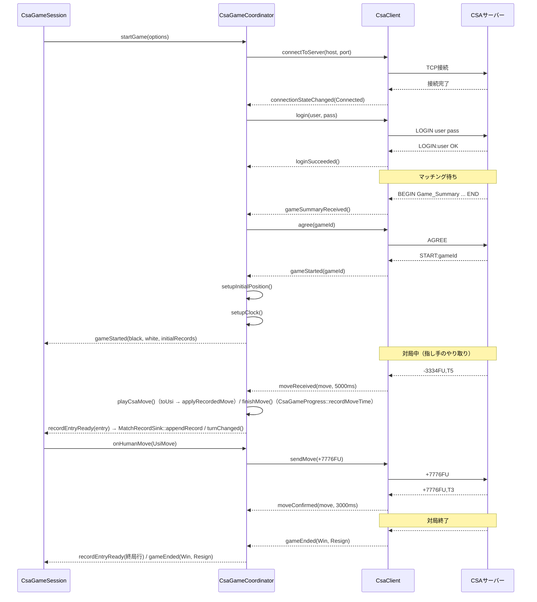

#### 時計管理の仕組み

CSA通信対局では、サーバーが権威的な消費時間（`T` に続く数値）を通知する。CsaGameCoordinatorはこの情報をもとにGUI側の時計を補正する。

1. **残り時間の追跡**: 値型 `CsaGameProgress`（`blackRemainingMs` / `whiteRemainingMs`・累計）でサーバーからの消費時間と加算を追跡（`recordMoveTime()`）
2. **時計の補正**: 対局開始時（`setupClock()`）に対局条件（`GameSummary::timeControl()`）を `ShogiClock::setTimeControl()` で渡し、着手ごとに `syncClockAfterMove()` がサーバーの消費時間を反映した残り時間を `ShogiClock::setRemainingTimes()` で合わせる
3. **手番の切替**: 指し手確認後に `setCurrentPlayer()` で次の手番の時計に切り替え、`startClock()` でGUI上のカウントダウンを開始

終局はサーバーの裁定に従い、表示用の時計の時間切れでは対局を終えない（`setLoseOnTimeout(false)`）。

#### 指し手形式の変換

指し手形式の変換は `CsaMoveConverter`（`src/network/csamoveconverter.h/.cpp`）の名前空間関数が受け持つ。盤は局面の値（`Position`。対局の盤なら `board->position()`）で受け取り、読むだけで動かさない。

| 関数 | 変換元 → 変換先 | 例 |
|------|----------------|-----|
| `toUsi(csaMove, board)` | CSA → USI（`std::optional<UsiMove>`） | `"+7776FU"` → `7g7f`。成りは盤の駒とCSAの駒種を比べて決める。書式・手番・駒が盤と合わなければ `nullopt` |
| `toCsa(move, mover, board)` | USI → CSA（`QString`） | `7g7f`（先手）→ `"+7776FU"`。動かす駒がなければ空 |

どちらも指す前の盤の駒を読む（CSAの駒種は指した後の駒のため）。盤への適用は `CsaGameCoordinator::playCsaMove()` が `ShogiGameController::applyRecordedMove(move, m_progress.previousTo())` で行い、棋譜の表示用の文字は `commitMove()` が `KifMoveText::format()` で作る（「同」は渡した直前の手の移動先で決める）。

駒打ちの場合、CSA形式では移動元が `00`（例: `+0077FU`）となり、GUI座標では `from.x() >= BoardConstants::kBlackStandFile`（10=先手駒台, 11=後手駒台）で表現される。

#### Deps構造体

```cpp
struct Deps {
    ShogiGameController* gameController = nullptr;
    ShogiClock* clock = nullptr;
    EngineLifecycleManager* engines = nullptr;  ///< エンジンで指すとき、エンジンを置く枠
};
```

盤のビュー・棋譜欄・ハイライトの部品は持たない。盤への着手は `ShogiGameController`、棋譜行は `recordEntryReady`（盤のハイライトは棋譜の表示中の手から `BoardSyncPresenter` が出す）、通信ログは `csaCommLogAppended` で知らせる。エンジンで指すときは、ローカル対局と同じ `MatchEngineSeat`（`m_engineSeat`）が枠 E1 にエンジンを借りて起動する（`Params::timeSource` に司令塔自身を渡す）。終局は `MatchEngineSeat::finish()`（勝ち・負け・引き分け。探索・先読みを止めて gameover と quit）で、ローカル対局と同じ手順で知らせ、接続を終えるときに `release()` で枠を空ける。通信対局の最中にほかの処理が枠を取ったときは、エンジンの異常と同じく `errorOccurred` → `onEngineError()` で知らせる。同じ接続の次の対局条件（`onGameSummaryReceived()`）は、エンジンが思考を頼める状態（`isReady()`）でなければ起動し直し、起動して初期化している間（`isInitializing()`）は readyok を待ってから同意する（`onEngineInitialized()`）。それ以外はすぐ同意する。思考の依頼は `Usi::requestMatchMove(const UsiPosition&)` で、時間は渡さない（エンジンが `MatchTimeSource` として司令塔から読む）。指し手は `MatchEngineSeat::moveReady` → `onEngineMoveReady(UsiMatchMove)`、投了・入玉宣言勝ちは `resigned`・`declaredWin` で届く。思考情報・USI通信ログのモデルは枠が持つ。

### 12.4 CsaGameSession — CSA通信対局の画面への反映

**ソース**: `src/ui/coordinators/csagamesession.h/.cpp`

CSA通信対局の開始（待機ダイアログ）と、`CsaGameCoordinator` の進行を盤の向き・評価値グラフ・ステータスバー・結果のダイアログへ反映するクラス（表示だけ）。通信の手順も棋譜も持たない。棋譜（対局者・持ち時間・開始と終了の日時・着手の行・自動保存）はローカル対局と同じく `GameSession` が受け持つ（6.9 節）。

#### 役割

- コンストラクタで `CsaGameCoordinator` の各シグナル（`gameStarted`・`gameEnded`・`turnChanged`・`logMessage`・`engineScoreUpdated`・`errorOccurred`）と、`CsaLogPanel`・`BoardMoveController::csaMoveRequested` を直接つなぐ。`gameStarted`・`recordEntryReady`・`gameEnded` は先に作られた `GameSession` も受け、棋譜を先に作る
- `startGame(const CsaGameDialog::Selection&)`: `CsaWaitingDialog` を出して `CsaGameCoordinator::startGame()` を呼び、対局が始まるかエラー・キャンセルまで待つ。呼び出しは `DialogLauncher`（CsaGameDialog で設定を決めた後）
- 対局開始時: 後手なら盤を反転し、動作状態（`AppActivityState`）を `DuringCsaGame` にする（棋譜と対局情報の作り直し・対局者の表示は `GameSession::onCsaGameStarted()` が `beginMatchRecord()` で済ませている）
- 自分のエンジンの評価値: `EvaluationGraphPresenter::plotEngineScore(自分の側, ply, score)`（Deps の `evalGraph`）で、ローカル対局のエンジンの手と同じ符号の扱いで描く
- 終局時: 動作状態を `Idle` に戻して結果を表示する（棋譜の確定・終局日時・自動保存は `GameSession::onCsaGameEnded()` の `finishMatchRecord(true)`。自動保存の指定は接続ダイアログの値を `CsaGameCoordinator::StartOptions::autoSave` に入れて渡す）
- 待機ダイアログ（`CsaWaitingDialog`）のログ窓は `CsaLogPanel` を使い、手入力のCSAコマンドは `csaRawCommandRequested` → `CsaGameCoordinator::sendRawCommand` で送る

### 12.5 設定の永続化 — 宣言の表（`Setting<T>`）

**ソース**: `src/services/setting.h`, `src/services/settingscommon.h/.cpp`, ドメイン別ヘッダー（`appsettings.h`・`gamesettings.h`・`analysissettings.h`・`networksettings.h`・`josekisettings.h`・`tsumeshogisettings.h`・`enginedialogsettings.h`・`docksettings.h`）

アプリケーション設定をINIファイル（`ShogiBoardQ.ini`）で永続化する。設定項目は `Setting<T>` で**キーと既定値を1行で宣言**し、読み書きはその宣言を通す。getter と setter の組やキー定数は手で書かない。詳しい規約は [settings-service.md](settings-service.md) にまとめている。

`src/services/settingsservice.h` は、ドメイン別ヘッダーをまとめて include するだけのヘッダーとして残っている（関数はなく、`.cpp` もない）。新しいコードはドメイン別ヘッダーを直接 include する。

#### INIファイルの場所と構造

INIファイルの場所は `SettingsCommon::settingsFilePath()` が `AppPaths::configDirectory()`（`src/services/apppaths.h`。既定は `QStandardPaths::AppConfigLocation`）から決める（Linux は `~/.config/ShogiBoardQ/ShogiBoardQ.ini`）。環境変数 `SHOGIBOARDQ_CONFIG_HOME` を指定すると、その下の `ShogiBoardQ` フォルダを使う。読み書きは `SettingsCommon::openSettings()` が返す、アプリ全体で1つの `QSettings` を通る。

```ini
[SizeRelated]
mainWindowSize=@Size(1100 720)
squareSize=55

[General]
lastKifuDirectory=/home/user/kifu
language=system

[FontSize]
usiLog=10
comment=10
gameInfo=10
thinking=10
kifuPane=10
csaLog=10
engineSettings=12

[UI]
lastSelectedTabIndex=0
toolbarVisible=true

[EvalChart]
yLimit=2000
xLimit=500
xInterval=10
labelFontSize=7

[Consideration]
engineName=YaneuraOu
unlimitedTime=true
byoyomiSec=0
multiPV=1

[KifuAnalysis]
fontSize=10
byoyomiSec=3
engineName=YaneuraOu
fullRange=true

[EvalChartDock]
floating=false
visible=true

[RecordPaneDock]
floating=false
visible=true

[CustomDockLayouts]
layout1=@ByteArray(<QMainWindow::saveState() のバイト列>)
```

主要なグループと設定項目:

| INIグループ | 設定カテゴリ | 主な項目 |
|------------|------------|---------|
| `SizeRelated` | ウィンドウサイズ | メインウィンドウ、盤のマスの大きさ、各ダイアログのサイズ |
| `General` | 一般設定 | 最後の棋譜ディレクトリ、言語、指し手の表記、GUI共通フォント |
| `FontSize` | フォントサイズ | 各タブ・ダイアログのフォントサイズ |
| `UI` | UI状態 | 最後に選択したタブ、ツールバー表示 |
| `EvalChart` | 評価値グラフ | 表示範囲の自動・固定、Y軸上限、X軸上限、目盛り間隔、軸ラベルサイズ（`AnalysisSettings::evalChart` の構造体 `EvaluationChartSettings` を項目ごとのキーに保存） |
| `Consideration` | 検討設定 | エンジン名、時間無制限フラグ、候補手数 |
| `KifuAnalysis` | 棋譜解析設定 | 思考時間、エンジン名、解析範囲 |
| `GameSettings` | 対局開始ダイアログ | 対局者・持ち時間・開始局面・最大手数など前回の対局条件 |
| `CsaGameSettings` | CSA通信対局ダイアログ | 対局者、接続先、接続の維持・連続対局・自動保存などの詳細設定 |
| `*Dock` | ドック状態 | 全12個のドックのフローティング、ジオメトリ、表示状態（グループ名は `DockRegistry` の表の `settingsGroup`） |
| `CustomDockLayouts` | カスタムレイアウト | 名前付きレイアウトの保存 |
| `MenuWindow` | メニューウィンドウ | お気に入り、サイズ、ボタンサイズ |
| `Engines`・エンジン名 | エンジン登録情報 | 登録一覧とUSIオプション（§7.9。宣言の表を使わない） |

#### 宣言と読み書き

各項目はドメイン別ヘッダーの namespace に `inline const Setting<T>` として宣言する。以下は実際のコードからの抜粋:

```cpp
// src/services/analysissettings.h より
namespace AnalysisSettings {
/// USI通信ログタブのフォントサイズ（デフォルト: 10）
inline const Setting<int> usiLogFontSize{"FontSize/usiLog", 10};
/// 読み筋表示ウィンドウのサイズ（デフォルト: 620x720）
inline const Setting<QSize> pvBoardDialogSize{"SizeRelated/pvBoardDialogSize", QSize(620, 720)};
}
```

```cpp
const int size = AnalysisSettings::usiLogFontSize();     // 読む（未保存なら宣言の既定値）
AnalysisSettings::usiLogFontSize.set(12);                // 書く
AnalysisSettings::usiLogFontSize.defaultValue();         // 宣言の既定値（「既定値に戻す」など）
AnalysisSettings::usiLogFontSize.remove();               // 保存値を消す
```

`Setting<T>` の要点:
1. 読み書きは `SettingsCommon::openSettings()` の共有 `QSettings` を通る。項目ごとの `.cpp` は要らない
2. 未保存のときは宣言の既定値を返す。既定値が翻訳文や実行時の場所で決まる項目は、宣言の既定値を空にして `valueOr()` で読む（例: `GameSettings::StartGame::player1.humanName.valueOr(tr("You"))`）
3. 同じ形の項目は `Setting<T>` をメンバに持つ構造体にまとめられる（対局開始ダイアログの `GameSettings::StartGame::Player` の `player1` / `player2`）
4. 1行の `Setting<T>` で書けない項目も、`setting.h` の型で1つの宣言にする（読み書きは `Setting<T>` と同じ）

| 型 | 保存の形 | 例 |
|---|---|---|
| `BoundedSetting<T>(キー, 既定値, 最小, 最大)` | 1つのキー。読みも書きも `qBound` で範囲に収める | `AppSettings::pieceSoundVolume`（0〜100）、`AppSettings::appearancePieceFilter`、`AnalysisSettings::usiLogCommandTarget`（0〜2） |
| `StructSetting<T>({SettingField<T>::of(キー, &T::メンバ), ...}, 整える関数)` | メンバごとに1つのキー。保存していない項目は `T{}` の既定値のまま | `AppSettings::pieceSoundTone`（`PieceSoundTone::clamped`）、`TsumeshogiSettings::playPreferences`・`collectionPreferences` |
| `ListSetting<T>(配列のキー, 要素のキー)` | QSettings の配列。配列のキーは実行時に作ってもよい | `JosekiSettings::josekiWindowColumnWidths`、思考・検討の表の列幅 |
| `StructListSetting<T>(配列のキー, {項目...})` | 構造体の配列 | `NetworkSettings::csaServerHistory`（`CsaServerHistoryEntry`。最大 `kCsaServerHistoryLimit` = 10 件） |

```cpp
// src/services/appsettings.h
inline const BoundedSetting<int> pieceSoundVolume{"Sound/pieceSoundVolume", 30, 0, 100};
// 使う側（範囲外なら 0〜100 に収めて保存）
AppSettings::pieceSoundVolume.set(percent);
```

#### 関数として書く項目

宣言の表（`Setting<T>` と上の型）で表せない処理が要る項目だけを、ドメイン別ヘッダーに関数として宣言し、`.cpp` で `SettingsCommon::openSettings()` を使って実装する。キーは `settingskeys.h` に置く。古い保存値を引き継ぐ（`AppSettings::appearanceSection`・`pieceStyle`）、未保存の項目をほかの項目で代える（`AppSettings::boardVisuals`。駒台の木目が未保存なら将棋盤の木目を使う）、独自の保存形式（`AppSettings::boardColors` の色の文字列、`AnalysisSettings::kifuAnalysisColumnWidths` の `QVariantList`、`DockSettings::dockState` のグループ名を引数で受けるキー）、キーを実行時に作る（`AnalysisSettings::engineInfoColumnWidths(ThinkingTable)`。中で `ListSetting<int>` を使う）、ドックレイアウトの名前の一覧などである。列幅は `TableHeaderView::sectionResizedByUser`（利用者がドラッグしたときだけ）を受けて、`EngineInfoWidget`・`ThinkingTableView` などが自分で保存する（思考・検討の表は `AnalysisSettings::ThinkingTable` の `Engine1`・`Engine2`・`Consideration` ごと）。補助ダイアログの文字の大きさと大きさは、関数ではなく `appsettings.h` に宣言を1行ずつ書く（`AppSettings::promotionDialogFontSize`・`promotionDialogSize`・`messageBoxFontSize`・`bookmarkDialogFontSize` など。キーは `DialogAppearance/<id>/fontSize`（既定値 0）・`DialogAppearance/<id>/size`（既定値 `QSize()`）。既定値 0 は、未保存ならダイアログの元の大きさから始めるという意味）。

```cpp
// src/services/analysissettings.cpp より（表の番号でキーを作り、読み書きは ListSetting に任せる）
QList<int> engineInfoColumnWidths(ThinkingTable table)
{
    return ListSetting<int>(tableKey(SettingsKeys::kEngineInfoColumnWidthsFmt, table), SettingsKeys::kArrayWidth)();
}
```

設定ファイルを `QSettings settings(SettingsCommon::settingsFilePath(), QSettings::IniFormat)` で直接開くのは、`beginReadArray` / `beginGroup` でグループを開いたまま読み書きを続ける配列データ（`EngineProfileStore` のエンジン登録一覧とエンジンごとのオプション配列）だけ。共有の `QSettings` でグループを開いたままにすると、その間に読み書きするほかの項目のキーがずれるためである。`ListSetting`・`StructListSetting` は共有の `QSettings` で配列を開き、同じ呼び出しの中で閉じる。

#### 設定項目の追加方法

新しいダイアログやウィンドウを追加する際は、CLAUDE.md の「Settings Update Guidelines」に従い、以下の手順で設定を追加する。

**1. ドメイン別ヘッダーに宣言を1行ずつ足す:**

```cpp
// gamesettings.h
/// 〇〇ダイアログのウィンドウサイズ（デフォルト: 800x600）
inline const Setting<QSize> myDialogSize{"SizeRelated/myDialogSize", QSize(800, 600)};
/// 〇〇ダイアログのフォントサイズ（デフォルト: 10）
inline const Setting<int> myDialogFontSize{"FontSize/myDialog", 10};
```

**2. ダイアログで読み込み/保存を行う:**

```cpp
// mydialog.cpp
MyDialog::MyDialog(QWidget* parent)
    : QDialog(parent)
{
    setupUi();

    // 文字の大きさ（初期値の読み込みと変更のたびの保存）。A-/A+ を渡さなければ決定ボタンの列に作る。
    // 大きさは作るときに戻し、閉じたときに保存する
    DialogFontScale::Options fontOptions;
    fontOptions.decrease = ui->buttonFontDecrease;
    fontOptions.increase = ui->buttonFontIncrease;
    fontOptions.size = &GameSettings::myDialogSize;
    DialogFontScale::install(this, GameSettings::myDialogFontSize, fontOptions);
}
```

`DialogFontScale`（`src/widgets/dialogfontscale.h`）は宣言から初期値を読み、A-/A+ で変わるたびに同じ宣言へ保存する。`Options` には範囲（`minSize`・`maxSize`。既定 8〜24）、ダイアログが置いたボタン（`decrease`・`increase`）と大きさの表示（`sizeLabel`）、ダイアログの大きさの宣言（`size`。渡すと開くときに戻し、閉じるときに保存する）を渡せる。ダイアログはこの `size` を使い、`DialogUtils::restoreDialogSize` / `saveDialogSize` を自分で呼ばない（`closeEvent` だけで保存すると、Esc や「閉じる」で閉じたときに取りこぼす）。ダイアログでないウィンドウ（定跡ウィンドウ）だけが `DialogUtils` を直接使う。

永続化すべき主な設定項目:
- **ウィンドウサイズ**: ユーザーがリサイズ可能なダイアログ
- **フォントサイズ**: A-/A+ ボタンによる調整機能がある場合
- **列幅**: テーブルやリストビューの列幅
- **最後に選択した項目**: コンボボックスの選択状態、最後に開いたファイルパス

### 12.6 手番・時計表示の同期

**ソース**: `src/views/boardchromewidget.h/.cpp`, `src/views/playercard.h/.cpp`, `src/ui/presenters/timedisplaypresenter.h/.cpp`, `src/game/matchcoordinator.h/.cpp`

手番は `ShogiBoard` だけが持つ（`ShogiGameController::currentPlayer()` は盤の手番を返す）。盤の手番の札は、`ShogiView::setBoard()` が `ShogiBoard::turnChanged` を `BoardChromeWidget::setActiveSide(Turn)` に直接つなぐことで合わせる。手番の側が替わると、時計の警告も消える。

対局中の時計の値は、`TimeDisplayPresenter` が `ShogiClock::timeUpdated` を直接受けて（`showClock()`）時計から読む。司令塔は中継しない。着手の確定では司令塔が時計の通知を止めてまとめて値を変え、その後で `ShogiClock::notifyTimeUpdated()` を呼ぶ。通信対局でも、サーバーの残り時間を写した同じ時計を同じ経路で表示する。`TimeDisplayPresenter` は時計の文字を `view->chrome()->card(Turn)->setClockText()` で出し、残り時間に応じた警告（`BoardChromeWidget::Urgency` の `Warn10`・`Warn5`）を `setUrgency()` で反映する。盤を反転したときなどは `refresh()` で最後の値から描き直す。人間同士の対局の考慮時間の計測は、対局モード別の Strategy（`HumanVsHumanStrategy`）が持つ。

### 12.7 対局者名の表示（PlayerInfoPresenter・EngineDisplayPresenter）

**ソース**: `src/ui/presenters/playerinfopresenter.h/.cpp`、`src/ui/presenters/enginedisplaypresenter.h/.cpp`（クラスの概要は 10.2 節）

盤の対局者名は `PlayerInfoPresenter` が対局者（`MatchPlayers`、[5.6節](#56-matchplayers--対局者)）から決める。対局中（動作状態が `DuringGame`）は最後に始めた対局の対局者（`KifuDocument::players()`）を出し、対局していなければ対局情報の名前を出す（`PlayerInfoPresenter` が文書と動作状態の知らせで決める）。エンジン名（通信ログの見出し・2つ目のエンジン欄・評価値グラフの系列名・検討タブ）は `EngineDisplayPresenter` が決める。

#### 通信ログの見出し（E1・E2）

2つの通信ログ（E1=上段, E2=下段）の見出しには、その枠（`EngineLifecycleManager` の E1・E2）に入ったエンジンの名前を出す（`UsiModelBinding` が結ぶときに `UsiCommLogModel::setEngineName()` する）。

| 対局者 | E1 | E2 |
|-------|----|----|
| 人間 vs 人間 | (空) | (空) |
| 人間（先手・下手） vs エンジン（後手・上手） | 後手のエンジン | (空) |
| エンジン（先手・下手） vs 人間（後手・上手） | 先手のエンジン | (空) |
| エンジン vs エンジン（平手・駒落ちとも） | 先手（下手）のエンジン | 後手（上手）のエンジン |

人間対エンジンでは、エンジンが後手でも E1 に置く。思考タブの2つ目のエンジン欄はエンジン同士の対局だけ表示する。評価値グラフは、どの対局でも先手のエンジンを1つ目、後手のエンジンを2つ目の系列として描く（`EngineDisplayPresenter` が `KifuDocument::playersChanged` を受けて `EvaluationGraphPresenter::setEngine1Name()`・`setEngine2Name()` を呼ぶ）。検討・詰み探索のエンジンは E1 だけを使う（`AnalysisSession::engineNamesChanged` → `EngineDisplayPresenter`）。

### 12.8 TimeControlUtil — 持ち時間設定のユーティリティ

**ソース**: `src/game/timecontrolutil.h/.cpp`

`MatchTimeSettings`（`src/game/matchtimesettings.h`。時間の決まり `rules` と `loseOnTimeout`）を `ShogiClock` に適用するユーティリティ名前空間。対局を始めるときに `GameSession::startGame()` が一度だけ呼ぶ。

#### applyToClock()

```cpp
void applyToClock(ShogiClock& clock,
                  const MatchTimeSettings& settings,
                  Turn firstPlayer);
```

処理の流れ:

1. **決まりの正規化**: `settings.rules.normalized()` で先後の決まりを整える。秒読みと加算の排他、持ち時間0の秒読みの扱いは `TimeControl::normalized()` が受け持つ
2. **時間切れ負け**: 時間制限があり、`settings.loseOnTimeout` がオンのときだけ `ShogiClock::setLoseOnTimeout(true)` にする
3. **時計への適用**: `ShogiClock::setTimeControl(rules)` で先後の決まりを渡す（初手の加算も時計が行う）
4. **最初の手番**: `ShogiClock::setCurrentPlayer(firstPlayer)`。`GameSession::startGame()` は開始局面のSFENの手番（`sideToMove()`）を渡す

```
MatchTimeSettings {rules: TimeControl {black, white}, loseOnTimeout}
    ↓
ShogiClock::setLoseOnTimeout(limited && loseOnTimeout)
ShogiClock::setTimeControl(rules.normalized())
ShogiClock::setCurrentPlayer(firstPlayer)
```

<!-- chapter-12-end -->

---

<!-- chapter-13-start -->
## 第13章 navigation層とboard層

本章では棋譜ナビゲーション（`src/navigation/`）と盤面操作（`src/board/`）の2層を解説する。ナビゲーション層は棋譜の手を辿るUI操作を統一管理し、盤面層はクリックによる駒操作・局面編集・画像エクスポートを担う。表示中の手を持つ `KifuNavigationState`（`src/kifu/`）と、開始局面から手を順に指して局面列を作る `SfenReplay`（`src/core/`）もここで扱う。

### 13.1 KifuNavigationController — 棋譜ナビゲーションコントローラ

**ソース**: `src/navigation/kifunavigationcontroller.h/.cpp`

棋譜を移る利用者の操作（ボタン・棋譜欄の行・分岐候補・分岐ツリー・評価値グラフ）を受けて、表示中の手（`KifuNavigationState`）を動かすコントローラ。表示の更新は行わない。棋譜欄・盤・分岐ツリーなどは `KifuNavigationState::changed()` を受けて、それぞれが自分で表示を合わせる（13.4）。

#### 依存オブジェクト

| オブジェクト | 設定方法 | 役割 |
|-------------|---------|------|
| `KifuNavigationState` | コンストラクタ | 表示中の手・選んだ手順の管理（非所有）。分岐ツリー（`KifuBranchTree`）は `state()->tree()` から辿る |
| 移動前の確認 | `addLeaveGuard(std::function<bool()>)` | 利用者の操作で別の手へ移る前の確認（足した順に聞き、1つでも false なら移らない）。合成ルートが `PositionEditSession::allowsLeavingMove()`（局面編集中でない）と `CommentCoordinator::confirmLeaveEditingMove()`（未更新のコメントを破棄してよい）を足す |

#### 局面送りの6つの操作（QAction）

局面送りの6つの操作は、このクラスが `QAction` の組として1つだけ持つ（`enum Step { First, Back10, Prev, Next, Fwd10, Last }`、`action(Step)`）。各 `QAction` の `triggered` を対応スロットにつなぎ、どのスロットも、まず `confirmLeave()` で確認を通す。

`bindButtons(const Buttons&)`（`Buttons` は `Step` の順の `std::array<QAbstractButton*, 6>`）は、ボタンの `clicked` を `QAction::trigger` に、`QAction::enabledChanged` をボタンの `setEnabled` につなぐ。合成ルートは棋譜欄と評価値グラフの2組のボタンを同じ `QAction` に結ぶので、有効・無効を2組に中継しなくても揃う。ボタンの文字は各パネルが決める（棋譜欄は ▲▼、評価値グラフは ◀▶）。有効・無効は `setStepActionsEnabled(bool)` で6つまとめて切り替え（`UiStatePolicyManager` の `WidgetNavigation`）、`stepActionsEnabled()` で読む。

| 操作（`Step`） | スロット | 動作 |
|-------|---------|------|
| `First`（最初に戻る） | `onFirstClicked` → `goToFirst()` | ルートノード（0手目）へ移動 |
| `Back10`（10手戻る） | `onBack10Clicked` → `goBack(10)` | 親ノードを10回辿る |
| `Prev`（1手戻る） | `onPrevClicked` → `goBack(1)` | 親ノードへ移動 |
| `Next`（1手進む） | `onNextClicked` → `goForward(1)` | 次の手（選んだ子）へ移動 |
| `Fwd10`（10手進む） | `onFwd10Clicked` → `goForward(10)` | 次の手を10回辿る |
| `Last`（最後に進む） | `onLastClicked` → `goToLast()` | 選んでいる手順の終端まで進む |

#### goForward() の分岐選択

「進む」では `KifuNavigationState::nextNode(node)` が次の手を決める。分岐点で選んだ子（`m_selectedChildIds`）があればそれ、選んでいなければ最初の子（本譜）である。`goToLast()` は `selectedPath()` の最後のノードへ移る。

分岐点での選択は足していくだけなので、一度分岐を選んでから「戻る→進む」しても、選んだ手順を辿り直せる。

#### 確認を通さない移動と、利用者の操作

プログラムからの移動は確認を通さない。利用者の操作は、移る前に `confirmLeave()` を通す。確認でやめたときは `navigationRejected()` を出す（クリックした行の強調を表示中の手に戻すため。合成ルートが `KifuDisplayPresenter::refresh` につなぐ）。

| 種類 | メソッド | 動作 |
|------|---------|------|
| 移動 | `goToFirst()` / `goToLast()` / `goBack(n)` / `goForward(n)` | 上の局面送りの動作 |
| 移動 | `goToPly(int ply)` | 選んでいる手順の指定手数へ移動 |
| 移動 | `goToNode(node)` | 指定ノードへ移動（開始局面からの経路を選んだ手順として記憶する） |
| 移動 | `goToPlyOnLine(int lineEndNodeId, int ply)` | lineEndNodeId の手で終わる手順の ply 手目へ移動し、その手順の終わりまでを選ぶ（手が無ければ移らない） |
| 移動 | `goToMainLineAtCurrentPly()` | 本譜の同じ手数へ戻る（選択を忘れる） |
| 操作 | `selectRecordRow(int row)` | 棋譜欄の行を選んだ |
| 操作 | `selectBranchCandidateRow(int row)` | 分岐候補欄の行を選んだ（候補の後ろの行は「本譜へ戻る」） |
| 操作 | `selectBranchTreeNode(int nodeId)` | 分岐ツリーの手を選んだ（`BranchTreeView::nodeActivated` から） |
| 操作 | `selectPly(int ply)` | 評価値グラフの手数を選んだ |

#### selectBranchTreeNode() — 分岐ツリークリック処理

```
selectBranchTreeNode(nodeId):
  1. nodeAt(nodeId) が無ければ何もしない。confirmLeave() でやめたら終了
  2. ルート（開始局面）→ KifuNavigationState::goToRoot() で分岐の選択を忘れて開始局面へ移動して終了
  3. 表示中の手順（selectedPath()）にある手なら、その手順のまま移る
     （分岐前の共有の手は親の手順の行に描いてあるため）
  4. それ以外は、その手から先頭の子をたどった手順（図でその手を描いた行）の終わりまでを選んで移る
```

#### 変更の通知

コントローラは更新用のシグナルを持たない（`navigationRejected()` だけ）。移動はすべて `KifuNavigationState::setCurrentNode()` / `resetToNode()` / `goToRoot()` を通り、表示中の手または手順が変わると `changed()` が1回出る。

### 13.2 KifuNavigationState — ナビゲーション状態管理

**ソース**: `src/kifu/kifunavigationstate.h/.cpp`

表示中の手（分岐ツリーのカーソル）と、分岐点ごとに選んだ子の記憶を持つ状態オブジェクト。棋譜の表示は、ここだけを正とする。現在の手・手数・手順・分岐候補はすべてノードIDから導き、写しを持たない。ツリーを作り直して表示中の手が無くなったときは開始局面へ戻る。

#### 主要な状態

| メンバ | 型 | 役割 |
|-------|---|------|
| `m_currentNodeId` | `int` | 表示中のノードID |
| `m_tree` | `KifuBranchTree*` | 分岐ツリーへの参照 |
| `m_selectedChildIds` | `QHash<int, int>` | 分岐点IDから選んだ子IDへの対応 |

#### 主要メソッド

| メソッド | 説明 |
|---------|------|
| `currentNode()` / `currentPly()` | 表示中のノードと手数（MainWindow は手数の変数を持たない） |
| `currentSfen()` | 表示中の局面（終局の行は直前の局面。ツリーが空なら空文字） |
| `selectedPath()` | 開始局面から、分岐点で選んだ子を辿った手順の終わりまで |
| `currentLineIndex()` | 表示中の手順の番号（0=本譜、1以上=分岐。`KifuBranchTree::allLines()` の添字） |
| `isOnMainLine()` | 本譜を表示しているか |
| `currentRecordLine()` | 表示中の手順（`RecordLine`）。手数 `currentPly` まで |
| `nextNode(node)` | node の次に進む手（選んだ子。無ければ最初の子） |
| `branchCandidatesAtCurrent()` | 表示中の手と同じ親を持つ手（分岐候補） |
| `offersBackToMainLine()` | 分岐候補欄に「本譜へ戻る」を出すか |
| `setCurrentNode(node)` / `setCurrentNode(node, lineEnd)` | node へ移り、開始局面から node（または lineEnd）までの経路を選んだ手順として記憶する |
| `resetToNode(node)` / `goToRoot()` | 選択を忘れて移る |

変わるたびに `changed()` を1回だけ出す。

### 13.3 KifuDisplayPresenter と BoardSyncPresenter — 表示への反映

**ソース**: `src/ui/presenters/kifudisplaypresenter.h/.cpp`, `src/ui/presenters/boardsyncpresenter.h/.cpp`

`KifuNavigationState::changed()` を受けて表示を合わせる側のクラス。ナビゲーション層は表示を知らない。

| クラス | 受け取るもの | 合わせるもの |
|--------|------------|-------------|
| `KifuDisplayPresenter` | `KifuNavigationState::changed()`、`LiveGameSession::activeChanged` | 棋譜欄（`KifuRecordListModel`。対局中は最新の手まで）・分岐候補欄（`KifuBranchListModel`）・分岐ツリーの図（`BranchTreeView`。表示中の手を `setCurrentNode()` で伝える。構造の変更は図が自分で受ける）。選択の変更は `QSignalBlocker` で止め、表示に合わせた変更を利用者の操作として扱わない |
| `BoardSyncPresenter` | `KifuNavigationState::changed()` | 盤を表示中の手の局面に合わせ（違うときだけ入れ替える）、ノードの指し手から直前手のハイライト（`BoardInteractionController::showMoveHighlights()`）を作る。手番の表示は盤のビューが盤の手番から作る |
| `EvaluationGraphPresenter` | 同上 | 評価値グラフの縦線（`showCurrentPly`） |
| `CommentCoordinator` | 同上 | 棋譜コメント欄（`showCurrentComment`） |
| `JosekiWindowController` | 同上 | 定跡ウィンドウ（`updateJosekiWindow`） |
| `AnalysisSession` | 同上 | 検討中なら表示中の局面に追従（`followDisplayedPosition`） |

### 13.4 ナビゲーションフロー図

ユーザの操作から表示の更新までの全体的なデータフローを示す。

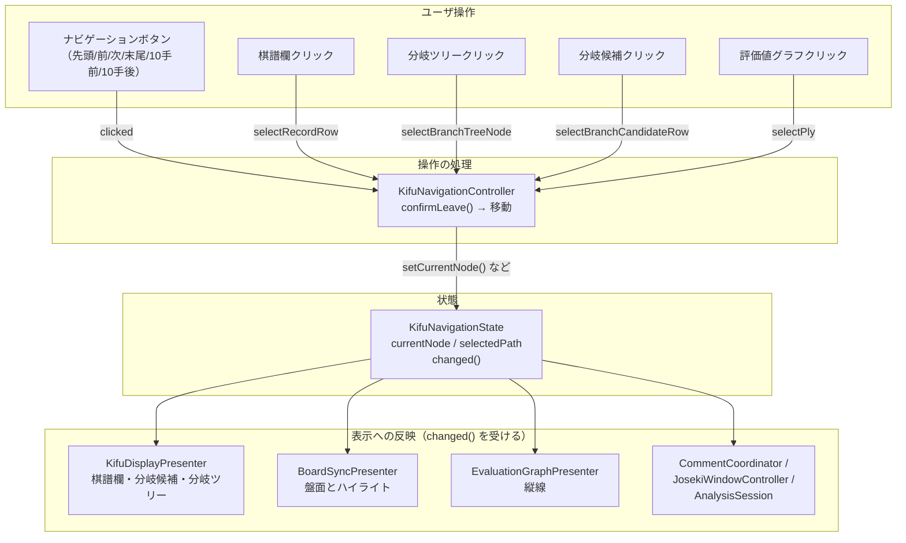

**ポイント**: どの操作も最後は `KifuNavigationState::changed()` に集まり、受け手が同じ状態から自分の表示を作り直す。接続は合成ルートの `connectRecord()`・`connectBoard()`・`connectAnalysisAndUi()`（`mainwindowcomposer_wire.cpp`）にある。確認でやめた操作は `navigationRejected()` で棋譜欄などの強調を表示中の手に戻す。

### 13.5 BoardInteractionController — 盤面操作コントローラ

**ソース**: `src/board/boardinteractioncontroller.h/.cpp`、`src/board/boardinputroute.h`

盤面上のクリックを移動元・移動先にし、ハイライトを出すコントローラ。手番の判定・成りの選択・着手は持たず、盤で指した手の行き先（`BoardInputRoute`）に任せる。

#### 盤で指した手の行き先（BoardInputRoute）

```cpp
class BoardInputRoute
{
public:
    virtual bool acceptsInput() const = 0;   // 盤の駒をつまめるか（局面編集中は常に true）
    virtual bool isEditing() const = 0;      // 局面編集中か
    virtual void submit(const QPoint& from, const QPoint& to) = 0;  // 行き先が決まった
};
```

行き先は `setInputRoute()` で渡す（非所有。無ければクリックを受け付けない）。主画面の行き先は `BoardMoveController`（10.3 節）で、`acceptsInput()` は局面編集中か `HumanTurnPolicy::isHumanTurnNow()`、`isEditing()` は `PositionEditSession::isEditing()` である。詰将棋を解くダイアログ（`TsumePlayDialog`）は自分で `BoardInputRoute` を実装し（正解手順の再生中でなく、解答を待っている（`TsumeGameSession::State::Ready`）ときだけ受け付ける）、指した手を解答として受け取る。着手の結果は行き先が `onMoveApplied(from, to, success)` で返す。

#### 2クリック方式の駒移動

駒の移動は2段階のクリックで実行される。

```
1stクリック（onLeftClick）:
  1. 行き先が受け付けるか（acceptsInput()）。受け付けなければ無視
  2. 駒台の枚数0チェック
  3. startDrag() でドラッグ開始
  4. selectPieceAndHighlight() で選択マスを Selection の層に出す
     （局面編集中でなければ相手の駒台は選ばない。設定により合法な移動先を LegalDestinations の層に出す）
  5. m_waitingSecondClick = true

2ndクリック（onLeftClick）:
  1. m_waitingSecondClick = false
  2. 同一マスクリック → キャンセル（finalizeDrag）
  3. 異なるマス → 合法な移動先の表示を消し、行き先の submit(from, to) に渡す
```

右クリックは2クリック待ち中のキャンセル、または局面編集中（`isEditing()`）の成/不成トグルに使用される。2クリックの途中状態は `cancelPendingClick()`（public slot）で取り消す。盤の手番が替わったとき（`ShogiBoard::turnChanged`）・盤が作り直されたとき（`boardReset`）に自分でつなぎ、動作状態が変わったとき（`AppActivityState::changed`）は `BoardMoveController` がつなぐ。

#### ハイライト

ハイライトは盤の層（`BoardHighlightLayer`、`src/views/shogiviewhighlighting.h`）に、マスの一覧を値で渡す（`ShogiViewHighlighting::setHighlights(layer, squares)`）。色は層ごとに `ShogiViewHighlighting` が決め、このクラスは色を持たない。

| 層 | 意味 | 出す関数 |
|-----------|------|-----------|
| `Selection` | 現在選択中の駒（橙系） | `selectPieceAndHighlight()`。`clearSelectionHighlight()` で消す |
| `LastMoveFrom` | 直前の着手の移動元（黄緑系。駒打ちでは出さない） | `showMoveHighlights()` |
| `LastMoveTo` | 直前の着手の移動先（橙系） | `showMoveHighlights()` |
| `LegalDestinations` | 選択中の駒の動かせるマス（青の縁取り。`setLegalMovesVisible()` で表示を切り替える。局面編集中は出さない） | `refreshLegalMoveHighlights()` |

```
onMoveApplied(from, to, success):
  成功時 → 移動元・移動先を LastMoveFrom・LastMoveTo の層に出し、選択をクリア
  失敗時 → 全選択状態をクリア（finalizeDrag）
```

`clearAllHighlights()` は2クリックの途中状態を取り消し、直前の手の層を消す。ハイライトは値なので、呼び出し側がハイライトの物を持って `ShogiView` と同期する必要はない。

#### 駒台の座標規約

| 定数 | 値 | 意味 |
|------|---|------|
| `kBlackStandFile` | 10 | 先手駒台のファイル番号 |
| `kWhiteStandFile` | 11 | 後手駒台のファイル番号 |

盤上は `file: 1-9`、`rank: 1-9` の座標を使用し、駒台は `file: 10-11` で区別する。

### 13.6 PositionEditSession — 局面編集

**ソース**: `src/board/positioneditsession.h/.cpp`

局面編集の開始・終了、編集メニューの操作、編集中の着手を1か所で受け持つ。「編集中か」（`isEditing()`）は動作状態が `AppActivityState::DuringPositionEdit` かの1つだけで決まり、盤の描き方（`ShogiView::setPositionEditMode()`）と「編集終了」ボタン（`ShogiView::setEditExitButtonVisible()`）はこのクラスが動作状態に合わせて切り替える。依存（`Deps`）は `view`・`gameController`・`board`（`BoardInteractionController`）・`navState`・`activity` と編集メニューの項目（`EditActions`）で、合成ルートは `MainWindowComponents::positionEdit` として持つ。

メニューの「局面編集」は `MainWindowActions::beginPositionEditing()` が未保存の棋譜を確認し、中断した対局を捨ててから `begin()` を呼ぶ。終了はメニューの「局面編集の終了」（`MenuActionsWiring`）と盤の「編集終了」ボタン（`BoardChromeWidget::editExitRequested`。コンストラクタでつなぐ）から `finish()` を呼ぶ。

#### 編集開始 — begin()

```
begin():
  1. 編集中なら何もしない
  2. 表示中の局面（KifuNavigationState::currentSfen()）を、盤の手番のまま1手目の SFEN にする
     （読めなければ盤の局面）
  3. つまんでいる駒とハイライトを消し、board->setSfen(sfen)
  4. 動作状態を DuringPositionEdit にする（UiStatePolicyManager が編集メニューを有効にする）
  5. setPositionEditMode(true)、「編集終了」ボタンを出す
  6. editingStarted(sfen) シグナル
```

#### 編集終了 — finish()

```
finish():
  1. 編集中でなければ何もしない
  2. 盤の局面から SFEN を作る（board->position().toSfen(GC の手番, 1)）
  3. つまんでいる駒とハイライトを消し、board->setSfen(sfen)
  4. setPositionEditMode(false)、「編集終了」ボタンを隠す、動作状態を Idle に戻す
  5. editingFinished(sfen) シグナル
```

`editingStarted(const QString& sfen)`・`editingFinished(const QString& sfen)` は `MainWindowActions::resetRecordForEditedPosition(const QString& sfen)` につながり、渡された局面だけの棋譜（分岐ツリー）に作り直す（盤から SFEN を作り直さない）。`editingStarted` は評価値グラフも消す（`EvaluationGraphPresenter::clear`）。接続は `MainWindowComposer::connectBoard()` にある。

#### 編集メニュー

| スロット | 対応アクション（`EditActions`） | 動作 |
|---------|-------------|------|
| `returnAllPiecesToBox()` | 「全ての駒を駒箱へ」（`returnAllPiecesToStand`） | `ShogiBoard::resetGameBoard()` を呼ぶ |
| `setHiratePosition()` | 「平手初期配置」（`setHiratePosition`） | 平手のSFEN（`SfenUtils::hirateSfen()`）を盤に設定し、手番を先手にする |
| `setTsumePosition()` | 「詰将棋初期配置」（`setTsumePosition`） | 詰将棋の見本のSFENを盤に設定し、手番を先手にする |
| `toggleSideToMove()` | 「手番切替」（`changeTurn`） | 配置はそのままで、先手 ⇔ 後手をトグル |

どれも編集中でなければ何もしない。メニューの項目はコンストラクタでつなぐ。

#### applyEditMove() — 編集中の着手適用

局面編集中に盤で指した手は、`BoardMoveController::playMove()` から渡される。

```cpp
bool applyEditMove(from, to):
  1. PositionEditRules::apply(*view->board(), from, to, view->pieceBoxSide()) で駒を移動
     （玉を持ち駒にする・二歩・味方の駒の上・駒台に無い駒・玉を取る形は断る。行き所のない段の歩・香・桂は
      ShogiBoard が PieceRules::isDeadSquare で成駒にする）
  2. view->endDrag() でドラッグ状態を解除
  3. board->onMoveApplied() でハイライトを更新
  （盤・駒台・駒箱の変化は ShogiBoard の通知で変わった所だけ描き直される）
```

### 13.7 BoardImageExporter — 盤面画像エクスポータ

**ソース**: `src/board/boardimageexporter.h/.cpp`

盤面ウィジェットのキャプチャ画像をクリップボードまたはファイルに保存する静的ユーティリティ。インスタンスを持たず、全メソッドが `static` である。

#### copyToClipboard()

```cpp
static void copyToClipboard(QWidget* boardWidget);
```

`boardWidget->grab()` で `QPixmap` を取得し、`QApplication::clipboard()->setPixmap()` でクリップボードにコピーする。

#### saveImage()

```cpp
static void saveImage(QWidget* parent, QWidget* boardWidget,
                      const QString& baseName = QStringLiteral("ShogiBoard"));
```

処理フロー:

1. `QImageWriter::supportedImageFormats()` でサポートフォーマットを収集
2. PNG/TIFF/JPEG/WebP/BMP 等からフィルタリスト作成
3. `QFileDialog::getSaveFileName()` でファイル名を取得（デフォルト名: `<baseName>_yyyyMMdd_HHmmss.png`。`baseName` の既定は `ShogiBoard`）
4. 拡張子からフォーマットを決定（JPEG/WebP は品質95で書き出し）
5. `QImageWriter` で画像を保存

### 13.8 SfenReplay — 局面に USI の1手を指す

**ソース**: `src/core/sfenreplay.h/.cpp`（名前空間 `SfenReplay`）

局面に USI の1手を手番側の手として指す小さな関数群。局面は値（`Position`）で持ち、合法手かどうかは確かめない。棋譜の読み込みと同じく、持ち駒の数が合わない駒打ちも指す（`Position::DropRule::Lenient`）。盤に依存しないので core 層に置いている。

棋譜の読み込みは `SfenReplay` を使わず、各形式のパーサが `KifLineBuilder`（8.11）で手を指しながら手順を組み立てる。

#### applyLenient() — USI手の適用

```
applyLenient(position, usiMove):
  UsiMove::parse() で読めなければ false
  Position::apply(move, DropRule::Lenient) で手番側の手として指す
  通常手（"7g7f" / "2b3c+"形式）:
    移動元が空なら false。取った駒を持ち駒に加え、手番を渡して手数を1つ進める
  駒打ち（"P*5e"形式）:
    1. 持ち駒があれば1枚減らす（無くても打つ）
    2. 打つマスに駒があっても、打った駒で置き換える
    3. 手番を相手に渡し、手数を1つ進める
```

#### 座標変換

座標は `UsiMove`・`BoardSquare`（筋・段とも1始まり）で扱い、盤の配列との変換は `Position` が行う。`SfenReplay` 自身は座標変換を持たない。

#### 主な関数

| 関数 | 用途 |
|---------|------|
| `applyLenient(position, usiMove)` | 局面に USI の1手を手番側の手として指す（読み筋の表記 `KifuPresentation::pv()` などが使う） |
| `positionAfter(sfen, usiMove)` | 局面から1手指した後の局面（指せなければ空）。定跡ウィンドウ・候補手の矢印・エンジンの最善手の後の局面に使う |

テストが手順の局面列や指し手列を作るときは、`tests/test_replay.h` の `TestReplay::buildSfenRecord(initialSfen, usiMoves, hasTerminal)`（開始局面と各手の後の局面の列。`hasTerminal` が `true` のとき終局の行のために最後の局面を複製する）と `TestReplay::buildGameMoves(initialSfen, usiMoves)`（各手の `ShogiMove` の列）を使う。どちらも `Position` で手を順に指すテスト用の関数で、本体の `SfenReplay` には無い。

### 13.9 navigation層とboard層の協調

ナビゲーションと盤面操作は独立した層だが、以下の箇所で協調する。

| 協調ポイント | 関与クラス | 内容 |
|-------------|-----------|------|
| 盤面とハイライトの同期 | KifuNavigationController → KifuNavigationState → BoardSyncPresenter | `KifuNavigationState::changed()` を受けて盤を表示中の局面に合わせ、直前手のハイライト（`BoardInteractionController::showMoveHighlights()`）を更新する |
| 棋譜欄の行変更 | RecordPane::mainRowChanged → KifuNavigationController::selectRecordRow | 行の選択を表示中の手の移動に変え、ボタン操作と同じ経路で更新する |
| 局面編集↔通常モード切替 | PositionEditSession → AppActivityState → BoardMoveController → BoardInteractionController | 編集中かは動作状態だけで決まり、`BoardInteractionController` は行き先の `isEditing()` に聞く。動作状態が変わると、つまんでいた駒を戻す |
| 対局中の棋譜欄 | KifuDisplayPresenter | ライブ対局のセッションが動いている間は、棋譜欄に対局の最新の手までを出し、表示に合わせた行の選択変更を閲覧操作として扱わない |

<!-- chapter-13-end -->

---

<!-- chapter-14-start -->
## 第14章 MainWindowの役割と構造

### 14.1 設計思想: "MainWindow should stay lean"

CLAUDE.md に明記されているとおり、ShogiBoardQ の設計原則は **「MainWindow は痩せた状態を保つ」** ことである。部品の生成・配線・状態は合成ルートの `MainWindowComposer` が持ち、MainWindow は `.ui` の保持と、閉じるときの確認・終了処理だけを持つ。合成ルートの規則は [composition-root.md](composition-root.md) にまとめてある。

```
MainWindow（.ui・閉じるときの確認と終了処理）
  └─ MainWindowComposer（合成ルート）
       ├─ MainWindowComponents  部品の一覧（起動時に全部作る）
       ├─ AppActivityState      部品どうしで共有する動作状態（1か所だけ）
       └─ compose()             生成 → シグナル接続 → 初期表示
```

メニュー・盤・棋譜欄の操作は MainWindow を経由しない。`MenuActionsWiring` が項目と処理する部品をつなぎ、複数の部品にまたがるものだけ `MainWindowActions` が受けて振り分ける（[14.6節](#146-操作の受け口mainwindowactions)）。

`mainwindow.cpp` は約 45 行で、コンストラクタで合成ルートを作って `compose()` を呼ぶだけである。

```cpp
// src/app/mainwindow.cpp
MainWindow::MainWindow(QWidget* parent)
    : QMainWindow(parent)
    , ui(std::make_unique<Ui::MainWindow>())
    , m_composer(std::make_unique<MainWindowComposer>(*this, *ui))
{
    m_composer->compose();
}
```

---

### 14.2 部品と状態の置き場

MainWindow のメンバは `ui`・`m_composer`・`m_skipCloseConfirmation`（自動化 API からの終了で確認を出さない）の3つだけである。部品と動作状態は `MainWindowComposer` が持ち、`composer().parts()` と `composer().activity()` で読める（テストと自動化 API が使う）。

#### AppActivityState — 動作状態

`AppActivityState`（`src/common/appactivitystate.h`）は、部品どうしで共有する動作状態（`Idle`・`DuringGame`・`DuringAnalysis`・`DuringCsaGame`・`DuringTsumeSearch`・`DuringConsideration`・`DuringPositionEdit`）の唯一の置き場である。合成ルートが持ち、部品は組み立て時に `AppActivityState*` を受け取って使うときに読む。部品のメンバに状態のコピーを持たない。

状態を変えられるのは、`begin(動作, 持ち主)` が返す move-only の `ActivityLease` を持つ部品だけである。リースを手放す（`reset()`・破棄）と `Idle` に戻るが、別の部品が別の動作を始めた後は何もしない。取り上げられた前の持ち主には `revoked(owner)` が次のイベントループで届く（エンジンの枠の `EngineLease`・`engineRevoked` と同じ形）。値が変わると `changed()` を出す。

棋譜に付く状態（対局情報・最後に始めた対局の対局者・持ち時間と開始・終了の日時・上書き保存先・未保存かどうか）は棋譜の文書 `KifuDocument`（8.5節）が持つ。文書を置き換える操作（新規・読み込み）で一緒に消えるので、前の対局者や保存先が次の棋譜に残らない。対局者を表示するのはローカル対局中（`DuringGame`）だけである（検討・解析・通信対局のエンジンは対局者ではない）。

開始局面・表示中の局面・表示中の手数は `AppActivityState` に持たない。棋譜の正本は分岐ツリー（`KifuBranchTree`）で、表示中の手は `KifuNavigationState`（`currentNode()`・`currentPly()`・`currentSfen()`）が持つ。対局中の手順は司令塔（`MatchCoordinator::record()`、`RecordLine`）が持つ。手番は `ShogiBoard` だけが持つ。盤の手前に表示している側は `ShogiView::flipMode()` から求める。

#### MainWindowComponents — 部品の一覧

`MainWindowComponents`（`src/app/mainwindowcomponents.h`）は、起動時に `MainWindowComposer` が作る部品の一覧である。QObject は MainWindow を親にした生ポインタ（親が破棄する）、QObject でないもの（`HumanTurnPolicy`・`SessionResetCoordinator`）は `std::unique_ptr` で持つ。どれも起動時に1回だけ作り、作り直さない。

| グループ | 主なメンバ |
|---------|-----------|
| 棋譜の正本 | `branchTree`（`KifuBranchTree`）・`navState`（`KifuNavigationState`）・`liveGameSession`・`kifuNavController`・`document`（`KifuDocument`。分岐ツリーの直後に作る） |
| モデル | `kifuRecord`・`kifuBranch`・`thinking1/2`・`consideration`・`analysis`・`commLog1/2` |
| 盤・時計 | `gameController`（`ShogiGameController`）・`shogiView`・`boardController`（`BoardInteractionController`）・`boardMoves`（`BoardMoveController`）・`boardSync`（`BoardSyncPresenter`）・`positionEdit`（`PositionEditSession`）・`clock`・`timePresenter` |
| 画面部品 | `recordPane`・`thinkingPanel`・`considerationTab`・`usiLog`・`csaLog`・`commentEditor`・`branchTreeView`・`evalChart`・`gameInfoPane`・`dockRegistry`（`DockRegistry`。12 個のドックは `dock(DockId)` で引く） |
| 棋譜の表示と編集 | `kifuDisplay`（`KifuDisplayPresenter`）・`branchEdit`（`BranchTreeEditController`）・`commentCoordinator` |
| 対局・検討・通信対局 | `engines`（`EngineLifecycleManager`。エンジンの枠 E1・E2 を対局・検討・棋譜解析・CSA 通信対局で共有）・`match`（`MatchCoordinator`）・`analysisSession`（`AnalysisSession`）・`consecutiveGames`（`ConsecutiveGameSeries`）・`csaGame`（`CsaGameCoordinator`）・`gameSession`（`GameSession`。対局の棋譜の受け手）・`csaSession`（`CsaGameSession`）・`humanTurnPolicy`・`sessionReset`（`SessionResetCoordinator`） |
| 棋譜のファイル | `kifuLoader`・`kifuFileController` |
| 表示 | `appearance`・`playerInfo`（`PlayerInfoPresenter`）・`engineDisplay`・`evalGraph`・`arrows`（`CandidateArrowPresenter`）・`analysisResults`・`dockLayoutManager`・`uiStatePolicy`・`notificationService` |
| 利用者の操作 | `actions`（`MainWindowActions`）・`dialogLauncher`・`kifuAnalysis`・`tsumeSearch`・`considerationUi`・`pvClickController`・`usiCommandController`・`joseki`・`menuWindowController`・`languageController`・`images`・`settingsReset` など |
| 自動化 | `automationServer`（`--automation` 指定時だけ） |

起動時に作らないのは `AutomationServer`（`--automation` 指定時だけ）だけである。CSA 通信対局の司令塔 `CsaGameCoordinator` も、ほかの部品と同じく起動時に作る（接続は対局を始めるときに行う）。

---

### 14.3 依存の渡し方

`MainWindowComposer` は部品を依存する部品より後に作り、依存はコンストラクタの `Deps` で渡す。共通の規則は [4.2節](#42-合成ルートでの組み立て) を参照。

- **依存はポインタで渡す**: 部品は `Deps` 構造体で、ほかの部品のポインタを受け取る。たとえば `GameSession::Deps` は `activity`・`match`・`analysis`・`engines`・`consecutive`・`reset`・`navState`・`liveSession` などをポインタで持つ。生成前の部品を指すための `std::function<X*()>` のゲッターは使わない。
- **状態は AppActivityState を指す**: 動作状態を使う部品は `&m_activity`（`AppActivityState*`）を受け取り（`GameSession`・`AutomationContext`・`MatchCoordinator`・`AnalysisSession`・`UiStatePolicyManager`・`HumanTurnPolicy`・`BoardMoveController`・`CsaGameSession` など）、使うときに読む。棋譜に付く状態（対局者・上書き保存先・対局情報）を使う部品は棋譜の文書 `KifuDocument*` を受け取る（`GameSession`・`KifuFileController`・`PlayerInfoPresenter`・`PvClickController`・`KifuAnalysisController`・`MatchCoordinator`・`AutomationContext` など。読むだけの部品は `const`）。
- **作った後に渡すもの**: 司令塔（`MatchCoordinator`）は棋譜の受け手の `GameSession` より先に作るので、受け手だけ `createSessions()` で `setRecordSink()` によって渡す。ほかに、`KifuNavigationController::addLeaveGuard()`（局面編集中でない `PositionEditSession::allowsLeavingMove()` と、未更新のコメントの確認 `CommentCoordinator::confirmLeaveEditingMove()`）・`ShogiGameController::setPromotionChooser()` が、できあがった部品の関数を受け取る。合成ルートは判断を持たず、部品の関数を結ぶだけにする。盤の操作の行き先（`BoardInteractionController::setInputRoute()`）は、`BoardMoveController` が自分のコンストラクタで自分を渡す。
- **`std::function` はフックだけ**: 上位へ問い合わせ・操作を委ねるフック（`KifuDocument::Hooks::commitPendingEdits`、`UiStatePolicyManager::Deps` の `localGameHasHuman`・`canResumeGame`、`JosekiWindowController::Deps::isHumanTurnNow` など）と、層の境界をまたぐ関数（`AutomationContext` のお気に入りの取得・設定）にだけ使う。司令塔（`MatchCoordinator`）はフックを持たず、シグナルと棋譜の受け手（`MatchRecordSink`）で上位に知らせる（[4.3節](#43-シグナルと-stdfunction-コールバック)）。

二重ポインタ（`T**`）で相手の変数に書き込む形は使わない。起動するクラスだけが使うダイアログ（CSA 通信対局の接続ダイアログ、局面集ビューア）は、その起動役（`DialogLauncher`）が持つ。

「新規」・対局開始前・局面編集・棋譜読み込み前の、棋譜とモデルの消去は `SessionResetCoordinator` が行う。`GameSession::resetToInitialState()`（「新規」）もこのコーディネータで初期状態に戻す。

`tst_service_initialization` は本体の MainWindow を使い、部品が1回だけ作られてシグナルが重複してつながらないこと、司令塔・エンジンの枠・検討のセッションが1つだけであることなどを確かめる。

### 14.4 起動の手順

`MainWindowComposer::compose()` が次の順に呼ぶ。この順序を崩すと null 参照や初期表示の不整合が起きやすい。

```
MainWindow::MainWindow()
 ├─ m_composer = MainWindowComposer(*this, *ui)
 └─ m_composer->compose()
     │  1) 生成（mainwindowcomposer_create.cpp）
     ├─ createRecordAndModels()        // 棋譜の正本（分岐ツリー・KifuNavigationState・ライブ対局・ナビゲーション）、各モデル、ui->setupUi()
     ├─ createBoard()                  // ShogiGameController と ShogiView、時計と時間表示、外観コントローラ、盤の操作（BoardInteractionController）
     ├─ createPanels()                 // 棋譜欄・ドックの中身（思考・検討・通信ログ・コメント・分岐ツリー）・評価値グラフ・対局情報、棋譜の表示と編集
     ├─ createMatchAndAnalysis()       // エンジンの枠・司令塔・検討・通信対局の司令塔、人間の手番の判定、盤の着手（BoardMoveController）、局面編集
     ├─ createPresentersAndDocks()     // 評価値グラフ・エンジンの表示（EngineDisplayPresenter。評価値グラフの後）・候補手の矢印・対局者情報、メニューウィンドウ・定跡ウィンドウ・棋譜解析結果、ドックの生成と配置
     ├─ createSessions()               // UI 状態ポリシー・通知・駒音、棋譜の読み込み・保存、GameSession、CsaGameSession
     ├─ createControllers()            // 言語・読み筋クリック・検討・棋譜解析・詰み探索・MainWindowActions・DialogLauncher など
     │
     │  2) シグナル接続（mainwindowcomposer_wire.cpp）
     ├─ connectRecord()                // 棋譜を移る操作・分岐の編集・コメント・読み込みと書き出し
     ├─ connectBoard()                 // 盤のクリック・駒音・局面編集の開始と終了
     ├─ connectGame()                  // 司令塔と連続対局のシグナル（時計・評価値・終局・中断・次局）
     ├─ connectAnalysisAndUi()         // 検討・矢印・読み筋クリック・USI コマンド、メニュー・ツールバー（MenuActionsWiring::wire）、通知
     │
     │  3) 初期表示（mainwindowcomposer.cpp）
     └─ finalizeUi()                   // 盤・棋譜欄・対局者名の描画、ウィンドウの大きさとドックの配置の復元、名前・時計のフォント、ツールチップ
```

**司令塔（MatchCoordinator）の生成と接続**: 司令塔は `createMatchAndAnalysis()` で、エンジンの枠（`EngineLifecycleManager`）を作った後に `MatchCoordinator::Deps`（`gc`・`clock`・`activity`・`engines`）を渡して1回だけ作る。検討・詰み探索の `AnalysisSession` と通信対局の `CsaGameCoordinator` も同じエンジンの枠を受け取る。

- `createSessions()` が `MatchCoordinator::setRecordSink()` で棋譜の受け手（`GameSession`）を渡す。`connectGame()` が司令塔のシグナルを `GameSession` などへ直接つなぐ（評価値 `engineMovePlayed`、待った `movesUndone`、再開できるか `resumeAvailabilityChanged`、終局 `gameEnded`・`gameOverMessage`・`gameEndProcessed`、中断 `gameInterrupted`、連続対局 `nextGameReady`）。時計の表示は `TimeDisplayPresenter` が `ShogiClock::timeUpdated` を自分でつなぐ。通信対局の棋譜は `GameSession` がコンストラクタで `CsaGameCoordinator` の `gameStarted`・`recordEntryReady`・`gameEnded` を自分でつなぐ（`CsaGameSession` より先に作るので、画面の反映より先に棋譜ができる）。検討のシグナルは `connectAnalysisAndUi()` がつなぐ。
- 終局の知らせは、終局の行の追記（`MatchRecordSink::appendRecord()`）→ `gameEnded`（`GameSession::onGameEnded()` の `finishMatchRecord()`：ライブ対局のセッションの確定・終局時刻の記録・棋譜の自動保存。アイドルへの遷移は司令塔が先に済ませている）→ `gameOverMessage` → `gameEndProcessed`（連続対局の次局）の順に出る。
- `tests/tst_wiring_contracts.cpp` は本体の部品で、対局の開始と終局が実際の受け手に届くこと（UI 状態・対局者・時計・棋譜の行）と、着手と待ったで司令塔の手順・棋譜・表示中の局面がそろうことを確かめる。

起動時に対局は始めない。`finalizeUi()` が初期局面・対局者名・手番を表示する。

**終了**: `MainWindow::closeEvent()` が `MainWindowComposer::confirmClose()`（未保存の棋譜・定跡の確認）を呼び、閉じるときに `shutdown()` でウィンドウ・盤・ドックの設定を保存してエンジンを止める。`shutdown()` は2回目以降は何もしない（デストラクタからも呼ばれる）。

---

### 14.5 委譲先クラスの詳細

#### 14.5.1 AutomationServer（自動化 API）

**ファイル**: `src/automation/automationserver.h/.cpp`、`src/app/mainwindowcomposer_automation.cpp`

`ShogiBoardQ --automation` で起動したときだけ、`MainWindowComposer::startAutomationServer()`（`MainWindow::startAutomationServer()` から呼ぶ）が作る（親は MainWindow）。`QLocalServer` で改行区切りの JSON-RPC 2.0 を待ち受け、局面・棋譜・UI の操作を外部から行えるようにする。MCP サーバー（`mcp/`）と GUI のテスト（`tests/gui/`）がこれを使う。

部品は `AutomationContext` に詰めて渡す（部品のポインタと、状態として `AppActivityState`・`KifuNavigationState`）。メソッドの実装（`automationcommands_*.cpp`）は MainWindow を知らない。

メソッドの引数は `AutomationMethodSpecs`（`src/headless/automationmethodspecs.h`）の表に、名前・型・必須・範囲・既定値・選択肢を `ParamSpec`（`src/headless/paramspec.h`）で1行ずつ宣言する。`AutomationDispatcher::handleRequest()` はメソッドを呼ぶ前に `ParamSpecs::validate()` で引数を検査し（知らない引数・必須の欠け・型・範囲・選択肢の誤りは `-32602`）、既定値を補った引数をメソッドに渡す。メソッドは補われた値を読むだけで、`AutomationParams`（`requireString`・`optionalInt`・`requireInt`）は範囲が画面の状態で決まる引数（表の行・列など）にだけ使う。CLI の引数も同じ部品の表 `CliCommandSpecs`（`src/cli/clicommandspecs.h`）で宣言し、`shogiboardq-cli describe` が両方の表を JSON Schema として出す。MCP サーバーのツールのスキーマがこの表と一致することは `mcp/tests/test_param_specs.py` が検査する。引数を足すときは表に1行足し、MCP のツール（`mcp/shogiboardq_mcp/tooldefs.py`）のスキーマも合わせる。設計は [MCP サーバーの設計](mcp-server.md) を参照。外部からアプリを操作するときは、この自動化 API を使う。

エラーの分類は `ErrorKind`（`src/headless/errorkinds.h`）の表1つで決める。メソッドは `AutomationError(ErrorKind, message, hint)` を投げ、`AutomationDispatcher::makeError()` が `error.code` に分類の JSON-RPC のコード（`ErrorKinds::rpcCode()`）、`error.data.slug` に分類の語（`ErrorKinds::slug()`）を入れる。CLI の失敗（`CliOutput::fail(ErrorKind, message)`・`failEvent()`）も同じ語を `code` に書くので、同じ失敗はどの経路でも同じ語になる（既存ファイルへの書き込みは `file_exists`、引数の誤りは `invalid_argument`、知らないメソッド・コマンドは `unknown_operation`、棋譜が読めないときは `parse_error`）。`shogiboardq-cli environment` は既定のソケット（`AutomationServer::defaultSocketPath()`）・エンドポイントファイル（`endpointFilePath()`）・設定ファイルの場所、1メッセージの上限（`AutomationServer::kMaxMessageBytes`）と分類の表（`ErrorKinds::toJson()`）を出し、MCP サーバーはこれを読んで値を写さない。分類の一覧は [MCP サーバーの設計](mcp-server.md#エラーの分類) を参照。

応答の後に行う UI 操作（`board.click`・`dialog.clickButton`・`action.trigger`・`dialog.close`・`widget.showDock`・`widget.click`・`widget.setValue`・`widget.clickCell`・`widget.editCell`・`dock.configure`・`menu.select`・`branch.click`）は、`AutomationInteractions::queue(QueuedInteraction{target, check, perform}, response)`（`src/automation/automationinteractions.h`）で予約する。モーダルダイアログを開く操作でも応答を返せるよう、操作は応答を書いた後のイベントループで行う。`check` は予約の時点（`queue()` が走らせ、失敗すれば予約せずにエラーの応答）と実行の直前（対象が隠れた・無効になった・別のダイアログに遮られたなど）の2回走り（メソッドは同じ検査を予約の前に書かない）、`perform` が投げた `AutomationError` も含めて結果を記録する（実行時の失敗は握りつぶさない）。応答には `"queued": true` と操作の番号 `"interaction"` が付き、`ui.interaction {id}` で状態（`pending`・`running`（開いたモーダルダイアログが閉じるまで）・`done`・`failed`（`error` に `code`・`message`・`data.slug`）・`cancelled`（実行前に対象が消えた））を引ける。記録は新しいものから `kHistoryLimit`（256）件まで残す。`app.quit` だけはこの仕組みを使わず、`AutomationDeferredCall` で応答の後に終了する。マウス入力は `AutomationInput::sendClick()`・`sendDrag()`（`automationinput.h`）の2つで送り（盤・表のセル・分岐ツリー・ドックのタイトルバー）、部品の読み（`widget.text`）と書き（`widget.setValue`）は型ごとのアダプタの表 `AutomationWidgetAdapters::describe()`・`writer()`（`automationwidgetadapters.h`）で行う（型を足すときは表に1行足す）。MCP サーバーの `AppClient.call_queued()` はこの番号で操作の実行を待つ（[MCP サーバーの設計](mcp-server.md)）。

#### 14.5.2 DockRegistry（ドックの作成）

**ファイル**: `src/ui/coordinators/dockregistry.h/.cpp`、`src/app/mainwindowcomposer_create.cpp`（`createDocks()`）

12 個のドック（棋譜、対局情報、思考、検討、USI 通信ログ、CSA 通信ログ、棋譜コメント、分岐ツリー、評価値グラフ、メニュー、定跡、棋譜解析）の名前・規定の配置・状態の保存は `DockRegistry` の表で決まる（表の中身は 10.5 節の「DockRegistry — ドックの表」）。ドックの中身（`RecordPane`・`ThinkingPanel`・`ConsiderationPanel`・`UsiLogPanel`・`CsaLogPanel`・`CommentEditorPanel`・`BranchTreeView`・`AnalysisResultsPanel` など）は、どれもコンストラクタで部品を作りきる `QWidget` で、合成ルートが先に作る。メニューウィンドウと定跡ウィンドウも、`MenuWindowController`・`JosekiWindowController` がコンストラクタで作る。`DockRegistry::createAll()` はパネルそのものをドックに入れるだけである。棋譜解析の結果のドックを解析の開始時に出すのは `KifuAnalysisController`（`Deps::resultsDock`）である。

`MainWindowComposer::createPresentersAndDocks()` の最後に呼ぶ `createDocks()` は、中身の部品を `DockId` の順に `DockRegistry::Contents` に詰めて渡すだけである。

```cpp
using Id = DockRegistry::DockId;
DockRegistry::Contents contents{};
put(Id::Record, m_c.recordPane);
put(Id::GameInfo, m_c.gameInfoPane);
// ...
put(Id::Menu, m_c.menuWindowController->menuWindow());
put(Id::Joseki, m_c.joseki->josekiWindow());
put(Id::AnalysisResults, m_c.analysisResults);
m_c.dockRegistry = new DockRegistry(&m_window, m_ui.Display, &m_window);
m_c.dockRegistry->createAll(contents);
// メニューウィンドウの分類に、ドックの表示の切り替えも入れる
m_c.menuWindowController->collectCategoriesFromMenuBar();
// ...（評価値グラフの浮動・定跡ウィンドウのドックをつなぐ）
m_c.dockLayoutManager = new DockLayoutManager(&m_window, m_c.dockRegistry, &m_window);
```

ドックを使う部品には `m_c.dockRegistry->dock(DockRegistry::DockId::AnalysisResults)` のように1つずつ渡す（`KifuAnalysisController::Deps::resultsDock`・`DialogLauncher::Deps::menuWindowDock`）。

#### 14.5.3 CommentCoordinator

**ファイル**: `src/ui/coordinators/commentcoordinator.h/.cpp`

表示中の手のコメント・しおりの表示と編集を MainWindow から分離したクラス。コメント・しおりの正本は分岐ツリーのノードで、書き込みは棋譜の文書 `KifuDocument`（`setComment()`・`setBookmark()`。`CommentCoordinator::Deps::document`）を通す（未保存の判定と通知のため）。

**提供機能**:
- `showCurrentComment()` — `KifuNavigationState::changed()` を受けて、表示中の手のコメントをコメント欄（`CommentEditorPanel`）に出す
- `onCommentUpdated()` — コメント欄の「コメント更新」を表示中のノードに書く
- `onBookmarkEditRequested()` — 棋譜欄の「しおり」ボタンで、表示中の手のしおりを編集する
- `confirmLeaveEditingMove()` — 別の手へ移る前に、未更新のコメントを破棄してよいか確認する（合成ルートが `KifuNavigationController::addLeaveGuard()` に足す）

編集する手は、`Deps::navState` の表示中の手（`KifuNavigationState`）から決める。

---

### 14.6 操作の受け口（MainWindowActions）

MainWindow はスロットを持たない。メニュー・盤・棋譜欄の操作は、処理する部品のスロットへ直接つなぐ。メニュー・ツールバーの項目のつなぎ込みは `MenuActionsWiring::wire()`（`src/app/menuactionswiring.h`）が起動時に1回だけ行う（言語・表記のメニューは `LanguageController`、局面編集中の盤のメニューは `PositionEditSession`、ドック配置のメニューは `DockLayoutManager::wireMenuActions()` がつなぐ）。たとえば待ったは `GameSession` のスロットへ、棋譜の保存は `KifuFileController` へ、ダイアログの表示は `DialogLauncher` へ直接つなぐ。

1つの部品では完結しないものだけ、`MainWindowActions`（`src/app/mainwindowactions.h`）のスロットが受ける。部品は `MainWindowActions::Deps` でポインタとして受け取る（すべて非所有）。

| スロット | 接続元 | 処理 |
|---------|--------|------|
| `resetToInitialState()` | メニュー「新規」 | 未保存の棋譜を確認 → `GameSession::resetToInitialState()` |
| `beginPositionEditing()` | メニュー「局面編集の開始」 | 未保存の棋譜を確認し、中断した対局を破棄（`GameSession::discardInterruptedGame()`） → `PositionEditSession::begin()` |
| `resetRecordForEditedPosition(sfen)` | `PositionEditSession::editingStarted` / `editingFinished` | シグナルで渡された局面を開始局面とする棋譜に作り直す（`SessionResetCoordinator`） |
| `requestQuit()` | メニュー「終了」 | ウィンドウを閉じる（確認は `MainWindow::closeEvent()`）。閉じられたらアプリを終了する |

盤上で指した手は `BoardMoveController`（`src/ui/controllers/`）が受ける。`BoardInteractionController` の行き先（`BoardInputRoute`）として `submit()` で受け、`AppActivityState` を見て次のように振り分ける。

- 局面編集中: 駒の配置を変える（`PositionEditSession::applyEditMove()`）
- 待機中: 表示中の手の次の手（変化）として棋譜に記録する（`BranchTreeEditController`）
- 通信対局中: `csaMoveRequested(UsiMove)` で `CsaGameCoordinator::onHumanMove(const UsiMove&)` に渡す
- 対局中で人間の手番: 合法手なら指し、司令塔に渡す

人間が盤で操作できる手番かの判定は `HumanTurnPolicy::isHumanTurnNow()`（対局していなければ、変化の入力を受け付けるか）で、`BoardMoveController::acceptsInput()`（局面編集中は判定を使わずに受け付ける）と定跡ウィンドウが使う。盤面クリックは `UiStatePolicyManager` の表に含めない。矢印ボタンなどの有効・無効は `UiStatePolicyManager` が状態ごとに決める（[UI状態ポリシー](ui-state-policy.md)）。

---

### 14.7 MainWindow から切り出した責務

MainWindow は `.ui` の保持と閉じるときの処理だけを持ち、ロジックは専用クラスに置く。主な置き場は次のとおり。

| クラス | 責務 |
|-------------|---------------|
| `MainWindowComposer` | 部品の生成・シグナル接続・初期表示・終了処理 |
| `MenuActionsWiring` | メニュー・ツールバーの項目と処理する部品の接続 |
| `MainWindowActions` | 複数の部品にまたがる操作（新規・局面編集の開始・終了） |
| `AppActivityState` | 動作状態 |
| `GameSession` | 対局の開始・投了・中断と再開・入玉宣言・待った・終局後の表示、対局の棋譜の追記（ローカル対局・通信対局の棋譜と自動保存） |
| `CsaGameSession` | CSA 通信対局の開始と、進行の画面への反映 |
| `SessionResetCoordinator` | 対局の開始前・新規・局面編集・棋譜の読み込み前に、棋譜と表示を作り直す |
| `DockRegistry` | ドックの表からの作成・規定の配置・状態の保存と復元（`DockLayoutManager` は名前付きレイアウト・起動時のレイアウト・固定） |
| `CommentCoordinator` | 表示中の手のコメント・しおりの表示と編集 |
| `ConsiderationUiController` | 検討タブの操作（開始・中止・エンジン変更・候補手の数）を検討のセッションへ伝える |
| `PlayerInfoPresenter` | 盤の対局者名の表示 |
| `EngineDisplayPresenter` | エンジンの表示（思考・検討・通信ログ・2つ目のエンジン欄・評価値グラフの系列名）とその消去 |
| `KifuNavigationController` / `KifuNavigationState` | 棋譜を移る操作と、表示中の手 |
| `KifuDisplayPresenter` / `BoardSyncPresenter` | 表示中の手に合わせた棋譜欄・分岐ツリー・盤の表示 |
| `BoardMoveController` | 盤で指した手の振り分け |
| `KifuLoader` | 棋譜ファイル・貼り付け・局面の読み込みと分岐ツリーの作り直し |

#### 設計の方針

1. **ラッパーメソッドを置かない**: MainWindow が単にメソッド呼び出しを中継するだけのラッパーは作らず、`connect()` を担当のクラスへ直接つなぐ
2. **デッドコードを残さない**: どのシグナルにも接続されておらず、直接呼び出しもないスロットは削除する
3. **起動時に全部作る**: 遅延生成（`ensure*()`）は使わず、合成ルートが全部品を作ってからポインタで結ぶ。`tst_structural_kpi` の `appLayerHasNoLazyEnsure` が app 層に `ensure*` が戻らないことを確かめる
4. **状態は1か所**: 状態のコピーを持たず、動作状態は `AppActivityState`、対局者は司令塔の `MatchStartOptions::players`（開始時に `KifuDocument::beginMatch()` で棋譜の文書に記録する）、上書き保存先と対局情報は `KifuDocument`、表示中の手は `KifuNavigationState`、手番は `ShogiBoard` だけを正とする
5. **状態表による UI の有効・無効**: 動作状態ごとのメニュー・ボタンの有効・無効は `UiStatePolicyManager` の状態表に置く

<!-- chapter-14-end -->

---

<!-- chapter-15-start -->
## 第15章 機能フロー詳解

本章では、ShogiBoardQの主要な5つのユースケースについて、シーケンス図と解説を通じてデータと制御の流れを追う。各フローは実際のクラス名・メソッド名に対応しており、コードリーディングの導線として活用できる。

---

### 15.1 対局開始フロー

対局開始は、ユーザーがメニューから「対局」を選択し、ダイアログで設定を行ってから、盤面・時計・エンジンが初期化されるまでの一連の処理である。

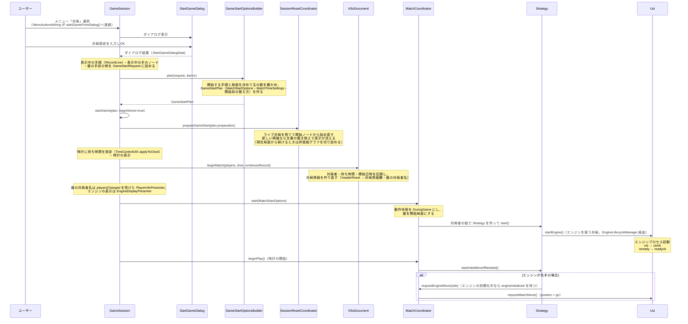

**主要クラスの役割:**

| クラス | 責務 |
|--------|------|
| `GameSession` | メニューの「対局」を受けてダイアログを出し、開始の手順（棋譜を整える → 時計 → 棋譜の文書への対局の記録 → 対局者の表示 → 対局 → 初手）を `startGame()` で順に行う（`src/app/`） |
| `StartGameDialog` | 対局者（人間・エンジン）・時間設定・開始局面のUI入力を収集し、`StartGameDialogData` として返す（`data()`）。先手・後手の欄は `PlayerSetupWidget`・`TimeControlEditor`（`src/widgets/`） |
| `GameStartOptionsBuilder` | ダイアログの値と表示中の手順から `GameStartPlan` を作る。状態を持たず、共有状態には触れない（`src/game/`） |
| `SessionResetCoordinator` | 開始前の棋譜と表示の作り直し（`prepareGameStart()`。盤面・棋譜・評価値グラフ・エンジン表示など）（`src/app/`） |
| `KifuDocument` | 対局者・持ち時間・開始日時を記録し、対局情報（対局日・開始日時・対局者・手合割・持ち時間）を作り直す（`beginMatch()`。`src/kifu/`） |
| `MatchCoordinator` | 対局進行の司令塔。対局の手順と対局者を持ち、対局者の組で Strategy を作る。時計を動かして初手の思考を頼む |
| `Usi` | USIプロトコル通信ファサード。エンジンプロセスの起動と初期化を実行 |

**補足:**
- `GameStartOptionsBuilder::plan()` は開始する手順（現在の局面から始めるなら、表示中の手順の表示中の手数まで）を決める。始められないときは理由を返し、`GameSession` が `ErrorBus` で知らせる
- 対局ダイアログからの開始・連続対局の次局（`ConsecutiveGameSeries::nextGameReady` → `GameSession::startNextGame()`）は、どれも `GameSession::startGame()` を通る。中断した対局の再開は `GameSession::resumeInterruptedGame()` が中断の行を除いて棋譜を直前の手へ戻し、`MatchCoordinator::resumeInterruptedGame()` で中断した局面・時計に戻して `beginPlay()` で時計を動かす
- 盤・棋譜欄・手番の表示は、`GameSession` が個別に命じるのではなく、分岐ツリーと表示中の手が変わったときに各部品（`BoardSyncPresenter`・`KifuDisplayPresenter` など）が自分で合わせる。メニュー・ボタンの有効/無効は動作状態（`AppActivityState`）の変化を `UiStatePolicyManager` が受けて切り替える
- `MatchCoordinator::start()` は `MatchStartOptions::players`（`MatchPlayers`）から Strategy を選ぶ。エンジン同士なら `EngineVsEngineStrategy`、片方がエンジンなら `HumanVsEngineStrategy`、人間同士なら `HumanVsHumanStrategy`（6.2 節）
- エンジン同士の対局では E1・E2 の枠に2つの `Usi` を作り、交互に go/bestmove を繰り返す

---

### 15.2 指し手実行フロー

人間が盤面をクリックして駒を移動し、合法手判定・盤面更新・棋譜記録・エンジン応答までを含む一連の処理。

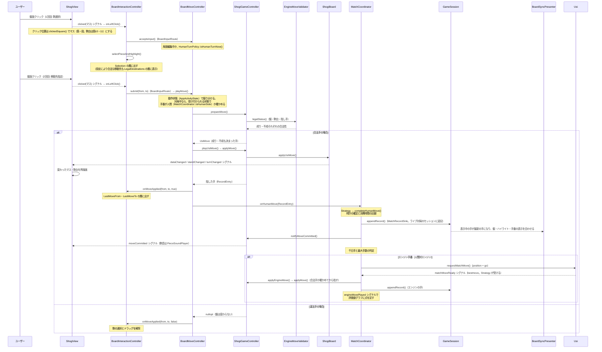

**主要クラスの役割:**

| クラス | 責務 |
|--------|------|
| `ShogiView` | 盤面の描画とマウスイベントの発行。クリックを `clickedSquare()` でマスにして `clicked` で知らせる |
| `BoardInteractionController` | 2クリック方式の駒選択と、行き先（`BoardInputRoute`）への移動元・移動先の受け渡し、ハイライト管理 |
| `BoardMoveController` | 主画面の `BoardInputRoute`。つまめるかを答え、盤で決まった手を動作状態に合わせて局面編集・棋譜の変化の記録・通信対局・対局に振り分ける（`src/ui/controllers/`） |
| `ShogiGameController` | 指し手の検証と盤面更新の実行。着手確定の知らせ（`moveCommitted`） |
| `EngineMoveValidator` | 合法手判定ロジック（王手放置、二歩、打ち歩詰め、行き所のない駒等を検査） |
| `ShogiBoard` | 9x9盤面 + 駒台のデータモデル。手番もここだけが持つ |
| `MatchCoordinator` | 一手の確定（時計・棋譜の行・千日手・最大手数）と、エンジンへの手番渡し |
| `GameSession` | 対局の棋譜の受け手（`MatchRecordSink`）。確定した行をライブ対局のセッション（分岐ツリー）に追記する |
| `BoardSyncPresenter` | 表示中の手の局面に盤を合わせ、指し手のハイライトと手番を示す（`src/ui/presenters/`） |

**補足:**
- `BoardMoveController::playMove()` が行き先（`HumanTurnPolicy::boardInput()`）で振り分ける。局面編集中は `PositionEditSession::applyEditMove()`、待機中は `BranchTreeEditController::recordMove()`、通信対局中は `csaMoveRequested(UsiMove)` シグナル、対局中は上のフローである。定跡ウィンドウの手は `playUsiMove()` から同じ処理に入る。どの場合も `onMoveApplied()` で手を受け付けたかを盤の操作へ返す
- 成り・不成は `ShogiGameController::prepareMove()` が合法性と合わせて決め、クリックを1回だけ `UsiMove` にする（盤に指すのは `applyMove()`）。両方とも合法なら成りダイアログ（`setPromotionChooser()` で渡す `DialogLauncher::choosePromotion()`）で選ばせ、成りだけが合法（行き所のない駒）なら成る（6.6 節）
- `MatchCoordinator::onHumanMove()` は対局者の組の Strategy（人間対エンジンなら `HumanVsEngineStrategy`）に渡す。Strategy は `MatchStrategyHost::completeHumanMove()` で一手を確定させ、エンジンの手番なら `requestEngineMove()` で `Usi::requestMatchMove()`（position と go）を頼み、`matchMoveReady` シグナルで受けた応手を `applyEngineMove()` で指す
- 手番は `ShogiBoard` だけが持ち、`ShogiBoard::turnChanged` を `BoardChromeWidget::setActiveSide()` が受けて盤の手番表示を切り替える。時計の表示は `TimeDisplayPresenter` が `ShogiClock::timeUpdated` を直接受けて合わせる
- 人間同士の対局ではエンジンとの通信はなく、司令塔が一手を確定して手番が交互に切り替わる。通信対局では `BoardMoveController` が `csaMoveRequested(UsiMove)` シグナルで手を `CsaGameCoordinator::onHumanMove(const UsiMove&)` へ送る（15.5）
- 対局していないときに盤で指した手は、`BranchTreeEditController::recordMove()` が棋譜の変化として記録する

---

### 15.3 棋譜読み込みフロー

棋譜ファイル（KIF / KI2 / CSA / JKF / USEN / USI形式）を読み込み、内部データモデルを構築してUIに反映するまでのフロー。

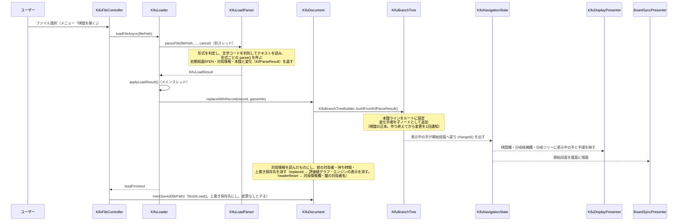

**主要クラスの役割:**

| クラス | 責務 |
|--------|------|
| `KifuFileController` | 「棋譜を開く」などのファイル操作の入口。進行ダイアログの表示と、読み込み後の上書き保存先・未保存の状態の設定（`finishLoad()`。`src/ui/coordinators/`） |
| `KifuLoader` | 棋譜ファイル・貼り付け・局面を読み、棋譜の文書を置き換える。パースの起動（別スレッド）と結果の適用（`src/kifu/`） |
| `KifuDocument` | 開いている棋譜の文書。分岐ツリーの作り直しと対局情報の置き換え、前の棋譜の対局者・持ち時間・上書き保存先の消去（`src/kifu/`） |
| `KifuLoadParser` | 形式判定、ファイルの文字コードの判別、フォーマット変換器への振り分け。結果を `KifuLoadResult` にまとめる（`src/kifu/`） |
| `KifTextParser` | KIF形式のテキストの解析（`parseKif()`。KI2 の `parseKi2()` と同じ読み取り）。手合割→SFEN変換、指し手→USI変換、変化抽出 |
| `KifLineBuilder` | 各形式のパーサが手順を組み立てる部品。手を指しながら局面を進め、棋譜の行（`RecordEntry`）を作る（`src/kifu/formats/`） |
| `KifuBranchTreeBuilder` | `KifParseResult` から分岐ツリーを組み立てる（`src/kifu/`） |
| `KifuBranchTree` | 分岐棋譜のツリー構造。本譜と変化を木構造で管理する棋譜の正本 |
| `KifuNavigationState` | 表示中のノード。ツリーや表示中の手が変わると `changed()` を出す（`src/kifu/`） |
| `KifuDisplayPresenter` | 棋譜欄（`KifuRecordListModel`）・分岐候補欄・分岐ツリーに、表示中の手と手順を映す（`src/ui/presenters/`） |
| `BoardSyncPresenter` | 表示中の手の局面に盤を合わせ、指し手のハイライトと手番を示す（`src/ui/presenters/`） |

**補足:**
- 同期版の `loadFile()` / `loadText()` / `loadPositionFromSfen()`（自動化 API・テストで使用）と、テキストからの読み込み（`loadTextAsync()`、クリップボード貼り付けで使用、形式を自動判定）も同じ `applyLoadResult()` を通る。SFEN・BOD は局面だけを読み、`loadPositionFromSfen()` で開始局面にする
- KIF以外の形式も同様のパターンで処理される: `KifTextParser::parseKi2()`（KI2形式）、`CsaToSfenConverter`（CSA形式）等。変換器はテキストを読むだけで、ファイルを読むのは `KifuLoadParser` である
- 読み込みが作るのは分岐ツリー（棋譜の正本）だけである。棋譜欄・分岐・盤は、ツリーが変わって表示中の手が開始局面へ戻ったことを受けた各部品が自分で合わせる。対局を始めるときは、表示中の手順（`KifuNavigationState::currentRecordLine()`）から司令塔の手順（`RecordLine`）を作る（15.1、8.7）
- 各手の後の局面は、パーサが手を読むたびに `KifLineBuilder::addMove()` が局面を進めて作る（8.11）。読めない手・指せない手は `ParseOptions` に従い、既定ではその手の手前で手順を打ち切って警告を出す

---

### 15.4 検討モードフロー

検討モードは、現在の局面をエンジンに解析させ、候補手と評価値をリアルタイム表示する機能。局面移動に追従して再解析する動作も含む。

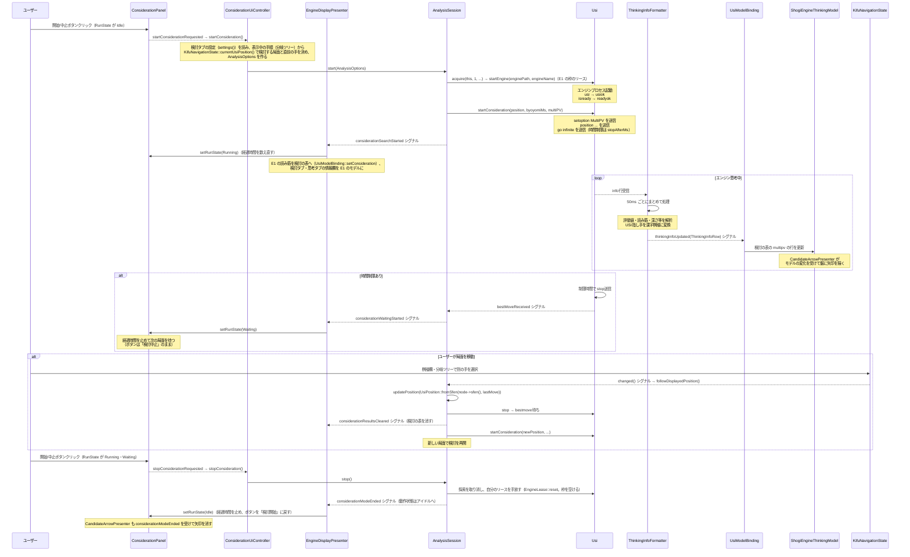

**主要クラスの役割:**

| クラス | 責務 |
|--------|------|
| `ConsiderationPanel` | 検討ドックの中身（`src/widgets/`）。エンジン選択・時間設定・MultiPV設定・矢印・開始/中止ボタン。設定は `ConsiderationSettings` を正本として持ち（`settings()`・`setSettings()`・`settingsChanged`）、保存・復元も担う。ボタンと経過時間は実行の状態（`RunState`）で決まる |
| `ConsiderationUiController` | 検討タブの開始・中止・条件の変更（エンジン・候補手の数）・エンジン設定を検討のセッションへ伝える。表示には触れない（`src/ui/controllers/`） |
| `EngineDisplayPresenter` | 検討タブの実行の状態・情報欄・検討の表への読み筋を、`AnalysisSession` の知らせだけから決める（`src/ui/presenters/`） |
| `AnalysisSession` | 検討・詰み探索のセッション。E1 の枠にエンジンを作り、局面や候補手の数が変わるたびに探索をやり直す。検討中は `KifuNavigationState::changed` を受けて表示中の局面を追う（`src/analysis/`） |
| `Usi` | エンジンへのposition/goコマンド送信、info行の受信 |
| `ThinkingInfoFormatter` | info行を解析し、評価値・読み筋（漢字変換含む）を `ThinkingInfoRow` に、探索状況を `EngineSearchStatus` にしてシグナルで通知（`src/engine/`） |
| `UsiModelBinding` | エンジン1台のシグナルを受けて、思考の表・検討の表・情報欄・通信ログのモデルを更新する（`src/ui/presenters/`） |
| `ShogiEngineThinkingModel` | 思考情報の表示モデル（MultiPV対応。`src/models/`） |
| `CandidateArrowPresenter` | 検討中（`AnalysisSession::isConsidering()`）なら、検討の表のモデルの候補手から盤の矢印を描く（`src/ui/presenters/`） |

**補足:**
- 検討モードのMultiPVは動的に変更可能。`ConsiderationPanel::settingsChanged` → `ConsiderationUiController::onSettingsChanged()` → `AnalysisSession::updateMultiPV()` の経路で伝わり、探索をやり直す
- 局面変更・MultiPV変更のやり直しは、`AnalysisSession` がエンジンに頼み直すだけで行う。探索していなければすぐ始め、探索中ならエンジンの側（`UsiEngineSession::search`）で stop を送り、結果を捨ててから最後の依頼だけを始めるので、二重に再開しない。`AnalysisSession` の状態は探索中（`Searching`）と次の局面を待つ（`Waiting`）だけ
- 矢印表示は `CandidateArrowPresenter` が、検討中かどうかを `AnalysisSession::isConsidering()` から、表示の有無を検討タブの設定（`Deps::considerationSettings`）から、候補手を検討の表のモデル（`Deps::consideration`）から読み、`ShogiView` に矢印を描く
- 検討中にエンジンを変えると、`ConsiderationUiController::onSettingsChanged()` が検討を止めて新しいエンジンで始め直す

---

### 15.5 CSA通信対局フロー

CSAプロトコルを使用したネットワーク対局の、接続からログイン、対局開始、指し手交換、対局終了までの一連のフロー。

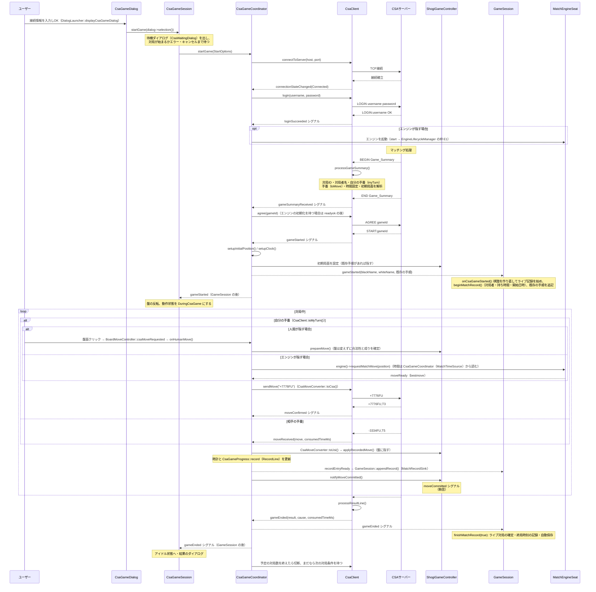

**主要クラスの役割:**

| クラス | 責務 |
|--------|------|
| `CsaGameDialog` | CSA通信対局の接続設定UI（ホスト・ポート・ユーザー名・パスワード・エンジン選択（`EngineSelector`）） |
| `CsaGameSession` | 通信対局の1回の接続を画面に反映する。接続ダイアログの値で `CsaGameCoordinator` に開始を頼み、対局の開始・手番・終局を盤の向き・評価値グラフ・ステータスバー・結果のダイアログへ映す（`src/ui/coordinators/`） |
| `GameSession` | 通信対局の棋譜（作り直し・対局者・持ち時間・開始と終了の日時・着手の行・自動保存）をローカル対局と同じ流れで受け持つ。投了・中断・入玉宣言は `CsaGameChannel` 経由でサーバーへ送る（`src/app/`） |
| `CsaGameCoordinator` | CSA通信対局の進行管理（合成ルートが起動時に1つ作る）。1局の進行（持ち時間・手数・手順）は `CsaGameProgress` に持ち、手順は `record`（`RecordLine`）1つだけ。自分の手番は持たず `CsaClient::isMyTurn()` を見る |
| `CsaClient` | CSAプロトコルのTCP/IP通信実装。メッセージの送受信と状態管理。Game_Summary は `GameSummary`（`myTurn` は `std::optional<Turn>`、`toMove` は `Turn`）にまとめる |
| `MatchEngineSeat` | エンジンで指すときの `Usi` の起動・知らせ・終局の手順（ローカル対局と共有。エンジンの枠は `EngineLifecycleManager` を使う） |
| `ShogiGameController` | 盤面データの更新と、着手確定の知らせ（`moveCommitted`） |

**補足:**
- `CsaClient`は状態マシンパターンで実装されており、`ConnectionState`が `Disconnected → Connecting → Connected → LoggedIn → WaitingForGame → GameReady → InGame → GameOver` と遷移する
- CSA形式の指し手（例: `+7776FU`）とUSI形式の指し手（例: `7g7f`）の変換は `CsaMoveConverter`（`toCsa()`・`toUsi()`）だけが担当する。どちらも指す前の盤の駒を読み、盤は動かさない。棋譜の表記は `KifMoveText::format()` で作り、盤への適用は `ShogiGameController::applyRecordedMove()` が行う
- 自分の手も相手の手も、サーバーからの確認（`moveConfirmed`／`moveReceived`）を受けてから盤に指す。盤で入力した手はその時点では盤を変えない
- 解釈できない指し手行が届いたときは、すぐ終局させずサーバーの裁定（`#ILLEGAL_MOVE` と勝敗）を待つ
- エンジン対局時は `MatchEngineSeat` が `Usi` を借り、`matchMoveReady` で受けた応手を `moveReady` で `CsaGameCoordinator` に返す
- 着手確定の知らせは、ローカル対局と同じ `ShogiGameController::moveCommitted`（`notifyMoveCommitted()` が出す）で、駒音はこれを受ける
- 終局原因（投了・時間切れ・千日手・入玉宣言等）は `CsaClient::GameEndCause` 列挙型で分類され、対応する結果表示が行われる

<!-- chapter-15-end -->

---

<!-- chapter-16-start -->
## 第16章 国際化（i18n）と翻訳

ShogiBoardQは日本語・英語・簡体字中国語・繁体字中国語の4言語をサポートしている（原文は日本語）。本章ではQtの国際化フレームワークを活用した翻訳の仕組みと、実行時の言語切替メカニズムについて解説する。

### 16.1 翻訳ワークフローの全体像

ソースコード中の `tr()` マクロで囲まれた文字列が翻訳対象となり、以下のパイプラインで処理される。

```
┌─────────────────────────────────────────────────────────────────┐
│                     翻訳ワークフロー                              │
├─────────────────────────────────────────────────────────────────┤
│                                                                 │
│  ① ソースコード (.cpp / .h / .ui)                                │
│      tr("言語設定") / tr("棋譜解析完了")                           │
│            │                                                    │
│            ▼                                                    │
│  ② lupdate（文字列抽出）                                         │
│      cmake --build build --target update_translations          │
│            │                                                    │
│            ▼                                                    │
│  ③ .ts ファイル編集（XML形式）                                    │
│      <source> に対する <translation> を記述                       │
│            │                                                    │
│            ▼                                                    │
│  ④ lrelease / cmake ビルド（バイナリ変換）                        │
│      qt_add_translation() が .ts → .qm を生成                   │
│            │                                                    │
│            ▼                                                    │
│  ⑤ .qm ファイル（コンパクトなバイナリ翻訳）                       │
│      実行時に QTranslator::load() で読み込み                      │
│                                                                 │
└─────────────────────────────────────────────────────────────────┘
```

各ステップの概要を以下にまとめる。

| ステップ | ツール/ファイル | 役割 |
|----------|----------------|------|
| ① `tr()` | ソースコード中のマクロ | 翻訳対象の文字列をマーク |
| ② `lupdate` | `update_translations` ターゲット | ソースから `.ts` ファイルへ文字列を抽出・同期（明示的に実行する） |
| ③ `.ts` 編集 | テキストエディタ or Qt Linguist | 翻訳テキストを入力 |
| ④ `lrelease` | CMakeビルド時に自動実行 | `.ts` → `.qm` バイナリ変換 |
| ⑤ `.qm` ロード | `QTranslator` + `QApplication` | 実行時に翻訳を適用 |

### 16.2 翻訳ファイルの構造

翻訳ファイルは `resources/translations/` に格納されるXML形式の `.ts` ファイルである。

| ファイル | 言語 |
|---------|------|
| `ShogiBoardQ_ja_JP.ts` | 日本語（原文と同じ訳を入れる） |
| `ShogiBoardQ_en.ts` | 英語 |
| `ShogiBoardQ_zh_CN.ts` | 簡体字中国語 |
| `ShogiBoardQ_zh_TW.ts` | 繁体字中国語（台湾の用語） |

4言語とも未翻訳（`type="unfinished"`）を0件に保つ。CI の `translation-check` ジョブは、未翻訳の数が `resources/translations/baseline-unfinished.txt` から増えると失敗する。`tst_translation_files` は、4言語のカタログ（原文の集合）とプレースホルダー（`%1` など）が揃っているかを確かめる。

#### .ts ファイルのXML構造

```xml
<?xml version="1.0" encoding="utf-8"?>
<!DOCTYPE TS>
<TS version="2.1" language="ja_JP">
  <context>
    <name>ConsiderationUiController</name>    <!-- クラス名 -->
    <message>
      <location filename="../../src/ui/controllers/considerationuicontroller.cpp" line="60"/>
      <source>将棋エンジンが選択されていません。</source>  <!-- 原文 -->
      <translation>No shogi engine is selected.</translation>  <!-- 翻訳（未翻訳なら type="unfinished" で空） -->
    </message>
    ...
  </context>
  <context>
    <name>BranchTreeView</name>
    ...
  </context>
</TS>
```

主要なXML要素を以下に示す。

| 要素 | 説明 |
|------|------|
| `<TS>` | ルート要素。`version` と `language` 属性を持つ |
| `<context>` | クラス単位のグルーピング。`<name>` でクラス名を示す |
| `<message>` | 翻訳単位。1つの `tr()` 呼び出しに対応 |
| `<location>` | ソースファイルのパスと行番号（`lupdate` が自動設定） |
| `<source>` | 翻訳元の文字列（`tr()` に渡された文字列） |
| `<translation>` | 翻訳先の文字列。未翻訳の場合は `type="unfinished"` |

`<translation>` 要素の `type` 属性の意味は以下の通り。

| type属性 | 意味 |
|----------|------|
| `type="unfinished"` | 未翻訳。翻訳テキストを追加する必要がある |
| `type="obsolete"` | ソースコードから該当する `tr()` が削除された |
| （属性なし） | 翻訳済み。正常状態 |

### 16.3 CMakeによるビルド統合

`CMakeLists.txt` で翻訳ファイルのビルドパイプラインが定義されている。

```cmake
# ==== Translations (.ts) ====
set(TS_FILES
    resources/translations/ShogiBoardQ_ja_JP.ts
    resources/translations/ShogiBoardQ_en.ts
    resources/translations/ShogiBoardQ_zh_CN.ts
    resources/translations/ShogiBoardQ_zh_TW.ts
)

# .qm 生成（lrelease のみ。ソースのスキャンはしない）
qt_add_translation(QM_FILES ${TS_FILES})
add_custom_target(translations ALL DEPENDS ${QM_FILES})
add_dependencies(ShogiBoardQ translations)

# lupdate（ソースから .ts を更新）は明示的に実行する
add_custom_target(update_translations
    COMMAND Qt6::lupdate ${CMAKE_SOURCE_DIR}/src -ts ${TS_FILES}
    WORKING_DIRECTORY ${CMAKE_SOURCE_DIR})

# .qm ファイルを実行可能ファイルと同じディレクトリにコピー
foreach(QM_FILE ${QM_FILES})
    add_custom_command(TARGET ShogiBoardQ POST_BUILD
        COMMAND ${CMAKE_COMMAND} -E copy_if_different
            ${QM_FILE}
            $<TARGET_FILE_DIR:ShogiBoardQ>)
endforeach()

# Qt 標準ダイアログの翻訳（qtbase_ja / zh_CN / zh_TW）をリソースに同梱する
qt_add_resources(ShogiBoardQ qt_dialog_translations PREFIX "/translations/qt" ...)
```

ポイント:

- 通常のビルドは `lrelease` だけを行う。ソースの `tr()` を `.ts` に反映するには `update_translations` ターゲットを実行する
- `lupdate` のスキャン対象を `${CMAKE_SOURCE_DIR}/src` に限定することで、`build/` 配下の autogen ファイルを拾わない
- 生成された `.qm` ファイルはビルド後に実行ファイルと同じディレクトリへコピーされる
- Qt 標準ダイアログ（ファイル選択など）の翻訳は、配布スクリプトが落としても使えるよう `:/translations/qt/` に埋め込む

### 16.4 起動時の翻訳ロード

`main.cpp` は `QApplication` を作った直後、ウィジェットを作る前に `ApplicationTranslations`（`src/services/applicationtranslations.h/.cpp`）を作り、終了処理まで持っておく。`ApplicationTranslations` は `AppSettings::language`（`General/language`）を読み、言語を1つに決めて翻訳を読み込む。

```
┌──────────────────────────────────────────────────────────┐
│               翻訳ロードのフロー                            │
├──────────────────────────────────────────────────────────┤
│                                                          │
│  AppSettings::language() で設定値を取得                     │
│         │  "system" ならシステムの UI 言語の先頭を使う         │
│         ▼                                                │
│  NotationStyle::resolveLanguage()                        │
│         ├── 日本語 → "ja_JP"                               │
│         ├── 中国語 → 繁体字なら "zh_TW"、それ以外は "zh_CN"   │
│         └── それ以外 → "en"                                │
│         │                                                │
│         ├→ Qt 標準ダイアログ: qtbase_<言語>.qm               │
│         │   （:/translations/qt/ → Qt の翻訳ディレクトリ）     │
│         ├→ アプリ: ShogiBoardQ_<言語>.qm                    │
│         │   （実行ファイルと同じディレクトリ）                  │
│         └→ 棋譜表記の設定: NotationStyle::configure()        │
│                                                          │
└──────────────────────────────────────────────────────────┘
```

`main.cpp` の該当部分（抜粋）:

```cpp
// 終了時の設定初期化メッセージも翻訳できるよう、このスコープで保持する。
const ApplicationTranslations translations;

configureApplicationAppearance(a, translations.language());  // フォントも言語に合わせる
```

`ApplicationTranslations` のコンストラクタ（抜粋）:

```cpp
const QStringList systemLanguages = QLocale::system().uiLanguages();
m_language = NotationStyle::resolveLanguage(AppSettings::language(),
    systemLanguages.isEmpty() ? QLocale::system().name() : systemLanguages.first());

// Qt 標準ダイアログの翻訳（日本語は "ja"）
const QString qtLanguage = m_language == QStringLiteral("ja_JP") ? QStringLiteral("ja") : m_language;
if (m_qtTranslator.load(":/translations/qt/qtbase_" + qtLanguage + ".qm")
    || m_qtTranslator.load("qtbase_" + qtLanguage, QLibraryInfo::path(QLibraryInfo::TranslationsPath)))
    QCoreApplication::installTranslator(&m_qtTranslator);

// アプリの翻訳（directory は実行ファイルと同じディレクトリ）
if (m_appTranslator.load(directory.filePath("ShogiBoardQ_" + m_language + ".qm")))
    QCoreApplication::installTranslator(&m_appTranslator);
else
    qCWarning(lcApp) << "Translation file not found:" << m_language;

// 棋譜の表記（漢数字か英字か、など）は言語と表記の設定から決める
NotationStyle::configure(m_language, AppSettings::moveNotation(), AppSettings::notationOrigin());
```

表示言語と表記の設定は services の `NotationStyle`（`src/services/notationstyle.h`）が持つ。`ApplicationTranslations` は kifu を参照しない。画面の表記を作る `KifuPresentation`（`src/kifu/kifupresentation.h`）は `NotationStyle::options()` を読み、`KifuPresentation::Notation`・`Options` は `NotationStyle` の型の別名、`configure()`・`options()`・`revision()`・`resolveLanguage()` は `NotationStyle` へ転送する。日本語表記の指し手は棋譜と同じ `KifMoveText`、段の漢数字は `ShogiNotation` で作る。英語表記で移動元を付けるかは KI2 の修飾語と同じ判定（`Ki2MoveNotation::annotate()` が返す `Annotation::sources`。合法手で決めるので、ピンされて動けない駒は数えない）で決める。

言語は日本語・英語・簡体字・繁体字のいずれかに必ず決まる。日本語のときも `ShogiBoardQ_ja_JP.qm` を読み込む（訳は原文と同じ）。`QTranslator` は `ApplicationTranslations` のメンバなので、破棄するとアプリケーションへの登録も外れる。

### 16.5 LanguageController: 実行時言語切替

LanguageControllerは、メニューからの言語と棋譜表記の選択をハンドリングし、設定の保存と再起動の案内を行うコントローラである。

**ファイル**: `src/ui/controllers/languagecontroller.h`, `src/ui/controllers/languagecontroller.cpp`

#### クラス構成

```
LanguageController (QObject)
├── Deps（メニュー項目。どれも無くてよい）
│   ├── parentWidget                      再起動の知らせ・表記の説明の親ウィジェット
│   ├── systemLanguage / japanese / english / chineseSimplified / chineseTraditional
│   │                                     言語のメニュー項目
│   └── notationAuto / notationJapanese / notationWestern / notationOrigin / notationHelp
│                                         棋譜表記のメニュー項目
├── メンバ
│   ├── m_languageGroup: QActionGroup*    言語の排他選択グループ（項目の data が言語コード "system"・"ja_JP"・"en"・"zh_CN"・"zh_TW"）
│   ├── m_notationGroup: QActionGroup*    棋譜表記（言語に合わせる・日本語表記・英語表記）の排他選択グループ
│   └── m_parentWidget: QWidget*          ダイアログ表示用の親ウィジェット
├── public メソッド
│   ├── LanguageController(Deps, parent)  メニュー項目を設定とつなぐ（コンストラクタで登録まで行う）
│   └── updateMenuState()                 現在の設定でチェック状態を更新
├── private slots
│   ├── onLanguageTriggered(QAction*)     言語の選択時（項目の data を保存し、変わっていれば再起動を案内）
│   ├── onNotationTriggered(QAction*)     棋譜表記の選択時
│   ├── onOriginTriggered(bool)           「英語表記で移動元を常に表示」の切り替え時
│   └── showNotationHelp()                棋譜表記の読み方を表示
└── private メソッド
    ├── setNotationActions()              棋譜表記のメニュー項目の登録と接続
    └── restartNotice()                   再起動の案内ダイアログ
```

#### 言語切替のシーケンス

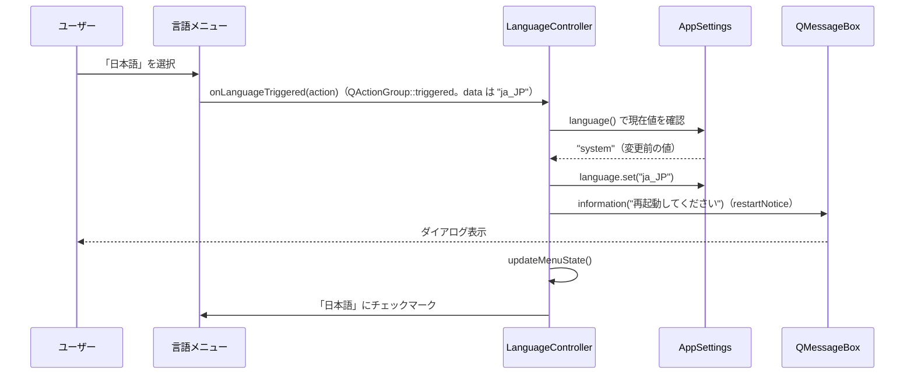

重要な設計上のポイント:

- **再起動が必要**: 言語と棋譜表記の変更は即座には反映されない。翻訳と棋譜表記は起動時に `ApplicationTranslations` が決めるため、変更を反映するにはアプリケーションの再起動が必要
- **排他選択**: `QActionGroup` により、5つの言語オプション（システム/日本語/英語/简体中文/繁體中文）は常に1つだけが選択される
- **同一言語の再選択を無視**: `onLanguageTriggered()` は現在の設定と同じ言語なら保存も案内もしない

#### 合成ルートとの統合

LanguageController は `MainWindowComposer::createControllers()` で作る。メニューのアクションは `Deps` に詰めて渡す。

```cpp
// src/app/mainwindowcomposer_create.cpp（createControllers）
LanguageController::Deps ld;
ld.parentWidget = &m_window;
ld.systemLanguage = m_ui.actionLanguageSystem;
ld.japanese = m_ui.actionLanguageJapanese;
ld.english = m_ui.actionLanguageEnglish;
ld.chineseSimplified = m_ui.actionLanguageChineseSimplified;
ld.chineseTraditional = m_ui.actionLanguageChineseTraditional;
ld.notationAuto = m_ui.actionNotationAuto;
ld.notationJapanese = m_ui.actionNotationJapanese;
ld.notationWestern = m_ui.actionNotationWestern;
ld.notationOrigin = m_ui.actionNotationOrigin;
ld.notationHelp = m_ui.actionNotationHelp;
m_c.languageController = new LanguageController(ld, &m_window);
```

コンストラクタの内部で各アクションの `triggered` シグナルと対応するスロットが接続されるため、呼び出し側での追加的な `connect()` は不要である。

### 16.6 AppSettingsによる言語設定の永続化

言語設定は `AppSettings::language`（`src/services/appsettings.h`）としてINIファイルに保存される。ほかの設定と同じく、宣言の表に1行で書いた `Setting<QString>` である（§12.5）。

```cpp
// appsettings.h
/// 言語コード（デフォルト: "system"）
inline const Setting<QString> language{"General/language", "system"};

// 読み書き
const QString current = AppSettings::language();  // LanguageController::changeLanguage()
AppSettings::language.set(lang);
```

起動時は `ApplicationTranslations`（`src/services/applicationtranslations.cpp`）がこの値を読み、`"system"` ならシステムのUI言語から解決して翻訳ファイルを選ぶ。

| 設定キー | 取りうる値 | デフォルト | 説明 |
|---------|-----------|-----------|------|
| `General/language` | `"system"`, `"ja_JP"`, `"en"`, `"zh_CN"`, `"zh_TW"` | `"system"` | 表示言語の設定 |

### 16.7 翻訳追加の手順

新しい翻訳可能文字列を追加してから翻訳が反映されるまでの具体的な手順を示す。

#### ステップ1: ソースコードで `tr()` を使用

```cpp
// 新しいダイアログメッセージを追加する例
QMessageBox::information(this,
    tr("エクスポート完了"),
    tr("棋譜のエクスポートが完了しました。"));
```

#### ステップ2: `lupdate` で翻訳ファイルを更新

```bash
cmake --build build --target update_translations
```

このコマンドにより、新しい `tr()` 文字列が4言語の `.ts` ファイルに `type="unfinished"` として追加される。既存の翻訳は保持される。

#### ステップ3: `.ts` ファイルを編集して翻訳を入力

日本語が原文の場合、英語・簡体字・繁体字（`ShogiBoardQ_en.ts`・`ShogiBoardQ_zh_CN.ts`・`ShogiBoardQ_zh_TW.ts`）に翻訳を追加し、`ShogiBoardQ_ja_JP.ts` には原文と同じ文字列を訳として入れる。英語の例:

```xml
<message>
    <source>エクスポート完了</source>
    <translation>Export Complete</translation>   <!-- type="unfinished" を削除 -->
</message>
<message>
    <source>棋譜のエクスポートが完了しました。</source>
    <translation>Kifu export has been completed.</translation>
</message>
```

翻訳を入力したら `type="unfinished"` 属性を削除する（または Qt Linguist で翻訳済みにマークする）。4言語とも未翻訳が0件になったことを確かめる。

```bash
grep -c 'type="unfinished"' resources/translations/*.ts
```

`%n` の複数形（`<numerusform>`）は使わない。`tst_translation_files` が訳を空と判定する。件数は `%2` などの通常の引数で渡す。

#### ステップ4: ビルドして .qm を生成

```bash
cmake --build build
```

CMakeの `qt_add_translation()` が `lrelease` を実行し、`.ts` → `.qm` の変換が行われる。

#### ステップ5: 動作確認

アプリケーションを起動し、言語メニューから対象言語を選択（→再起動）して翻訳が反映されていることを確認する。

### 16.8 `tr()` マクロの使い方

#### 基本的な使い方

```cpp
// QObject を継承するクラス内で使用
setWindowTitle(tr("対局設定"));

// 引数を含む文字列
statusBar()->showMessage(tr("手数: %1").arg(moveCount));
```

#### 注意事項

| 項目 | 説明 |
|------|------|
| QObject派生クラス内で使用 | `tr()` は `QObject::tr()` のマクロであり、QObject派生クラスのメンバ関数内で使用する |
| QObject でないクラス・名前空間 | クラスは `Q_DECLARE_TR_FUNCTIONS(クラス名)` を付けて `tr()` を使う。関数だけの名前空間は `QCoreApplication::translate("文脈名", "...")` に文脈名をリテラルで渡す。`QObject::tr()` を借りると文脈が `QObject` になり、同じ原文の別の箇所と訳を分けられない。`lupdate` は自作の関数に包んだ文字列を拾わない |
| リテラル文字列のみ | `tr(variable)` はNG。`lupdate` は静的にソースを解析するため、リテラル文字列のみ抽出できる |
| `%1`, `%2` で引数 | `QString::arg()` と組み合わせて動的な値を埋め込む |
| `.ui` ファイル | Qt Designer で設定した文字列は自動的に `tr()` でラップされる |

<!-- chapter-16-end -->

---

<!-- chapter-17-start -->
## 第17章 新機能の追加ガイド

本章では、ShogiBoardQに新機能を追加する際の標準的な手順を、実践チュートリアル形式で解説する。仮の新機能「棋譜にタグを付ける機能」（棋譜ファイルに「急戦」「居飛車」等のタグを付与し、検索・フィルタリングを可能にする）を題材として、ファイル配置からビルド確認までの全工程を一通り示す。

### 17.1 ファイル配置先の選定

新しいクラスをどのディレクトリに配置するかは、そのクラスの責務で決まる。判断基準を以下にまとめる。

#### ディレクトリ選定フローチャート

```
新クラスの主な責務は？
│
├─ 将棋のルール・盤面ロジック ──→ src/core/
│
├─ 対局進行・ゲーム管理 ──→ src/game/
│
├─ 棋譜データ・フォーマット変換 ──→ src/kifu/
│    └─ フォーマット変換器 ──→ src/kifu/formats/
│
├─ エンジン通信・USIプロトコル ──→ src/engine/
│
├─ 解析（検討・棋譜解析・詰将棋） ──→ src/analysis/
│
├─ ネットワーク通信（CSA） ──→ src/network/
│
├─ ナビゲーション（棋譜移動・分岐） ──→ src/navigation/
│
├─ 盤面操作（編集・画像出力） ──→ src/board/
│
├─ UI関連
│    ├─ データ表示の同期 ──→ src/ui/presenters/
│    ├─ ユーザー操作のハンドリング ──→ src/ui/controllers/
│    └─ 複数コンポーネントの調整・ダイアログの起動 ──→ src/ui/coordinators/
│
├─ 部品の組み立て（合成ルート。生成とシグナル接続）・メニューのアクションの接続・
│  利用者操作の振り分け・対局の流れの UI 側 ──→ src/app/
│
├─ ウィジェット（再利用可能なUI部品） ──→ src/widgets/
│
├─ ダイアログ（モーダル/モードレス） ──→ src/dialogs/
│
├─ Qtモデル（QAbstractListModel等） ──→ src/models/
│
├─ 設定・永続化・横断サービス ──→ src/services/
│
├─ ウィジェットの書体・アプリのスタイル・スタイルシート ──→ src/style/
│
├─ 自動化 API ──→ src/automation/
│
├─ CLI・自動化 API・MCP が共有する GUI 非依存の部品（引数の表・エラーの分類・変換・エンジンの実行器）──→ src/headless/
│
├─ CLI（shogiboardq-cli）のコマンド ──→ src/cli/
│
└─ ログ・エラー通知・共有状態などの土台 ──→ src/common/
```

置き場所は層の規則にも合わせる。下の層は上の層を `#include` しない。下から順に core・common → services → kifu → engine → game → analysis・network・navigation → style → models → views・widgets → board → dialogs → ui → app で、automation・cli は外側の入口である（analysis・network・navigation は互いを参照しない）。`tests/tst_layer_dependencies.cpp` が `#include` を調べて確かめる（§3.2）。たとえば game のクラスは ui の部品を知らないので、表示や棋譜への反映はシグナルか、上の層が実装するインターフェース（司令塔の棋譜の受け手 `MatchRecordSink` を app の `GameSession` が実装する、など）で知らせる。

#### 今回の例: 棋譜タグ機能

棋譜タグ機能は以下の3つのクラスで構成すると仮定する。

| クラス | 責務 | 配置先 |
|-------|------|--------|
| `KifuTagModel` | タグデータの管理（追加・削除・検索） | `src/models/` |
| `KifuTagController` | タグ編集の操作の処理（ダイアログを出し、結果を受ける） | `src/ui/controllers/` |
| `KifuTagDialog` | タグ編集ダイアログのUI | `src/dialogs/` |

`KifuTagController`（ui）は `KifuTagModel`（models）と `KifuTagDialog`（dialogs）を参照できるが、逆向きの参照はできない。クラス名は役割に合わせる（`*Wiring` はシグナルの接続だけ、`*Presenter` は表示への反映、`*Controller` は利用者操作の処理、`*Coordinator` は複数の部品にまたがる流れ）。タグ編集はメニューからの操作を処理するので `*Controller` とする。

> **ポイント**: ヘッダファイル（`.h`）は対応するソースファイル（`.cpp`）と同じディレクトリに配置する。ソースファイルは `CMakeLists.txt` に列挙しているので、配置先に対応する `SRC_*`（例: `src/models/` なら `SRC_MODELS`）に `.cpp` と `.h` を書き足す（[1.4節](#14-cmakeビルド構成の概要)）。

### 17.2 Deps構造体を持つ新クラスの作成

新しいクラスは第4章で解説した「Deps構造体パターン」に従う。ここでは `KifuTagController` の実装例を示す。

#### ヘッダファイル

```cpp
// src/ui/controllers/kifutagcontroller.h

#ifndef KIFUTAGCONTROLLER_H
#define KIFUTAGCONTROLLER_H

/// @file kifutagcontroller.h
/// @brief 棋譜タグ編集の操作を処理するコントローラの定義

#include <QObject>

class QWidget;
class KifuTagModel;

/**
 * @brief 棋譜タグ編集の操作を処理するクラス
 *
 * 責務:
 * - タグ編集ダイアログの表示制御
 * - ダイアログの結果の受け取り
 *
 * Deps構造体で必要なオブジェクトを受け取る（合成ルートが起動時に1回渡す）。
 */
class KifuTagController : public QObject
{
    Q_OBJECT

public:
    /// 依存オブジェクト
    struct Deps {
        QWidget* parentWidget = nullptr;       ///< 親ウィジェット（必須、非所有）
        KifuTagModel* tagModel = nullptr;      ///< タグモデル（必須、非所有）
    };

    explicit KifuTagController(const Deps& deps, QObject* parent = nullptr);

public slots:
    /// タグ編集ダイアログを表示する（actionEditTags に接続）
    void showTagEditDialog();

signals:
    /// タグ変更の保存を要求する（→ KifuFileController::overwriteKifuFile）
    void saveRequested();

private:
    QWidget* m_parentWidget = nullptr;  ///< 親ウィジェット（非所有）
    KifuTagModel* m_tagModel = nullptr; ///< タグモデル（非所有）
};

#endif // KIFUTAGCONTROLLER_H
```

#### ソースファイル

```cpp
// src/ui/controllers/kifutagcontroller.cpp

/// @file kifutagcontroller.cpp
/// @brief 棋譜タグ編集の操作を処理するコントローラの実装

#include "kifutagcontroller.h"

#include "kifutagmodel.h"
#include "kifutagdialog.h"

// ============================================================
// 初期化
// ============================================================

KifuTagController::KifuTagController(const Deps& deps, QObject* parent)
    : QObject(parent)
    , m_parentWidget(deps.parentWidget)
    , m_tagModel(deps.tagModel)
{
    Q_ASSERT(m_parentWidget && m_tagModel);
}

// ============================================================
// スロット
// ============================================================

void KifuTagController::showTagEditDialog()
{
    KifuTagDialog dialog(m_tagModel, m_parentWidget);
    // 保存はダイアログで OK を押したときだけ。キャンセルでは棋譜を書き換えない
    if (dialog.exec() == QDialog::Accepted) {
        emit saveRequested();
    }
}
```

**テンプレートの要点**:

| 要素 | ルール |
|------|--------|
| **Deps のフィールド** | 全て `nullptr` または適切なデフォルト値で初期化。必須の依存はコンストラクタで `Q_ASSERT` する |
| **コンストラクタ** | 初期化リストで `Deps` の値をメンバーにコピー。作ったあとに `set*` で依存を注入しない |
| **ファイルヘッダー** | `@file` と `@brief` の2行（commenting-style-guide.md §2） |
| **クラスコメント** | `@brief` + 責務の箇条書き（commenting-style-guide.md §3） |

### 17.3 合成ルートに部品を追加

部品の生成と依存の設定は、MainWindow ではなく合成ルート（`MainWindowComposer`）で行う。部品は起動時に1回だけ作り、`ensure*()` は使わない（[4.2節](#42-合成ルートでの組み立て)、[composition-root.md](composition-root.md)）。

#### 1. MainWindowComponents にメンバーを宣言

```cpp
// src/app/mainwindowcomponents.h に追加

class KifuTagController;
class KifuTagModel;

struct MainWindowComponents {
    // ...
    // --- 利用者の操作 ---
    KifuTagModel* kifuTagModel = nullptr;
    KifuTagController* kifuTagController = nullptr;
};
```

> **ポイント**: 前方宣言をヘッダ冒頭の前方宣言セクションに追加する。`#include` ではなく前方宣言を使うことで、ヘッダの依存関係を最小化する。QObject は MainWindow を親にした生ポインタ、QObject でないものは `std::unique_ptr` で持つ。

#### 2. 生成段階で作る

依存する部品が先にできている順に、`compose()` が呼ぶ `create*()` の該当する段階で作る。`Deps` は作るときにコンストラクタへ渡す。

```cpp
// src/app/mainwindowcomposer_create.cpp（createControllers の末尾）

// Lifetime: MainWindow の子（親が破棄する）。起動時に1回だけ作る
m_c.kifuTagModel = new KifuTagModel(&m_window);

KifuTagController::Deps td;
td.parentWidget = &m_window;
td.tagModel = m_c.kifuTagModel;
m_c.kifuTagController = new KifuTagController(td, &m_window);
```

依存する部品は先に作っておく（作った後に `set*` で注入しない）。モデルのように依存のない部品は、それを使う部品より前の段階（`createRecordAndModels()` など）で作ってもよい。

動作状態が要るときは、値を写さずに `AppActivityState` へのポインタ（`&m_activity`）を渡し、部品は使うときに読む。状態を変える部品は `begin()` で `ActivityLease` を受け取る。個々のフィールドへのポインタ（`QString*` など）は渡さない。部品を `std::function<X*()>` のゲッターで渡さない。

#### 4. シグナルをつなぐ

部品どうしのシグナルは、全部品を作ってから `mainwindowcomposer_wire.cpp` の `connectRecord()`・`connectBoard()`・`connectGame()`・`connectAnalysisAndUi()` でつなぐ（§17.4）。

`tst_structural_kpi` の `appLayerHasNoLazyEnsure` が app 層に `ensure*` がないことを確かめる。テストから部品を読むときは `MainWindow::composer().parts().kifuTagController` を使う。

### 17.4 シグナル/スロットの接続

シグナル/スロット接続は **`connect()` のメンバー関数ポインタ構文** を使用する。ラムダ式は禁止である（CLAUDE.md の Code Style 参照）。

#### 接続コードの例

```cpp
// src/app/menuactionswiring.cpp（wire。メニュー項目 → 処理する部品のスロット）
QObject::connect(ui->actionEditTags, &QAction::triggered,
                 d.tags, &KifuTagController::showTagEditDialog);

// src/app/mainwindowcomposer_wire.cpp（connectRecord。部品のシグナル → 別の部品のスロット）
connect(m_c.kifuTagController, &KifuTagController::saveRequested,
        m_c.kifuFileController, &KifuFileController::overwriteKifuFile);
```

メニュー・ツールバーの項目は、`MenuActionsWiring::wire()`（`src/app/menuactionswiring.cpp`）が処理する部品へまとめてつないでいる。つなぐ先は `MenuActionsWiring::Deps` で受け取る（この例では `Deps` に `KifuTagController* tags` を足す）。部品どうしのシグナルは、合成ルートの `connect*()` に、関係する段（棋譜・盤・対局・検討と通知）ごとに書く。

#### 接続時の注意事項

| ルール | 理由 | 例 |
|--------|------|-----|
| ラムダ禁止 | 接続の追跡を困難にするため | `connect(a, &A::sig, [this](){...})` は使わない |
| `Qt::UniqueConnection` | 重複接続を防ぐ（同じ接続を二度通りうる場合） | `connect(..., Qt::UniqueConnection)` |
| 接続先のコメント | コードを追わずに接続関係を把握できるようにする | `/// タグ変更の保存を要求（→ KifuFileController）` |

#### 部品が内部に持つ下位の部品の接続

部品が内部に下位の部品を持つ場合は、下位の部品を作るところで、そのシグナルを接続する。app 層の外の部品が自分の中に持つ下位の部品は、必要になったときに作ってよい（下の例）。起動時から要る下位の部品は、持ち主のコンストラクタで作ってつなぐ（実例: `MenuWindowController`・`JosekiWindowController` は、起動時にドックへ入れるメニューウィンドウ・定跡ウィンドウをコンストラクタで作ってシグナルをつなぐ）。app 層の部品は、合成ルートが起動時に作る。

```cpp
void KifuTagController::ensureTagEditor()
{
    if (m_tagEditor) return;

    m_tagEditor = new KifuTagEditor(this);

    // 下位の部品のシグナルを、この部品のスロットで受ける
    connect(m_tagEditor, &KifuTagEditor::tagAdded,
            this, &KifuTagController::onTagAdded);
}
```

### 17.5 設定の宣言の表に設定項目を追加

ダイアログの状態（ウィンドウサイズ、フォントサイズ等）を永続化する場合は、ドメイン別ヘッダーの宣言の表に `Setting<T>` を1行ずつ足す（§12.5、[settings-service.md](settings-service.md)）。getter と setter の組やキー定数は書かない。

#### 1. ドメイン別ヘッダーに宣言を追加

棋譜タグは対局・棋譜の設定なので `gamesettings.h` に置く。

```cpp
// src/services/gamesettings.h — namespace GameSettings 内に追加

/// 棋譜タグダイアログのフォントサイズ（デフォルト: 10）
inline const Setting<int> kifuTagDialogFontSize{"FontSize/kifuTag", 10};

/// 棋譜タグダイアログのウィンドウサイズ（デフォルト: 400x300）
inline const Setting<QSize> kifuTagDialogSize{"SizeRelated/kifuTagDialogSize", QSize(400, 300)};
```

宣言は `inline const` なので `.cpp` への実装は要らない。

#### 2. ダイアログ側で読み込み・保存

```cpp
// src/dialogs/kifutagdialog.cpp

KifuTagDialog::KifuTagDialog(KifuTagModel* model, QWidget* parent)
    : QDialog(parent)
    , m_model(model)
{
    setupUi();

    // 文字の大きさ（初期値を読み、変更のたびに保存する。A-/A+ は決定ボタンの列に作る）
    DialogFontScale::install(this, GameSettings::kifuTagDialogFontSize);

    // 設定の読み込み
    DialogUtils::restoreDialogSize(this, GameSettings::kifuTagDialogSize);
}

void KifuTagDialog::closeEvent(QCloseEvent* event)
{
    // 設定の保存（フォントサイズは DialogFontScale が保存済み）
    DialogUtils::saveDialogSize(this, GameSettings::kifuTagDialogSize);
    QDialog::closeEvent(event);
}
```

ダイアログには `FontSizeHelper` のメンバ、A-/A+ 用の connect やスロット、`applyFontSize()` を書かない。`DialogFontScale` が A-/A+ を `FontSizeControl` で結び、変わるたびに全部品（コンボボックスの一覧・ダイアログのメニューを含む）へ反映する。

- **ボタンの置き場所**: .ui などにダイアログ自身の A-/A+ を置くときは、`Options` の `decrease`・`increase`（大きさの表示があれば `sizeLabel`）に渡す。渡さなければ決定ボタンの列の横に作る
- **大きさ**: `Options::size` に `Setting<QSize>` を渡すと、ダイアログの大きさも開くときに戻し、閉じるときに保存する（上の `restoreDialogSize` / `saveDialogSize` を書かなくてよい）
- **相対の大きさ**: 各部品を元の大きさからの差で拡大・縮小するので、太字や大きめの見出しは作るときに1回だけ相対の大きさを決める。変わるたびに付け直さない
- **追加の調整**: 行の高さなど大きさに合わせた処理は、`install()` が返す部品の `fontSize()`（`FontSizeHelper*`）の `fontSizeChanged` につなぐ（`KifuPasteDialog`・`JishogiScoreDialog` と同じ形）。内容を作り直して後から部品を足したときは `rescale()` を呼ぶ
- **対象外**: 盤面など文字の大きさを自分で決める部品は、プロパティ `dialogFontScaleExcluded` を true にする（`TsumePlayDialog` の盤の `ShogiView` など）

ダイアログ自身の A-/A+ を置き、行の高さも合わせるときは次のように書く。

```cpp
DialogFontScale::Options fontOptions;
fontOptions.decrease = m_fontDecrease;
fontOptions.increase = m_fontIncrease;
fontOptions.sizeLabel = m_fontSizeLabel;
auto* fontScale = DialogFontScale::install(this, GameSettings::kifuTagDialogFontSize, fontOptions);
connect(fontScale->fontSize(), &FontSizeHelper::fontSizeChanged, this, &KifuTagDialog::fitRowHeights);
```

#### 設定項目を追加するときの規約

| 項目 | 規約 |
|------|------|
| **置き場所** | 機能に合うドメイン別ヘッダー（`appsettings.h`・`gamesettings.h`・`analysissettings.h`・`networksettings.h`・`josekisettings.h`・`tsumeshogisettings.h`・`enginedialogsettings.h`・`docksettings.h`） |
| **宣言** | `inline const Setting<T> name{"Group/key", 既定値};` を1行。ドキュメントコメントに既定値を書く。範囲付きは `BoundedSetting<T>`、構造体は `StructSetting<T>`、配列は `ListSetting<T>`・`StructListSetting<T>`（§12.5） |
| **INIキー命名** | `グループ名/キー名` 形式（例: `FontSize/kifuTag`）。キーを変えると保存済みの値は読まれなくなる |
| **読み書き** | `NS::name()` / `NS::name.set(v)` / `NS::name.defaultValue()`。既定値が翻訳文や実行時の場所で決まる項目は `NS::name.valueOr(...)` |
| **関数にする項目** | 宣言の型で表せない処理（古い保存値の引き継ぎ、未保存の項目の代わり、独自の保存形式など）が要るものだけ。`SettingsCommon::openSettings()` を使い、キーは `settingskeys.h` に置く |
| **QSettings の直接構築** | `beginReadArray` / `beginGroup` でグループを開いたまま読み書きする配列データだけ（`QSettings settings(SettingsCommon::settingsFilePath(), QSettings::IniFormat)`） |
| **永続化対象の判断** | ウィンドウサイズ、フォントサイズ、列幅、最後の選択状態など |

### 17.6 tr()による翻訳対応

ユーザーに表示する文字列は全て `tr()` でラップし、翻訳可能にする。

#### tr() の使い方

```cpp
// 基本形: QObject 派生クラス内
setWindowTitle(tr("タグ編集"));

// パラメータ付き
statusBar()->showMessage(tr("%1 件のタグを追加しました").arg(count));

// コンテキスト付き（同じ文字列でも異なるクラスで別の翻訳が必要な場合）
// tr() は自動的にクラス名をコンテキストとして使用する

// QObject 非派生クラスの場合
QCoreApplication::translate("KifuTagDialog", "タグ編集");
```

#### 翻訳で避けるべきパターン

```cpp
// 悪い例: 文字列の連結
label->setText(tr("合計") + ": " + QString::number(count) + tr("件"));

// 良い例: %1 プレースホルダを使う
label->setText(tr("合計: %1 件").arg(count));

// 悪い例: 翻訳不要な文字列を tr() で囲む
qDebug() << tr("Debug message");   // デバッグログは翻訳不要

// 良い例: tr() を付けない
qDebug() << "Debug message";
```

#### lupdate の実行

`tr()` でラップした文字列を追加・変更したら、翻訳ファイルを更新する。

```bash
cmake --build build --target update_translations
```

4言語（`ja_JP`・`en`・`zh_CN`・`zh_TW`）の `.ts` ファイルがまとめて更新される（§16.7）。

#### .ts ファイルの編集

`lupdate` 実行後、`.ts` ファイル内の `type="unfinished"` エントリに翻訳を追加する。

```xml
<!-- resources/translations/ShogiBoardQ_en.ts に追加されるエントリ例 -->
<context>
    <name>KifuTagDialog</name>
    <message>
        <source>タグ編集</source>
        <translation type="unfinished"></translation>  <!-- ← 翻訳を追加 -->
    </message>
</context>
```

翻訳を追加した後:

```xml
<message>
    <source>タグ編集</source>
    <translation>Edit Tags</translation>  <!-- type属性を削除 -->
</message>
```

> **参考**: 翻訳ワークフローの詳細は [第16章](#第16章-国際化i18nと翻訳) を参照。

### 17.7 コメントの記述

[commenting-style-guide.md](commenting-style-guide.md) に従ってコメントを記述する。ここでは新機能追加時に必要なコメントの種類と具体例をまとめる。

#### ファイルヘッダー（§2）

全ての `.h` / `.cpp` ファイルに `@file` と `@brief` を付ける。

```cpp
// .h ファイル
/// @file kifutagcontroller.h
/// @brief 棋譜タグ編集の操作を処理するコントローラの定義

// .cpp ファイル
/// @file kifutagcontroller.cpp
/// @brief 棋譜タグ編集の操作を処理するコントローラの実装
```

#### クラスコメント（§3）

クラス宣言の直前に `@brief` + 責務を記述する。Deps構造体を持つクラスでは、Depsパターンの使用を明記する。

```cpp
/**
 * @brief 棋譜タグ編集の操作を処理するクラス
 *
 * 責務:
 * - タグ編集ダイアログの表示制御
 * - ダイアログの結果の受け取り
 *
 * Deps構造体で必要なオブジェクトを受け取る（合成ルートが起動時に1回渡す）。
 */
class KifuTagController : public QObject
```

#### シグナル・スロットコメント（§5）

接続元または接続先を明示する。

```cpp
signals:
    /// タグ変更の保存を要求する（→ KifuFileController::overwriteKifuFile）
    void saveRequested();

public slots:
    /// タグ編集ダイアログを表示する（actionEditTags に接続）
    void showTagEditDialog();
```

#### メンバー変数（§6）

`///<` で行末コメントを付ける。ポインタは所有権を明記する。

```cpp
private:
    QWidget* m_parentWidget = nullptr;     ///< 親ウィジェット（非所有）
    KifuTagModel* m_tagModel = nullptr;    ///< タグモデル（非所有）
```

#### .cpp 内のインラインコメント（§9）

**Why（なぜ）** を書く。コードの繰り返しは書かない。

```cpp
// 良い例: なぜそうするかを説明
// 保存はダイアログで OK を押したときだけ。キャンセルでは棋譜を書き換えない
if (dialog.exec() == QDialog::Accepted) {
    emit saveRequested();
}

// 悪い例: コードの繰り返し
// ダイアログを表示する  ← 見れば分かる
dialog.exec();
```

#### セクション区切り（§8）

```cpp
// .h 内
public:
    // --- 初期化 ---
    explicit KifuTagController(const Deps& deps, QObject* parent = nullptr);

    // --- 操作 ---
    void showTagEditDialog();

// .cpp 内
// ============================================================
// 初期化
// ============================================================

KifuTagController::KifuTagController(const Deps& deps, QObject* parent)
```

### 17.8 チェックリスト

新機能の追加が完了したら、以下の項目を確認する。

#### コーディング規約チェック

| # | 確認項目 | 参照 |
|---|---------|------|
| 1 | `connect()` でラムダ式を使っていないか | CLAUDE.md Code Style |
| 2 | `std::as_const()` でQt コンテナの detach を防いでいるか | CLAUDE.md Code Style |
| 3 | コンパイラ警告が出ていないか（`-Wall -Wextra -Wpedantic -Wshadow -Wconversion`） | CLAUDE.md Code Style |
| 4 | `tr()` でユーザー向け文字列をラップしているか | 第16章、§17.6 |
| 5 | commenting-style-guide.md に従ったコメントを書いたか | §17.7 |

#### 設計パターンチェック

| # | 確認項目 | 参照 |
|---|---------|------|
| 6 | `Deps` 構造体で依存を注入しているか | 第4章 §4.1 |
| 7 | 部品を `MainWindowComponents` に足し、合成ルートで1回だけ作っているか（app 層に `ensure*()` を置かない） | 第4章 §4.2 |
| 8 | 依存をポインタで渡しているか（`std::function<X*()>` のゲッターを使わず、動作状態は `AppActivityState` を指す） | 第4章 §4.2 |
| 9 | MainWindowへのロジック追加を最小限にしているか | CLAUDE.md Design Principles |
| 10 | ポインタの所有権をコメントで明記しているか | commenting-style-guide.md §6 |

#### 設定の永続化チェック

| # | 確認項目 | 参照 |
|---|---------|------|
| 11 | ダイアログのウィンドウサイズを保存しているか（`DialogUtils::restoreDialogSize` / `saveDialogSize`） | CLAUDE.md Settings Update Guidelines |
| 12 | フォントサイズ調整機能がある場合、サイズを保存しているか（ダイアログは `DialogFontScale::install` に、パネルは `FontSizeHelper` に宣言を渡し、ボタンは `FontSizeControl` で結ぶ） | CLAUDE.md Settings Update Guidelines |
| 13 | テーブル/リストの列幅を保存しているか（該当する場合） | CLAUDE.md Settings Update Guidelines |
| 14 | コンボボックス等の選択状態を保存しているか（該当する場合） | CLAUDE.md Settings Update Guidelines |

どの項目も、getter と setter の組ではなく `Setting<T>` の宣言1行で足す。関数にするのは処理が要る項目だけ（§17.5）。

#### 翻訳チェック

| # | 確認項目 | 参照 |
|---|---------|------|
| 15 | `update_translations` ターゲット（`lupdate`）を実行して `.ts` ファイルを更新したか | CLAUDE.md Translation Guidelines |
| 16 | 4言語の `.ts` ファイルの `type="unfinished"` エントリに翻訳を追加し、未翻訳が0件か | 第16章 §16.2、§16.7 |
| 17 | デバッグログやINIキー等の翻訳不要な文字列に `tr()` を付けていないか | §17.6 |

#### ビルド・動作確認チェック

| # | 確認項目 | 手順 |
|---|---------|------|
| 18 | ビルドが通るか | `cmake --build build` |
| 19 | clang-tidy の警告が出ていないか | `cmake -B build -DENABLE_CLANG_TIDY=ON && cmake --build build` |
| 20 | 追加した機能が正常に動作するか | `./build/ShogiBoardQ` で手動確認 |

#### 全手順のまとめ

```
新機能の追加手順

① ファイル配置先を決定（§17.1 のフローチャート参照）
     │
② ヘッダ / ソースファイルを作成（§17.2）
   ├─ Deps 構造体を定義
   ├─ コンストラクタを実装（Deps の値をメンバーへ）
   └─ スロットメソッドを実装
     │
③ 合成ルートに部品を追加（§17.3）
   ├─ mainwindowcomponents.h にメンバーを宣言
   ├─ MainWindowComposer の create*() で、Deps を渡して1回だけ作る
   └─ CMakeLists.txt の SRC_* に新しいファイルを列挙（§1.4）
     │
④ シグナル / スロット接続を追加（§17.4）
   ├─ メニューの項目は MenuActionsWiring::wire()、部品どうしは connect*()
   └─ connect() はメンバー関数ポインタ構文のみ
     │
⑤ 設定の宣言の表に設定項目を追加（§17.5）
   ├─ ドメイン別ヘッダーに Setting<T> を1行ずつ宣言
   └─ ダイアログで読み込み / 保存（DialogFontScale・DialogUtils に宣言を渡す）
     │
⑥ tr() で翻訳対応（§17.6）
   ├─ ユーザー向け文字列を tr() でラップ
   ├─ lupdate を実行
   └─ .ts ファイルに翻訳を追加
     │
⑦ コメントを記述（§17.7）
   └─ commenting-style-guide.md に準拠
     │
⑧ チェックリストで最終確認（§17.8）
   └─ ビルド → clang-tidy → 動作確認
```

<!-- chapter-17-end -->

---

<!-- chapter-18-start -->
## 第18章 用語集・索引

本章は、ShogiBoardQの開発において頻出する将棋用語・技術略語を整理し、全クラスとファイルの逆引き索引を提供する。

---

### 18.1 将棋用語 日英対応表

| 日本語 | 英語 | SFEN/USI表記 | 補足 |
|--------|------|-------------|------|
| 先手（せんて） | Black / First player | `b` | SFEN手番表記。先に指す側 |
| 後手（ごて） | White / Second player | `w` | SFEN手番表記 |
| 玉将（ぎょくしょう） | King | `K` / `k` | 先手=`K`、後手=`k` |
| 飛車（ひしゃ） | Rook | `R` / `r` | 成ると竜王（`+R`） |
| 角行（かくぎょう） | Bishop | `B` / `b` | 成ると竜馬（`+B`） |
| 金将（きんしょう） | Gold | `G` / `g` | 成りなし |
| 銀将（ぎんしょう） | Silver | `S` / `s` | 成ると成銀（`+S`） |
| 桂馬（けいま） | Knight | `N` / `n` | 成ると成桂（`+N`） |
| 香車（きょうしゃ） | Lance | `L` / `l` | 成ると成香（`+L`） |
| 歩兵（ふひょう） | Pawn | `P` / `p` | 成ると「と金」（`+P`） |
| 成る（なる） | Promote | `+`（USI末尾） | 例: `7c7b+` |
| 不成（ならず） | Non-promote | （`+`なし） | 例: `7c7b` |
| 持ち駒（もちごま） | Hand pieces / Pieces in hand | SFEN第3フィールド | 例: `S2Pb2p` |
| 王手（おうて） | Check | — | 玉が取られる状態 |
| 詰み（つみ） | Checkmate | `mate` | USIの`score mate N` |
| 千日手（せんにちて） | Repetition | — | 同一局面4回で引き分け |
| 入玉（にゅうぎょく） | Entering King | — | 玉が敵陣に入ること |
| 持将棋（じしょうぎ） | Impasse / Jishogi | — | 両玉入玉で点数判定 |
| 投了（とうりょう） | Resignation | — | 負けを宣言 |
| 中断（ちゅうだん） | Adjournment / Break | — | 対局の一時停止 |
| 筋（すじ） | File | 1〜9（右→左） | 縦の列。9が左端 |
| 段（だん） | Rank | 1〜9 / a〜i | 横の行。1（a）が先手側 |
| 棋譜（きふ） | Kifu / Game record | — | 指し手の記録 |
| 定跡（じょうせき） | Joseki / Opening book | — | 定番の序盤手順 |
| 検討（けんとう） | Consideration / Analysis | — | エンジンによる局面分析 |
| 読み筋（よみすじ） | Principal Variation (PV) | `pv`（USI info） | エンジンの最善手順 |
| 評価値（ひょうかち） | Evaluation score | `score cp N` | センチポーン単位 |
| 秒読み（びょうよみ） | Byoyomi | `byoyomi` | 持ち時間後の秒数制限 |
| 手数（てすう） | Move number / Ply | SFEN第4フィールド | 何手目かの番号 |
| 駒台（こまだい） | Piece stand | — | 持ち駒の置き場 |
| 打つ（うつ） | Drop | `P*3d`（USI） | 持ち駒を盤上に置く |

---

### 18.2 略語一覧

| 略語 | 正式名称 | 意味 | 参照章 |
|------|---------|------|--------|
| **SFEN** | Shogi Forsyth-Edwards Notation | 局面を1行テキストで表現する記法。FEN（チェス）の将棋版 | 第2章 §2.3 |
| **USI** | Universal Shogi Interface | 将棋エンジンとGUI間の通信プロトコル。UCI（チェス）の将棋版 | 第2章 §2.4, 第7章 |
| **CSA** | Computer Shogi Association | コンピュータ将棋協会。ネットワーク対局プロトコルおよび棋譜形式の名称 | 第2章 §2.5, 第12章 |
| **PV** | Principal Variation | エンジンが示す最善手順（読み筋） | 第7章 §7.7, 第9章 |
| **MultiPV** | Multiple Principal Variations | 複数の候補手を同時に表示する機能 | 第9章 §9.1 |
| **KIF** | 棋譜ファイル（Kifu File） | 日本語表記の棋譜形式。柿木将棋が起源 | 第2章 §2.5 |
| **KI2** | 棋譜ファイル2（Kifu File 2） | KIFの改良版。座標を省略し日本語のみで表記 | 第2章 §2.5 |
| **JKF** | JSON Kifu Format | JSON形式の棋譜フォーマット | 第2章 §2.5 |
| **USEN** | URL-Safe Encoded Notation | URL安全な棋譜エンコード形式 | 第2章 §2.5 |
| **MVP** | Model-View-Presenter | UI設計パターン。Model→Viewの同期をPresenterが担当 | 第4章 §4.5 |
| **Deps** | Dependencies（依存構造体） | 依存注入用のPOD構造体パターン | 第4章 §4.1 |
| **MOC** | Meta-Object Compiler | Qtのメタオブジェクトコンパイラ。シグナル/スロットを処理 | 第4章 |
| **INI** | Initialization File | Windows形式の設定ファイル。`Setting<T>` の宣言の表で読み書きする | 第12章 §12.5 |

---

### 18.3 クラス名逆引き一覧

全主要クラス・名前空間をアルファベット順に掲載する。「種別」列の凡例: C=クラス, S=構造体（値型）, NS=名前空間。

| 名前 | 種別 | ディレクトリ | 説明 | 解説章 |
|------|------|-------------|------|--------|
| AnalysisJob | C | analysis | 棋譜解析1回の入力・進行・エンジンの利用期間を管理する（局面ごとに `PlyAnalysis` を出す） | 第9章 |
| AnalysisOptions | S | analysis | 検討・詰み探索の開始オプション | 第9章 |
| AnalysisRequest | S | analysis | 棋譜解析の依頼（手順・範囲と思考時間 `Options`・エンジン・分岐ライン） | 第9章 |
| KifuAnalysisRowPresenter | C | ui/presenters | 棋譜解析の1局面の結果（`PlyAnalysis`）を結果の表の1行にし、先手から見た評価値を返す | 第9章, 第10章 |
| AnalysisResultsPanel | C | widgets | 棋譜解析の結果ドックの中身（結果の表・停止ボタン・文字の大きさ） | 第9章, 第11章 |
| AnalysisSession | C | analysis | 検討・詰み探索（1つのエンジンで局面を調べる）のセッション | 第9章 |
| AnalysisSettings | NS | services | 解析・検討の設定の宣言の表 | 第9章, 第12章 |
| ActivityLease | C | common | 動作状態を持つ権利（`AppActivityState::begin()` が返す move-only の値。手放すと待機中に戻す） | 第3章, 第14章 |
| AppActivityState | C | common | アプリの動作状態（待機・対局・解析・検討・詰み探索・通信対局・局面編集）の正本 | 第3章, 第14章 |
| ApplicationTranslations | C | services | 起動時の言語の決定と翻訳ファイルの読み込み | 第16章 |
| AppearanceState | S | services | 外観（駒のセット・配色・見た目）をまとめた値（`current()`・`apply()`） | 第12章 |
| AppPaths | NS | services | 設定・データ・キャッシュの置き場所（環境変数で別の場所へ切り替えられる） | 第12章 |
| AppSettings | NS | services | アプリ全般の設定の宣言の表（`Setting<T>`） | 第12章 |
| AppToolTipFilter | C | widgets | アプリ全体のツールチップフィルタ | 第11章 |
| AutomationActionPolicy | NS | automation | 自動化 API が実行してよい QAction の許可リスト | 第14章 |
| AutomationContext | S | automation | 自動化 API のメソッド実装に渡すアプリ側の状態と部品 | 第14章 |
| AutomationDispatcher | C | automation | JSON-RPC 2.0 の解析とメソッド表（GUI 非依存）。呼ぶ前に引数を `AutomationMethodSpecs` で検査し既定値を補う | 第14章 |
| AutomationInput | NS | automation | 自動化 API が送る通常のマウス入力（`sendClick()`・`sendDrag()`） | 第14章 |
| AutomationInteractions | NS | automation | 応答の後に行う UI 操作の予約（`queue()`）・実行直前の再検査・結果の記録（`status()`。`ui.interaction`） | 第14章 |
| AutomationMethodSpecs | NS | automation | 自動化 API の全メソッドの引数の表（`all()`・`find()`） | 第14章 |
| AutomationServer | C | automation | 自動化 API のローカルソケットサーバー（改行区切り JSON-RPC 2.0） | 第4章, 第14章 |
| AutomationWidgetAdapters | NS | automation | 部品の型ごとの読み（`describe()`。`widget.text`）と書き（`writer()`。`widget.setValue`）の表 | 第14章 |
| BoardChromeWidget | C | views | 盤に重ねる対局者カード（先手・後手の `PlayerCard`。`card(Turn)`）・編集用ボタン・駒箱の先後切り替え | 第11章 |
| BoardCoordinates | NS | core | 盤面表示の座標（駒台は筋10・11、駒箱は筋12）と駒・USI の指し手の対応 | 第5章 |
| BoardGeometry | C | views | 盤・マス・駒台のセル・座標の文字・対局者カードの位置（マスの大きさ・反転・筋と段の数から1度だけ計算する変えない値。ウィジェット座標） | 第11章 |
| BoardImageExporter | C | board | 盤面画像のクリップボードコピー・ファイル保存 | 第13章 |
| BoardImageRenderer | C | automation | 盤面画像の描画（GUI を起動しない CLI・自動化 API と共有） | 第13章 |
| BoardInputRoute | C | board | 盤で指した手の行き先のインターフェース（`acceptsInput()`・`isEditing()`・`submit()`） | 第13章 |
| BoardInteractionController | C | board | 盤のクリックを移動元・移動先にして行き先へ渡す操作と、ハイライト制御 | 第13章 |
| BoardMoveController | C | ui/controllers | 主画面の `BoardInputRoute`。盤で指した手を、動作状態に合わせて処理する（局面編集・棋譜の変化の記録・通信対局・対局） | 第10章, 第15章 |
| BoardSquare | S | core | 盤のマス（筋・段）の値型 | 第5章 |
| BoardStaticLayer | C | views | 盤面のうち局面によらない部分（盤・マス・段筋の文字など）の画像 | 第11章 |
| BoardSyncPresenter | C | ui/presenters | 表示中の手の局面に盤を合わせ、指し手のハイライトと手番を示す | 第10章 |
| BranchNodeItem | C | widgets | 分岐ツリーの図の1手（開始局面を含む）の図形 | 第11章 |
| BranchTreeEditController | C | ui/controllers | 分岐ツリーの右クリックメニューからの分岐の編集と、盤上の変化の記録 | 第10章 |
| BranchTreeLayout | S | widgets | 分岐ツリーの行（変化）の折りたたみと段の割り当て（描画に依存しない値型） | 第11章 |
| BranchTreeView | C | widgets | 分岐ツリーの図（ツリーの変更を受けて描き直す・表示中の手の強調・クリックとキー操作。外とはノード ID でやり取りする） | 第11章, 第13章 |
| CandidateArrowPresenter | C | ui/presenters | 検討と対局のエンジンの読みを盤上の矢印にする | 第9章, 第10章 |
| ChangeEngineSettingsDialog | C | dialogs | エンジン設定変更ダイアログ | 第11章 |
| CliCommandSpecs | NS | cli | `shogiboardq-cli` の全コマンドの引数の表（引数名は MCP のツールと同じ。オプション名は引数名の `_` を `-` にしたもの、旧名・`--no-<名前>`・`--params-json` も受ける。`parse()`・`usage()`） | 第14章 |
| ClockTimeSource | C | engine | ローカル対局の対局時計から読むエンジンの時間の出どころ（`MatchTimeSource` の実装。`MatchCoordinator` が持つ） | 第7章 |
| CollapsibleGroupBox | C | widgets | 折りたたみ可能なグループボックス | 第11章 |
| CommentCoordinator | C | ui/coordinators | コメント編集の統合調整 | 第14章 |
| ConsecutiveGameSeries | C | game | エンジン同士の連続対局（局数・手番の入れ替え・次局の計画） | 第6章 |
| ConsiderationSettings | S | widgets | 検討タブの設定の値（エンジン・時間・候補手の数・矢印） | 第9章 |
| ConsiderationPanel | C | widgets | 検討ドックの中身（ツールバー・エンジン情報・候補手の表）。設定の正本と実行の状態（`RunState`）を持つ | 第9章, 第11章 |
| ConsiderationUiController | C | ui/controllers | 検討タブの開始・中止・条件の変更・エンジン設定を検討のセッションへ伝える | 第9章, 第10章 |
| CsaClient | C | network | CSAプロトコル通信クライアント | 第12章 |
| CsaExporter | C | kifu/formats | CSA形式の書き出し | 第8章 |
| CsaGameChannel | C | network | 通信対局の窓口（`GameChannel` の実装。操作はサーバーへ送り、入玉宣言の成否はサーバーが判定する） | 第6章, 第12章 |
| CsaGameCoordinator | C | network | CSAネットワーク対局の統合調整。自分のエンジンの時間の出どころ（`MatchTimeSource`）も兼ねる | 第12章 |
| CsaGameDialog | C | dialogs | CSA対局接続ダイアログ | 第11章 |
| CsaGameProgress | S | network | 通信対局1局ぶんの進行（手順 `RecordLine`・持ち時間・消費時間） | 第12章 |
| CsaGameSession | C | ui/coordinators | 通信対局の開始（待機ダイアログ）と、進行の画面への反映（棋譜・自動保存は `GameSession`） | 第10章, 第12章 |
| CsaLogPanel | C | widgets | CSA通信ログドックの中身（`LogPanel` の派生。接続状態・接続中だけ送れるコマンド） | 第11章, 第12章 |
| LogPanel | C | widgets | 通信ログのパネルの共通部分（USI・CSA） | 第11章 |
| CsaMoveConverter | NS | network | CSA と USI の指し手の変換（`toCsa`・`toUsi`） | 第12章 |
| CsaToSfenConverter | C | kifu/formats | CSA形式→SFEN変換器 | 第8章 |
| CsaWaitingDialog | C | dialogs | CSA接続待機ダイアログ | 第11章 |
| DialogLauncher | C | ui/coordinators | メニューから開くダイアログの起動 | 第10章 |
| DialogFontScale | C | widgets | ダイアログの A-/A+ と保存（全ダイアログ共通。元の大きさからの差で拡大・縮小する） | 第11章, 第17章 |
| DialogUtils | NS | widgets | ダイアログの大きさの保存・復元、文字の大きさの適用 | 第11章 |
| DockLayoutManager | C | ui/coordinators | 名前付きレイアウト・起動時のレイアウト・ドックの固定 | 第10章 |
| DockRegistry | C | ui/coordinators | ドックの表（`DockSpec`）からの作成・規定の配置・状態の保存と復元 | 第10章, 第14章 |
| DockSettings | NS | services | ドックの状態（`DockState`。浮動・表示・位置）・固定・名前付きレイアウトの設定 | 第12章 |
| EditActions | C | widgets | 元に戻す〜貼り付けの5つの `QAction`（標準ショートカット・ツールチップ・ボタン。コメント欄・対局情報で共通） | 第11章 |
| ElideLabel | C | widgets | テキスト省略表示ラベル | 第11章 |
| EngineAnalysisRunner | C | automation | 登録エンジンで1局面を一定時間解析する実行器（CLI・自動化 API と共有） | 第7章 |
| EngineDisplayPresenter | C | ui/presenters | エンジンの表示の持ち主（枠 E1・E2 とモデルの結び・検討の表示・2つ目のエンジン欄・評価値グラフの系列名・表示の消去） | 第9章, 第10章 |
| EngineInfoWidget | C | widgets | エンジン情報表示ウィジェット（列幅を自分で保存） | 第11章 |
| EngineLease | C | game | 枠のエンジンを使う権利（move-only。`EngineLifecycleManager::acquire()` が返し、手放すと枠を空ける） | 第6章 |
| EngineLifecycleManager | C | game | エンジンの枠 E1・E2 の生成・起動・破棄と手番との対応（対局・検討・棋譜解析・通信対局で共有。使う側には `EngineLease` を渡し、取り上げたら `engineRevoked`） | 第6章 |
| EngineListSettings | NS | services | 登録エンジン一覧の検索（名前・パス）と機能ごとに選んだエンジンの保存 | 第7章 |
| EngineMoveValidator | C | core | 合法手判定・合法手の一覧 | 第2章, 第5章 |
| EngineOptionDescriptions | C | engine | USIエンジンオプション説明データベース | 第7章 |
| EnginePosition | C | core | エンジン内部の局面データ（`fmv` の合法手生成が使う） | 第5章 |
| EngineProcessManager | C | engine | エンジンプロセスのライフサイクル管理 | 第7章 |
| EngineProfileStore | NS | services | 登録エンジンの設定（一覧・USIオプション・先読みの設定）の保存形式を知る唯一の場所 | 第7章 |
| EngineRegistrationDialog | C | dialogs | エンジン登録・設定ダイアログ | 第11章 |
| EngineRegistrationHandler | C | engine | エンジン登録のワーカースレッド管理・USI解析・設定の永続化 | 第7章 |
| EngineSearchStatus | S | engine | エンジンの探索状況（探索中の手・深さ・ノード数・NPS・ハッシュ使用率）の値 | 第7章 |
| EngineSelector | C | widgets | 登録エンジンを選ぶ部品（コンボ・「設定」ボタン・未登録の案内・選択の保存。設定ダイアログは `settingsRequested` で受け手に頼む） | 第11章 |
| EngineSettingsConstants | NS | services | エンジン設定の定数定義 | 第7章 |
| EngineSettingsOptionHandler | C | dialogs | エンジン設定オプションのウィジェット生成・データ管理 | 第11章 |
| EngineVsEngineStrategy | C | game | エンジン対エンジンの Strategy | 第6章 |
| ErrorBus | C | common | アプリ全体のエラー通知イベントバス（シングルトン） | 第4章, 第12章 |
| ErrorKinds | NS | automation | CLI・自動化 API・MCP で共有するエラーの分類（enum `ErrorKind`）と、語（slug）・JSON-RPC のコードの表（`slug()`・`rpcCode()`・`toJson()`） | 第14章 |
| EvaluationChartWidget | C | widgets | 評価値グラフチャートウィジェット（`EvaluationSeries` を描くだけ） | 第11章 |
| EvaluationChartRange | N | widgets | 評価値グラフの軸の範囲と目盛りの計算（`compute()` が `EvaluationChartAxes` を返す） | 第11章 |
| EvaluationChartSettingsDialog | C | dialogs | 評価値グラフの表示設定のダイアログ | 第11章 |
| EvaluationGraphPresenter | C | ui/presenters | 評価値グラフの点の書き手（対局・通信対局・棋譜解析）と表示中の手数 | 第10章 |
| EvaluationSeries | C | models | 評価値グラフの点（先手から見た評価値の列が2本・系列名・解析した手順の番号） | 第10章 |
| FixedTimeSource | C | engine | 決まった残り時間を返すエンジンの時間の出どころ（時計のない対局・テスト） | 第7章 |
| FlowLayout | C | widgets | フロー（折り返し）レイアウトマネージャ | 第11章 |
| FontSizeControl | C | widgets | A-/A+ のボタンの組（文字・見た目・説明・範囲の端での無効化） | 第11章 |
| FontSizeHelper | C | widgets | 文字の大きさ（A-/A+）の状態・範囲・保存と変更の通知 | 第11章 |
| GameChannel | C | game | 対局相手の窓口のインターフェース（投了・中断・即指し・入玉宣言をローカル対局と通信対局で同じ操作に。実装は `LocalGameChannel`・`CsaGameChannel`） | 第6章 |
| GameInfoEditModel | C | models | 対局情報の表の中身・編集の履歴 | 第11章 |
| GameInfoPane | C | widgets | 対局情報ドックの中身（ツールバー＋表） | 第11章 |
| GameModeStrategy | C | game | 対局モード別の手番の進め方（人間対人間・人間対エンジン・エンジン対エンジン） | 第6章 |
| GameSession | C | app | 対局の開始・終局・再開・待った・新規と、対局の手順の棋譜への追記（`MatchRecordSink`）。ローカル対局と通信対局の棋譜を開始から終局・自動保存まで1本の流れで扱う | 第6章, 第15章 |
| GameSettings | NS | services | 対局・棋譜の設定の宣言の表 | 第12章 |
| GameStartOptionsBuilder | C | game | 対局開始ダイアログの値から、対局の開始の計画（局面・対局者・時間・連続対局）を作る | 第6章 |
| GameStartPlan | S | game | 対局の開始の計画（開始の設定・時間・開始前の整え方・連続対局） | 第6章 |
| GlobalToolTip | C | widgets | グローバルツールチップ表示ウィジェット | 第11章 |
| Handicaps | NS | core | 手合割（名前・JKF の preset・開始局面）の表 | 第8章 |
| HumanTurnPolicy | C | ui/controllers | 盤を人間が操作できる手番か・対局が進行中かの判定 | 第6章 |
| HumanVsEngineStrategy | C | game | 人間対エンジンの Strategy | 第6章 |
| HumanVsHumanStrategy | C | game | 人間対人間の Strategy | 第6章 |
| InterruptedGameState | S | game | 中断したローカル対局の状態（アプリ起動中だけ保持する） | 第6章 |
| ItemTextDelegate | C | widgets | 項目の文字を、配置を覚えて描くデリゲート | 第11章 |
| JishogiCalculator | C | core | 持将棋の点数計算と宣言の判定（`judge()` が `Verdict` を返す。点数の閾値はここだけ。文言は `NyugyokuJudgement`・`JishogiScoreDialog` が作る） | 第12章 |
| JishogiScoreDialog | C | dialogs | 持将棋の点数ダイアログ（`showFor()` が局面から点数と王手を計算して開く） | 第10章 |
| JkfExporter | C | kifu/formats | JKF形式の書き出し | 第8章 |
| JkfToSfenConverter | C | kifu/formats | JKF形式→SFEN変換器 | 第8章 |
| JosekiBook | C | kifu | 定跡のデータの値型（局面のキー `positionKey()` から `JosekiPosition`（登録したときの SFEN・定跡手）を引く map 1つ。棋譜で指された手を数えるのは `addPlayedMove()`）。読み書きは `JosekiBookFile::load()`・`save()` | 第8章, 第11章 |
| JosekiBookSession | C | kifu | 開いている定跡ファイル（`JosekiBook` の値・変更状態・読み書き） | 第8章, 第11章 |
| JosekiMergeDialog | C | dialogs | 定跡結合ダイアログ | 第11章 |
| JosekiMoveDialog | C | dialogs | 定跡手入力ダイアログ（値は `setEntry()`・`entry()`） | 第11章 |
| JosekiMoveInputWidget | C | dialogs | 定跡手の入力欄（局面の合法手を棋譜の表記で並べた一覧。データは USI） | 第11章 |
| JosekiWindow | C | dialogs | 定跡管理ウィンドウ | 第11章 |
| JosekiWindowController | C | ui/controllers | 定跡ウィンドウの表示・更新と、選んだ定跡手の着手の要求 | 第10章 |
| Ki2Exporter | C | kifu/formats | KI2形式の書き出し | 第8章 |
| Ki2Lexer | NS | kifu/formats | KI2形式固有の行の字句解析（指し手の行・「まで…」の結果の行） | 第8章 |
| KifExporter | C | kifu/formats | KIF形式の書き出し | 第8章 |
| KifLineBuilder | C | kifu/formats | 棋譜の読み込みで1本の手順を組み立てる（全形式で共通。指しながら `RecordEntry` を作る） | 第8章 |
| KifMoveGrammar | NS | kifu/formats | KIF・KI2 の指し手の文字列の文法（`MoveText`・`parseMoveText()`・`resolve()`） | 第8章 |
| KifMoveText | NS | core | KIF 形式の指し手の文字列（ヘッダーオンリー） | 第5章 |
| KifParseResult | S | kifu | 棋譜の変換器が返す、本譜と変化の解析結果 | 第8章 |
| KifReader | NS | kifu | KIF形式ファイルの読み込み | 第8章 |
| KifTextParser | NS | kifu/formats | KIF・KI2 のテキストを読む（`parseKif`・`parseKi2`。行の分類・変化の区切り・開始局面を両形式で共有） | 第8章 |
| KifuAnalysisController | C | ui/controllers | 棋譜解析（メニューの「棋譜解析」「解析中止」と、解析の進み具合の表示） | 第9章 |
| KifuAnalysisDialog | C | dialogs | 棋譜解析設定ダイアログ | 第11章 |
| KifuAnalysisListModel | C | models | 棋譜解析の結果の表のモデル（8列。行は `KifuAnalysisRow` の値） | 第9章 |
| KifuAnalysisRow | S | models | 棋譜解析の結果の表の1行（作った後は変えない値） | 第9章 |
| KifuBranchListModel | C | models | 分岐候補リストモデル | 第11章 |
| KifuBranchNode | C | kifu | 分岐ツリーのノード | 第8章 |
| KifuBranchTree | C | kifu | 分岐ツリーデータモデル | 第8章 |
| KifuBranchTreeBuilder | C | kifu | 分岐ツリー構築ビルダー | 第8章 |
| KifuConversionService | C | automation | 棋譜ファイル・文字列を各形式へ変換する GUI 非依存サービス（CLI・自動化 API と共有） | 第8章 |
| KifuDisplayPresenter | C | ui/presenters | 棋譜欄・分岐候補欄・分岐ツリーに、表示中の手と手順を映す | 第10章 |
| KifuDocument | C | kifu | 開いている棋譜の文書（分岐ツリー・対局情報・対局の記録・上書き保存先。未保存は保存した時点との比較で求める） | 第8章 |
| KifuExport | NS | kifu | 形式ごとの書き出しの表（GUI の保存・コピーと CLI の変換で共通） | 第8章 |
| KifuExportMetadataBuilder | NS | kifu | UI に依存しない棋譜出力メタデータとヘッダの生成 | 第8章 |
| KifuFileController | C | ui/coordinators | 棋譜の開く・保存・上書き・自動保存・貼り付けと、棋譜・局面のクリップボードへのコピー | 第3章, 第8章 |
| KifuFormats | NS | kifu | 棋譜の形式（読み込み・保存・変換で共通の enum）と判定 | 第8章 |
| KifuIoService | NS | kifu | 棋譜ファイルI/Oサービス | 第8章 |
| KifuLoader | C | kifu | 棋譜ファイル・貼り付け・局面を読み、棋譜の文書（`KifuDocument`）を置き換える（読み込みの実体は `KifuLoadParser`） | 第8章, 第15章 |
| KifuLoadParser | NS | kifu | 棋譜の読み込み口（ファイルの文字コードの判別と、形式ごとの変換器への振り分け） | 第8章 |
| KifuNavigationController | C | navigation | 棋譜ナビゲーション操作（局面送りの6つの QAction と棋譜欄・評価値グラフのボタンの結び付け・分岐）の処理 | 第13章 |
| KifuNodeReplay | C | kifu/formats | 手順のノードを指す前の局面と一緒にたどる（KI2・JKF の書き出しで共有） | 第8章 |
| KifuNavigationState | C | kifu | 表示中のノードと手順。変わると `changed()` を出す | 第8章, 第13章 |
| KifuParseOutcome | S | kifu | 形式ごとの `parse()` が返す1回の解析の結果（棋譜・開始局面・手合割・対局情報・警告） | 第8章 |
| KifuPasteDialog | C | dialogs | 棋譜ペーストダイアログ | 第11章 |
| KifuPresentation | NS | kifu | 画面に出す棋譜の表記（指し手・読み筋・終局語・対局情報の見出しと値）を表示言語と表記の設定（`NotationStyle`）に合わせて作る。日本語は `KifMoveText`、英語表記の移動元の要否は `Ki2MoveNotation::annotate()` の `sources` | 第11章, 第16章 |
| KifuRecordListModel | C | models | 棋譜レコードリストモデル | 第11章 |
| KifuSaveDialogs | C | dialogs | 棋譜の保存で利用者に聞くこと（保存先・未保存の確認など。静的な関数だけ） | 第8章 |
| KifuSaveFile | NS | kifu | 棋譜の保存形式（拡張子）とファイルへの書き出し | 第8章 |
| LanguageController | C | ui/controllers | アプリ言語切替の制御 | 第10章, 第16章 |
| LegalMoveStatus | S | core | 指し手の成り・不成それぞれの合法性 | 第5章 |
| LiveGameSession | C | kifu | 対局中の棋譜一時記録セッション | 第8章 |
| LocalGameChannel | C | game | ローカル対局の窓口（`GameChannel` の実装。`MatchCoordinator` と時計を包む） | 第6章 |
| LongLongSpinBox | C | widgets | 64ビット整数スピンボックス | 第11章 |
| MainWindow | C | app | メインウィンドウ（.ui と閉じるときの確認・終了処理） | 第3章, 第14章 |
| MainWindowActions | C | app | メニュー・盤・棋譜欄からの利用者操作の振り分け先 | 第14章 |
| MainWindowAppearanceController | C | ui/controllers | 盤の反転・拡大縮小、ツールバーなど外観の操作 | 第10章 |
| MainWindowComponents | S | app | 合成ルートが起動時に作る部品の一覧 | 第4章, 第14章 |
| MainWindowComposer | C | app | 合成ルート。部品の生成・依存の注入・シグナル接続・初期表示 | 第3章, 第4章, 第14章 |
| MatchAutoSave | S | game | 終局した棋譜の自動保存の指定（有効・保存先・形式。ローカル対局・通信対局で同じ） | 第6章 |
| MatchCoordinator | C | game | ローカル対局（人間・エンジン）の司令塔。手順・一手の確定・終局・待った・中断と再開 | 第6章 |
| MatchEngineSeat | C | game | 対局で指すエンジン1台（枠のリース・手番・持ち時間の出どころ・知らせ・終局の手順）。人間対エンジン・エンジン同士・通信対局で共有 | 第6章, 第12章 |
| MatchPlayers | S | core | 対局者（先手・後手を人間とエンジンのどちらが指すかと、その名前） | 第3章, 第5章 |
| MatchRecordSink | C | game | 対局の棋譜の受け手のインターフェース（実装は `GameSession`） | 第6章 |
| MatchSessionState | C | game | 対局の設定と終了状態の持ち主 | 第6章 |
| MatchStartOptions | S | game | 対局開始の設定（対局者・開始局面・手順・エンジンのパス） | 第6章 |
| MatchStrategyHost | C | game | Strategy が司令塔に頼む操作のインターフェース | 第6章 |
| MatchTimeRecord | C | kifu | 対局の持ち時間と開始・終了の日時（棋譜の文書が持ち、対局情報と棋譜に書く記録） | 第6章, 第8章 |
| MatchTimeSettings | S | game | 対局の時間の決まり（持ち時間・秒読み・加算と、時間切れの扱い） | 第6章 |
| MatchTimeSource | C | engine | エンジンの思考に使う時間の出どころのインターフェース（ローカル対局は対局時計、通信対局はサーバーの残り時間） | 第7章, 第12章 |
| MateAnswer | S | engine | 詰みの問い合わせの答え（`Mate`・`NoMate`・`Unknown`・`Unsupported` と手順。`UsiCheckmate` からの変換は `fromCheckmate()` だけ） | 第7章, 第9章 |
| MateOracle | C | engine | エンジン1台への詰みの問い合わせ（go mate。`UsiEngineSession` を持つ） | 第7章, 第9章 |
| MateQueryLoop | C | engine | 引き出し型の問い合わせ元を `MateOracle` で最後まで回す | 第7章, 第9章 |
| MateQuerySource | C | engine | 引き出し型の問い合わせ元のインターフェース（`nextQuery()`・`submit()`・`isDone()`） | 第7章, 第9章 |
| MateSearchRunner | C | automation | 登録エンジンで詰みを探す実行器（CLI・自動化 API と共有） | 第9章 |
| MenuActionsWiring | NS | app | メニュー・ツールバーの項目を、処理する部品へつなぐ（シグナルの接続だけ） | 第4章, 第10章 |
| MenuButtonWidget | C | widgets | メニューボタンウィジェット | 第11章 |
| MenuWindow | C | dialogs | メニュー項目をボタンで並べるウィンドウ | 第11章 |
| MenuWindowController | C | ui/controllers | メニューウィンドウの表示と、押されたボタンの項目の通知 | 第10章 |
| MoveFont | NS | style | 指し手・読み筋の書体の規則（表のモデルの FontRole と `KifuMoveDelegate` で共通。ヘッダーオンリー） | 第11章 |
| NotationStyle | NS | services | 表示言語と棋譜の表記の設定（`configure()`・`options()`・`revision()`・`resolveLanguage()`。`ApplicationTranslations` が決め、`KifuPresentation` が読む） | 第16章 |
| NumericRightAlignCommaDelegate | C | widgets | 数値右寄せカンマ区切りデリゲート | 第11章 |
| NyugyokuDeclarationHandler | C | ui/controllers | 利用者の入玉宣言（確認・宣言・結果の表示。`GameChannel` 経由でローカル対局・通信対局に共通） | 第10章 |
| OperationSpec | S | automation | 操作1つ（CLI のコマンド・自動化 API のメソッド）の名前・説明・引数の表 | 第14章 |
| ParamSpec | S | automation | 引数1つの仕様（名前・型・必須・範囲・既定値・選択肢・説明）。`ParamSpecs::inputSchema()`・`validate()` で JSON Schema の出力と検査を行う | 第14章 |
| ParseOptions | S | kifu | 読めない手・指せない手・パスの扱い（手順を打ち切るか、棋譜全体を失敗にするか） | 第8章 |
| ParseReport | C | kifu | 読み込み中の警告と失敗の記録（`ParseOptions` に従って読めない手を扱う） | 第8章 |
| PieceSoundPlayer | C | services | 駒音（駒を指したときの効果音）の再生 | 第10章 |
| PieceStyleCatalog | C | services | 駒のセットの表（ID・分類 `Family`・表示名・画像の場所） | 第12章 |
| PlayerCard | C | views | 対局者1人のカード（手番の札・名前・時計を子に持ち、`place()` で並べる。`setName()`・`setClockText()`・`applyColors()`） | 第11章, 第12章 |
| PlayerInfoPresenter | C | ui/presenters | 盤の対局者名を出す | 第10章, 第12章 |
| PlayerChoice | S | game | 対局開始ダイアログで選んだ対局者1人（人間かエンジンか・名前・エンジン・時間。`startgamedatabridge.h`） | 第6章 |
| PlayerSetupWidget | C | widgets | 対局開始ダイアログの対局者1人の欄（「人間」と登録エンジンのコンボ・名前・「エンジン設定」。`EngineSelector` を使う） | 第11章 |
| PlyAnalysis | S | analysis | 棋譜解析の1局面の結果（評価値・読み筋・定跡か） | 第9章 |
| PlyAnalysisCollector | C | analysis | 1局面の info と bestmove から `PlyAnalysis` を作る | 第9章 |
| Position | C | core | 局面の値（盤・持ち駒・手番・手数）。SFEN の読み書きと指し手の適用 | 第2章, 第5章 |
| PositionCollectionFile | NS | analysis | 局面集ファイル（1行1局面）の規則。局面集ビューアと詰将棋問題一覧で共有 | 第9章, 第11章 |
| PositionEditSession | C | board | 局面編集の開始・終了・編集メニュー・編集中の着手（編集中かは動作状態で決まる） | 第13章 |
| PositionValidator | NS | core | 局面として成り立つかの検査（駒の数・駒台の玉・玉の重複と有無・手番でない側への王手）と王手・合法手の数 | 第3章 |
| PromoteDialog | C | dialogs | 成/不成確認ダイアログ（`ask()`。主画面の盤と詰将棋を解く画面で共通） | 第6章, 第11章 |
| PvBoardDialog | C | dialogs | 読み筋盤面表示ダイアログ | 第11章 |
| PvClickController | C | ui/controllers | 読み筋クリックの制御 | 第10章 |
| PvLine | C | dialogs | 読み筋盤の読み筋1本の値（各手数の局面・手の表記・直前の手のハイライト `PvLine::Highlight`） | 第11章 |
| PvText | C | core | 局面の上で指した読み筋の値（表記は `KifuPresentation::pv`） | 第7章 |
| PvTableView | C | widgets | 読み筋の表（数値の列・「盤面」ボタン・読み筋の描き方。思考の表と棋譜解析の結果の表で使う） | 第11章 |
| QueuedInteraction | S | automation | 応答の後に行う UI 操作1つ（対象・実行直前の検査・操作） | 第14章 |
| RecentFileList | C | common | 最近使ったファイルの一覧（新しい順・重複なし・上限つき） | 第11章 |
| RecentFilesMenu | C | widgets | 「履歴」ボタンのメニュー（ファイル・履歴をクリア）を作り、選ばれた項目を知らせる | 第11章 |
| RecordEntry | S | kifu | 棋譜の1行（指した手か終局） | 第8章 |
| RecordLine | S | kifu | 1本の手順の値（局面列・指し手・表記・表示中の手数。末尾に終局行を持てる。読み込み結果の本譜・変化にも使う） | 第8章 |
| RecordPane | C | widgets | 棋譜ペインウィジェット | 第11章 |
| SessionResetCoordinator | C | app | 対局の開始前・新規・局面編集・棋譜の読み込み前に、棋譜と表示を作り直す | 第6章 |
| Setting | C | services | 設定ファイルの1項目（キーと既定値）の宣言。読み書きの入口になるテンプレート（ヘッダーオンリー） | 第12章 |
| SettingsCommon | NS | services | 設定ファイルのパスと、アプリ全体で共有する `QSettings` | 第12章 |
| SettingsResetController | C | ui/controllers | 全設定の初期化と、それに伴う終了確認 | 第10章 |
| SettingsFormBinding | C | widgets | 入力欄と設定の宣言（`Setting<T>`）の対応の表（読み込み・保存・既定値に戻す） | 第11章 |
| SfenReplay | NS | core | 局面に USI の1手を指す（`applyLenient()`・`positionAfter()`） | 第13章 |
| SfenUtils | NS | core | SFEN文字列のユーティリティ（ヘッダーオンリー） | 第2章, 第5章 |
| SfenValidationService | C | analysis | SFEN 文字列の妥当性検査の結果を値と JSON にする（検査は core の `PositionValidator`。GUI 非依存） | 第9章 |
| ShiftJisCodec | NS | kifu | Shift_JIS（CP932）の変換（ICU のない Qt でも使える） | 第8章 |
| ShogiBoard | C | core | 表示・局面編集に使う盤（Position を1つ持ち、変更をシグナルで知らせる） | 第5章 |
| ShogiClock | C | core | 対局時計・時間管理 | 第5章 |
| ShogiEngineThinkingModel | C | models | 思考の表のモデル（行は `ShogiInfoRecord` の値。MultiPV対応） | 第7章, 第11章 |
| ShogiGameController | C | game | 対局進行・盤面更新・合法手検証 | 第6章 |
| ShogiInfoRecord | C | models | USIエンジン思考情報レコード | 第7章, 第8章 |
| ShogiMove | S | core | 指した手の記録（USI の指し手と、動かした駒・取った駒） | 第5章 |
| ShogiNotation | NS | core | 棋譜の表記（筋・段・駒の名前・CSA の駒種）の対応表（ヘッダーオンリー） | 第2章, 第5章 |
| ShogiView | C | views | 将棋盤の描画とマウス入力（クリックは `clickedSquare()` でマスにして `clicked` で知らせる） | 第11章 |
| ShogiViewHighlighting | C | views | 盤のハイライト（層 `BoardHighlightLayer` ごとのマス）と矢印 | 第11章 |
| ShogiViewInteraction | C | views | 盤のドラッグの状態 | 第11章 |
| StartGameDialog | C | dialogs | 対局開始設定ダイアログ（選んだ条件は `data()` で `StartGameDialogData` として返す） | 第11章 |
| StartGameDialogData | S | game | 対局開始ダイアログで選んだ対局の条件（対局者2人・開始局面の手合割・最大手数・連続対局など） | 第6章 |
| TableButtonDelegate | C | widgets | 表のセルを控えめなボタンとして描画する（読み筋の盤面・定跡手の着手と編集など） | 第11章 |
| TableHeaderView | C | widgets | 表の見出し。列幅は利用者がドラッグしたときだけ `sectionResizedByUser` で知らせて保存する | 第11章 |
| TerminalCodes | NS | kifu/formats | 棋譜形式ごとの終局の符号（CSA・JKF・USI・USEN） | 第8章 |
| ThinkingInfoFormatter | C | engine | エンジンの info 行を、思考の表の行（`ThinkingInfoRow`）と探索状況（`EngineSearchStatus`）にする | 第7章 |
| ThinkingInfoRow | S | engine | 思考タブの1行分の表示データ | 第7章 |
| ThinkingPanel | C | widgets | 思考ドックの中身（エンジン2つ分の情報と思考の表、候補手の矢印の表示設定） | 第11章 |
| ThinkingTableView | C | widgets | 思考の表（`PvTableView` の派生。対局のエンジン2つと検討タブで共用。列幅） | 第11章 |
| TimeControl | S | core | 持ち時間の決まり（持ち時間・秒読み・加算・遅延）の値型 | 第5章, 第6章 |
| TimeControlUtil | NS | game | 持ち時間設定を `ShogiClock` へ適用するユーティリティ | 第12章 |
| TimeControlEditor | C | widgets | 片方の対局者の持ち時間・秒読み・加算の欄（`TimeControlSide` で読み書き。秒読みと加算は排他） | 第11章 |
| TimeDisplayPresenter | C | ui/presenters | 時計の表示の更新（`ShogiClock::timeUpdated` を直接受ける） | 第10章 |
| TsumeCandidateJob | C | analysis | 詰将棋の候補1つを採択か棄却まで進める（手数の確認・唯一解の検査・要らない駒の除去） | 第9章 |
| TsumeCollectionSession | C | analysis | 詰将棋集の進捗・解析待ちの管理 | 第9章 |
| TsumePositionUtil | C | analysis | 詰み探索の position の組み立て（`buildPositionForMate()`。文字列は `UsiPosition::commandFor()` で作る。ヘッダーオンリー） | 第9章 |
| TsumeSearchController | C | ui/controllers | 詰み探索（メニューの「詰み探索」: 条件ダイアログを出して表示中の局面を探索する） | 第9章 |
| TsumeshogiGenerator | C | analysis | 詰将棋局面の自動生成（候補の待ち行列・問い合わせの中継・結果の集計） | 第9章 |
| TsumeShogiSearchDialog | C | dialogs | 詰将棋探索ダイアログ | 第11章 |
| TsumeVerificationJob | C | analysis | 総予算と1回の上限つきの唯一解の検査（生成と CLI の余詰検査で共通） | 第9章 |
| TsumeVerificationRunner | C | automation | 詰将棋の検証の実行器（CLI・自動化 API と共有） | 第9章 |
| NotificationPresenter | C | ui | エラー・情報の知らせのダイアログ | 第4章 |
| UiStatePolicyManager | C | ui/coordinators | 動作状態ごとのメニュー・ボタンの有効・無効（コンパイル時の表） | 第6章, 第10章, 第14章 |
| UsenCodec | NS | kifu/formats | USEN の符号（指し手の3文字・開始局面・手順）の符号化と復号 | 第8章 |
| UsenExporter | C | kifu/formats | USEN形式の書き出し | 第8章 |
| UsenToSfenConverter | C | kifu/formats | USEN形式→SFEN変換器 | 第8章 |
| Usi | C | engine | GUI から使う USI エンジン1台の窓口（型付きの送信メソッド） | 第7章 |
| UsiBestMove | S | engine | エンジンが返した bestmove の値型 | 第7章 |
| UsiCommandController | C | ui/controllers | USIエンジンコマンド送信の制御 | 第10章 |
| UsiCommLogModel | C | models | エンジン1台の情報欄（エンジン名・探索状況・予想手）と通信ログの行の知らせ | 第7章, 第11章 |
| UsiEngineSession | C | engine | USI エンジン1台への接続（起動・初期化・探索・終了）。GUI と CLI が共用する | 第7章 |
| UsiExporter | C | kifu/formats | USI形式の書き出し | 第8章 |
| UsiInfo | S | engine | info 行を解析した値（UsiScore を含む） | 第7章 |
| UsiLineParser | NS | engine | エンジンからの受信行（info・bestmove・checkmate・option・id）を型付きの値にする | 第7章 |
| UsiLogPanel | C | widgets | USI通信ログドックの中身（`LogPanel` の派生。エンジン名・送信先） | 第7章, 第11章 |
| UsiMatchHandler | C | engine | 対局での position/go/bestmove のやり取り（先読みを含む） | 第7章 |
| UsiModelBinding | C | ui/presenters | エンジン1台の思考情報・通信ログを、表示のモデルへ反映する | 第7章, 第10章 |
| UsiMove | S | core | USI と1対1に対応する指し手の値型（ヘッダーだけで完結する） | 第2章, 第5章 |
| UsiPosition | C | core | エンジンに探索させる局面（開始局面・指し手の列・直前の手） | 第5章, 第7章, 第9章 |
| UsiProtocolHandler | C | engine | USIプロトコルの送受信管理 | 第7章 |
| UsiScore | S | core | USI の評価値（score cp / score mate とその境界） | 第7章 |
| UsiToSfenConverter | C | kifu/formats | USI形式→SFEN変換器 | 第8章 |
| VersionDialog | C | dialogs | バージョン情報ダイアログ | 第11章 |

---

### 18.4 ファイル→章 対応表（逆引き）

主要ソースファイルがどの章で解説されているかの逆引き一覧。ヘッダー（`.h`）と実装（`.cpp`）は同一ディレクトリに配置されているため、ファイル名部分のみ記載する。

#### core/（第2章, 第5章）

| ファイル | 解説章 | 内容 |
|---------|--------|------|
| shogiboard | 第2章, 第5章 | 盤面・駒台の状態管理 |
| shogimove | 第2章, 第5章 | 指した手の記録（USI の指し手と、動かした駒・取った駒） |
| usimove | 第2章, 第5章 | USI と1対1に対応する指し手（`UsiMove`・`BoardSquare`） |
| enginemovevalidator | 第2章, 第5章 | 合法手判定 |
| fmv* | 第2章, 第5章 | 合法手判定の内部（局面・利き・指し手の生成） |
| shogiclock | 第5章 | 対局時計 |
| matchplayers | 第3章, 第5章 | 対局者（`MatchPlayers`） |
| sfenreplay | 第13章 | 局面に USI の1手を指す |
| sfenutils | 第2章, 第5章 | SFENユーティリティ |
| sfendiffutils | 第5章 | 2つの局面の盤上の差分 |
| shoginotation | 第2章, 第5章 | 棋譜の表記の対応表 |
| kifmovetext | 第5章 | KIF 形式の指し手の文字列 |
| legalmovestatus | 第5章 | 合法手ステータス |
| terminaltype | 第8章 | 終局手の種類と終局語の対応表 |
| boardcoordinates | 第5章 | 盤面表示の座標（駒台は筋10・11、駒箱は筋12）と駒・USI の指し手の対応 |
| handicaps | 第8章 | 手合割（名前・JKF の preset・開始局面）の表 |
| jishogicalculator | 第10章, 第12章 | 持将棋の点数計算・判定 |
| timecontrol | 第5章, 第6章 | 持ち時間の決まり（持ち時間・秒読み・加算・遅延）の値型 |
| usiscore | 第7章 | USI の評価値（score cp / score mate とその境界） |

#### game/（第6章）

| ファイル | 解説章 | 内容 |
|---------|--------|------|
| matchcoordinator | 第4章, 第6章 | ローカル対局の司令塔 |
| matchengineseat | 第6章, 第12章 | 対局で指すエンジン1台 |
| matchsessionstate | 第6章 | 対局の設定と終了状態 |
| matchrecordsink | 第6章 | 対局の棋譜の受け手（インターフェース） |
| gamechannel | 第6章 | 対局相手の窓口 `GameChannel`（投了・中断・即指し・入玉宣言をローカル対局と通信対局で同じ操作に）とローカル対局の実装 `LocalGameChannel` |
| matchautosave | 第6章 | 終局した棋譜の自動保存の指定（ローカル対局・通信対局で同じ） |
| gamemodestrategy | 第6章 | 対局モード別の Strategy（実装は humanvs*strategy・enginevsenginestrategy） |
| enginelifecyclemanager | 第6章 | エンジンの枠 E1・E2 の生成・破棄（対局・検討・棋譜解析・通信対局で共有）と枠のリース `EngineLease` |
| shogigamecontroller | 第6章 | 対局フロー制御（指し手の検証と盤への適用） |
| timecontrolutil | 第12章 | 持ち時間の時計への適用 |
| consecutivegameseries | 第6章 | エンジン同士の連続対局（局数・手番の入れ替え・次局の計画） |
| enginevsenginestrategy | 第6章 | エンジン対エンジンの Strategy |
| gamestartoptionsbuilder | 第6章 | 対局開始ダイアログの値から、対局の開始の計画（局面・対局者・時間・連続対局）を作る |
| humanvsenginestrategy | 第6章 | 人間対エンジンの Strategy |
| humanvshumanstrategy | 第6章 | 人間対人間の Strategy |
| interruptedgamestate | 第6章 | 中断したローカル対局の状態（アプリ起動中だけ保持する。棋譜に書いた中断の行 `terminalNodeId` を含む） |
| matchtimesettings | 第6章 | 対局の時間の決まり（持ち時間・秒読み・加算と、時間切れの扱い） |

#### engine/（第7章）

| ファイル | 解説章 | 内容 |
|---------|--------|------|
| usi | 第7章 | GUI から使うエンジン1台の窓口 |
| usiprotocolhandler | 第7章 | USIプロトコル処理 |
| engineprocessmanager | 第7章 | エンジンプロセス管理 |
| usimatchhandler | 第7章 | 対局・解析での USI のやり取り（position/go/bestmove） |
| matchtimesource | 第7章 | エンジンの思考に使う時間の出どころ（`MatchTimeSource`・`ClockTimeSource`・`FixedTimeSource`） |
| engineoptiondescriptions | 第7章 | オプション説明 |
| usienginesession | 第7章 | USI エンジン1台への接続（起動・初期化・探索・終了）。GUI と CLI が共用する |
| usilineparser | 第7章 | エンジンからの受信行（info・bestmove・checkmate・option・id）を型付きの値にする |
| mateoracle | 第7章, 第9章 | 詰みの問い合わせ（`MateOracle`）と答え（`MateAnswer`） |
| matequeryloop | 第7章, 第9章 | 引き出し型の問い合わせ元（`MateQuerySource`）を `MateOracle` で回す |
| engineregistrationhandler | 第7章 | エンジン登録のワーカースレッド管理・USI解析・設定の永続化 |
| thinkinginfoformatter | 第7章 | エンジンの info 行を、思考の表の行（`ThinkingInfoRow`）と探索状況（`EngineSearchStatus`）にする |
| thinkinginforow | 第7章 | 思考タブの1行分の表示データ |
| enginesearchstatus | 第7章 | 探索状況（探索中の手・深さ・ノード数・NPS・ハッシュ使用率）の値 |
| usiinfo | 第7章 | info 行を解析した値（`UsiScore` を含む） |

#### kifu/（第8章）

| ファイル | 解説章 | 内容 |
|---------|--------|------|
| kifudocument | 第8章 | 開いている棋譜の文書（分岐ツリー・対局情報・対局の記録・上書き保存先・未保存の判定） |
| kifuexport | 第8章 | 形式ごとの書き出しの表 |
| matchtimerecord | 第6章, 第8章 | 対局の持ち時間と開始・終了の日時（棋譜の文書が持ち、対局情報と棋譜に書く） |
| kifubranchtree | 第8章 | 分岐ツリー |
| kifubranchnode | 第8章 | 分岐ノード |
| kifubranchtreebuilder | 第8章 | ツリー構築 |
| kifusavefile | 第8章 | 保存形式（拡張子）とファイルへの書き出し |
| kifuioservice | 第8章 | ファイルI/O |
| kifunavigationstate | 第8章, 第13章 | 表示中のノード |
| recordline | 第8章 | 手順の値（RecordLine） |
| livegamesession | 第8章 | 対局中セッション |
| kifreader | 第8章 | KIFファイル読み込み |
| kifparsetypes | 第8章 | パース型定義（`KifParseResult`・`KifuParseOutcome`・`ParseOptions`・`ParseReport`） |
| josekibook | 第8章, 第11章 | 定跡のデータの値型 `JosekiBook` と定跡ファイルの読み書き `JosekiBookFile` |
| josekibooksession | 第8章, 第11章 | 開いている定跡ファイル（`JosekiBook` の値・変更状態・読み書き） |
| kifuformat | 第8章 | 棋譜の形式（読み込み・保存・変換で共通の enum）と判定 |
| kifuloadparser | 第8章 | 棋譜の読み込み口（ファイルの文字コードの判別と、形式ごとの変換器への振り分け） |
| recordentry | 第8章 | 棋譜の1行（指した手か終局） |
| shiftjiscodec | 第8章 | Shift_JIS（CP932）の変換（ICU のない Qt でも使える） |
| kifupresentation | 第11章, 第16章 | 画面に出す棋譜の表記（表示言語と表記の設定に合わせる） |

#### kifu/formats/（第8章）

| ファイル | 解説章 | 内容 |
|---------|--------|------|
| csatosfenconverter | 第8章 | CSA→SFEN変換 |
| jkftosfenconverter | 第8章 | JKF→SFEN変換 |
| usentosfenconverter | 第8章 | USEN→SFEN変換 |
| usitosfenconverter | 第8章 | USI→SFEN変換 |
| csaexporter | 第8章 | CSA形式の書き出し |
| jkfexporter | 第8章 | JKF形式の書き出し |
| ki2exporter | 第8章 | KI2形式の書き出し |
| ki2lexer | 第8章 | KI2形式固有の行の字句解析 |
| kifexporter | 第8章 | KIF形式の書き出し |
| kiftextparser | 第8章 | KIF・KI2 の読み取り（`parseKif`・`parseKi2`） |
| kifmovegrammar | 第8章 | KIF・KI2 の指し手の文法 |
| kiflinebuilder | 第8章 | 1本の手順の組み立て（全形式で共通） |
| kifunodereplay | 第8章 | 手順のノードを局面と一緒にたどる（KI2・JKF の書き出し） |
| usencodec | 第8章 | USEN の符号化と復号 |
| terminalcodes | 第8章 | 棋譜形式ごとの終局の符号（CSA・JKF・USI・USEN） |
| usenexporter | 第8章 | USEN形式の書き出し |
| usiexporter | 第8章 | USI形式の書き出し |

#### analysis/（第9章）

| ファイル | 解説章 | 内容 |
|---------|--------|------|
| analysissession | 第9章 | 検討・詰み探索のセッション |
| analysisoptions | 第9章 | 検討・詰み探索の開始オプション |
| analysisjob | 第9章 | 棋譜解析1回（`AnalysisJob`）と1局面の結果（`PlyAnalysis`・`PlyAnalysisCollector`） |
| sfenvalidationservice | 第9章 | SFEN 文字列の妥当性検査の結果（検査は core の PositionValidator。GUI 非依存） |
| positioncollectionfile | 第9章 | 局面集ファイル（1行1局面）の規則 |
| tsumecollectionsession | 第9章 | 詰将棋集の進捗・解析待ちの管理 |
| tsumeshogigenerator | 第9章 | 詰将棋局面の自動生成（候補の待ち行列・問い合わせの中継・結果の集計） |
| tsumecandidatejob | 第9章 | 詰将棋の候補1つの処理（手数の確認・唯一解の検査・要らない駒の除去） |
| tsumeverificationjob | 第9章 | 総予算つきの唯一解の検査（生成と CLI の余詰検査で共通） |
| tsumepositionutil | 第9章 | 詰み探索の position の組み立て（`UsiPosition::commandFor()` で作る） |

棋譜解析・検討・詰み探索の操作は `ui/controllers/`（`KifuAnalysisController`・`ConsiderationUiController`・`TsumeSearchController`）、解析結果の表示は `widgets/`（`AnalysisResultsPanel`）と `ui/presenters/`、解析結果のモデルは `models/` にある。

#### network/（第12章）

| ファイル | 解説章 | 内容 |
|---------|--------|------|
| csaclient | 第12章 | CSAプロトコルクライアント（csaclient_parser・csaclient_commands に分割） |
| csagamecoordinator | 第12章 | CSA対局調整（csagamecoordinator_moves・_setup に分割）。自分のエンジンの時間の出どころ（`MatchTimeSource`）も兼ねる |
| csagamechannel | 第6章, 第12章 | 通信対局の窓口（`GameChannel` の実装） |
| csagameprogress | 第12章 | 1局ぶんの進行の値型 |
| csamoveconverter | 第12章 | CSA と USI の指し手の変換（`toCsa`・`toUsi`） |

#### navigation/（第13章）

| ファイル | 解説章 | 内容 |
|---------|--------|------|
| kifunavigationcontroller | 第13章 | ナビゲーション制御 |

#### style/（第11章, 第16章）

| ファイル | 解説章 | 内容 |
|---------|--------|------|
| applicationfonts | 第16章 | 表示言語に応じた書体 |
| applicationstyle / applicationrendering | 第11章 | アプリ全体のスタイルと描画の設定 |
| movefont | 第11章 | 指し手・読み筋の書体の規則 |
| buttonstyles | 第11章 | ボタンの役割ごとのスタイルシート（`docs/dev/button-color-scheme.md`） |
| tablestyles | 第11章 | 表のスタイルシート |

#### board/（第13章）

| ファイル | 解説章 | 内容 |
|---------|--------|------|
| boardinteractioncontroller | 第13章 | 盤面操作制御 |
| boardinputroute | 第13章 | 盤で指した手の行き先 |
| positioneditsession | 第13章 | 局面編集 |
| boardimageexporter | 第13章 | 盤面画像出力 |

#### ui/presenters/（第10章）

| ファイル | 解説章 | 内容 |
|---------|--------|------|
| boardsyncpresenter | 第10章 | 表示中の手の局面に盤を合わせ、ハイライトと手番を示す |
| playerinfopresenter | 第10章, 第12章 | 盤の対局者名の表示 |
| timedisplaypresenter | 第10章 | 時間表示更新（`ShogiClock::timeUpdated` を直接受ける） |
| kifuanalysisrowpresenter | 第9章, 第10章 | 棋譜解析の1局面の結果を結果の表の1行にする |
| candidatearrowpresenter | 第9章, 第10章 | 検討と対局のエンジンの読みを盤上の矢印にする |
| kifudisplaypresenter | 第10章 | 棋譜欄・分岐候補欄・分岐ツリーに、表示中の手と手順を映す |
| enginedisplaypresenter | 第9章, 第10章 | エンジンの表示の持ち主（枠 E1・E2 とモデルの結び・検討の表示・2つ目のエンジン欄・系列名・表示の消去） |
| evaluationgraphpresenter | 第10章 | 評価値グラフの点の書き手と表示中の手数 |
| usimodelbinding | 第7章, 第10章 | エンジン1台の思考情報・通信ログを、表示のモデルへ反映する |

#### ui/controllers/（第10章）

| ファイル | 解説章 | 内容 |
|---------|--------|------|
| considerationuicontroller | 第9章, 第10章 | 検討タブの操作を検討のセッションへ伝える |
| josekiwindowcontroller | 第10章 | 定跡ウィンドウ |
| menuwindowcontroller | 第10章 | メニューウィンドウ |
| languagecontroller | 第10章, 第16章 | 言語切替 |
| nyugyokudeclarationhandler | 第10章 | 利用者の入玉宣言（`GameChannel` 経由でローカル対局・通信対局に共通） |
| pvclickcontroller | 第10章 | 読み筋クリック |
| usicommandcontroller | 第10章 | USIコマンド送信 |
| boardmovecontroller | 第10章, 第15章 | 盤で指した手を、動作状態に合わせて処理する（局面編集・棋譜の変化の記録・通信対局・対局） |
| humanturnpolicy | 第6章 | 人間が盤を操作できる手番か・対局が進行中かの判定 |
| branchtreeeditcontroller | 第10章 | 分岐ツリーの右クリックメニューからの分岐の編集と、盤上の変化の記録 |
| kifuanalysiscontroller | 第9章 | 棋譜解析（メニューの「棋譜解析」「解析中止」と、解析の進み具合の表示） |
| mainwindowappearancecontroller | 第10章 | 盤の反転・拡大縮小、ツールバーなど外観の操作 |
| settingsresetcontroller | 第10章 | 全設定の初期化と、それに伴う終了確認 |
| tsumesearchcontroller | 第9章 | 詰み探索（メニューの「詰み探索」: 条件ダイアログを出して表示中の局面を探索する） |

#### ui/coordinators/（第10章）

| ファイル | 解説章 | 内容 |
|---------|--------|------|
| dialoglauncher | 第10章 | メニューから開くダイアログの起動 |
| uistatepolicymanager | 第10章, 第14章 | 動作状態ごとの UI の有効・無効 |
| dockregistry | 第10章, 第14章 | ドックの表からの作成・規定の配置・状態の保存と復元 |
| docklayoutmanager | 第10章 | 名前付きレイアウト・起動時のレイアウト・ドックの固定 |
| commentcoordinator | 第14章 | コメント調整 |
| kifuloader | 第8章, 第15章 | 棋譜ファイル・貼り付け・局面を読み、分岐ツリーを作り直す |
| kifufilecontroller | 第8章 | 棋譜の開く・保存・上書き・自動保存・貼り付け・クリップボードへのコピー |
| kifusavedialogs | 第8章 | 棋譜保存の確認・保存ダイアログ |
| csagamesession | 第10章, 第12章 | 通信対局の開始（待機ダイアログ）と、進行の画面への反映（棋譜・自動保存は gamesession） |

#### views/（第11章）

| ファイル | 解説章 | 内容 |
|---------|--------|------|
| shogiview | 第11章 | 将棋盤の描画とマウス入力 |
| boardgeometry | 第11章 | 盤・駒台・座標の文字・対局者カードの位置（ウィジェット座標の値） |
| boardchromewidget | 第11章 | 盤に重ねる対局者カード・編集終了ボタン・駒箱の先後切り替え |
| playercard | 第11章, 第12章 | 対局者1人のカード（手番の札・名前・時計） |
| boardstaticlayer | 第11章 | 盤面のうち局面によらない部分（盤・マス・段筋の文字など）の画像 |
| shogiviewhighlighting | 第11章 | 盤のハイライトと矢印 |
| shogiviewinteraction | 第11章 | 盤のドラッグの状態 |

#### widgets/（第11章）

| ファイル | 解説章 | 内容 |
|---------|--------|------|
| recordpane | 第11章 | 棋譜ペイン |
| branchtreeview | 第11章, 第13章 | 分岐ツリーの図（`BranchTreeView`。ドックの中身の `QGraphicsView`） |
| branchnodeitem | 第11章 | 分岐ツリーの図の1手の図形（`BranchNodeItem`） |
| branchtreelayout | 第11章 | 分岐ツリーの行の折りたたみと段の割り当て |
| evaluationchartwidget | 第11章 | 評価値チャート（`EvaluationSeries` を描くだけ） |
| evaluationchartrange | 第11章 | 評価値グラフの軸の範囲と目盛りの計算 |
| engineinfowidget | 第11章 | エンジン情報（探索状況の書式を決める。列幅を自分で保存） |
| menubuttonwidget | 第11章 | メニューボタン |
| collapsiblegroupbox | 第11章 | 折りたたみボックス |
| elidelabel | 第11章 | テキスト省略ラベル |
| flowlayout | 第11章 | フローレイアウト |
| globaltooltip | 第11章 | ツールチップ |
| apptooltipfilter | 第11章 | ツールチップフィルタ |
| longlongspinbox | 第11章 | 64bit スピンボックス |
| numericrightaligncommadelegate | 第11章 | 数値デリゲート |
| dialogutils | 第11章, 第17章 | ダイアログの大きさの保存・復元など |
| fontsizehelper | 第11章, 第17章 | A-/A+ のフォントサイズ調整 |
| fontsizecontrol | 第11章 | A-/A+ のボタンの組 |
| editactions | 第11章 | 元に戻す〜貼り付けの QAction の組 |
| dialogfontscale | 第11章, 第17章 | ダイアログの A-/A+ と保存 |
| engineselector | 第11章 | 登録エンジンを選ぶ部品 |
| recentfilesmenu | 第11章 | 「履歴」ボタンのメニュー |
| playersetupwidget | 第11章 | 対局開始ダイアログの対局者1人の欄 |
| timecontroleditor | 第11章 | 片方の対局者の持ち時間・秒読み・加算の欄 |
| settingsformbinding | 第11章 | 入力欄と設定の宣言の対応の表 |
| analysisresultspanel | 第9章, 第11章 | 棋譜解析の結果ドックの中身（結果の表・停止ボタン・文字の大きさ） |
| considerationpanel | 第9章, 第11章 | 検討ドックの中身（ツールバー・エンジン情報・候補手の表。設定の正本と実行の状態） |
| considerationsettings | 第9章 | 検討タブの設定の値（エンジン・時間・候補手の数・矢印） |
| gameinfopane | 第11章 | 対局情報ドックの中身（ツールバー＋表） |
| tableheaderview | 第11章 | 表の見出し。列幅は利用者がドラッグしたときだけ `sectionResizedByUser` で知らせて保存する |
| thinkingpanel | 第11章 | 思考ドックの中身（エンジン2つ分の情報と思考の表、候補手の矢印の表示設定） |
| pvtableview | 第11章 | 読み筋の表（数値の列・「盤面」ボタン・読み筋の描き方。思考の表と棋譜解析の結果の表で使う） |
| thinkingtableview | 第11章 | 思考の表（`PvTableView` の派生。対局のエンジン2つと検討タブで共用。列幅） |
| csalogpanel | 第11章, 第12章 | CSA通信ログドックの中身（`LogPanel` の派生。接続状態・手入力のコマンド） |
| logpanel | 第11章 | 通信ログのパネルの共通部分 `LogPanel` |
| toolbarwidth | 第11章 | ドックの操作列がドックの最小幅を広げないようにする |
| itemtextdelegate | 第11章 | 項目の文字を、配置を覚えて描くデリゲート |
| tablemodelutils | 第11章 | 表へのモデルの付け替え（Qt が置き換えた選択モデルを解放する） |
| tablebuttondelegate | 第11章 | 表のセルを控えめなボタンとして描画する（読み筋の盤面・定跡手の着手と編集など） |
| usilogpanel | 第7章, 第11章 | USI通信ログドックの中身（`LogPanel` の派生） |

#### dialogs/（第11章）

| ファイル | 解説章 | 内容 |
|---------|--------|------|
| startgamedialog | 第11章 | 対局開始 |
| kifuanalysisdialog | 第11章 | 棋譜解析 |
| csagamedialog | 第11章 | CSA対局 |
| engineregistrationdialog | 第11章 | エンジン登録 |
| evaluationchartsettingsdialog | 第11章 | 評価値グラフの表示設定 |
| changeenginesettingsdialog | 第11章 | エンジン設定変更 |
| promotedialog | 第6章, 第11章 | 成/不成確認（`PromoteDialog::ask()`） |
| versiondialog | 第11章 | バージョン情報 |
| tsumeshogisearchdialog | 第11章 | 詰将棋探索 |
| pvboarddialog | 第11章 | 読み筋盤面 |
| pvline | 第11章 | 読み筋盤の読み筋の値 `PvLine` |
| kifupastedialog | 第11章 | 棋譜ペースト |
| csawaitingdialog | 第11章 | CSA待機 |
| menuwindow | 第11章 | メニューウィンドウ |
| josekiwindow | 第11章 | 定跡ウィンドウ |
| josekimergedialog | 第11章 | 定跡結合 |
| josekimovedialog | 第11章 | 定跡手入力 |
| josekimoveinputwidget | 第11章 | 定跡手の入力欄（局面の合法手の一覧） |
| enginesettingsoptionhandler | 第11章 | エンジン設定オプションのウィジェット生成・データ管理 |
| jishogiscoredialog | 第10章 | 持将棋の点数ダイアログ |
| josekitablemodel | 第11章 | 定跡の表のモデル（データは `JosekiBookSession`） |
| josekifilecontroller | 第11章 | 定跡ファイルの操作（開く・保存・結合） |

#### models/（第11章）

| ファイル | 解説章 | 内容 |
|---------|--------|------|
| kifurecordlistmodel | 第11章 | 棋譜レコードモデル |
| kifubranchlistmodel | 第11章 | 分岐候補モデル |
| kifuanalysislistmodel | 第9章 | 解析結果の表のモデル（行は `KifuAnalysisRow` の値） |
| kifuanalysisrow | 第9章 | 解析結果の表の1行 |
| gameinfoeditmodel | 第11章 | 対局情報の表の中身・編集の履歴 |
| shogienginethinkingmodel | 第7章 | 思考結果モデル |
| shogiinforecord | 第7章, 第8章 | 思考情報レコード |
| usicommlogmodel | 第7章 | 情報欄（エンジン名・探索状況・予想手）と通信ログの行の知らせ |
| evaluationseries | 第10章 | 評価値グラフの点（先手から見た評価値の列が2本） |

#### services/（第12章）

| ファイル | 解説章 | 内容 |
|---------|--------|------|
| setting | 第12章 | 設定1項目の宣言（`Setting<T>`） |
| settingscommon | 第12章 | 設定ファイルのパスと共有 `QSettings` |
| appsettings ほか `*settings` | 第12章 | ドメイン別の設定の宣言の表 |
| settingsservice | 第12章 | ドメイン別設定ヘッダーをまとめて取り込むだけのヘッダー |
| enginesettingsconstants | 第1章, 第7章 | エンジン設定の定数 |
| applicationtranslations | 第16章 | 起動時の言語の決定と翻訳ファイルの読み込み |
| notationstyle | 第16章 | 表示言語と棋譜の表記の設定（`NotationStyle`） |
| apppaths | 第12章 | 設定・データ・キャッシュの置き場所（環境変数で別の場所へ切り替えられる） |
| engineprofilestore | 第7章 | 登録エンジンの設定（一覧・USIオプション・先読みの設定）の保存形式を知る唯一の場所 |
| engineoption | 第7章 | USIオプション1つの値（`EngineOption`） |
| registeredengines | 第7章 | 登録エンジンの一覧と検索（名前・パス。GUI・CLI・自動化 API で共通） |
| enginelistsettings | 第7章 | 機能ごとに選んだエンジンの保存 |
| piecesoundplayer | 第10章 | 駒音（駒を指したときの効果音）の再生 |
| piecestylecatalog | 第12章 | 駒のセットの表（ID・分類・表示名・画像の場所） |
| appearancestate | 第12章 | 外観（駒のセット・配色・見た目）をまとめた値 |
| notificationpresenter | 第4章 | エラー・情報の知らせのダイアログ |

#### common/（第4章, 第12章）

| ファイル | 解説章 | 内容 |
|---------|--------|------|
| appactivitystate | 第3章, 第14章 | アプリの動作状態（`AppActivityState`）と持ち主のリース（`ActivityLease`） |
| errorbus | 第4章, 第12章 | エラー通知バス |
| logcategories | 第4章 | ログカテゴリ |
| recentfilelist | 第11章 | 最近使ったファイルの一覧 |
| boardcolors / boardvisuals | 第12章 | 盤の配色と質感の値 |
| branchtreeitemroles | 第13章 | 分岐ツリーの描画と自動化で共有する項目のキー |
| threadtypes | 第9章 | スレッド間で使う共通型（ジョブの世代番号・キャンセルフラグ） |
| tsumeevaluation | 第9章 | 詰みの判定結果 |

#### app/（第1章, 第3章, 第14章）

| ファイル | 解説章 | 内容 |
|---------|--------|------|
| main | 第1章 | アプリケーションエントリーポイント |
| mainwindow | 第3章, 第14章 | メインウィンドウ（.ui と閉じるときの確認・終了処理） |
| mainwindowcomposer | 第3章, 第4章, 第14章 | 合成ルート（実装は mainwindowcomposer_create / wire / automation に分割） |
| mainwindowcomponents | 第14章 | 部品の一覧 |
| mainwindowactions | 第14章, 第15章 | メニュー・盤・棋譜欄からの利用者操作の振り分け先 |
| gamesession | 第6章, 第15章 | 対局の開始・終局・再開と、対局の手順の棋譜への追記（`MatchRecordSink`）。ローカル対局と通信対局の棋譜を開始から終局・自動保存まで1本の流れで扱う |
| menuactionswiring | 第4章, 第10章 | メニュー・ツールバーの項目を、処理する部品へつなぐ（シグナルの接続だけ） |
| sessionresetcoordinator | 第6章 | 対局の開始前・新規・局面編集・棋譜の読み込み前に、棋譜と表示を作り直す |

#### automation/（第14章）

| ファイル | 解説章 | 内容 |
|---------|--------|------|
| automationactionpolicy | 第14章 | 自動化 API が実行してよい QAction の許可リスト |
| automationdispatcher | 第14章 | JSON-RPC 2.0 の解析とメソッド表（GUI 非依存） |
| automationinput | 第14章 | 通常のマウス入力（クリック・ドラッグ）の送信 |
| automationinteractions | 第14章 | 応答の後に行う UI 操作の予約と結果の記録（`ui.interaction`） |
| automationmethodspecs | 第14章 | 自動化 API の全メソッドの引数の表 |
| automationserver | 第4章, 第14章 | 自動化 API のローカルソケットサーバー（改行区切り JSON-RPC 2.0） |
| automationwidgetadapters | 第14章 | 部品の型ごとの読み書きの表 |
| boardimagerenderer | 第13章 | 盤面画像の描画（GUI を起動しない CLI・自動化 API と共有） |
| engineanalysisrunner | 第7章 | 登録エンジンで1局面を一定時間解析する実行器（CLI・自動化 API と共有） |
| errorkinds | 第14章 | エラーの分類 `ErrorKind` と語・JSON-RPC のコードの表（CLI・自動化 API・MCP で共有） |
| kifuconversionservice | 第8章 | 棋譜ファイル・文字列を各形式へ変換する GUI 非依存サービス（CLI・自動化 API と共有） |
| matesearchrunner | 第9章 | 登録エンジンで詰みを探す実行器（CLI・自動化 API と共有） |
| paramspec | 第14章 | 引数の表の部品（`ParamSpec`・`OperationSpec`）と JSON Schema の出力・検査（CLI・自動化 API・MCP で共有） |
| tsumeverificationrunner | 第9章 | 詰将棋の検証の実行器（CLI・自動化 API と共有） |

#### cli/（第14章）

| ファイル | 解説章 | 内容 |
|---------|--------|------|
| main / cliargs / clioutput / clicommands_* | 第14章 | `shogiboardq-cli`（GUI を起動しない JSON 出力コマンド。MCP サーバーが呼び出す） |
| clicommandspecs | 第14章 | 全コマンドの引数の表（オプションの登録・使い方の文・JSON への変換と検査） |

#### resources/（第1章, 第16章）

| ファイル | 解説章 | 内容 |
|---------|--------|------|
| shogiboardq.qrc | 第1章 | Qtリソース定義 |
| translations/ShogiBoardQ_ja_JP.ts | 第1章, 第16章 | 日本語翻訳 |
| translations/ShogiBoardQ_en.ts | 第1章, 第16章 | 英語翻訳 |
| translations/ShogiBoardQ_zh_CN.ts | 第16章 | 簡体字中国語翻訳 |
| translations/ShogiBoardQ_zh_TW.ts | 第16章 | 繁体字中国語翻訳 |

#### その他

| ファイル | 解説章 | 内容 |
|---------|--------|------|
| CMakeLists.txt | 第1章 | CMakeビルド設定 |
| CLAUDE.md | 第1章, 第4章 | 開発ガイドライン |
| mcp/ | 第14章 | MCP サーバー（`shogiboardq-cli` と自動化 API を呼び出す） |

---

### 18.5 章別 主要トピック索引

各章の主要トピックへのクイックリファレンス。

| トピック | 章 | 節 |
|---------|----|----|
| SFEN記法 | 第2章 | §2.3 |
| USI指し手記法 | 第2章 | §2.4 |
| 棋譜フォーマット比較 | 第2章 | §2.5 |
| レイヤー構造と層間の依存ルール | 第3章 | §3.1–§3.2 |
| 動作状態（AppActivityState）と対局者（MatchPlayers） | 第3章 | §3.4 |
| Deps構造体パターン | 第4章 | §4.1 |
| 合成ルート（MainWindowComposer） | 第4章 | §4.2 |
| シグナルと std::function コールバック | 第4章 | §4.3 |
| Wiringパターン | 第4章 | §4.4 |
| MVP分割（Presenter/Controller/Coordinator） | 第4章 | §4.5 |
| ErrorBusシングルトン | 第4章 | §4.6 |
| connect()でのラムダ禁止 | 第4章 | §4.7 |
| 局面の値 Position（81マスの `std::array<Piece, 81>`・持ち駒）と表示の盤 ShogiBoard | 第5章 | §5.2 |
| 対局者（MatchPlayers） | 第5章 | §5.6 |
| MatchCoordinator（対局司令塔） | 第6章 | §6.2 |
| GameSession（対局の流れの UI 側・棋譜の受け手） | 第6章 | §6.9 |
| エンジン3層構造（Usi/ProtocolHandler/ProcessManager） | 第7章 | §7.1 |
| SearchPhase（思考フェーズ） | 第7章 | §7.4 |
| 分岐ツリー（KifuBranchTree/Node） | 第8章 | §8.2 |
| TerminalType（終局手の種類） | 第8章 | §8.2 |
| 検討・棋譜解析・詰将棋探索の3モード比較 | 第9章 | §9.1 |
| 検討モード（Consideration） | 第9章 | §9.4–§9.5 |
| 棋譜解析（KifuAnalysis） | 第9章 | §9.6 |
| 詰将棋探索（TsumeSearch） | 第9章 | §9.7 |
| ShogiViewの描画パイプライン | 第11章 | §11.1 |
| CSAプロトコル状態遷移 | 第12章 | §12.2 |
| 設定の宣言の表（`Setting<T>`）とINI永続化 | 第12章 | §12.5 |
| MainWindowComponents と AppActivityState | 第14章 | §14.2 |
| 起動の手順 | 第14章 | §14.4 |
| MainWindow から切り出した責務 | 第14章 | §14.7 |
| ユースケースシーケンス図（5パターン） | 第15章 | §15.1–§15.5 |
| Qt Linguistワークフロー | 第16章 | §16.1 |
| 新機能追加チェックリスト | 第17章 | §17.8 |

<!-- chapter-18-end -->
