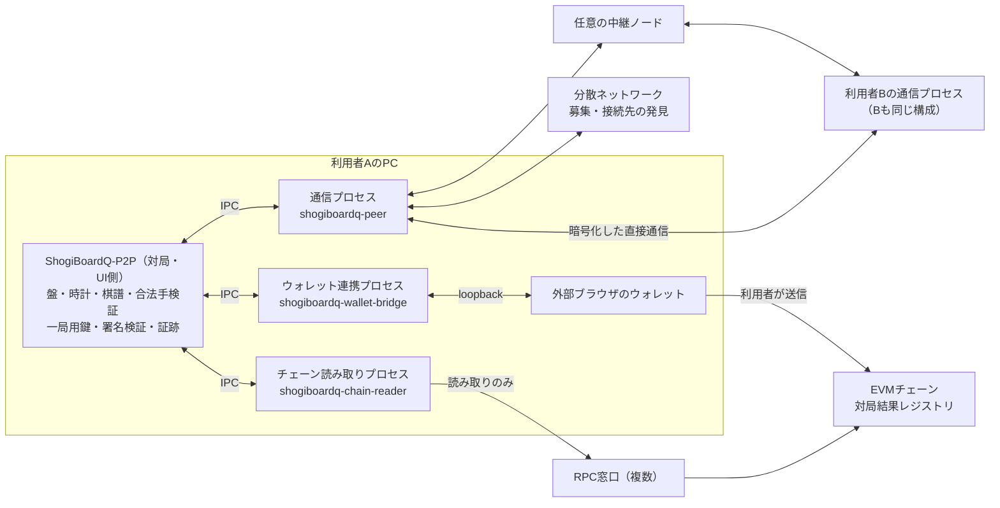
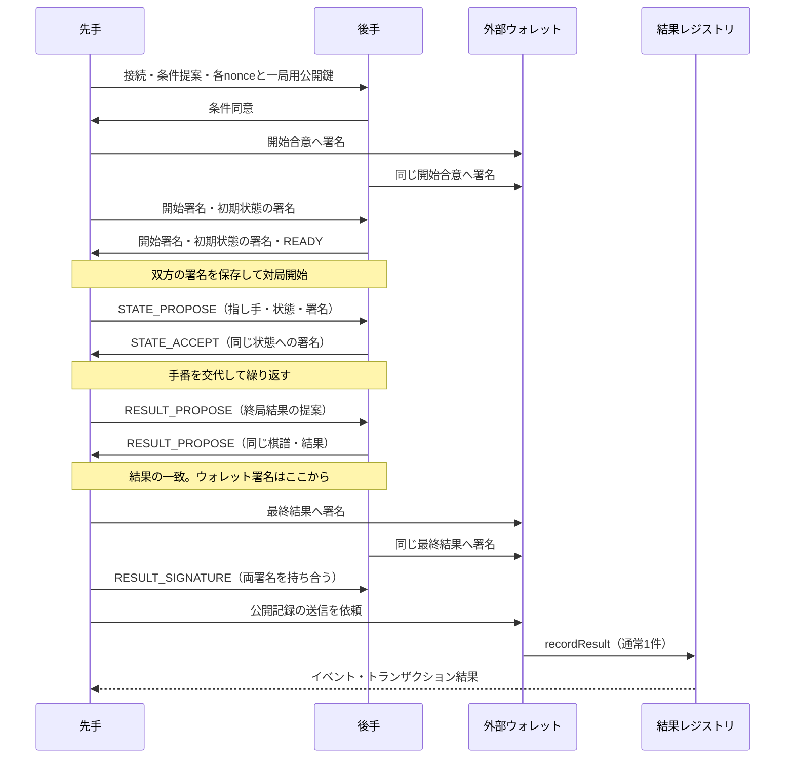

# P2P・ブロックチェーン対局の実装仕様

作成日: 2026-11-10

改訂: 2026-11-10（第2版。権限分離と安全性の見直し）

状態: 新機能の設計案。本文の追加クラス、プロトコル、コントラクト、補助プロセスは未実装。

対象: ShogiBoardQ から派生した実験版（ShogiBoardQ-P2P）の Qt6 / C++17 デスクトップ版。

開発先と権限分離は、[リポジトリ構成と開発方針](p2p-development-strategy.md)を優先する。第2版では、同文書7章が改訂対象に挙げていたプロセスの分割、一局用鍵の保持主体、ウォレット連携の起動と承認、IPC の窓口、段階の前提を本文へ反映した。OS ごとのサンドボックス方式だけは、同文書の D2 で実際に拒否を確かめて決める（12.4節）。

### 第2版の変更点

| 対象 | 変更 |
|---|---|
| 1章 | v1 で受け入れる既知の限界を1か所にまとめた（1.2節） |
| 2章・12章 | 補助プロセスを通信・チェーン読み取り・ウォレット連携の3つに分け、権限表、IPC、起動失敗時の挙動を定義した |
| 3章・4章 | 募集の検証と転送、予約の占有への対策、表示名・招待文字列・接続先アドレスの規則、IP を見せない設定を追加した |
| 5章 | 一局用鍵と署名検証を対局・UI側に置いた。侵害時の影響を表にした |
| 7章 | 自己申告時間と観測時間の許容差、切断中の着手、切断時間の上限を定義した |
| 8章 | 結果を提案できる側と、提案・同意・拒否の手順、ウォレット署名の前提を定義した |
| 9章・10章 | resultDigest の定義、ウォレット連携ページが出せる要求の限定、実験版が扱うチェーンの限定を追加した |
| 11章 | 証跡ファイルの形式、ジャーナルの上限、検証ツールの置き場所を定義した |
| 14章・15章 | 脅威の表・試験項目・不変条件を追加し、段階に開発方針の前提を対応させた |

## 1. 採用する構成と保証範囲

対局募集・相手の発見・指し手の交換を P2P で行い、終局後に双方が署名した対局結果と棋譜のハッシュを EVM 互換ブロックチェーンに記録する。専用の中央対局サーバは設置しない。対局中にブロックの生成やトランザクションの承認を待たない。

ブロックチェーンが証明するのは「この二つのウォレットが、この条件と結果に署名し、その記録がチェーンに取り込まれたこと」である。コントラクトは棋譜の合法性、人間による着手、時計の正確さ、対局が実際に行われたことを検証しない。棋譜を持つ第三者は、ハッシュの一致と将棋のルールに従った手順を別々に検証できる。

初版は双方の合意による記録方式とする。相手が結果への署名を拒否した場合、片方の申告だけで勝敗を登録する機能は設けない。資産の預託、賭け、独自トークン、NFT、公式レーティングは対象外。

これは紛争をオンチェーンで裁定する完全なステートチャネルではない。ステートチャネルを採用するには、状態遷移の検証、異議申立期間、監視と応答の仕組みも必要になる。[Ethereum のステートチャネル解説](https://ethereum.org/developers/docs/scaling/state-channels/)

### 1.1 初版の機能

| 項目 | v1 の仕様 |
|---|---|
| 相手探し | 公開募集一覧、条件による絞り込み、招待情報による接続 |
| 対局 | 人間対人間、平手、開始局面固定、1局単位 |
| 時計 | 双方共通の持ち時間と秒読み。加算・遅延は0。既定は10分＋30秒 |
| 終局 | 投了、詰み、時間切れ、千日手、連続王手の千日手、合意引き分け、512手到達、中断 |
| 入玉 | 宣言勝ちは扱わない。双方の合意による引き分けは可能。開始前に表示 |
| 接続復旧 | 両アプリと通信プロセスが生存している間の回線再接続 |
| 身元 | 外部ウォレットの署名用アドレス。実名や一人一アカウントは保証しない |
| 公開記録 | 終局合意後に1トランザクション。利用者が送信するまでローカル保存 |
| 棋譜 | 既存形式での保存と、署名・検証用証跡ファイルの保存 |
| 動作環境 | Linux・Windows・macOS。対応ウォレット拡張を備えた外部ブラウザを使用。インターネット越しの対局は、補助プロセスの権限制限を確かめた OS だけで有効にする |

エンジン対局、駒落ち、任意局面、加算時計、観戦、公開棋譜配信、スマートコントラクトウォレット、第三者裁定は後続版で追加する。非対応条件を受信したときに、既定条件へ黙って置き換えない。

### 1.2 v1 で受け入れる既知の限界

次は設計上防げないか、v1 では防がないと決めたものである。画面と文書で利用者に伝え、対策済みと表示しない。

- 負けた側が結果への署名を拒めば公開記録は成立しない。公開記録は双方が合意した対局だけに偏る。
- 消費時間は自己申告である。1手あたり許容差（既定10秒）までの水増しと、切断を使った思考時間の延長（1局の合計で既定10分まで）は検出できない（7章）。
- 偽の募集で一覧を埋める、申込みだけして署名しない、といった募集・交渉の妨害は、身元に費用がかからない以上、完全には防げない（3章）。招待による対局はこの影響を受けにくい。
- 募集を公開した時点で、IP アドレスは対局相手に限らず不特定のピアから見える。対局相手は IP とウォレットアドレスの両方を知る（14章）。
- 対局・UI側のプロセスと同じ利用者権限で動くマルウェアは防げない。外部ウォレットの確認画面が最後の防御になる。
- 双方が示し合わせた架空の対局と、人間の代わりにエンジンが指した対局は区別できない。

## 2. 全体構成



ブートストラップノードはネットワークへの入口、中継ノードは接続支援、RPC はチェーンの読み取り窓口として使う。いずれも将棋の指し手や勝敗を裁定しない。複数の運営者と利用者指定の接続先を扱えるようにする。

「特定の対局サーバに依存しない」構成であり、常時到達できるノードが一切不要になる構成ではない。小規模ネットワークでは、公開接続を受け付ける協力ノードの維持が必要になる。[分散型ホールパンチングの研究](https://research.protocol.ai/publications/decentralized-hole-punching/)

### 2.1 プロセスと信頼境界

外部の入力を解釈する処理を、入力の出どころごとに別のプロセスへ分ける。3つの補助プロセスはどれも Rust で書き、サンドボックスの中で動かす（12.4節）。

| プロセス | 役割 | 持つ秘密 | 信頼しない入力 | 持たせないもの |
|---|---|---|---|---|
| 対局・UI側（Qt6 / C++） | 合法手・状態・署名の検証、時計、棋譜、証跡、利用者の承認 | 一局用鍵、証跡 | 3つの補助プロセスの出力、証跡ファイル | ネットワークの待受、外部から届いた命令の実行 |
| 通信 `shogiboardq-peer` | 発見、募集、NAT越え、フレームの送受信 | libp2p識別鍵 | インターネット上の任意のピア、招待文字列 | 一局用鍵、ウォレット操作、RPC、ファイル |
| チェーン読み取り `shogiboardq-chain-reader` | 設定済みの RPC への読み取り | なし | RPC の応答、TLS の相手 | 署名・送信、P2P、ファイル |
| ウォレット連携 `shogiboardq-wallet-bridge` | 利用者が承認した1件の操作を外部ウォレットへ依頼 | 操作1件の capability | ブラウザと、loopback へ届く任意のローカルの要求 | P2P、RPC、ファイル、任意の署名対象 |

- 信頼の基点は対局・UI側だけとする。補助プロセスの出力は、型、大きさ、署名、現在の状態に合う操作かを対局・UI側で検証し直す。補助プロセスが「検証済み」「成功」と返したことを、署名の成立・記録の成立・相手の身元の根拠にしない。
- 補助プロセス同士は直接通信しない。3つの IPC は別々で、共通の capability を持たない。通信プロセスが侵害されても、ウォレット連携プロセスへ要求を届ける経路がない。
- 信頼しない入力の解釈、メモリ安全でない言語、高い権限の3つを1か所に重ねない。対局・UI側（C++・利用者の権限）が解釈する外部由来のバイト列は、補助プロセスが形式を検査した後の、上限付きの小さな形式（IPC の JSON と 5.2節の決定的 CBOR）に限り、その読み取り部をファジングの対象にする。[Chromium の Rule of 2](https://chromium.googlesource.com/chromium/src/+/main/docs/security/rule-of-2.md)

### 2.2 技術選定

| 層 | 採用案 | 理由・制約 |
|---|---|---|
| GUI・将棋処理 | 既存の Qt6 / C++17 | 盤面・棋譜・操作経路を再利用する |
| P2P | Rust の別プロセス `shogiboardq-peer` と rust-libp2p | 発見・NAT越え・中継を同じ基盤で扱う。Rust の配布・ビルド手順が増える |
| 通信経路 | QUIC、TCP＋Noise＋Yamux、Circuit Relay v2 | UDPが通らない環境ではTCPを試す。中継時にも当事者間を暗号化する |
| 接続支援 | Identify、AutoNAT、DCUtR | 到達性を確認し、中継経由の接続から直接接続への移行を試す |
| 募集 | 専用 Kademlia DHT、GossipSub、一覧取得プロトコル | DHTは参加者探索、GossipSubは募集更新、一覧取得は途中参加時の補完 |
| チェーン | EVM互換。開発はローカルEVM、結合検証はSepolia | 本番チェーンは費用と最終性の実測後に決定。独自チェーンは作らない |
| チェーン読み取り | Rust の別プロセス `shogiboardq-chain-reader` | RPC の応答と TLS の解釈を対局・UI側とウォレット連携から離す。送信の機能を持たない |
| ウォレット連携 | Rust の別プロセス `shogiboardq-wallet-bridge` と同梱のローカルページ | 操作1件ごとに起動する。ページの JavaScript は依存ライブラリなしで書く |
| 署名 | ウォレットはEIP-712、一局用鍵はsecp256k1 | 条件・結果を型付き署名にし、各着手ではウォレット操作を不要にする |
| 一局用鍵の演算 | 対局・UI側で [libsecp256k1](https://github.com/bitcoin-core/secp256k1)（recovery モジュール）。Keccak-256 は Qt の `QCryptographicHash::Keccak_256` | 楕円曲線の演算を自作しない。libsecp256k1 は版を固定して取り込む |
| コントラクト | Solidity、OpenZeppelinのEIP712・ECDSAを利用 | 独自暗号実装を避ける。プロキシや管理者による結果変更を設けない |
| ワイヤ形式 | 決定的CBOR、長さ付きフレーム | 言語間で同一バイト列を作り、署名・ハッシュを再現する |

rust-libp2p は必要な各機能を提供する。採用時に対応OS、機能の組合せ、依存ライブラリのライセンスを確認し、Cargo.lock とツールチェーンを固定する。本書はライブラリの最新バージョンへの自動追従を指定しない。[rust-libp2p の公式API資料](https://docs.rs/libp2p/latest/libp2p/)

初版では WebRTC を併用しない。ブラウザ対局を追加する段階で、相互運用と配布サイズを測定して再検討する。

## 3. 発見・募集・マッチング

### 3.1 ネットワークへの参加

- 専用DHTプロトコルを `/shogiboardq/kad/1.0.0` とし、IPFSなどの既存公開DHTに独自レコードを書き込まない。
- ネットワーク識別子は `H(CBOR(["SBQ-NETWORK", 1, chainId, registryAddress]))` とする。アドレスは20バイト、v1のchainIdは64bit符号なし整数の範囲とする。テストネットと本番の募集を混在させない。
- 同梱設定に独立した運営者のブートストラップ候補を3件以上用意することを公開運用の条件とする。起動時は複数へ接続を試す。
- 接続できた公開ピアを上限付きキャッシュに保存する。初期ノードの全停止時にも、到達可能な既知ピアから復帰できるようにする。キャッシュは対局・UI側が保存し、起動時に通信プロセスへ渡す（通信プロセスはファイルを開かない）。
- 利用者は候補の追加・無効化ができる。候補一覧の更新は署名付きアプリ配布で行い、中央URLへの問い合わせを起動の必須条件にしない。
- 検証用のローカルネットワークでは、同一ホスト上の複数プロセスと明示した接続先を使う。

DHTで共有するのはロビー参加者の接続先を探すためのprovider情報とする。ロビーキーのproviderとして参加し、見つかったピアへ募集一覧を問い合わせる。募集一覧の完全性や、全オンライン利用者の列挙は保証しない。[libp2p の発見・ルーティング](https://libp2p.io/docs/discovery-routing-overview/)

ロビーキーは `H(CBOR(["SBQ-LOBBY", 1, networkId, rulesHash]))`、GossipSubのtopicは `/shogiboardq/lobby/1/<networkIdの小文字hex>/<rulesHashの小文字hex>` とする。公開到達可能な協力ノードがDHTのserver役を担い、通常のデスクトップは到達性に応じてclient役を使う。DHTのprovider情報のTTLと、募集自体の120秒の有効期間は別々に扱う。

DHT と発見の部分を、任意のデータ置き場や他者への攻撃の踏み台にさせない。

- DHT が受け付けるのはロビーキーの provider 情報だけとする。任意の値のレコードを保存・転送しない。1つのキーの provider 数と、1ピアが登録できる件数に上限を置く。
- 経路表を同じアドレス帯のピアで埋めない上限を設け、ブートストラップ候補と利用者指定の候補への接続を保つ。小さな専用 DHT では、多数の偽ノードで特定の利用者の視界を塞ぐ攻撃（eclipse）を完全には防げない。
- 発見で得た宛先の扱いは4章の規則に従う。発見しただけのピアへ自動で接続する数に上限を置く。
- mDNS などのローカル探索は既定で無効にする。

### 3.2 募集情報

公開募集は次の内容を含み、発信者のlibp2p識別鍵で署名する。識別鍵は Ed25519 に固定し、PeerId から公開鍵を取り出して検証できるようにする。ウォレットとの結び付けは接続後に確認するため、公開募集の名前を認証済みの身元として表示しない。

| フィールド | 内容 |
|---|---|
| `version / networkId` | 募集形式とネットワーク |
| `offerId / sequence` | CSPRNGによる32バイトの識別子、更新番号 |
| `peerId` | 発信ピア。メッセージ署名の鍵と一致させる |
| `displayName` | 表示名。下の規則に従う |
| `rulesHash / timeControl` | 対応ルールと持ち時間。初版の許可値だけを受理 |
| `sidePreference` | 先手希望、後手希望、指定なし |
| `createdAt / expiresAt` | UNIX秒。募集寿命は最大120秒 |
| `availability` | `Open` または `Withdrawn` |

- 募集中は30秒ごとに更新し、同一ピアの公開募集は1件とする。同じ発信者の更新は10秒に1回までとし、それより多い更新は捨てる。
- GossipSubのtopicはネットワーク・ルールごとに分ける。途中参加時は見つかった3ピア以上にキャッシュ一覧を要求する。一覧の応答は要求より大きいので、同じ相手からの要求の頻度を制限する。
- 期限切れ、古いsequence、署名不正、過大な時刻ずれの募集を除外する。端末時刻のずれが30秒を超える場合は時計の確認を案内する。
- 同じ署名済み募集の再受信で有効期限を延長しない。重複識別子は10分間、上限付きで保持する。
- マッチングはクライアントが候補を絞り、相手へ直接申し込む。中央キューは設けない。
- 募集を公開・申込みできるのは、ウォレットのアドレスを取得し（10.2節）、記録先を確認した（10.1節）後とする。交渉の短い期限の中で初めてウォレットを接続させない。

募集の検証は通信プロセスが行い、検証を終えた募集だけを他のピアへ転送する。

- 署名のないメッセージ、発信者と `peerId` が一致しないメッセージ、形式・許可値・期限・頻度の規則に合わない募集は転送しない。不正なメッセージを送ったピアは減点し、繰り返せば切断する。
- 対局・UI側は募集を認証済みの情報として扱わない。通信プロセスから受けた募集について、形式、上限、表示名の規則だけを検証し直す。相手の認証は開始合意（5.3節）で行う。
- 保持の上限（4章）に達したら新しい発信者の募集を受け付けず、期限切れで空くのを待つ。偽の募集で一覧を埋める妨害は防ぎきれない（1.2節）。

表示名は次の規則を満たすものだけを受理する。満たさない募集は表示名を直さずに募集ごと捨てる。

- UTF-8 で96バイト以下、32文字（コードポイント）以下、NFC 正規化済み、前後に空白がない。
- 制御文字（Cc）と書式文字（Cf。双方向の制御文字、ゼロ幅文字を含む）、私用領域、未割り当て、改行を含まない。
- 表示は PlainText とし、リッチテキスト・リンクとして解釈しない。ツールチップへ出すときは既存の `plainToolTip` で包む。

### 3.3 競合と招待

募集側は最初に受け入れた申込みに60秒の仮予約を与える。他の申込みには `BUSY` を返す。条件の合意後、ウォレット署名待ちは最大10分まで延長できる。期限切れやキャンセル時は予約を破棄する。

予約を占有するだけの申込みで募集を止められないよう、次の順序と期限を守る。

1. 仮予約の60秒以内に、条件の交換と双方の利用者による確認を終える。
2. 開始合意のウォレット署名は申込側が先に届ける。期限は条件の合意から3分。届くまで募集側は募集を取り下げず、届いた時点で取り下げる。
3. 募集側が署名し、双方の開始署名がそろってから30秒以内に State0 の交換と READY を終える。終わらなければ開始失敗として待機へ戻り、募集を出し直せるようにする。
4. 署名に至らずに期限切れ・取消になった相手（その PeerId と、判明していればウォレットアドレス）からの再申込みを10分間拒否する。繰り返す相手には拒否の時間を延ばす。
5. 募集側の利用者は、いつでも予約を取り消し、その相手をブロックできる。

PeerId もウォレットアドレスも無料で作り直せるため、これらは妨害の手間を増やすだけで、完全な対策にはならない（1.2節）。ブロックの対象はウォレットアドレスとし、そのセッションの PeerId も併せて拒否する。

双方が「指定なし」の場合、申込側を先手とすることを条件確認画面に表示する。ランダム性や公平な抽選を保証する表示はしない。先後を変える場合は署名前に再提案する。

招待情報にはネットワーク、相手PeerId、到達候補、32バイトの一回用トークン、有効期限を含める。招待だけでは対局は開始しない。招待トークンの有効期間は10分、成功時に失効させ、ログへ出さない。初版は招待文字列のコピー・貼り付けとし、OSへのURLスキーム登録は後続対応とする。

- 招待文字列は接頭辞・版・本体・検査用の値からなる固定の形式とし、全体で1 KiB以下、到達候補は8件までとする。貼り付けられた文字列は通信プロセスが解釈し、対局・UI側は解釈結果（相手の PeerId の短縮表示、到達候補の数、期限）だけを確認画面に出す。
- 招待トークンは Noise で認証した招待元の PeerId への接続の中でだけ送る。照合は一定時間の比較で行う。
- 私設アドレス（同じ LAN 内の相手）を含む招待は、利用者が確認画面で宛先を見て許可したときだけ使う。loopback 宛は検証用の profile だけで使う。

## 4. 接続・NAT越え・資源制限

1. 既知の到達候補へ直接接続を試す。
2. AutoNAT等で到達性を確認し、必要な場合は中継の予約を確保する。
3. 中継接続を作り、DCUtRによって直接接続への移行を試す。
4. 直接接続に失敗した場合は、中継が許可する範囲で通信を継続する。
5. どちらの経路も利用できない場合は接続失敗として終了する。ポート開放を自動実行しない。

Circuit Relayには時間・データ量・予約数の制約がある。一般公開リレーを無制限で使えると仮定しない。運用するリレーでは長時間対局に必要な設定を検証し、制限到達による切断も再接続手順で扱う。[Circuit Relay](https://libp2p.io/docs/circuit-relay/)、[DCUtR](https://libp2p.io/docs/dcutr/)

宛先のアドレスは次の規則で絞る。公開募集や DHT に他人のアドレスを書き込んで、利用者の PC から LAN 内の機器や第三者へ接続させる使い方を防ぐためである。

- 公開募集・DHT・Identify で得た宛先は、インターネット上で到達できるアドレスと中継経由のアドレスだけを使う。loopback、私設、link-local、共有アドレス空間（100.64.0.0/10）、IPv6 の ULA、マルチキャスト、未指定、IPv4 射影 IPv6 を拒否する。
- DNS 名の宛先は、同梱または利用者指定の協力ノードにだけ許す。ほかのピアが示した DNS 名は解決しない。
- 1ピアあたりの宛先は8件まで、同時に試す接続数に上限を置き、失敗した宛先はしばらく再試行しない。
- 自分が広告するアドレスからも私設アドレスを除く。LAN の構成を Identify で配らない。
- 対局中は、開始合意に含めた相手の PeerId 以外からの対局ストリームを受け付けない。

設定で「直接接続を使わない」を選べるようにする。この設定では中継経由のアドレスだけを広告し、DCUtR を行わない。対局相手と不特定のピアからは IP が見えなくなるが、中継の運営者には見える。中継の容量に依存するため既定は無効とする。

協力ノードは通信プロセスの `--service` モードとして別途運用する。ブートストラップ、DHT server、中継を設定で有効化でき、GUI・ウォレット・チェーン読み取り・将棋の裁定処理を含めない。通常のデスクトップを自動的に中継サーバへ昇格させない。サービス用PeerIdは再起動で変えず、識別鍵を所有者だけが読めるファイル権限・ACLで保存する。これは5章の通常クライアントの一時鍵とは別の運用である。

- 協力ノードは専用の権限の低いアカウントで動かす。
- 中継は予約数、1ピアあたりの回路数、1回路の時間とデータ量、全体の帯域に上限を置く。1回路のデータ量は1局に必要な量に余裕を足した程度に抑え、汎用の中継として使われにくくする。
- 接続元の IP を含むログは、保存する項目と期間を決めて公開する（開発方針9章）。

| 制限 | v1の初期値 |
|---|---|
| 直接接続の試行 | 10秒。その後は中継候補を含め全体30秒で判定 |
| 接続維持 | ping 10秒、応答不在30秒で再接続へ移る |
| 着手確認 | 5秒で同一メッセージを再送。30秒で接続復旧へ移る |
| 回線復旧待ち | 切断検出から120秒 |
| 1局の切断時間の合計 | 10分。超えたら中断（7.2節） |
| 自己申告時間の許容差 | 10秒（7.1節） |
| 1局の実時間上限 | 24時間。上限時は合意中断を提案し、合意できなければ未確定終了 |
| 1フレーム | 64 KiB。長さを確認してから領域を確保 |
| 募集1件・一覧 | 4 KiB / 100件。ページ送りでも保持は1,000件まで |
| 接続数 | 合計32、未認証8、対局相手1 |
| 受信キュー | 接続ごとに256 KiB。超過時は切断 |
| アプリメッセージ | 認証前は5件/秒、対局中は20件/秒、burstは各2倍 |
| 制御メッセージ | 1局で双方合わせて4,096件。超えたら `LIMIT_EXCEEDED` で中断 |
| ジャーナル | 1局16 MiB。超えたら `STORAGE_ERROR` で中断 |
| 証跡転送 | 32 KiB以下の分割、1ファイル最大8 MiB |

これらは設計上の初期値であり、実測した性能値ではない。実装時の接続試験で調整し、対局に影響する値は `networkPolicyHash` に含める。IPごとの制限だけで携帯回線の利用者を一括排除しない。

## 5. 鍵・署名・データ形式

### 5.1 鍵を分ける

| 鍵 | 用途 | 保持するプロセス | 保管 |
|---|---|---|---|
| ウォレット鍵 | 開始条件と最終結果への同意、公開記録トランザクション | 外部ウォレットのみ | ShogiBoardQへ取り込まない |
| libp2p識別鍵（Ed25519） | PeerId、暗号化通信、募集への署名 | 通信プロセス | 起動ごとに生成、メモリのみ |
| 一局用secp256k1鍵 | 着手状態・対局制御メッセージへの署名 | 対局・UI側 | 一局ごとに OS の CSPRNG から生成、メモリのみ。資産を持たせない |

一局用鍵は対局・UI側が持ち、通信プロセスへ渡さない。インターネットから届く入力を解釈するプロセスに署名の権限を置かないためである。相手の StateApproval・Control・ウォレット署名の検証（署名からのアドレスの復元）も対局・UI側で行う。通信プロセスは署名済みのフレームを運ぶだけで、署名も検証結果も作らない。

一局用鍵の権限は、開始合意に含めた一局の通信証跡に限る。最終結果をオンチェーン登録する署名の代用にはしない。プロセス終了で鍵が失われた場合、進行中の対局を自動再開しない。

- 一局用鍵は終局・中断・取消の時点で上書きして消す。ログ、IPC、証跡、設定、クラッシュ報告へ出さない。
- 補助プロセスはコアダンプを無効にし、capability と識別鍵を引数・環境変数・ログへ出さない。

v1のウォレット署名は、secp256k1署名から当該アドレスを復元できる方式に限定する。ERC-1271によるコントラクトウォレットは後続対応とする。署名の検証が失敗したとき、成功とみなすフォールバックを設けない。[ERC-1271](https://eips.ethereum.org/EIPS/eip-1271) アドレスにコードがあるかどうかは判定に使わない（コードを委任した EOA も、鍵による署名は復元で検証できる）。

侵害されたときの影響を次のとおり見積もる。表の「できないこと」が崩れる変更は設計の変更として扱う。

| 侵害された部分 | できること | できないこと |
|---|---|---|
| 通信プロセス | 通信の遮断・遅延・盗み見（対局の内容、相手の IP）、偽の募集の表示、対局・UI側への不正な入力の送り込み | 一局用鍵での署名、相手の署名の偽造、ウォレットへの要求、チェーンの状態の偽装、ファイルの読み書き |
| チェーン読み取りプロセス | 記録の有無・確定状態・手数料見積りの偽装、問い合わせ内容の漏えい | 署名・送信、対局の進行への関与、ウォレットへの要求 |
| ウォレット連携プロセス | ページの差し替えによる、意図しない署名・送信の要求の表示 | 利用者がウォレットで承認していない署名、対局・UI側が期待した内容と違う署名を有効として通すこと |
| 一局用鍵の漏えい | その1局の着手状態・制御メッセージの偽造 | 最終結果のウォレット署名、他の対局への流用、資産の移動 |
| 対局・UI側 | 利用者の権限でできるすべて | 外部ウォレットの鍵の取得。ウォレットの確認画面を経ない署名 |

ウォレット連携プロセスが侵害された場合に残る防御は、外部ウォレット自身の確認画面だけである。このため 10.2節で、ページが出せる要求を限定し、利用者がウォレットの表示とアプリの表示を見比べられるようにする。

### 5.2 決定的エンコード

署名済みデータは、RFC 8949のcore deterministic encodingに従う固定順序のCBOR配列とする。最短整数表現・確定長のみを許し、浮動小数、タグ、未定義値、不定長、余剰要素を拒否する。バイナリ値はbyte string、USI・SFEN・識別文字列はASCIIとする。数値は符号なしで、スキーマの上限を超えた値を拒否する。[RFC 8949 §4.2](https://www.rfc-editor.org/rfc/rfc8949.html#section-4.2)

ハッシュ関数 `H` はEthereumのKeccak-256とし、FIPS SHA3-256と混同しない。Qt では `QCryptographicHash::Keccak_256` を使い、`Sha3_256` を使わない。実装は空入力のハッシュが `c5d2460186f7233c927e7db2dcc703c0e500b653ca82273b7bfad8045d85a470` になることをテストで固定する。CBORの再エンコード結果が元のバイト列と一致することも検証する。JSONやKIFファイルの見た目をそのままハッシュしない。

ハッシュ・nonceは32バイト、Ethereumアドレスは20バイト、署名は65バイト、SFENは256バイト以下、USI着手は4または5バイトとする。State0だけは空のUSIを許可する。CBORの入れ子は最大16段とし、整数のデコード後にplyは32bit、時刻とミリ秒は64bitの範囲を検証する。カウントや時刻を加算する箇所もオーバーフローを拒否する。

以下を順序固定のスキーマとする。配列内の名称は値を表し、ラベル文字列がある箇所はその文字列自体も含む。

```text
Rules = ["SBQ-RULES", 1, initialSfen, 512,
         "fourfold-draw", "perpetual-check-loss", "no-declaration",
         "human", "human"]
TimeControl = ["SBQ-TIME", 1, mainMs, byoyomiMs, 0, 0]
NetworkPolicy = ["SBQ-NET", 1, 10000, 30000, 120000, 5000, 86400000,
                 10000, 600000]

State = ["SBQ-STATE", 1, gameId, ply, previousStateHash,
         moveUsi, sfen, spentMs, blackMainMs, whiteMainMs]
Transcript = ["SBQ-TRANSCRIPT", 1, gameId, [State0, State1, ..., StateN]]
```

- `Rules` の末尾は対局者種別。`TimeControl` の末尾2値は加算・遅延で、v1は0のみ。
- `NetworkPolicy` の時間値は順にping間隔、切断検出、再接続、再送、1局上限、自己申告時間の許容差、1局の切断時間の合計上限で、すべてミリ秒。
- `mainMs` は0〜86,400,000、`byoyomiMs` は0〜600,000。両方0はv1では拒否する。
- 初期SFENは `lnsgkgsnl/1r5b1/ppppppppp/9/9/9/PPPPPPPPP/1B5R1/LNSGKGSNL b - 1`。
- SFENは空白1個区切り、持駒の順序を `RBGSNLPrbgsnlp` とし、手数を `ply + 1` に固定する。持駒の順序は既存の `PieceRules::kHandOrder`（飛・角・金・銀・桂・香・歩）と同じである。
- `State0` は `ply=0`、前状態ハッシュはゼロ32バイト、指し手は空文字、消費時間0、双方の残り持ち時間は初期値。
- 以後の指し手はUSIの通常手または駒打ちのみ。`resign` 等は着手に混ぜない。
- `rulesHash` 等は各配列の決定的CBORをHに渡す。`stateHash` と `transcriptHash` も同様。
- Transcriptには署名、表示名、棋譜コメント、保存日時を含めない。署名は別の証明として保存する。

### 5.3 開始合意と対局ID

EIP-712のdomainは `name="ShogiBoardQ Match Registry"`、`version="1"`、`chainId`、`verifyingContract` とする。型文字列は次のフィールド順・型で固定する。[EIP-712](https://eips.ethereum.org/EIPS/eip-712)

以下の改行・インデントは説明用である。typeHashにはEIP-712のencodeTypeに従う空白・改行なしの区切りを使い、各フィールドでは型名とフィールド名の間だけ半角空白1個を置く。

```text
StartAgreement(
  bytes32 blackNonce, bytes32 whiteNonce,
  address black, address white,
  address blackSession, address whiteSession,
  bytes32 blackPeerIdHash, bytes32 whitePeerIdHash,
  bytes32 rulesHash, bytes32 timeControlHash, bytes32 networkPolicyHash,
  uint64 startBefore, uint64 recordBefore
)
```

- 各nonceは当該側がCSPRNGで生成する32バイト。相手が両方を決めない。
- PeerIdのハッシュは文字列表記ではなく、libp2p PeerIdのバイナリ表現にHを適用する。
- `gameId = EIP712Digest(StartAgreement)`。domainも含まれるので別チェーン・別コントラクトへ署名を流用できない。
- 両ウォレットと両一局用鍵の4つのアドレスはすべて異なる値とし、両PeerIdも異なる値とする。ゼロアドレスを拒否する。
- `startBefore` は合意作成から10分以内、`recordBefore` は `startBefore + 30日` に固定する。コントラクトもこの差が30日であることを検証する。
- `startBefore` は開始時に双方のクライアントで確認する期限。過去に開始した事実をコントラクトが証明する値ではない。
- `recordBefore` はコントラクトがブロック時刻で検証する登録期限。経過後は記録を「登録期限切れ」として残す。
- 両署名が同一の合意を指し、各条件配列のハッシュと一致し、相手の一局用鍵の所有を確認してから開始する。

相手の認証の根拠は、開始合意へのウォレット署名（ウォレットが一局用鍵を指定する）と、State0 への一局用鍵の署名（その鍵を相手が持っている）の2つとする。PeerId は通信プロセスの報告なので認証の根拠にせず、合意に含めた PeerId と接続中の PeerId の一致は、経路の取り違えを防ぐ補助として確かめる。

署名の前に、相手、先後、持ち時間、ルール、記録先、公開される内容を日本語等の選択言語で表示する。ハッシュ値だけを見せて条件への同意を求めない。ウォレットの画面に出る値との見比べ方は 10.2節に従う。

### 5.4 着手・制御・最終結果の署名

```text
StateApproval(bytes32 gameId, uint32 ply, bytes32 stateHash)
Control(bytes32 gameId, bytes32 connectionId, uint64 sequence,
        uint8 kind, bytes32 bodyHash)
FinalResult(bytes32 gameId, bytes32 finalStateHash,
            bytes32 transcriptHash, uint32 ply, uint8 outcome, uint8 cause)
```

`StateApproval` と `Control` は一局用鍵、`FinalResult` はウォレットで署名する。すべて同じEIP-712 domainを使い、型とgameIdで用途を分離する。署名は65バイトの `r || s || v`、low-sのみ、vは27または28に正規化する。

`resultDigest = EIP712Digest(FinalResult)` とする。ウォレットが署名する値、コントラクトが保存する値、クライアントが照合する値はこの1つである。

接続時に双方が32バイトの乱数を交換し、`connectionId = H(CBOR(["SBQ-CONN", 1, gameId, blackRandom, whiteRandom]))` とする。`Control` のsequenceは方向別に1から増加させ、同一接続内の再送は同一バイト列とする。再接続では新しいconnectionIdを作る。着手状態の証明は接続が変わっても有効である。

`Control.kind` は1=READY、2=RESUME、3=RESULT_PROPOSE、4=ABORT、5=ERROR、6=RESULT_DECLINEとする。bodyは順に `[state0Hash]`、`[latestPly, latestStateHash]`、`[FinalResultのフィールド列]`、`[latestStateHash, reasonCode]`、`[errorCode, relatedPly]`、`[拒否する提案のbodyHash]`。bodyHashはbodyの決定的CBORにHを適用する。不明なkindは拒否する。署名済み制御メッセージが最終ウォレット署名を置き換えることはない。結果の提案と同意の手順は 8.1節に定める。

## 6. 対局プロトコル

### 6.1 フレームと互換性

対局用libp2pプロトコルは `/shogiboardq/game/1.0.0`、募集一覧は `/shogiboardq/lobby/1.0.0` とする。フレームは4バイトのネットワークバイト順長＋CBOR。`[version, type, requestId, gameId, payload]` を共通外枠とする。versionは1、typeは16bit、requestIdは方向別に増える64bit整数、gameIdは32バイトとする。対局ID決定前はゼロ32バイトを用いる。

typeは1=HELLO、2=START_AGREEMENT、3=START_SIGNATURE、4=STATE_PROPOSE、5=STATE_ACCEPT、6=CONTROL、7=SYNC_REQUEST、8=SYNC_CHUNK、9=RESULT_SIGNATURE。HELLOではnetworkId、対応major版、PeerId、募集/招待ID、接続用乱数を交換する。開始合意後にgameIdと接続用乱数からconnectionIdを確定する。未知major版は切断、未知typeはエラーとして対局を進めない。

通信プロセスは対局フレームの外枠（長さ、決定的CBORとして整った形か、version、typeの範囲）と流量だけを検査し、payload の意味を解釈しない。対局・UI側は外枠の検査を含めてすべてやり直す。同じ規則を2か所で検査するのは、通信プロセスが健全な間は壊れた入力を対局・UI側へ届かせないためで、対局・UI側の検査を省く理由にしない。

START_AGREEMENTは合意の全フィールドと3種類の条件配列、START_SIGNATUREは先後の識別とウォレット署名を運ぶ。STATE_PROPOSEはStateと着手側のStateApproval署名、STATE_ACCEPTはply・stateHash・受信側のStateApproval署名、CONTROLはControlとbodyと署名、RESULT_SIGNATUREはFinalResultと先後の識別とウォレット署名を運ぶ。

SYNC_REQUESTは要求開始plyと直前のstateHash、SYNC_CHUNKは連続したStateと各状態の両署名・終端フラグを運ぶ。要求外のデータや既存状態と異なる上書きを受け入れない。フレームごとの型・順序はこの定義からC++/Rust共通のテストベクトルとして固定する。

State0は先手がSTATE_PROPOSEで送り、後手がSTATE_ACCEPTで応答する。初期状態だけは着手・手番変更を伴わない。対局中に新しいState0を受けても再初期化しない。

エラーコードは `UNSUPPORTED_VERSION`、`WRONG_NETWORK`、`BUSY`、`EXPIRED`、`INVALID_SIGNATURE`、`INVALID_MOVE`、`STATE_CONFLICT`、`CLOCK_MISMATCH`、`LIMIT_EXCEEDED`、`STORAGE_ERROR` とする。開始前は拒否して待機へ戻す。対局中の検証失敗は状態を変更せず中断へ移り、相手の負けとして登録しない。

### 6.2 開始から記録まで



図は先手が申込側の場合である。開始合意のウォレット署名は、先後によらず申込側が先に届ける（3.3節）。

先後の開始条件署名とState0への両署名がそろった後、後手がREADYを送る。先手はその受信で初手の計時を開始する。後手はREADY送信時から相手の時間を観測する。再送したREADYで時計を初期化し直さない。

### 6.3 着手確定の順序

1. 手番側は二重送信を禁止し、候補局面で合法手を検証する。State生成時に消費時間を固定し、新Stateへの自分の署名を証跡へ永続化してから送信する。
2. 受信側は相手の署名、gameId、ply、前状態ハッシュ、手番、合法性、SFEN、残り時間の計算、自己申告時間と観測時間の差（7.1節）を検証する。
3. 受信側は自分のStateApprovalを作り、両署名を含む証跡を永続化してからSTATE_ACCEPTを送信し、その状態を盤・棋譜へ反映する。
4. 送信側はSTATE_ACCEPTを検証・永続化してから盤・棋譜へ反映する。確認待ちの指し手を確定棋譜へ先行追加しない。
5. 各側で時計・棋譜・盤の更新を済ませ、最後に `GameBoard::notifyMoveCommitted()` を呼ぶ。

双方に届く瞬間を完全に同時にはできない。受信側だけが新状態を知っている区間は再接続時に両署名付き証明を交換して解消する。通信のACKだけを双方署名付き証明の代わりにしない。

同じply・同じstateHashの再送には、保存した署名を再送する。盤・時計・棋譜・駒音は再実行しない。同じplyで異なるstateHashを受けた場合は `STATE_CONFLICT` として停止する。部分署名だけの別分岐へ巻き戻さない。相手が同じ ply の異なる State に署名した2つの証明は、証跡に残す。

一局につき有効な対局ストリームは1本とする。通常は先手が開き、後手は余分なストリームを閉じる。再接続では旧ストリームを無効化し、RESUMEと状態照合を終えるまで着手を受け付けない。再接続した相手は、新しい connectionId に対する RESUME の一局用鍵の署名で確かめる。

状態を変更する受信処理は順番に一件ずつ完了させる。ACKの署名検証や永続化が非同期でも、後続の相手の着手を先に適用しない。バッファ上限を超える場合は接続を閉じて復旧へ移る。

## 7. 時計・切断・状態復旧

### 7.1 時計の計算

計時には単調増加時計を用い、OSの現在時刻の変更を反映させない。署名・UI・ネットワーク処理の都合で計時を自動的にやり直さない。

初手以外の手番開始は、相手の着手を検証してSTATE_ACCEPTを送信キューへ渡す時点。自分の合法な着手からStateを生成する直前に、その手の消費時間を固定する。以後の署名・永続化・送信・確認待ちは消費時間に追加しない。署名後のStateへ送信時刻を後付けしない。候補手のローカル検証に失敗した場合は計時を継続し、署名・保存に失敗した場合は対局を中断する。

初版では持ち時間と秒読みだけを扱う。手番開始時の基本持ち時間をR、秒読みをB、自己計測した消費時間をEとする。

- 着手可能な条件は `E < R + B`。境界と同値なら時間切れ。
- 着手後の基本持ち時間は `max(0, R - E)`。
- 秒読みの未使用分は次の手へ持ち越さない。次の自分の手番では同じBを使う。
- 相手側の基本持ち時間は、その着手によって変わらない。
- 受信側はEから残り時間を再計算する。送られてきた残り時間だけを信用しない。

秒表示の丸めは既存の[時計表示仕様](game-time-control-spec.md)に合わせるが、通信上の比較と保存はミリ秒の整数で行う。

Eは署名者の自己申告でもある。相手側は次のとおり観測し、自己申告との差を確かめる。

- 観測時間 O は、自分の STATE_PROPOSE を最初に送信キューへ渡した時点（初手は READY の送信時点）から、相手の次の STATE_PROPOSE を受信した時点までを単調増加時計で測った値とする。STATE_ACCEPT の受信を起点にしない。相手が STATE_ACCEPT を遅らせて考える時間も O に入る。
- その間に対局が `Reconnecting` だった時間の合計を D とする。
- `O - E` が `自己申告時間の許容差 + D` を超える着手には StateApproval を作らず、`ERROR(CLOCK_MISMATCH, ply)` を送って 6.1節の検証失敗と同じく中断へ移る。相手の負けとして登録しない。
- E が O より大きい申告は、申告した側が不利になるだけなので受理する。
- 相手の着手が届かないまま `O - D` が `R + B + 許容差` を超えたら、観測側は時間切れによる勝ちを主張できる（8.1節）。相手が同意しなければ結果は確定しない。

許容差は往復の通信と双方の検証・保存にかかる時間を見込む値で、同じ幅だけ申告の水増しも通す。観測値だけで公開勝敗を確定しない。ネットワーク遅延を差し引くことによる公平性を保証しない。署名は計時の正しさを証明しない。許容差の既定値は接続試験の実測で調整する。

### 7.2 回線切断時

- 対局を `Reconnecting` にする。現在手番の計時は続ける。
- 手番の側は、切断中も1手だけ指せる。State を生成して消費時間を固定し、署名を永続化して、復旧後に送る。切断中に入力を止めて時計だけを進めると、相手の手番に回線を切るだけで時間切れに追い込めるためである。
- 未確認の着手は同一バイト列で再送する。ACK消失を理由に別の指し手を生成しない。
- 双方の最新両署名付き状態を交換し、正しい署名と連続した手順を検証して不足分を補う。
- 受信前に消えていた相手の着手を復旧で初めて受理した場合、その側の手番は復旧時の受理・ACKから始める。失われた手番開始時刻を推測しない。
- 同じ状態の照合だけで、継続していた手番の時計を巻き戻さない。
- 時間切れや結果不一致が発生した場合は 8.1節の結果の提案へ移る。120秒で復旧できなければローカルで「通信中断・結果未確定」として棋譜を閉じる。
- 1局の `Reconnecting` の合計が NetworkPolicy の上限（既定10分）を超えたら、復旧できていても中断へ移る。切断中の時間は 7.1節の D として観測から除かれるので、上限がなければ切断を繰り返して思考時間を延ばせる。

切断は相手の負けと同義ではない。自分側の回線障害と相手の意図的切断を、2者だけで確実に区別することはできない。

### 7.3 クラッシュ・スリープ

v1ではアプリまたは通信プロセスの再起動後に対局を継続しない。一局用秘密鍵、相手と合意した PeerId、信頼できる計時区間を再現できないためである。スリープや計時の連続性を確認できない状態でも同様に中断する。スリープは、単調増加時計と OS の現在時刻の進み方の食い違いと、OS の復帰通知で検出する。保存済み証跡の確認、最終ウォレット署名の追加、期限内の公開記録は再起動後も可能。

中断から新たな局面で続ける機能は後続版とし、元の対局と同じgameIdを使い回さない。

## 8. 終局・結果の意味

結果の表現を次に固定する。

| 値 | outcome |
|---|---|
| 1 | 先手勝ち |
| 2 | 後手勝ち |
| 3 | 引き分け |
| 4 | 合意中断 |

| 値 | cause | 許されるoutcome |
|---|---|---|
| 1 | 投了 | 1 / 2 |
| 2 | 詰み | 1 / 2 |
| 3 | 時間切れ | 1 / 2 |
| 4 | 千日手 | 3 |
| 5 | 連続王手の千日手 | 1 / 2 |
| 6 | 合意引き分け | 3 |
| 7 | 512手到達 | 3 |
| 8 | 合意中断 | 4 |

詰み・千日手等は双方のクライアントで評価する。512手目の着手が別の終局条件も満たす場合、詰み、連続王手の千日手、通常の千日手、手数上限の順で判定する。合法手のない手番側は、王手がかかっていなくても負けとし、cause は詰みを使う。非合法な着手は受理せず、公開記録上の反則負けへ自動変換しない。

終局結果は最後の両署名付きStateとTranscriptを参照する。未確認の着手がある間は、その状態を照合するまで結果へ署名しない。両ウォレットが同じFinalResultに署名した時点で `MutuallyAgreed` とする。署名は各利用者が結果と公開内容を確認して行う。

投了メッセージがある場合も、コントラクトの登録条件は両ウォレット署名とする。相手が署名しなければ、ローカルの終局理由と公開記録の不成立を分けて残す。署名拒否や無応答を「引き分け」に置き換えない。

双方が故意に架空の結果へ署名することも可能であり、レジストリはそれを検出しない。ここに記録した勝数を、そのまま公式レーティングや人間の棋力の根拠として使用しない。

### 8.1 結果の提案と同意

終局は RESULT_PROPOSE の交換で確かめる。双方が同じ body（同じ FinalResult）の RESULT_PROPOSE を一局用鍵で署名して送り合った時点を「結果の一致」とする。ウォレット署名を求めるのは結果の一致の後だけとする。片方だけが先にウォレットで署名すると、その側は別の結果に署名し直せず（11章）、争いのある結果が残るためである。

| cause | 最初に提案できる側 | 受けた側の処理 |
|---|---|---|
| 投了 | 負ける側だけ。自分の手番に限る | 受けた時点で対局を止め、同じ提案を返す |
| 詰み | どちらでも | 最終 State から自分で判定し、一致すれば返す |
| 時間切れ（負けの申告） | 自分の時計が切れた側 | 同じ提案を返す |
| 時間切れ（勝ちの主張） | 7.1節の条件を満たした観測側 | 自分の時計で確かめ、切れていれば返す。切れていなければ拒否する |
| 千日手、連続王手の千日手、512手到達 | どちらでも | 棋譜から自分で判定し、一致すれば返す |
| 合意引き分け、合意中断 | どちらでも（申し出） | 利用者が承諾すれば同じ提案を返し、断れば拒否する |

- 提案は最新の両署名付き State を指す。自分の未確認の着手がある間は提案しない。ply が進んだら、それまでの提案は無効とする。
- 表の「最初に提案できる側」に合わない提案（相手が投了したという提案など）と、自分の判定と一致しない提案には同意せず、RESULT_DECLINE を返す。拒否された後も対局は続く。
- 詰み・千日手・512手到達の判定が双方で食い違うのは実装の不一致である。同意せずに中断へ移り、証跡を残す。
- 合意引き分け・合意中断の申し出は、同じ ply でそれぞれ1回までとする。
- 結果の一致の後は、別の結果を提案・同意しない。`gameId -> resultDigest` を永続化してからウォレット署名を求める（11章）。
- 結果が一致しないまま対局が終わったら、ローカルの終局理由を「結果未確定」として残す。

ABORT（kind 4）は一方的な離脱や続行できない失敗の通知で、合意中断（outcome 4）ではない。受けた側は対局を止め、結果未確定として閉じる。

## 9. スマートコントラクト

### 9.1 単一の結果レジストリ

コントラクト名の案は `ShogiMatchRegistryV1`。開始時のトランザクション、入会登録、資産預託を不要とし、通常は終局後の1トランザクションだけを使う。

```solidity
function recordResult(
    StartAgreement calldata agreement,
    bytes calldata blackStartSignature,
    bytes calldata whiteStartSignature,
    FinalResult calldata result,
    bytes calldata blackResultSignature,
    bytes calldata whiteResultSignature
) external;

function resultDigest(bytes32 gameId) external view returns (bytes32);

event ResultRecorded(
    bytes32 indexed gameId,
    address indexed black,
    address indexed white,
    bytes32 resultDigest,
    bytes32 rulesHash,
    bytes32 finalStateHash,
    bytes32 transcriptHash,
    uint32 ply,
    uint8 outcome,
    uint8 cause
);
```

上記はABI設計の抜粋であり、そのままビルド可能な実装ではない。構造体の順序と型は5章の定義を用いる。保存する `resultDigest` は 5.4節の定義（FinalResult の EIP-712 digest）で、ゼロは未登録を表す。

### 9.2 検証する条件

1. 先後のウォレット・一局用アドレスの4つがゼロでなく、互いに異なる。PeerIdハッシュもゼロ・同一を拒否する。
2. agreementのdomainと型から計算したgameIdがresult.gameIdに一致する。
3. 開始条件への両署名が、agreementに指定された両ウォレットに一致する。
4. 最終結果への両署名も同じ両ウォレットに一致する。
5. `recordBefore = startBefore + 30日` である。加算のオーバーフローを拒否する。初回登録では現在のブロック時刻がrecordBefore以下であることも要求する。
6. `ply <= 512`、outcomeとcauseの組が8章の表に一致し、手数上限のcauseではplyが512である。
7. 必須ハッシュがゼロでない。同じgameIdの既存記録との整合性を確認する。

署名は65バイトだけを受け付け、s が大きい署名と v が27・28以外の署名を拒否する（OpenZeppelin の ECDSA の検査をそのまま使う）。

コントラクトは署名からプレイヤーを求める。送信者 `msg.sender` を勝者や対局者として扱わない。署名済みパケットを持つ任意の送信者が登録できる。相手や任意の代行者が送っても結果は変わらない。

同じgameId・同じ結果digestの再登録は成功扱いのno-opとし、イベントを重複発行しない。異なるdigestが登録済みなら `ConflictingResult` で拒否する。両者が複数の矛盾した結果に署名した場合は先に取り込まれた結果が残るため、クライアントは一つのgameIdで異なるFinalResultに署名させない。

署名等の検証後に既存digestを照会し、一致するno-opでは登録期限を再要求しない。新しい記録だけに期限を適用する。結果やルールのハッシュから棋譜内容を検証する処理はコントラクトにないため、読み取り側も既知のルールと独立検証結果を確認して表示する。

コントラクトには所有者による書換え、削除、upgrade、送金、任意外部callを設けない。関数はnonpayableとする。将来の仕様変更は新しいコントラクトとdomain versionで行い、旧記録の照合経路を維持する。

コンパイラの版、最適化の設定、EVM の版を固定し、EVM の版はデプロイ先のチェーンが対応するものに合わせる。本番チェーンへのデプロイの前に、開発者以外によるコントラクトのレビューを受ける（開発方針8章）。

### 9.3 チェーンに載る情報

保存領域にはgameIdから結果digestへの対応、イベントには上記の検索用情報を残す。開始条件と両署名はトランザクション入力として公開される。IPアドレス、表示名、棋譜全文、チャット、招待トークンは入力へ含めない。

ハッシュだけから棋譜全文は復元できない。署名・棋譜ファイルを失った場合に備えるには、利用者自身のバックアップか、別の配信・保存機能が必要である。IPFSへの自動アップロードは初版に含めない。

ウォレットアドレスと対局履歴は公開され、削除できない。PeerIdのハッシュ等も、別途そのPeerIdを知る第三者には対応付けられる。この公開範囲を開始署名と最終署名の前に説明する。

対局相手は、相手のウォレットアドレスと IP アドレスの両方を知る。資産を持つアドレスを対局に使うと、資産の持ち主と接続元が結び付く。対局には資産を持たない専用のアドレスを使うことを、ウォレットの接続時に案内する。公開記録の送信は対局に使ったアドレスでなくてもよい（コントラクトは送信者を見ない）ので、手数料は別のアドレスから払える。

## 10. チェーン接続・ウォレット・確定性

### 10.1 チェーン設定

`ChainProfile` にchainId、RPC候補、レジストリアドレス、期待するruntime bytecodeのハッシュ、deployment block、エクスプローラURL、最終性ポリシーを持たせる。実装で勝手に選んだアドレスへ署名させない。

ローカル開発ではテスト起動設定にchainId=31337を明示する。公開結合検証はSepolia（11155111）を用い、検証環境の存続状況は実施時に再確認する。本番チェーンのアドレスはデプロイ後の成果物で確定する。[Ethereum のネットワーク資料](https://ethereum.org/developers/docs/networks/)、[OpenZeppelin のテストネット接続手順](https://docs.openzeppelin.com/contracts/5.x/learn/connecting-to-public-test-networks)

実験版が署名・送信に使う chainId は、ビルドに含めた許可リスト（当面はローカルEVMの31337とSepoliaの11155111）に限る。許可リストにない chainId の ChainProfile は、利用者が設定に追加しても使わない。本番チェーンは、16章の判断を経たリリースで許可リストに加える。

期待する runtime bytecode のハッシュはデプロイ先ごとに異なる。OpenZeppelin の EIP712 は chainId や自アドレスを immutable として runtime bytecode に埋め込むためである。ChainProfile の値はデプロイした実物から記録し、ビルド成果物に immutable の値を当てはめた結果と一致することをデプロイ時に確かめる。

チェーンの読み取りはチェーン読み取りプロセスが行う。

- 接続先は ChainProfile の RPC 候補だけとする。相手、募集、招待、証跡ファイルに書かれた URL やアドレスへは接続しない。
- HTTPS を使い、リダイレクトに従わず、応答の大きさ（1 MiB）と待ち時間に上限を置く。平文の HTTP は、自己運用ノードやローカルEVMとして profile に明示した宛先にだけ許す。
- 対局・UI側が頼めるのは用途別の読み取りだけとする（12.5節）。任意の JSON-RPC を運ぶ口と、トランザクションを送る機能を持たせない。
- RPC の運営者には、接続元の IP と、照会した gameId・アドレスが見える。

開始前に `eth_chainId` と `eth_getCode` を検証する。RPCが利用不能で記録先を確認できない場合、新しい署名対局は開始しない。開始済みの対局はRPC障害で停止させず、記録を後回しにする。

### 10.2 外部ウォレットとの接続

ウォレット連携プロセスが、操作中だけloopbackのランダムポートでローカルページを配信し、外部ブラウザのウォレット拡張と接続する。EIP-1193 Providerを用い、型付き署名には `eth_signTypedData_v4` 対応を必要とする。ウォレット拡張が複数あるときは EIP-6963 で列挙し、利用者に選ばせる。最初の実証で主要OSの採用ウォレットとの互換性を確認する。[EIP-1193](https://eips.ethereum.org/EIPS/eip-1193)、[EIP-6963](https://eips.ethereum.org/EIPS/eip-6963)

起動と、出せる要求を次のとおり限定する。

- 起動できるのは対局・UI側だけで、利用者がボタンを押した操作1件ごとに起動する。通信プロセスやチェーン読み取りプロセスの出力、相手から届いたフレームを契機に起動しない。同時に進める操作は1件とする。
- 操作は「アドレスの取得」「開始合意への署名」「最終結果への署名」「公開記録の送信」の4種類だけとする。対局・UI側は操作の種類と型付きの値（合意・結果の各フィールド、chainId、レジストリアドレス、期待するアドレス）を渡す。任意の typed-data、任意の送信先・calldata・送金額、任意の JSON-RPC メソッドを運ぶ口を、IPC にもページにも作らない。
- typed-data の JSON と `recordResult` の calldata は、ウォレット連携プロセスが固定のひな形から作る。送信先は渡されたレジストリアドレス、送金額は0に固定する。
- ページが呼ぶ Provider のメソッドは `eth_requestAccounts`、`eth_chainId`、`eth_signTypedData_v4`、`eth_sendTransaction` の4つだけとする。`eth_sign`、`personal_sign`、`wallet_addEthereumChain`、トークンの承認にあたる要求は実装しない。ウォレットのチェーンが違うときは切り替えを自動で要求せず、利用者に案内する。

capability の受け渡しは次のとおりとする。

- 256ビットの一回用capabilityは、対局・UI側が OS の CSPRNG で作り、IPC でウォレット連携プロセスへ渡す。コマンドライン引数、環境変数、ログに置かない。通信プロセスとチェーン読み取りプロセスには、capability もポート番号も渡さない。
- ブラウザは対局・UI側が開く。URL は `http://127.0.0.1:<port>/#<capability>` とし、capability を URL fragment で渡す。ページは取得後すぐに fragment を消し、capability を1回だけセッション用の秘密と交換する。以後の要求はその秘密をヘッダーで送る。
- 2回目の交換要求が来たら、操作全体を取り消して利用者に知らせる。ブラウザへ渡した URL は、同じ PC のほかのプロセスから起動引数として見える場合がある。capability を、見えた後も使える権限にしない。
- 署名完了または5分の期限でページの権限を破棄する。条件確認中の全体期限は3章の予約期限に従う。

ローカルページとその待受は次を守る。

- 待受は127.0.0.1のみ。LANへ公開しない。
- Host ヘッダーが `127.0.0.1:<port>` と完全に一致しない要求を拒否する（DNS rebinding）。
- 状態を変える要求は、POST、JSON、セッション用の秘密のヘッダー、要求IDを必須とする。Origin が自ページでない要求、`Sec-Fetch-Site` が付いていて `same-origin` でない要求、要求の再実行を拒否する。CORS の許可ヘッダーを返さない。
- ページは実行ファイルに埋め込んだ資源のみを使い、外部JavaScript・CDN・解析タグを読み込まない。JavaScript は依存ライブラリなしで書く。
- CSP（`default-src 'none'` を基本に、自ページのスクリプト・スタイル・接続だけを許す。`frame-ancestors 'none'`）、`Referrer-Policy: no-referrer`、`X-Content-Type-Options: nosniff`、`Cache-Control: no-store` を設定する。厳しい CSP の下でウォレット拡張が Provider を注入できるかは、P0 で対応ブラウザごとに確かめる。注入できない場合に、CSP を黙って緩めない。
- 要求・応答の大きさと同時接続数に上限を置く。

結果は対局・UI側で検証する。

- 署名は、対局・UI側が自分で計算した digest から署名者を復元し、期待するアドレスと一致するときだけ採用する。ウォレット連携プロセスの成功の知らせを根拠にしない。
- 取得したアドレスは条件確認画面に全桁で表示し、利用者が自分のウォレットのアドレスか確かめられるようにする。
- 公開記録の送信で返る txHash は、記録の成立の根拠にしない。成立は 10.3節のとおりチェーン読み取りプロセスの照会で判定する。
- ウォレットのaccountsChanged・chainChanged・切断・拒否を扱い、署名後もアドレスと内容を再検証する。
- 秘密鍵、シードフレーズ、資産残高の入力をShogiBoardQ側で要求しない。

利用者がウォレットの画面で内容を確かめられるようにする。

- 署名の前に、ウォレットに表示される項目名と値（domain の名前・chainId・レジストリアドレスと、型の各フィールド）をアプリの確認画面にそのまま並べ、意味（`outcome=1` は先手勝ち、など）を添える。
- 「ShogiBoardQ はトークンの承認、送金、シードフレーズの入力を求めない。ウォレットの画面に `ShogiBoardQ Match Registry` 以外の名前や送金額が出たら拒否する」ことを、ウォレットの接続時と署名の前に表示する。
- ハードウェアウォレットなど、型付き署名の中身を表示できないウォレットの扱いは、対応ウォレットを決めるとき（16章）に確かめる。

通常、一人あたり開始時・終局時の2回のメッセージ署名が必要となる。公開送信担当は別途トランザクション送信を承認する。最終署名を共有した後は相手も公開可能なので、「自分が送信ボタンを押すまで非公開」とは表示しない。

### 10.3 登録状態

対局の終了状態と、チェーンへの記録状態は別の状態機械にする。

```text
AwaitingSignatures -> ReadyToSubmit -> Submitted -> Included -> Finalized
                           |              |           |
                        Expired        Failed       Reorged
                                                      |
                                                ReadyToSubmit
```

- `ReadyToSubmit`: 条件・結果の両署名を保存済み。送信者がガス代を負担する。
- `Submitted`: txHashを保存。まだ成功を意味しない。
- `Included`: receipt.status=1、コントラクト・イベント・gameId・digestの一致を確認済み。
- `Finalized`: 設定されたチェーンの最終性条件を満たし、当該receiptのブロックが正規チェーン上に残っている。
- `Reorged`: receiptが消失またはブロックハッシュが不一致。記録を未確定へ戻し、既存登録を照会する。
- `Failed`: revert、期限切れ、異なる結果の先行登録等。理由を示し、対局棋譜は保持する。

送信前にresultDigestを照会し、相手等による同一結果の登録があれば新規送信を省く。no-opとなった自分のreceiptにはイベントがないため、deployment block以降を範囲制限付きで検索し、最初のResultRecordedのトランザクションを確定性確認の対象にする。期限切れ判定より先に既存の登録を確認する。

Sepoliaでは `finalized` ブロックを照合する。L2採用時は、そのチェーンでの取り込みとL1を含む最終性を別に定義する。単に固定回数の承認を待った状態を、すべてのチェーンで「最終確定」と呼ばない。[Ethereum JSON-RPC](https://ethereum.org/developers/docs/apis/json-rpc/)

RPCの申告は信頼境界である。既定では異なる運営者の2窓口でブロックハッシュと記録を照合し、不一致は確定表示にしない。一致の判定は対局・UI側が行い、チェーン読み取りプロセスは窓口ごとの結果を並べて返すだけにする。ただし2窓口の一致は暗号学的なライトクライアント検証の代用ではない。自己運用ノードも指定できる。

### 10.4 費用・再送

通常の公開記録は1局1トランザクションで、署名だけではガス代は発生しない。実額は使用チェーンと混雑で変わるため、固定金額を仕様に置かない。実装後に `eth_estimateGas` と実行receiptで費用を測定する。

送信直前に送信先、チェーン、見積り、上限を表示する。自動的な追加課金、無制限の再送、勝手なチェーン切替は行わない。タイムアウトだけで新しいトランザクションを作らず、既存txHash・置換トランザクション・resultDigestを確認する。双方が同時送信した場合、二重の結果登録は避けられてもガス代の重複は起こり得る。

## 11. ローカル保存と検証

データの保存先は `AppPaths::dataDirectory()/p2p/` とし、アプリ配布先やカレントディレクトリに書き込まない。テストでは `SHOGIBOARDQ_DATA_HOME` を使って隔離する。`p2p/` とその中のファイルは、所有者だけが読み書きできる権限で作る。読み書きは対局・UI側だけが行い、補助プロセスにこの場所を渡さない。

| 保存物 | 内容 |
|---|---|
| 対局ジャーナル | 開始合意、署名、提案・受理したState、制御証跡。追記型、長さとチェックサム付き |
| 検証用証跡 `<gameId>.sbqmatch` | 形式version、domain、条件、全State、各両署名、最終結果とその署名 |
| 記録状態 | txHash、receipt、観測ブロック、登録状態、最終照会日時 |
| 通常棋譜 | 既存のKIF等。証跡のgameIdを関連付ける |

送信前の提案とACK前の受理証明は、書込み失敗を検出し、必要な永続化（ストレージへの同期まで）を完了してから外部へ送る。書込みに失敗した場合は署名・着手を進めず中断する。起動時はジャーナルの完全なレコードまでを読み、不完全な末尾を復旧対象として扱う。秘密鍵は保存しない。ジャーナルの大きさと制御メッセージの件数には上限を置く（4章）。相手が制御メッセージを送り続けて保存領域を埋めることを防ぐためである。

最終署名の要求前に `gameId -> resultDigest` を永続化する。再起動後も異なる最終結果への再署名を防ぐ。同じ内容の署名・公開記録の再試行は許可する。

証跡ファイルは 5.2節の決定的CBORで、次の固定順序の配列とする。

```text
Evidence = ["SBQ-MATCH", 1, chainId, registryAddress,
            StartAgreement, blackStartSignature, whiteStartSignature,
            Rules, TimeControl, NetworkPolicy,
            [[State, blackApproval, whiteApproval], ...],
            FinalResult, blackResultSignature, whiteResultSignature]
```

- `StartAgreement` と `FinalResult` は、5章の型のフィールドを定義順に並べた配列とする。最終結果とその署名がまだない証跡では、`FinalResult` を空の配列、2つの署名を空のbyte stringにする。
- 全体で8 MiB以下、State は513件以下とする。表示名、IPアドレス、PeerIdそのもの、招待トークンは含めない。
- 他人から受け取った証跡ファイルは信頼しない入力として扱う。上限つきで読み、検証が済むまで棋譜として開かない。証跡に書かれた chainId とレジストリアドレスは、手元の ChainProfile と一致するときだけチェーンの照会に使う。

独立検証ツールは、サイズ制限、domain、開始署名、一局用鍵の紐付け、Stateの両署名、連続する手数・ハッシュ、全着手の合法性、時計の算術、Transcriptのハッシュ、最終署名、チェーン上のdigestを検証する。証跡だけで確かめられる項目は `shogiboardq-cli` のコマンド（案: `verify-match`）で検証し、gameId と resultDigest を出力する。チェーン上の digest との照合は、アプリの履歴画面（チェーン読み取りプロセス経由）か、出力した値を利用者がエクスプローラ等で見比べる手順で行う。CLI に RPC への接続を持たせない。

検証表示は「署名と記録が一致」「棋譜がルールに適合」「自己申告時間の計算が一致」を区別する。「実際の思考時間が正しい」「人間が指した」とは表示しない。KIFのコメント編集は証跡を変更せず、着手列を編集した棋譜は元の検証済み証跡との対応を失う。

## 12. ShogiBoardQへの組込み

追加先は、通常版から派生した実験版リポジトリである（開発方針2章）。通常版へは追加しない。

### 12.1 再利用する部品

| 現在の部品 | 組込み方 |
|---|---|
| [GameBoard](../../src/game/gameboard.h) | 合法手検証、確定手の適用、着手確定通知 |
| [GameChannel](../../src/game/gamechannel.h) / [GameChannels](../../src/network/gamechannels.h) | P2P用の操作窓口を追加し、盤操作側に対局種別の分岐を増やさない |
| [MatchRecordSink](../../src/game/matchrecordsink.h) / GameSession | 開始、着手、終局の既存棋譜記録経路 |
| [AppActivityState](../../src/common/appactivitystate.h) | P2P接続中・対局中のActivityLeaseと操作可否 |
| UiStatePolicyManager / OperationPolicy | 追加する動作状態ごとの行（メニュー・ボタンの有効/無効、棋譜を移る・変える可否） |
| [SennichiteDetector](../../src/game/sennichitedetector.h) | ルール固定用テストを追加して千日手評価に利用 |
| [TimeControl](../../src/core/timecontrol.h) / ShogiClock | 条件の値と表示。P2Pの残り時間の正本は専用進行データ |
| [NetworkSettings](../../src/services/networksettings.h) | P2P設定を既存の型付き設定方式で永続化 |
| NotificationPresenter / `plainToolTip` | 相手・補助プロセスから来た文字列（表示名、エラーの説明）を PlainText で出す |

既存のCsaClientはサーバの着手確認・裁定を前提とするため、P2P通信の基底にはしない。P2Pの確認・結果合意は独立したクラスに置く。既存CSA対局との互換通信は提供しない。

### 12.2 追加する部品

以下のパス・名称は新規追加案である。実装時は既存規約の小さなクラス、メンバ関数ポインタによるsignal/slot接続を守る。

プロトコルの値・符号化・検証のうち、ソケットもプロセスも GUI も使わない部分は `src/game/p2p/` に置く。証跡の検証を CLI から使うには headless の部品にする必要があり、headless は network を参照できない（`tests/tst_layer_dependencies.cpp`）ためである。

| 追加先 | 責務 |
|---|---|
| `src/game/p2p/p2pprotocol.h/.cpp` | 条件・State・証跡の値型、決定的CBOR、EIP-712 の digest、境界値と形式の検証 |
| `src/game/p2p/p2psignature.h/.cpp` | libsecp256k1 の包み（一局用鍵の生成と署名、署名からのアドレスの復元） |
| `src/game/p2p/p2pevidenceverifier.h/.cpp` | 証跡の検証（署名、手順、合法性、時計の算術、ハッシュ） |
| `src/network/p2p/helperprocess.h/.cpp` | 補助プロセス1つの起動、サンドボックス適用の確認、非同期IPC、プロセス世代と要求IDの管理（3つの窓口で共通） |
| `src/network/p2p/peerclient.h/.cpp` | 通信プロセスの窓口（型付きの要求と通知） |
| `src/network/p2p/chainreaderclient.h/.cpp` | チェーン読み取りプロセスの窓口 |
| `src/network/p2p/walletbridgeclient.h/.cpp` | ウォレット連携プロセスの窓口。利用者の操作から始まる要求だけを受ける |
| `src/network/p2p/p2plobbyservice.h/.cpp` | 募集・招待・接続候補のモデル |
| `src/network/p2p/p2pgamecoordinator.h/.cpp` | 開始、着手合意、復旧、終局の状態機械。一局用鍵を持つ |
| `src/network/p2p/p2pgamechannel.h/.cpp` | GameChannelを実装。送信直後はMoveResult::Sent |
| `src/network/p2p/p2pgameprogress.h/.cpp` | 確定手順、合意済み残り時間、保留中の一手の値型 |
| `src/network/p2p/p2pevidencestore.h/.cpp` | ジャーナル、証跡の原子的保存、復旧 |
| `src/network/p2p/matchregistryclient.h/.cpp` | 記録キューと登録状態。読み取りはチェーン読み取り、送信はウォレット連携の窓口へ依頼 |
| `src/headless/`・`src/cli/` | 証跡の検証サービスと `verify-match` コマンド |
| `src/dialogs/p2plobbydialog.h/.cpp` | 募集一覧、絞り込み、招待 |
| `src/dialogs/p2pgamedialog.h/.cpp` | 条件、接続、公開範囲の確認 |
| `src/ui/controllers/p2pgameuicontroller.h/.cpp` | メニュー・状態・終局表示の接続 |
| `peer/` | Rust。通信プロセス（P2P、募集、識別鍵）と `--service` モード |
| `chain-reader/` | Rust。チェーン読み取りプロセス |
| `wallet-bridge/` | Rust とローカルページ。ウォレット連携プロセス |
| `protocol/` | スキーマ、C++・Rust・Solidity 共通の署名・エンコードのテストベクトル、形式検査用の Rust crate |
| `contracts/` | Solidityソース、ABI、Foundryテスト、配布manifest |

将棋の合法性と対局進行、署名するかどうかは対局・UI側が決定する。補助プロセスは受信した合法手を独断で盤へ適用せず、署名も行わない。受信した P2P の着手は合法手を確かめる `GameBoard::isLegal()`・`applyMove()` で扱い、サーバ裁定前提の `applyRecordedMove()` を流用しない。

自動化 API（`--automation`）を有効にして起動したときは、P2P 対局の部品を作らない。P2P の QAction を `AutomationActionPolicy` の許可リストに入れない。ローカルのソケットから、募集・署名・送信を始められないようにするためである。

### 12.3 状態とライフサイクル

```text
Idle -> Discovering -> Connecting -> Negotiating -> AwaitingWallet -> Playing
Playing <-> Reconnecting
Playing -> Finishing -> Completed
Reconnecting -> Interrupted
任意の開始前状態 -> Cancelled / Error
```

AppActivityStateへ `DuringP2pConnection` と `DuringP2pGame` を追加し、GameChannelsがP2pGameChannelを選択する。登録処理だけが残っている場合は、対局中のActivityLeaseを保持しない。

部品はMainWindowComposerで生成・配線し、MainWindowへ通信処理を追加しない。MatchRecordSinkだけは既存の構成に従ってGameSession生成後に渡す。[合成ルートの規約](composition-root.md)

対局開始では棋譜を作成してからActivityLeaseを取得する。終局では棋譜を確定してから対局状態を解放する。相手の結果署名やチェーン記録待ちが、通常の棋譜閲覧・次の対局を無期限に阻害しないようにする。

補助プロセスは必要な間だけ動かす。通信プロセスは「P2P対局」を始めてから終えるまで、チェーン読み取りプロセスは記録先の確認と記録状態の照会がある間、ウォレット連携プロセスは操作1件の間だけとする。P2P を使わない利用者の PC で、補助プロセスや待受を起動しない。

### 12.4 補助プロセスの起動と権限

- 実行ファイルは、アプリと同じ配布物の中の決まった場所から絶対パスで起動する。PATH、カレントディレクトリ、環境変数、設定で差し替えられないようにする。開発用の差し替えはデバッグビルドだけに置く。
- 環境変数は許可したものだけを渡し、標準入出力以外のハンドル・ファイル記述子を引き継がない。秘密を引数・環境変数で渡さない。
- 各プロセスは、起動直後、外部の入力を読む前にサンドボックスを適用し、`hello` の応答で適用結果を返す。適用に失敗したプロセスは終了する。対局・UI側は制限なしで起動し直さず、その機能を使えない状態として理由を表示する。
- 対局・UI側が終了したら補助プロセスも終了する。stdin の終端で直ちに終了し、OS の仕組み（親の終了の通知、ジョブオブジェクトなど）も併用する。

補助プロセスに与える権限の目標は次のとおり。OS ごとの実現方法は開発方針の D2 で選び、禁止した操作が実際に拒否されることを試験する。

| | 通信 | チェーン読み取り | ウォレット連携 |
|---|---|---|---|
| ネットワーク | P2P の送受信と待受（UDP・TCP） | 設定済みの RPC への外向きの接続だけ | 127.0.0.1 の待受だけ。外向きの接続なし |
| ファイル | 読み書きなし（名前解決など OS が必要とする読み取りを除く） | 同左と、TLS の信頼の起点の読み取り | 読み書きなし（ページは実行ファイルに埋め込む） |
| 子プロセス・ほかのプロセスへの干渉 | 不可 | 不可 | 不可（ブラウザは対局・UI側が開く） |
| 永続データ | 持たない（既知ピアのキャッシュは対局・UI側が保存する） | 持たない | 持たない |

`--service` モードの協力ノードは識別鍵のファイルを自分で読むので、この表ではなく 4章の運用に従う。

| 事象 | 挙動 |
|---|---|
| サンドボックスの適用失敗、`hello` の版・適用結果の不一致 | そのプロセスを使う機能を無効にし、理由を表示する。制限なしで続行しない |
| 通信プロセスの異常終了 | 募集・交渉は取消。対局中なら中断（結果未確定）。識別鍵が失われるので同じ対局へは戻らない |
| チェーン読み取りプロセスの異常終了 | 回数を限って起動し直す。対局は止めない。記録状態は未確認の表示へ戻す |
| ウォレット連携プロセスの異常終了 | その操作を取り消す。利用者がやり直せる。自動では再要求しない |
| 上限超過・形式不正の IPC | そのプロセスを終了させ、上の異常終了と同じ扱いにする |

### 12.5 プロセス間通信

3つの窓口は別々の QProcess の stdin/stdout を使う。4バイト長＋UTF-8 JSONを流し、stdoutはプロトコル専用、stderrはサイズを制限した診断専用とする。JSONの数値精度に依存しないよう、64bit整数は10進文字列、署名済みCBORはbase64で運ぶ。IPC1件の上限も64 KiBとする。

各要求・応答にprotocolVersion、processGeneration、requestId、必要な場合gameIdを含める。対局・UI側は、知らないメソッド・通知、知らないフィールド、型や範囲の合わない値を拒否する。どの窓口にも、任意コマンド、任意ファイルパス、任意JSON-RPCを運ぶ口を設けない。

| 窓口 | 対局・UI側からの要求 | 補助プロセスからの通知 |
|---|---|---|
| 通信 | `hello`、`start`（ネットワーク設定・既知ピア）、`publishOffer`、`withdrawOffer`、`listOffers`、`createInvite`、`connectOffer`、`connectInvite`、`sendFrame`、`closeConnection`、`shutdown` | `networkStatus`、`offersChanged`、`connectionOpened`（PeerId・経路の種別）、`frameReceived`、`connectionClosed`、`knownPeers` |
| チェーン読み取り | `hello`、`start`（ChainProfile）、`checkRegistry`、`queryResult`、`findRecord`、`transactionStatus`、`blockStatus`、`estimateRecord`、`shutdown` | 要求への応答だけ（窓口ごとの結果を並べて返す） |
| ウォレット連携 | `hello`、`beginOperation`（操作の種類・型付きの値・capability）、`cancelOperation`、`shutdown` | `listening`（ポート）、`pageConnected`、`account`、`signature`、`transactionSent`、`rejected`、`expired` |

通信の窓口に、署名・ウォレット・RPC の要求を置かない。初期案の `signState`、`requestWalletSignature`、`submitResult` は通信プロセスの要求から外した。

`beginOperation` は、利用者がUIで許可した一件の操作からだけ送る。受信P2Pフレーム、募集、チェーンの応答から、ウォレット要求を起動できない構造にする（`WalletBridgeClient` を呼べるのは UI の操作を受ける部品だけにする）。

QProcessはGUIスレッドで生成・非同期操作し、waitForFinished等でイベントループを止めない。署名結果・接続結果が古い世代や取消済み要求に属する場合は破棄する。[スレッド規約](threading-guidelines.md)

終了時は募集を取り下げ、進行中なら中断を通知し、証跡を保存してshutdownを依頼する。2秒で終了しなければterminate、さらに2秒でkillする。すべて非同期タイマーで処理する。

## 13. 画面と設定

メニューに「P2P対局」を追加し、募集一覧・条件確認・対局画面・記録状態へ進む。通常の利用者画面ではDHTやRPCの用語を主操作に使わず、「対戦相手を探す」「招待で接続」「公開記録を送信」など行動が分かる文言にする。

| 画面 | 必要な表示・操作 |
|---|---|
| ウォレットの接続 | 取得したアドレス（全桁）、専用アドレスの案内、ShogiBoardQ が求めない操作の説明 |
| 募集一覧 | 表示名、先後、持ち時間、ルール、接続状態、募集取消、名前が自己申告であること、募集を出すと IP が見えること |
| 条件確認 | 相手アドレス、署名の確認状態、先後・時間・入玉の扱い、公開記録の範囲、ウォレットに表示される項目と値 |
| 対局中 | 直接/中継、着手確認待ち、再接続残り時間、切断時間の残り、投了・合意中断 |
| 終局 | ローカル結果、結果の一致、相手の署名待ち、双方合意、記録準備の状態 |
| 公開記録 | 記録先、費用見積り、送信担当、送信・再照会・証跡保存 |
| 履歴 | 対局結果と登録状態を別々に表示。txHashから設定済みエクスプローラを開く |

「ブロックチェーンで不正防止済み」「時間切れが証明された」等の表示はしない。署名拒否・RPC停止・ガス不足・登録期限切れには、それぞれ別の説明を出す。アドレスの同一性を、省略した表示だけで利用者に判断させない。

NetworkSettingsに `P2p/*` としてロビーの大きさ、列幅、フォント、絞り込み、持ち時間、先後希望、チェーンprofile、接続候補、直接接続を使わない設定、ブロックした相手、証跡保存先を登録する。最後に使った公開アドレスは保存できるが、秘密鍵・署名要求のcapability・招待トークンは設定へ保存しない。

既存の設定方式は[設定仕様](settings-service.md)に従う。UI実装時はすべての `tr()` 追加を翻訳ソースへ反映し、日本語・英語等の既存対応言語を更新する。

## 14. 信頼境界と異常系

| 事象 | 処理 |
|---|---|
| なりすまし | 開始合意のウォレット署名と一局用鍵の署名で確かめる。PeerId の一致は補助 |
| 過去の着手・署名の再利用 | domain、gameId、ply、前状態ハッシュ、接続ごとのsequenceで拒否 |
| 改造クライアントの非合法手 | 受信側で合法性を検証し、ACKしない |
| 棋譜・表示上の結果の改ざん | Transcript、両署名、チェーン上のdigestを別々に照合 |
| 時計の虚偽申告 | 算術と観測差（許容差まで）を確認。公平な実時間の証明はできず、合意不成立として扱える |
| ACK の保留による考慮時間の水増し | 観測時間を自分の送信から測り、許容差を超えたら中断 |
| 切断を使った時間稼ぎ・時間切れへの追い込み | 切断中も手番側は指せる。1局の切断時間に上限 |
| 結果への署名拒否 | 公開記録を成立させない。部分証跡を保存 |
| 争いのある結果への片側署名 | 結果の一致の後にだけウォレット署名を求める |
| 相手の切断 | 再接続後に状態照合。復旧不可は未確定終了 |
| 悪意ある中継 | 暗号化と署名で内容改変を検出。遮断・遅延・通信量の観測は防げない |
| 大量の募集・接続 | 件数、容量、レート制限、検証後の転送、利用者によるブロック |
| 予約の占有 | 申込側が先に署名、段階ごとの期限、再申込みの拒否 |
| 多数の偽アカウント・偽ノード | 完全には防げない。トークンや公開勝数を耐性の根拠にしない |
| 表示名による偽装 | 書式文字の拒否、PlainText 表示、自己申告であることの表示 |
| RPCの虚偽・障害 | 複数窓口照合、未確定表示、自己運用ノードの指定 |
| ブロック再編成 | Included/Finalizedの再確認と記録状態の巻戻し |
| 秘密鍵の盗難 | 外部ウォレットに保管。一局用鍵だけではオンチェーン結果を署名できない |
| ウォレットへの意図しない要求（トークンの承認など） | ページが出せる要求の限定、利用者の操作1件からの起動、ウォレットの表示との見比べ |
| 補助プロセスの侵害 | プロセスごとの権限の制限と、対局・UI側での再検証（5.1節の表） |
| ローカルページへのほかのページ・プロセスからの要求 | Host・Origin の検査、一回用 capability の交換、期限 |
| 補助プロセスの差し替え | 配布物の中の絶対パスからの起動、配布物への署名 |
| 自動化 API からの操作 | `--automation` で起動したときは P2P 対局の部品を作らない |
| パーサへの攻撃 | 長さ・深さ・要素数の上限、決定的形式、fuzzing |
| 接続先情報からのローカル探索・第三者への接続の誘導 | 4章の宛先の規則。明示したローカル試験だけ別profile |
| 依存ライブラリの改ざん・脆弱性 | 版の固定、依存の点検、ページの JavaScript を依存なしで書く（開発方針5章） |

募集を公開した時点で、IP アドレスは不特定のピアから見える。P2P直接接続では対局相手にIPアドレスが分かる。中継でも中継運営者には接続元が分かる。RPC の運営者には接続元と照会の内容が見える。初版は匿名性を保証しない。

ログはgameId、状態遷移、エラーコード、経路の種別を基本とする。IP、ウォレットの対応表、署名パケット、棋譜全文を通常ログへ無制限に出さない。補助プロセスの stderr は既定では保存しない。証跡は専用保存先へ明示的に保持する。

## 15. 実装段階と完了条件

段階ごとに独立してレビューできる変更に分ける。プロトコルとコントラクトは、署名互換性のテストベクトルを固定してからGUIへ組み込む。

| 段階 | 作業 | 完了条件 | 開発方針の前提 |
|---|---|---|---|
| P0 接続実証 | 3つの補助プロセス、Qt IPC、サンドボックス、2端末の直接/中継接続、外部ウォレット署名 | 3OSで起動・停止と署名往復を確認。禁止した操作が拒否され、制限の失敗で停止する。全リレー経由でも一局分の接続を維持 | 試作は D2。インターネット越しの接続は D1・D2 の完了後 |
| P1 形式と記録 | CBOR・EIP-712ベクトル、証跡、Solidityレジストリ | C++/Rust/Solidityでdigest一致。ウォレット連携の typed-data から得た署名が C++ の digest で検証できる。不正署名と再利用を拒否 | D3 |
| P2 招待対局 | GameChannel接続、合法手、時計、着手合意、回線復旧 | 招待から終局・棋譜保存まで完了。欠落・重複・再接続で棋譜が一致 | ローカルは D3、実回線は D4 |
| P3 分散募集 | DHT・GossipSub・一覧補完・予約・取消 | 初期ノードの一部停止時も相手を発見し、二重マッチを防止 | D4 |
| P4 チェーン統合 | 外部ウォレット、登録キュー、receipt、最終性 | Sepoliaで両署名付き結果を登録し、独立検証が一致。RPC停止中も対局継続 | D4 |
| P5 配布と運用 | 設定、翻訳、3OS配布、複数運営者のノード、監視 | 既存対局に回帰なし。署名拒否・接続不能・登録失敗から復帰可能 | D5 |

P2だけでは公開募集機能は完成としない。P4までの結合を機能上の初版とし、P5の配布・運用確認後に公開する。権限の制限を確かめていない OS では、インターネット越しの試験を行わない。

### 15.1 試験項目

| 対象 | 必須試験 |
|---|---|
| エンコード・署名 | 型順序、大小境界、異なるdomain、異なるgameId、low-s、不定長CBOR、改変1バイト、署名者逆転 |
| 条件 | nonce衝突、同一プレイヤー、期限切れ、ハッシュ不一致、非対応ルール、先後の不一致 |
| 将棋 | 成り、駒打ち、二歩、打ち歩詰め、自玉王手、詰み、合法手なし、千日手、連続王手、512手との同時成立 |
| 時計 | 0ms、境界直前/同値、秒読み移行、再送、OS時刻変更、ACK遅延、ACK保留、許容差の境界、回線断、切断中の着手、切断時間の上限、スリープ |
| 確定順序 | PROPOSE前後・ACK前後の切断、重複、次の手の先着、ジャーナル書込み失敗、異なる同一ply |
| 結果の提案 | 権限のない側からの投了の提案、古いplyの提案、同意後の別の結果、申し出の繰り返し、判定の食い違い |
| 接続 | IPv4 NAT、CGNAT、IPv6、UDP遮断、全通信中継、リレー制限切れ、経路変更、私設・loopback宛の拒否 |
| 発見 | 募集期限、更新の逆順、取消の遅着、同時申込、初期ノード停止、ネットワーク分断、偽の募集の大量受信、書式文字を含む表示名、予約の占有と再申込みの拒否 |
| コントラクト | 4署名の各欠落/改変、別チェーン・別レジストリ、期限、結果組合せ、重複、矛盾、任意送信者 |
| RPC | receipt.status=0、txHash不明、置換、再編成、窓口間不一致、誤ったbytecode、過大な応答、リダイレクト |
| ウォレット | 署名拒否、account/chain変更、操作取消、bridge期限、Origin・Host不正、要求再送、capability の二重交換、別のページからの POST、許可外のメソッド |
| 権限の制限 | 補助プロセスごとの禁止操作（ファイルの読み書き、子プロセス、許可外の宛先への接続）の拒否、適用失敗時の停止、親の終了での終了 |
| IPC | 上限超過、知らないメソッド・フィールド、古い世代の応答、偽の成功応答（署名・記録の成立）、補助プロセスの異常終了 |
| 保存 | 末尾破損、再起動後の署名再試行、期限内登録、KIF編集と証跡の分離、ジャーナルの上限、細工した証跡ファイル |
| UI | 既存対局との排他、確認待ちの二重操作防止、終了中の遅延応答、設定復元、翻訳、自動化 API 有効時の無効化 |

Qt Testは既存のtestsへ追加し、Rustはcargo test、コントラクトはFoundryで単体・fuzz・不変条件試験を行う。決定的CBORの読み取り、IPC の JSON、証跡ファイル、招待文字列、募集の読み取りはファジングの対象にする。通常CIはローカルEVMとローカルピアで再現可能にし、公開RPC・実ウォレット・携帯回線を使う試験は明示した結合試験として分ける。

不変条件は次のとおりとする。

- gameIdごとの登録digestは変わらない。
- 必要な4署名が検証される。
- 両署名のない状態を確定棋譜に追加しない。
- 同じ着手を2回適用しない。
- 受信した任意データからウォレット操作を起動しない。ウォレット連携プロセスへの要求は、利用者の操作1件から始まる。
- 一局用鍵、capability、招待トークンは、通信プロセス・チェーン読み取りプロセス・ログへ出ない。
- 補助プロセスの出力だけを根拠に、署名の成立・記録の成立・相手の身元を確定しない。
- サンドボックスの適用に失敗した補助プロセスで、外部と通信しない。

### 15.2 性能目標と配布

- ローカル試験で、ネットワーク待ちを除く1着手の検証・署名・保存・反映の追加時間をp95で50ms以下とする。ディスク永続化を含めて測定する。
- GUIスレッドにブロッキングI/Oを置かない。通常の描画と操作を保つ。
- 512手の証跡が8 MiB以内であること、24時間の対局でキューとメモリが無制限に増加しないことを確認する。
- 接続成功率は環境別に測定して公開し、NAT越えの成功率を事前に保証しない。
- CMakeへ `ENABLE_P2P_PLAY` を追加し、既定OFFで段階導入する。OFFではRust toolchainやコントラクト開発ツールを通常ビルドに要求しない。
- ONでは固定したRust依存をビルドし、3つの補助バイナリとローカルウォレットページを同梱する。実行時にコードをダウンロードしない。
- Solidityのコンパイラ・最適化設定・依存版、ABI、runtime bytecode hash、デプロイ情報を配布成果物に残す。
- 既存の警告設定を維持し、ビルド、関連Qt Test、既存CSA・ローカル対局の回帰確認を通す。

## 16. 本番導入前に確定する項目

実装開始に必要なプロトコルと初版範囲は本書で定義する。本番の公開には次の実測・運用判断が残る。

| 項目 | 決める基準 |
|---|---|
| 本番EVMチェーン | 1局の記録費用、最終性、RPCの分散性、L2の場合の運営依存と停止時の挙動 |
| ブートストラップ・中継運営者 | 独立性、帯域と接続上限、継続運用費、障害時の代替、ログの保存方針 |
| 対応ウォレット | EIP-712の内容の表示、外部ブラウザのloopback接続、厳しい CSP の下での Provider の注入、3OSでの互換性 |
| OSごとのサンドボックス方式 | 12.4節の権限表を満たし、禁止した操作の拒否を試験で確認できること |
| コントラクト配布 | ソース・ビルド再現性・開発者以外によるレビューの結果・実際のアドレスの一致 |
| 既定の制限値 | NAT別接続試験、長時間対局、募集数増加時の負荷測定。自己申告時間の許容差と切断時間の上限は実回線の遅延の実測 |
| 利用者への説明 | 公開される情報（アドレス、対局履歴、IP の見える範囲）と 1.2節の限界の説明文 |

厳密なレーティングや一方的な時間切れ裁定を将来必要とする場合は、第三者立会いまたはオンチェーン紛争処理を別仕様として設計する。後者でも、チェーンの期限は実際の秒読み時間を直接証明しない。単にタイムアウト後に片方が勝ちを登録できるよう変更してはならない。
