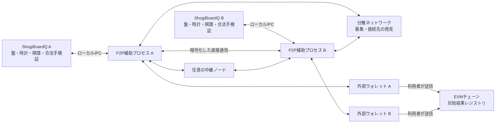
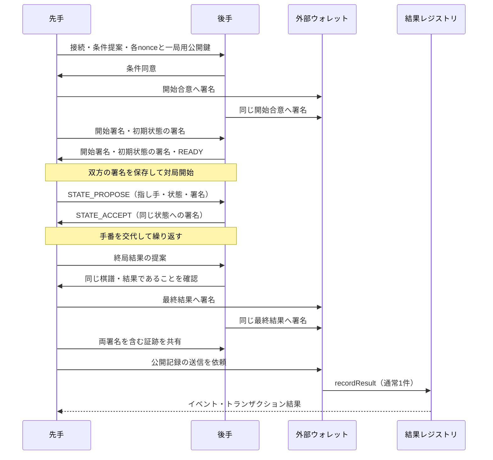

# P2P・ブロックチェーン対局の実装仕様

作成日: 2026-11-10

状態: 新機能の設計案。本文の追加クラス、プロトコル、コントラクトは未実装。

対象: ShogiBoardQ の Qt6 / C++17 デスクトップ版。

開発先と権限分離は、[リポジトリ構成と開発方針](p2p-development-strategy.md)を優先する。本文の追加先は通常版から派生する実験版リポジトリとして読み替える。P2P通信とウォレット接続を一つの補助プロセスにまとめた初期案は、同文書7章の改訂対象であり、プロセス・鍵・IPC設計を更新してから実装へ進む。

## 1. 採用する構成と保証範囲

対局募集・相手の発見・指し手の交換を P2P で行い、終局後に双方が署名した対局結果と棋譜のハッシュを EVM 互換ブロックチェーンに記録する。専用の中央対局サーバは設置しない。対局中にブロックの生成やトランザクションの承認を待たない。

ブロックチェーンが証明するのは「この二つのウォレットが、この条件と結果に署名し、その記録がチェーンに取り込まれたこと」である。コントラクトは棋譜の合法性、人間による着手、時計の正確さ、対局が実際に行われたことを検証しない。棋譜を持つ第三者は、ハッシュの一致と将棋のルールに従った手順を別々に検証できる。

初版は双方の合意による記録方式とする。相手が結果への署名を拒否した場合、片方の申告だけで勝敗を登録する機能は設けない。資産の預託、賭け、独自トークン、NFT、公式レーティングは対象外。

これは紛争をオンチェーンで裁定する完全なステートチャネルではない。ステートチャネルを採用するには、状態遷移の検証、異議申立期間、監視と応答の仕組みも必要になる。[Ethereum のステートチャネル解説](https://ethereum.org/developers/docs/scaling/state-channels/)

### 1.1 初版の機能

| 項目 | v1 の仕様 |
|---|---|
| 相手探し | 公開募集一覧、条件による絞り込み、招待情報による接続 |
| 対局 | 人間対人間、平手、開始局面固定、1局単位 |
| 時計 | 双方共通の持ち時間と秒読み。加算・遅延は0。既定は10分＋30秒 |
| 終局 | 投了、詰み、時間切れ、千日手、連続王手の千日手、合意引き分け、512手到達、中断 |
| 入玉 | 宣言勝ちは扱わない。双方の合意による引き分けは可能。開始前に表示 |
| 接続復旧 | 両アプリと補助プロセスが生存している間の回線再接続 |
| 身元 | 外部ウォレットの署名用アドレス。実名や一人一アカウントは保証しない |
| 公開記録 | 終局合意後に1トランザクション。利用者が送信するまでローカル保存 |
| 棋譜 | 既存形式での保存と、署名・検証用証跡ファイルの保存 |
| 動作環境 | Linux・Windows・macOS。対応ウォレット拡張を備えた外部ブラウザを使用 |

エンジン対局、駒落ち、任意局面、加算時計、観戦、公開棋譜配信、スマートコントラクトウォレット、第三者裁定は後続版で追加する。非対応条件を受信したときに、既定条件へ黙って置き換えない。

## 2. 全体構成



ブートストラップノードはネットワークへの入口、中継ノードは接続支援、RPC はチェーンの読み取り窓口として使う。いずれも将棋の指し手や勝敗を裁定しない。複数の運営者と利用者指定の接続先を扱えるようにする。

「特定の対局サーバに依存しない」構成であり、常時到達できるノードが一切不要になる構成ではない。小規模ネットワークでは、公開接続を受け付ける協力ノードの維持が必要になる。[分散型ホールパンチングの研究](https://research.protocol.ai/publications/decentralized-hole-punching/)

### 2.1 技術選定

| 層 | 採用案 | 理由・制約 |
|---|---|---|
| GUI・将棋処理 | 既存の Qt6 / C++17 | 盤面・棋譜・操作経路を再利用する |
| P2P | Rust の別プロセス `shogiboardq-peer` と rust-libp2p | 発見・NAT越え・中継を同じ基盤で扱う。Rust の配布・ビルド手順が増える |
| 通信経路 | QUIC、TCP＋Noise＋Yamux、Circuit Relay v2 | UDPが通らない環境ではTCPを試す。中継時にも当事者間を暗号化する |
| 接続支援 | Identify、AutoNAT、DCUtR | 到達性を確認し、中継経由の接続から直接接続への移行を試す |
| 募集 | 専用 Kademlia DHT、GossipSub、一覧取得プロトコル | DHTは参加者探索、GossipSubは募集更新、一覧取得は途中参加時の補完 |
| チェーン | EVM互換。開発はローカルEVM、結合検証はSepolia | 本番チェーンは費用と最終性の実測後に決定。独自チェーンは作らない |
| 署名 | ウォレットはEIP-712、一局用鍵はsecp256k1 | 条件・結果を型付き署名にし、各着手ではウォレット操作を不要にする |
| コントラクト | Solidity、OpenZeppelinのEIP712・ECDSAを利用 | 独自暗号実装を避ける。プロキシや管理者による結果変更を設けない |
| ワイヤ形式 | 決定的CBOR、長さ付きフレーム | 言語間で同一バイト列を作り、署名・ハッシュを再現する |

rust-libp2p は必要な各機能を提供する。採用時に対応OS、機能の組合せ、依存ライセンスを確認し、Cargo.lock とツールチェーンを固定する。本書はライブラリの最新バージョンへの自動追従を指定しない。[rust-libp2p の公式API資料](https://docs.rs/libp2p/latest/libp2p/)

初版では WebRTC を併用しない。ブラウザ対局を追加する段階で、相互運用と配布サイズを測定して再検討する。

## 3. 発見・募集・マッチング

### 3.1 ネットワークへの参加

- 専用DHTプロトコルを `/shogiboardq/kad/1.0.0` とし、IPFSなどの既存公開DHTに独自レコードを書き込まない。
- ネットワーク識別子は `H(CBOR(["SBQ-NETWORK", 1, chainId, registryAddress]))` とする。アドレスは20バイト、v1のchainIdは64bit符号なし整数の範囲とする。テストネットと本番の募集を混在させない。
- 同梱設定に独立した運営者のブートストラップ候補を3件以上用意することを公開運用の条件とする。起動時は複数へ接続を試す。
- 接続できた公開ピアを上限付きキャッシュに保存する。初期ノードの全停止時にも、到達可能な既知ピアから復帰できるようにする。
- 利用者は候補の追加・無効化ができる。候補一覧の更新は署名付きアプリ配布で行い、中央URLへの問い合わせを起動の必須条件にしない。
- 検証用のローカルネットワークでは、同一ホスト上の複数プロセスと明示した接続先を使う。

DHTで共有するのはロビー参加者の接続先を探すためのprovider情報とする。ロビーキーのproviderとして参加し、見つかったピアへ募集一覧を問い合わせる。募集一覧の完全性や、全オンライン利用者の列挙は保証しない。[libp2p の発見・ルーティング](https://libp2p.io/docs/discovery-routing-overview/)

ロビーキーは `H(CBOR(["SBQ-LOBBY", 1, networkId, rulesHash]))`、GossipSubのtopicは `/shogiboardq/lobby/1/<networkIdの小文字hex>/<rulesHashの小文字hex>` とする。公開到達可能な協力ノードがDHTのserver役を担い、通常のデスクトップは到達性に応じてclient役を使う。DHTのprovider情報のTTLと、募集自体の120秒の有効期間は別々に扱う。

### 3.2 募集情報

公開募集は次の内容を含み、発信者のlibp2p識別鍵で署名する。ウォレットとの結び付けは接続後に確認するため、公開募集の名前を認証済みの身元として表示しない。

| フィールド | 内容 |
|---|---|
| `version / networkId` | 募集形式とネットワーク |
| `offerId / sequence` | CSPRNGによる32バイトの識別子、更新番号 |
| `peerId` | 発信ピア。メッセージ署名の鍵と一致させる |
| `displayName` | 表示名。最大32文字、制御文字を拒否、リッチテキストとして解釈しない |
| `rulesHash / timeControl` | 対応ルールと持ち時間。初版の許可値だけを受理 |
| `sidePreference` | 先手希望、後手希望、指定なし |
| `createdAt / expiresAt` | UNIX秒。募集寿命は最大120秒 |
| `availability` | `Open` または `Withdrawn` |

- 募集中は30秒ごとに更新し、同一ピアの公開募集は1件とする。
- GossipSubのtopicはネットワーク・ルールごとに分ける。途中参加時は見つかった3ピア以上にキャッシュ一覧を要求する。
- 期限切れ、古いsequence、署名不正、過大な時刻ずれの募集を除外する。端末時刻のずれが30秒を超える場合は時計の確認を案内する。
- 同じ署名済み募集の再受信で有効期限を延長しない。重複識別子は10分間、上限付きで保持する。
- マッチングはクライアントが候補を絞り、相手へ直接申し込む。中央キューは設けない。

### 3.3 競合と招待

募集側は最初に受け入れた申込みに60秒の仮予約を与える。他の申込みには `BUSY` を返す。条件の合意後、ウォレット署名待ちは最大10分まで延長でき、その間は募集を取り下げる。期限切れやキャンセル時は予約を破棄する。

双方が「指定なし」の場合、申込側を先手とすることを条件確認画面に表示する。ランダム性や公平な抽選を保証する表示はしない。先後を変える場合は署名前に再提案する。

招待情報にはネットワーク、相手PeerId、到達候補、32バイトの一回用トークン、有効期限を含める。招待だけでは対局は開始しない。招待トークンの有効期間は10分、成功時に失効させ、ログへ出さない。初版は招待文字列のコピー・貼り付けとし、OSへのURLスキーム登録は後続対応とする。

## 4. 接続・NAT越え・資源制限

1. 既知の到達候補へ直接接続を試す。
2. AutoNAT等で到達性を確認し、必要な場合は中継の予約を確保する。
3. 中継接続を作り、DCUtRによって直接接続への移行を試す。
4. 直接接続に失敗した場合は、中継が許可する範囲で通信を継続する。
5. どちらの経路も利用できない場合は接続失敗として終了する。ポート開放を自動実行しない。

Circuit Relayには時間・データ量・予約数の制約がある。一般公開リレーを無制限で使えると仮定しない。運用するリレーでは長時間対局に必要な設定を検証し、制限到達による切断も再接続手順で扱う。[Circuit Relay](https://libp2p.io/docs/circuit-relay/)、[DCUtR](https://libp2p.io/docs/dcutr/)

協力ノードは補助バイナリの `--service` モードとして別途運用する。ブートストラップ、DHT server、中継を設定で有効化でき、GUI・ウォレット・将棋の裁定処理を必要としない。通常のデスクトップを自動的に中継サーバへ昇格させない。サービス用PeerIdは再起動で変えず、識別鍵を所有者だけが読めるファイル権限・ACLで保存する。これは5章の通常クライアントの一時鍵とは別の運用である。

| 制限 | v1の初期値 |
|---|---|
| 直接接続の試行 | 10秒。その後は中継候補を含め全体30秒で判定 |
| 接続維持 | ping 10秒、応答不在30秒で再接続へ移る |
| 着手確認 | 5秒で同一メッセージを再送。30秒で接続復旧へ移る |
| 回線復旧待ち | 切断検出から120秒 |
| 1局の実時間上限 | 24時間。上限時は合意中断を提案し、合意できなければ未確定終了 |
| 1フレーム | 64 KiB。長さを確認してから領域を確保 |
| 募集1件・一覧 | 4 KiB / 100件。ページ送りでも保持は1,000件まで |
| 接続数 | 合計32、未認証8、対局相手1 |
| 受信キュー | 接続ごとに256 KiB。超過時は切断 |
| アプリメッセージ | 認証前は5件/秒、対局中は20件/秒、burstは各2倍 |
| 証跡転送 | 32 KiB以下の分割、1ファイル最大8 MiB |

これらは設計上の初期値であり、実測した性能値ではない。実装時の接続試験で調整し、対局に影響する値は `networkPolicyHash` に含める。IPごとの制限だけで携帯回線の利用者を一括排除しない。

## 5. 鍵・署名・データ形式

### 5.1 鍵を分ける

| 鍵 | 用途 | 保管 |
|---|---|---|
| ウォレット鍵 | 開始条件と最終結果への同意、公開記録トランザクション | 外部ウォレットのみ。ShogiBoardQへ取り込まない |
| libp2p識別鍵 | PeerId、暗号化通信、募集への署名 | 補助プロセス起動ごとに生成、メモリのみ |
| 一局用secp256k1鍵 | 着手状態・対局制御メッセージへの署名 | 一局ごとに生成、メモリのみ。資産を持たせない |

一局用鍵の権限は、開始合意に含めた一局の通信証跡に限る。最終結果をオンチェーン登録する署名の代用にはしない。プロセス終了で鍵が失われた場合、進行中の対局を自動再開しない。

v1のウォレット署名は、secp256k1署名から当該アドレスを復元できる方式に限定する。ERC-1271によるコントラクトウォレットは後続対応とする。署名の検証が失敗したとき、成功とみなすフォールバックを設けない。[ERC-1271](https://eips.ethereum.org/EIPS/eip-1271)

### 5.2 決定的エンコード

署名済みデータは、RFC 8949のcore deterministic encodingに従う固定順序のCBOR配列とする。最短整数表現・確定長のみを許し、浮動小数、タグ、未定義値、不定長、余剰要素を拒否する。バイナリ値はbyte string、USI・SFEN・識別文字列はASCIIとする。数値は符号なしで、スキーマの上限を超えた値を拒否する。[RFC 8949 §4.2](https://www.rfc-editor.org/rfc/rfc8949.html#section-4.2)

ハッシュ関数 `H` はEthereumのKeccak-256とし、FIPS SHA3-256と混同しない。CBORの再エンコード結果が元のバイト列と一致することも検証する。JSONやKIFファイルの見た目をそのままハッシュしない。

ハッシュ・nonceは32バイト、Ethereumアドレスは20バイト、署名は65バイト、SFENは256バイト以下、USI着手は4または5バイトとする。State0だけは空のUSIを許可する。CBORの入れ子は最大16段とし、整数のデコード後にplyは32bit、時刻とミリ秒は64bitの範囲を検証する。カウントや時刻を加算する箇所もオーバーフローを拒否する。

以下を順序固定のスキーマとする。配列内の名称は値を表し、ラベル文字列がある箇所はその文字列自体も含む。

```text
Rules = ["SBQ-RULES", 1, initialSfen, 512,
         "fourfold-draw", "perpetual-check-loss", "no-declaration",
         "human", "human"]
TimeControl = ["SBQ-TIME", 1, mainMs, byoyomiMs, 0, 0]
NetworkPolicy = ["SBQ-NET", 1, 10000, 30000, 120000, 5000, 86400000]

State = ["SBQ-STATE", 1, gameId, ply, previousStateHash,
         moveUsi, sfen, spentMs, blackMainMs, whiteMainMs]
Transcript = ["SBQ-TRANSCRIPT", 1, gameId, [State0, State1, ..., StateN]]
```

- `Rules` の末尾は対局者種別。`TimeControl` の末尾2値は加算・遅延で、v1は0のみ。
- `NetworkPolicy` の時間値は順にping間隔、切断検出、再接続、再送、1局上限で、すべてミリ秒。
- `mainMs` は0〜86,400,000、`byoyomiMs` は0〜600,000。両方0はv1では拒否する。
- 初期SFENは `lnsgkgsnl/1r5b1/ppppppppp/9/9/9/PPPPPPPPP/1B5R1/LNSGKGSNL b - 1`。
- SFENは空白1個区切り、持駒の順序を `RBGSNLPrbgsnlp` とし、手数を `ply + 1` に固定する。
- `State0` は `ply=0`、前状態ハッシュはゼロ32バイト、指し手は空文字、消費時間0、双方の残り持ち時間は初期値。
- 以後の指し手はUSIの通常手または駒打ちのみ。`resign` 等は着手に混ぜない。
- `rulesHash` 等は各配列の決定的CBORをHに渡す。`stateHash` と `transcriptHash` も同様。
- Transcriptには署名、表示名、棋譜コメント、保存日時を含めない。署名は別の証明として保存する。

### 5.3 開始合意と対局ID

EIP-712のdomainは `name="ShogiBoardQ Match Registry"`、`version="1"`、`chainId`、`verifyingContract` とする。型文字列は次のフィールド順・型で固定する。[EIP-712](https://eips.ethereum.org/EIPS/eip-712)

以下の改行・インデントは説明用である。typeHashにはEIP-712のencodeTypeに従う空白・改行なしの区切りを使い、各フィールドでは型名とフィールド名の間だけ半角空白1個を置く。

```text
StartAgreement(
  bytes32 blackNonce, bytes32 whiteNonce,
  address black, address white,
  address blackSession, address whiteSession,
  bytes32 blackPeerIdHash, bytes32 whitePeerIdHash,
  bytes32 rulesHash, bytes32 timeControlHash, bytes32 networkPolicyHash,
  uint64 startBefore, uint64 recordBefore
)
```

- 各nonceは当該側がCSPRNGで生成する32バイト。相手が両方を決めない。
- PeerIdのハッシュは文字列表記ではなく、libp2p PeerIdのバイナリ表現にHを適用する。
- `gameId = EIP712Digest(StartAgreement)`。domainも含まれるので別チェーン・別コントラクトへ署名を流用できない。
- 両ウォレット、両一局用鍵、両PeerIdはそれぞれ異なる値とし、ゼロアドレスを拒否する。
- `startBefore` は合意作成から10分以内、`recordBefore` は `startBefore + 30日` に固定する。コントラクトもこの差が30日であることを検証する。
- `startBefore` は開始時に双方のクライアントで確認する期限。過去に開始した事実をコントラクトが証明する値ではない。
- `recordBefore` はコントラクトがブロック時刻で検証する登録期限。経過後は記録を「登録期限切れ」として残す。
- 両署名が同一の合意を指し、各条件配列のハッシュと一致し、相手PeerIdと一局用鍵の所有を確認してから開始する。

署名の前に、相手、先後、持ち時間、ルール、記録先、公開される内容を日本語等の選択言語で表示する。ハッシュ値だけを見せて条件への同意を求めない。

### 5.4 着手・制御・最終結果の署名

```text
StateApproval(bytes32 gameId, uint32 ply, bytes32 stateHash)
Control(bytes32 gameId, bytes32 connectionId, uint64 sequence,
        uint8 kind, bytes32 bodyHash)
FinalResult(bytes32 gameId, bytes32 finalStateHash,
            bytes32 transcriptHash, uint32 ply, uint8 outcome, uint8 cause)
```

`StateApproval` と `Control` は一局用鍵、`FinalResult` はウォレットで署名する。すべて同じEIP-712 domainを使い、型とgameIdで用途を分離する。署名は65バイトの `r || s || v`、low-sのみ、vは27または28に正規化する。

接続時に双方が32バイトの乱数を交換し、`connectionId = H(CBOR(["SBQ-CONN", 1, gameId, blackRandom, whiteRandom]))` とする。`Control` のsequenceは方向別に1から増加させ、同一接続内の再送は同一バイト列とする。再接続では新しいconnectionIdを作る。着手状態の証明は接続が変わっても有効である。

`Control.kind` は1=READY、2=RESUME、3=RESULT_PROPOSE、4=ABORT、5=ERRORとする。bodyは順に `[state0Hash]`、`[latestPly, latestStateHash]`、`[FinalResultのフィールド列]`、`[latestStateHash, reasonCode]`、`[errorCode, relatedPly]`。bodyHashはbodyの決定的CBORにHを適用する。不明なkindは拒否する。署名済み制御メッセージが最終ウォレット署名を置き換えることはない。

## 6. 対局プロトコル

### 6.1 フレームと互換性

対局用libp2pプロトコルは `/shogiboardq/game/1.0.0`、募集一覧は `/shogiboardq/lobby/1.0.0` とする。フレームは4バイトのネットワークバイト順長＋CBOR。`[version, type, requestId, gameId, payload]` を共通外枠とする。versionは1、typeは16bit、requestIdは方向別に増える64bit整数、gameIdは32バイトとする。対局ID決定前はゼロ32バイトを用いる。

typeは1=HELLO、2=START_AGREEMENT、3=START_SIGNATURE、4=STATE_PROPOSE、5=STATE_ACCEPT、6=CONTROL、7=SYNC_REQUEST、8=SYNC_CHUNK、9=RESULT_SIGNATURE。HELLOではnetworkId、対応major版、PeerId、募集/招待ID、接続用乱数を交換する。開始合意後にgameIdと接続用乱数からconnectionIdを確定する。未知major版は切断、未知typeはエラーとして対局を進めない。

START_AGREEMENTは合意の全フィールドと3種類の条件配列、START_SIGNATUREは先後の識別とウォレット署名を運ぶ。STATE_PROPOSEはStateと着手側のStateApproval署名、STATE_ACCEPTはply・stateHash・受信側のStateApproval署名、CONTROLはControlとbodyと署名、RESULT_SIGNATUREはFinalResultと先後の識別とウォレット署名を運ぶ。

SYNC_REQUESTは要求開始plyと直前のstateHash、SYNC_CHUNKは連続したStateと各状態の両署名・終端フラグを運ぶ。要求外のデータや既存状態と異なる上書きを受け入れない。フレームごとの型・順序はこの定義からC++/Rust共通のテストベクトルとして固定する。

State0は先手がSTATE_PROPOSEで送り、後手がSTATE_ACCEPTで応答する。初期状態だけは着手・手番変更を伴わない。対局中に新しいState0を受けても再初期化しない。

エラーコードは `UNSUPPORTED_VERSION`、`WRONG_NETWORK`、`BUSY`、`EXPIRED`、`INVALID_SIGNATURE`、`INVALID_MOVE`、`STATE_CONFLICT`、`LIMIT_EXCEEDED`、`STORAGE_ERROR` とする。開始前は拒否して待機へ戻す。対局中の検証失敗は状態を変更せず中断へ移り、相手の負けとして登録しない。

### 6.2 開始から記録まで



先後の開始条件署名とState0への両署名がそろった後、後手がREADYを送る。先手はその受信で初手の計時を開始する。後手はREADY送信時から相手の時間を観測する。再送したREADYで時計を初期化し直さない。

### 6.3 着手確定の順序

1. 手番側は二重送信を禁止し、候補局面で合法手を検証する。State生成時に消費時間を固定し、新Stateへの自分の署名を証跡へ永続化してから送信する。
2. 受信側は相手の署名、gameId、ply、前状態ハッシュ、手番、合法性、SFEN、残り時間の計算を検証する。
3. 受信側は自分のStateApprovalを作り、両署名を含む証跡を永続化してからSTATE_ACCEPTを送信し、その状態を盤・棋譜へ反映する。
4. 送信側はSTATE_ACCEPTを検証・永続化してから盤・棋譜へ反映する。確認待ちの指し手を確定棋譜へ先行追加しない。
5. 各側で時計・棋譜・盤の更新を済ませ、最後に `GameBoard::notifyMoveCommitted()` を呼ぶ。

双方に届く瞬間を完全に同時にはできない。受信側だけが新状態を知っている区間は再接続時に両署名付き証明を交換して解消する。通信のACKだけを双方署名付き証明の代わりにしない。

同じply・同じstateHashの再送には、保存した署名を再送する。盤・時計・棋譜・駒音は再実行しない。同じplyで異なるstateHashを受けた場合は `STATE_CONFLICT` として停止する。部分署名だけの別分岐へ巻き戻さない。

一局につき有効な対局ストリームは1本とする。通常は先手が開き、後手は余分なストリームを閉じる。再接続では旧ストリームを無効化し、RESUMEと状態照合を終えるまで着手を受け付けない。

状態を変更する受信処理は順番に一件ずつ完了させる。ACKの署名検証や永続化が非同期でも、後続の相手の着手を先に適用しない。バッファ上限を超える場合は接続を閉じて復旧へ移る。

## 7. 時計・切断・状態復旧

### 7.1 時計の計算

計時には単調増加時計を用い、OSの現在時刻の変更を反映させない。署名・UI・ネットワーク処理の都合で計時を自動的にやり直さない。

初手以外の手番開始は、相手の着手を検証してSTATE_ACCEPTを送信キューへ渡す時点。自分の合法な着手からStateを生成する直前に、その手の消費時間を固定する。以後の署名・永続化・送信・確認待ちは消費時間に追加しない。署名後のStateへ送信時刻を後付けしない。候補手のローカル検証に失敗した場合は計時を継続し、署名・保存に失敗した場合は対局を中断する。

初版では持ち時間と秒読みだけを扱う。手番開始時の基本持ち時間をR、秒読みをB、自己計測した消費時間をEとする。

- 着手可能な条件は `E < R + B`。境界と同値なら時間切れ。
- 着手後の基本持ち時間は `max(0, R - E)`。
- 秒読みの未使用分は次の手へ持ち越さない。次の自分の手番では同じBを使う。
- 相手側の基本持ち時間は、その着手によって変わらない。
- 受信側はEから残り時間を再計算する。送られてきた残り時間だけを信用しない。

秒表示の丸めは既存の[時計表示仕様](game-time-control-spec.md)に合わせるが、通信上の比較と保存はミリ秒の整数で行う。

Eは署名者の自己申告でもある。相手側でも観測し、自己申告と大きく異なる場合や無応答で時間切れ相当になった場合は結果協議へ移るが、観測値だけで公開勝敗を確定しない。ネットワーク遅延を差し引くことによる公平性を保証しない。署名は計時の正しさを証明しない。

### 7.2 回線切断時

- 新たな着手入力を止め、対局を `Reconnecting` にする。現在手番の計時は続ける。
- 未確認の着手は同一バイト列で再送する。ACK消失を理由に別の指し手を生成しない。
- 双方の最新両署名付き状態を交換し、正しい署名と連続した手順を検証して不足分を補う。
- 受信前に消えていた相手の着手を復旧で初めて受理した場合、その側の手番は復旧時の受理・ACKから始める。失われた手番開始時刻を推測しない。
- 同じ状態の照合だけで、継続していた手番の時計を巻き戻さない。
- 時間切れや結果不一致が発生した場合は結果協議へ移る。120秒で復旧できなければローカルで「通信中断・結果未確定」として棋譜を閉じる。

切断は相手の負けと同義ではない。自分側の回線障害と相手の意図的切断を、2者だけで確実に区別することはできない。

### 7.3 クラッシュ・スリープ

v1ではアプリまたは補助プロセスの再起動後に対局を継続しない。一局用秘密鍵と信頼できる計時区間を再現できないためである。スリープや計時の連続性を確認できない状態でも同様に中断する。保存済み証跡の確認、最終ウォレット署名の追加、期限内の公開記録は再起動後も可能。

中断から新たな局面で続ける機能は後続版とし、元の対局と同じgameIdを使い回さない。

## 8. 終局・結果の意味

結果の表現を次に固定する。

| 値 | outcome |
|---|---|
| 1 | 先手勝ち |
| 2 | 後手勝ち |
| 3 | 引き分け |
| 4 | 合意中断 |

| 値 | cause | 許されるoutcome |
|---|---|---|
| 1 | 投了 | 1 / 2 |
| 2 | 詰み | 1 / 2 |
| 3 | 時間切れ | 1 / 2 |
| 4 | 千日手 | 3 |
| 5 | 連続王手の千日手 | 1 / 2 |
| 6 | 合意引き分け | 3 |
| 7 | 512手到達 | 3 |
| 8 | 合意中断 | 4 |

詰み・千日手等は双方のクライアントで評価する。512手目の着手が別の終局条件も満たす場合、詰み、連続王手の千日手、通常の千日手、手数上限の順で判定する。非合法な着手は受理せず、公開記録上の反則負けへ自動変換しない。

終局結果は最後の両署名付きStateとTranscriptを参照する。未確認の着手がある間は、その状態を照合するまで結果へ署名しない。両ウォレットが同じFinalResultに署名した時点で `MutuallyAgreed` とする。署名は各利用者が結果と公開内容を確認して行う。

投了メッセージがある場合も、コントラクトの登録条件は両ウォレット署名とする。相手が署名しなければ、ローカルの終局理由と公開記録の不成立を分けて残す。署名拒否や無応答を「引き分け」に置き換えない。

双方が故意に架空の結果へ署名することも可能であり、レジストリはそれを検出しない。ここに記録した勝数を、そのまま公式レーティングや人間の棋力の根拠として使用しない。

## 9. スマートコントラクト

### 9.1 単一の結果レジストリ

コントラクト名の案は `ShogiMatchRegistryV1`。開始時のトランザクション、入会登録、資産預託を不要とし、通常は終局後の1トランザクションだけを使う。

```solidity
function recordResult(
    StartAgreement calldata agreement,
    bytes calldata blackStartSignature,
    bytes calldata whiteStartSignature,
    FinalResult calldata result,
    bytes calldata blackResultSignature,
    bytes calldata whiteResultSignature
) external;

function resultDigest(bytes32 gameId) external view returns (bytes32);

event ResultRecorded(
    bytes32 indexed gameId,
    address indexed black,
    address indexed white,
    bytes32 resultDigest,
    bytes32 rulesHash,
    bytes32 finalStateHash,
    bytes32 transcriptHash,
    uint32 ply,
    uint8 outcome,
    uint8 cause
);
```

上記はABI設計の抜粋であり、そのままビルド可能な実装ではない。構造体の順序と型は5章の定義を用いる。

### 9.2 検証する条件

1. 先後のウォレット・一局用アドレスが有効で、先後同士が重複しない。PeerIdハッシュもゼロ・同一を拒否する。
2. agreementのdomainと型から計算したgameIdがresult.gameIdに一致する。
3. 開始条件への両署名が、agreementに指定された両ウォレットに一致する。
4. 最終結果への両署名も同じ両ウォレットに一致する。
5. `recordBefore = startBefore + 30日` である。加算のオーバーフローを拒否する。初回登録では現在のブロック時刻がrecordBefore以下であることも要求する。
6. `ply <= 512`、outcomeとcauseの組が8章の表に一致し、手数上限のcauseではplyが512である。
7. 必須ハッシュがゼロでない。同じgameIdの既存記録との整合性を確認する。

コントラクトは署名からプレイヤーを求める。送信者 `msg.sender` を勝者や対局者として扱わない。署名済みパケットを持つ任意の送信者が登録できる。相手や任意の代行者が送っても結果は変わらない。

同じgameId・同じ結果digestの再登録は成功扱いのno-opとし、イベントを重複発行しない。異なるdigestが登録済みなら `ConflictingResult` で拒否する。両者が複数の矛盾した結果に署名した場合は先に取り込まれた結果が残るため、クライアントは一つのgameIdで異なるFinalResultに署名させない。

署名等の検証後に既存digestを照会し、一致するno-opでは登録期限を再要求しない。新しい記録だけに期限を適用する。結果やルールのハッシュから棋譜内容を検証する処理はコントラクトにないため、読み取り側も既知のルールと独立検証結果を確認して表示する。

コントラクトには所有者による書換え、削除、upgrade、送金、任意外部callを設けない。関数はnonpayableとする。将来の仕様変更は新しいコントラクトとdomain versionで行い、旧記録の照合経路を維持する。

### 9.3 チェーンに載る情報

保存領域にはgameIdから結果digestへの対応、イベントには上記の検索用情報を残す。開始条件と両署名はトランザクション入力として公開される。IPアドレス、表示名、棋譜全文、チャット、招待トークンは入力へ含めない。

ハッシュだけから棋譜全文は復元できない。署名・棋譜ファイルを失った場合に備えるには、利用者自身のバックアップか、別の配信・保存機能が必要である。IPFSへの自動アップロードは初版に含めない。

ウォレットアドレスと対局履歴は公開され、削除できない。PeerIdのハッシュ等も、別途そのPeerIdを知る第三者には対応付けられる。この公開範囲を開始署名と最終署名の前に説明する。

## 10. チェーン接続・ウォレット・確定性

### 10.1 チェーン設定

`ChainProfile` にchainId、RPC候補、レジストリアドレス、期待するruntime bytecodeのハッシュ、deployment block、エクスプローラURL、最終性ポリシーを持たせる。実装で勝手に選んだアドレスへ署名させない。

ローカル開発ではテスト起動設定にchainId=31337を明示する。公開結合検証はSepolia（11155111）を用い、検証環境の存続状況は実施時に再確認する。本番チェーンのアドレスはデプロイ後の成果物で確定する。[Ethereum のネットワーク資料](https://ethereum.org/developers/docs/networks/)、[OpenZeppelin のテストネット接続手順](https://docs.openzeppelin.com/contracts/5.x/learn/connecting-to-public-test-networks)

開始前に `eth_chainId` と `eth_getCode` を検証する。RPCが利用不能で記録先を確認できない場合、新しい署名対局は開始しない。開始済みの対局はRPC障害で停止させず、記録を後回しにする。

### 10.2 外部ウォレットとの接続

補助プロセスが必要な操作中だけloopbackのランダムポートでローカルページを配信し、外部ブラウザのウォレット拡張と接続する。EIP-1193 Providerを用い、型付き署名には `eth_signTypedData_v4` 対応を必要とする。最初の実証で主要OSの採用ウォレットとの互換性を確認する。[EIP-1193](https://eips.ethereum.org/EIPS/eip-1193)

- 待受は127.0.0.1のみ。LANへ公開しない。
- 256ビットの一回用capabilityをURL fragmentで渡す。ページ内で取得後にfragmentを消し、POSTの認証ヘッダーとして使う。
- Host・Origin・capability・要求IDを検証する。任意Origin、DNS rebinding、要求の再実行を拒否する。
- ページは同梱資源のみを使い、外部JavaScript・CDN・解析タグを読み込まない。CSPとReferrer-Policyを設定する。
- ブラウザから任意の署名対象や送信先を受け取らない。アプリが用意した一件の操作だけを表示・実行する。
- ウォレットのaccountsChanged・chainChanged・切断・拒否を扱い、署名後もアドレスと内容を再検証する。
- 署名完了または5分の期限でページの権限を破棄する。条件確認中の全体期限は3章の予約期限に従う。
- 秘密鍵、シードフレーズ、資産残高の入力をShogiBoardQ側で要求しない。

通常、一人あたり開始時・終局時の2回のメッセージ署名が必要となる。公開送信担当は別途トランザクション送信を承認する。最終署名を共有した後は相手も公開可能なので、「自分が送信ボタンを押すまで非公開」とは表示しない。

### 10.3 登録状態

対局の終了状態と、チェーンへの記録状態は別の状態機械にする。

```text
AwaitingSignatures -> ReadyToSubmit -> Submitted -> Included -> Finalized
                           |              |           |
                        Expired        Failed       Reorged
                                                      |
                                                ReadyToSubmit
```

- `ReadyToSubmit`: 条件・結果の両署名を保存済み。送信者がガス代を負担する。
- `Submitted`: txHashを保存。まだ成功を意味しない。
- `Included`: receipt.status=1、コントラクト・イベント・gameId・digestの一致を確認済み。
- `Finalized`: 設定されたチェーンの最終性条件を満たし、当該receiptのブロックが正規チェーン上に残っている。
- `Reorged`: receiptが消失またはブロックハッシュが不一致。記録を未確定へ戻し、既存登録を照会する。
- `Failed`: revert、期限切れ、異なる結果の先行登録等。理由を示し、対局棋譜は保持する。

送信前にresultDigestを照会し、相手等による同一結果の登録があれば新規送信を省く。no-opとなった自分のreceiptにはイベントがないため、deployment block以降を範囲制限付きで検索し、最初のResultRecordedのトランザクションを確定性確認の対象にする。期限切れ判定より先に既存の登録を確認する。

Sepoliaでは `finalized` ブロックを照合する。L2採用時は、そのチェーンでの取り込みとL1を含む最終性を別に定義する。単に固定回数の承認を待った状態を、すべてのチェーンで「最終確定」と呼ばない。[Ethereum JSON-RPC](https://ethereum.org/developers/docs/apis/json-rpc/)

RPCの申告は信頼境界である。既定では異なる運営者の2窓口でブロックハッシュと記録を照合し、不一致は確定表示にしない。ただし2窓口の一致は暗号学的なライトクライアント検証の代用ではない。自己運用ノードも指定できる。

### 10.4 費用・再送

通常の公開記録は1局1トランザクションで、署名だけではガス代は発生しない。実額は使用チェーンと混雑で変わるため、固定金額を仕様に置かない。実装後に `eth_estimateGas` と実行receiptで費用を測定する。

送信直前に送信先、チェーン、見積り、上限を表示する。自動的な追加課金、無制限の再送、勝手なチェーン切替は行わない。タイムアウトだけで新しいトランザクションを作らず、既存txHash・置換トランザクション・resultDigestを確認する。双方が同時送信した場合、二重の結果登録は避けられてもガス代の重複は起こり得る。

## 11. ローカル保存と検証

データの保存先は `AppPaths::dataDirectory()/p2p/` とし、アプリ配布先やカレントディレクトリに書き込まない。テストでは `SHOGIBOARDQ_DATA_HOME` を使って隔離する。

| 保存物 | 内容 |
|---|---|
| 対局ジャーナル | 開始合意、署名、提案・受理したState、制御証跡。追記型、長さとチェックサム付き |
| 検証用証跡 `<gameId>.sbqmatch` | 形式version、domain、条件、全State、各両署名、最終結果とその署名 |
| 記録状態 | txHash、receipt、観測ブロック、登録状態、最終照会日時 |
| 通常棋譜 | 既存のKIF等。証跡のgameIdを関連付ける |

送信前の提案とACK前の受理証明は、書込み失敗を検出し、必要な永続化を完了してから外部へ送る。書込みに失敗した場合は署名・着手を進めず中断する。起動時はジャーナルの完全なレコードまでを読み、不完全な末尾を復旧対象として扱う。秘密鍵は保存しない。

最終署名の要求前に `gameId -> finalResultDigest` を永続化する。再起動後も異なる最終結果への再署名を防ぐ。同じ内容の署名・公開記録の再試行は許可する。

独立検証ツールは、サイズ制限、domain、開始署名、一局用鍵の紐付け、Stateの両署名、連続する手数・ハッシュ、全着手の合法性、時計の算術、Transcriptのハッシュ、最終署名、チェーン上のdigestを検証する。

検証表示は「署名と記録が一致」「棋譜がルールに適合」「自己申告時間の計算が一致」を区別する。「実際の思考時間が正しい」「人間が指した」とは表示しない。KIFのコメント編集は証跡を変更せず、着手列を編集した棋譜は元の検証済み証跡との対応を失う。

## 12. ShogiBoardQへの組込み

### 12.1 再利用する部品

| 現在の部品 | 組込み方 |
|---|---|
| [GameBoard](../../src/game/gameboard.h) | 合法手検証、確定手の適用、着手確定通知 |
| [GameChannel](../../src/game/gamechannel.h) / [GameChannels](../../src/network/gamechannels.h) | P2P用の操作窓口を追加し、盤操作側に対局種別の分岐を増やさない |
| [MatchRecordSink](../../src/game/matchrecordsink.h) / GameSession | 開始、着手、終局の既存棋譜記録経路 |
| [AppActivityState](../../src/common/appactivitystate.h) | P2P接続中・対局中のActivityLeaseと操作可否 |
| [SennichiteDetector](../../src/game/sennichitedetector.h) | ルール固定用テストを追加して千日手評価に利用 |
| [TimeControl](../../src/core/timecontrol.h) / ShogiClock | 条件の値と表示。P2Pの残り時間の正本は専用進行データ |
| [NetworkSettings](../../src/services/networksettings.h) | P2P設定を既存の型付き設定方式で永続化 |

既存のCsaClientはサーバの着手確認・裁定を前提とするため、P2P通信の基底にはしない。P2Pの確認・結果合意は独立したクラスに置く。既存CSA対局との互換通信は提供しない。

### 12.2 追加する部品

以下のパス・名称は新規追加案である。実装時は既存規約の小さなクラス、メンバ関数ポインタによるsignal/slot接続を守る。

| 追加先 | 責務 |
|---|---|
| `src/network/p2p/peerprocessclient.h/.cpp` | QProcessの起動、非同期IPC、プロセス世代と要求IDの管理 |
| `src/network/p2p/p2plobbyservice.h/.cpp` | 募集・招待・接続候補のモデル |
| `src/network/p2p/p2pgamecoordinator.h/.cpp` | 開始、着手合意、復旧、終局の状態機械 |
| `src/network/p2p/p2pgamechannel.h/.cpp` | GameChannelを実装。送信直後はMoveResult::Sent |
| `src/network/p2p/p2pgameprogress.h/.cpp` | 確定手順、合意済み残り時間、保留中の一手の値型 |
| `src/network/p2p/p2pprotocol.h/.cpp` | 条件・Stateの構築、境界値と形式の検証 |
| `src/network/p2p/p2pevidencestore.h/.cpp` | ジャーナル、証跡の原子的保存、復旧 |
| `src/network/p2p/matchregistryclient.h/.cpp` | 記録キューと登録状態。RPC操作は補助プロセスへ依頼 |
| `src/dialogs/p2plobbydialog.h/.cpp` | 募集一覧、絞り込み、招待 |
| `src/dialogs/p2pgamedialog.h/.cpp` | 条件、接続、公開範囲の確認 |
| `src/ui/controllers/p2pgameuicontroller.h/.cpp` | メニュー・状態・終局表示の接続 |
| `peer/` | Rust補助プロセス。P2P、鍵、署名、RPC、ウォレットbridge |
| `contracts/` | Solidityソース、ABI、Foundryテスト、配布manifest |
| `tests/fixtures/p2p/` | C++・Rust・Solidity共通の署名・エンコードテストベクトル |

将棋の合法性と対局進行はC++側が決定する。補助プロセスは受信した合法手を独断で盤へ適用せず、C++から承認されたStateだけに署名する。既存の `applyRecordedMove()` によるサーバ裁定前提の適用を、受信P2P着手の検証に流用しない。

### 12.3 状態とライフサイクル

```text
Idle -> Discovering -> Connecting -> Negotiating -> AwaitingWallet -> Playing
Playing <-> Reconnecting
Playing -> Finishing -> Completed
Reconnecting -> Interrupted
任意の開始前状態 -> Cancelled / Error
```

AppActivityStateへ `DuringP2pConnection` と `DuringP2pGame` を追加し、GameChannelsがP2pGameChannelを選択する。登録処理だけが残っている場合は、対局中のActivityLeaseを保持しない。

部品はMainWindowComposerで生成・配線し、MainWindowへ通信処理を追加しない。MatchRecordSinkだけは既存の構成に従ってGameSession生成後に渡す。[合成ルートの規約](composition-root.md)

対局開始では棋譜を作成してからActivityLeaseを取得する。終局では棋譜を確定してから対局状態を解放する。相手の結果署名やチェーン記録待ちが、通常の棋譜閲覧・次の対局を無期限に阻害しないようにする。

### 12.4 プロセス間通信

QProcessのstdin/stdoutに4バイト長＋UTF-8 JSONを流す。stdoutはプロトコル専用、stderrはサイズを制限した診断専用。JSONの数値精度に依存しないよう、64bit整数は10進文字列、署名済みCBORはbase64で運ぶ。IPC1件の上限も64 KiBとする。

コマンド例は `hello`、`discover`、`publishOffer`、`connectPeer`、`signState`、`sendFrame`、`requestWalletSignature`、`submitResult`、`queryResult`、`shutdown`。各要求・応答にprotocolVersion、processGeneration、requestId、必要な場合gameIdを含める。

UIからウォレット署名・課金を許可した一件の要求だけを補助プロセスへ渡す。受信P2Pフレームから、直接ウォレット要求や任意JSON-RPCを起動できない構造にする。

QProcessはGUIスレッドで生成・非同期操作し、waitForFinished等でイベントループを止めない。署名結果・接続結果が古い世代や取消済み要求に属する場合は破棄する。[スレッド規約](threading-guidelines.md)

終了時は募集を取り下げ、進行中なら中断を通知し、証跡を保存してshutdownを依頼する。2秒で終了しなければterminate、さらに2秒でkillする。すべて非同期タイマーで処理する。

## 13. 画面と設定

メニューに「P2P対局」を追加し、募集一覧・条件確認・対局画面・記録状態へ進む。通常の利用者画面ではDHTやRPCの用語を主操作に使わず、「対戦相手を探す」「招待で接続」「公開記録を送信」など行動が分かる文言にする。

| 画面 | 必要な表示・操作 |
|---|---|
| 募集一覧 | 表示名、先後、持ち時間、ルール、接続状態、募集取消、名前が自己申告であること |
| 条件確認 | 相手アドレス、署名の確認状態、先後・時間・入玉の扱い、公開記録の範囲 |
| 対局中 | 直接/中継、着手確認待ち、再接続残り時間、投了・合意中断 |
| 終局 | ローカル結果、相手の署名待ち、双方合意、記録準備の状態 |
| 公開記録 | 記録先、費用見積り、送信担当、送信・再照会・証跡保存 |
| 履歴 | 対局結果と登録状態を別々に表示。txHashから設定済みエクスプローラを開く |

「ブロックチェーンで不正防止済み」「時間切れが証明された」等の表示はしない。署名拒否・RPC停止・ガス不足・登録期限切れには、それぞれ別の説明を出す。

NetworkSettingsに `P2p/*` としてロビーの大きさ、列幅、フォント、絞り込み、持ち時間、先後希望、チェーンprofile、接続候補、証跡保存先を登録する。最後に使った公開アドレスは保存できるが、秘密鍵・署名要求のcapability・招待トークンは設定へ保存しない。

既存の設定方式は[設定仕様](settings-service.md)に従う。UI実装時はすべての `tr()` 追加を翻訳ソースへ反映し、日本語・英語等の既存対応言語を更新する。

## 14. 信頼境界と異常系

| 事象 | 処理 |
|---|---|
| なりすまし | 接続PeerId、一局用鍵、開始合意のウォレット署名を照合 |
| 過去の着手・署名の再利用 | domain、gameId、ply、前状態ハッシュ、接続ごとのsequenceで拒否 |
| 改造クライアントの非合法手 | 受信側で合法性を検証し、ACKしない |
| 棋譜・表示上の結果の改ざん | Transcript、両署名、チェーン上のdigestを別々に照合 |
| 時計の虚偽申告 | 算術と観測差を確認。公平な実時間の証明はできず、合意不成立として扱える |
| 結果への署名拒否 | 公開記録を成立させない。部分証跡を保存 |
| 相手の切断 | 再接続後に状態照合。復旧不可は未確定終了 |
| 悪意ある中継 | 暗号化と署名で内容改変を検出。遮断・遅延・通信量の観測は防げない |
| 大量の募集・接続 | 件数、容量、レート制限、利用者によるブロック |
| 多数の偽アカウント | 完全には防げない。トークンや公開勝数を耐性の根拠にしない |
| RPCの虚偽・障害 | 複数窓口照合、未確定表示、自己運用ノードの指定 |
| ブロック再編成 | Included/Finalizedの再確認と記録状態の巻戻し |
| 秘密鍵の盗難 | 外部ウォレットに保管。一局用鍵だけではオンチェーン結果を署名できない |
| パーサへの攻撃 | 長さ・深さ・要素数の上限、決定的形式、fuzzing |
| 接続先情報からのローカル探索 | 公開募集由来のloopback/private/link-local宛を拒否。明示したローカル試験だけ別profile |

P2P直接接続では対局相手にIPアドレスが分かる。中継でも中継運営者には接続元が分かる。初版は匿名性を保証しない。

ログはgameId、状態遷移、エラーコード、経路の種別を基本とする。IP、ウォレットの対応表、署名パケット、棋譜全文を通常ログへ無制限に出さない。証跡は専用保存先へ明示的に保持する。

## 15. 実装段階と完了条件

段階ごとに独立してレビューできる変更に分ける。プロトコルとコントラクトは、署名互換性のテストベクトルを固定してからGUIへ組み込む。

| 段階 | 作業 | 完了条件 |
|---|---|---|
| P0 接続実証 | Rust補助プロセス、Qt IPC、2端末の直接/中継接続、外部ウォレット署名 | 3OSで起動・停止と署名往復を確認。全リレー経由でも一局分の接続を維持 |
| P1 形式と記録 | CBOR・EIP-712ベクトル、証跡、Solidityレジストリ | C++/Rust/Solidityでdigest一致。不正署名と再利用を拒否 |
| P2 招待対局 | GameChannel接続、合法手、時計、着手合意、回線復旧 | 招待から終局・棋譜保存まで完了。欠落・重複・再接続で棋譜が一致 |
| P3 分散募集 | DHT・GossipSub・一覧補完・予約・取消 | 初期ノードの一部停止時も相手を発見し、二重マッチを防止 |
| P4 チェーン統合 | 外部ウォレット、登録キュー、receipt、最終性 | Sepoliaで両署名付き結果を登録し、独立検証が一致。RPC停止中も対局継続 |
| P5 配布と運用 | 設定、翻訳、3OS配布、複数運営者のノード、監視 | 既存対局に回帰なし。署名拒否・接続不能・登録失敗から復帰可能 |

P2だけでは公開募集機能は完成としない。P4までの結合を機能上の初版とし、P5の配布・運用確認後に公開する。

### 15.1 試験項目

| 対象 | 必須試験 |
|---|---|
| エンコード・署名 | 型順序、大小境界、異なるdomain、異なるgameId、low-s、不定長CBOR、改変1バイト、署名者逆転 |
| 条件 | nonce衝突、同一プレイヤー、期限切れ、ハッシュ不一致、非対応ルール、先後の不一致 |
| 将棋 | 成り、駒打ち、二歩、打ち歩詰め、自玉王手、詰み、千日手、連続王手、512手との同時成立 |
| 時計 | 0ms、境界直前/同値、秒読み移行、再送、OS時刻変更、ACK遅延、回線断、スリープ |
| 確定順序 | PROPOSE前後・ACK前後の切断、重複、次の手の先着、ジャーナル書込み失敗、異なる同一ply |
| 接続 | IPv4 NAT、CGNAT、IPv6、UDP遮断、全通信中継、リレー制限切れ、経路変更 |
| 発見 | 募集期限、更新の逆順、取消の遅着、同時申込、初期ノード停止、ネットワーク分断 |
| コントラクト | 4署名の各欠落/改変、別チェーン・別レジストリ、期限、結果組合せ、重複、矛盾、任意送信者 |
| RPC | receipt.status=0、txHash不明、置換、再編成、窓口間不一致、誤ったbytecode |
| ウォレット | 署名拒否、account/chain変更、操作取消、bridge期限、Origin不正、要求再送 |
| 保存 | 末尾破損、再起動後の署名再試行、期限内登録、KIF編集と証跡の分離 |
| UI | 既存対局との排他、確認待ちの二重操作防止、終了中の遅延応答、設定復元、翻訳 |

Qt Testは既存のtestsへ追加し、Rustはcargo test、コントラクトはFoundryで単体・fuzz・不変条件試験を行う。通常CIはローカルEVMとローカルピアで再現可能にし、公開RPC・実ウォレット・携帯回線を使う試験は明示した結合試験として分ける。

不変条件は「gameIdごとの登録digestは変わらない」「必要な4署名が検証される」「両署名のない状態を確定棋譜に追加しない」「同じ着手を2回適用しない」「受信した任意データからウォレット操作を起動しない」とする。

### 15.2 性能目標と配布

- ローカル試験で、ネットワーク待ちを除く1着手の検証・署名・保存・反映の追加時間をp95で50ms以下とする。ディスク永続化を含めて測定する。
- GUIスレッドにブロッキングI/Oを置かない。通常の描画と操作を保つ。
- 512手の証跡が8 MiB以内であること、24時間の対局でキューとメモリが無制限に増加しないことを確認する。
- 接続成功率は環境別に測定して公開し、NAT越えの成功率を事前に保証しない。
- CMakeへ `ENABLE_P2P_PLAY` を追加し、既定OFFで段階導入する。OFFではRust toolchainやコントラクト開発ツールを通常ビルドに要求しない。
- ONでは固定したRust依存をビルドし、補助バイナリとローカルウォレットページを同梱する。実行時にコードをダウンロードしない。
- Solidityのコンパイラ・最適化設定・依存版、ABI、runtime bytecode hash、デプロイ情報を配布成果物に残す。
- 既存の警告設定を維持し、ビルド、関連Qt Test、既存CSA・ローカル対局の回帰確認を通す。

## 16. 本番導入前に確定する項目

実装開始に必要なプロトコルと初版範囲は本書で定義する。本番の公開には次の実測・運用判断が残る。

| 項目 | 決める基準 |
|---|---|
| 本番EVMチェーン | 1局の記録費用、最終性、RPCの分散性、L2の場合の運営依存と停止時の挙動 |
| ブートストラップ・中継運営者 | 独立性、帯域と接続上限、継続運用費、障害時の代替 |
| 対応ウォレット | EIP-712表示、外部ブラウザのloopback接続、3OSでの互換性 |
| コントラクト配布 | ソース・ビルド再現性・レビュー結果・実際のアドレスの一致 |
| 既定の制限値 | NAT別接続試験、長時間対局、募集数増加時の負荷測定 |

厳密なレーティングや一方的な時間切れ裁定を将来必要とする場合は、第三者立会いまたはオンチェーン紛争処理を別仕様として設計する。後者でも、チェーンの期限は実際の秒読み時間を直接証明しない。単にタイムアウト後に片方が勝ちを登録できるよう変更してはならない。
