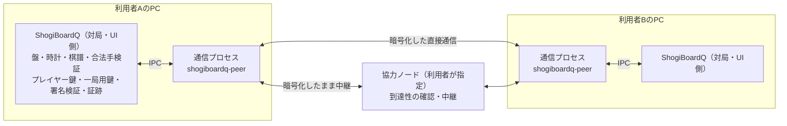
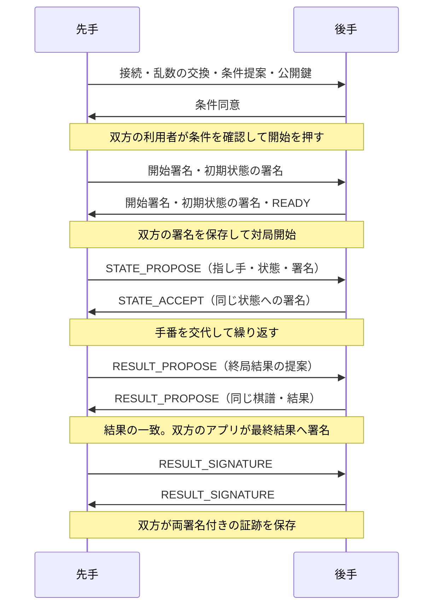

# P2P対局の実装仕様

作成日: 2026-11-10

改訂: 2026-11-10（第2版: 権限分離と安全性の見直し。第3版: ブロックチェーンとウォレットを使わない構成への変更と、安全対策の追加。第4版: 実装前の見直しで見つけた抜けと矛盾の修正、安全面の追記）、2026-11-11（実装の状況と、実装で決めた細部を「実装の状況」に記録。第5版: 不特定の相手との公開募集をやめ、対局の相手を招待だけで決める構成への変更と、「直接接続を使わない」の強化。実験版リポジトリでの開発を終えて通常版へ取り込んだ（開発方針 11.3節））、2026-11-14（実験版から正式な機能にした: 既定で有効にし、配布物に入れる。画面のネットワークの呼び名を「ローカル」「インターネット」にした。ビルドの使用期限と networkName は変えていない。14章の「2026-11-14 の判断」）

状態: 2026-11-14 に、所有者の判断で実験版から正式な機能にした（`ENABLE_P2P_PLAY` を既定で ON にし、配布物に入れる。14章）。Linux・Windows・macOS で実装し、ローカル（同じ PC・`sbq-local-1`）の試験で動作を確かめた段階（Windows の権限の制限は 2026-11-13 に、macOS の権限の制限は 2026-11-14 に足した。10.4節）。インターネット越しの接続、公開用のネットワークは未実装・未検証（「実装の状況」）。不特定の相手との公開募集は第5版でやめた（「第5版の変更点」）。

対象: ShogiBoardQ の Qt6 / C++17 デスクトップ版（P2P対局は `ENABLE_P2P_PLAY` で、既定は ON。OFF にしたビルドには入らない）。ShogiBoardQ から派生した実験版リポジトリ（ShogiBoardQ-P2P）で開発し、通常版へ取り込んだ（開発方針 11.3節）。

開発先と権限分離は、[リポジトリ構成と開発方針](p2p-development-strategy.md)を優先する。OS ごとのサンドボックス方式は、同文書の D2 で実際に拒否を確かめて決める（10.4節）。

### 実装の状況（2026-11-11）

本書の部品を `ENABLE_P2P_PLAY`（2026-11-14 から既定 ON）のビルドに実装した。バイト列と JSON の形は [protocol/](../../protocol/README.md) に1つだけ置く。

| 段階 | 実装したもの | 確かめたこと（自動試験） |
|---|---|---|
| P0 | 通信プロセス `peer/`（Rust・rust-libp2p 0.56）、IPC（`PeerProcess`）、Linux の権限の制限（no_new_privs・Landlock・seccomp-bpf・親の終了での終了・コアダンプなし）、Windows の権限の制限（起動する側の `PeerConfinement` が AppContainer・ジョブ・子プロセスの禁止・緩和ポリシーを掛け、通信プロセスが確かめる）、macOS の権限の制限（通信プロセスが自分で掛けるサンドボックス Seatbelt・親の終了の見張り・コアダンプなし・デバッガの接続の拒否） | `--sandbox-self-test` でファイルの読み書き・プログラムの起動・fork・Unix ソケット・親へのシグナルが拒否される。Linux では、loopback への TCP 接続は OS の側では止められない（10.4節の「拒否できない OS」）。Windows では、ファイルの読み書き・プログラムの起動・名前付きパイプへの接続・ほかのプロセスを開くこと・loopback への TCP 接続が拒否され、制限なしで起動した通信プロセスは動かず、ジョブを閉じると終わる（`tst_p2p_sandbox`）。macOS では、ファイルの読み書き・プログラムの起動・fork・Unix ドメインのソケットへの接続・親へのシグナルが拒否され、loopback への TCP 接続は、ローカルのネットワークを使わないとき（`--no-loopback`）に拒否される（`tst_p2p_sandbox`）。IPC の違反で通信プロセスを止める |
| P1 | 決定的CBOR・Ed25519（libsodium）・条件と状態の値・証跡・検証（`shogiboardq-cli verify-match`）・プレイヤー鍵の保管（QtKeychain・Argon2id＋XChaCha20-Poly1305・暗号化なし） | RFC 8032 の例、正規の形でない S と位数の小さい点の拒否、ラベルの流用の拒否、C++ と Rust の共通の試験入力（`protocol/testvectors`）の一致、細工した証跡の拒否、記録の3区分 |
| P2 | 招待、交渉、開始署名、着手の合意、時計の観測、結果の提案と署名、再接続と照合、ジャーナル、証跡の保存、画面 | 本物の通信プロセス2つで、招待から終局・棋譜と証跡の保存まで。回線を切った後の再接続と対局の続行。順序・重複・欠落・ACK の遅れ・保存の失敗を状態機械の試験で |
| P3 | 「直接接続を使わない」設定での招待対局（第4版までの公開募集は第5版でやめた） | ローカルの協力ノード（`--service --relay`）の中継だけを通って、招待から合意の引き分けまで。相手の直接のアドレスへつながないこと |
| P4 | 配布: 2026-11-14 に既定で有効にし、配布物（Linux の AppImage と ZIP・Ubuntu の .deb・Arch Linux のパッケージ、Windows の ZIP とインストーラ、macOS の DMG）に通信プロセスと libsodium を入れる構成にした。通信プロセスに取り込んだ Rust のライブラリのライセンス一覧（`scripts/rust_licenses.py` が `Cargo.lock` から作る `resources/licenses/RUST-NOTICES.md`）をアプリに内蔵した。運用（協力ノードの運営など）は未実装 | Linux の AppImage を古い Arch Linux のコンテナで作り、同梱した通信プロセスの `--sandbox-self-test`（Ubuntu 24.04・Fedora 40 のコンテナでも）と、AppImage のアプリからの接続（`sbq-local-1`）を確かめた。Windows・macOS の配布用スクリプトの変更は未検証 |

実装で決めた細部（本文との違い・本文に書いていなかったこと）:

- エラーコードに 12=CANCELLED、13=DISCONNECT_LIMIT、14=GAME_TIME_LIMIT、15=CLOCK_DISCONTINUITY を足した（`protocol/game-frames.md` 2章）。利用者の取りやめ・切断時間の上限・1局の時間の上限・スリープの検出（7.3節）を、ABORT と REJECT の理由として伝えるため。スリープは、単調増加時計と OS の時刻の進み方が 15 秒を超えて食い違ったことで検出する（OS の復帰通知は使っていない）。
- 再接続では、最初に接続した側（申込側）が接続し直す（6.3節の「通常は先手が開き」の代わり）。到達候補を知っているのは申込側なので。再接続の乱数は HELLO（gameId 付き、`SBQ-RECONNECT`）で交換する。
- 受け付けた側の `connectionOpened` は、相手の最初のフレームが届いてから出す。接続を開いた側が先に送る（`protocol/ipc.md`）。
- DNS 名の宛先は使わない（名前解決のためのファイルを、権限の制限の中で読まない）。協力ノードは IP アドレスの multiaddr で指定する。
- 第5版で公開募集をやめ、通信プロセスから GossipSub・Kademlia・一覧取得を外した。libp2p は使う機能だけを有効にしている（Identify・ping・中継・DCUtR・AutoNAT と対局ストリーム）。IPC の版を 2 に上げた（`protocol/ipc.md`）。
- 通信プロセスが自分から接続を始める相手は、利用者が指定した協力ノードと、招待・対局の相手だけである。既知ピアのキャッシュは持たない（以前の版が残したキャッシュのファイルは、P2P対局を使い始めるときに消す）。
- 中継の予約は、自分の到達性によらず取る（「直接接続を使わない」相手が、中継経由のアドレスでつなげるように）。中継経由のアドレスは、利用者が指定した協力ノードの宛先から作る。
- 経路（直接・中継）の表示は、つないだ宛先（自分から）か、届いた待受のアドレス（相手から）で決める。第4版までは、中継経由で届いた接続を「直接」と表示していた。
- ローカルのネットワークは、同じ LAN の PC どうしでも使える。第5版の最初の実装は待受が 127.0.0.1 だけで、同じ PC の中でしかつながらなかった（画面とガイドの「同じPC・同じLAN」と合っていなかった）。待受を LAN 側（IPv4）にも開き、接続元を loopback と私設アドレスに限った。待受のポートは 48210（TCP・UDP）に決めた。
- 自分や相手のアドレス（IP）は、通信プロセスから対局・UI側へ渡さず、画面に出さない（例外は、招待に入っていた私設アドレスへつなぐ許可を求める表示だけ）。接続中は、招待がどの経路で届くかを文で示す。
- 自動化 API を有効にして起動したときは、P2P対局の画面と通信プロセス・プレイヤー鍵を作らない（司令塔は作るが、交渉を始める入口がない）。ガイドの画像を撮るためのビルド（`ENABLE_P2P_DOCS_AUTOMATION`）だけは例外とする（10.2節）。
- 実行ファイルの名前は通常版と同じ `ShogiBoardQ` のまま（開発方針 11.1節）。通常版へ取り込んだ後は、アプリ名・設定ファイル・自動化 API のソケットも通常版と同じ（開発方針 11.3節）。
- 利用者の画面とガイドでは、プレイヤー鍵による署名を「確定」と呼ぶ。署名は利用者の操作ではなくアプリが自動で行うので、
  保証や約束を求められるような語感を避けた。8章の区分は画面で「双方で確定」「棋譜から決まる結果」「結果未確定」、
  「相手の署名なし」は「相手の確定なし」、9章の検証表示の「署名が一致」は「プレイヤー鍵による確定が正しい」と出す。
  本書・`protocol/`・`verify-match` の JSON の項目名（`signatures`・`mutually_signed` など）は署名のままにする。

### 第5版の変更点

不特定の相手との公開募集をやめ、対局の相手を招待だけで決める構成にした。P2P対局の目的を、安全に使える範囲（知り合いどうしの対局）に絞るためである。

| 種類 | 変更 | 節 |
|---|---|---|
| 機能の削除 | 公開募集（GossipSub での配信、Kademlia DHT での発見、一覧取得、募集への申込み、予約と再申込みの拒否）をやめた。募集を出した利用者の IP と、申込みを装えば分かるプレイヤーID の組を、だれでも集められるためである。全員に届く入力を読む部分と、偽の募集・予約の占有による妨害も無くなる | 1.1・2.3・3 |
| 接続の相手の限定 | 通信プロセスが自分から接続を始める相手を、利用者が指定した協力ノードと、招待・対局の相手だけにした。対局ストリームは、有効な招待の合言葉を最初に送ってきた相手と、対局の相手からだけ受け付ける | 3.1・4 |
| 「直接接続を使わない」の強化 | 第4版の実装は、自分のアドレスを広告しないだけで、相手の直接のアドレスへは自分からつないでいた（相手に IP が見えた）。直接つなぐ宛先を協力ノードだけにし、Transport の層で断る。到達性の確認（AutoNAT）も行わない | 4 |
| 画面 | 自分や相手のアドレス（IP）を画面に出さない。プレイヤー鍵による署名を、画面では「確定」と呼ぶ | 11 |
| 後続の案 | 知り合いどうしで相手を選びやすくする「合言葉による招待」と「友だち一覧」は、[設計案](p2p-invite-code-and-friends.md)にまとめた（未実装） | — |

本書では、招待した側を「募集側」、招待を受けた側を「申込側」と呼ぶ（HELLO の role の名前。第4版までの呼び方を残している）。

### 第4版の変更点

実装に入る前に本書を通し読みし、組込み先のコードと照らして見直した。構成は第3版のままである。

| 種類 | 変更 | 節 |
|---|---|---|
| 抜けの補い | HELLO に表示名・先後の希望・条件を加えた。開始前の拒否を運ぶフレーム REJECT を加えた | 6.1 |
| 矛盾の修正 | 64 KiB のフレームを base64 にした IPC と、上限いっぱいの募集の一覧が、それぞれの上限に収まらなかった。IPC の上限を 128 KiB、募集1件を 1 KiB、一覧の応答を1回50件までにした | 4・10.5 |
| 矛盾の修正 | 招待文字列を解釈する通信プロセスに、招待トークンを「出さない」としていた。トークンは通信プロセスが作って照合するものと決めた | 3.3・6.1・13.1 |
| 相手の確認 | 開始署名は申込側が先に送り、募集側は名乗っただけの ID に対して署名しない。署名を確かめるまで、相手の ID を確かめた身元として表示しない | 3.3・5.4・11 |
| 記録 | 詰みなど棋譜から決まる終局は、結果への署名がそろわなくても検証できる記録として示す | 8・9 |
| 脅威の追記 | 侵害された通信プロセスから LAN 内・loopback へ届くこと、募集が全員に届く入力であること、指し手の取り次ぎ、ID と IP の収集、通信プロセスを落とす欠陥 | 1.2・3.2・5.1・10.4・12 |
| 安全対策 | 表示名の判定に使う文字の表の固定、ビルドの使用期限、Identify で配る情報の制限、招待文字列の扱い、鍵の保管庫の同期の確認 | 3.1・3.2・3.3・4・5.2 |
| 組込み | 対局中にアプリが手の助言を出さないこと、棋譜に入れる名前と対局ID、同じ保存先を同時に使えるアプリは1つ（同じ PC の2つ目からのアプリは別のプレイヤーになる）、記録の削除、相手ごとの対局数の表示 | 3.4・9・10.3・11 |

### 第3版の変更点

第2版までは、対局結果を EVM 互換ブロックチェーンに記録し、開始合意と最終結果に外部ウォレットで署名する構成だった。第3版ではこれをやめた。対局を始めるのにウォレットが要ること、記録に手数料がかかる仕組みを抱えることを避けるためである。

| 対象 | 変更 |
|---|---|
| 記録 | チェーン上のレジストリをやめ、双方が署名した対局記録（証跡ファイル）を双方の手元に残す |
| 身元 | 外部ウォレットのアドレスをやめ、アプリが作って手元に保管するプレイヤー鍵にした |
| 署名 | EIP-712・secp256k1・Keccak-256 をやめ、決定的CBORへの Ed25519 署名と SHA-256 にした |
| プロセス | チェーン読み取りとウォレット連携の補助プロセスをなくし、補助プロセスは通信の1つだけにした |
| 開始まで | ウォレットの操作がなくなり、条件を確認して押すだけで始まる。署名待ちの期限を短くした |
| 章立て | スマートコントラクトとチェーン接続の章を削り、以降の章番号を詰めた |

あわせて、次の安全対策を加えた。

| 対策 | 内容 | 節 |
|---|---|---|
| プレイヤー鍵の保管 | OS の鍵の保管庫、またはパスフレーズで暗号化したファイル。メモリ上では保護付きの領域に置く | 5.2 |
| 振り駒の公平化 | 先後を双方の乱数から決め、片方だけでは結果を決められないようにする（commit-reveal） | 3.3 |
| 相手の確認 | 以前の相手のプレイヤーIDの記憶、手元で付ける名前、別の経路で見比べる確認コード | 3.4 |
| 発見の強化 | 経路の重ならない問い合わせ、アドレス帯ごとの上限、募集の採点と検証後の転送 | 3.1・3.2 |
| 実装の検査 | ファジング、サニタイザ、Rust の安全でないコードの禁止、依存の点検 | 13.1、開発方針5章 |

第2版で入れた権限分離、時計と切断の規則、結果の提案と同意、募集の妨害への対策は残している。検討して採らなかった技術は 2.3節にまとめた。

## 1. 採用する構成と保証範囲

招待による相手との接続と、指し手の交換を P2P で行い、終局後に双方が署名した対局記録（条件・棋譜・結果）を双方の手元に残す。専用の中央対局サーバは設置しない。ブロックチェーン、暗号資産、外部ウォレット、外部サービスのアカウントは使わない。利用者に費用は発生しない。

対局記録が証明するのは「この二つのプレイヤー鍵の持ち主が、この条件・この棋譜・この結果に署名したこと」である。証跡ファイルを受け取った第三者は、署名、ハッシュの一致、将棋のルールに従った手順を検証できる。記録は、人間による着手、時計の正確さ、対局が実際に行われたこと、署名した時刻を証明しない。プレイヤー鍵と実在の人物の対応も証明しない。

公開の台帳はない。記録は当事者が持つファイルだけにあり、失えば復元できない。第三者が記録を知るのは、当事者がファイルを渡したときだけである。

初版は双方の合意による記録方式とする。相手が結果への署名を拒否した場合、片方の申告だけで勝敗を確定した記録は作らない。資産の預託、賭け、独自トークン、NFT、公式レーティングは対象外。

### 1.1 初版の機能

| 項目 | v1 の仕様 |
|---|---|
| 相手 | 招待情報による接続（知り合いどうしの対局）。不特定の相手との公開募集は持たない（第5版） |
| 対局 | 人間対人間、平手、開始局面固定、1局単位 |
| 先後 | 希望があれば希望どおり。双方が指定なしなら双方の乱数で決める |
| 時計 | 双方共通の持ち時間と秒読み。加算・遅延は0。既定は10分＋30秒 |
| 終局 | 投了、詰み、時間切れ、千日手、連続王手の千日手、合意引き分け、512手到達、中断 |
| 入玉 | 宣言勝ちは扱わない。双方の合意による引き分けは可能。開始前に表示 |
| 接続復旧 | 両アプリと通信プロセスが生存している間の回線再接続 |
| 身元 | アプリが作るプレイヤー鍵（公開鍵がプレイヤーID）。実名や一人一アカウントは保証しない |
| 対局記録 | 双方の署名がそろった証跡ファイルを、双方がローカルに保存する。アプリからは公開・送信しない |
| 棋譜 | 既存形式での保存と、証跡ファイルの保存 |
| 費用 | なし |
| 動作環境 | Linux・Windows・macOS。インターネット越しの対局は、通信プロセスの権限制限を確かめた OS だけで有効にする |

エンジン対局、駒落ち、任意局面、加算時計、観戦、公開棋譜配信、対局記録の公開と集計、第三者裁定は後続版で追加する。非対応条件を受信したときに、既定条件へ黙って置き換えない。

### 1.2 v1 で受け入れる既知の限界

次は設計上防げないか、v1 では防がないと決めたものである。画面と文書で利用者に伝え、対策済みと表示しない。

- 負けた側が結果への署名を拒めば、双方の署名がそろった記録は成立しない。記録は双方が合意した対局だけに偏る。詰みなど棋譜から決まる終局は、最後の局面まで双方の署名があれば検証できる（8章）が、負けそうな側がその前に切断すれば、それも残らない。
- 消費時間は自己申告である。1手あたり許容差（既定10秒）までの水増しと、切断を使った思考時間の延長（1局の合計で既定10分まで）は検出できない（7章）。
- 申込みだけして開始しない、といった交渉の妨害は、身元に費用がかからない以上、完全には防げない（3章）。招待は、招待文字列を受け取った相手しか使えないので、影響は招待を渡した範囲に限られる。
- プレイヤー鍵は無料で作り直せる。ブロックや過去の成績は、作り直しで回避できる。
- 直接つなぐと、対局相手は通信を調べて IP アドレスを知ることができる（画面には出さない）。プレイヤーID も相手に伝わる（12章）。「直接接続を使わない」設定では、相手に見えるのは協力ノードの中継のアドレスだけになり、IP が見えるのは利用者が指定した協力ノードの運営者だけになる（4章）。
- インターネット越しの対局には、招待でも協力ノードが1つは要る（自分が外からどのアドレスで見えるかを、ほかのノードに確かめてもらうため。家庭の回線の多くは、中継も要る）。協力ノードなしで動くのは、同じ PC・同じ LAN の中だけである。
- 対局・UI側のプロセスと同じ利用者権限で動くマルウェアは防げない。プレイヤー鍵を盗まれると、その利用者になりすまして対局できる。
- 通信プロセスが侵害されると、利用者の PC から LAN 内の機器や loopback のサービスへ接続を試せる。OS の側でこれを止められるかは OS によって異なる（10.4節）。
- 通信プロセスを異常終了させられる欠陥があると、対局相手でない第三者にも対局を中断させられる。v1 は通信プロセスの再起動後に同じ対局へ戻らない（7.3節）。
- 双方が示し合わせた架空の対局と、人間の代わりにエンジンが指した対局は区別できない。
- 相手が、別の相手との対局の指し手をそのまま取り次いでいても（2つの対局の間に入り、双方の手を写す）、区別できない。記録に残る署名は取り次いだ者のものである。
- 公開の台帳がないので、記録があること・ないことを第三者は確かめられない。双方が示し合わせれば、同じ対局に矛盾する2つの結果へ署名した記録も作れる。

## 2. 全体構成



協力ノードは、利用者のアプリが最初に接続する相手になり、到達性の確認と中継を受け持つ。将棋の指し手や勝敗を裁定せず、中継する通信の中身（当事者間で暗号化している）も読まない。複数の運営者と利用者指定の接続先を扱えるようにする。

「特定の対局サーバに依存しない」構成であり、常時到達できるノードが一切不要になる構成ではない。小規模ネットワークでは、公開接続を受け付ける協力ノードの維持が必要になる。[分散型ホールパンチングの研究](https://research.protocol.ai/publications/decentralized-hole-punching/)

### 2.1 プロセスと信頼境界

インターネットから届く入力を解釈する処理を、対局・UI側とは別のプロセスへ分ける。通信プロセスは Rust で書き、サンドボックスの中で動かす（10.4節）。

| プロセス | 役割 | 持つ秘密 | 信頼しない入力 | 持たせないもの |
|---|---|---|---|---|
| 対局・UI側（Qt6 / C++） | 合法手・状態・署名の検証、時計、棋譜、証跡、利用者の承認 | プレイヤー鍵、一局用鍵、証跡 | 通信プロセスの出力、証跡ファイル | ネットワークの待受、外部から届いた命令の実行 |
| 通信 `shogiboardq-peer` | 招待の接続、NAT越え、中継、フレームの送受信 | libp2p識別鍵 | インターネット上の任意のピア、招待文字列 | プレイヤー鍵、一局用鍵、ファイル、子プロセスの起動 |

- 信頼の基点は対局・UI側だけとする。通信プロセスの出力は、型、大きさ、署名、現在の状態に合う操作かを対局・UI側で検証し直す。通信プロセスが「検証済み」「成功」と返したことを、署名の成立や相手の身元の根拠にしない。
- 信頼しない入力の解釈、メモリ安全でない言語、高い権限の3つを1か所に重ねない。対局・UI側（C++・利用者の権限）が解釈する外部由来のバイト列は、通信プロセスが形式を検査した後の、上限付きの小さな形式（IPC の JSON と 5.3節の決定的 CBOR）に限り、その読み取り部をファジングの対象にする。[Chromium の Rule of 2](https://chromium.googlesource.com/chromium/src/+/main/docs/security/rule-of-2.md)
- 他人から届く入力のうち、通信プロセスを通らずに対局・UI側へ入るものは、招待文字列と証跡ファイルの2つである。招待文字列は、対局・UI側で読まずに通信プロセスへ渡して解釈させる（3.3節）。他人から受け取った証跡ファイルは対局・UI側と CLI が直接読むので、9章の上限を先に確かめ、通信で使うのと同じ決定的 CBOR の読み取り部だけで読む。

### 2.2 技術選定

| 層 | 採用案 | 理由・制約 |
|---|---|---|
| GUI・将棋処理 | 既存の Qt6 / C++17 | 盤面・棋譜・操作経路を再利用する |
| P2P | Rust の別プロセス `shogiboardq-peer` と rust-libp2p | 発見・NAT越え・中継を同じ基盤で扱う。Rust の配布・ビルド手順が増える |
| 通信経路 | QUIC、TCP＋Noise＋Yamux、Circuit Relay v2 | UDPが通らない環境ではTCPを試す。中継時にも当事者間を暗号化する。どちらの経路も、後から鍵が漏れても過去の通信を解読できない方式である |
| 接続支援 | Identify、AutoNAT、DCUtR | 到達性を確認し、中継経由の接続から直接接続への移行を試す |
| 署名 | Ed25519。対局・UI側で [libsodium](https://doc.libsodium.org/) を使う | 署名が決定的で、乱数の品質に左右されない。楕円曲線の演算を自作しない。libsodium は 1.0.18 以上を求め（CMake）、検証で拒否する署名・公開鍵の規則は版によらず試験（`tst_p2p_protocol`）で固定する |
| ハッシュ | SHA-256（Qt の `QCryptographicHash::Sha256`） | 標準の関数で、どの言語にも実装がある |
| 鍵の保管 | OS の鍵の保管庫（QtKeychain 経由）。使えなければ libsodium の Argon2id と認証付き暗号で暗号化したファイル | 保存中の鍵を、ほかの利用者やディスクの持ち出しから守る |
| 秘密のメモリ | libsodium の保護付きメモリ | 前後に保護ページを置き、解放時に消す。スワップへ書き出さないよう OS に求めるが、OS が応じる保証はない |
| ワイヤ形式 | 決定的CBOR、長さ付きフレーム | 言語間で同一バイト列を作り、署名・ハッシュを再現する |

rust-libp2p は必要な各機能を提供する。採用時に対応OS、機能の組合せ、依存ライブラリのライセンスを確認し、Cargo.lock とツールチェーンを固定する。本書はライブラリの最新バージョンへの自動追従を指定しない。[rust-libp2p の公式API資料](https://docs.rs/libp2p/latest/libp2p/)

本書が前提にするライブラリの機能は、2026-11-10 に次のとおり確かめた。版を上げるときは同じ項目を確かめ直す。

| ライブラリ | 確かめたこと | 方法 |
|---|---|---|
| libsodium 1.0.22 | 正規の形でない署名、位数の小さい公開鍵、位数の小さい R を検証で拒否する。署名は決定的で RFC 8032 のテストベクトルと一致する。Argon2id と XChaCha20-Poly1305 で鍵を暗号化・復号でき、追加の認証データを変えると復号に失敗する | 手元での実行。拒否の規則は公式資料に明記がないので、5.5節のとおりテストで固定する |
| QtKeychain | Windows の資格情報ストア、macOS のキーチェーン、Linux の GNOME Keyring・KWallet に保存する。Qt 6 に対応。使えない環境ではエラーを返し、明示的に頼まない限り暗号化せずに保存しない | 公式の説明 |

初版では WebRTC を併用しない。ブラウザ対局を追加する段階で、相互運用と配布サイズを測定して再検討する。

### 2.3 検討して採らなかった技術

| 技術 | 採らない理由 | 再検討する条件 |
|---|---|---|
| ブロックチェーンへの記録 | ウォレットと手数料が前提になる（[利用者の負担](p2p-wallet-user-burden.md)） | 対局の開始条件にせず、利用者に費用を負わせない方法があるとき。別仕様の任意機能として扱う |
| 第三者による時刻の証明（RFC 3161 のタイムスタンプ、Roughtime など） | 外部サービスへの依存と、接続元・記録のハッシュの露出が増える。応答の解釈という入口も増える | 記録した時刻の証明が必要になったとき |
| 追記専用の公開ログ | 運営者が要る | 公開の成績表を作るとき |
| 計算パズル（proof of work）による募集・申込みの制限 | 性能の低い PC の利用者ほど不利になり、攻撃側は計算資源で回避できる。検証の負荷も攻撃に使える | 募集の妨害が実際に問題になったとき |
| 不特定の相手との公開募集（GossipSub での配信、Kademlia DHT での発見、一覧取得） | 募集を出した利用者の IP と、申込みを装えば分かるプレイヤーID の組を、だれでも集められる。全員に届く入力を読む部分が攻撃の入口になり、偽の募集・予約の占有による妨害も防ぎきれない。第4版まで実装していたが、第5版で外した | 相手に IP を見せない経路と、運用できる出会いの場を用意できたとき。知り合いどうしの範囲は、合言葉と友だち一覧の案（[設計案](p2p-invite-code-and-friends.md)）で扱う |
| Tor などの匿名通信 | 対応ライブラリが成熟していない。v1 は「直接接続を使わない」設定（協力ノードの中継だけを通る。4章）で、相手に IP を見せない | 協力ノードの運営者にも IP を見せないことが要件になったとき |
| ハードウェアで守る鍵（TPM、Secure Enclave、パスキー） | 使える署名方式が Ed25519 と異なり、OS ごとの実装が要る | プレイヤー鍵の価値が上がったとき（公式の成績など） |
| 短い合言葉による招待（PAKE） | 待ち合わせ用のサーバーが要る | 招待文字列の受け渡しが不便だと分かったとき |

## 3. ネットワークへの参加・招待

対局の相手は招待で決める。不特定の相手との公開募集は持たない（第5版。理由は 2.3節）。

### 3.1 ネットワークへの参加

- ネットワーク識別子は `H(CBOR(["SBQ-NETWORK", 1, networkName]))` とする。networkName は32バイト以下の ASCII。検証用と公開用で名前を分け、別のネットワークの招待を使えないようにする。
- ビルドが参加する networkName は、ビルドに含めた一覧（ローカルの `sbq-local-1` と、インターネットの `sbq-limited-1`）に限る。画面には「ローカル（同じPC・同じLAN）」「インターネット」と出す。`sbq-limited-1` は実験版のときに「限定試験用」と呼んでいた名前で、正式な機能にしたとき（2026-11-14）も、それまでのビルドと対局できるように変えていない。別の名前の公開用のネットワークは設けていない（14章）。
- ビルドには使用期限を入れる（正式な機能にした後も残す。14章）。ビルドした日から180日を過ぎたビルドは、インターネットのネットワーク（`sbq-limited-1`）へ参加せず、更新を案内する。ローカルのネットワークと、保存済みの証跡の確認・検証は期限後も使える。P2P のネットワークには中央から機能を止める仕組みがなく（開発方針9章）、欠陥の直っていない古い版が残り続けるためである。期限は OS の時計で判定するので、時計を戻せば回避できる。期限の長さは 14章で決める。対局・UI側と通信プロセスは同じ期限で判定する（起点は CMake で構成した時刻（`SOURCE_DATE_EPOCH` があればその値）で、CMake が cargo に渡す。日数は `sbq-protocol` の `BUILD_LIFETIME_DAYS` の1か所で決め、CMake がそこから読む）。
- 協力ノード（最初に接続する相手。到達性の確認と中継を受け持つ）は、利用者が接続候補として指定する。v1 のビルドには同梱しない。同梱するときは、独立した運営者の候補を複数用意することを条件にする（14章）。
- 通信プロセスが自分から接続を始める相手は、利用者が指定した協力ノードと、招待・対局の相手だけとする。発見しただけのピアへは接続しない。ほかのピアの一覧を集めず、保存もしない。
- ローカルのネットワーク（同じ PC・同じ LAN）では、協力ノードなしで、招待文字列に入った loopback と私設アドレスで直接つなぐ。待受は LAN 側（IPv4）にも開き、接続元が loopback・私設アドレスでない接続は、暗号の手続きを始める前に閉じる。インターネット上のアドレスへはつながない。待受のポートは TCP・UDP とも 48210 に決める（ファイアウォールで許可するポートを決められるように。使用中なら空いているポートで待ち受ける。同時に起動した通信プロセスが TCP のポートを共有しないよう、48210 の UDP を開けたプロセスだけが TCP でも 48210 を使う。`protocol/ipc.md` 5章）。招待には、同じ LAN の相手が使う私設アドレスを先に入れる。招待した側の PC のファイアウォールが外からの接続を止めているとつながらないので、つながらないときは、その確認と、招待する側の入れ替えを案内する。
- インターネット越しでは、協力ノードが1つは要る。通信プロセスは、自分が外からどのアドレスで見えるかを、協力ノードに確かめてもらって知る（AutoNAT v2。確かめてもらうのは協力ノードが観測したインターネット上のアドレスだけで、待受のアドレスの一覧は送らない。確認に応えるのは協力ノードだけ）。だれともつながっていなければ、招待に入れる接続先がない。
- mDNS などのローカル探索は使わない。

### 3.2 表示名

表示名は HELLO（6.1節）で相手に伝える自己申告の名前である。次の規則を満たすものだけを受理する。満たさない HELLO を受けたら、表示名を直さずに交渉をやめる。

- UTF-8 で96バイト以下、32文字（コードポイント）以下、NFC 正規化済み、前後に空白がない。
- 制御文字（Cc）と書式文字（Cf。双方向の制御文字、ゼロ幅文字を含む）、私用領域、未割り当て、改行を含まない。
- 上の2つの判定は Unicode の版で結果が変わる（文字の区分、未割り当ての範囲、正規化）。判定に使う表は `protocol/` に1つだけ置いて版を明記する。Qt が持つ表をそのまま使わない。判定は対局・UI側だけが行う（通信プロセスは表示名を読まない）。
- v1 の表は、許可する文字の範囲を並べた小さなものにする（ASCII の印字できる文字、ひらがな、カタカナ、CJK 統合漢字、全角の英数字と記号など）。結合文字を含まず、NFC で形の変わらない範囲だけを選ぶ。こうすると正規化の表が要らず、重ねた結合文字で表示を崩す名前も通らない。この範囲にない文字（絵文字、ほかの文字体系）の名前は v1 では使えない。範囲を広げるときはプロトコルの版を上げる。
- 表示は PlainText とし、リッチテキスト・リンクとして解釈しない。ツールチップへ出すときは既存の `plainToolTip` で包む。
- 表示名は相手が自由に書ける文である。知らせや確認の文に入れるときは、かぎ括弧で囲むなど名前と分かる形にし、ウィンドウの題名とボタンの文字には使わない。相手が書いた文を、アプリの知らせと読み違えさせないためである。

### 3.3 招待・開始の順序・先後の決定

招待情報にはネットワーク、招待した側の PeerId、到達候補、32バイトの一回用トークン、有効期限を含める。招待だけでは対局は開始しない。招待トークンの有効期間は10分、成功時に失効させ、ログへ出さない。初版は招待文字列のコピー・貼り付けとし、OSへのURLスキーム登録は後続対応とする。

- 招待文字列は接頭辞・版・本体・検査用の値からなる固定の形式とし、全体で1 KiB以下、到達候補は8件までとする。貼り付けられた文字列は通信プロセスが解釈し、対局・UI側は解釈結果（相手の PeerId の短縮表示、到達候補の数、期限）だけを確認画面に出す。
- 招待トークンは通信プロセスが CSPRNG から作り、照合も通信プロセスが行う。対局・UI側は、招待文字列をそのまま受け渡すだけで、トークンを取り出して使わない。
- 招待トークンは Noise で認証した招待元の PeerId への接続の中でだけ送る。招待を受けた側の通信プロセスが、対局ストリームの最初のフレーム（INVITE_TOKEN。6.1節）で送る。招待した側の通信プロセスは、照合に通った接続だけを対局・UI側へ知らせ、ほかのストリームは閉じる。照合は、一致した長さで処理時間が変わらない比較で行う。
- トークンは、招待していない相手からの接続を断るためのものである。相手の認証には使わない。有効期限内に招待文字列を見た者は、だれでも申し込める。招待した側は、条件確認画面で相手のプレイヤーID を確かめる（3.4節）。
- 招待文字列には、招待した側への到達候補が入る。直接つなぐ設定では IP アドレスが入り、「直接接続を使わない」設定では協力ノードの中継を経由するアドレスだけが入る（4章）。招待を作る画面で、相手だけに届く経路で渡すことと、公開の場所に貼らないことを知らせる。到達候補が1件も無い招待（協力ノードにつながっていないインターネット越しの招待など）は、相手が接続できないことを知らせる。
- 招待の条件（持ち時間、先後の希望）は招待文字列に入れない。招待した側が HELLO の応答で示し（6.1節）、招待を受けた側は条件確認画面で初めて見る。
- インターネットの profile では、私設アドレス（同じ LAN 内の相手）を含む招待は、利用者が確認画面で宛先を見て許可したときだけ使う。ローカルのネットワークでは、loopback と私設アドレスを許可なしで使う（このネットワークを選んだ利用者は、LAN 内の宛先へつなぐことを選んでいる）。
- 同時に有効な招待は4件まで。対局は同時に1局で、交渉中・対局中に届いた申込みには `BUSY` を返す。

開始までの順序と期限は次のとおり。開始の署名（画面では「確定」と呼ぶ）はアプリが行うので、利用者が待つのは条件の確認だけである。

1. 交渉を始めてから60秒以内に、条件の交換と双方の利用者による確認を終える。過ぎたら取り消す。
2. 開始合意への署名（プレイヤー鍵）は申込側（招待を受けた側）が先に送る。申込側は、利用者が開始を押した時点で送る。募集側（招待した側）は、利用者が開始を押し、かつ申込側の開始署名を確かめた時点で送る。利用者が先に押していても、確かめるまで送らない。名乗っただけのプレイヤーID に対して署名しないためである。
3. 双方の開始署名がそろってから30秒以内に State0 の交換と READY を終える。終わらなければ開始失敗として待機へ戻る。
4. どちらの利用者も、開始の前ならいつでも取りやめられる。招待した側は、その相手をブロックできる。

PeerId もプレイヤーID も無料で作り直せるため、ブロックは妨害の手間を増やすだけで、完全な対策にはならない（1.2節）。ブロックの対象はプレイヤーID とする。ブロックは、申込みで名乗ったプレイヤーID で判定してよい（他人の ID を名乗っても、名乗った側が断られるだけである）。ブロックした相手の申込みには、ブロックしたことを知らせずに `BUSY` を返す。第4版までの「再申込みの拒否」は持たない。招待は1回用で、取りやめた相手がつなぎ直すには、新しい招待文字列を受け取る必要があるためである。

先後は次のとおり決める。

- 先手または後手の希望があり、双方の希望が両立すれば（片方だけが希望している場合と、先手希望と後手希望の組）、希望どおりにする。招待を受けた側は希望を「指定なし」にするので、招待した側の希望が通る。両立しない申込みは、申込みの時点で断る。
- 双方が「指定なし」なら、双方の乱数から決める。どちらか片方が結果を選べないよう、次の順序（commit-reveal）で乱数を交換する。
  1. 申込側は32バイトの乱数 `nonceA` を作り、`commitA = H(CBOR(["SBQ-COMMIT", 1, nonceA]))` だけを送る。
  2. 募集側は32バイトの乱数 `nonceB` をそのまま送る。
  3. 申込側は `nonceA` を送る。募集側は `commitA` と一致することを確かめる。一致しなければ交渉を打ち切る。
  4. `H(CBOR(["SBQ-COIN", 1, nonceA, nonceB]))` の最後のバイトの最下位ビットが0なら申込側が先手、1なら募集側が先手とする。
- この交換は先後の希望があるときも行い、2つの乱数を開始合意の nonce に使う（5.4節）。対局ID を片方だけで決められないようにするためである。
- 申込側は結果を知ってから取りやめることができる。画面では「双方の乱数で決めた」と表示し、それ以上の公平さを保証する表示はしない。

### 3.4 相手の確認

表示名は自己申告で、誰でも同じ名前を名乗れる。相手が以前と同じ人かどうかは、プレイヤーID で確かめられるようにする。

- 対局した相手のプレイヤーID を手元に記録する。利用者はその相手に名前（手元の覚え）を付けられる。条件確認画面と対局画面では、相手の自己申告の表示名と、利用者が付けた名前を区別して出す。
- 名前を付けた相手と同じ表示名で、プレイヤーID が違う相手が来たら、別人の可能性があることを条件確認画面で知らせる。比べるときは、全角と半角、大文字と小文字の違いをなくした形を使う。見た目が似た別の文字までは見分けられないので、相手を確かめる根拠はプレイヤーID と確認コードである。
- 既知の相手の記録には、その相手との対局数と、結果が確定しなかった数も残し、条件確認画面に出す。途中で去ることを繰り返す相手を、利用者が見分けられるようにするためである。プレイヤー鍵を作り直した相手は、初めての相手として現れる。
- 相手のプレイヤーID は、相手の開始署名を確かめるまでは申告である（5.4節）。申告だけの ID を、既知の相手・確認済みの相手として表示しない。
- 確認コードを用意する。双方のプレイヤーID から `H(CBOR(["SBQ-VERIFY", 1, 小さい方の公開鍵, 大きい方の公開鍵]))` を計算し、5桁の数字6組（約100ビット）で表す。公開鍵の大小はバイト列の辞書順で決める。数字は、ハッシュの先頭30バイトを5バイトずつ6組に分け、各組をビッグエンディアンの整数として100000で割った余りを、0で埋めた5桁にしたものとする。2人が電話や対面など別の経路で数字を見比べ、一致したら相手を「確認済み」として記録する。
- 初めての相手を確認済みとして扱わない。確認済みかどうかは手元の記録だけで決め、相手の申告を使わない。

## 4. 接続・NAT越え・資源制限

1. 既知の到達候補へ直接接続を試す。
2. AutoNAT等で到達性を確認し、必要な場合は中継の予約を確保する。
3. 中継接続を作り、DCUtRによって直接接続への移行を試す。
4. 直接接続に失敗した場合は、中継が許可する範囲で通信を継続する。
5. どちらの経路も利用できない場合は接続失敗として終了する。ポート開放を自動実行しない。

Circuit Relayには時間・データ量・予約数の制約がある。一般公開リレーを無制限で使えると仮定しない。運用するリレーでは長時間対局に必要な設定を検証し、制限到達による切断も再接続手順で扱う。[Circuit Relay](https://libp2p.io/docs/circuit-relay/)、[DCUtR](https://libp2p.io/docs/dcutr/)

宛先のアドレスは次の規則で絞る。招待文字列や Identify に他人のアドレスを書き込んで、利用者の PC から LAN 内の機器や第三者へ接続させる使い方を防ぐためである。

- 招待・Identify で得た宛先は、インターネット上で到達できるアドレスと中継経由のアドレスだけを使う。loopback、私設、link-local、共有アドレス空間（100.64.0.0/10）、IPv6 の ULA、マルチキャスト、未指定、IPv4 射影 IPv6 を拒否する。
- DNS 名の宛先は、同梱または利用者指定の協力ノードにだけ許す。ほかのピアが示した DNS 名は解決しない。
- 1ピアあたりの宛先は8件まで、同時に試す接続数に上限を置き、失敗した宛先はしばらく再試行しない。
- 宛先は決めた形（`ip/tcp`・`ip/udp/quic-v1` と、それに中継の部分を付けた形）だけを使う。IP を2つ重ねた宛先などは使わない（libp2p の TCP は末尾の IP へつなぐので、先頭の IP だけを確かめる規則を抜けられる。監査 2026-11-13 P3）。
- 自分が広告するアドレスからも私設アドレスを除く。LAN の構成を Identify で配らない。ローカルのネットワークでも、待受のアドレスは Identify に載せない（招待を持たない LAN の機器にも届くため。相手への宛先は招待で渡す）。到達性の確認に、待受のアドレス（私設・loopback・link-local）を送らない（AutoNAT v1 は送るので使わない。監査 2026-11-13 P2・P10）。
- Identify で配る自分の情報は、対応するプロトコルとアプリの版だけとする。OS の種類と版、ホスト名、利用者名を入れない。アプリの版は、協力ノードが古い版を断るために使う（開発方針9章）。
- 対局中は、開始合意に含めた相手の PeerId 以外からの対局ストリームを受け付けない。

設定で「直接接続を使わない」を選べるようにする。対局の相手に自分の IP を見せないための設定で、IP が見えるのは利用者が指定した協力ノードだけになる。中継の容量に依存するため既定は無効とする。

- 直接つなぐ宛先は、利用者が指定した協力ノードの宛先（と、そのノードが Identify で名乗った別の宛先）だけとする。ほかの宛先への直接の接続は、Transport の層で断る（どの経路で始まった接続にも掛かる）。第4版の実装は、自分のアドレスを広告しないだけで、相手の直接のアドレスへは自分からつないでいた。
- 中継経由の宛先は、中継が指定した協力ノードのときだけ使う。指定していない中継には自分の IP が見えるので使わない。招待に使える宛先が残らなければ、つながずに理由を知らせる。
- 自分のアドレスとして出すのは、中継経由のアドレスだけとする（招待・Identify）。待受のアドレスは Identify で配らない。
- AutoNAT（到達性の確認）と DCUtR（直接接続への切り替え）を行わない。どちらも、自分のアドレスの候補を相手に渡すためである。
- この設定の相手がつなげるよう、中継の予約は、直接接続を使う側も、自分の到達性によらず取り、中継経由のアドレスを招待に入れる。双方が同じ協力ノードを指定していることが条件になる。

協力ノードは通信プロセスの `--service` モードとして別途運用する。利用者のアプリが最初に接続する相手になり、到達性の確認に応え、設定で中継を受け持つ。GUI・将棋の裁定処理を含めず、対局ストリームも受け付けない。通常のデスクトップを自動的に中継サーバへ昇格させない。サービス用PeerIdは再起動で変えず、識別鍵を所有者だけが読めるファイル権限・ACLで保存する。これは5章の通常クライアントの一時鍵とは別の運用である。

- 協力ノードは専用の権限の低いアカウントで動かす。
- 中継は予約数、1ピアあたりの回路数、1回路の時間とデータ量、全体の帯域に上限を置く。1回路のデータ量は1局に必要な量に余裕を足した程度に抑え、汎用の中継として使われにくくする。
- 接続元の IP を含むログは、保存する項目と期間を決めて公開する（開発方針9章）。

| 制限 | v1の初期値 |
|---|---|
| 直接接続の試行 | 10秒。その後は中継候補を含め全体30秒で判定 |
| 接続維持 | ping 10秒、応答不在30秒で再接続へ移る |
| 着手確認 | 5秒で同一メッセージを再送。30秒で接続復旧へ移る |
| 回線復旧待ち | 切断検出から120秒 |
| 1局の切断時間の合計 | 10分。超えたら中断（7.2節） |
| 自己申告時間の許容差 | 10秒（7.1節） |
| 1局の実時間上限 | 24時間。上限時は合意中断を提案し、合意できなければ未確定終了 |
| 1フレーム | 64 KiB。長さを確認してから領域を確保 |
| 接続数 | 合計32、未認証8（同じ接続元の IP から3）、対局相手1。同じアドレス帯からの接続にも上限。接続の確立は20秒まで。最初のフレームを待つ対局ストリームは全体16・相手ごと1・5秒まで |
| 受信キュー | 接続ごとに256 KiB。超過時は切断 |
| アプリメッセージ | 認証前は5件/秒、対局中は20件/秒、burstは各2倍 |
| 制御メッセージ | 1局で双方合わせて4,096件。超えたら `LIMIT_EXCEEDED` で中断 |
| ジャーナル | 1局16 MiB。超えたら `STORAGE_ERROR` で中断 |

これらは設計上の初期値であり、実測した性能値ではない。実装時の接続試験で調整し、対局に影響する値は `networkPolicyHash` に含める。IPごとの制限だけで携帯回線の利用者を一括排除しない。

上限どうしは、大きい側が小さい側を収めるように決める。フレームを対局・UI側へ渡す IPC の上限は 10.5節に定める。

## 5. 鍵・署名・データ形式

### 5.1 鍵を分ける

| 鍵 | 用途 | 保持するプロセス | 保管 |
|---|---|---|---|
| プレイヤー鍵（Ed25519） | 開始条件と最終結果への同意。公開鍵がプレイヤーID | 対局・UI側 | アプリが初回に生成し、5.2節の方法で保管する |
| libp2p識別鍵（Ed25519） | PeerId、暗号化通信 | 通信プロセス | 起動ごとに生成、メモリのみ |
| 一局用鍵（Ed25519） | 着手状態・対局制御メッセージへの署名 | 対局・UI側 | 一局ごとに OS の CSPRNG から生成、メモリのみ |

プレイヤー鍵が署名するのは、1局につき開始合意と最終結果の2回だけとする。着手ごとの署名は一局用鍵で行う。長く使う鍵を使う場面を絞ることで、将来プレイヤー鍵の守り方を強めても（ハードウェアでの保管など）、対局プロトコルを変えずに済む。

プレイヤー鍵と一局用鍵は対局・UI側が持ち、通信プロセスへ渡さない。インターネットから届く入力を解釈するプロセスに署名の権限を置かないためである。相手の署名の検証も対局・UI側で行う。通信プロセスは署名済みのフレームを運ぶだけで、署名も検証結果も作らない。

一局用鍵の権限は、開始合意に含めた一局の通信証跡に限る。最終結果への署名の代用にはしない。プロセス終了で鍵が失われた場合、進行中の対局を自動再開しない。

- 一局用鍵は終局・中断・取消の時点で消す。
- プレイヤー鍵と一局用鍵は、メモリ上では libsodium の保護付きの領域に置く（前後に保護ページを置き、解放時に消す。スワップへ書き出さないよう OS に求めるが、応じない OS や上限に達した場合もあるので、保証として扱わない）。ログ、IPC、証跡、設定、クラッシュ報告へ出さない。
- 通信プロセスはコアダンプを無効にし、識別鍵を引数・環境変数・ログへ出さない。

侵害されたときの影響を次のとおり見積もる。表の「できないこと」が崩れる変更は設計の変更として扱う。

| 侵害された部分 | できること | できないこと |
|---|---|---|
| 通信プロセス | 通信の遮断・遅延・盗み見（対局の内容、相手の IP）、対局・UI側への不正な入力の送り込み、任意の宛先への通信（LAN 内の機器や loopback のサービスへの接続、第三者への攻撃の踏み台。OS の側で止められる範囲は 10.4節） | プレイヤー鍵・一局用鍵での署名、相手の署名の偽造、ファイルの読み書き |
| 一局用鍵の漏えい | その1局の着手状態・制御メッセージの偽造 | 開始合意・最終結果への署名、他の対局への流用 |
| プレイヤー鍵の漏えい | その利用者になりすました対局の開始と、結果への署名 | 過去の対局記録の書換え（相手の署名が要る）。金銭的な被害（鍵は資産と結び付かない） |
| 対局・UI側 | 利用者の権限でできるすべて | — |

### 5.2 プレイヤー鍵の保管

プレイヤー鍵は「P2P対局」を初めて使うときにアプリが作る。利用者に鍵の入力や外部サービスへの登録を求めない。

保管の方法は次の順で選ぶ。

1. OS の鍵の保管庫（Windows の資格情報ストア、macOS のキーチェーン、Linux の GNOME Keyring または KWallet）に置く。QtKeychain を使い、項目の名前はこのアプリ専用にする（サービス名はアプリ名。`src/services/appidentity.h`）。項目は保存先ごとに別にする: 標準のデータの場所の1人目の鍵（`p2p/identity`）は `player-key-v1`、それ以外の保存先（同じ PC の2人目からのプレイヤー（9章）・`SHOGIBOARDQ_DATA_HOME` で分けた保存先・試験の一時フォルダ）は、その後ろに `@` と、保存先の絶対パスの SHA-256 の先頭16桁（16進）を付ける。同じ PC のほかのプレイヤーが、1人目の鍵を上書き・削除しないためである。
2. 保管庫が使えない環境（QtKeychain がエラーを返す環境）では、利用者が決めたパスフレーズで暗号化したファイルに置く。パスフレーズから Argon2id で鍵を導出し、認証付き暗号（XChaCha20-Poly1305）で暗号化する。どちらも libsodium の関数を使う。
3. 利用者がパスフレーズを使わないと明示的に選んだ場合だけ、暗号化しないファイルに置く。この選択では、ファイルを読める者が鍵を使えることを表示する。

保管庫が使えないときに、黙って暗号化なしの保存へ切り替えない。QtKeychain の暗号化なしの代替保存（`setInsecureFallback`）は使わない。

保管庫に置いた項目が、ほかの PC やクラウドへ同期・移動されない設定で保存されることを、OS ごとに確かめる（Windows の資格情報のローミング、macOS の iCloud キーチェーンなど）。同期される環境があれば、保管の方法の説明にそのことを出す。

鍵ファイルは 5.3節の決定的CBORで、次のどちらかの配列とする。3番目の値は方式で、0が暗号化なし、1がパスフレーズである。

```text
IdentityFile = ["SBQ-IDENTITY", 1, 0, seed]
IdentityFile = ["SBQ-IDENTITY", 1, 1, opsLimit, memLimitBytes, salt, nonce, box]
```

- `seed` は Ed25519 の秘密鍵の種32バイト。OS の鍵の保管庫にも同じ32バイトを置く。
- `salt` は16バイト、`nonce` は24バイトで、保存のたびに CSPRNG から作り直す。`box` は暗号化した種と認証タグで48バイト。
- 暗号化では `CBOR(["SBQ-IDENTITY", 1, 1, opsLimit, memLimitBytes, salt])` を追加の認証データにする。ファイルのパラメータを書き換えると復号に失敗する。
- 新しく作るファイルの Argon2id のパラメータは、反復3回・メモリ256 MiB（libsodium の MODERATE）とする。読むときは反復1〜10回、メモリ64 MiB〜1 GiB の範囲だけを受け付け、範囲外のファイルは鍵の導出を始める前に拒否する。細工したファイルで大量のメモリと時間を使わせないためである。
- ファイルは `AppPaths::dataDirectory()/p2p/identity/` に、所有者だけが読み書きできる権限で、原子的に書く。
- 鍵を読み込むのは「P2P対局」を使う間だけとする。パスフレーズは鍵の読み込みにだけ使い、保存しない。
- 利用者はプレイヤー鍵を作り直せる。作り直すとプレイヤーID が変わり、相手からは別人に見える。古い鍵は消す。
- 保管庫も暗号化も、同じ利用者の権限で動くマルウェアからは鍵を守れない（1.2節）。
- 鍵の書き出しと読み込み（PC の移行）の画面は v1 に置かない。

### 5.3 決定的エンコード

署名済みデータは、RFC 8949のcore deterministic encodingに従う固定順序のCBOR配列とする。最短整数表現・確定長のみを許し、浮動小数、タグ、未定義値、不定長、余剰要素を拒否する。バイナリ値はbyte string、USI・SFEN・識別文字列はASCIIとする。数値は符号なしで、スキーマの上限を超えた値を拒否する。[RFC 8949 §4.2](https://www.rfc-editor.org/rfc/rfc8949.html#section-4.2)

ハッシュ関数 `H` は SHA-256 とする。CBORの再エンコード結果が元のバイト列と一致することも検証する。JSONやKIFファイルの見た目をそのままハッシュしない。

ハッシュ・nonce・公開鍵は32バイト、署名は64バイト、SFENは256バイト以下、USI着手は4または5バイトとする。State0だけは空のUSIを許可する。CBORの入れ子は最大16段とし、整数のデコード後にplyは32bit、時刻とミリ秒は64bitの範囲を検証する。カウントや時刻を加算する箇所もオーバーフローを拒否する。

以下を順序固定のスキーマとする。配列内の名称は値を表し、ラベル文字列がある箇所はその文字列自体も含む。

```text
Rules = ["SBQ-RULES", 1, initialSfen, 512,
         "fourfold-draw", "perpetual-check-loss", "no-declaration",
         "human", "human"]
TimeControl = ["SBQ-TIME", 1, mainMs, byoyomiMs, 0, 0]
NetworkPolicy = ["SBQ-NET", 1, 10000, 30000, 120000, 5000, 86400000,
                 10000, 600000]

State = ["SBQ-STATE", 1, gameId, ply, previousStateHash,
         moveUsi, sfen, spentMs, blackMainMs, whiteMainMs]
Transcript = ["SBQ-TRANSCRIPT", 1, gameId, [State0, State1, ..., StateN]]
```

- `Rules` の末尾は対局者種別。`TimeControl` の末尾2値は加算・遅延で、v1は0のみ。
- `NetworkPolicy` の時間値は順にping間隔、切断検出、再接続、再送、1局上限、自己申告時間の許容差、1局の切断時間の合計上限で、すべてミリ秒。
- `mainMs` は0〜86,400,000、`byoyomiMs` は0〜600,000。両方0はv1では拒否する。
- 初期SFENは `lnsgkgsnl/1r5b1/ppppppppp/9/9/9/PPPPPPPPP/1B5R1/LNSGKGSNL b - 1`。
- SFENは空白1個区切り、持駒の順序を `RBGSNLPrbgsnlp` とし、手数を `ply + 1` に固定する。持駒の順序は既存の `PieceRules::kHandOrder`（飛・角・金・銀・桂・香・歩）と同じである。
- `State0` は `ply=0`、前状態ハッシュはゼロ32バイト、指し手は空文字、消費時間0、双方の残り持ち時間は初期値。
- 以後の指し手はUSIの通常手または駒打ちのみ。`resign` 等は着手に混ぜない。
- `rulesHash` 等は各配列の決定的CBORをHに渡す。`stateHash` と `transcriptHash` も同様。
- Transcriptには署名、表示名、棋譜コメント、保存日時を含めない。署名は別の証明として保存する。

### 5.4 開始合意と対局ID

```text
StartAgreement = ["SBQ-START", 1, networkId,
                  blackNonce, whiteNonce,
                  blackPlayerKey, whitePlayerKey,
                  blackSessionKey, whiteSessionKey,
                  blackPeerIdHash, whitePeerIdHash,
                  rulesHash, timeControlHash, networkPolicyHash,
                  startBefore]
```

- nonce は 3.3節の交換で得た2つの乱数を、決まった先後に従って置く。相手が両方を決めない。
- `PlayerKey` はプレイヤー鍵の公開鍵、`SessionKey` は一局用鍵の公開鍵。
- PeerIdのハッシュは文字列表記ではなく、libp2p PeerIdのバイナリ表現にHを適用する。
- `gameId = H(CBOR(StartAgreement))`。networkId を含むので、別のネットワークへ署名を流用できない。
- 4つの公開鍵はすべて異なる値とし、両PeerIdも異なる値とする。
- `startBefore` はUNIX秒で、合意作成から3分以内とする。開始時に双方のクライアントで確認する期限であり、対局が行われた時刻を証明する値ではない。
- 開始署名は、各プレイヤー鍵による `StartAgreement` への署名（5.5節）とする。
- 両署名が同一の合意を指し、各条件配列のハッシュと一致し、相手の一局用鍵の所有を確認してから開始する。

相手の認証の根拠は、開始合意へのプレイヤー鍵の署名（プレイヤー鍵が一局用鍵を指定する）と、State0 への一局用鍵の署名（その鍵を相手が持っている）の2つとする。PeerId は通信プロセスの報告なので認証の根拠にせず、合意に含めた PeerId と接続中の PeerId の一致は、経路の取り違えを防ぐ補助として確かめる。

開始の前に、相手（プレイヤーID、手元で付けた名前、確認済みかどうか）、先後、持ち時間、ルール、対局記録に残る内容を日本語等の選択言語で表示する。ハッシュ値だけを見せて条件への同意を求めない。プレイヤー鍵で開始合意に署名するのは、利用者がこの画面で開始を押したときだけとする。

この画面を出す時点では、相手のプレイヤーID は HELLO での申告で、署名ではまだ確かめていない。他人の ID を名乗る相手に、既知の相手の名前や確認済みの印を見せないよう、次のとおり扱う。

- 相手の開始署名を確かめるまで、手元で付けた名前と確認済みの印は「申告された ID に付けてある名前」として出し、署名は未確認であることを併せて示す。
- 募集側は、申込側の開始署名を確かめてから自分の署名を送る（3.3節）。募集側の利用者が先に開始を押していても同じである。
- 申込側は、相手が申告だけの状態で署名を送ることになる。相手が名乗った ID の持ち主でなければ、相手は開始署名を作れず、対局は始まらない。このとき相手の手元に残るのは、申込側だけが署名した開始合意である。これだけでは対局記録にならない。
- 相手の開始署名を確かめた時点で、表示を確かめた身元に切り替える。確かめられなければ開始をやめ、相手が名乗った ID の持ち主であることを示せなかったと知らせる。

### 5.5 着手・制御・最終結果の署名

```text
StateApproval = ["SBQ-APPROVE", 1, gameId, ply, stateHash]
Control = ["SBQ-CONTROL", 1, gameId, connectionId, sequence, kind, bodyHash]
FinalResult = ["SBQ-RESULT", 1, gameId, finalStateHash, transcriptHash,
               ply, outcome, cause]
```

署名は Ed25519 で、対象は各配列の決定的CBORのバイト列そのものとする。`StartAgreement` と `FinalResult` はプレイヤー鍵、`StateApproval` と `Control` は一局用鍵で署名する。署名するデータは必ず種類ごとの固有のラベルで始まるので、ある種類への署名を別の種類として使うことはできない。ラベルのないデータ、ここに定義していない種類のデータに署名しない。

署名の検証では、正規の形でない署名（S が群の位数以上の署名）と、位数の小さい公開鍵・位数の小さい R を拒否する。libsodium 1.0.22 はこのとおり動くことを確かめたが、公式資料に明記がないので、採用する版がこのとおり動くことをテストベクトルで固定する。ベクトルには、RFC 8032 の例、S に群の位数を足した署名、位数の小さい公開鍵と R を含める。

`resultDigest = H(CBOR(FinalResult))` とする。クライアントが保存・照合する結果の識別子はこの1つである。

接続時に双方が32バイトの乱数を交換し、`connectionId = H(CBOR(["SBQ-CONN", 1, gameId, blackRandom, whiteRandom]))` とする。`Control` のsequenceは方向別に1から増加させ、同一接続内の再送は同一バイト列とする。再接続では新しいconnectionIdを作る。着手状態の証明は接続が変わっても有効である。

`Control.kind` は1=READY、2=RESUME、3=RESULT_PROPOSE、4=ABORT、5=ERROR、6=RESULT_DECLINEとする。bodyは順に `[state0Hash]`、`[latestPly, latestStateHash]`、`[FinalResultのフィールド列]`、`[latestStateHash, reasonCode]`、`[errorCode, relatedPly]`、`[拒否する提案のbodyHash]`。bodyHashはbodyの決定的CBORにHを適用する。不明なkindは拒否する。署名済み制御メッセージが、プレイヤー鍵による最終結果の署名を置き換えることはない。結果の提案と同意の手順は 8.1節に定める。

## 6. 対局プロトコル

### 6.1 フレームと互換性

対局用libp2pプロトコルは `/shogiboardq/game/1.0.0` とする。フレームは4バイトのネットワークバイト順長＋CBOR。`[version, type, requestId, gameId, payload]` を共通外枠とする。versionは1、typeは16bit、requestIdは方向別に増える64bit整数、gameIdは32バイトとする。対局ID決定前はゼロ32バイトを用いる。

typeは1=HELLO、2=START_AGREEMENT、3=START_SIGNATURE、4=STATE_PROPOSE、5=STATE_ACCEPT、6=CONTROL、7=SYNC_REQUEST、8=SYNC_CHUNK、9=RESULT_SIGNATURE、10=REJECT、11=INVITE_TOKEN。開始合意後にgameIdと接続用乱数からconnectionIdを確定する。未知major版は切断、未知typeはエラーとして対局を進めない。

REJECT は開始合意の前の拒否を運ぶ。payload は `[errorCode]` で、署名はない。受けた側は交渉をやめて待機へ戻る。双方の開始署名がそろった後に届いた REJECT は無視する。対局中のエラーと中断は、一局用鍵で署名した CONTROL だけで伝える。

INVITE_TOKEN は招待トークンを運ぶ（3.3節）。payload は `[token]`、requestId は0とする。招待を受けた側の通信プロセスが対局ストリームの最初に送り、招待した側の通信プロセスが照合して取り除く。対局・UI側には届かない。対局・UI側がこの type を受けたら、未知の type と同じく扱う。

HELLOは申込側が先に送り、募集側が応える。

- 双方とも、networkId、対応major版、PeerId、接続用乱数、プレイヤー鍵と一局用鍵の公開鍵、表示名、先後の希望を入れる。3.3節の乱数は、申込側が commit、募集側が値を入れる。
- offerId は予約の項目で、常にゼロ32バイトを入れる（第4版までは公開募集への申込みで使った。ゼロ以外は断る）。申込側は先後の希望を「指定なし」にする。どの招待への接続かは、通信プロセスが `connectionOpened` で知らせる。
- 募集側（招待した側）は、応答に3種類の条件配列（Rules、TimeControl、NetworkPolicy）を入れる。申込側はこの応答で初めて条件を知り、条件確認画面で利用者に示す。
- 表示名は 3.2節の規則で対局・UI側が検査する。対局フレームの payload を通信プロセスは読まないためである。規則に合わなければ、名前を直さずに REJECT を返す。
- 募集側は、申込側の HELLO で、ブロックと、先後の希望が両立するかを確かめてから応える。断るときは HELLO を返さずに REJECT を返し、自分の公開鍵を知らせない。
- HELLO の公開鍵は、まだ署名で確かめていない申告である。この時点では相手の身元として扱わず、開始署名と State0 の署名（5.4節）を確かめてから身元として扱う。
- 申込側は、双方の HELLO の値から START_AGREEMENT を組み立てて送る。募集側は、自分が送った値と受けた値、乱数の開示、先後の決定が合意の内容と一致することを確かめる。

通信プロセスは対局フレームの外枠（長さ、決定的CBORとして整った形か、version、typeの範囲）と流量だけを検査し、payload の意味を解釈しない。例外は INVITE_TOKEN の1種類だけである。対局・UI側は外枠の検査を含めてすべてやり直す。同じ規則を2か所で検査するのは、通信プロセスが健全な間は壊れた入力を対局・UI側へ届かせないためで、対局・UI側の検査を省く理由にしない。

START_AGREEMENTは合意の全フィールド（申込側の乱数の開示を含む）と3種類の条件配列、START_SIGNATUREは先後の識別とプレイヤー鍵の署名を運ぶ。STATE_PROPOSEはStateと着手側のStateApproval署名、STATE_ACCEPTはply・stateHash・受信側のStateApproval署名、CONTROLはControlとbodyと署名、RESULT_SIGNATUREはFinalResultと先後の識別とプレイヤー鍵の署名を運ぶ。

SYNC_REQUESTは要求開始plyと直前のstateHash、SYNC_CHUNKは連続したStateと各状態の両署名・終端フラグを運ぶ。要求外のデータや既存状態と異なる上書きを受け入れない。フレームごとの型・順序はこの定義からC++/Rust共通のテストベクトルとして固定する。

State0は先手がSTATE_PROPOSEで送り、後手がSTATE_ACCEPTで応答する。初期状態だけは着手・手番変更を伴わない。対局中に新しいState0を受けても再初期化しない。

エラーコードは `UNSUPPORTED_VERSION`、`WRONG_NETWORK`、`BUSY`、`EXPIRED`、`CONDITION_MISMATCH`（条件・先後の希望・表示名が合わない）、`INVALID_SIGNATURE`、`INVALID_MOVE`、`STATE_CONFLICT`、`CLOCK_MISMATCH`、`LIMIT_EXCEEDED`、`STORAGE_ERROR` とする。開始前は REJECT で拒否して待機へ戻す。対局中の検証失敗は状態を変更せず中断へ移り、相手の負けとして記録しない。

### 6.2 開始から記録まで



図は先手が申込側の場合である。最初の HELLO と最初の開始署名は、先後によらず申込側が送る（6.1節・3.3節）。募集側が先手の場合、募集側は申込側の開始署名を確かめてから、自分の開始署名と初期状態の署名を送る。

先後の開始条件署名とState0への両署名がそろった後、後手がREADYを送る。先手はその受信で初手の計時を開始する。後手はREADY送信時から相手の時間を観測する。再送したREADYで時計を初期化し直さない。

### 6.3 着手確定の順序

1. 手番側は二重送信を禁止し、候補局面で合法手を検証する。State生成時に消費時間を固定し、新Stateへの自分の署名を証跡へ永続化してから送信する。
2. 受信側は相手の署名、gameId、ply、前状態ハッシュ、手番、合法性、SFEN、残り時間の計算、自己申告時間と観測時間の差（7.1節）を検証する。
3. 受信側は自分のStateApprovalを作り、両署名を含む証跡を永続化してからSTATE_ACCEPTを送信し、その状態を盤・棋譜へ反映する。
4. 送信側はSTATE_ACCEPTを検証・永続化してから盤・棋譜へ反映する。確認待ちの指し手を確定棋譜へ先行追加しない。確認待ちの間、盤の値（`ShogiBoard`）と棋譜は変えずに、画面の表示だけを指した後の局面にする（`BoardInteractionController::showSentMove`。つまんだ駒を移動元へ戻すと、承認が届いたときに駒が跳んで見える）。承認が届かないまま終わったら、表示を元に戻す。駒音と画面の時計も駒を置いた時点に合わせる: 送ったときに駒音を鳴らし（`GameBoard::notifyPiecePlaced()`）、自分の時計を、固定した消費時間を引いた残り時間で止める。相手の時計は、承認を受けてから進める（承認を送った時点が相手の手番の始まり。7.1節。送った時点から進めると、往復の通信の分だけ多く数えて、相手の着手で戻ることになる）。
5. 各側で時計・棋譜・盤の更新を済ませる。相手の着手を盤に指した側は、最後に `GameBoard::notifyPiecePlaced()` を呼ぶ（駒音。自分が送った手は、送ったときに呼んでいる）。

双方に届く瞬間を完全に同時にはできない。受信側だけが新状態を知っている区間は再接続時に両署名付き証明を交換して解消する。通信のACKだけを双方署名付き証明の代わりにしない。

同じply・同じstateHashの再送には、保存した署名を再送する。盤・時計・棋譜・駒音は再実行しない。承認済みの手に対する承認（STATE_ACCEPT）の再送は、自分に未承認の手があるときも無視する（提案の再送に相手が承認を送り直し、それが、こちらが次の手を提案した後に届くことがある）。同じplyで異なるstateHashを受けた場合は `STATE_CONFLICT` として停止する。部分署名だけの別分岐へ巻き戻さない。相手が同じ ply の異なる State に署名した2つの証明は、対局ジャーナルに残す（証跡ファイルには入らない）。

一局につき有効な対局ストリームは1本とする。通常は先手が開き、後手は余分なストリームを閉じる。再接続では旧ストリームを無効化し、RESUMEと状態照合を終えるまで着手を受け付けない。再接続した相手は、新しい connectionId に対する RESUME の一局用鍵の署名で確かめる。

状態を変更する受信処理は順番に一件ずつ完了させる。ACKの署名検証や永続化が非同期でも、後続の相手の着手を先に適用しない。バッファ上限を超える場合は接続を閉じて復旧へ移る。

## 7. 時計・切断・状態復旧

### 7.1 時計の計算

計時には単調増加時計を用い、OSの現在時刻の変更を反映させない。署名・UI・ネットワーク処理の都合で計時を自動的にやり直さない。

初手以外の手番開始は、相手の着手を検証してSTATE_ACCEPTを送信キューへ渡す時点。自分の合法な着手からStateを生成する直前に、その手の消費時間を固定する。以後の署名・永続化・送信・確認待ちは消費時間に追加しない。署名後のStateへ送信時刻を後付けしない。候補手のローカル検証に失敗した場合は計時を継続し、署名・保存に失敗した場合は対局を中断する。

初版では持ち時間と秒読みだけを扱う。手番開始時の基本持ち時間をR、秒読みをB、自己計測した消費時間をEとする。

- 着手可能な条件は `E < R + B`。境界と同値なら時間切れ。
- 着手後の基本持ち時間は `max(0, R - E)`。
- 秒読みの未使用分は次の手へ持ち越さない。次の自分の手番では同じBを使う。
- 相手側の基本持ち時間は、その着手によって変わらない。
- 受信側はEから残り時間を再計算する。送られてきた残り時間だけを信用しない。

秒表示の丸めは既存の[時計表示仕様](game-time-control-spec.md)に合わせるが、通信上の比較と保存はミリ秒の整数で行う。

Eは署名者の自己申告でもある。相手側は次のとおり観測し、自己申告との差を確かめる。

- 観測時間 O は、自分の STATE_PROPOSE を最初に送信キューへ渡した時点（初手は READY の送信時点）から、相手の次の STATE_PROPOSE を受信した時点までを単調増加時計で測った値とする。STATE_ACCEPT の受信を起点にしない。相手が STATE_ACCEPT を遅らせて考える時間も O に入る。
- その間に対局が `Reconnecting` だった時間の合計を D とする。
- `O - E` が `自己申告時間の許容差 + D` を超える着手には StateApproval を作らず、`ERROR(CLOCK_MISMATCH, ply)` を送って 6.1節の検証失敗と同じく中断へ移る。相手の負けとして記録しない。
- E が O より大きい申告は、申告した側が不利になるだけなので受理する。
- 相手の着手が届かないまま `O - D` が、相手の `R + B` に許容差を足した値を超えたら、観測側は時間切れによる勝ちを主張できる（8.1節）。相手が同意しなければ結果は確定しない。

許容差は往復の通信と双方の検証・保存にかかる時間を見込む値で、同じ幅だけ申告の水増しも通す。観測値だけで勝敗を確定しない。ネットワーク遅延を差し引くことによる公平性を保証しない。署名は計時の正しさを証明しない。許容差の既定値は接続試験の実測で調整する。

### 7.2 回線切断時

- 対局を `Reconnecting` にする。現在手番の計時は続ける。
- 手番の側は、切断中も1手だけ指せる。State を生成して消費時間を固定し、署名を永続化して、復旧後に送る。切断中に入力を止めて時計だけを進めると、相手の手番に回線を切るだけで時間切れに追い込めるためである。
- 未確認の着手は同一バイト列で再送する。ACK消失を理由に別の指し手を生成しない。
- 双方の最新両署名付き状態を交換し、正しい署名と連続した手順を検証して不足分を補う。
- 受信前に消えていた相手の着手を復旧で初めて受理した場合、その側の手番は復旧時の受理・ACKから始める。失われた手番開始時刻を推測しない。
- 同じ状態の照合だけで、継続していた手番の時計を巻き戻さない。
- 時間切れや結果不一致が発生した場合は 8.1節の結果の提案へ移る。120秒で復旧できなければローカルで「通信中断・結果未確定」として棋譜を閉じる。
- 1局の `Reconnecting` の合計が NetworkPolicy の上限（既定10分）を超えたら、復旧できていても中断へ移る。切断中の時間は 7.1節の D として観測から除かれるので、上限がなければ切断を繰り返して思考時間を延ばせる。

切断は相手の負けと同義ではない。自分側の回線障害と相手の意図的切断を、2者だけで確実に区別することはできない。

### 7.3 クラッシュ・スリープ

v1ではアプリまたは通信プロセスの再起動後に対局を継続しない。一局用秘密鍵、相手と合意した PeerId、信頼できる計時区間を再現できないためである。スリープや計時の連続性を確認できない状態でも同様に中断する。スリープは、単調増加時計と OS の現在時刻の進み方の食い違いと、OS の復帰通知で検出する。保存済みの証跡の確認は再起動後も可能。

中断から新たな局面で続ける機能は後続版とし、元の対局と同じgameIdを使い回さない。

通信プロセスだけが異常終了した場合も、v1 は同じ対局へ戻らない（10.4節）。このとき対局・UI側と一局用鍵は残っている。通信プロセスを起動し直し、新しい PeerId の相手を一局用鍵の RESUME の署名で確かめて続ける再開は、後続版で検討する。通信プロセスは攻撃を受ける前提の部分なので、そこを落とされても対局が続くことには意味がある。

## 8. 終局・結果の意味

結果の表現を次に固定する。

| 値 | outcome |
|---|---|
| 1 | 先手勝ち |
| 2 | 後手勝ち |
| 3 | 引き分け |
| 4 | 合意中断 |

| 値 | cause | 許されるoutcome |
|---|---|---|
| 1 | 投了 | 1 / 2 |
| 2 | 詰み | 1 / 2 |
| 3 | 時間切れ | 1 / 2 |
| 4 | 千日手 | 3 |
| 5 | 連続王手の千日手 | 1 / 2 |
| 6 | 合意引き分け | 3 |
| 7 | 512手到達 | 3 |
| 8 | 合意中断 | 4 |

詰み・千日手等は双方のクライアントで評価する。512手目の着手が別の終局条件も満たす場合、詰み、連続王手の千日手、通常の千日手、手数上限の順で判定する。合法手のない手番側は、王手がかかっていなくても負けとし、cause は詰みを使う。非合法な着手は受理せず、記録上の反則負けへ自動変換しない。

終局結果は最後の両署名付きStateとTranscriptを参照する。未確認の着手がある間は、その状態を照合するまで結果へ署名しない。両方のプレイヤー鍵が同じFinalResultに署名した時点で `MutuallySigned` とする。

詰み、合法手なし、千日手、連続王手の千日手、512手到達は、最後の両署名付き State までの棋譜から決まる。この終局では、結果への署名がそろわなくても、だれでも棋譜から結果を確かめられる。投了、時間切れ、合意引き分け、合意中断は棋譜から決まらない。検証ツールと履歴は、記録を次の3つに分けて示す。

| 区分 | 条件 |
|---|---|
| 双方の署名あり | 両方のプレイヤー鍵が同じ FinalResult に署名している |
| 棋譜から決まる結果 | 結果への署名はそろっていないが、最後の両署名付き State が上の終局になっている |
| 結果未確定 | どちらでもない |

「棋譜から決まる結果」は、相手が最後の着手を受け取って署名した後、結果の提案や署名をせずに去った場合に残る。相手が最後の着手を受け取る前に切断すれば残らない（1.2節）。署名された結果が棋譜から決まる結果と食い違う記録（すでに詰んでいる局面に付いた投了など）は、検証で不一致として示す。

相手が最終結果に署名しなければ、ローカルの終局理由と、双方の署名がそろった記録の不成立を分けて残す。署名拒否や無応答を「引き分け」に置き換えない。

双方が故意に架空の結果へ署名することも可能であり、検証ツールはそれを検出しない。記録した勝数を、そのまま公式レーティングや人間の棋力の根拠として使用しない。

### 8.1 結果の提案と同意

終局は RESULT_PROPOSE の交換で確かめる。双方が同じ body（同じ FinalResult）の RESULT_PROPOSE を一局用鍵で署名して送り合った時点を「結果の一致」とする。プレイヤー鍵で最終結果に署名するのは、結果の一致の後だけとする。片方だけが先に署名すると、その側は別の結果に署名し直せず（8.2節）、争いのある結果が残るためである。

| cause | 最初に提案できる側 | 受けた側の処理 |
|---|---|---|
| 投了 | 負ける側だけ。自分の手番に限る | 受けた時点で対局を止め、同じ提案を返す |
| 詰み | どちらでも | 最終 State から自分で判定し、一致すれば返す |
| 時間切れ（負けの申告） | 自分の時計が切れた側 | 同じ提案を返す |
| 時間切れ（勝ちの主張） | 7.1節の条件を満たした観測側 | 自分の時計で確かめ、切れていれば返す。切れていなければ拒否する |
| 千日手、連続王手の千日手、512手到達 | どちらでも | 棋譜から自分で判定し、一致すれば返す |
| 合意引き分け、合意中断 | どちらでも（申し出） | 利用者が承諾すれば同じ提案を返し、断れば拒否する |

- 提案は最新の両署名付き State を指す。自分の未確認の着手がある間は提案しない。ply が進んだら、それまでの提案は無効とする。
- 結果を提案・同意するのは、READY を交わして対局が始まった後だけとする。開始の手続きの途中（先手が READY を待つ間）に届いた提案には同意しない。時間切れの主張を確かめる自分の消費時間は、自分の手番が始まった時点（先手の初手は READY を受けた時点）から数え、それより前の時間を含めない（監査 2026-11-13 P1。以前は READY の前の時間を時計の起点から数え、0手目の時間切れ負けに署名しえた）。
- 表の「最初に提案できる側」に合わない提案（相手が投了したという提案など）と、自分の判定と一致しない提案には同意せず、RESULT_DECLINE を返す。拒否された後も対局は続く。
- 棋譜から終局（詰み・千日手・連続王手の千日手・512手到達）が決まった局面では、その結果のほかは提案も同意もしない。投了・時間切れ・合意の申し出は、利用者に尋ねずに RESULT_DECLINE を返す（同意すると、署名した結果が棋譜と食い違い、9章の検証に通らない。監査 2026-11-13 P7）。
- 詰み・千日手・512手到達の判定が双方で食い違うのは実装の不一致である。同意せずに中断へ移り、証跡を残す。
- 合意引き分け・合意中断の申し出は、同じ ply でそれぞれ1回までとする。
- 結果の一致の後は、別の結果を提案・同意しない。
- 結果の一致の後に届いた着手（STATE_PROPOSE）と承認（STATE_ACCEPT）は取り込まない。申し出た側の着手と相手の承諾が行き違うと、結果の指す手数より後の状態が届く。それを承認すると、双方の証跡が「結果が最後の状態を指す」検査に通らなくなる。
- 回線が切れている間は、相手の申し出に承諾しても結果を一致させない（承諾を相手へ送れない）。つなぎ直した後に相手が申し出を送り直すので、利用者にもう一度尋ねる。
- 結果が一致しないまま対局が終わったら、ローカルの終局理由を「結果未確定」として残す。

ABORT（kind 4）は一方的な離脱や続行できない失敗の通知で、合意中断（outcome 4）ではない。受けた側は対局を止め、結果未確定として閉じる。

### 8.2 最終結果への署名

結果の一致の後、双方のアプリは次の順で最終結果に署名する。利用者に追加の操作を求めない。同意は、投了する、申し出を承諾する、といった対局中の操作と、アプリ自身の判定で済んでいるためである。

1. `gameId -> resultDigest` を永続化する。以後、この対局で別の結果に署名しない（再起動後も同じ）。
2. プレイヤー鍵で FinalResult に署名し、RESULT_SIGNATURE を送る。
3. 相手の RESULT_SIGNATURE を検証し、両署名付きの証跡を保存する。

相手の署名が30秒以内に届かない、または接続が閉じた場合は、「相手の署名なし」の証跡として保存する。棋譜から決まる終局であれば、8章の「棋譜から決まる結果」として示す。同じ内容の署名の再送は許す。後から相手の証跡ファイルを取り込んで署名を補う機能は後続版とする。

## 9. ローカル保存と検証

データの保存先は `AppPaths::dataDirectory()/p2p/` とし、アプリ配布先やカレントディレクトリに書き込まない。テストでは `SHOGIBOARDQ_DATA_HOME` を使って隔離する。同じ PC の2人目からのプレイヤーの保存先は、同じ場所の `p2p-2/`・`p2p-3/`…とする（下の「同じ PC のプレイヤー」）。`p2p/` とその中のファイルは、所有者だけが読み書きできる権限で作る。読み書きは対局・UI側だけが行い、通信プロセスにこの場所を渡さない。

| 保存物 | 内容 |
|---|---|
| プレイヤー鍵 | 5.2節の方法で保管する。OS の鍵の保管庫を使う場合、ファイルには置かない |
| 対局ジャーナル | 開始合意、署名、提案・受理したState、制御証跡。追記型、長さとチェックサム付き |
| 検証用証跡 `<gameId>.sbqmatch` | 形式version、条件、全State、各両署名、最終結果とその署名 |
| 既知の相手 | プレイヤーID、手元で付けた名前、確認済みかどうか、ブロック |
| 通常棋譜 | 既存のKIF等。証跡のgameIdを関連付ける |

送信前の提案とACK前の受理証明は、書込み失敗を検出し、必要な永続化（ストレージへの同期まで）を完了してから外部へ送る。書込みに失敗した場合は署名・着手を進めず中断する。起動時はジャーナルの完全なレコードまでを読み、不完全な末尾を復旧対象として扱う。一局用鍵は保存しない。ジャーナルの大きさと制御メッセージの件数には上限を置く（4章）。相手が制御メッセージを送り続けて保存領域を埋めることを防ぐためである。

1つの保存先を使えるアプリは同時に1つとする。ロックファイル（`QLockFile`）を取れた保存先だけを使う。2つのアプリが同じプレイヤー鍵、ジャーナル、既知の相手の記録を同時に書き換えることを防ぐためである。

**同じ PC のプレイヤー**: 同じ PC でアプリをいくつも動かすと、「P2P対局」を開いた順に、空いている最初の番号のプレイヤーになる（`P2pPlayerProfile::acquire`。1人目は `p2p/`、2人目からは `p2p-2/`・`p2p-3/`…の保存先を順に試し、ロックを取れた最初のものを使う。同時に8人まで）。利用者に選ばせず、自動で決める。同じ PC の中で、協力ノードなしで対局を試せるようにするためである（プレイヤー鍵は保存先ごとに1つなので、同じ保存先のアプリどうしでは対局できない）。

- 保存先のもの（プレイヤー鍵・ジャーナル・証跡・履歴・既知の相手とブロック）は、プレイヤーごとに別になる。設定のうち表示名も、プレイヤーごとに覚える（`P2p/displayName`、2人目からは `P2p/displayName2`…）。そのほかの設定（ネットワーク・持ち時間・接続候補など）は共通である。
- 2人目からのアプリは、ウィンドウの題名（「P2P対局 — 2人目」）と、タブの上の案内に、何人目として開いたかと、鍵と記録が別になることを出す。誤って2つ起動した利用者が、別のプレイヤーになったことに気づけるようにするためである。
- アプリを1つだけ動かしているときは、いつも1人目になる。閉じたアプリの番号は、次に「P2P対局」を開いたアプリが使う。
- 8人分の保存先がどれも使用中なら、P2P対局を始めず、ほかのアプリを閉じるよう知らせる。

保存した記録は次のとおり扱う。

- 証跡を保存し終えた対局のジャーナルは消す。相手が同じ ply の異なる State に署名した証明（6.3節）がある対局のジャーナルは残す。
- 履歴の画面から、対局ごとの証跡とジャーナル、既知の相手の記録を消せるようにする。相手のプレイヤーID と対局の履歴は、利用者の手元に残る他人の情報でもある。
- `p2p/` 全体の大きさに上限（初期値 1 GiB）を置く。超えるときは、新しい対局を始める前に、古い記録を消すかどうかを利用者に尋ねる。黙って消さない。

通常棋譜には次のとおり書く。

- 対局者名には、双方が名乗った表示名を入れる。手元で付けた名前は入れない。棋譜を人に渡すと、その名前が伝わるためである。
- 対局情報に対局ID（gameId の16進表記）の項目を加え、証跡と対応させる。
- 相手の表示名は、既定のファイル名にも使われる。ファイル名は既存の `KifuSaveFile::makeDefaultSaveFileName` だけで作る（ファイル名に使えない文字と、文字の向きを変える制御文字を置き換え、長さを切る）。表示名からファイルの場所を別の方法で組み立てない。

証跡ファイルは 5.3節の決定的CBORで、次の固定順序の配列とする。

```text
Evidence = ["SBQ-MATCH", 1,
            StartAgreement, blackStartSignature, whiteStartSignature,
            Rules, TimeControl, NetworkPolicy,
            [[State, blackApproval, whiteApproval], ...],
            FinalResult, blackResultSignature, whiteResultSignature]
```

- 最終結果がまだない証跡では `FinalResult` を空の配列にする。まだない署名は空のbyte stringにする。
- 全体で8 MiB以下、State は513件以下とする。表示名、IPアドレス、PeerIdそのもの、招待トークン、手元で付けた名前は含めない。
- 証跡には双方のプレイヤーID が入る。証跡を人に渡すと、自分と相手のプレイヤーID がその人に伝わることを、書き出しの画面で知らせる。
- 他人から受け取った証跡ファイルは信頼しない入力として扱う。上限つきで読み、検証が済むまで棋譜として開かない。

独立検証ツールは、サイズ制限、開始署名、一局用鍵の紐付け、Stateの両署名、連続する手数・ハッシュ、全着手の合法性、時計の算術、Transcriptのハッシュ、最終署名を検証する。最後の State が規則上の終局かどうかも判定し、署名された結果との一致を確かめる。`shogiboardq-cli` のコマンド（案: `verify-match`）として提供し、gameId、双方のプレイヤーID、resultDigest、8章の区分を出力する。検証にネットワークは使わない。

検証表示は「署名が一致」「棋譜がルールに適合」「自己申告時間の計算が一致」「結果が棋譜から決まる」を区別する。「実際の思考時間が正しい」「人間が指した」「この日時に対局した」とは表示しない。KIFのコメント編集は証跡を変更せず、着手列を編集した棋譜は元の検証済み証跡との対応を失う。

## 10. ShogiBoardQへの組込み

追加先は、通常版から派生した実験版リポジトリだった（開発方針2章）。開発を終えて通常版へ取り込み（開発方針 11.3節）、2026-11-14 からは既定で有効にして配布物にも入れている（`-DENABLE_P2P_PLAY=OFF` で構成したビルドには入らない）。

### 10.1 再利用する部品

| 現在の部品 | 組込み方 |
|---|---|
| [GameBoard](../../src/game/gameboard.h) | 合法手検証、確定手の適用、着手確定通知 |
| [GameChannel](../../src/game/gamechannel.h) / [GameChannels](../../src/network/gamechannels.h) | P2P用の操作窓口を追加し、盤操作側に対局種別の分岐を増やさない |
| [MatchRecordSink](../../src/game/matchrecordsink.h) / GameSession | 開始、着手、終局の既存棋譜記録経路 |
| [AppActivityState](../../src/common/appactivitystate.h) | P2P接続中・対局中のActivityLeaseと操作可否 |
| UiStatePolicyManager / OperationPolicy | 追加する動作状態ごとの行（メニュー・ボタンの有効/無効、棋譜を移る・変える可否） |
| [SennichiteDetector](../../src/game/sennichitedetector.h) | ルール固定用テストを追加して千日手評価に利用 |
| [TimeControl](../../src/core/timecontrol.h) / ShogiClock | 条件の値と表示。P2Pの残り時間の正本は専用進行データ |
| [NetworkSettings](../../src/services/networksettings.h) | P2P設定を既存の型付き設定方式で永続化 |
| NotificationPresenter / `plainToolTip` | 相手・通信プロセスから来た文字列（表示名、エラーの説明）を PlainText で出す |

既存のCsaClientはサーバの着手確認・裁定を前提とするため、P2P通信の基底にはしない。P2Pの確認・結果合意は独立したクラスに置く。既存CSA対局との互換通信は提供しない。

### 10.2 追加する部品

実装した部品は次のとおり（2026-11-12 の時点。実装前の案にあった `p2pgameprogress`・`p2pevidencestore`・`p2pgamedialog` は、それぞれ `P2p::Match`・`P2pRecordStore`・`P2pConfirmDialog` になった）。既存規約の小さなクラス、メンバ関数ポインタによるsignal/slot接続を守る。

プロトコルの値・符号化・検証と、交渉・対局の状態機械のうち、ソケットもプロセスも GUI も使わない部分は `src/game/p2p/` に置く。証跡の検証を CLI から使うには headless の部品にする必要があり、headless は network を参照できない（`tests/tst_layer_dependencies.cpp`）ためである。

| 追加先 | 責務 |
|---|---|
| `src/game/p2p/p2pcbor.h/.cpp` | 決定的CBOR の値・符号化・読み取りと SHA-256 |
| `src/game/p2p/p2pprotocol.h/.cpp` | 条件・状態・開始合意・結果の値とその CBOR、識別子（networkId・先後の決定・connectionId・確認コード）、境界値 |
| `src/game/p2p/p2pframes.h/.cpp` | 対局フレームの外枠と payload |
| `src/game/p2p/p2pdisplayname.h/.cpp` | 表示名の判定（表は CMake が `protocol/displayname-v1.txt` から作る） |
| `src/game/p2p/p2psignature.h/.cpp` | libsodium の包み（鍵の生成、署名、検証、保護付きメモリ） |
| `src/game/p2p/p2pgamerules.h/.cpp` | 次の状態の作成と検証、時計の算術、棋譜から決まる終局 |
| `src/game/p2p/p2pnegotiation.h/.cpp` | 開始までの交渉の状態機械（HELLO、先後の決定、開始合意、開始署名） |
| `src/game/p2p/p2pmatch.h/.cpp`・`p2pmatch_control.cpp` | 開始後の対局の状態機械（State0、着手の合意、時計の観測、再接続と照合、結果の提案と署名）。一局用鍵を持つ |
| `src/game/p2p/p2pmatchtimer.h` | 計時の記録（自分の消費時間、相手の手番の観測時間、切断の時間）。比べ方の規則は状態機械が持つ |
| `src/game/p2p/p2precordkinds.h/.cpp` | 対局ジャーナルの件の形と読み戻し |
| `src/game/p2p/p2pevidence.h/.cpp`・`p2pevidenceverifier.h/.cpp` | 証跡の値と読み書き、証跡の検証（署名、手順、合法性、時計の算術、ハッシュ） |
| `src/network/p2p/peeripc.h/.cpp` | IPC のメッセージの形、要求の作成、受けたメッセージの検査と読み取り |
| `src/network/p2p/peerprocess.h/.cpp` | 通信プロセスの起動、サンドボックス適用の確認、非同期IPC、プロセス世代と要求IDの管理 |
| `src/network/p2p/p2pidentitystore.h/.cpp` | プレイヤー鍵の生成・保管・読み込み・作り直し（OS の鍵の保管庫、暗号化したファイル） |
| `src/network/p2p/p2pplayerprofile.h/.cpp` | プレイヤーの保存先（同じ PC の何人目か、ロック、対局の記録・既知の相手・プレイヤー鍵の持ち主） |
| `src/network/p2p/p2precordstore.h/.cpp` | ジャーナル、証跡の原子的保存、復旧、履歴 |
| `src/network/p2p/p2pownerfile.h/.cpp` | 所有者だけが読み書きできる権限での原子的な書き込み（鍵・記録・既知の相手で共通） |
| `src/network/p2p/p2pknownpeers.h/.cpp` | 既知の相手（手元で付けた名前、確認済みか、ブロック、対局数） |
| `src/network/p2p/p2pplayerslot.h` | 同じ PC の何人目のプレイヤーかと、その保存先 |
| `src/network/p2p/p2ptransport.h` | 司令塔がフレームを送る先の窓口（通信プロセスを直接知らないため） |
| `src/network/p2p/p2plobbyservice.h/.cpp` | 通信プロセスの窓口（起動・停止、招待と、開いた接続の振り分け） |
| `src/network/p2p/p2pbuildexpiry.h/.cpp` | ビルドの使用期限（起点と日数は通信プロセスと同じ値） |
| `src/network/p2p/p2pgamecoordinator.h/.cpp` | 交渉と対局の状態機械を、盤・時計・棋譜・動作状態・証跡へつなぐ司令塔 |
| `src/network/p2p/p2pgamechannel.h/.cpp` | GameChannelを実装。送信直後はMoveResult::Sent |
| `src/headless/matchverificationservice.h/.cpp`・`src/cli/clicommands_p2p.cpp` | 証跡の検証サービスと `verify-match` コマンド |
| `src/dialogs/p2pwindow.h/.cpp`・`p2phistorypanel`・`p2ppeerspanel` | 接続と条件、招待、対局中、記録、相手、設定のタブ |
| `src/dialogs/p2pconfirmdialog.h/.cpp` | 条件、相手の確認、対局記録に残る内容の確認 |
| `src/dialogs/p2pidentitydialog.h/.cpp` | プレイヤー鍵の作成・読み込み |
| `src/dialogs/p2pwindowtext.h/.cpp` | P2P対局の画面で共通の文 |
| `src/ui/controllers/p2pgameuicontroller.h/.cpp` | 「P2P対局」を開いたときに部品を作り、プレイヤー鍵の準備・条件確認・申し出・終局の知らせをつなぐ |
| `peer/` | Rust。通信プロセス（P2P、招待、識別鍵）と `--service` モード |
| `protocol/` | スキーマ、C++・Rust 共通の署名・エンコードのテストベクトル、形式検査用の Rust crate |

将棋の合法性と対局進行、署名するかどうかは対局・UI側が決定する。通信プロセスは受信した合法手を独断で盤へ適用せず、署名も行わない。受信した P2P の着手は合法手を確かめる `GameBoard::isLegal()`・`applyMove()` で扱い、サーバ裁定前提の `applyRecordedMove()` を流用しない。

自動化 API（`--automation`）を有効にして起動したときは、P2P 対局の部品を作らない。P2P の QAction を `AutomationActionPolicy` の許可リストに入れない。ローカルのソケットから、招待・対局・署名を始められないようにするためである。

例外として、ガイドの画像を撮るためのビルド（CMake の `ENABLE_P2P_DOCS_AUTOMATION`。既定は OFF で、`ENABLE_P2P_PLAY` も要る）だけは、自動化 API から P2P対局を操作できる（`AutomationActionPolicy::allowsP2pPlay`）。画面を部品の名前で操作して4言語の画像を撮り直せるようにするためで、配布してはならない。そのため、Release・MinSizeRel の構成ではビルドを止め（複数の構成を持つジェネレーターでは、その構成にだけ定義を付けない）、`cmake --install` とパッケージの作成も止める。起動すると、標準エラーに撮影用のビルドであることを出す。撮影用のビルドでも、撮影の環境だと環境変数 `SHOGIBOARDQ_P2P_DOCS_LAB=1` で明示して起動したときだけ操作でき、付けなければふだんのビルドと同じく P2P対局の部品を作らない（誤って配ったビルドを、ふだんの起動で動かさない。監査 2026-11-13 I-e）。ふだんのビルドで許可リストに P2P の QAction が入らないことと、撮影用のビルドでも環境変数がなければ入らないことは `tst_automation_security` で確かめる。

### 10.3 状態とライフサイクル

```text
Idle -> Discovering -> Connecting -> Negotiating -> Playing
Playing <-> Reconnecting
Playing -> Finishing -> Completed
Reconnecting -> Interrupted
任意の開始前状態 -> Cancelled / Error
```

AppActivityStateへ `DuringP2pConnection` と `DuringP2pGame` を追加し、GameChannelsがP2pGameChannelを選択する。

部品はMainWindowComposerで生成・配線し、MainWindowへ通信処理を追加しない。MatchRecordSinkだけは既存の構成に従ってGameSession生成後に渡す。[合成ルートの規約](composition-root.md)

対局開始では棋譜を作成してからActivityLeaseを取得する。終局では棋譜を確定してから対局状態を解放する。相手の結果署名の待ちが、通常の棋譜閲覧・次の対局を阻害しないようにする（8.2節の期限で打ち切る）。

`DuringP2pGame` の間、アプリは手の助言になる表示をしない。Rules に対局者を human と書いて署名するので、アプリ自身がそれに反する表示をしないためである。

- 検討、詰み探索、棋譜解析を始められなくする。`UiStatePolicyManager` の表で、既存の対局中（`DuringGame`・`DuringCsaGame`）と同じ扱いにする。
- 定跡ウィンドウの定跡手と、盤の定跡手の矢印を出さない。この2つは、現在は対局中も表示中の局面の定跡手を出すので、P2P対局のための規則を足す。
- 待ったは置かない。局面を戻すには相手の同意が要り、v1 のプロトコルにその手順がない。
- ほかのアプリやほかの PC を使うことは防げない（1.2節）。画面で「エンジンを使っていない」と保証する表示はしない。

通信プロセスは「P2P対局」を始めてから終えるまでだけ動かす。P2P を使わない利用者の PC で、通信プロセスや待受を起動しない。

### 10.4 通信プロセスの起動と権限

- 実行ファイルは、アプリと同じ配布物の中の決まった場所から絶対パスで起動する。PATH、カレントディレクトリ、環境変数、設定で差し替えられないようにする。開発用の差し替えはデバッグビルドだけに置く。
- 環境変数は許可したものだけを渡し、標準入出力以外のハンドル・ファイル記述子を引き継がない。秘密を引数・環境変数で渡さない。
- 通信プロセスは、起動直後、外部の入力を読む前にサンドボックスを適用し、`hello` の応答で適用結果を返す。適用に失敗したら終了する。プロセスを作る時点でしか掛けられない制限を使う OS（Windows）では、起動する側が掛け、通信プロセスは外部の入力を読む前に、掛かっていることを確かめる（掛かっていなければ終了する）。対局・UI側は制限なしで起動し直さず、P2P対局を使えない状態として理由を表示する。
- 対局・UI側が終了したら通信プロセスも終了する。stdin の終端で直ちに終了し、OS の仕組み（親の終了の通知、ジョブオブジェクトなど）も併用する。
- 通信プロセスの自前のコードでは、Rust の安全でないコード（unsafe）を禁止し、整数のオーバーフローの検査をリリースビルドでも有効にする。例外は、Windows で自分に掛かっている制限を確かめる Win32 API の呼び出しだけを置く小さなクレート（`peer/win32`）と、macOS で自分にサンドボックスを掛ける libSystem の関数の呼び出しだけを置く小さなクレート（`peer/macos`）で、どちらも外部の入力を扱わない。
- 外部の入力で決まる値の計算・添字・変換は、失敗を戻り値で扱う書き方にする。異常終了（panic）を起こしうる書き方（unwrap、検査なしの添字と算術）を、自前のコードでは clippy で禁止する。通信プロセスを異常終了させられる入力は、第三者が対局を中断させる手段になるためである（1.2節）。
- libp2p は、使う機能だけを有効にして組み込む（既定の機能を切る）。使わない通信方式とプロトコルを配布物に入れない。

通信プロセスに与える権限の目標は次のとおり。OS ごとの実現方法は開発方針の D2 で選び、禁止した操作が実際に拒否されることを試験する。

| 項目 | 通信プロセスに許すこと |
|---|---|
| ネットワーク | P2P の送受信と待受（UDP・TCP）。loopback と私設アドレスへの接続は 4章の規則で拒否する |
| ファイル | 読み書きなし（名前解決など OS が必要とする読み取りを除く） |
| 子プロセス・ほかのプロセスへの干渉 | 不可 |
| 永続データ | 持たない |

表の宛先の拒否（loopback と私設アドレス）は、通信プロセス自身のコードが行う。通信プロセスが侵害されると、この拒否は働かない。OS の仕組みで宛先のアドレス帯まで絞れるかは、OS と方式によって異なる。

- D2 で、侵害された通信プロセスに見立てた試験用のプログラムから loopback と私設アドレスへの接続を試し、OS の側で拒否できるかを OS ごとに確かめる。
- 拒否できない OS では、残る危険として 1.2節と利用者への説明に入れる。拒否できると確かめていないことを、対策済みと書かない。
- Unix ドメインソケットと名前付きパイプ（自動化 API など、ローカルのサービスの入口）への接続は、どの OS でも拒否することを目標にし、同じ試験で確かめる。

OS ごとに確かめた結果（詳細は `protocol/ipc.md` 6章）:

| OS | 方式 | loopback・私設アドレスへの接続 | ローカルのソケット・パイプ |
|---|---|---|---|
| Linux | 通信プロセスが自分で掛ける（no_new_privs・Landlock・seccomp-bpf） | OS の側では止められない（残る危険として利用者に説明する） | Unix ドメインソケット（抽象を含む）を拒否する |
| Windows | 起動する側が `CreateProcess` の属性で掛ける（AppContainer・ジョブ・子プロセスの禁止・緩和ポリシー）。QProcess の `setCreateProcessArgumentsModifier` で指定でき、起動だけを行う別の部品は要らなかった | loopback は OS が止める（同じ AppContainer の通信プロセスどうしは、同じ PC でもつながる）。私設アドレスは、同じ LAN へ出る能力を渡していないとき（ローカルのネットワーク以外）に、OS がそのネットワークをプライベートと扱っていれば止まる | 名前付きパイプへの接続を拒否する |
| macOS | 通信プロセスが自分で掛ける（サンドボックス Seatbelt。既定ですべて拒否し、TCP・UDP の通信、自分へのシグナル、sysctl の読み取り、アドレスの変化を知らせる configd だけを許す。親の終了の見張り・コアダンプなし・デバッガの接続の拒否も） | loopback は、ローカルのネットワークを使わないとき（起動する側が `--no-loopback` を付ける）にサンドボックスが止める。私設アドレスは OS の側では止められない（サンドボックスの規則は、宛先を「すべて」か loopback でしか絞れない。残る危険として利用者に説明する） | Unix ドメインソケットへの接続を拒否する |

Windows で残るもの: システムのフォルダのファイルは読める（利用者のファイルは読めない）。AppContainer のプロファイルを利用者ごとに1回登録し、通信プロセスの実行ファイルにその AppContainer の読み取りと実行の許可を足す。待受を始めても、Windows のファイアウォールは利用者に許可を求めなかった（AppContainer の能力で決まる）。

macOS で残るもの: ローカルのネットワーク（同じ PC・同じ LAN）を使うときは、loopback への接続も OS の側では止めない（同じ PC の相手とつなぐため）。同じ LAN の相手と初めて通信するときに、OS が利用者に「ローカルネットワーク」の許可を求めることがある（別の PC との対局は未確認）。

`--service` モードの協力ノードは識別鍵のファイルを自分で読むので、この表ではなく 4章の運用に従う（鍵のファイルを読んだ後に自分で制限を掛けられる Linux と macOS で動く）。

| 事象 | 挙動 |
|---|---|
| サンドボックスの適用失敗、`hello` の版・適用結果の不一致 | P2P対局を無効にし、理由を表示する。制限なしで続行しない |
| 通信プロセスの異常終了 | 招待・交渉は取消。対局中なら中断（結果未確定）。識別鍵が失われるので同じ対局へは戻らない |
| 上限超過・形式不正の IPC | 通信プロセスを終了させ、異常終了と同じ扱いにする |

### 10.5 プロセス間通信

QProcessのstdin/stdoutに4バイト長＋UTF-8 JSONを流す。stdoutはプロトコル専用、stderrはサイズを制限した診断専用。JSONの数値精度に依存しないよう、64bit整数は10進文字列、署名済みCBORはbase64で運ぶ。IPC 1件の上限は 128 KiB とする。64 KiB のフレームを base64 にすると約 85 KiB（87,384バイト）になり、外枠を足しても収まる値である。

各要求・応答にprotocolVersion、processGeneration、requestId、必要な場合gameIdを含める。対局・UI側は、知らないメソッド・通知、知らないフィールド、型や範囲の合わない値を拒否する。任意コマンド、任意ファイルパスを運ぶ口を設けない。

| 向き | 内容 |
|---|---|
| 対局・UI側からの要求 | `hello`、`start`（ネットワーク・協力ノード・直接接続を使わない設定）、`createInvite`、`cancelInvites`、`inspectInvite`、`connectInvite`、`setGamePeer`、`connectPeer`、`sendFrame`、`closeConnection`、`shutdown` |
| 通信プロセスからの通知 | `networkStatus`（接続の状態・到達性・中継の予約の数。アドレスは入れない）、`connectionOpened`（PeerId・経路の種別）、`connectionRoute`、`frameReceived`、`connectionClosed` |

署名を頼む要求、鍵を渡す要求を置かない。通信プロセスが受け取るのは、対局・UI側が署名を済ませたフレームだけである。

QProcessはGUIスレッドで生成・非同期操作し、waitForFinished等でイベントループを止めない。接続結果が古い世代や取消済み要求に属する場合は破棄する。[スレッド規約](threading-guidelines.md)

終了時は招待を無効にし、進行中なら中断を通知し、証跡を保存してshutdownを依頼する。2秒で終了しなければterminate、さらに2秒でkillする。すべて非同期タイマーで処理する。

## 11. 画面と設定

メニューに「P2P対局」を追加し、接続と条件・招待・条件確認・対局画面・対局記録へ進む。通常の利用者画面では鍵の用語を主操作に使わず、「招待で接続」「証跡を書き出す」など行動が分かる文言にする。プレイヤー鍵による署名は、画面では「確定」と呼ぶ（利用者の操作ではなくアプリが自動で行うので、保証や約束を求められるような語感を避ける）。自分や相手のアドレス（IP）は画面に出さない。

| 画面 | 必要な表示・操作 |
|---|---|
| 初回の準備 | プレイヤーID の作成、保管の方法、既知の限界（1.2節）の説明 |
| 接続と条件 | ネットワーク、接続の状態、自分のプレイヤーID、招待がどの経路で届くか（直接・協力ノードの中継）、表示名、持ち時間、先後の希望 |
| 招待 | 招待文字列の作成と貼り付け、期限、文字列に自分の接続先が入ること、相手だけに渡すこと |
| 条件確認 | 相手のプレイヤーID、手元で付けた名前、確認済みかどうか、相手の署名を確かめる前か後か（5.4節）、以前の相手と ID が違う場合の知らせ、その相手との対局数と結果が確定しなかった数、先後とその決め方、時間・入玉の扱い、対局記録に残る内容 |
| 対局中 | 直接/中継、着手確認待ち、再接続残り時間、切断時間の残り、投了・合意中断 |
| 終局 | ローカル結果、結果の一致、双方の署名がそろったか、棋譜から決まる結果か（8章） |
| 履歴 | 対局結果と署名の状態を別々に表示。証跡の検証と書き出し、記録の削除 |
| 相手の管理 | 既知の相手の一覧、名前の変更、確認コードの表示、ブロックと解除 |
| プレイヤーID | 自分のプレイヤーID の表示、作り直し |

「不正防止済み」「時間切れが証明された」等の表示はしない。署名拒否・接続不能・保存の失敗には、それぞれ別の説明を出す。プレイヤーID の同一性を、省略した表示だけで利用者に判断させない。

NetworkSettingsに `P2p/*` としてウィンドウの大きさ、フォント、表示名（同じ PC のプレイヤーごと。9章）、持ち時間、先後希望、接続候補、直接接続を使わない設定、既知でない相手の表示名を出さない設定、証跡の書き出し先（最後に使ったフォルダ）を登録する。ジャーナルと証跡の保存先は 9章の場所に固定し、設定で変えられるようにしない。プレイヤー鍵・パスフレーズ・招待文字列は設定へ保存しない。既知の相手とブロックは 9章の保存先に置く。

「既知でない相手の表示名を出さない」を選ぶと、条件確認と対局記録で、対局したことのない相手の表示名を出さずに「名前は非表示」と示す。不快な名前や、知らせと紛らわしい文を見ずに済ませるための設定で、既定は無効とする。

既存の設定方式は[設定仕様](settings-service.md)に従う。UI実装時はすべての `tr()` 追加を翻訳ソースへ反映し、日本語・英語等の既存対応言語を更新する。

## 12. 信頼境界と異常系

| 事象 | 処理 |
|---|---|
| なりすまし | 開始合意のプレイヤー鍵の署名と一局用鍵の署名で確かめる。PeerId の一致は補助 |
| 表示名による偽装 | 書式文字の拒否、PlainText 表示、手元で付けた名前との区別、ID が違う場合の知らせ、確認コード |
| 他人のプレイヤーID を名乗る申込み | 開始署名で確かめるまで身元として扱わない |
| 申告だけの ID に対する表示と署名 | 署名を確かめるまで、既知の相手・確認済みの相手として表示しない。募集側は申込側の開始署名を確かめてから署名する |
| 招待文字列の漏えい | 一回用で10分の期限。相手の認証には使わず、条件確認画面でプレイヤーID を確かめる |
| 過去の着手・署名の再利用 | ラベル、networkId、gameId、ply、前状態ハッシュ、接続ごとのsequenceで拒否 |
| 改造クライアントの非合法手 | 受信側で合法性を検証し、ACKしない |
| 棋譜・表示上の結果の改ざん | Transcript と両署名を照合 |
| 先後の決定の操作 | 双方の乱数と commit-reveal。結果を見てからの取りやめは防げない（招待は1回用なので、やり直すには新しい招待が要る） |
| 時計の虚偽申告 | 算術と観測差（許容差まで）を確認。公平な実時間の証明はできず、合意不成立として扱える |
| ACK の保留による考慮時間の水増し | 観測時間を自分の送信から測り、許容差を超えたら中断 |
| 切断を使った時間稼ぎ・時間切れへの追い込み | 切断中も手番側は指せる。1局の切断時間に上限 |
| 結果への署名拒否 | 双方の署名がそろった記録を成立させない。部分証跡を保存。棋譜から決まる終局は、署名がなくても検証できる記録として示す |
| 争いのある結果への片側署名 | 結果の一致の後にだけプレイヤー鍵で署名する |
| 相手の切断 | 再接続後に状態照合。復旧不可は未確定終了 |
| 悪意ある中継 | 暗号化と署名で内容改変を検出。遮断・遅延・通信量の観測は防げない |
| 大量の接続 | 件数、容量、レート制限、有効な招待の合言葉を持たないストリームの拒否、利用者によるブロック |
| 交渉の占有 | 段階ごとの期限。招待は1回用で、渡した相手しか使えない |
| 多数の偽アカウント・偽ノード | 完全には防げない。経路の重ならない問い合わせとアドレス帯ごとの上限で影響を抑える。勝数を耐性の根拠にしない |
| プレイヤー鍵の盗難 | OS の鍵の保管庫または暗号化したファイル、保護付きメモリ。盗まれたら作り直す |
| 通信プロセスの侵害 | サンドボックスによる権限の制限と、対局・UI側での再検証（5.1節の表） |
| ローカルのネットワーク（同じ LAN）の待受 | LAN 側（IPv4）でも待ち受けるので、接続元が loopback・私設アドレスでない接続を、暗号の手続きの前に閉じる。対局ストリームは有効な招待の合言葉を持つ相手からだけ受け付ける。同じ LAN のほかの機器からは待受のポートに届く |
| ローカルのネットワークの招待に書かれた私設アドレス | 利用者が選んだネットワークなので、許可を求めずにつなぐ。届くのは libp2p の接続の手続きだけで、相手が招待の PeerId の持ち主でなければ切れる。招待は知り合いから受け取るものとして扱う |
| 侵害された通信プロセスからの LAN 内・loopback への接続 | OS の側で拒否できるかを OS ごとに確かめる。拒否できない OS では残る危険として説明する（10.4節） |
| 通信プロセスを異常終了させる入力 | 異常終了を起こしうる書き方の禁止、ファジング。v1 では対局は中断になる |
| 通信プロセスの差し替え | 配布物の中の絶対パスからの起動、配布物への署名 |
| 自動化 API からの操作 | `--automation` で起動したときは P2P 対局の部品を作らない（撮影用のビルド `ENABLE_P2P_DOCS_AUTOMATION` を除く。配布できないようにしてある。10.2節） |
| アプリ自身による手の助言 | 対局中は検討・詰み探索・棋譜解析と、定跡手の表示を止める |
| パーサへの攻撃 | 長さ・深さ・要素数の上限、決定的形式、ファジング |
| 欠陥の直っていない古い版の残存 | ビルドの使用期限、プロトコルの版による接続の拒否（開発方針9章） |
| 接続先情報からのローカル探索・第三者への接続の誘導 | 4章の宛先の規則。明示したローカル試験だけ別profile |
| 依存ライブラリの改ざん・脆弱性 | 版の固定、依存の点検、配布物の来歴の証明（開発方針5章） |

直接つなぐ対局では、対局相手は通信を調べて IP アドレスを知ることができる（画面には出さない）。「直接接続を使わない」設定では、相手に見えるのは協力ノードの中継のアドレスだけになり、IP が見えるのは利用者が指定した協力ノードの運営者だけになる。招待文字列には、招待した側への接続先が入る（直接つなぐ設定では IP が入る）。プレイヤーID は、招待に応えた時点で相手に伝わる（対局に至らなくても伝わる）。同じ相手との対局は相手から結び付けられる。初版は匿名性を保証しない。

ログはgameId、状態遷移、エラーコード、経路の種別を基本とする。IP、プレイヤーID の対応表、署名パケット、棋譜全文を通常ログへ無制限に出さない。通信プロセスの stderr は既定では保存しない。証跡は専用保存先へ明示的に保持する。

## 13. 実装段階と完了条件

段階ごとに独立してレビューできる変更に分ける。プロトコルは、署名互換性のテストベクトルを固定してからGUIへ組み込む。

| 段階 | 作業 | 完了条件 | 開発方針の前提 |
|---|---|---|---|
| P0 接続実証 | 通信プロセス、Qt IPC、サンドボックス、2端末の直接/中継接続 | 3OSで起動・停止を確認。禁止した操作が拒否され、制限の失敗で停止する。全リレー経由でも一局分の接続を維持 | 試作は D2。インターネット越しの接続は D1・D2 の完了後 |
| P1 形式と記録 | CBOR・署名のテストベクトル、プレイヤー鍵の保管、証跡、検証コマンド | C++/Rustでハッシュと署名が一致。不正署名と再利用、細工した証跡を拒否 | D3 |
| P2 招待対局 | GameChannel接続、合法手、時計、着手合意、回線復旧、相手の確認 | 招待から終局・棋譜と証跡の保存まで完了。欠落・重複・再接続で棋譜が一致 | ローカルは D3、実回線は D4 |
| P3 中継だけの対局 | 「直接接続を使わない」設定、協力ノードの中継、先後の決定 | 相手の直接のアドレスへつながずに、中継だけで1局を終える | D4 |
| P4 配布と運用 | 設定、翻訳、3OS配布、複数運営者のノード、監視 | 既存対局に回帰なし。署名拒否・接続不能・保存の失敗から復帰可能 | D5 |

P3までの結合を機能上の初版とし、P4の配布・運用確認後に公開する。権限の制限を確かめていない OS では、インターネット越しの試験を行わない。

### 13.1 試験項目

| 対象 | 必須試験 |
|---|---|
| エンコード・署名 | 型順序、大小境界、異なるnetworkId、異なるgameId、別の種類のラベルへの署名の流用、RFC 8032 の例、正規の形でない署名、位数の小さい公開鍵と R、不定長CBOR、改変1バイト、署名者逆転 |
| 鍵の保管 | 生成、保管庫が使えない環境、誤ったパスフレーズ、壊れた鍵ファイル、パラメータを書き換えた鍵ファイル、範囲外のパラメータ、ファイルの権限、作り直し、鍵がログ・IPC・証跡に出ないこと |
| 条件 | nonce衝突、同一プレイヤー、期限切れ、ハッシュ不一致、非対応ルール、先後の不一致、申込みで名乗った公開鍵と開始合意の不一致、他人のプレイヤーID を名乗る申込み、規則に合わない表示名の HELLO、開始前の REJECT、開始後に届いた REJECT の無視 |
| 先後の決定 | commit と一致しない開示、開示しない申込み、結果を見てからの取りやめ、希望が両立しない申込み |
| 将棋 | 成り、駒打ち、二歩、打ち歩詰め、自玉王手、詰み、合法手なし、千日手、連続王手、512手との同時成立 |
| 時計 | 0ms、境界直前/同値、秒読み移行、再送、OS時刻変更、ACK遅延、ACK保留、許容差の境界、回線断、切断中の着手、切断時間の上限、スリープ |
| 確定順序 | PROPOSE前後・ACK前後の切断、重複、次の手の先着、ジャーナル書込み失敗、異なる同一ply |
| 結果の提案と署名 | 権限のない側からの投了の提案、古いplyの提案、同意後の別の結果、申し出の繰り返し、判定の食い違い、相手の署名が届かない終局、再起動後の別の結果への署名の拒否、詰みの局面で結果への署名がない証跡、棋譜から決まる結果と食い違う署名 |
| 接続 | IPv4 NAT、CGNAT、IPv6、UDP遮断、全通信中継、リレー制限切れ、経路変更、私設・loopback宛の拒否 |
| 招待 | 招待の期限、使い終わった招待の再使用、別のネットワークの招待、自分の招待、接続先の無い招待、合言葉の一致しないストリーム、書式文字を含む表示名、許可した範囲にない文字の表示名 |
| 直接接続を使わない設定 | 相手の直接のアドレスへつながないこと、指定していない中継を使わないこと、中継を通る宛先の無い招待を断ること、自分の招待に直接のアドレスを入れないこと、対局の間に直接の経路へ切り替わらないこと |
| 相手の確認 | 同じ表示名で ID が違う相手、確認コードの一致と不一致、ブロックした相手の申込み、開始署名を確かめる前と後の表示、申込側の署名より先に募集側が署名を送らないこと、全角と半角だけが違う表示名 |
| 招待 | 期限切れ、使用済みのトークン、誤ったトークン、上限を超える文字列、招待していない相手からの接続が対局・UI側に届かないこと |
| 権限の制限 | 通信プロセスの禁止操作（ファイルの読み書き、子プロセス、許可外の宛先への接続、ローカルのソケットとパイプへの接続）の拒否、loopback・私設アドレスへの接続を OS の側で拒否できるか、適用失敗時の停止、親の終了での終了 |
| IPC | 上限超過、上限いっぱいのフレームの受け渡し、知らないメソッド・フィールド、古い世代の応答、偽の成功応答、通信プロセスの異常終了 |
| 保存 | 末尾破損、KIF編集と証跡の分離、ジャーナルの上限、細工した証跡ファイル、同じ保存先の2つ目のアプリからの利用の拒否、同じ PC のプレイヤーの番号と保存先、記録の削除、全体の上限 |
| UI | 既存対局との排他、確認待ちの二重操作防止、終了中の遅延応答、設定復元、翻訳、自動化 API 有効時の無効化、対局中の検討と定跡手の表示の停止、使用期限を過ぎたビルドの挙動 |

Qt Testは既存のtestsへ追加し、Rustはcargo testで単体試験を行う。次の読み取り部はファジングの対象にする: 決定的CBOR、IPC の JSON、証跡ファイル、プレイヤー鍵のファイル、招待文字列、表示名の判定。C++ 側はアドレスサニタイザと未定義動作サニタイザ（既存の `ENABLE_SANITIZERS`）を有効にしたビルドで回す。プロトコルの状態機械は、メッセージの順序・重複・欠落を乱数で作る試験にかける。通常CIはローカルピアで再現可能にし、携帯回線などを使う試験は明示した結合試験として分ける。

不変条件は次のとおりとする。

- 両署名のない状態を確定棋譜に追加しない。
- 同じ着手を2回適用しない。
- 一つの gameId で、異なる FinalResult にプレイヤー鍵で署名しない。
- プレイヤー鍵で署名するのは、利用者が開始を押した開始合意と、結果の一致の後の最終結果だけである。受信した任意のデータから、それ以外の署名を起動しない。
- プレイヤー鍵、一局用鍵、パスフレーズは、通信プロセスとログへ出ない。招待文字列（トークンを含む）は、ログと設定へ出ない。
- 募集側は、申込側の開始署名を確かめる前に、自分の開始署名を送らない。
- 通信プロセスの出力だけを根拠に、署名の成立・相手の身元を確定しない。
- サンドボックスの適用に失敗した通信プロセスで、外部と通信しない。

### 13.2 性能目標と配布

- ローカル試験で、ネットワーク待ちを除く1着手の検証・署名・保存・反映の追加時間をp95で50ms以下とする。ディスク永続化を含めて測定する。
- GUIスレッドにブロッキングI/Oを置かない。パスフレーズからの鍵の導出のように時間のかかる処理も、GUIスレッドで行わない。
- 512手の証跡が8 MiB以内であること、24時間の対局でキューとメモリが無制限に増加しないことを確認する。
- 接続成功率は環境別に測定して公開し、NAT越えの成功率を事前に保証しない。
- CMakeへ `ENABLE_P2P_PLAY` を追加し、既定OFFで段階導入する。OFFではRust toolchainと追加のライブラリを通常ビルドに要求しない（2026-11-14 に既定を ON にした。libsodium か Rust が無いときは、入れ方と `-DENABLE_P2P_PLAY=OFF` を案内して構成を止める）。
- ONでは固定したRust依存をビルドし、通信プロセスの実行ファイルを同梱する。実行時にコードをダウンロードしない。
- libsodium と QtKeychain は ON のときだけ探す。OS ごとの入手と同梱の方法（システムのライブラリを使うか、配布物に含めるか）は P0 で決め、含める場合は版を固定する。
- 既存の警告設定とハードニング（`ENABLE_HARDENING`）を維持し、ビルド、関連Qt Test、既存CSA・ローカル対局の回帰確認を通す。

## 14. 公開前に確定する項目

実装開始に必要なプロトコルと初版範囲は本書で定義する。公開には次の実測・運用判断が残る。

| 項目 | 決める基準 |
|---|---|
| 公開用のネットワーク | networkName を許可する判断。協力ノードの運用体制と、脆弱性対応の手順が整っていること |
| ブートストラップ・中継運営者 | 独立性、帯域と接続上限、継続運用費、障害時の代替、ログの保存方針 |
| OSごとのサンドボックス方式 | 10.4節の権限表を満たし、禁止した操作の拒否を試験で確認できること |
| OS の側での宛先の制限 | 侵害された通信プロセスから loopback・私設アドレスへの接続を拒否できる OS と、拒否できない OS での説明 |
| OS のファイアウォールの確認 | 待受の許可を求める表示が出る OS で、利用者に何を案内するか。許可しなくても、外向きの接続と中継で対局できること |
| プレイヤー鍵の保管 | 対応する OS とデスクトップ環境ごとに、鍵の保管庫が使えるか。使えない環境での案内。保管庫の項目がほかの PC やクラウドへ同期されないこと |
| ビルドの使用期限 | 期限の長さ（初期値180日）。修正版を出せる間隔より短くしない |
| 表示名に使える文字 | v1 の範囲（3.2節）で足りるか。広げる場合の表の作り方と、プロトコルの版の上げ方 |
| 既定の制限値 | NAT別接続試験、長時間対局、中継の負荷測定。自己申告時間の許容差と切断時間の上限は実回線の遅延の実測 |
| 利用者への説明 | 相手と第三者に見える情報（プレイヤーID、IP の見える範囲）と 1.2節の限界の説明文 |

### 2026-11-14 の判断

所有者の判断で、P2P対局を実験版から正式な機能にした。決めたことは次のとおり。上の表のうち、実測と運用の体制に関わる項目（協力ノードの運営者、既定の制限値の実測など）は、引き続き課題として残る。

- `ENABLE_P2P_PLAY` を既定で ON にし、配布物（Linux・Windows・macOS）に入れる。画面・ガイドから「実験版」の表記を外す。
- ネットワークは `sbq-local-1` と `sbq-limited-1` のまま変えない（別の名前の公開用のネットワークは設けない。それまでのビルドと対局できる）。画面の呼び名だけ「ローカル（同じPC・同じLAN）」「インターネット」にした。
- ビルドの使用期限（180日。インターネットのネットワークだけ）は残す。
- 協力ノードは、これまでどおり利用者が指定する（アプリに組み込んだ協力ノードは無い）。
- これより後は、互換性のない変更ではプロトコルの版を上げる（互換実装向けの仕様書 1.5節）。

厳密なレーティングや一方的な時間切れ裁定を将来必要とする場合は、第三者の立会いを別仕様として設計する。公開の台帳や時刻の証明を足す場合も、対局の開始条件にせず、利用者に費用を負わせない（2.3節）。
