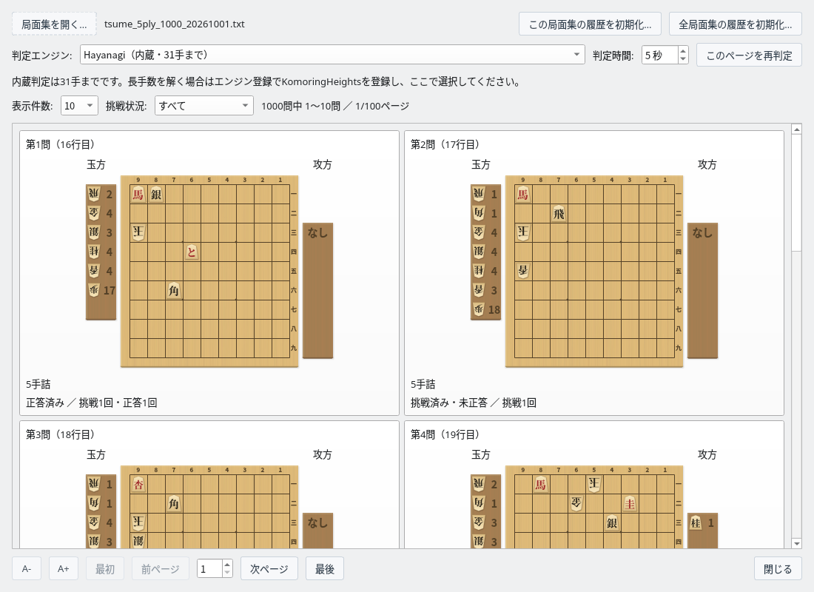
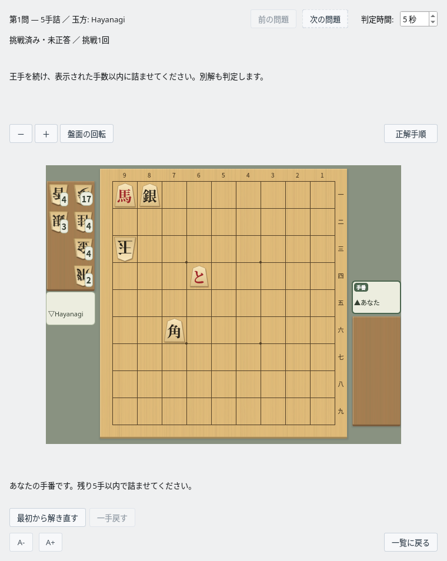
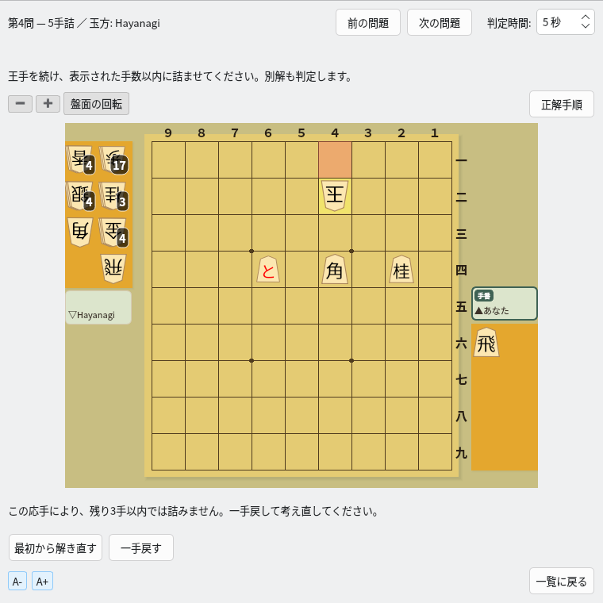
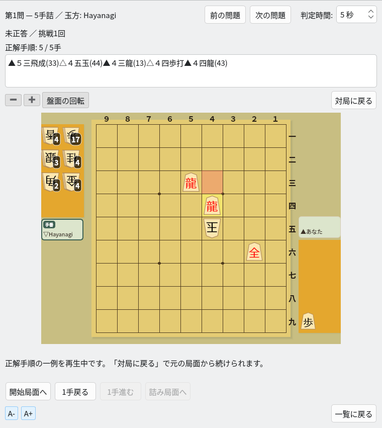

# 詰将棋対局

## 問題一覧から解く

「対局 → 詰将棋対局…」を開くと、最初に問題一覧が表示される。
「局面集を開く…」でファイルを選び、初期盤面のカードをクリックすると対局画面へ進む。

- カードには問題番号、元ファイルの行番号、初期盤面、攻方・玉方の持駒、詰み手数、挑戦状況を表示する。
- 表示件数は **10 / 20 / 50 / 100件**。最初・前・次・最後のページとページ番号で移動する。
  1000問を読み込んでも、盤面ウィジェットを作るのは現在のページだけ。
- 「すべて」「未挑戦」「挑戦済み・未正答」「正答済み」で絞り込める。
- 「一覧に戻る」で元のページ・絞り込み・スクロール位置へ戻り、履歴を更新する。
  絞り込み後に元のページがなくなった場合は最後のページへ移動する。
- 未検証の初期局面の判定は現在のページ内を1問ずつ実行する。検証済みの結果があれば再利用する。ページ変更や対局開始時には
  一覧の判定を中止し、選んだ問題を優先する。
- 確定した結果は「5手詰」などと表示する。未判定の参考手順は「参考手順: 5手・未検証」、
  手順なしは「手数未判定」と表示する。時間切れ・異常応答は「判定不能」とし、
  時間を増やして「このページを再判定」できる。不詰が確認できた問題は対局開始を無効にする。

一覧のウィンドウサイズ、ファイル、ページ、表示件数、絞り込み、判定エンジン、判定時間を
設定ファイルへ保存する。対局画面のウィンドウサイズと盤のマスサイズも保持する。
対局・問題一覧の下部にある A−／A＋で文字サイズを8〜24ptの範囲で1ptずつ変更できる。
文字サイズは画面ごとに保存し、問題一覧ではページ切替後のカードにも適用する。
盤は Ctrl+ホイールで拡大・縮小できる。

## 読み込める局面集と手数

1行1局面のファイルを読む。1行の規則は局面集ビューアと同じ `PositionCollectionFile`（`src/kifu/positioncollectionfile.h`）で、
`TsumeCollection::parse()` はこれを使う。

- 空行と `#` で始まる行は読み飛ばし、UTF-8 BOM・CRLF・タブ区切りを受け付ける
- 局面は SFEN の4語（前に `sfen` を付けてもよい）か `startpos`。前に `position` を付けた USI の position コマンドも受け付ける
- 局面の後には `moves <USI の指し手>` だけを続けられる。SFEN だけの行の `moves ...` は参考手順として分離し、開始局面へ適用しない。
  `position sfen ... moves ...`・`startpos moves ...` のような position コマンドの指し手は指した後の局面を問題にする
- 局面は `SfenValidator` で確かめる。余計な語・指し手の形でない語・指せない手がある行は読めない行（`invalidLines`）にする

攻め方の玉は省略できる。後手攻めでは盤を反転表示する。
余った駒を玉方へ補完せず、SFENに記載された持駒を使う。

**初期局面だけのファイルでも、参考手順付きのファイルでも、同じ方式で対局できる。**
ファイル名や参考手順の長さを正解手数とはみなさず、初期局面の解析結果、または同梱監査とファイル内容が一致した検証結果で出題する。
参考手順が101手でも、最短が短ければ確認した短い手数を表示する。
対局機能は唯一解を保証する検査ではなく、成立する別解も正解と認める。

komori-n氏が開発する **[KomoringHeights](https://github.com/komori-n/KomoringHeights)** を登録して一覧の「判定エンジン」で選ぶと、内蔵探索上限（`TsumePositionAnalyzer::kBuiltInMaxPlies` = 31手）や63手の探索上限を使わず、101手などの長手数も解析・対局の対象にできる。
エンジンが制限時間内に手数を確定できることが開始条件であり、あらゆる長編の完了を保証するものではない。
KomoringHeights未登録時は内蔵Hayanagiを選べるが、初期判定は従来どおり31手まで（`TsumePositionAnalyzer::kBuiltInMaxPlies`）。
技巧・通常のやねうら王を詰将棋の判定用エンジンとしては選択しない。
KomoringHeights自体は配布物に同梱せず、通常の「エンジン登録」で登録する。

## 対局と判定

対局画面の操作には通常画面と同じ `ShogiView` を使う。盤上の駒または持駒、移動先の順に
クリックして指し、成る手と成らない手のどちらも指せるなら主画面と同じ成りの確認（`PromoteDialog::ask()`。
「成る」「成らない」の2択で、閉じたときは成らない）を出す。王手でない手、二歩、打ち歩詰め、
自玉の王手放置は拒否する。
盤の上の「－」「＋」または盤上の Ctrl＋ホイールで盤を縮小・拡大できる。
「盤面の回転」で向きを切り替えられ、回転後も着手・正解手順の再生ができる。
盤の大きさと、攻方を下にした向きからの回転状態は次回の対局画面にも引き継ぐ。

**玉方の合法手生成・着手はHayanagi、詰み判定はKomoringHeights** が担当する。
KomoringHeightsに玉方として指す機能を要求せず、Hayanagiで列挙した各応手後の
「攻方の手番の局面」に対して `go mate` で問い合わせる。

- 全応手で残り手数以内の詰みが証明されたら、その中で最長に抵抗する応手を指す。
- 不詰が証明された応手を見つけたら、その手を指して詰みを防いだことを通知する。
- 指定手数を超えることが確認された応手を見つけたら、その手を指して手数超過を通知する。
  例えば5手詰の問題を7手で詰ませる手は「残り手数以内では詰まない」と判定する。
- 不詰・手数超過の通知は、玉方の応手を描画した **1秒後** に表示する。
  待機中に一手戻す・最初から解き直す・一覧へ戻る・閉じる操作をすると通知を取り消す。
- 時間切れ、探索中止、起動失敗、異常応答、未確認の応手が残る場合は不正解と断定しない。
  対局を保留し、時間を増やして「再判定」するか、「一手戻す」ことができる。
- 「一手戻す」は攻方の直前の着手前へ、「最初から解き直す」は出題局面へ戻す。
  最終王手後に合法な応手がなければ正答とする。
- 画面上部の「前の問題」「次の問題」で、一覧へ戻らずに隣の問題へ移る。
  移動順は一覧の絞り込み後の表示順で、ページ境界をまたいでも続けて移動できる。
  一覧の先頭・末尾ではそれぞれのボタンを無効にする。移動時は対局中の手順・保留中の判定・
  正解手順の再生を破棄し、対局画面で変更した判定時間は次の問題にも引き継ぐ。
  出題した問題はすべて挑戦として記録し、一覧へ戻ったときに履歴と判定結果を更新する。
  対局画面で変更した判定時間は、一覧へ戻ると一覧の判定時間になる（以後の判定・再判定に使い、
  一覧の設定 `TsumeCollection/timeout` に保存する）。判定時間の値は一覧だけが持ち、対局画面は保存しない。

判定時間は既定5秒、1〜600秒（範囲は `TsumeshogiSettings::CollectionPreferences::kMinTimeoutSec`・`kMaxTimeoutSec`。
一覧と対局画面の欄で共通）。玉方応手の確認では全候補で時間枠を共有する
（外部プロセスの起動・USI初期化には別途上限15秒がある）。
未完了の解析はページ変更・画面終了時にキャンセルし、古い結果が新しい局面へ適用されないようにする。
内蔵Hayanagi選択時は、Hayanagi の反復深化探索と、証明数探索の2つで判定と応手を行う（次の節）。

### 内蔵の判定: 手数つきの探索と証明数探索

内蔵Hayanagi選択時、攻方が指した後の局面は `TsumeDefenseSearch`（`src/analysis/tsumedefensesearch.{h,cpp}`）が判定する。
2つの探索を別々のワーカー（`QtConcurrent`）で同時に動かし、結果を `shogi::TsumeResult` で知らせる。

| 探索 | 求めるもの | 向かないこと |
|------|-----------|-------------|
| 手数つきの探索（Hayanagi の `shogi::TsumeSearch`。深さを延ばしながら全部の王手と応手を調べる） | 残り手数の中で詰むか、最長に抵抗する応手はどれか（`Mate`・`Limit`）。王手が続かなくなるまで調べきれれば不詰（`NoMate`） | 「何手かけても詰まない」ことの確認。長手数の問題で誤った手を指した後は、残り手数（30手など）の深さまで調べきれない |
| 証明数探索（`TsumeProofNumberSearch`。df-pn） | 何手かけても詰まないこと（`NoMate`）と、詰みを防ぐ応手 | 詰みまでの手数（詰みがあることは分かるが、最短とは限らない手順しか分からない） |

- 手数つきの探索が結論（`Mate`・`NoMate`・`Limit`）を出せば、それを使う（短い問題は従来どおりの応手と手数になる）。
- 証明数探索が先に「詰まない」と確かめたときは、手数つきの探索の結論を開始から 500 ミリ秒
  （`TsumeDefenseSearch::kExactSearchGraceMs`）まで待ち、出なければ手数つきの探索を止めて、証明数探索の応手で
  不詰（`Outcome::NoMate`）を知らせる。
- 証明数探索が「詰みがある」と確かめても、手数が分からないので対局には使わない。手数つきの探索が判定時間内に
  結論を出せなければ、従来どおり保留（`Outcome::Inconclusive`）にする。

`TsumeProofNumberSearch`（`src/analysis/tsumeproofnumbersearch.{h,cpp}`）は、結論に近い局面から調べる。
不詰の結論は「攻方に王手が無い」と「手順の途中の局面に戻る」の2つだけから組み立てる（詰みがあるなら、同じ局面を
繰り返さない詰みの手順があるので、どちらも詰みのある局面では成り立たない）。

- 局面に戻ることに頼った不詰は、頼った局面が今の手順にある間だけ使う。別の手順から来た同じ局面に使うと、
  詰む局面を不詰と誤る（GHI 問題）。頼っている局面が無くなった不詰だけを、どの手順から来ても成り立つ結論として表に書く。
- 結論の出ていない見積もり（証明数・反証数）は、深さごとに分けて覚える。手順が輪になる局面で見積もりどうしが
  互いを数え合い、数字だけが際限なく増えて探索が進まなくなるのを防ぐ。
- 深さの上限（256手）に達した局面は詰みと仮定する。不詰の結論はこの仮定の下でも成り立ち、仮定を使った探索は
  「詰みがある」を返さない。
- 表は 64MB まで。一杯になったら見積もりを捨てて続け、結論だけで半分を超えたら「分からなかった」で終える。

同梱の問題集での実測（Release ビルド。2026-11-28）:

- 31手詰の先頭300問で、正解以外の初手809手のうち808手を「詰まない」と判定した（平均0.02秒。残る1手は28秒）。
  手数つきの探索は、第35問の ４三金-３三・４三金-４四・３六成桂-３五 を5秒では判定できなかった。
- 詰むと分かっている局面（9・19・31手詰の開始局面と正解手順の途中。13800局面）で、誤って「詰まない」と
  した例は無い。
- 3〜31手詰の8つの問題集で、正解手順の上の攻方の手番ごとに正解以外の王手を調べた18799局面のうち、
  手数つきの探索も結論を出せた15436局面で、結論の食い違いは無い。証明数探索が返した応手（17891手）の後の局面に、
  手数つきの探索で詰みが見つかった例も無い。
- 盤の空いた短手数の問題（玉方の持ち駒が多く、合駒の多い局面）では、証明数探索は1手に数秒かかることがある。
  その長さの問題は手数つきの探索がすぐに結論を出すので、対局には影響しない。

### 手順が分かっている間は応手を探索しない

開始局面の判定に詰みまでの手順が付いているとき（同梱監査と一致した問題集の正解手順、判定エンジンが返した手順、
「正解手順」の取得で保存された内蔵探索の手順）、`TsumeGameSession` はその手順を覚え、**開始局面からの手がすべて
手順と同じ間は、応手を探索せずに手順の次の手を玉方の応手として指す**（`TsumeGameSession::knownReply()`。
残り手数は手順の残りの長さ）。判定エンジンが内蔵でも KomoringHeights でも同じ。

長手数の問題では、正解の手を指した後の玉方の局面を1手ごとに調べ直すと判定時間に収まらない。
31手詰の第35問（`tsume_31ply_1000_20261127.txt`）は、初手 ３五と の後の局面を内蔵探索が20秒では決められず
（4スレッドで約10分・約31億局面でも未確定）、正解の手を指しても対局が進まなかった。

- 攻方の手を手順との一致で採点するのではない。手順を外れた手（別解・誤った手）は上の方法で探索して判定し、
  成立する別解は正解と認める。
- 手順を外れた後の局面では手順を使わない。「一手戻す」で手順の上の局面に戻れば、また手順の応手を指す。
- 手順の応手は、着手の処理（`play()`）から戻った後に指す（盤は攻方の手を示してから玉方の手を示す）。
- 手順の付かない判定結果（内蔵探索が手数だけを確定した問題）は、従来どおり毎手探索する。
- 長手数の問題で手順を外れた誤った手は、証明数探索が「詰まない」ことを確かめて、詰みを防ぐ応手を指す
  （前の節）。手順を外れても詰みがある手（別解や、残り手数より長い詰み）は、手数つきの探索が判定時間内に
  手数を決められなければ保留にする（不正解とは断定しない）。

## 正解手順の再生

対局画面の「正解手順」ボタンを押すと、盤の上の案内文を日本語表記の棋譜と再生手数に切り替え、
盤の下の対局操作欄を再生操作に切り替える。通常の対局中は棋譜・再生ボタンを隠す。
案内文と棋譜は同じ高さの領域を共有し、盤上の「正解手順」は同じ位置・サイズの「対局に戻る」に切り替わる。
操作欄も両モードの必要サイズを確保するため、表示切替で盤面や共通ボタンの位置は変わらない。
棋譜は長手数でもスクロールして全文を確認・コピーできる。
初期判定で詰み手数が確定すると操作でき、対局の応手を探索している間は無効になる。

| ボタン | 操作 |
|---|---|
| 開始局面へ | 正解手順の初期局面を表示 |
| 1手戻る | 攻方・玉方を区別せず1手だけ戻る |
| 1手進む | 正解手順を1手進める |
| 詰み局面へ | 正解手順の最後の局面を表示 |
| 対局に戻る | 棋譜・再生ボタンを隠し、再生前の対局局面・残り手数・待ったの履歴へ戻る |

再生中は盤面を閲覧専用にし、表示中の手数を「1 / 5手」のように表示する。
通常対局の「一手戻す」「最初から解き直す」は再生中には表示しない。再生するだけでは
挑戦回数・正答回数を増やさない。新しい挑戦を始めるには「対局に戻る」の後に「最初から解き直す」を押す。
文字サイズと「一覧に戻る」は、どちらのモードでも最下段の同じ位置に表示する。

対局と正解手順の再生は `TsumePlayDialog` の `enum class Mode { Playing, Reviewing }` で持ち、
部品の有効・無効は `controlStates()` の表1か所で決めて `applyControlStates()` で部品に当てる
（切り替える欄の表示もここで合わせる）。

| 部品 | 対局（`Mode::Playing`） | 正解手順の再生（`Mode::Reviewing`） |
|---|---|---|
| 最初から解き直す | 問題を開いているとき | 無効 |
| 一手戻す | 戻せる手があるとき（`TsumeGameSession::canUndo()`） | 無効 |
| 探索中止 | 応手の探索中（`State::Thinking`）だけ表示 | 正解手順の取得中だけ表示 |
| 再判定 | 判定を保留したとき（`State::Paused`）だけ表示 | 取得を終えても正解手順が無いときだけ表示 |
| 正解手順 | 詰み手数が分かり、応手の探索も正解手順の取得もしていないとき | （同じ位置の「対局に戻る」に切り替わる） |
| 開始局面へ・1手戻る | （再生の操作欄は隠す） | 正解手順があり、1手目以降を表示しているとき |
| 1手進む・詰み局面へ | （再生の操作欄は隠す） | 正解手順があり、最後の手より前を表示しているとき |
| 対局に戻る | （「正解手順」を表示） | 常に有効 |

選択中の判定エンジンで検証した手順、または同梱監査と内容が一致した問題集の検証済み手順を使う。
初期局面だけのファイルにも対応し、KomoringHeightsの検証済み手順はキャッシュから再利用する。
内蔵Hayanagiの場合は最短の攻手と最長に抵抗する応手を順に探索して手順を取得する。
初回取得は非同期で行い、時間切れなら判定時間を増やして「再判定」できる。
「探索中止」「対局に戻る」「一覧に戻る」は取得中にも操作できる。
「探索中止」は探索中だけ、「再判定」は判定をやり直せるときだけ表示する。
問題の変更や画面終了後に、古い再生結果が盤面へ適用されることはない。

## 履歴とキャッシュ

SQLiteをQt SQLの `QSQLITE` ドライバで利用する。配布スクリプトはQt SQLとSQLiteドライバの
同梱を確認するので、配布版の利用者がSQLiteサーバーやコマンドを別途入れる必要はない。
ソースからのビルドではQt SQLとそのSQLiteドライバが必要。

| 保存先 | 内容 | 増加の扱い |
|---|---|---|
| 既存設定ファイル | 画面サイズ、表示件数などのUI設定 | 問題ごとの記録は保存しない |
| `QStandardPaths::AppDataLocation/tsume_progress.sqlite` | 挑戦回数、正答回数、最終挑戦・正答日時 | 1局面1行の集計。各回の棋譜やイベント履歴は保存しない |
| `QStandardPaths::CacheLocation/tsume_cache.sqlite` | 確定した詰み手数・手順または不詰、エンジン識別情報 | 最大10000件、DB本体64 MiB。古い結果から削除 |

問題の識別子には、Hayanagiで正規化した盤面・手番・持駒を使用し、SFENの手数カウンターは含めない。
同一局面はファイル名・場所・行番号・参考手順が変わっても、また別ファイルに重複していても履歴を共有する。
先後や持駒が違う局面は別問題として扱う。

一覧の閲覧や自動解析だけでは挑戦回数を増やさない。対局を開いて初期判定が確定し、
指せる状態になった時点で1回記録する。「最初から解き直す」は新しい挑戦として数え、待った・再判定は同じ挑戦に含める。
正答は1挑戦につき1回だけ記録し、再挑戦中の失敗や中断で過去の正答済み状態は消さない。
記録は対局の `TsumeGameSession` が付ける。`setState()` で、`start()` の後に初めて攻め方の手番（`State::Ready`）になったときに
挑戦（`TsumeProgressStore::recordAttempt()`）、詰ませた（`State::Solved`）ときに正答（`recordSolved()`）を、どちらも `start()` ごとに1回だけ記録する
（知らせる前に記録するので、受け手は記録後の履歴を読める）。記録先は `configureEngine(path, store)` で渡し、問題の識別子は
`TsumeCollection::positionId()` で開始局面から作る。`TsumePlayDialog` は履歴を表示するだけで、記録はしない。
履歴DBへの保存に失敗した場合は画面に表示する。

一覧上部の「この局面集の履歴を初期化…」は、ページ・絞り込みに関係なく、開いている局面集の
全問題を未挑戦に戻す。「全局面集の履歴を初期化…」は過去に開いたすべての局面集の履歴を消す。
どちらも確認画面を表示し、挑戦・正答回数と最終日時を削除する。同一局面は履歴を共有するため、
現在の局面集のみの初期化でも他の局面集に重複する同一局面へ反映される。
初期化は解析キャッシュを保持し、成功後に一覧と絞り込みを更新する。削除に失敗した場合は
履歴を部分的に消さず、エラーを表示する。

キャッシュの削除・容量制限は挑戦履歴に影響しない。時間切れなどの判定不能は永続キャッシュしない。
外部エンジンの実行ファイルのSHA-256、絶対パス、判定オプションの版をキーに含め、
外部エンジンを更新すると以前の結果を再利用しない。内蔵コアを更新する開発者は
`TsumePositionAnalyzer` の内蔵キャッシュ識別子も更新する。外部エンジンの詰み手順は初期解析・キャッシュ読出し時に
Hayanagiで合法性・連続王手・最終詰みを検証する。確認済みの読出し結果はメモリにも最大1000件保持し、
同じ問題の一覧・対局開始・正解手順の再生で、ストア読出し時のSQL照会と手順検証を省く。
更新・削除時にはメモリの対応する結果も無効にする。

### 読み込みの軽量化と適用範囲

問題集は引き続きテキスト形式で扱う。次の改善は、同梱・公開した問題集以外にも適用される。

- `TsumeCollection::parse()` が1行を `PositionCollectionFile::parse()` で読み、SFENの構文検査と同時に正規化した局面識別子を返す。
  一覧はその識別子を使い、履歴照会のために全局面のSFENを再解析しない。
- `TsumeProgressStore::progress(QStringList)` が重複を除いた識別子を最大500件ずつSQLで照会する。
  1000題の異なる局面なら、履歴のSELECTは1000回から2回になる。正答後などの更新時には再取得する。
- 確定した解析結果を局面とエンジンの識別子で再利用する。一般の問題集は最初の解析が必要で、
  再表示・対局開始などで得られたキャッシュを利用する。参考手順が付いているだけでは検証済みと扱わない。

公開している3〜31手詰・各1000題（計15,000題。配布パッケージ同梱は3〜13手詰の6000題、15〜31手詰の9000題はリポジトリの `data/tsumeshogi/` および利用ガイドから取得可能）には、初回の探索も省ける仕組みを設けている。
`resources/tsumeshogi.qrc` に次の3つの監査記録を埋め込み、いずれかの記録で読込ファイル全体のSHA-256、件数、最短手数の確定件数、不要駒・判定不能0件、監査方式がすべて一致した場合だけ採用する（`TsumeCollection::verifiedMateLength()`）。

- `data/tsumeshogi/validation_20260926.json`（3〜13手詰の旧版。ファイル本体はリポジトリ未収録だが旧版ファイルの読み込み互換用に監査記録を保持）
- `data/tsumeshogi/validation_20261001.json`（3〜13手詰の駒余り検査・差し替え版。Hayanagi独立最短探索＋最終手複数解許容）
- `data/tsumeshogi/validation_long_20261127.json`（15〜31手詰の9000題。KomoringHeights `MinLength` の `go mate infinite` 自然終了・最終手複数解禁止・駒余り禁止）

新しい版を公開したときは、その版の監査記録を `resources/tsumeshogi.qrc` と `TsumeCollection` の `trustedCollectionReports()` に追加し、`tst_tsume_play` の `verifiedCollections` に版を加える。
そのファイルの最短手数と手順は選択エンジンに依存しない事前検証結果としてメモリに登録し、
手順の合法性を初回利用時にも確認する。対局中の応手と別解は、従来どおり実際の局面を解析して判定する。

改名・移動してもファイル内容が同じなら有効だが、問題の追加・削除・並べ替えやコメント・改行の変更でも
SHA-256が変わるため通常の解析に戻る。ファイル名や外部のJSONによる自己申告では探索を省略しない。
今後別の問題集で初回探索を省略するには、同様の監査記録を確認してアプリの同梱記録を更新し、再ビルドする。
既存の通常キャッシュがあれば、内容を変更したファイルでも同一局面の結果は再利用できる。

「このページを再判定」は、選択中のエンジンについて通常キャッシュと同梱監査結果の利用を解除し、
ページ内を実際に探索し直す。解除はその問題集を再読込するまで保持し、新たに確定した解析結果は再利用する。
この処理でも挑戦・正答履歴は消さない。

## 実装構成

- `TsumeCollectionDialog`: 問題カード、ページと絞り込み、ページ内の順次解析。
- `TsumePositionPreview`: 表示中のページにのみ作る、軽量な盤面・持駒表示。
- `TsumePlayDialog`: 入力と画面の動作（`Mode`）、部品の有効・無効の表（`controlStates()`）、成りの確認（`PromoteDialog::ask()`）、挑戦履歴の表示。
- `TsumeGameSession`: 対局状態、応手選択（分かっている手順の上では手順の応手、外れた手は探索）、保留・待った、挑戦・正答の記録（`TsumeProgressStore`）。
- `TsumeDefenseSearch`: 内蔵の判定（攻方が指した後の局面の、玉方の応手と詰みまでの手数）。手数つきの探索と証明数探索を別々のワーカーで動かし、結果を1つにする。止めた探索は終わるのを待たずに捨てる。
- `TsumeProofNumberSearch`: 証明数探索（df-pn）。王手の連続で詰むか・詰まないかを調べる（Qt を使わない。局面は Hayanagi の `shogi::Position`）。
- `TsumeSolutionReplay`: 検証済みの正解手順の取得と、対局状態から独立した手順再生。
- `TsumeMateEngine`（`src/analysis/tsumemateengine.{h,cpp}`）・`TsumeEvaluation`（`src/analysis/tsumeevaluation.h`）: ほかの詰み探索と同じ `MateOracle`（`UsiEngineSession` で USI の手順と設定を送る）の `askWithin()` で動かす詰み判定と結果表現。`TsumePositionAnalyzer`（`kBuiltInMaxPlies = 31`）: 判定方式選択とキャッシュ。
- `TsumeProgressStore`: 設定ファイルとは独立したSQLite集計と解析キャッシュ。
- `TsumeshogiSettings`（`src/services/tsumeshogisettings.h`）: UI設定を保存する。文字サイズは宣言の表の `Setting<int>`（`tsumePlayFontSize`・`tsumeCollectionFontSize`）、盤の大きさ・向きや最後に開いたファイルなど複数のキーをまとめる項目は構造体の宣言 `StructSetting`（`playPreferences` / `collectionPreferences`。読むのは `playPreferences()`、書くのは `playPreferences.set(...)`。保存していない項目は `PlayPreferences`・`CollectionPreferences` の既定値）。最後に開いたファイルは問題一覧だけが持ち、`lastCollectionFile()` が以前の版の `TsumePlay/file` も読む（解く画面の `lastFile`・`problemIndex` は消した）。

KomoringHeightsは `PostSearchLevel=MinLength`、`GenerateAllLegalMoves=true`、
`RootIsAndNodeIfChecked=false` を必須とする。エンジンには登録済みの設定（スレッド数・ハッシュなど、
エンジン設定ダイアログで変えたもの）を送り、そのうえで最短手数の確認に必要な
`PostSearchLevel=MinLength`、`GenerateAllLegalMoves=true`、`RootIsAndNodeIfChecked=false`、
`NodesLimit=0`、`MultiPV=1` を、この接続に限って上書きする（`UsiProtocolHandler::setSessionOptions`）。
登録済みの設定そのものは変えない。2026-10-13 までは `Threads=1`、`USI_Hash=256` も固定で送っていたので、
利用者が設定したスレッド数とハッシュが使われていなかった。

KomoringHeights 1.1.0では最短化の途中で時間制限に達しても発見済み手順を返す場合があるため、
`go mate infinite` を送り、期限（`MateOracle::askWithin()`）までに答えなければ stop を送らずに打ち切る。自然終了した結果だけを確定とし、
停止・時間切れ時の部分的な読み筋を最短手数として採用しない。
[KomoringHeightsのオプション](https://github.com/komori-n/KomoringHeights/blob/main/source/engine/user-engine/docs/EngineOptions.txt)
と [USI仕様](https://shogidokoro2.stars.ne.jp/usi.html)を参照。

Hayanagiの `Position` と内蔵探索コアはサブモジュールから静的リンクする。
今回、Hayanagiサブモジュール側のソース・参照コミットは変更していない。
独立したUSI実行ファイルも `build/Hayanagi/hayanagi` に生成される。

## 画面例









## Hayanagiの管理と更新

`Hayanagi/` は [独立したHayanagiリポジトリ](https://github.com/hnakada123/Hayanagi) を
参照するGitサブモジュール。導入時の参照先は、詰将棋対応を含む
`30cfce58e0a863f9f2d2144635f1d9e9d4e3e54f`。
ShogiBoardQにはHayanagiのソースをコピーして登録せず、検証済みコミットのIDを記録する。
ビルドではそのソースから詰将棋コアとUSI実行ファイルを生成する。

新しく取得するときは `git clone --recurse-submodules` を使用する。
既存のcloneやShogiBoardQの更新後は、リポジトリ直下で次を実行する。

```bash
git submodule update --init --recursive
git submodule status
```

Hayanagiの開発は独立した作業ディレクトリ（例: `/home/nakada/GitHub/Hayanagi`）で行い、
テストしてHayanagi側へコミット・pushする。その後、ShogiBoardQ側で採用する版を指定する。
以下の `30cfce5` は例なので、採用するコミットIDに置き換える。

```bash
git -C Hayanagi fetch origin
git -C Hayanagi checkout --detach 30cfce5
cmake -B build -S . -DBUILD_TESTING=ON
cmake --build build
ctest --test-dir build --output-on-failure
python3 Hayanagi/tests/test_engine.py build/Hayanagi/hayanagi
git add Hayanagi
git commit -m "Hayanagiの参照コミットを更新"
```

サブモジュールは通常、ブランチから離れた状態（detached HEAD）で固定する。
独立リポジトリへのpushだけではShogiBoardQの使用版は変わらず、上記の参照更新が必要。
通常の取得には `git submodule update --init --recursive` を使用し、
`--remote` による最新版への自動追従は行わない。

## 検証

```bash
cmake -B build -S . -DBUILD_TESTING=ON
cmake --build build -j 4
ctest --test-dir build --output-on-failure
python3 tests/gui/prepare.py
xvfb-run -a build/gui-audit/test-build/tst_tsume_play_gui
xvfb-run -a build/gui-audit/test-build/tst_tsume_collection_gui
# 任意: 実際のKomoringHeightsによる同じ応手検証
env SHOGI_REAL_KOMORING=/path/to/KomoringHeights build/tests/tst_tsume_play externalDefense
```

`tst_tsume_play` は5問、参考手順あり・なし、別解、不詰、手数超過、後手攻め、打ち歩詰め、
形式不正、外部USI応答の検証、中止と再判定、永続履歴、キャッシュ分離を検証する。
読み込みの軽量化については、正規化識別子、1003件の履歴一括取得、収録全15ファイル・15,000題（20261001版の3〜13手詰6000題および20261127版の15〜31手詰9000題）の同梱監査との照合と手順合法性、
ファイル変更時の無効化、起動できないエンジンでも可能な検証済み結果の再利用、明示的な再判定を確認する。
外部エンジンの異常・遅延応答は専用のテスト用実行ファイルで再現する。
`tst_tsume_defense_search` は内蔵の判定を検証する: 証明数探索が、正解手順の上の局面を詰み、31手詰の正解以外の初手を
不詰（返した応手の後も不詰）とすること、手数つきの探索の結論と食い違わないこと、王手が続くだけの局面・打ち歩詰めを
詰みとしないこと、中止と時間切れ。`TsumeDefenseSearch` が、短い問題では手数つきの探索の結論を使い、長手数の問題の
誤った手を判定時間を待たずに不詰と知らせること、止めた探索の結果を知らせないこと。対局（`TsumeGameSession`）が、
31手詰の第35問の誤った初手に応手を指して不正解を知らせ、一手戻すと正解手順の上に戻ること。
`tst_tsume_play_gui` は盤クリック・成り選択・駒打ち・応手後1秒の結果表示を確認する。
正解手順の再生は内蔵・外部判定の両方で検証し、GUIでは各移動ボタン、途中対局への復帰、
再生中の着手禁止、正答履歴の不変、中断後の遅延応答破棄を確認する。
文字サイズ10・12・16・24ptで対局と正解手順を繰り返し切り替え、盤面の全描画フレームと
共通ボタン・切替ボタンの位置・サイズが変わらないことを検証する。
着手と玉方の応手では盤全体を描き直さず、変わった所だけを描き直しても画面が正しいことも確認する。MCPテストでも実際のボタンクリックと座標比較を行う。
`tst_tsume_collection_gui` は1003問、各ページサイズ、末尾ページ、絞り込み、
閲覧時の履歴不変、対局開始・正答時の記録、一覧への復帰、絞り込み順での前後の問題への移動を確認する。
同梱監査と内容が一致するファイルでは、改名後も初期探索なしで手数を表示し、編集後や再判定では通常の解析に戻ることも確認する。
